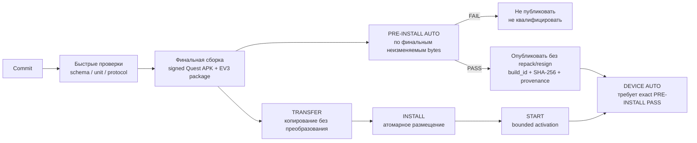

# PHANTOM — разработка, сборка и развёртывание

> **Роль:** Нормативные правила разработки, CI, build/deploy, совместимости конфигурации, release engineering, logs и observability.
> **Владелец правил:** см. [`README.md`](README.md).


---

<a id="sec-8"></a>
# 8. Разработка, сборка и развёртывание

<a id="sec-8-1"></a>
## 8.1. Структура репозитория

```text
phantom/
├── AGENTS.md                       # правила для AI-агентов (canonical)
├── ARCHITECTURE.md
├── .agents/skills/                 # canonical repo skills
├── PhantomQuest/                   # Unity-проект Quest
│   └── Assets/Plugins/Android/     # androidlib: NSD bridge + credential store
├── ev3/
│   ├── include/, src/, safety/, tests/   # production controller/supervisor
│   ├── network/                     # phantom-network, phantom-mdns
│   └── bench/                       # НЕ production: характеризационный harness
├── protocol/
│   ├── wire_schema.yaml             # normative Quest↔EV3 wire source
│   ├── ipc_schema.yaml              # normative EV3-local IPC source
│   ├── jcs.py                       # RFC 8785 канонизация (общая для всех компонентов)
│   ├── phantom_protocol.py          # reference codec
│   ├── protocol.md                  # generated wire mirror
│   ├── generated/                   # generated constants/layout/canonical/hashes
│   └── golden_vectors/              # wire, IPC и JCS фикстуры
├── config/
│   ├── schema/, source/, generated/
├── tools/
│   ├── specgen.py, docindex.py, doclint.py
│   ├── protocolgen.py, configgen.py, build_identity.py
│   ├── artifact_check.py, security_scan.py, spec_contract_check.py
│   ├── toolchain.ps1                # единая точка обнаружения host-инструментов
│   ├── test_*.py                    # deterministic регрессии
│   ├── quest_validation/, ev3_validation/
├── sim/                             # PC-симулятор EV3 и tracking replay
├── deploy/                          # systemd units, tmpfiles, install/device-auto
├── scripts/                         # build/test/package/device/provisioning
├── toolchains/
│   ├── ev3dev-stretch.lock.json     # pinned cross image/compiler
│   └── host-tools.json              # объявленные host-инструменты и override-переменные
├── mechanical/                      # BOM, сборка, safety inspection
├── results/                         # локальные runner outputs; Git-ignored
├── docs/
│   ├── PHANTOM_SPECIFICATION.md     # generated spec-set manifest
│   └── PHANTOM/
│       ├── README.md
│       ├── SECTION_INDEX.md         # generated navigation index
│       ├── spec-set.json
│       ├── SPECIFICATION_GOVERNANCE.md
│       ├── PRODUCT_REQUIREMENTS.md
│       ├── SYSTEM_ARCHITECTURE.md
│       ├── QUEST_SPECIFICATION.md
│       ├── EV3_SPECIFICATION.md
│       ├── MECHANICAL_SPECIFICATION.md
│       ├── PROTOCOL_SPECIFICATION.md
│       ├── SAFETY.md
│       ├── ENGINEERING.md
│       ├── TEST_PLAN.md
│       ├── IMPLEMENTATION_STAGES.md
│       ├── REFERENCE.md
│       ├── REFERENCES.md
│       ├── CHANGELOG.md
│       ├── implementation-map.json  # requirement → stage → status → verification
│       ├── decisions/
│       ├── exec-plans/
│       ├── risks/
│       └── status/
├── README.md
└── .github/workflows/
```

`ev3/bench/**`, `scripts/ev3-bench-*` и `tools/ev3_validation/**` являются **инженерной
оснасткой вне production и вне safety-периметра**: собственная разводка портов, прямые
`run-direct` записи и собственная привилегированная модель. Их результаты никогда не являются
DEVICE/HIL evidence production-сборки. `deploy/scripts/install-release` удаляет
`/etc/sudoers.d/phantom-ev3-bench` перед установкой и отказывается продолжать, если правило
не удалось убрать: NOPASSWD root на writable для `robot` путь обходит разделение
`phantom-ctrl`/`phantom-net`, на котором построена часть safety-аргументации §7.2.2.

`results/**` является локальным/CI workspace для machine-readable runner outputs и полностью
игнорируется Git. Требуемое долговечное PRE-INSTALL/DEVICE/HIL/release evidence публикуется
как immutable CI/release artifact; status/release record хранит его URI, SHA-256 и candidate
identity, но не копирует raw logs в историю исходников.

<a id="sec-8-1-1"></a>
### 8.1.1. Среда разработчика

Host-инструменты объявлены в `toolchains/host-tools.json` и разрешаются единственным модулем
`tools/toolchain.ps1`; абсолютные пути не дублируются по скриптам. Каждый инструмент имеет
override через переменную окружения:

| инструмент | зачем | override | по умолчанию |
|---|---|---|---|
| Unity Editor | Quest build, EditMode tests, Roslyn/mono для host-компиляции | `PHANTOM_UNITY_ROOT` | Hub-путь для версии из `PhantomQuest/ProjectSettings/ProjectVersion.txt` |
| `adb` | Quest DEVICE AUTO и provisioning | `PHANTOM_ADB` | platform-tools из Unity Android SDK, затем `PATH` |
| WSL distribution | host-сборка и sanitizers EV3 | `PHANTOM_WSL_DISTRO` | `Ubuntu` (нужны `cmake`, `ninja-build`, `g++`) |
| Docker | pinned ARMv5TEJ cross image | — | образ по digest из `toolchains/ev3dev-stretch.lock.json` |
| Git Bash | POSIX-скрипты bench | `PHANTOM_GIT_BASH` | `C:\Program Files\Git\bin\bash.exe` |

Версия Unity закреплена самим проектом (`ProjectVersion.txt`), а не скриптом: скрипт ищет
именно её и завершается с понятным сообщением, если она не установлена.

<a id="sec-8-2"></a>
## 8.2. Общие правила исходного кода

Репозиторий должен обеспечивать:

- единый источник описания wire-протокола;
- единый источник схем конфигурации;
- автоматическое создание канонического хэша конфигурации; derived hash никогда не входит в байты, которые он хэширует;
- отсутствие вручную дублируемых числовых констант между Quest и EV3 там, где они должны совпадать;
- тестируемое разделение чистой математики и SDK/I/O адаптеров;
- невозможность случайно включить секретный ключ в исходники или артефакт логов;
- детерминированный `protocol_schema_hash`: schema pipeline сначала преобразует `wire_schema.yaml` в canonical JSON projection (`wire_schema.canonical.json`, RFC 8785 JCS), и SHA-256 считается именно по этим bytes; checkout line endings YAML не влияют на identity;
- детерминированный `specification_sha256`: SHA-256 по **точным bytes** generated `docs/PHANTOM_SPECIFICATION.md`. Все нормативные Markdown и сам manifest обязаны быть UTF-8 без BOM с LF line endings; gate отвергает другую encoding/line-ending форму и не выполняет hidden normalization. Manifest содержит ordered path+exact-byte-SHA-256 каждого нормативного документа из `docs/PHANTOM/spec-set.json`, поэтому один существующий wire hash транзитивно связывает весь normative spec set. Current status, task execution plans, ADRs, risk records, changelog и `REFERENCES.md` в manifest не входят. Manifest генерируется `tools/specgen.py`; ручное редактирование запрещено.

<a id="sec-8-3"></a>
## 8.3. Симулятор EV3

До подключения физической механики должен существовать PC-симулятор, реализующий тот же сетевой протокол и state model.

Симулятор должен уметь:

- отвечать на `HELLO/HELLO_ACK`;
- публиковать/имитировать обнаруживаемый `robot_id`;
- выдавать `CALIBRATION_SAMPLE` с raw отсчёты энкодера;
- принимать `SET_JOINT_REFERENCE`;
- имитировать валидную/невалидную `DriveCalibration`;
- принимать `COMMAND` и выдавать `TELEMETRY`;
- моделировать q_ref shaping и безопасные границы;
- моделировать stall, потерю/инвалидацию reference, maintenance lock после подозрения на проблему передачи, gripper contact и gripper fault;
- имитировать latency/loss/reordering/duplicate packets;
- менять `controller_boot_id` и IP сетевой адрес;
- воспроизводить `SAFE_HOLD`, `STOPPED`, latched fault overlays (`STOPPED + fault_code`) и recovery.

<a id="sec-8-4"></a>
## 8.4. Повторное воспроизведение отслеживания

Инженерный инструмент `tracking-replay` должен уметь записывать и воспроизводить:

```text
head pose для XR lifecycle
Body_RightShoulder pose + validity/quality/fidelity + sample_or_query_time + receive time + timing uncertainty
Wrist pose + validity/quality + sample_or_query_time + receive time + timing uncertainty
степень сжатия + валидность
Left Grip / валидность Controller
receive timestamps / frame ids
```

Запись включается явно. Воспроизведение должно проходить через те же алгоритмы калибровки, отображения движения, рабочей области и IK, что и реальные данные.

<a id="sec-8-5"></a>
## 8.5. Непрерывная интеграция

CI разделяется на быстрые проверки исходного кода, сборку артефактов и обязательный post-build gate §9.1.2. Артефакт не считается разрешённым к установке только потому, что компиляция завершилась успешно.



До и во время сборки выполняются быстрые проверки, чтобы раньше обнаруживать ошибки. После
сборки `PRE-INSTALL AUTO` повторно выполняет набор, необходимый для публикации и qualification
конкретных artifact bytes. BUILD, TRANSFER и INSTALL не читают предыдущие result-файлы:
инженер может установить явно выбранный артефакт для диагностики, но такая установка сама по
себе не создаёт DEVICE/HIL/Release evidence и не расширяет motor authority.

Соотношение двух исполнителей зафиксировано явно, иначе «CI зелёный» и «установка разрешена»
означают разное:

- **`scripts/pre-install-auto.ps1`** — полный gate на рабочей станции разработчика/релиза. Он
  авторизует публикацию и последующую qualification, и потому обязан включать проверки
  актуальности specification manifest и section index (`specgen --check`, `docindex --check`,
  `doclint`). Без них отчёт мог бы объявить `specification_sha256`, который фактически не
  покрывает текущие нормативные документы. Требует Unity, Docker и WSL на рабочей станции,
  но ничего не устанавливает на Quest/EV3 и не обращается к ним.
- **`.github/workflows/ci.yml`** — максимально возможное **детерминированное подмножество**
  того же набора: identity/lint, все generated artifacts, canonicalization, protocol и IPC
  cross-implementation vectors, config-boundary тесты, регрессии shipped EV3 worker и
  device-auto runner, анализаторы отчётов, статические Quest-контракты, provisioning audit,
  host-сборка EV3 с sanitizers и оба on-host self-test. Вне CI остаётся только то, что
  требует Unity, Windows-Docker или физического устройства.

Проверка, добавляемая в PRE-INSTALL, обязана быть добавлена и в CI, если она детерминирована и
не требует Unity/устройства.

Обязательные проверки включают:

- JSON Schema конфигураций;
- C#↔C++ эталонные протокольные векторы;
- HMAC эталонные векторы;
- IK/FK тесты свойств;
- тесты абсолютного shoulder-relative mapping;
- тесты преобразования координат;
- тесты QR-геометрии и QR↔encoder calibration на синтетических данных;
- тесты автомата состояний;
- fuzz парсера протокола;
- host-native C++ тесты EV3 core и `MockMotorBackend`;
- ARM/armel кросс-сборку;
- Unity EditMode/PlayMode и доступные simulator/spatial tests;
- проверку `Release` и `Diagnostic` профилей;
- проверку lock-файлов пакетов;
- поиск секретов;
- проверку, что сгенерированные файлы соответствуют источникам;
- проверку метаданных, архитектуры, обязательных файлов и SHA-256 готовых артефактов.

CI публикует отчёт `PRE-INSTALL AUTO` как отдельный immutable artifact вместе с provenance
commit, component/profile-specific `build_id` и SHA-256 артефактов. Без успешного отчёта build
не допускается к DEVICE/HIL/Release qualification, однако это не блокирует явную инженерную
установку при остановленном runtime.

После PASS байты проверенных APK/EV3 package являются immutable для данного evidence: последующая подпись, repack, изменение manifest внутри артефакта или иная byte-level модификация требует нового `build_id`/artifact SHA-256 и повторного PRE-INSTALL. Post-gate разрешено только публиковать внешние provenance/signature metadata, которые не меняют проверенный artifact.

<a id="sec-8-5-1"></a>
### 8.5.1. Границы фаз и место выполнения инструментов

Каждая фаза имеет одного владельца результата и не запускает предыдущую или следующую фазу
неявно. Фаза проверяет фактический input/device state, а не наличие result-файла предыдущей
фазы. Отсутствующий артефакт, staging directory или установленный runtime означает быстрый
`FAIL`, а не автоматическую пересборку, установку или квалификацию.

| Фаза | Где выполняется | Разрешённая работа | Запрещённая скрытая работа |
|---|---|---|---|
| `BUILD` | PC/CI | компиляция, подпись, упаковка; создание immutable APK/EV3 package и manifest | доступ к устройствам, установка, DEVICE/HIL |
| `PRE-INSTALL AUTO` | PC/CI | тесты и admission уже созданных final bytes; отчёт с identity/hashes | пересборка, resign/repack, ADB/SSH deployment |
| `TRANSFER` | PC→устройство | копирование во staging и сверка end-to-end SHA-256 | распаковка/activation, запуск services/app, тесты |
| `INSTALL` | устройство | hash/schema validation, атомарное размещение и выбор версии при запрещённом motion | чтение PRE-INSTALL/TRANSFER reports, build, host tests, runtime activation, DEVICE AUTO |
| `START` | устройство | bounded запуск уже установленной версии и readiness каждого runtime component | установка, fault injection, полный test suite |
| `DEVICE AUTO` | устройство + host orchestrator | проверки exact installed build, restart/fault cases и machine-readable evidence | сборка, установка, смена artifact bytes, неявный rollback |
| `HIL AUTO` / manual acceptance | реальное оборудование | только явно выбранные hardware/user cases после DEVICE PASS | компенсация пропущенных предыдущих gates |

Unity Editor существует только на PC/CI: он собирает Quest APK и выполняет Quest
EditMode/PlayMode/simulator tests. Unity не входит в EV3 package, не устанавливается на EV3 и
не запускается EV3 installer’ом.

Python имеет две разные роли. На PC/CI он обслуживает generators, linters и test tooling. На
EV3 закреплённый base image предоставляет системный Python runtime для поставляемых
`phantom-network`, `phantom-mdns` и `phantom-device-auto`; это runtime dependency, а не build
tool на Brick. Installer не устанавливает и не обновляет Python, не скачивает packages и не
выполняет полный `compileall`: syntax/generated/import regressions проверяются до установки,
а совместимость фактического device runtime — в bounded `START`/`DEVICE AUTO` checks.

Все hardware-side фазы обязаны иметь отдельный declared deadline, выдавать progress не реже
границ внутренних steps и сохранять в локальный `results/**` machine-readable result с `build_id`, artifact SHA-256,
start/end/duration, step durations, первым непосредственным отказом и terminal safe state.
Общий wrapper может последовательно вызвать фазы только по явному списку пользователя и
должен показывать начало/окончание каждой; имя `install` не может означать весь pipeline.


Обязательные дополнительные CI gates для финальной baseline:

- host C++ tests с ASan/UBSan;
- `clang-tidy`/эквивалентный static analysis и C# analyzers;
- SBOM и known-vulnerability/risk record, включая legacy EV3 image/toolchain;
- SHA-256 pinned image/toolchain artifacts;
- exact datagram-length/golden-vector tests;
- sequence/session/reconnect/replay tests;
- transaction ordering/conflict/gap/no-eviction semantics tests;
- parser fuzz и controlled flood tests;
- Mermaid syntax/undefined-node lint;
- coordinate golden-vector tests OpenXR Y-up → RobotBaseFrame Z-up.
<a id="sec-8-6"></a>
## 8.6. Сборка EV3

CI формирует два профиля из одного исходного кода:

```text
Release
Diagnostic
```

Оба профиля должны собираться из одного control/state/safety core. Для product-mode одинаковые входы обязаны давать одинаковые state/control results; различаться могут logging/diagnostic surfaces и символы/инструменты отладки. `Diagnostic` дополнительно может включать явно инженерные qualification-only entry/UI/commissioning surfaces, но они обязаны использовать общий controller/safety implementation, требовать локальную физическую авторизацию и быть compile/config-disabled либо недоступны в `Release`.

Воспроизводимая baseline-кросс-сборка EV3 выполняется в legacy-образе `ev3dev/debian-stretch-cross:latest`, но release/CI никогда не полагается на изменяемый тег и запускает образ по digest:

```text
ev3dev/debian-stretch-cross@sha256:819ea7442bbe109d2b39c6c7766e7d1fe635bb98b86c4f6c3b636c0ce176a29f
arm-linux-gnueabi-g++ 6.3.0-18
CMake 3.7.2 compatible project
target: ARMv5TEJ / armel / gnueabi
required flags: -march=armv5te -mfloat-abi=soft
```

Тег `latest` допускается только как понятное человеку имя источника при первоначальном получении образа. Фактический digest, версия и SHA-256 бинарника компилятора проверяются по `toolchains/ev3dev-stretch.lock.json`. Exact ev3dev image, установленный на Brick, его SHA-256, package snapshot/SBOM и vulnerability/risk record являются отдельными обязательными release inputs; пока они имеют `UNRESOLVED`/`PENDING`, сборка может использоваться для разработки и DEVICE AUTO, но не является финальным release candidate.

`build_id` является component/profile-specific **raw SHA-256[32]** (wire `u8[32]`; human/text manifest form — 64 lowercase hex symbols), а не общим номером всего проекта. Он вычисляется до packaging **только** из UTF-8 bytes RFC 8785 JCS canonical object:

```json
{
  "schema": "PHANTOM-BUILD-V2",
  "component_id": "<EV3|QUEST>",
  "build_profile": "<Release|Diagnostic>",
  "source_tree_hash": "<64-hex>",
  "specification_sha256": "<64-hex>",
  "protocol_schema_hash": "<64-hex>",
  "component_config_hash": "<64-hex>",
  "toolchain_or_package_lock_hash": "<64-hex>"
}
```

```text
build_id = SHA-256(JCS_UTF8(build_identity_object))
```

Имена полей, отсутствие лишних полей и lowercase hex encoding нормативны; string concatenation/разделители/implementation-specific dictionary order для вычисления identity запрещены. `component_id` как минимум различает `EV3` и `QUEST`; `build_profile` различает `Release`/`Diagnostic`. Вычисление identity централизовано в детерминированном host build tooling и покрывается golden vectors; C++/C# runtime не реализуют независимый JCS/hash алгоритм, а валидируют/передают уже вычисленный 64-hex `build_id`. `source_tree_hash` вычисляется по точным bytes объявленных component source inputs независимо от их Git status; локальные `results/**`, build outputs и прочие не-входы исключены. `git_commit` и `worktree_dirty` допускаются только как provenance-поля внешнего/embedded manifest и не входят в `build_id`. `component_config_hash` считается по semantic authored/generated config **до** добавления build identity/provenance; generated manifest с самим `build_id`, signatures и timestamps исключены из hash inputs. Hash финального `.tar.gz`/APK, signing fingerprint и wall-clock timestamp также не входят в `build_id`, иначе возникает self/provenance cycle. Один публикуемый PRE-INSTALL/HIL release candidate связывает component build IDs общими spec/protocol/config identities и точными artifact hashes, но не требует общего commit либо равенства `quest_build_id == ev3_build_id`.

Артефакт включает:

```text
phantom-controller
phantom-safety
phantom-device-auto
config.generated.json
build-manifest.json
SHA256SUMS
systemd units
tmpfiles.d policy
```

`SHA256SUMS` содержит относительные POSIX paths для всех файлов release, кроме самого `SHA256SUMS`, кодируется ASCII и использует только LF line endings. Пакет отвергается, если inventory неполон, содержит duplicate/absolute/`..` path, CRLF либо hash mismatch. `phantom-controller`, `phantom-safety` и `phantom-device-auto` сохраняют executable bit; остальные файлы данных не становятся исполняемыми.

`build-manifest.json` внутри EV3 release является **детерминированной embedded build identity** и не может содержать hash самого итогового архива либо wall-clock build time:

```text
component: EV3
build_identity_schema: PHANTOM-BUILD-V2
build_id
git_commit
source_tree_hash / worktree_dirty
build_profile
protocol_version
compiler/toolchain
cross_image_digest
specification_sha256
protocol_schema_hash
config_hash
drive_calibration_schema_version
source_date_epoch_or_reproducible_epoch
```

После создания финального `.tar.gz` pipeline создаёт **внешний** immutable artifact provenance/report (не включённый обратно в архив) с `build_id`, final `artifact_sha256`, `created_at`, signing/provenance metadata и hash embedded manifest. Это устраняет self-hash cycle и не ломает bit-for-bit reproducibility; `created_at` является provenance, а не semantic build input.

Референсная последовательность Windows/CI для EV3:

```powershell
powershell -NoProfile -ExecutionPolicy Bypass -File scripts/ev3-host-build.ps1 -Profile Release
powershell -NoProfile -ExecutionPolicy Bypass -File scripts/ev3-host-build.ps1 -Profile Diagnostic
powershell -NoProfile -ExecutionPolicy Bypass -File scripts/ev3-armel-docker.ps1
powershell -NoProfile -ExecutionPolicy Bypass -File scripts/ev3-package.ps1
powershell -NoProfile -ExecutionPolicy Bypass -File scripts/pre-install-auto.ps1
```

Перед `pre-install-auto.ps1` уже должны существовать **финальные** EV3 package artifacts и Quest Release/Diagnostic APK согласно §8.8; gate записывает отдельные `ev3_build_id`/`quest_build_id` для каждого profile и вычисляет/проверяет их внешние SHA-256. Старый APK либо repack после gate делает report неприменимым и требует новый PRE-INSTALL. BUILD и упаковка разрешены из любого checkout, если `source_tree_hash` вычислен по точным текущим входам; provenance commit/dirty-state не даёт и не отнимает qualification. Упаковщик повторно проверяет внутренние hashes, нормализует modes и создаёт `.tar.gz` с детерминированными owner/group, порядком файлов, mtime и gzip header. Release и Diagnostic упаковываются раздельно и не могут разделять один `build_id`.

<a id="sec-8-7"></a>
## 8.7. Развёртывание EV3

Развёртывание принимает явно выбранный артефакт без чтения предыдущих report-файлов.
TRANSFER/INSTALL проверяют sidecar, внешний SHA-256, embedded manifest и внутренний
`SHA256SUMS`; установка непроверенного PRE-INSTALL build не может участвовать в DEVICE/HIL или
Release-приёмке и сама по себе не расширяет motor authority.

Installer работает с root privilege. Runtime identities разделены: `phantom-ctrl` (controller + motor-I/O group), `phantom-net` (UDP/HMAC + credential read), `phantom-mdns` (public identity only), dedicated `phantom-ipc`/`phantom-safety-ipc` groups; `phantom-safety` работает как root только для supervisor/takeover I/O. `/run/phantom` и его subdirectories создаются через совместимую с systemd 232 `tmpfiles.d` policy с минимальными owner/group/mode для каждого endpoint, а `/var/lib/phantom/secrets` недоступен controller/mDNS. Общая writable `phantom:phantom` область, которая одновременно даёт network и motor authority, запрещена. Общий unrestricted passwordless sudo для пользователя `robot` запрещён; maintenance harness получает только явно перечисленную команду, а production install требует отдельного контролируемого root/sudo шага.

До распаковки проверяются отсутствие absolute/`..` members, sidecar hash финального архива и
hash embedded manifest. Внутри распакованного release выполняется `sha256sum -c SHA256SUMS`,
а безопасный release id выводится только из валидного 64-hex `build_id`. PRE-INSTALL
проверяет эти же exact bytes отдельно перед qualification; commit не используется как
artifact admission key.

Каталоги:

```text
/opt/phantom/
  releases/
    <release-id>/
  current -> releases/<release-id>
  previous -> releases/<previous-id>
```

EV3 workflow разделяется на четыре операции: `TRANSFER`, `INSTALL`, `START` и
`DEVICE AUTO`. Они могут быть оркестрированы последовательно, но имеют отдельные команды,
deadlines, отчёты и failure semantics.

`TRANSFER` копирует package в новый staging path, проверяет внешний SHA-256 на PC и EV3 и не
меняет `current`, units либо состояние services. Повторная передача тех же bytes должна быть
idempotent. Медленный SSH handshake/transport измеряется отдельно и не учитывается как работа
installer’а.

`INSTALL` выполняется атомарно при запрещённом motion:

```text
проверить sidecar/embedded manifest и внешний SHA-256 staging package
→ безопасно распаковать новый release directory
→ проверить schema/config hash
→ проверить inventory, внутренние SHA-256, modes и runtime prerequisites
→ остановить runtime и подтвердить terminal zero-output/safe state
→ обновить previous
→ подготовить и проверить versioned units/tmpfiles metadata
→ transactional установить metadata и выполнить daemon-reload/tmpfiles
→ атомарно переключить current symlink последним activation step
→ завершиться, оставив runtime остановленным
```

До переключения `current` разрешены только короткие bounded package admission checks.
Controller/safety self-tests, Python `compileall`, systemd activation, network readiness,
process kill/restart и `phantom-device-auto` не являются установкой и не выполняются этой
операцией. Ошибка остановки runtime либо неподтверждённый safe state блокирует переключение;
она не игнорируется ради продолжения deployment.

`START` активирует уже установленный release по dependency graph с отдельной проверкой после
каждого шага. Минимальная последовательность: `phantom-safety` → `phantom-controller`;
`phantom-wifi-autoconnect` устанавливает network prerequisite, после чего запускаются
`phantom-network` → `phantom-mdns`. Следующий dependent service не запускается после первого
`FAIL`. Один общий `systemctl start phantom.target` может быть transport mechanism, только
если orchestrator всё равно показывает per-service deadline/result и однозначно находит
первый непосредственный отказ, а не объявляет cascade dependency failures отдельными causes.

При startup failure до любого rollback сохраняются journal/status первого failed unit,
`Result`, `ExecMainCode`, `ExecMainStatus`, dependency/cascade outcomes, identity failed
release и terminal zero-output/safe state. Failed activated release не удаляется до
завершения диагностики. `START` не запускает on-device self-tests с fault injection и не
вызывает `DEVICE AUTO`.

`DEVICE AUTO` запускается отдельной явной командой только после успешного `START` и следует
§9.1.3. Он может выполнять документированные restart/process-failure cases, но не устанавливает
release, не меняет `current` и не выполняет rollback.

Штатные host-команды вызываются по одной и требуют фактический IP/USB-RNDIS address; DNS alias
не является обязательным prerequisite deployment:

```powershell
scripts/ev3-transfer.ps1 -Address <address> -Package <package.tar.gz>
scripts/ev3-install.ps1 -Address <address> -BuildId <ev3_build_id>
scripts/ev3-start.ps1 -Address <address> -BuildId <ev3_build_id>
scripts/ev3-device-auto.ps1 -Address <address> -BuildId <ev3_build_id>
scripts/ev3-recover.ps1 -Address <address> -FailedBuildId <ev3_build_id>
```

Последняя команда выполняется только как явно выбранное recovery. Ни одна из остальных не
вызывает следующую автоматически. Recovery report возвращает восстановленный `build_id`; для
его отдельного запуска допускается использовать уже переданный generic start tool:
`ev3-start.ps1 -BuildId <restored> -ToolBuildId <failed-candidate>`.

Rollback/recovery является отдельной видимой операцией:

```text
остановить процессы
→ вернуть current на previous
→ восстановить versioned units/tmpfiles metadata предыдущей версии
→ подтвердить safe state и оставить JointReference invalid
→ при явно запрошенном recovery отдельно выполнить START предыдущей версии
```

Rollback не повторяет INSTALL/DEVICE AUTO и не скрывает первоначальный result. Если recovery
START не проходит, система остаётся остановленной в safe state, а оба отказа записываются
раздельно. Остановка/перезапуск `phantom.target` обязана распространяться на все runtime
services через `PartOf=` либо эквивалентную явную остановку, чтобы старые процессы не
продолжали работать после смены symlink. При failed first install `current` удаляется; при
failed upgrade он возвращается на `previous`; неуспешно распакованный staging release можно
удалить только после проверки, что canonical path находится внутри `/opt/phantom/releases/`.

Развёртывание во время `TRACKING` запрещено.

<a id="sec-8-8"></a>
## 8.8. Сборка Quest

Quest также имеет два build profile. Явно выбранный APK разрешается устанавливать независимо
от наличия предыдущего PRE-INSTALL report. Quest `TRANSFER/INSTALL` ограничен проверкой sidecar/hash и `adb install`
уже собранного APK с последующей проверкой installed package/version/hash identity; он не
запускает Unity, не собирает APK и не выполняет app test suite. `START` отдельно запускает
установленное приложение с bounded process/readiness check. `DEVICE AUTO` §9.1.3 затем
отдельно требует exact PRE-INSTALL artifact PASS и выполняет launch/relaunch/config/platform
checks exact installed build; только его PASS допускает build к HIL и ручной приёмке.

Штатные Quest-команды также разделены:

```powershell
scripts/quest-install.ps1 -Apk <artifact.apk>
scripts/quest-start.ps1 -Apk <artifact.apk>
scripts/quest-device-auto.ps1 -Apk <artifact.apk>
```


<a id="sec-8-8-1"></a>
### 8.8.1. Release

- оптимизированная сборка;
- обычный русский пользовательский UI;
- штатная телеметрия;
- только критические/агрегированные логи;
- raw XR trajectory recording выключена;
- engineering panels скрыты.

<a id="sec-8-8-2"></a>
### 8.8.2. Diagnostic

- тот же control/state/safety code;
- расширенный engineering UI;
- `DIAGNOSTIC_TELEMETRY`;
- явно сконфигурированные `qualification_only`/`actuator_scope_mask`/`safety_observation_mask` для HIL milestones, причём actuator authority всё равно требует commissioning key + локальный arm/confirmation;
- QR/encoder residuals, raw tracking и сетевые counters при явном включении;
- developer symbols/профилирование допускаются согласно build policy.

Diagnostic qualification не является альтернативным пользовательским режимом и не может перейти в `READY`, если bundle неполный. Release binary/config отвергает `qualification_only=true`.

Оба APK встраивают **детерминированную build identity**, которая не содержит hash самого APK:

```yaml
build:
  component: QUEST
  build_id: ...
  app_version: 1.x.y
  git_commit: ...
  source_tree_hash: ...
  worktree_dirty: false
  build_profile: Release|Diagnostic
  protocol_version: 1
  specification_sha256: ...
  protocol_schema_hash: ...
  unity_version: ...
  package_lock_sha256: ...
  meta_xr_core_version: ...
  movement_sdk_version: ...
  body_tracking_provider: ...
  mruk_version: ...
  openxr_plugin_version: ...
  meta_openxr_version: ...
  xr_hands_version: ...
  quest_config_hash: ...
  target_sdk: ...
  local_network_permission_mode: ...
```

Смежный **внешний** `*.build-manifest.json`, создаваемый после финальной подписи APK, дополнительно содержит `apk_sha256`, signing certificate fingerprint/key id (без secret) и provenance `created_at`; он ссылается на hash embedded identity и не встраивается обратно в APK.

Обновление Unity/OpenXR/Meta packages требует повторных platform/integration tests.

Baseline этапов 1–2 собирается Unity Editor `6000.3.22f1` в batch mode вызовом `Phantom.Editor.PhantomBuild.BuildAndroid`. Входы signing передаются только через локальные файлы/переменные окружения, отсутствующие в Git: путь к keystore, файл пароля, alias и Meta App ID. Ожидаемые артефакты — `build/quest/PhantomQuest-release.apk` и `build/quest/PhantomQuest-diagnostic.apk` с соседними `*.build-manifest.json`. Release и Diagnostic подписываются разрешённым ключом, но Diagnostic отличается только разрешёнными §8.8.2 поверхностями.

Перед `BuildPipeline.BuildPlayer` build process временно встраивает в APK exact **semantic build identity без `apk_sha256`/wall-clock provenance** и `quest.generated.json`, чтобы установленное приложение могло само сообщить `build_id` и проверить config hash. После финальной подписи отдельный host step вычисляет `apk_sha256` и формирует смежный внешний manifest. После сборки временные Resources удаляются, signing/development settings восстанавливаются и сохраняются; путь к локальному keystore, alias и профиль не должны оставлять tracked diff. После каждого профиля Gradle daemon штатно останавливается, чтобы последовательная сборка Release→Diagnostic на Windows не зависела от удерживаемого handle в сгенерированном launcher.

Для текущей pinned Meta XR matrix APK обязан содержать и post-build gate обязан проверять как минимум:

```text
android.permission.INTERNET
# platform-conditional LAN access: target API 37+ -> android.permission.ACCESS_LOCAL_NETWORK;
# Android 16 restriction-opt-in/testing -> android.permission.NEARBY_WIFI_DEVICES where required
com.oculus.permission.HAND_TRACKING
com.oculus.permission.BODY_TRACKING
com.oculus.permission.USE_SCENE
com.oculus.permission.USE_ANCHOR_API
```

Build pipeline выбирает LAN permission policy по actual `targetSdk`/platform APIs, а DEVICE/P0 проверяет её на установленном runtime. Для target API 37+ default v1 использует broad `ACCESS_LOCAL_NETWORK`, поскольку PHANTOM автоматически выбирает configured `robot_id` и открывает UDP; переход на system-mediated per-service NSD access допускается только как отдельная UX/security revision. Для старых platform extension combinations adapter отдельно тестирует необходимость foreground multicast lock и всегда освобождает его по lifecycle. Denied/revoked permission не деградирует в hardcoded IP.

Build-time manifest фиксирует версии Unity и пакетов. Фактический Horizon OS/runtime конкретного Quest неизвестен сборщику APK и записывается в DEVICE/P0 qualification report вместе с `build_id` и внешним `apk_sha256`; только эта связанная пара документов образует tested platform matrix.

<a id="sec-8-9"></a>
## 8.9. Совместимость конфигурации

Каждая persistent конфигурация разделяет детерминированное содержимое и provenance:

```text
semantic_payload:
  schema_version
  revision
  safety/config fields или component hashes
content_hash = SHA-256(JCS(semantic_payload))

provenance_sidecar:         # отдельный artifact; не входит в content_hash
  semantic_content_hash
  created_by_build
  created_at
  transaction_id / evidence reference, если применимо
```

Build/commissioning pipeline сохраняет `semantic_payload` как отдельный canonical JCS JSON artifact и provenance как отдельный sidecar/envelope. Runtime actuator path проверяет SHA-256 **установленных semantic artifact bytes**; повторная runtime-сериализация объекта ради hash запрещена. Provenance sidecar может иметь собственный file hash и обязан ссылаться на `semantic_content_hash`, но его отсутствие/другое время создания не меняет actuator compatibility.

`CommissioningBundle` использует тот же принцип. `commissioning_bundle_hash = SHA-256(JCS(bundle_semantic_payload))` хранится только в envelope/manifest/runtime metadata и **никогда не включается в `bundle_semantic_payload`**, иначе возник бы рекурсивный self-hash. То же правило действует для component hashes: hash компонента находится в содержащем его bundle/envelope, но не внутри bytes самого компонента. `commissioning_bundle_hash` нельзя зависеть от wall-clock Quest/EV3, имени workstation или иных локально созданных metadata; provenance не участвует в actuator compatibility decision.

Чтобы `bundle_id` не создавал циклический или недетерминированный hash, он **не входит** в `semantic_payload`. После вычисления `commissioning_bundle_hash` он детерминированно выводится как:

```text
bundle_id = "cb-" + lowercase_hex(first_16_bytes(commissioning_bundle_hash))
```

Следовательно, Quest и EV3 независимо получают один и тот же `bundle_id`; случайный UUID/timestamp/hostname не может участвовать в идентичности bundle.


**Нормативный путь установки geometry/safety artifacts.** Runtime UDP v1 намеренно не имеет `SET_ROBOT_GEOMETRY`/chunked file-transfer сообщений: `RobotGeometry`, `RobotCollisionModel`, PayloadProfiles и `JointSafeSet` могут быть больше безопасного control datagram и не должны частично обновляться через actuator protocol. Engineering calibration сохраняет candidate geometry на Quest/commissioning workstation как canonical semantic artifact; host tooling собирает полный **qualification-only production-candidate** `CommissioningBundle`, выполняет schema/offline collision/traceability gates и устанавливает **одни и те же canonical component bytes** на EV3 и Quest maintenance path (ADB для Quest package/profile; SSH/USB maintenance installer для EV3) только при запрещённом motion. Production `qualification_only=false` revision из этого component set создаётся отдельным release-tooling step только после PASS `QualificationEvidenceManifest`; component bytes/hashes менять при promotion запрещено, кроме добавления/ссылки на evidence manifest и production qualification metadata, поэтому изменение geometry/calibration после HIL требует новой qualification. EV3 activation выполняется temp+fsync+atomic rename/symlink swap с сохранением предыдущей revision. После установки все runtime sessions/references invalid, затем новый `HELLO` обязан вернуть ожидаемый `commissioning_bundle_hash` до любой reference/motion. Если deploy одной стороны не завершён, hash mismatch fail-closed; частично активированный bundle не используется.

`SET_DRIVE_CALIBRATION` остаётся специализированной bounded commissioning transaction для калибровочного subset и использует ACK-loss reconciliation §4.7.5; финальная сборка/замена geometry/collision/safe-set всё равно проходит описанный artifact deployment gate.

Правила:

- изменение передачи, motor mounting, encoder semantics или `encoder_scale` требует новой `DriveCalibration`;
- изменение QR-держателя/крепления, оси, `L1`, `L2`, положения пола относительно Shoulder или TCP требует новой `RobotGeometry` revision;
- изменение Base mechanical hard-stop/cable routing или pitch mechanical range требует повторной инженерной калибровки safe bounds;
- перезапуск EV3 **или `phantom-controller`/смена `controller_boot_id`** не уничтожает persistent `DriveCalibration`, но всегда инвалидирует runtime `JointReference`/`GripperReference` текущего запуска и старые sessions;
- принятие нового `DriveCalibration` создаёт новую immutable `CommissioningBundle` revision детерминированной заменой только соответствующего component и `new_bundle_revision = previous_bundle_revision + 1`; скрытое редактирование уже активной revision запрещено;
- после активации новой bundle revision все существующие sessions считаются config-stale для actuator authority и закрываются; новый `HELLO` обязан увидеть новый `commissioning_bundle_hash` до reference/motion;
- Quest и EV3 независимо вычисляют hash candidate bundle из одних canonical components; mismatch блокирует motion и требует исправления provisioning/artefacts;
- смена HMAC key требует новой сетевой сессии;
- изменение только UI не инвалидирует RobotGeometry/DriveCalibration.

<a id="sec-8-10"></a>
## 8.10. Откат программного обеспечения

Откат допускается только на сборку, которая понимает текущую схему конфигурации, **текущую нормативную семантику протокола** и ранее прошла применимые PRE-INSTALL/DEVICE/HIL gates для того же либо явно совместимого safety-critical component set. Простое совпадение `protocol major`/JSON schema version недостаточно: если более новая ревизия изменила state/handshake/safety semantics без изменения major, старый build не считается автоматически совместимым. Rollback tooling сверяет `specification_sha256`, `protocol_schema_hash`, semantic config migrations, `CommissioningBundle`/component hashes и applicable qualification evidence; при отсутствии доказанной совместимости rollback выполняется только в maintenance/no-motion режиме до новой qualification.

После любого отката EV3:

```text
JointReference = invalid
старый session = invalid
новый controller_boot_id
```

Старые запуск encoder offsets не должны восстанавливаться; требуется новый QR-привязка.

<a id="sec-8-11"></a>
## 8.11. Первичное сопряжение Quest и EV3

PHANTOM использует **два независимых PSK**, а не один общий секрет:

```text
control PSK        -> HELLO role=CONTROL / обычный COMMAND
commissioning PSK  -> HELLO role=COMMISSIONING / CALIBRATION_JOG / calibration writes / ACTUATOR_QUALIFICATION
```

Процедура provisioning:

1. доверенная commissioning workstation генерирует CSPRNG **два независимых секрета минимум по 32 случайных байта каждый**;
2. секреты получают разные `key_id`/key slots (`phantom01-control`, `phantom01-commissioning`) и не выводятся друг из друга KDF без отдельного пересмотра threat model;
3. оба секрета устанавливаются на EV3 в раздельные защищённые credential files/slots с минимальными permissions;
4. control PSK передаётся на Quest вне исполнительного UDP-протокола и хранится через app-private credential service; plaintext в `PlayerPrefs`, Resources/StreamingAssets или build manifest запрещён. Android Keystore используется для wrapping/encryption key там, где он доступен текущему Quest runtime, а фактический backend/permissions фиксируются P0/DEVICE evidence. Реализованный путь описан в §8.11.1;
5. commissioning PSK устанавливается только в доверенный Diagnostic/engineering credential store; Release profile не должен иметь доступного `commissioning_key_id`/секрета;
6. role/key-slot mismatch отклоняется до создания session: control PSK не авторизует commissioning operations, commissioning role не повышается из CONTROL session;
7. ротация каждого ключа выполняется независимо только при запрещённом actuator motion; после ротации соответствующие sessions инвалидируются и обе стороны должны получить согласованный новый credential;
8. секреты не входят в Git, build manifest, `CommissioningBundle`, обычные логи или telemetry; там допускаются только `key_id`/slot metadata.

Проверенный EV3 layout для control credential: `/var/lib/phantom/secrets/control.psk`, каталог `root:phantom-net 0750`, файл `root:phantom-net 0640`, `key_slot=0`. Только `phantom-net` читает wire PSK; `phantom-ctrl`, `phantom-mdns` и helpers не получают эту группу/файл. Commissioning credential имеет тот же owner model, но устанавливается только Diagnostic/engineering profile. Loader принимает минимум 32 raw random bytes; совместимый provisioning также может хранить ровно 64 ASCII hex symbols, декодируемых в 32 bytes. Содержимое не выводится даже при startup/config error. Commissioning PSK хранится отдельным файлом/slot и не требуется для network-only gate.

Такое разделение является обязательным для этапов 4–5: раннее управление Gripper остаётся engineering qualification и не получает commissioning authority из обычного control credential.

<a id="sec-8-11-1"></a>
### 8.11.1. Реализованный путь provisioning CONTROL PSK на Quest

Без установленного credential аутентифицированная CONTROL session физически невозможна,
поэтому этот путь является частью Stage-3 exit criteria, а не опциональным удобством.

```text
доверенная commissioning workstation
  → scripts/quest-provision-credential.ps1 -KeyFile <вне репозитория>
  → adb push в app-specific provisioning directory
  → первый запуск Diagnostic-сборки: importProvisioningDrop()
  → AES-GCM ciphertext в app-private preferences, wrapping key в Android Keystore
  → plaintext drop перезаписывается нулями и удаляется
  → DEVICE AUTO строка quest-control-credential-present = PASS
```

Обязательные свойства:

- ключ никогда не является аргументом командной строки, не печатается скриптом, не попадает в
  APK, `Resources`, `StreamingAssets`, build manifest, build identity или обычные logs;
  наружу выходит только факт наличия credential;
- импорт выполняется один раз; после успешного или отклонённого импорта plaintext-файл
  затирается и удаляется, поэтому он не переживает установку;
- принимаются только 32+ случайных байта либо ровно 64 ASCII hex-символа (`NFR-SEC-02`);
- путь доступен **только** в `Diagnostic`: Release-сборка не импортирует provisioning drop;
- отсутствующий или отклонённый credential fail-closed: клиент остаётся в
  `AuthenticationFailure` и не отправляет `HELLO`;
- provisioning drop проходит через app-specific external storage, что является известным
  ограничением инженерного пути на неотлаживаемой сборке; окно существования drop
  ограничено одним запуском приложения, и это допущение действует только внутри доверенной
  изолированной лаборатории §8.12.

Commissioning PSK использует ту же механику с отдельным `key_id` и появляется вместе с
этапом, который его требует.

<a id="sec-8-12"></a>
## 8.12. Сетевая изоляция

EV3 должен принимать исполнительный UDP-трафик только из настроенной локальной сети.

Первичная настройка SSID/пароля для WNA1100 является инженерным provisioning шагом (локальная консоль/USB/SSH из доверенной сети или эквивалентный администрируемый path) и выполняется до обычного запуска этапа 3. Credential хранится только в локальной сетевой конфигурации EV3 с ограниченными правами, не экспортируется в PHANTOM logs/bundle и не передаётся через UDP protocol. После provisioning EV3 обязан автоматически поднимать эту сеть при boot/reconnect без PC; смена сети является отдельной инженерной операцией.

На проверенном ev3dev Stretch сетью управляет существующий `ConnMan 1.36`; второй network manager запрещён. ConnMan profile обязан быть явно provisioned с `Favorite=true` и `AutoConnect=true`, а его settings доступны только root. Так как USB probe `ath9k_htc` может завершиться позже запуска `connmand`, `phantom-wifi-autoconnect` выполняет bounded boot recovery: динамически обнаруживает wireless interface через `/sys/class/net/*/wireless`, выбирает только уже сохранённые Favorite+AutoConnect profiles и просит ConnMan подключить их. Helper никогда не читает, не копирует и не печатает `Passphrase`, не содержит SSID/credential в репозитории и завершается с ошибкой после bounded timeout. Обычный link down/up после boot восстанавливается самим ConnMan; helper не становится конкурирующим daemon.

SSH используется только для инженерного обслуживания. Для него должны применяться ключи, а не пароль как основной способ автоматического развёртывания.

Исполнительный `phantom-network` UDP socket в Release должен bind-иться к адресу/интерфейсу provisioned Wi-Fi LAN, а не к `0.0.0.0` при наличии иных routable interfaces. Host firewall (на ev3dev Stretch — воспроизводимо provisioned `iptables`/эквивалент с сохранённой конфигурацией) разрешает CONTROL/COMMISSIONING UDP только с configured trusted subnet на этом интерфейсе; loopback допускается только для явно определённых local tests. Default policy для исполнительного порта на остальных интерфейсах/источниках — drop/reject до user-space parser. Discovery mDNS ограничивается link-local LAN semantics.

Проброс исполнительного порта (`port forwarding`), UPnP/NAT-PMP automatic publication и Internet-facing route запрещены. Provisioning/DEVICE AUTO обязаны проверять effective bind address, firewall rules и отсутствие неожиданного listener на других интерфейсах; после смены SSID/subnet эти проверки повторяются до допуска HIL/Release.

<a id="sec-8-13"></a>
## 8.13. Хранение логов и инцидентов

<a id="sec-8-13-1"></a>
### 8.13.1. Release

Обычные локальные журнал событий и incident packages хранятся до первого ограничения:

```text
7 суток
или
250 MB
```

Incident package содержит metadata/event log и сохранённый FlightRecorder вокруг конкретного сбоя. Passthrough image/video не сохраняются.

<a id="sec-8-13-2"></a>
### 8.13.2. Diagnostic

Расширенные логи имеют отдельную rotation policy и могут занимать больший лимит, заданный engineering config. Запись частой XR/motor telemetry включается явно и имеет видимый индикатор диагностической записи.

<a id="sec-8-13-3"></a>
### 8.13.3. Ротация и целостность

- сначала удаляются наиболее давние non-incident diagnostic files;
- затем обычные журнал событий вне retention window;
- incident package не должен удаляться раньше минимального retention срока, если есть место для безопасной работы системы;
- запись выполняется через temporary file + atomic rename, где это применимо;
- при старте controller создаётся маленький `runtime-active` маркер, удаляемый только при корректном shutdown; если маркер найден после следующего boot, создаётся `UNCLEAN_SHUTDOWN` event, что позволяет зафиксировать power loss/process termination даже когда предыдущий процесс физически не успел записать fault;
- неполный файл после power loss распознаётся при следующем запуск и помечается как incomplete;
- ошибка удаления/записи не влияет на цикл управления моторами и приводит к `LOG_STORAGE_DEGRADED` telemetry/event при первой возможности.

<a id="sec-8-14"></a>
## 8.14. Наблюдаемые показатели

Quest Diagnostic UI может показывать:

```text
state / fault
service discovery status / current endpoint
RTT p50/p95/p99
packet loss / telemetry age
q_target / q_actual
QR visibility and residuals
workspace projection count
Body_RightShoulder/Wrist tracking quality/status and age
human_arm_reach calibration quality
tracking loss/dropout counters
XR CPU/GPU frame time / dropped frames / app refresh target
managed allocation / GC counters в frame-critical path
auth failure counters
incident/log storage status
```

EV3 Diagnostic измеряет:

```text
loop dt p50/p95/p99/max
loop overruns
command age
accepted/dropped/auth-failed packets
raw encoder / q_ref / q_actual error
duty saturation time
stall candidates
motor stress / high-duty time
backlash take-up state
LOCAL_STOP state
fault counters
battery voltage
process CPU time / RSS
RX/telemetry/logger queue high-water marks
log drops
```

В `Release` наружу выводятся только агрегированные/критические subset, необходимый для эксплуатации.
