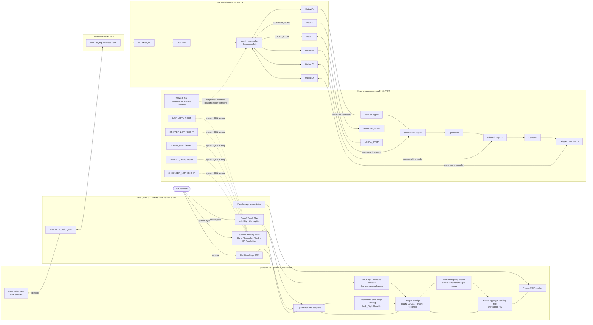
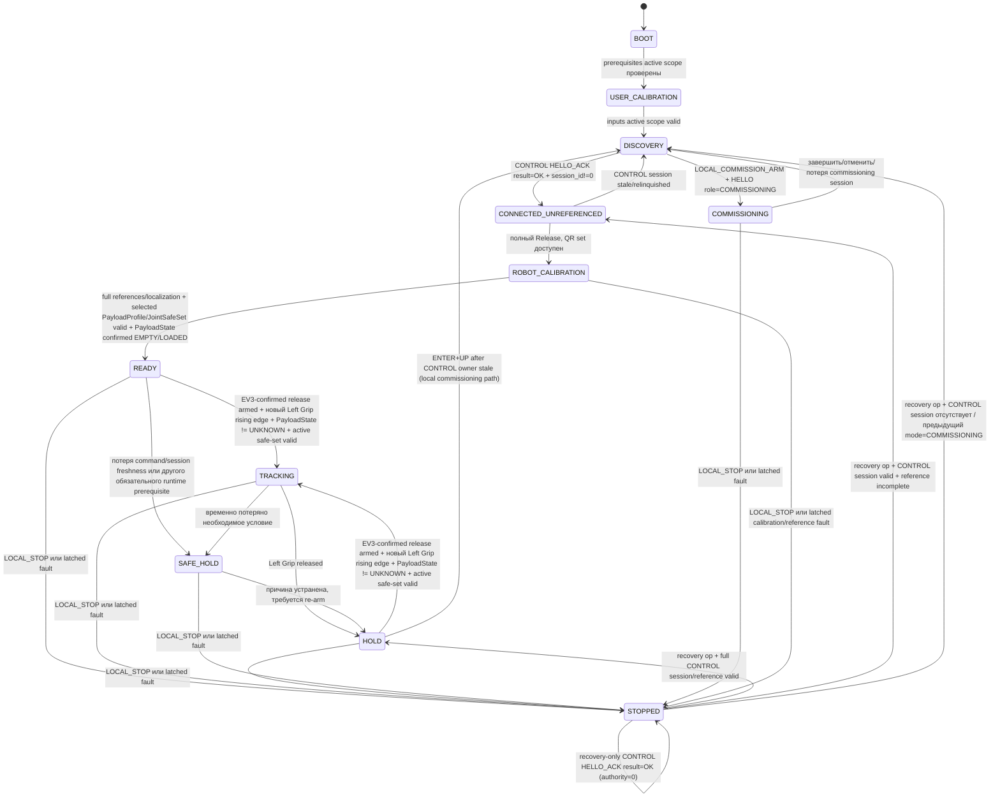
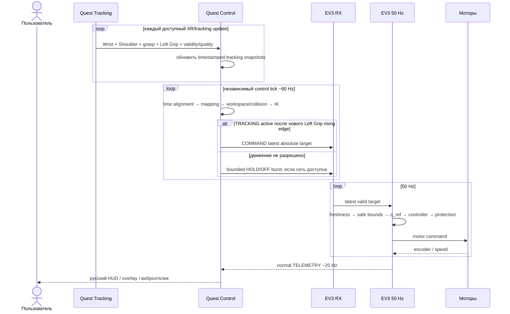

# PHANTOM — системная архитектура

> **Роль:** Нормативная архитектура верхнего уровня: состав системы, ответственность, состояния, потоки запуска/движения и итоговый поток данных.
> **Владелец правил:** см. [`README.md`](README.md).


---

<a id="sec-1"></a>
# 1. Введение

<a id="sec-1-1"></a>
## 1.1. Общее описание

PHANTOM — телеуправляемый манипулятор с тремя моторизованными степенями свободы позиционирования и отдельным двухгубочным захватом:

- `Base` — поворот основания вокруг вертикальной оси;
- `Shoulder` — подъём и опускание первого звена;
- `Elbow` — сгибание и разгибание второго звена;
- `Gripper` — пропорциональное раскрытие двух губок.

Meta Quest 3 отслеживает правую руку пользователя. QR-маркеры используются при инженерной калибровке и привязке перед началом движения для определения положения физического робота, его звеньев и захвата. После перехода в `READY` обычное управление выполняется без QR: EV3 использует моторные энкодеры как локальную обратную связь.

Левый Touch Plus Controller используется для разрешения движения и работы с интерфейсом. Пока `Left Grip` удерживается и все необходимые условия управления валидны, система формирует целевую позу PHANTOM по текущему положению правой руки. При отпускании `Left Grip` робот прекращает следование и удерживает текущую физическую позу.

<a id="sec-1-2"></a>
## 1.2. Состав системы

Система состоит из трёх основных областей:

1. **Приложение Meta Quest 3** — XR Hand Tracking, Body Tracking правого плеча, проверка пространства, калибровка длины руки и опциональный remap сигнала кисти, QR-калибровка PHANTOM, преобразование движения руки, рабочая область, обратная кинематика, пользовательский интерфейс и сетевой обмен с EV3.
2. **Физическая конструкция PHANTOM** — основание, Shoulder, Elbow, два звена, захват, QR-маркеры, механические ограничители, кабели, противовес и `LOCAL_STOP`.
3. **LEGO Mindstorms EV3** — сетевой протокол, привязка энкодеров к физическим углам по результатам QR-калибровки, формирование локальной траектории, управление моторами, удержание, защита от заклинивания, управление захватом, телеметрия и отдельный программный supervisor `phantom-safety` для отказа основного процесса. Он не считается независимым аппаратным safety channel; независимое снятие энергии обеспечивает `POWER_CUT`.

<a id="sec-4"></a>
# 4. Общее взаимодействие системы

<a id="sec-4-1"></a>
## 4.1. Общая схема



Диаграмма является логической, а не схемой электрических соединений. Критические положения:

- PHANTOM **не получает raw RGB/passthrough camera frames** для QR. QR распознаёт системный Meta Trackables service, а приложение получает `MRUKTrackable`/anchor pose и payload через `QrTrackingAdapter`;
- passthrough используется для визуального совмещения/UI, а не как собственный компьютерно-зрительный pipeline PHANTOM;
- `XrSpaceBridge` — единственный путь преобразования Wrist, Body Tracking и QR pose в согласованный `LOCAL_FLOOR`; смешивание Unity world/OVRCameraRig TrackingSpace координат напрямую в `Mapping` запрещено;
- `LOCAL_STOP` находится на `in4`, `GRIPPER_HOME` — на `in3`; оба читаются локально EV3;
- `POWER_CUT` является отдельным физическим устройством в цепи питания и не представлен software input-портом;
- EV3 не получает видеопоток и не распознаёт QR самостоятельно; Quest не формирует PWM/duty.

<a id="sec-4-2"></a>
## 4.2. Разделение ответственности

| Функция | Quest | EV3 | Конструкция |
|---|---|---|---|
| Отслеживание руки, HMD и Left Grip | получает и валидирует | — | — |
| Проверка `LOCAL_FLOOR`, Spatial Data/QR capabilities | выполняет | — | — |
| Калибровка пользователя | выполняет | — | — |
| `RobotLocalization` | вычисляет только по QR | — | обеспечивает жёсткие QR крепления |
| `CommissioningBundle` (`RobotGeometry`/`DriveCalibration`/`JointSafeSet`/SafetyEnvelope) | использует и сверяет hash | хранит authoritative safety subset и сверяет общий hash | физически определяет исходные измеряемые параметры |
| `DriveCalibration` | измеряет физические углы по QR и рассчитывает модель | собирает отсчёты энкодеров и хранит коэффициенты | физически определяет передачу |
| `JointReference` текущего запуска | измеряет `q_qr` и отправляет данные привязки | связывает текущий исходный отсчёт энкодера с физическим углом | механика остаётся неподвижной во время привязки |
| Абсолютная цель TCP и IK | вычисляет | не пересчитывает IK | задаёт доступную кинематику |
| Скорость/ускорение физического движения | прогнозирует для UI | окончательно ограничивает `q_ref` | допускается только квалифицированный диапазон |
| PWM/duty | не формирует | единственный штатный владелец | исполняется моторами |
| Заклинивание/контакт | отображает | детектирует по энкодеру, скорости, `duty` и состоянию | обеспечивает механическую податливость и механический ограничитель/упор |
| Заклинивание / перегрузка мотора | — | определяет по `duty`, запросу движения, скорости энкодера и ошибке положения | должна выдерживать допустимую нагрузку без разрушения |
| Потеря процесса `phantom-controller` | — | `phantom-safety` перехватывает остановку и включает `BRAKE` | пассивные меры ограничивают последствия |
| Common-mode отказ EV3/Linux/питания | — | software не считается независимым safety channel | внешний `POWER_CUT` снимает энергию; пассивная механика ограничивает последствия |

<a id="sec-4-3"></a>
## 4.3. Состояния системы



`READY` остаётся состоянием **только полностью собранного и полностью откалиброванного PHANTOM**. Неполный стенд никогда не маскируется под `READY`. При этом `READY` — не синоним «любой привод сейчас может двигаться»: actuator authority вычисляется отдельными gates. В частности, `PayloadState=UNKNOWN` или pending payload transition оставляют A/B/C hard-inhibited; **невыбранный/несовместимый PayloadProfile/JointSafeSet либо startup `PayloadState=UNKNOWN` вообще не допускают переход `ROBOT_CALIBRATION→READY`**; UI обязан явно показывать «ГОТОВНОСТЬ СИСТЕМЫ / ДВИЖЕНИЕ ЗАБЛОКИРОВАНО» и конкретную причину, а новый `Left Grip` rising edge не снимает такой inhibit. `CONNECTED_UNREFERENCED` и `HOLD` являются состояниями CONTROL-domain: они могут сохранять stale-but-replaceable control context при сетевом recovery, но никогда не используются как recovery state бывшей commissioning session. Для network-only scope `0x00` имя `CONNECTED_UNREFERENCED` является legacy wire name: references там `N_A`, состояние означает только authenticated connected-but-not-READY.

Если CONTROL command/session freshness теряется уже в `READY`, система не остаётся формально `READY`: она переходит в `SAFE_HOLD` с отменённым armed-latch и после восстановления валидной CONTROL session — в `HOLD`/deliberate re-arm. `HOLD` может кратковременно сохранять stale-but-replaceable control context без движения; это не даёт actuator authority и не отменяет session freshness gates.

`FAULT` **не является отдельным wire state protocol v1**: любой latched fault condition принудительно передаётся как `state=STOPPED` плюс соответствующий ненулевой `fault_code`. `FAULT_ACK` очищает только устранённый fault latch; `RESET_STOPPED` снимает stop latch `LOCAL_STOP` после физического release. Если одновременно действовали оба latch, для выхода из `STOPPED` должны быть выполнены обе соответствующие операции. Recovery op никогда не armed motion: full CONTROL возвращается в `HOLD` или `CONNECTED_UNREFERENCED` по reference, бывший commissioning/no CONTROL — в `DISCOVERY`; `MAINTENANCE_REQUIRED` остаётся `STOPPED` до завершения обслуживания. `LOCAL_STOP`/fault в `COMMISSIONING` уничтожает session-local commissioning authority, поэтому новый actuator authority требует новой `LOCAL_COMMISSION_ARM → HELLO role=COMMISSIONING → local ENTER`.

`COMMISSIONING` имеет две внутренние, взаимоисключающие фазы, которые не добавляют новый wire-state code:

1. `CALIBRATION` — разрешены только ограниченные `CALIBRATION_JOG`, `MOTION_ENABLE=0`;
2. `ACTUATOR_QUALIFICATION` — разрешается штатный `COMMAND` только на приводах из authoritative `actuator_scope_mask` текущего `qualification_only` bundle. `safety_observation_mask` отдельно задаёт оси, чьё фактическое положение обязательно safety logic и authority не расширяет. Переход в эту фазу возможен только после валидных calibration/reference motor-authorized приводов и, для partial A/B/C, всех safety-observed A/B/C и **явного локального подтверждения `ENTER` на EV3**, пока commissioning session активна. При входе `qualification_armed=false`; сам `ENTER` никогда не разрешает motion. EV3 должен затем в той же session принять безопасный OFF/HOLD `COMMAND` (`MOTION_ENABLE=0`, `HOLD_REQUEST=1`) после фактического release Left Grip на Quest, и только последующий новый rising edge может установить motion permission. Сетевой пакет сам по себе не может включить фазу, а локальный ENTER сам по себе не может вооружить движение.

Для раннего gripper-only стенда допускаются только `actuator_scope_mask=0x08` и `safety_observation_mask=0x08`. В этой фазе A/B/C либо физически отсутствуют, либо остаются hard-inhibited; `JointReference A/B/C`, `RobotLocalization`, `JointSafeSet`, Body Shoulder/Wrist и `human_arm_reach` не требуются. Потеря commissioning session, `LOCAL_STOP`, fault, process/safety heartbeat или несовместимость bundle немедленно запрещают scoped motor output и выводят из qualification phase. Потеря/восстановление grasp или `Left Grip` не может автоматически возобновить движение: требуется фактическое release, принятый EV3 OFF/HOLD с telemetry-confirmed `release_seen` и только затем новый rising edge.

В полном пользовательском режиме `SAFE_HOLD` всегда снимает armed-latch движения. После устранения временной причины система возвращается в `HOLD`; оператор должен отпустить `Left Grip`, после чего Quest выполняет OFF/HOLD release-handshake и остаётся dearmed до свежего telemetry-подтверждения принятого `release_off_sequence`. Только затем новый rising edge разрешает `TRACKING`. Latched fault condition переводит wire-state в `STOPPED`, дополнительно требует предусмотренного fault class подтверждения/обслуживания; reference-invalidating fault инвалидирует соответствующий `JointReference` и/или `GripperReference`.

<a id="sec-4-4"></a>
## 4.4. Последовательность запуска

При полном Release приложение сначала получает пользовательские параметры, необходимые для A/B/C mapping, и только затем переходит к discovery/привязке PHANTOM. В Diagnostic qualification profile `USER_CALIBRATION` зависит от `actuator_scope_mask`: network-only scope `0x00` не требует пользовательских измерений, gripper-only `0x08` проверяет grasp и `Left Grip`, но не требует `Body_RightShoulder`, Wrist-vector mapping или `human_arm_reach`.

```mermaid
sequenceDiagram
  actor U as Пользователь
  participant Q as Quest
  participant X as XR Space
  participant D as mDNS/DNS-SD
  participant R as PHANTOM QR
  participant E as EV3

  U->>Q: запуск приложения
  Q->>X: LOCAL_FLOOR + Spatial Data + Scene/Anchor/QR capabilities
  alt обязательная capability не готова
    Q->>U: русская инструкция по разрешению/настройке XR
    Q->>X: повторная проверка capability после системного UI
  end

  Q->>Q: запустить Upper-Body Body Tracking
  Q->>Q: дождаться valid Body_RightShoulder
  Q->>U: полностью выпрямить руку в нескольких позах
  Q->>Q: human_arm_reach = устойчивое расстояние Body_RightShoulder→Wrist
  Q->>Q: проверить OpenXR graspValue/graspReady
  opt нужен accessibility remap
    Q->>U: выполнить open/closed remap gesture
  end
  Q->>U: проверка виртуального движения руки

  Q->>D: browse type=_phantom-ev3._udp domain=local.
  D-->>Q: robot_id + address + port + protocol
  Q->>E: HELLO + HMAC
  E-->>Q: HELLO_ACK(result_code, session_id) + controller_boot_id + hashes
  alt result_code != OK или session_id == 0
    Q->>U: показать причину, остаться в discovery/recovery, motion authority=0
    Q->>Q: прекратить этот startup attempt; новый путь начинается с fresh discovery/HELLO
  else result_code == OK и session_id != 0
    Q->>U: покажите PHANTOM QR-маркеры
    R-->>Q: base/link/gripper marker poses для startup-калибровки
    E-->>Q: CALIBRATION_SAMPLE raw encoders
    Q->>Q: RobotLocalization + q_qr + jaw opening
    Q->>E: SET_JOINT_REFERENCE(transaction_id, q_qr, encoder sample id)
    E-->>Q: REFERENCE_ACK q_actual
    Q->>Q: QR↔encoder consistency check
    Q->>U: выбрать применимый PayloadProfile
    Q->>E: SET_PAYLOAD_PROFILE в ROBOT_CALIBRATION
    E-->>Q: CONTROL_ACK; active profile/safe-set authoritative
    Q->>U: подтвердить фактическое EMPTY/LOADED
    Q->>E: SET_PAYLOAD_STATE в ROBOT_CALIBRATION
    E-->>Q: CONTROL_ACK; payload state authoritative
    Q->>Q: product-state READY, motion disabled
    Q->>Q: operational-ready indication после valid payload gates
    Q->>Q: armed=false, дождаться Left Grip released
    Q->>E: priority OFF/HOLD COMMAND; remember release_off_sequence
    E-->>Q: fresh TELEMETRY last_accepted_command_sequence >= release_off_sequence
    Q->>Q: armed=true только после подтверждения EV3 release_seen
    alt новый Left Grip rising edge
      Q->>E: COMMAND current absolute q_target + grip_intent
    end
  end
```


Полная sequence diagram выше описывает production startup до `READY`. Для раннего gripper-only стенда используется отдельный **инженерный путь внутри того же приложения и протокола**, без фиктивной полной привязки:

```text
Quest app (Diagnostic, qualification_only, scope=D)
→ grasp + Left Grip readiness
→ discovery нужного robot_id без создания CONTROL session
→ приложение просит локально активировать LOCAL_COMMISSION_ARM на EV3
→ ENTER+UP на EV3 открывает bounded commissioning-arm window в DISCOVERY
→ HELLO role=COMMISSIONING в пределах этого окна → прямой переход в COMMISSIONING
→ при необходимости инженерная калибровка D (§5.16.8)
→ CALIBRATION_SAMPLE только применимого scope
→ QR JAW_LEFT/RIGHT → jaw_opening
→ SET_JOINT_REFERENCE с D-scope semantics
→ REFERENCE_ACK: joint_reference_valid=0, gripper_reference_valid=1
→ пользователь отпускает Left Grip
→ локально нажимает ENTER на EV3: перейти в COMMISSIONING/ACTUATOR_QUALIFICATION
→ Quest передаёт priority OFF/HOLD COMMAND и ждёт fresh TELEMETRY с last_accepted_command_sequence >= release_off_sequence
→ только после EV3-confirmed release_seen Quest armed=true
→ новый Left Grip rising edge разрешает COMMAND.grip_intent только для D
```

Полная кривая `DriveCalibration[D]` **не пересчитывается при каждом запуске**. Она сохраняется после этапа 4 и повторяется только после изменения механики/`GRIPPER_HOME`/QR-to-contact geometry или провала валидации. Обычный запуск gripper-only стенда выполняет только быструю `GripperReference` текущего запуска.

<a id="sec-4-5"></a>
## 4.5. Последовательность движения



<a id="sec-11-7"></a>
## 11.7. Итоговый поток данных

```text
Полный PHANTOM / A+B+C:
Правая рука пользователя
→ OpenXR Wrist
→ live Body_RightShoulder + live Wrist (time-aligned)
→ текущий Shoulder→Wrist vector
→ абсолютный P_requested_B в RobotBaseFrame
→ аналитические reach/floor constraints
→ fixed-branch IK на Quest
→ independent joint-bound projection + FK(P_projected_B), если требуется
→ Quest RobotCollisionModel/JointSafeSet preview; coupled violation = TARGET_INVALID
→ локальная authoritative проверка EV3 JointSafeSet endpoint + DDA пути
→ аутентифицированный абсолютный q_target
→ безопасные границы EV3 + формирователь q_ref + локальный регулятор
→ Base / Shoulder / Elbow
→ физическое повторение текущей позы руки

Gripper / D (одинаковый functional path в полном режиме и D-only qualification):
Правая кисть
→ IGripSignalProvider / optional remapped humanGrip
→ grip_intent
→ authenticated COMMAND
→ EV3 Gripper FSM + local rate/duty/contact protection
→ Motor D
→ фактическое раскрытие губок
→ TELEMETRY.grip_actual/grip_state → Quest

QR full PHANTOM:
→ RobotLocalization + проверка RobotGeometry
→ q_qr A/B/C + jaw opening при engineering calibration/startup reference
→ JointReference A/B/C + GripperReference

QR partial A/B/C qualification после полного commissioning:
→ full RobotLocalization + q_qr A/B/C
→ CALIBRATION_QUERY snapshot всех A/B/C из safety_observation_mask
→ JointReference A/B/C даже при motor authority только C/B+C
→ motor-disabled A/B/C остаются hard-inhibited, но их q_actual участвует в JointSafeSet

QR D-only qualification:
→ JAW_LEFT/RIGHT + gripper geometry
→ jaw opening + encoder D
→ только GripperReference; JointReference A/B/C остаётся invalid

После успешной **применимой** startup reference QR tracking выключается на время encoder-based движения:
- full Release: после полного reference и перехода к READY/TRACKING;
- partial A/B/C qualification: после принятой JointReference A/B/C и qualification gates;
- D-only: после GripperReference и допуска ACTUATOR_QUALIFICATION.
QR снова включается только для новой reference, engineering calibration или явной диагностической проверки.
```
