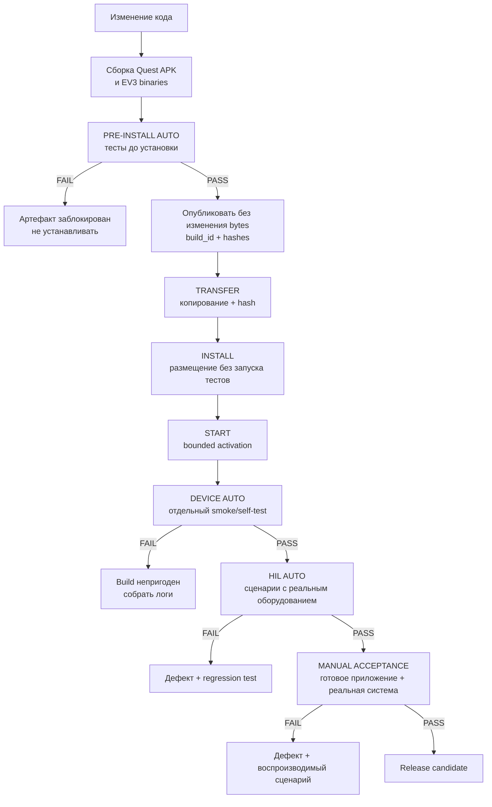

# PHANTOM — план тестирования и приёмки

> **Роль:** Нормативная стратегия тестирования, модель evidence, применимость по этапам и финальные gates готовности.
> **Владелец правил:** см. [`README.md`](README.md).


---

<a id="sec-9"></a>
# 9. Тестирование и критерии готовности

<a id="sec-9-1"></a>
## 9.1. Стратегия и обязательный конвейер тестирования

Тестирование PHANTOM строится как последовательность обязательных ворот. Чем раньше ошибка может быть обнаружена без физического оборудования, тем раньше она должна обнаруживаться. Установка нового приложения на Quest или новых бинарных файлов на EV3 не является первым способом проверить изменение.

Глобальный нормативный инвариант: любой тест с пометкой `AUTO` (`PRE-INSTALL AUTO`, `DEVICE AUTO`, `HIL AUTO`) от запуска case runner до формирования результата выполняется без участия человека. Он не может просить надеть/разбудить Quest, двигать рукой или Touch Plus, показать QR, подтвердить haptics, выполнить pause/resume либо иное действие. Quest в AUTO разрешено лежать на столе. Для HIL инженерная подготовка безопасной зоны и исходной конфигурации является внешним prerequisite до запуска case runner; после запуска конкретного AUTO-case вмешательство запрещено и приводит к `FAIL`, а не к ожиданию пользователя.

Каждый **непрерывный автоматический motion/stress exposure segment** любого HIL/DEVICE/MANUAL сценария ограничен `<=60 s`; предпочтительная длительность — `5..30 s`. Один логический test case или endurance suite может занимать больше и состоять из многих bounded segments/runs с явными checkpoints/reset conditions; отчёт обязан отдельно хранить suite/setup time, каждый segment duration и агрегированный результат. Свойства с большим временным горизонтом проверяются ускоренным monotonic/virtual time, контролируемой инъекцией порога или серией независимых bounded segments. Непрерывно оставлять автоматическое actuator exposure дольше `60 s` одним segment запрещено.

Основной принцип:

```text
изменение кода
→ сборка артефактов
→ автоматические тесты до установки
→ разрешение установки
→ transfer и установка без запуска tests
→ bounded запуск exact installed build
→ автоматические проверки на устройстве
→ HIL/сценарные проверки
→ ручная системная и пользовательская приёмка
→ Release candidate
```

Провал любого обязательного уровня блокирует переход на следующий уровень. Исключение допускается только для явно помеченной локальной инженерной отладки; такой build не может считаться кандидатом в `Release` и не используется для приёмочных тестов.

<a id="sec-9-1-1"></a>
### 9.1.1. Конвейер от сборки до приёмки



Быстрые статические проверки и часть модульных тестов могут выполняться до или параллельно компиляции, но **после успешной сборки существует отдельный обязательный `PRE-INSTALL` gate**. Он привязан к конкретным `commit`, `build_id` и хэшам артефактов. Нельзя считать достаточным ситуацию, когда тесты прошли для исходников, а устанавливается другой APK или другой EV3 binary. Границы `TRANSFER`/`INSTALL`/`START` нормативно определены в §8.5.1 и §8.7; успешная установка файлов сама по себе не является DEVICE PASS.

<a id="sec-9-1-2"></a>
### 9.1.2. Автоматические тесты до установки (`PRE-INSTALL AUTO`)

Эти тесты выполняются на PC/CI непосредственно после получения сборочных артефактов и **до** `adb install` на Quest и до копирования бинарных файлов на EV3.

`PRE-INSTALL AUTO` принимает уже существующие финальные artifact bytes как input. Runner не
вызывает production build, не переподписывает/переупаковывает артефакт и не обращается к
физическим устройствам. Unity tests выполняются Unity Editor’ом на PC; их наличие в этом gate
не означает установку Unity на Quest или EV3. Если для теста нужна отдельная disposable test
сборка, она хранится вне candidate paths и не может заменить либо изменить проверяемые bytes.

Обязательный набор:

| Область | Что проверяется |
|---|---|
| Quest pure logic | `IK`/`FK`, системы координат, рабочая область, абсолютное отображение руки, фильтры, state machine |
| Quest Unity | EditMode/PlayMode tests, XR Simulator, MRUK Spatial Testing для виртуальных комнат и пола |
| QR-математика | синтетические позы всех десяти маркеров: `SHOULDER_*`, `TURRET_*`, `ELBOW_*`, `GRIPPER_*`, `JAW_*`; `RobotBaseFrame`, отдельный `q_base_qr`, векторы `ShoulderCenter → ElbowCenter` и `ElbowCenter → GripperCenter`, независимость `GripperCenter` от раскрытия, преобразования `JAW_* → JawContactPoint`, эллиптическая траектория и фактический зазор губок |
| EV3 core | host-native C++ unit/property tests, `MockMotorBackend`, `q_ref`, регулятор, ограничения, fault state machines |
| Калибровка | синтетические QR↔encoder datasets, знак, scale, backlash, rejection плохих точек, нелинейные кривые Gripper |
| Протокол | C#↔C++ golden vectors, HMAC, sequence/session/transaction rules, malformed packets и fuzz |
| Интеграция без устройств | Quest logic ↔ PC EV3 simulator, telemetry, HOLD/SAFE_HOLD, reconnect, injected faults |
| Replay | записанные Shoulder/Wrist traces, timestamp skew, dropped samples и восстановление |
| Конфигурации | `config/schema/ev3.schema.json` и `config/schema/commissioning_bundle.schema.json`, обязательные поля/units/ranges, `MEASURED.required_before`, совместимость `RobotGeometry`/`DriveCalibration`/safe-set/protocol; duplicate mapping keys, unknown fields и last-key-wins parsing обязаны давать FAIL до canonical JSON/hash |
| Канонизация | RFC 8785 conformance: UTF-16 порядок ключей, ECMAScript представление чисел (`1.0`→`1`, `1e-6`→`0.000001`, negative zero, экспоненты), одинаковые bytes во всех реализациях |
| EV3-local IPC | общие golden vectors `ControllerRequestV1`/`ControllerReplyV1`/`ControllerTelemetrySnapshotV1`: размеры, offsets, endian, canonical-zero, credential/freshness, session watchdog — проверяются и Python, и C++ |
| Interop | shipped Quest client против **shipped** `phantom-network`, отдельно от сценариев PC-симулятора; отчёт обязан различать эти два источника |
| Артефакты | package/application id Quest, требуемые permissions/features, build metadata; архитектура и зависимости EV3 ELF, отсутствие test/debug secret в Release |

Минимальные правила gate:

```text
0 failed mandatory tests
0 crashed tests
0 unexpected skipped tests
all generated protocol/config golden hashes match
Quest and EV3 build_id recorded
artifact SHA-256 recorded
```

Отчёт имеет versioned machine-readable schema и для каждого нормативного test id хранит как минимум `status`, `introduced_at_stage`, `applicable_to_stage`, команду/runner и ссылку на evidence. Допустимые статусы: `PASS`, `FAIL`, `NOT_RUN`, `N_A`. `N_A` разрешён только если тест ещё не применим к проверяемому этапу и содержит нормативную причину; отсутствие строки или неожиданный `NOT_RUN` эквивалентны FAIL. Итоговый `PASS` запрещён для dirty worktree и обязан содержать `git_commit`, `source_tree_hash`, `specification_sha256`, `protocol_schema_hash`, **все применимые component/profile-specific `quest_build_id`/`ev3_build_id`**, а также SHA-256 каждого проверенного артефакта. Локальный отчёт dirty checkout является только диагностическим и не разрешает установку.

Минимальный набор этапа 1 включает schemas/generated-file checks, protocol/golden/HMAC/parser tests, Quest pure logic и synthetic adapters, EV3 host core/MockMotorBackend, simulator/replay, secret scan и host sanitizers. На этапе 2 дополнительно обязательны Unity EditMode/PlayMode и доступные XR/MRUK simulation tests, Release/Diagnostic APK audit, pinned ARMv5TEJ cross-build, artifact manifests/hashes и автономные startup/self-test сценарии. Проверки функций, впервые вводимых этапом 3+, могут иметь `N_A` до своего этапа, но не должны молча исчезать из отчёта.

Если тест требует настоящей камеры, пользователя, EV3 scheduler или физический мотор, он **не симулируется как доказательство аппаратной готовности**; для него существует следующий уровень. Но вся чистая логика такого теста должна быть вынесена из SDK/I/O слоя и проверена здесь.

<a id="sec-9-1-3"></a>
### 9.1.3. Автоматические тесты после установки (`DEVICE AUTO`)

Установка разрешена только после успешного `PRE-INSTALL AUTO`. `DEVICE AUTO` является
отдельной явно запускаемой фазой над уже установленным и успешно активированным exact build.
Его runner не выполняет build, transfer, package installation, смену active release или
rollback. Он может перезапускать процессы только внутри явно перечисленных test cases и после
каждого такого case обязан восстановить документированное безопасное terminal state.

**Quest:**

- приложение запускается и сообщает ожидаемый **`quest_build_id`** текущего profile;
- загружаются конфигурации и проверяются их хэши;
- проверяются декларация/config OpenXR и фактическое состояние session, причём неактивная session на лежащем Quest записывается как environment evidence, а не как несовместимость software;
- доступны требуемые Meta XR API/config/permissions; AUTO не запускает интерактивный запрос разрешения, permissions выдаются при установке либо их отсутствие даёт `FAIL`;
- диагностический self-test может запустить synthetic tracking/QR providers без движения реального PHANTOM;
- отсутствует crash/exception при входе/выходе из приложения и повторном запуске;
- Release не содержит включённых инженерных механизмов, которые должны быть Diagnostic-only.

Штатный Quest stage-2 DEVICE runner — `scripts/quest-device-auto.ps1`. Он принимает только
уже установленный APK со смежным build manifest и существующим
`results/pre-install/report.json` со статусом `PASS`, содержащим тот же
`quest_build_id`; проверяет единственный авторизованный ADB target `Quest 3/eureka` и identity
установленного package. `adb install -r -g` относится к отдельному Quest INSTALL runner и не
выполняется DEVICE runner’ом. DEVICE runner выполняет первый bounded запуск, `force-stop` и
повторный bounded запуск. Запуск через ADB не использует неограниченный `am start -W`: runner
автоматически посылает bounded wake event, отдельно и с конечным timeout проверяет PID и
появление app report; ручное пробуждение/разблокирование не требуется и не запрашивается.
Неактивные XR session/focus и отсутствие live observations на лежащем шлеме записываются как
`NOT_RUN` environment evidence без software FAIL. Встроенный zero-output self-test проверяет
build/config identity, `LOCAL_FLOOR`, permissions, passthrough/MRUK/Multimodal configuration
и все adapters, но stage PASS определяется active profile: full-arm profile требует выбранный
Body provider/Wrist path, gripper-only profile требует Hand/grasp + left Controller, а
Body/Wrist live/provider qualification помечается `N_A` для этого stage gate и остаётся
blocker будущего этапа 8/9. При pause сохраняется тот же классифицированный snapshot, а
Diagnostic выполняет полный synthetic suite без `RobotTransport`. Raw logcat обоих запусков
и объединённый host/app report сохраняются под
`results/quest/device-auto/<quest_build_id>/`; серийный номер в отчёт не попадает,
используется только сокращённый SHA-256 идентификатор.

Quest `DEVICE AUTO PASS` доказывает запуск конкретного установленного APK и software/platform compatibility, но не доказывает качество реальных Wrist/Shoulder/grasp/Touch/QR observations. Он не заменяет bounded live-observation cases §9.6, camera/QR measurement §9.10 и ручные pause/resume/HMD/haptics сценарии. Provider классифицируется раздельно: API отсутствует — `FAIL`; provider явно отключён или несовместим — `FAIL`; provider сконфигурирован, но XR/focus неактивен и live samples отсутствуют — compatibility `PASS`, live evidence `NOT_RUN`; provider инициализирован — `PASS`, а live sample является дополнительным evidence.

**EV3:**

- `phantom-controller` и `phantom-safety` запускаются через `systemd`;
- версии и **`ev3_build_id`** соответствуют установленному EV3 package/profile;
- конфигурация читается и проходит schema/hash checks;
- sysfs devices обнаруживаются по `address`, а не по нестабильному имени `motorN`; DEVICE AUTO проверяет **ровно обязательный motor/sensor I/O active profile**: Release требует `outA/outB/outC/outD + GRIPPER_HOME + LOCAL_STOP`, gripper-only Diagnostic требует `outD + GRIPPER_HOME + LOCAL_STOP`, network-only Diagnostic не требует motor I/O; battery telemetry является общим обязательным I/O для всех профилей; любой physically present disabled motor дополнительно проверяется на zero-output inhibit; для scoped моторов проверяются ожидаемые `driver_name`/тип и `count_per_rot=360`;
- выполняется короткий timing self-test критического цикла с `duty=0`/безопасным backend;
- DNS-SD/mDNS service публикуется;
- Quest/PC test client может выполнить `HELLO/HELLO_ACK`, `PING/PONG` и получить `TELEMETRY`;
- падение одного процесса обнаруживается вторым по правилам безопасности.

Каждый DEVICE AUTO test также имеет `introduced_at_stage`. На этапе 2 обязательны только автономный запуск, config/hash checks, обнаружение локального I/O, zero-output timing self-test, supervisor heartbeat/takeover и безопасный shutdown. DNS-SD, `HELLO/PING/TELEMETRY` и иные функции этапа 3 становятся обязательными с этапа 3; до этого они записываются как `N_A`, а не как PASS и не как пропущенная строка. DEVICE AUTO никогда не заменяется результатом PC-симулятора.

EV3 stage-2 DEVICE AUTO выполняется установленным `/opt/phantom/current/bin/phantom-device-auto` с root privilege и атомарно сохраняет `/var/lib/phantom/device-auto.json`. Отчёт содержит `git_commit`, один установленный **`ev3_build_id`** текущего profile, hashes controller/safety/config, platform fingerprint, monotonic timestamp и отдельные строки минимум для artifact integrity, config, motor/sensor/battery discovery, обоих on-device self-tests, systemd startup, zero-output startup, supervisor takeover и safe restart. Stage-3 network строки присутствуют как `N_A` с `introduced_at_stage=3`.

EV3 DEVICE runner требует успешный отдельный `START` result того же installed `ev3_build_id`.
Он не вызывается installer’ом и сам не распаковывает package, не переключает
`/opt/phantom/current`, не обновляет systemd units/tmpfiles и не выполняет rollback. Если
case обнаружил runtime failure, runner сначала сохраняет первый непосредственный service
failure и cascade relationships, затем приводит систему в заявленное safe terminal state;
исправление/rollback выполняется последующей отдельной операцией.

Начиная с EV3-side этапа 3 тот же installed runner формирует report `schema_version=2`, `gate="DEVICE AUTO"`, `stage=3` и проверяет дополнительно:

- согласованный network-only profile одновременно в runtime config и authoritative bundle, а также их manifest hashes;
- WNA1100 по sysfs USB VID/PID `0846:9030`, загруженный `ath9k_htc` и динамически обнаруженное имя wireless interface; автоматический gate не зависит от `lsusb`, который на legacy Brick может блокироваться;
- carrier и наличие DHCP IPv4 без записи конкретного DHCP-адреса как identity;
- active state `phantom-safety`, `phantom-wifi-autoconnect`, `phantom-controller`, `phantom-network`, `phantom-mdns`;
- живой multicast DNS-SD response с правильными service type, port, `robot_id`, boot id и build id;
- локальный authenticated `HELLO/HELLO_ACK`, server-generated nonzero session id, `PING/PONG`, `TELEMETRY`, rejection invalid HMAC/replay и authenticated `COMMAND` при scope `0x00`;
- смену boot id после controller kill/restart и сохранение zero/brake для всех физически присутствующих моторов;
- отсутствие motor authority: фактическое финальное состояние sysfs всех присутствующих motors,
  `motor_write_attempts_rejected` в `/run/phantom/network/status.json` и подтверждение, что
  `phantom-net` не имеет write-доступа к motor-I/O. Счётчик, который worker никогда не
  инкрементирует, не является доказательством и не принимается как evidence.

Отсутствующие motor и motor-safety inputs при scope `0x00` получают `N_A` с `reason=OUT_OF_SCOPE`; battery telemetry остаётся обязательной и должна иметь `PASS`. Итоговый report записывается atomically в `/var/lib/phantom/device-auto.json`; пропуск любой применимой Stage-3 строки не считается PASS.

On-device timing self-test выполняет не менее 250 итераций по абсолютной 20-ms сетке с безопасным backend, требует `p99 <= 25 ms`, `max < 50 ms`, нулевое число nonzero motor writes. Для `LOCAL_STOP` DEVICE AUTO без fixture проверяет discovery/текущее released состояние input и software state-transition logic через test backend, но **не выдаёт PASS физическому press/release**. Физический `LOCAL_STOP` press→BRAKE→latched STOP→release/reset проверяется только HIL AUTO с квалифицированным actuator fixture либо отдельной manual safety procedure; человеческое нажатие во время AUTO запрещено. Supervisor test при уже нулевом output посылает `SIGKILL` controller, подтверждает новый emergency event и сохранение `duty=0`, `speed=0`, `stop_action=brake`, после чего полностью перезапускает target. В network-only profile это также доказывает безопасное повторное получение освобождённого lease и смену controller boot identity, но не снимает fault/не выдаёт authority motion-capable profile. Ни один DEVICE AUTO step не выставляет ненулевой duty.

DEVICE AUTO оценивает комплект относительно versioned profile, а не относительно будущей финальной механики. Scope-aware classification имеет `introduced_at_stage=3` (network-only) / `introduced_at_stage=4` (gripper-only); evidence более раннего stage не заменяет соответствующий новый gate, перед которым обязательно выполняется regression applicable autonomous-startup behavior. При таком regression gripper-bench report может быть `PASS` при scope `0x08`, если D/`GRIPPER_HOME`/`LOCAL_STOP` присутствуют и A/B/C явно помечены `N_A` с `reason=OUT_OF_SCOPE`; это **не** является evidence production hardware completeness. Финальный Release DEVICE AUTO всё равно требует A/B/C/D, `LOCAL_STOP` и `GRIPPER_HOME`; отсутствие любого обязательного элемента даёт `FAIL`/`NOT_RUN` без попытки движения.

EV3 не имеет надёжного RTC, поэтому control/watchdog/safety freshness используют только `CLOCK_MONOTONIC`. DEVICE AUTO дополнительно фиксирует wall-clock/NTP state; неверные календарные часы не ослабляют stop path, но блокируют использование отчёта как хронологического release/HIL evidence до синхронизации либо надёжной корреляции с host timestamp.

`DEVICE AUTO` не заменяет HIL: успешный запуск процесса ещё не доказывает, что реальная передача, QR, мотор и механика работают правильно.

<a id="sec-9-1-4"></a>
### 9.1.4. Автоматизированные аппаратные тесты (`HIL AUTO`)

После успешного device smoke используется сценарный HIL-исполнитель. Человек до запуска runner подготавливает безопасную зону и переводит стенд в указанную исходную конфигурацию; после старта каждый HIL AUTO **motion/stress segment** выполняется полностью автоматически и завершается не позднее `60 s`, а один логический case может агрегировать несколько таких segments без вмешательства человека либо с новым явно отдельным setup между cases:

```text
setup confirmed by engineer
→ scenario runner
→ controlled commands
→ telemetry + Quest diagnostics
→ automatic metrics
→ PASS / FAIL report
→ incident package on failure
```

К HIL относятся:

- реальная Quest↔EV3 сеть;
- QR→геометрия и QR↔encoder reference;
- инженерная `DriveCalibration`;
- сценарные `q_target` без пользовательской руки;
- tracking performance реального EV3;
- stall/obstruction с безопасным тестовым приспособлением;
- `LOCAL_STOP`, watchdog, process kill, packet loss;
- серия независимых `Release`/`Diagnostic` timing cases по `<=60 s` с агрегированием распределений;
- автоматический сбор всех численных критериев точности и производительности, которые не требуют субъективной оценки человека.

HIL должен выдавать машинно читаемый отчёт со **всеми реально участвующими `quest_build_id`/`ev3_build_id`**, конфигурационными хэшами, временем запуска, сценарием, метриками и итогом. Ручное переписывание результатов в таблицу не является штатным способом приёмки.

<a id="sec-9-1-5"></a>
### 9.1.5. Ручные тесты готового приложения (`MANUAL ACCEPTANCE`)

Ручные **функциональные и пользовательские** тесты проводятся только на установленном build, который уже прошёл `PRE-INSTALL AUTO`, `DEVICE AUTO` и обязательные для данного сценария HIL-проверки.

Именно вручную проверяются свойства, для которых нужен реальный человек или субъективная/физическая оценка:

- качество `Body_RightShoulder` и `Wrist` при движениях пользователя;
- реальное распознавание напечатанных QR системным QR Trackable service Quest при разных ракурсах/освещении;
- удобство запуска, XR permission/recovery flows и обычного управления; `Space Setup` оценивается только при включённой scene-aware функции;
- понятность русского UI, подсказок, состояний и ошибок;
- ощущение задержки и предсказуемости управления;
- физическое соответствие движения руки и PHANTOM;
- поведение Gripper с реальными объектами;
- повторяемые пользовательские сессии, разбитые на независимые cases по `<=60 s`;
- сквозные сценарии HOLD/SAFE_HOLD/восстановления, где важна наблюдаемая реакция системы.

Для ручного теста заранее задаются шаги, ожидаемый результат и автоматически собираемая диагностическая трасса. Формат «попробовать и посмотреть, нормально ли» не является приёмочным тестом.

<a id="sec-9-1-6"></a>
### 9.1.6. Ручные проверки механической безопасности до автоматического движения

Это исключение из правила «ручные тесты на готовом приложении». До первого HIL-движения обязательно вручную проверяются вещи, которые опасно впервые обнаруживать мотором:

- соосность Shoulder/Elbow;
- свободный ход без закусывания;
- правильное зацепление шестерён;
- затяжка/фиксация рам, осей и QR-креплений;
- запас моторных кабелей во всём предполагаемом диапазоне;
- положение физических ограничителей;
- устойчивость основания;
- работоспособность `LOCAL_STOP` при ещё запрещённом автоматическом движении;
- отсутствие посторонних предметов и людей в swept volume.

Эти проверки являются **safety inspection**, а не ручным тестированием пользовательского приложения. Их прохождение разрешает HIL, но не является функциональной приёмкой PHANTOM.

<a id="sec-9-1-7"></a>
### 9.1.7. Классификация подробных тестов главы 9

| Раздел | Основной уровень | Дополнительный уровень |
|---|---|---|
| §9.2–§9.4 | `PRE-INSTALL AUTO` | — |
| §9.5 | `PRE-INSTALL AUTO` capability/state logic | `MANUAL ACCEPTANCE` Quest lifecycle/reference-space; `Space Setup` только для scene-aware UX |
| §9.6 | `PRE-INSTALL AUTO` для replay/alignment | `MANUAL ACCEPTANCE` на Quest 3 с пользователями |
| §9.7 | `PRE-INSTALL AUTO` provider/remap state logic | `MANUAL ACCEPTANCE` реального `graspValue/graspReady` |
| §9.8–§9.9 | `PRE-INSTALL AUTO` | `DEVICE AUTO`/HIL для реальной сети и EV3 |
| §9.10 | `PRE-INSTALL AUTO` для synthetic QR geometry | HIL/ручная камера для физических QR |
| §9.11–§9.14 | `PRE-INSTALL AUTO` для математики | `HIL AUTO` для реального робота |
| §9.15 | manual safety inspection + HIL | часть проверок требует физического наблюдения |
| §9.16–§9.19 | `HIL AUTO` | отдельные опасные сценарии требуют инженера рядом с `LOCAL_STOP` |
| §9.20–§9.23 | `MANUAL ACCEPTANCE` | численные метрики считаются автоматически |
| §9.24 | `PRE-INSTALL AUTO` + `DEVICE AUTO` + HIL | физический power-loss отдельно |
| §9.25–§9.26 | отчётность/Release gate | агрегируют результаты всех уровней |

<a id="sec-9-1-8"></a>
### 9.1.8. Регрессии и доказательства прохождения

Каждый обнаруженный дефект, который можно воспроизвести без человека или физического риска, должен получить автоматический regression test на самом раннем возможном уровне.

```text
дефект найден вручную/HIL
→ минимальный воспроизводимый сценарий
→ по возможности PRE-INSTALL regression
→ исправление
→ локальный набор тестов
→ полный обязательный gate
```

Для каждого build должны сохраняться:

```text
commit SHA
quest_build_id
ev3_build_id
SHA-256 артефактов
версии SDK/toolchain
RobotGeometry hash
DriveCalibration hash
config hash
результаты PRE-INSTALL AUTO
результаты DEVICE AUTO
результаты применимых HIL
идентификаторы ручных приёмочных сценариев
```

Тестовый отчёт является частью доказательства готовности конкретного build. Результат другого commit/build нельзя переносить на текущий артефакт без повторного прохождения соответствующего gate.

<a id="sec-9-2"></a>
## 9.2. Модульные тесты и тесты свойств кинематики

**Уровень:** `PRE-INSTALL AUTO`.

Минимум `10 000` случайных валидных наборов:

```text
q → FK → IK на фиксированной branch → q_reconstructed
```

Вне сингулярностей:

```text
|q_base - q_base_reconstructed| <= 0.1°
|q_shoulder - q_shoulder_reconstructed| <= 0.1°
|q_elbow - q_elbow_reconstructed| <= 0.1°
```

Проверяются:

- границы геометрической достижимости;
- `RobotBaseFrame.origin == ShoulderCenter`;
- commissioned joint bounds;
- Shoulder/Elbow 90° flexion rule;
- yaw singularity;
- отсутствие `NaN/Inf`;
- отсутствие переключения зафиксированного `branch_sign`;
- constrained projection;
- `norm(HumanArmVector) < human_vector_min_m` и yaw singularity hold-zone дают invalid target/`SAFE_HOLD`, не используют исторический/произвольный Base yaw;
- `reach_ratio` всегда clamp-ится в `[0,1]`, а `mapping_reach_m=min(RobotGeometry.robot_nominal_reach_m, human_arm_reach*max_mapping_scale)`: tracking overshoot не может вынести `P_requested_B` дальше `mapping_reach_m`, и property test отдельно покрывает пользователя, для которого nominal scale превышал бы limit;
- independent joint-bound clamp после IK даёт документированный `P_projected_B` через FK;
- coupled collision/`JointSafeSet` не заменяется поиском «ближайшей» IK-ветви: такой target получает `TARGET_INVALID`.

<a id="sec-9-3"></a>
## 9.3. Тест абсолютного отображения руки

**Уровень:** `PRE-INSTALL AUTO`.

Для фиксированных `RobotBaseFrame`, `human_arm_reach` и заданного `HumanShoulderCenter` генерируется множество поз правой руки.

Должно выполняться:

```text
same(HumanWristCenter - HumanShoulderCenter)
→ same physical Shoulder_PHANTOM→TCP direction
→ same P_requested_B
```

независимо от:

- положения локтя пользователя при тех же плечевом центре и запястье;
- ориентации HMD при неизменной позиции HMD;
- предыдущей траектории руки;
- предыдущей физической позы робота;
- момента нажатия `Left Grip`;
- количества циклов HOLD→TRACKING.

Отдельный regression test доказывает независимость **чистой** цели от исходной позы робота: две разные физические начальные позы при одной и той же aligned-позе руки дают одинаковый `P_requested_B`. При одинаково seeded filter state они также дают одинаковые `P_control_B/q_target`; тест отдельно проверяет, что re-arm/reacquire выполняет seed и не наследует старую траекторию.

<a id="sec-9-4"></a>
## 9.4. Тесты преобразования координат

**Уровень:** `PRE-INSTALL AUTO`.

Для заранее заданного `T_floor_base` проверяются эталонные мировые векторы `плечо → запястье`. После преобразования в `RobotBaseFrame` FK целевого робота должен давать тот же физический вектор при обратном переводе в `LOCAL_FLOOR`.

Тест обязан ловить:

- mirror по любой оси;
- axis swap;
- неверный handedness;
- ошибочное применение translation к вектору;
- зависимость результата от HMD yaw/pitch/roll.

<a id="sec-9-5"></a>
## 9.5. Тесты XR readiness, Multimodal lifecycle и reference-space changes

**Уровень:** `PRE-INSTALL AUTO` для capability/state logic; затем `MANUAL ACCEPTANCE` на Quest 3.

Проверяются сценарии:

| Сценарий | Ожидаемый результат |
|---|---|
| `LOCAL_FLOOR`, Spatial Data, Scene/Anchor support и QR capability валидны; room mesh отсутствует | core startup продолжается |
| spatial permission не выдан | запрос/инструкция; движения нет |
| Scene/Anchor capability для QR выключена | `READY` запрещён до исправления capability |
| room/furniture semantics отсутствуют при `scene_aware_ux_enabled=false` | не блокируют core startup |
| пользователь запускает опциональный `Space Setup` и отменяет | приложение повторяет scene-aware readiness check; core actuator path остаётся зависим только от обязательных capabilities |
| `XrEventDataReferenceSpaceChangePending`/смена tracking origin | full A/B/C: немедленный `SAFE_HOLD`, `RobotLocalization` invalid, новая QR-локализация, затем deliberate re-arm; D-only qualification: scoped inhibit/dearm в `COMMISSIONING`, `GripperReference` не инвалидируется только из-за space change при доказанной encoder/JAW continuity, затем scope-specific readiness + deliberate re-arm |
| pause/focus loss → resume | Multimodal/Hand/Body capabilities повторно включаются/проверяются; held Grip не возобновляет движение |

Golden-vector tests отдельно проверяют OpenXR Y-up → robot Z-up adapter и отсутствие axis mirror/swap.

<a id="sec-9-6"></a>
## 9.6. P0 compatibility, Body Tracking плеча и калибровка длины руки

**Уровень:** replay/time-alignment — `PRE-INSTALL AUTO`; качество реального tracking — `MANUAL ACCEPTANCE` на Quest 3.

Live full-arm Body/Wrist qualification и пользовательские cases этого раздела выполняются на реальном Quest 3 в штатной полной комбинации ниже. **P0 до них является scope-specific** и не обязан включать providers, помеченные `N_A(OUT_OF_SCOPE)` для `COMMISSIONING_QR`/`D_ONLY_USER`:

```text
passthrough enabled
правый Hand Tracking
левый Touch Plus Controller
Multimodal Input
Upper-Body Body Tracking
IOBT = off
FBS = off
FMM = off
WMM = off в actuator profile
```

### P0 Quest platform compatibility AUTO

До первого физического milestone каждого XR path exact pinned platform matrix из build manifest проходит короткий полностью автоматический compatibility case на реальном Quest 3. P0 имеет три независимых applicability-scope и проверяет **только используемые данным path providers/API**:

| `P0CompatibilityScope` | Обязателен до | Проверяемый минимум | Явно `N_A(OUT_OF_SCOPE)` |
|---|---|---|---|
| `COMMISSIONING_QR` | первого QR-driven `CALIBRATION_JOG` этапа 4; повторно перед A/B/C commissioning, если platform matrix изменилась | OpenXR lifecycle/reference-space API, passthrough/Spatial Data permissions, MRUK QR Trackables/anchors и commissioning adapters | Body/Wrist, grasp/Hand, Left Grip/haptics |
| `D_ONLY_USER` | первого user-driven D этапа 5 | Hand/grasp provider, левый Touch Plus Grip+haptics, Multimodal/focus lifecycle, passthrough и требуемый JAW QR path | Body_RightShoulder/Wrist mapping |
| `FULL_ARM_USER` | full-arm live qualification этапа 8 и обязательно до первого user-driven A/B/C этапа 9 | Wrist, выбранный UpperBody provider+`Body_RightShoulder`, Multimodal/focus lifecycle, passthrough, QR/local-space adapters | ничего из full actuator input stack |

Case длится `5..30 s`, допускает лежащий на столе HMD и не требует live движения робота, жестов человека, haptics confirmation или pause/resume. Для каждого применимого provider проверяются наличие API/components, статическая конфигурация feature flags/permissions, отсутствие явного SDK/runtime запрета выбранной комбинации и отсутствие **активной `RobotTransport` session/actuator authority во время P0**. Неиспользуемый provider не может дать `FAIL`; он получает `N_A(OUT_OF_SCOPE)`. **FAIL применимого scope блокирует соответствующий actuator milestone**; его нельзя обходить HMD→shoulder heuristic, отключением Multimodal или silent provider fallback.

P0 evidence сохраняется как отдельный versioned report и содержит `p0_compatibility_scope`, **`quest_build_id`**, `apk_sha256`, модель/серийно обезличенный id устройства, точный Horizon OS/runtime build, Unity/Meta XR Core/Movement SDK/MRUK/OpenXR versions, provider/joint-set, feature flags, permissions, время/длительность case, результаты каждого compatibility check и ссылки на device logs. Только реальный Quest 3 может дать `PASS`; отсутствие устройства даёт `NOT_RUN`, доказанная несовместимость provider/API — `FAIL`.

P0 обязан различать состояния provider:

| Состояние | Итог compatibility |
|---|---|
| требуемый текущим `P0CompatibilityScope` provider API отсутствует | `FAIL` |
| применимый component/joint set сконфигурирован неверно | `FAIL` |
| SDK или runtime явно отключает/запрещает provider в требуемом scope/profile | `FAIL` |
| provider не используется данным P0 scope | `N_A(OUT_OF_SCOPE)`; не блокирует gate |
| provider сконфигурирован, но XR session/focus неактивен и live samples нет | `PASS`; live evidence отдельно `NOT_RUN` |
| provider инициализирован без live sample в данном коротком окне | `PASS`; sample отдельно `NOT_RUN` |
| provider инициализирован и live sample доступен | `PASS` плюс дополнительное live evidence |

Текущее отсутствие live observations на снятом/лежащем HMD никогда не используется как доказательство несовместимости. И наоборот, явный source/runtime guard нельзя переклассифицировать в «HMD не был надет». Наличие `OVRBody` в package не считается PASS само по себе: если pinned package source/runtime отключает выбранный provider при Multimodal, такой provider/profile получает `FAIL` до выбора другой документированной версии/provider и нового P0. При конфликте сначала выполняется дешёвый source/config audit минимального числа package/provider candidates; APK собирается только для кандидата, который не содержит известного запрета и сохраняет все обязательные API.

После `FULL_ARM_USER P0` отдельными `MANUAL ACCEPTANCE` cases проверяется доступность и качество живых full-arm данных:

- `Body_RightShoulder` присутствует в выбранном joint set;
- joint имеет валидную позицию и обновляется непрерывно;
- `Wrist` и `Body_RightShoulder` одновременно доступны при работающем левом Touch Plus;
- приложение получает доступные body tracking calibration/status/fidelity поля и документированную временную информацию; отсутствие sensor timestamp не подменяется выдуманным значением.

Физические сценарии выполняются минимум на `10` пользователях; каждый пронумерованный case имеет собственный отчёт и длительность `<=60 s`:

1. **Голова без корпуса:** пользователь держит корпус и правую руку неподвижно, поворачивает голову примерно на `±90°` и наклоняет её вверх/вниз. Положение `HumanShoulderCenter` не должно повторять HMD yaw/pitch; допускается только шум отслеживания.
2. **Шаг в сторону:** пользователь смещается примерно на `0.30 м` влево и вправо. `Body_RightShoulder` должен отражать соответствующую трансляцию без дополнительной shoulder-калибровки.
3. **Шаг вперёд/назад:** аналогично проверяется продольная координата.
4. **Приседание:** пользователь уменьшает высоту плеча минимум на `0.20 м` и возвращается в исходное положение; вертикальная координата tracked shoulder должна следовать движению.
5. **Поворот корпуса:** пользователь поворачивает корпус примерно на `±45°`, не выполняя специального калибровочного жеста. Положение правого плеча должно обновляться непрерывно.
6. **Движение руки при неподвижном корпусе:** изменение Wrist не должно искусственно переносить tracked shoulder вслед за кистью сверх допустимой ошибки body tracking.
7. **Краткий tracking пропуск:** в grace-window actuator target заморожен; stale Shoulder не смешивается со fresh Wrist. После восстановления filter reseed выполняется текущим aligned-вектором, приложение остаётся в `HOLD` до deliberate re-arm и не просит пользователя двигать рукой для вычисления плеча.

Для проверки пространственной ошибки используются статические контрольные позы и независимая измерительная точка/маркер вблизи правого плеча. Начальные критерии приёмки:

| Метрика | Критерий |
|---|---:|
| p95 ошибка положения плеча в статических контрольных позах | `<=30 мм` |
| p95 ложное смещение плеча при только головы yaw/pitch | `<=20 мм` |
| ошибка изменения положения после шага/приседания | `<=30 мм` |
| автоматическое восстановление после краткого пропуска | без пользовательской перекалибровки |

Если эти критерии не выполняются, тест создаёт диагностический дефект с сохранением `Body_RightShoulder`, `Wrist`, quality/status, временные метки и состояния приложения. Основной алгоритм при этом не переключается на HMD-эвристику и не требует от пользователя дополнительной калибровки: причина сначала анализируется по журналам и `FlightRecorder`. Для финальной готовности системы критерии всё равно должны быть выполнены.

Точность `Wrist` и итогового вектора проверяется в неподвижных контрольных позах. Для квалификационного теста допускается временный жёсткий `WRIST_TEST` маркер/крепление с заранее измеренным offset до анатомической точки Wrist; QR measurement снимается только после полной остановки руки и не используется в runtime управления. Минимум `20` пространственно различных поз на пользователя.

Начальные критерии приёмки:

| Метрика | Критерий |
|---|---:|
| p95 ошибка stationary `Wrist` относительно тестовое крепление | `<=20 мм` |
| p95 ошибка длины `Shoulder→Wrist` | `<=30 мм` |
| p95 ошибка направления `Shoulder→Wrist` | `<=3°` |
| накопленный offset после возврата в ту же неподвижную позу | отсутствует; ошибка остаётся в том же статистическом диапазоне |

Эти критерии измеряют tracking/mapping input до IK. Сквозной физическая точность PHANTOM отдельно проверяется §9.20.

Калибровка `human_arm_reach` проверяется отдельно:

```text
>=10 пользователей
>=5 calibration runs на человека
ровно 3 **принятые устойчивые** позы полностью выпрямленной руки; отклонённые/нестабильные попытки не засчитываются и могут повторяться без искусственного лимита
```

Критерии:

- положение плеча берётся непосредственно из валидного `Body_RightShoulder`, а калибровка измеряет только `human_arm_reach`;
- медианное значение `human_arm_reach` между повторными run одного пользователя отличается не более чем на `20 мм`;
- поворот головы, шаг или приседание после калибровки не меняют сохранённый `human_arm_reach`;
- одинаковые текущие `HumanShoulderCenter` и `HumanWristCenter` дают одинаковую цель независимо от положения локтя.

Отдельно проверяется временное согласование Shoulder/Wrist. `tracking-replay` искусственно вводит известное рассогласование временных меток и дрожание, а затем сравнивает вычисленный `Shoulder→Wrist` с эталоном:

```text
stationary pose
slow arm motion
sinusoidal arm motion
step-like change direction
sample/query-time offsets: 0 / 10 / 20 / 40 / 60 ms + отдельные сценарии timing uncertainty
short dropped samples
```

Критерии:

- измерения старше настроенного alignment/extrapolation window не используются как свежие;
- при допустимом рассогласовании временных меток интерполяция уменьшает ошибку вектора относительно варианта «брать последние два несинхронных измерения»;
- stationary `Shoulder→Wrist` p95 дрожание после фильтра `<=15 мм` в квалифицированных условиях освещения/tracking;
- дополнительная задержка фильтра относительно time-aligned raw vector p95 `<=30 мс` для обычного движения;
- после краткого пропуска нет смешивания stale/fresh joints; `P_requested_B` остаётся pure, а после reseed `P_control_B` стартует от текущего raw-вектора без хвоста старого filter state.

Если реальные платформенные данные требуют других численных filter thresholds, значения меняются только через измеренный config и повторный §9.6, а не скрытым повышением smoothing latency.

<a id="sec-9-7"></a>
## 9.7. Тесты сигнала сжатия кисти

**Уровень:** provider/remap logic — `PRE-INSTALL AUTO`; реальный Hand Tracking — `MANUAL ACCEPTANCE`/P0 на Quest 3.

Default `OpenXrGraspProvider` проверяется так:

- `graspReady=true`, raw `0`, `0.25`, `0.5`, `0.75`, `1` → identity/clamp mapping без обязательной пользовательской калибровки;
- `graspReady=false` → `GRASP_VALID=0`, сохранение текущей физической gripper target, отсутствие автоматического открытия;
- `NaN/Inf/out-of-contract` отклоняются до command builder;
- после HOLD/SAFE_HOLD актуальный `grip_intent` может применяться только после общего deliberate re-arm;
- EV3 rate/duty/contact logic ограничивает физический скачок даже при step input.

Optional `GripRemapProfile` тестируется отдельно:

- `g_open < g_closed`, span `>= remap_min_usable_span`;
- remap монотонен и ограничен `[0,1]`;
- invalid/zero/inverted span отклоняется;
- profile compatibility metadata инвалидируется после несовместимого runtime/provider update;
- включение/выключение remap вне `TRACKING` не переносит stale command.

Если используется альтернативный `JointCurlGripProvider`, он обязан иметь отдельный qualification profile с теми же end-to-end safety tests; runtime silent fallback между providers запрещён.

<a id="sec-9-8"></a>
## 9.8. Тесты DNS-SD/mDNS обнаружения

**Уровень:** `PRE-INSTALL AUTO` с сетевым симулятором; `DEVICE AUTO`/HIL с реальным EV3.

Сценарии:

1. один PHANTOM в сети;
2. два PHANTOM с разными `robot_id`;
3. сервис с неверным protocol major;
4. корректный service type `_phantom-ev3._udp`, но неверный/non-local domain;
5. resolve даёт только IPv6 endpoint при v1;
6. IPv4 меняется после DHCP renew;
7. Wi-Fi interface EV3 переподключается и получает новый IPv4;
8. старый IPv4 занят другим host;
9. сервис исчезает и появляется снова.
10. `HELLO` retransmit с тем же nonce в retry-window возвращает тот же session id только пока исходная session/config generation остаётся authoritative; bundle/session/boot invalidation очищает HELLO cache, и повтор старого nonce не воскресит session. Competing CONTROL HELLO при свежей активной session получает rejected `HELLO_ACK(result_code=ERR_CONTROL_SESSION_BUSY, session_id=0)`; после stale/HOLD новый handshake получает новую EV3-generated session id, а старые COMMAND остаются невалидны.
11. на реальном EV3 publisher использует Avahi D-Bus, а DEVICE AUTO посылает raw multicast DNS query и валидирует service type `_phantom-ev3._udp`, domain `local.`, IPv4 address/SRV port и TXT identity независимо от локального publisher process;
12. restart controller меняет `controller_boot_id` и приводит к перепубликации TXT; restart `phantom-mdns` временно удаляет и затем восстанавливает service;
13. TXT не содержит credential, PSK, HMAC material или session id.
14. Quest LAN permission denied/revoked или platform multicast prerequisite отсутствует → discovery/UDP явно unavailable, старый endpoint/session не используется; после разрешения выполняется fresh discovery.

Критерии приёмки:

- Quest выбирает робота по `robot_id`, а не по сохранённому IP;
- после смены адреса старый сетевой адрес/session не используется;
- новый IPv4 сетевой адрес проходит новый `HELLO/HELLO_ACK`;
- IPv6-only resolve в v1 не создаёт session и не запускает fallback на сохранённый IPv4;
- робот с неверным `robot_id` никогда не получает actuator command текущей сессии.

<a id="sec-9-9"></a>
## 9.9. Тесты сетевого протокола и HMAC

**Уровень:** `PRE-INSTALL AUTO`; performance parser/HMAC дополнительно проверяется на EV3 как `DEVICE AUTO`/HIL.

Структура каждого message type определяется одним `wire_schema.yaml`; C# и C++ production encode/decode, независимо от того generated они или hand-written, должны проходить общие golden/negative vectors. CI проверяет `protocol_schema_hash`, exact payload lengths, enum/bit values и запрещает расхождение generated constants/size maps со схемой либо production codecs с общими vectors. Отдельный schema assertion требует, чтобы `COMMAND` содержал только motion flags, абсолютные `q_target[3]`, `grip_intent` и reserved field; PWM/duty/raw motor commands в Quest→EV3 wire отсутствуют.

Security tests:

| Тест | Результат |
|---|---|
| bad magic / wrong version / unknown type / reserved bits != 0 | cheap reject до HMAC/type-specific parsing |
| truncated datagram / bad exact length | cheap reject |
| bit flip полезная часть | HMAC fail |
| wrong PSK / unknown key slot | drop без создания session |
| old/replayed sequence | drop |
| duplicate/reordered packet | drop без repeated side effect |
| wrong session | drop |
| old boot id | drop |
| repeated transaction в той же session | тот же semantic ACK payload/result, no repeated side effect; response datagram имеет новый EV3→Quest sequence/timestamp/HMAC |
| exact retry с повтором старого request payload, но новым Quest→EV3 wire sequence | принимается как transaction retry; canonical request hash остаётся тем же, old header bytes в hash не входят |
| новая state transaction `id=last+1` даёт operation-level `ERR_STATE/ERR_RANGE/...` | error ACK кэшируется как completed transaction и consume-ит id; исправленный payload обязан использовать следующий id |
| bad HMAC/session/exact-length packet с видимыми случайными bytes transaction_id | drop до transaction layer, `last_transaction_id` не меняется |
| повтор того же consumed error transaction id с исправленным payload | `ERR_TRANSACTION_CONFLICT`, state без изменения |
| controller cached ACK payload на retry | `phantom-network` не replay-ит старую datagram: выдаёт fresh outbound sequence; Quest anti-replay принимает ответ |
| `CALIBRATION_JOG`: ACK потерян, затем session потеряна | старый JOG **не** отправляется автоматически в новой session; состояние `OUTCOME_UNKNOWN`, новый `LOCAL_COMMISSION_ARM`/session + stationary `CALIBRATION_QUERY` + QR/encoder observation предшествуют любому следующему jog |
| `COMMISSIONING_SAMPLE` ACK потерян | exact retry в той же session возвращает тот же `CONTROL_ACK` payload/result с fresh response sequence/HMAC; journal append/sample consume выполняются ровно один раз |
| `REFERENCE_ACK` потерян и затем session потеряна | новая session не считает старую reference подтверждённой: fresh `CALIBRATION_QUERY` + QR observation + новый `SET_JOINT_REFERENCE`; старый transaction id не replay-ится |
| HELLO `key_slot/session_role` selector до HMAC | используется только для выбора одного preinstalled PSK; invalid HMAC не создаёт session/semantic side effect |
| authenticated `HELLO` при busy CONTROL / commissioning без local arm | `HELLO_ACK.session_id=0`, `result_code=ERR_CONTROL_SESSION_BUSY/ERR_COMMISSIONING_NOT_ARMED`; session owner/sequence/authority не создаются |
| rejected authenticated `HELLO_ACK` canonical fields | `client_nonce_echo` и HMAC-validated selectors совпадают с запросом; identity/build/hash/state fields декодируются как diagnostics, но не создают authority; profile-dependent safe limits при отсутствии применимого active profile равны canonical zero; Quest **не** применяет rejected ACK как config/reference readiness |
| successful network-only/D-only `HELLO_ACK` canonical N_A | `0x00/0x00`: отсутствующие component hashes и все reference/A-B-C limit fields canonical zero при ненулевом network-only bundle hash; `0x08/0x08`: только присутствующие gripper subset hashes/Gripper reference могут быть ненулевыми, A/B/C JointReference/JointSafeSet/limits canonical zero; `-0.0`, NaN, stale values rejected by golden/schema test |
| HELLO retry-cache invalidation | после cached successful ACK изменить/активировать bundle либо инвалидировать session/controller boot до истечения `hello_retry_window_ms`; повтор того же HELLO/nonce **не** получает старый session id/hash, cache очищен и handshake оценивается по текущей generation |
| successful `HELLO_ACK` | `result_code=OK`, `session_id!=0`; subsequent session messages с zero id rejected |
| role↔key-slot mismatch | при установленном/проверяемом slot authenticated reject `HELLO_ACK(result_code=ERR_AUTH,session_id=0)`; unknown/uninstalled slot — silent drop |
| `SET_DRIVE_CALIBRATION` commit ACK потерян | EV3 остаётся в bounded `CONFIG_STALE_ACK_ONLY`; exact retry возвращает тот же ACK payload/result с fresh response sequence/HMAC, а reconnect/HELLO hash reconciliation однозначно определяет committed old/candidate revision |
| `SET_DRIVE_CALIBRATION` reconnect после неопределённого ACK | Quest durable pending-candidate reconciles по `commissioning_bundle_hash`; third/unexpected hash → manual `ERR_HASH_MISMATCH`, motion authority=0 |
| NaN/Inf target | reject |
| `payload_length` превышает current schema-generated maximum, total datagram >1024 или exact-length mismatch | reject |
| 1 000 000 malformed host fuzz packets | no crash/UB |
| unauthenticated traffic flood within test limits | no actuator state change |
| `MOTION_ENABLE=1` первым packet новой/recovered session без предыдущего OFF/HOLD | reject/no actuator target; `release_seen=false` |
| противоречивый stop-like `COMMAND`: `MOTION_ENABLE=1,HOLD_REQUEST=1` | fail-safe stop/hold выполняется, moving target не принимается, но `release_seen` **не** становится true; deliberate re-arm требует отдельный canonical `0/1` OFF/HOLD |
| Quest локально увидел release, но OFF/HOLD потерян | `last_accepted_command_sequence` не достигает `release_off_sequence`; Quest остаётся `armed=false`, moving packet не посылается |
| OFF/HOLD принят, но telemetry stale/потеряна | EV3 уже fail-safe снял motion, но Quest остаётся `armed=false` до свежего подтверждения текущей session; automatic resume запрещён |
| OFF/HOLD подтверждён свежей telemetry, затем новый false→true enable edge | допускается только после остальных обычных movement predicates |
| command/session freshness lost while product state=`READY` | state не остаётся READY: `READY→SAFE_HOLD`, armed/release latch очищаются; после новой/восстановленной valid session переход только через `HOLD` и deliberate re-arm |
| `HELLO role=CONTROL` при `STOPPED` | создаёт recovery-only session; COMMAND не имеет authority, разрешены только read/PING + `FAULT_ACK`/`RESET_STOPPED` |
| попытка `SET_PAYLOAD_*`/обычного COMMAND в recovery-only STOPPED session | reject/no actuator change |
| `SET_PAYLOAD_STATE=LOADED` при active profile `EMPTY` | reject/no state change |
| moving A/B/C COMMAND при `PayloadState=UNKNOWN` либо mismatch profile↔safe-set | reject/inhibit, old moving target invalid, no A/B/C motor authority |
| cold boot/controller restart до profile selection | `active_payload_profile_id=UNSELECTED`, active safe-set hash=0, `PayloadState=UNKNOWN`; `ROBOT_CALIBRATION→READY` запрещён до startup `SET_PAYLOAD_PROFILE` **и** `SET_PAYLOAD_STATE=EMPTY/LOADED` |
| `SET_PAYLOAD_PROFILE` в `ROBOT_CALIBRATION` до full reference | reject `ERR_REFERENCE`; после full reference+stationary — accepted без motor motion, остаётся startup flow |
| попытка передать `payload_profile_id=UNSELECTED` | reject; sentinel существует только локально и не является installed profile |
| narrow A/B/C qualification: `SET_PAYLOAD_PROFILE/STATE` | только explicit `EMPTY/EMPTY` при full A/B/C reference, stationary motors, commissioning local authority и dearmed phase; `LOADED`/non-empty reject |
| full 0x0F qualification-only payload transitions | installed profiles + `EMPTY/LOADED` допускаются только stationary/dearmed в `COMMISSIONING`; successful transaction не меняет state на READY/HOLD и требует новый qualification re-arm |
| payload operation ACK потерян + session lost | новая session обязана заново выполнить безопасную profile/state selection/confirmation до motion; stale UI confirmation не переносится |
| «SESSION_CLOSE» как неизвестный message type | cheap reject; v1 voluntary relinquish реализуется прекращением traffic + stale timeout |

EV3 receive path использует общий HIL-квалифицированный token bucket `rx_rate_limit_pps`/`rx_burst_packets`, ограниченный socket receive buffer и не обрабатывает более `32` datagrams за один drain. Тест выполняется ниже, на границе и выше **фактически установленного** threshold; hard-coded `100/20` не является нормативным substitute для `MEASURED`. Oversize/header/length/type/reserved проверки выполняются до HMAC. Ни malformed packet, ни flood не создаёт per-source unbounded state, очередь или thread и не изменяет session/actuator state. Для network-only profile дополнительно проверяется, что после authenticated `COMMAND`, replay и flood motor state остаётся нулевым, а каждая отвергнутая motion request учтена в `motor_write_attempts_rejected`.

На реальном EV3 direct on-device benchmark отдельно доказывает:

```text
HMAC + exact-length parse service time p99 < 2 ms на bounded valid-datagram benchmark;
configured rx_rate_limit_pps/rx_burst_packets при valid+invalid flood не нарушают motor-loop p99 и watchdog budgets
```

<a id="sec-9-10"></a>
## 9.10. Тесты QR RobotLocalization

**Уровень:** synthetic geometry — `PRE-INSTALL AUTO`; реальные маркеры/камеры — HIL и `MANUAL ACCEPTANCE`.

Не менее `30` независимых локализаций центра Shoulder и `RobotBaseFrame` после перемещения/повторного запуска.

Критерии приёмки:

```text
coarse ShoulderCenter repeatability p95 <= 25 mm
coarse RobotBaseFrame yaw repeatability p95 <= 5°
accepted commissioning/startup q_qr uncertainty95 <= configured qr_joint_angle_uncertainty95_max_deg
foreign robot_id / geometry_revision accepted = 0
wrong marker_id-for-role / duplicate marker_id / duplicate role accepted = 0
malformed/non-canonical PHANTOM1 QR payload accepted = 0
READY without required QR set = 0
base relocation after RobotLocalization without re-localization → A/B/C motion authority = 0
localization source = MRUK QR Trackables only
```

Проверяются частичная окклюзия, неверный `marker_id`, два маркера с одной role/id, valid QR другого role, переставленное крепление, неверный prefix/geometry revision/encoding canonical payload, недостаточная геометрия видимых точек, слабое освещение, слишком большая дистанция и деформированный/наклонённый держатель. Отдельный PRE-INSTALL parser test round-trip-ит весь `qr_marker_manifest` и гарантирует однозначность role↔id.

Для каждого принятого окна после остановки дополнительно сохраняются дрожание центра маркера и robust-остаточная ошибка расчёта. измерение не принимается, если видимый набор маркеров формально достаточен, но его геометрия плохо обусловлена или центры продолжают заметно двигаться. Пороги jitter, pair baseline, conditioning и propagated angular uncertainty фиксируются по физическим тестам. `25 мм / 5°` — только coarse localization/UI gate; калибровочная/стартовая точка принимается лишь если её собственный uncertainty budget достаточно мал для критериев §9.12/§9.13. Если Quest QR stack не достигает этого бюджета, проект не ослабляет критерий молча: требуется улучшить fixtures/наблюдения или использовать отдельную более точную absolute-reference технологию в следующей revision.

<a id="sec-9-11"></a>
## 9.11. Инженерная калибровка RobotGeometry

**Уровень:** математика — `PRE-INSTALL AUTO`; физическая квалификация — `HIL AUTO`.

Минимум шесть и предпочтительно больше поз, покрывающих Base/Shoulder/Elbow range.

Проверяются:

- `L1`, `L2`, положение пола относительно Shoulder и TCP;
- оси Shoulder/Elbow;
- локальные координаты всех QR-креплений;
- неизменность geometry при обычном запуске;
- FK против независимых измерений/QR observations, не использованных в расчёте.

Критерии приёмки:

```text
QR geometry residual p95 <= 25 mm
FK TCP error against independent measurement p95 <= 15 mm
```

Механическое изменение крепления или звена создаёт новую `geometry_revision`.

<a id="sec-9-12"></a>
## 9.12. Инженерная калибровка `DriveCalibration` Base/Shoulder/Elbow

QR hold-out точки проверяют повторяемость калибровочного sensor stack. Отдельно обязательна независимая физическая validation точности как минимум на нескольких контрольных позах с jig/угломером/линейкой либо иной метрологией известной погрешности; QR не может быть единственным «независимым» ground truth для собственной калибровки.

**Уровень:** алгоритм fit/rejection — `PRE-INSTALL AUTO`; реальная процедура — `HIL AUTO`.

Для каждой оси выполняется не менее `10` независимых запусков инженерной калибровки из разных допустимых исходных положений.

Каждый запуск должен автоматически пройти тот же алгоритм, который описан в §5.16:

```text
неподвижное QR-измерение исходной позы
→ очень малое первое калибровочное перемещение
→ полная остановка
→ QR-измерение и первая оценка знака/коэффициента
→ не менее 5 остановленных измерений в одном направлении
→ проход в обратном направлении
→ не менее 5 новых остановленных измерений
→ расчёт коэффициента, знака и люфта
→ отдельные контрольные положения
```

Непрерывное измерение движущегося QR не используется. Каждая точка принимается только после полной остановки мотора и устойчивого многомаркерного QR-измерения.

На полностью собранном роботе отдельно проверяется автоматический безопасный порядок приводов:

```text
D Gripper → C Elbow → B Shoulder → A Base
```

Проверяется, что:

- одновременно motor-write authority имеет только одна калибруемая ось; чтение safety-observed encoder/QR других осей не считается motor authority;
- перед `Elbow` исходная поза исключает контакт предплечья/захвата с основанием, верхним звеном и полом, а ещё не откалиброванный Shoulder механически фиксирован/поддержан так, что движение C не может вызвать его неконтролируемое опускание;
- перед `Shoulder` уже откалиброванный `Elbow` переводит механизм в `SHOULDER_CAL_POSE`, эта поза подтверждается QR, C имеет валидные calibration/reference+HOLD gate либо дополнительно фиксируется fixture;
- перед `Base` уже откалиброванные `Shoulder`/`Elbow` переводят руку в компактную `BASE_CAL_POSE`, имеют валидные calibration/reference+HOLD gates либо fixture, после чего проверяются кабельный запас и свободный описываемый объём;
- попытка активного HOLD ещё не откалиброванной/не referenced нагрузочной оси считается FAIL теста;
- fixture/support removal выполняется только после получения соответствующей calibration/reference и отдельной проверки удержания;
- риск выхода за безопасный объём, потеря QR, движение motor-disabled оси сверх допуска, препятствие или `LOCAL_STOP` немедленно прекращают автоматическую процедуру.

Для A/B/C проверяются:

- стабильность `count_per_rot` и абсолютного счётчика энкодера;
- знак `k_axis`;
- `encoder_scale_rad_per_count`;
- согласованность прямого и обратного проходов;
- `backlash_total_angle`;
- остаточная ошибка расчёта;
- ошибка на контрольных положениях;
- повторяемость одной физической позиции при подходе с двух сторон;
- независимость результата от порядка сохранённых измерений.

Для номинальной передачи `5:1` ожидаемый порядок `k_axis` — около `0.2°` физического угла на один градус/отсчёт моторного вала. Это только проверка здравого смысла: значительное отклонение требует проверки сборки и конфигурации.

Начальные критерии приёмки A/B/C:

```text
sign(k_axis) stable across runs
scale repeatability p95 <= 0.5% relative
fit residual p95 <= 1.0°
hold-out encoder→QR prediction p95 <= 1.5°
hold-out max error <= 3.0°
backlash_total_angle <= 3.0°
forward/reverse same-pose discrepancy p95 <= 2.0°
```

Имена полей в блоке выше являются служебными метриками; пользовательский отчёт отображает их русские названия.

Если люфт или нелинейность выше допуска, исправляется механика, передача либо крепление QR. Более сложная математическая компенсация не считается успешной калибровкой без отдельной механической квалификации.

Дополнительно выполняется автоматический тест отсутствия программного накопления ошибки:

```text
привязка при запуске
→ 1000 безопасных циклов туда/обратно в квалифицированном диапазоне
→ периодический возврат к заранее выбранным абсолютным отсчётам энкодера
→ сравнение q_actual с независимым QR-измерением после остановки
```

Критерии разделяются:

- **программный:** один и тот же `encoder_count` при одной `DriveCalibration`, одной `JointReference` и одинаковом состоянии модели люфта всегда даёт тот же `q_actual` до численной погрешности, независимо от числа циклов и пропусков периода управления; `speed*dt` никогда не является источником положения;
- **механический:** физическая ошибка при возврате к тому же отсчёту энкодера не должна расти с номером цикла и должна оставаться внутри допуска люфта/повторяемости. Рост ошибки означает проскальзывание, ослабление крепления или износ и блокирует приёмку.

<a id="sec-9-13"></a>
## 9.13. QR→энкодерная `JointReference` при запуске

**Уровень:** protocol/state logic — `PRE-INSTALL AUTO`; реальные QR+encoder — `HIL AUTO`.

Не менее `30` независимых циклов запуска для каждой квалифицируемой конфигурации:

```text
перезапуск EV3
→ обнаружение сервиса и установление сессии
→ робот остаётся неподвижным
→ устойчивое многомаркерное QR-измерение №1
→ атомарный снимок энкодеров / sample_id
→ SET_JOINT_REFERENCE
→ REFERENCE_ACK
→ устойчивое многомаркерное QR-измерение №2
→ сравнение q_actual и q_qr
→ READY только после успешной проверки
```

Все десять QR не обязаны быть видимы одновременно, но весь startup capture относится к одной неподвижной механической позе: EV3 фиксирует pre-scan и post-scan encoder snapshots, и любое изменение сверх stationary threshold отклоняет capture. Каждая marker observation имеет max age; stale pose из прошлого положения не используется.

Обычный запуск **не должен двигать ни один сустав или губку ради привязки**. Инженерная `DriveCalibration` уже существует; QR только сообщает текущую физическую позу, а EV3 связывает её с текущими абсолютными отсчётами энкодеров.

Отдельно, только в инженерном тесте после успешной привязки выполняется малое безопасное движение в обе стороны, затем полная остановка и QR-измерение. Это проверяет, что абсолютная энкодерная модель продолжает предсказывать физический угол.

Критерии:

```text
second QR verification vs q_actual p95 <= 1.5°
second QR verification max <= 3.0°
post-move encoder→QR prediction p95 <= 2.0°
reference without valid QR = 0/30
stale/reused sample_id accepted = 0/30
wrong controller_boot_id accepted = 0/30
incompatible DriveCalibration hash accepted = 0/30
READY before second verification = 0/30
```

Служебные имена метрик сохраняются в машинном отчёте. После перезапуска EV3 или нарушения непрерывности энкодера старая `JointReference` не восстанавливается из файла.

Отдельный partial-qualification regression создаёт bundle с `actuator_scope_mask=C` (затем `B+C`) и `safety_observation_mask=0x07`. `CALIBRATION_QUERY/SET_JOINT_REFERENCE` обязаны получить/принять реальные A/B/C в одном snapshot, `REFERENCE_ACK` подтверждает JointReference, telemetry содержит реальные q всех safety-observed A/B/C, а non-authorized axes получают zero motor writes. Подмена A/B raw/q полей нулями или потеря их reference должна блокировать qualification до motor write.

<a id="sec-9-14"></a>
## 9.14. Калибровка и проверка захвата по QR

**Уровень:** curve/rejection logic — `PRE-INSTALL AUTO`; физическая процедура — `HIL AUTO`.

Инженерная калибровка D повторяется не менее `10` раз из разных допустимых начальных раскрытий.

Автоматически проверяется полный алгоритм:

```text
низкоскоростное закрывание
→ подтверждение GRIPPER_HOME
→ фиксация E_closed; stall до home = fault
→ загрузка signed independently commissioned gripper_open_limit_delta_counts
→ нормализация d=open_encoder_sign*(E-E_closed_cal)
→ пошаговое открывание с полной остановкой только до d=D_open_counts
→ QR-измерение фактического зазора рабочих поверхностей после каждого шага
→ достижение safe open endpoint без stall/unsafe condition
→ двунаправленный сбор промежуточных точек
→ построение двух монотонных кусочно-линейных кривых
→ контрольные положения, не участвовавшие в построении
```

Проверяются:

- абсолютная семантика энкодера;
- корректное определение closed/home по `GRIPPER_HOME`, включая debounce/repeatability;
- отсутствие продолжительного силового давления после определения закрытой границы;
- независимое доказательство безопасного `gripper_open_limit_delta_counts` до автоматической QR-калибровки;
- запрет выхода за `d∈[0,D_open_counts]` независимо от QR и от absolute encoder intercept;
- преобразования `JAW_LEFT/RIGHT → рабочие поверхности губок`;
- фактическое QR-измерение `opening_open_mm` в `d=D_open_counts`;
- нелинейная зависимость `encoder ↔ jaw opening`;
- прямой/обратный люфт и отсутствие скачка реконструкции до фактического backlash take-up;
- симметрия движения губок и стабильность TCP;
- однозначная монотонность всего рабочего участка closed→safe-open endpoint;
- привязка при запуске из произвольного положения без движения к упору;
- независимость contact FSM от QR после `READY`.

Критерии приёмки:

```text
jaw opening reconstruction p95 <= 2 mm
hold-out opening error <= 4 mm
center shift due to symmetric opening p95 <= 2 mm
startup grip_actual error <= 0.05 normalized
false GRIPPER_HOME detection = 0
stall-before-home accepted as closed = 0
encoder command that can exceed d∈[0,D_open_counts] = 0
reboot/new GripperReference never reuses calibration-session absolute E_open_limit_cal
unsafe/non-monotonic section before d=D_open_counts accepted = 0
hysteresis branch switched before qualified take-up = 0
forward/reverse same-opening discrepancy <= configured gripper backlash limit
```

Если кривая раскрытия немонотонна внутри commissioned рабочего диапазона или губки движутся заметно несимметрично, сначала исправляется механика/граница; программная калибровка не должна маскировать такую конструкцию.

<a id="sec-9-15"></a>
## 9.15. Механические тесты

**Уровень:** ранняя manual safety inspection + HIL. Не откладывается до пользовательской приёмки.

<a id="sec-9-15-1"></a>
### 9.15.1. Соосность

Shoulder и Elbow без приводных gears должны свободно вращаться, не закусывать и не раздвигать рамы.

<a id="sec-9-15-2"></a>
### 9.15.2. Shoulder HOLD

Наиболее тяжёлая горизонтальная поза собранной руки без внешнего предмета, `60 s`:

```text
TCP drift <= 10 mm
joint drift <= 1.5°
steady duty average <= 40%
steady duty p95 <= 50%
```

<a id="sec-9-15-3"></a>
### 9.15.3. Безопасные границы

инженерная калибровка должна доказать:

- Base software bounds имеют cable slack с обеих сторон;
- Base mechanical hard-stop срабатывает раньше натяжения connector/cable;
- Shoulder software flexion никогда не превышает `90°`;
- Elbow software flexion никогда не превышает `90°`;
- физические механические ограничители расположены за software bounds и до опасной геометрии.

<a id="sec-9-15-4"></a>
### 9.15.4. Слежение суставов

Репрезентативная траектория:

```text
dynamic q tracking error p95 <= 2.5°
max transient <= 8°
steady velocity tracking bias caused by derivative term <= qualified limit
```

Отдельный trajectory case с постоянной ненулевой `qdot_ref` подтверждает, что D-term использует `qdot_ref-qdot_actual_filtered`, а не только `-qdot_actual`; при одинаковом profile feed-forward отключение/включение не должно менять знак velocity feedback.

Отдельный feed-forward HIL sweep проходит representative `(q, tau_model_Nm, battery_mv, PayloadState)` domain для Base/Shoulder/Elbow: output `FeedForwardMap` конечен, bounded в duty%, монотонность/знак соответствуют измеренному стенду там, где это задано model schema, LOADED payload term появляется только после LOADED ACK, а запрос вне qualified torque/battery domain даёт derating/inhibit вместо extrapolation. Unit/property test отдельно гарантирует, что значение в N·m не может напрямую попасть в сумматор `% duty`.

<a id="sec-9-15-5"></a>
### 9.15.5. Повторяемость TCP

Одна точка достигается с разных направлений:

```text
TCP repeatability p95 <= 10 mm
max <= 15 mm
```

<a id="sec-9-15-6"></a>
### 9.15.6. Потеря питания и независимый POWER_CUT

Проверяются отдельно: отключение питания EV3/приводов, аппаратный `POWER_CUT`, недоступность `phantom-controller` и отсутствие активного HOLD. `POWER_CUT` должен срабатывать независимо от Linux и не требовать нахождения оператора внутри swept volume. После восстановления выполняется новый EV3 boot; старая session/reference не восстанавливается, требуется QR reference и re-arm.

В нескольких worst-case позах физически снимается питание с EMPTY и каждым разрешённым PayloadProfile. Проверяются все критерии §6.15, включая peak TCP speed `<= power_loss_peak_tcp_speed_limit_mps`, displacement/time-to-rest, отсутствие cable tension/part or payload ejection и безопасное containment, если passive payload retention не гарантируется. Отдельно измеряется `POWER_CUT command/actuation → power removed`; результат должен удовлетворять qualified `power_cut_max_disconnect_ms` SafetyEnvelope, а не только визуальному PASS.

<a id="sec-9-15-7"></a>
### 9.15.7. JointSafeSet, coupled collision и проверка пути

**Уровень:** `PRE-INSTALL AUTO` для генератора/математического proof, затем `HIL AUTO` на финальной механике.

Для `EMPTY` и каждого разрешённого `PayloadProfile` проверяется:

1. `JointSafeSet` metadata/hash однозначно связывает exact `RobotCollisionModel`, PayloadProfile, independent bounds, grid resolution и inflation margin;
2. offline validator **исчерпывающе перепроверяет каждую cell, помеченную SAFE** тем же либо более строгим independent conservative proof. Любой unsafe false-negative (`SAFE`, хотя whole-cell safety не доказана) — безусловный FAIL; консервативный false-positive (`UNSAFE` для фактически безопасной cell) допустим как потеря workspace;
3. boundary cases для floor/base/self/payload/joint/cable forbidden geometry классифицируются fail-closed;
4. строится пара безопасных endpoint, путь между которыми пересекает хотя бы одну `UNSAFE` cell: endpoint-only реализация обязана быть поймана тестом, а EV3 DDA — отклонить step;
5. DDA проверяется в обоих направлениях, включая face/edge/corner tie cases и максимальный допустимый `q_ref` step; rounding не может пропустить пересечённую cell;
6. missing/corrupt/wrong-hash set, неверный PayloadProfile, out-of-grid target и set больше `joint_safe_set_max_bytes` дают fail-closed до motion;
7. Quest coupled-collision preview даёт `TARGET_INVALID` без generic nearest-point/alternate-branch search; EV3 независимо отклоняет тот же unsafe target/path;
8. `SET_PAYLOAD_PROFILE` атомарно переключает `{profile,set}` и не допускает `TRACKING` между unload/validation/swap;
9. partial A/B/C qualification сначала проходит reference regression §9.13 и выполняется только с пустым Gripper на candidate/installed `EMPTY` PayloadProfile/JointSafeSet; после reference обязательны explicit engineering `SET_PAYLOAD_PROFILE=EMPTY` + `SET_PAYLOAD_STATE=EMPTY`, но pickup/release, LOADED/non-empty и product/user payload transitions запрещены. `actuator_scope_mask` используется только как motor authority, `safety_observation_mask = 0x07 | actuator_scope_mask` как минимум: любой motor-enabled привод наблюдаем, disabled A/B/C encoder/reference остаются реальными fixed coordinates. Нагрузочная disabled ось механически fixture/support-ится; попытка q-based HOLD через запрещённый motor write является FAIL. Injected zero/stale/invalid reference или выход fixture-drift за qualified bound должен inhibit motion; попытка применить LOADED/non-EMPTY profile к narrow qualification case также должна fail-closed;
10. HIL у граничных безопасных/unsafe cells сохраняет cell indices, traversed path, effective q, active hashes и фактический motor result в evidence.

<a id="sec-9-16"></a>
## 9.16. Тесты защиты моторов

**Уровень:** модель fault logic — `PRE-INSTALL AUTO`; реальная защита — `HIL AUTO` под наблюдением инженера.

<a id="sec-9-16-1"></a>
### 9.16.1. Препятствие и заклинивание основных суставов

Каждая ось низкоскоростно блокируется контролируемым тестовым приспособлением. Рукой оператора или хрупким предметом блокировать механизм запрещено.

Проверяются обе стадии:

```text
OBSTRUCTION_CANDIDATE latched with pre-inhibit evidence
→ duty больше не растёт
→ q_ref speed уменьшается
→ candidate timer продолжается независимо от уже сниженного q_ref

persistent obstruction
→ FAULT_JOINT_STALL
→ moving target invalid
→ configured fault_stop_mode без роста усилия
```

Критерии приёмки:

```text
candidate response <= configured candidate timeout + 1 motor-loop period
no duty growth after candidate
stall fault <= configured stall timeout + 1 motor-loop period
no automatic high-duty retry
incident log + FlightRecorder created
```

<a id="sec-9-16-2"></a>
### 9.16.2. Реверс и выбор люфта

На каждой A/B/C выполняются многократные смены направления на малой, средней и максимально квалифицированной user speed.

Проверяется:

- duty проходит через zero crossing;
- acceleration limits не нарушаются;
- внутри measured backlash band применяется пониженный take-up duty;
- нет отдельного ударного motor kick;
- зубчатая передача не получает видимого ударного расхождения;
- `q_actual` не совершает математического скачка на величину motor-side backlash.

<a id="sec-9-16-3"></a>
### 9.16.3. Длительная нагрузка / `MotorStressScore`

На motor bench и затем на собранной оси выполняются сценарии:

1. bounded HOLD с нормальной нагрузкой (`<=60 s`) и ускоренным временем `MotorStressScore`;
2. повторяющиеся движения с умеренным duty;
3. искусственно повышенная, но безопасная нагрузка;
4. high-duty состояние, доведённое до warning/derating threshold без повреждения оборудования.

Проверяется:

```text
stress растёт при нагрузке
stress уменьшается во время охлаждения
warn threshold → derating + event
critical threshold → motion cancelled + fault/stop policy
hard max_high_duty_ms действует независимо от integral score
```

`MotorStressScore` не сравнивается с градусами температуры; задача серии bounded cases — доказать консервативное ограничение накопленной motor load. В software/bench case используется ускоренный monotonic time, а физический case безопасно достигает инъецированного квалификационного порога не дольше `60 s`. Отдельный HIL case перезапускает controller/EV3 при WARN и CRITICAL и доказывает, что restart floor/cooldown не позволяет обнулить защиту. Case отдельно проверяет, что `CLOCK_MONOTONIC` после reboot не засчитывается как off-time; без квалифицированного persistent time source применяется полный restart cooldown.

<a id="sec-9-16-4"></a>
### 9.16.4. Перегрузка при удержании

В тяжёлых, но квалифицированных позах проверяется duty удержания Shoulder/Elbow. Если `hold_duty_limit_permille` устойчиво превышается, система должна зафиксировать `FAULT_HOLD_OVERLOAD`, прекратить high-duty HOLD и требовать mechanical/payload inspection согласно §7.14.5.

Одновременно механические тесты потери питания должны доказывать, что снятие активного момента не создаёт разрушительного падения.

<a id="sec-9-16-5"></a>
### 9.16.5. Подозрение на нарушение передачи

Поскольку post-gear slip не наблюдается motor encoder напрямую, тест проверяет maintenance lock, а не несуществующее live detection.

Инжектируются:

- флаг механического вмешательства;
- encoder discontinuity;
- изменение `DriveCalibration` hash;
- оператором подтверждённый пропуск зуба/проворот.

Во всех случаях:

```text
новое движение запрещено
JointReference invalid или maintenance lock active
→ механическая проверка
→ QR reference / DriveCalibration по необходимости
→ только затем READY
```

<a id="sec-9-16-6"></a>
### 9.16.6. Контакт и заклинивание захвата

Не менее `100` open/close cycles, плюс отдельные payload-state transition cases:

- без предмета;
- мягкий compliant object;
- small rigid cylinder;
- medium rigid block/cylinder;
- объект около максимального раскрытия.

Критерии:

```text
false contact <= 1/100
opening jam never treated as normal contact
confirmed closing contact stops further force growth
soft object has no visible damage from continued motor forcing
full stroke within commissioned timing range
stall/contact incident is logged when applicable
```

`contact_min_travel_ratio`, `contact_duty_min_permille`, `contact_speed_max_counts_s`, `contact_position_error_min_counts`, `contact_confirm_ms` и `release_intent_hysteresis` подбираются только по этому HIL dataset с разделением nominal closing / backlash take-up / compliant contact / rigid contact / jam / release. Принятые значения обязаны удовлетворять false-contact критерию и не маскировать opening jam; изменение любого из них требует повторного §9.16.6.

Дополнительно payload-state HIL обязан проверить **оба state-domain**: production и full `0x0F` qualification-only. В production cold boot/controller restart даёт `active_payload_profile_id=UNSELECTED`, safe-set hash=0 и `PayloadState=UNKNOWN`; `ROBOT_CALIBRATION→READY` до startup `SET_PAYLOAD_PROFILE` и последующего `SET_PAYLOAD_STATE=EMPTY/LOADED` отклоняется; startup profile selection после reference загружает совместимый safe-set без motor motion, затем state confirmation также проходит без motor motion; выбор non-empty `PayloadProfile` без предмета (limits уже conservative, feed-forward payload=off), startup-подтверждение `EMPTY/LOADED` допускается в `ROBOT_CALIBRATION` после full reference+profile selection; последующие runtime-подтверждения — только в `READY/HOLD` при stationary motors, включение payload feed-forward после `LOADED` ACK, запрет `TRACKING` при неизвестном/несогласованном state; при release из `GRIP_CONTACT_HOLD + LOADED/UNKNOWN` A/B/C должны замереть до начала D-opening, D открывается bounded, после снятия контакта система остаётся `HOLD + UNKNOWN`, а переход `UNKNOWN→EMPTY` возможен только явной confirmation transaction при stationary motors; до ACK/new re-arm продолжение `TRACKING` запрещено.


Обязательно проверяются переходы `EMPTY → contact → UNKNOWN → LOADED`, `LOADED/UNKNOWN → bounded release → UNKNOWN → EMPTY`, unexpected contact при profile `EMPTY`, смена profile → `UNKNOWN`, reboot/controller continuity loss → `UNKNOWN`. Во всех этих cases A/B/C не продолжают старую trajectory до явного подтверждения допустимого payload state. В full qualification-only те же contact/release transitions обязаны оставлять wire state=`COMMISSIONING` (не `HOLD/READY`), очищать qualification armed-latch и разрешать `SET_PAYLOAD_*` только stationary/dearmed по §4.7.5; narrow A/B/C qualification при object contact fail/inhibit и остаётся EMPTY-only.

<a id="sec-9-17"></a>
## 9.17. EV3 HIL: точность, временной бюджет и ресурсы

**Уровень:** `HIL AUTO` на установленном build после успешного `DEVICE AUTO`.

Конфигурация:

```text
3 Large + 1 Medium active
real mechanisms connected
authenticated Wi-Fi
Release: набор независимых representative-movement cases, каждый <=60 s
Diagnostic: тот же набор независимых cases, каждый <=60 s
```

Проверяются одновременно:

- `50 Hz` цикл управления моторами;
- absolute encoder reads всех четырёх моторов;
- q_ref/regulator/protection;
- UDP/HMAC traffic;
- штатная телеметрия;
- FlightRecorder ring writes;
- logger rotation/incident flush;
- `phantom-safety` heartbeat;
- worst-case разрешённый Diagnostic traffic.

Критерии временного бюджета:

```text
loop p99 <= 25 ms
max normal interval < 50 ms
scheduler-induced SAFE_HOLD = 0
unexplained missed deadline = 0
```

Критерии ресурсов:

```text
no unbounded heap growth after READY
bounded RX/log/telemetry queues
no motor-loop filesystem open/path lookup
no motor-loop JSON/YAML/HMAC/network send
Diagnostic backpressure reduces diagnostic rate before motor deadline is affected
```

Отдельно измеряются cross-device cadence contracts:

- Quest logical control sender следует configured `~60 Гц` независимо от выбранной поддерживаемой HMD render refresh rate; изменение refresh rate не меняет sender semantics;
- EV3 штатная `TELEMETRY` следует configured `~20 Гц` при нормальной нагрузке; backpressure сначала снижает/отбрасывает Diagnostic stream и не вытесняет motor loop/штатную telemetry.

Отдельно создаётся worst-case logger test: медленная SD-card write/temporary storage stall. цикл управления моторами обязан сохранять заданный временной бюджет; допускается потеря diagnostic records с `log_drop_count`, но не потеря safety events в резервной очереди.

Точность во время HIL:

```text
absolute encoder-derived position never uses integrated speed as source
same encoder/reference/backlash state → same q_actual
no position drift after repeated HOLD/TRACKING cycles without mechanical motion
```

Если `Diagnostic` не способен сохранять `p99<=25 ms` при максимальном объёме данных, его частота выборки обязана автоматически уменьшаться до выполнения временного бюджета.

<a id="sec-9-18"></a>
## 9.18. Сетевые тесты отказов

**Уровень:** `PRE-INSTALL AUTO` в симуляции + `HIL AUTO` на реальной сети.

Сценарии:

```text
single packet loss
10% burst loss
50% burst loss
full link loss
reordering
duplicates
Quest process kill
wrong session/HMAC traffic
DHCP address change
mDNS service disappear/reappear
traffic to actuator port from disallowed interface/subnet
wildcard-listener / firewall-misconfiguration negative check
unexpected routed/Internet-side source (lab-isolated test path)
```

Критерии приёмки:

- старая цель не восстанавливается после более новой;
- full link loss → full product path: `SAFE_HOLD` p95 `<=150 ms`; `ACTUATOR_QUALIFICATION`: scoped inhibit/dearm в `COMMISSIONING`, а при утрате commissioning session/local authority qualification полностью завершается и recovery начинается с `DISCOVERY`;
- после transient command/telemetry loss **при всё ещё свежей той же CONTROL session** допускается восстановление этой session, но она остаётся dearmed до полного release-handshake; если session stale/lost, endpoint/boot изменился или controller перезапущен — требуется новый authenticated `HELLO`, и новая session также начинается dearmed;
- qualification path при живой той же commissioning session может восстановиться только через deliberate re-arm; если commissioning session/local authority потеряна, требуется новая локальная commissioning procedure;
- если временная причина устранена и `Left Grip` всё ещё удерживается, state machine остаётся в `HOLD`; после release Quest обязан дождаться EV3-confirmed OFF/HOLD прежде чем вооружиться, затем требуется новый rising edge;
- если Grip отпущен — состояние остаётся `HOLD`;
- latched fault condition (`STOPPED + fault_code`) не снимается сетевым восстановлением;
- старый COMMAND из предыдущей session не принимается новой EV3-generated session; exact HELLO retry внутри retry-window возвращает тот же session id без сброса sequence;
- competing CONTROL HELLO при свежей активной session получает `ERR_CONTROL_SESSION_BUSY`; после stale/HOLD новая session не наследует target/sequence/armed-latch;
- exact retry последней state transaction идемпотентен; stale/conflict/gap IDs отклоняются без side effect и без cache-exhaustion режима.
- Release listener существует только на ожидаемом LAN bind address/interface; wildcard listener при наличии иных routable interfaces является FAIL;
- packet к actuator port с разрешённого interface+trusted subnet достигает parser, а тот же packet с disallowed interface/subnet блокируется до actuator authority; spoof/replay/HMAC-негативные cases всё равно безопасно отклоняются;
- effective firewall соответствует provisioned policy после boot/reconnect; отсутствие rules, permissive fallback или автоматический Internet/NAT publication являются FAIL;
- смена provisioned subnet без обновления/повторной DEVICE/HIL policy-check не допускает Release motion.

Дополнительные asymmetric/security cases обязательны:

- **только EV3→Quest `TELEMETRY` потеряна**, Quest→EV3 `COMMAND` ещё проходит: при telemetry age `>100 ms` Quest очищает `MOTION_ENABLE`, выдаёт OFF/HOLD и не re-arm-ится автоматически после восстановления; отдельный bidirectional-loss case подтверждает EV3 command-watchdog;
- LAN permission Quest отозван уже после established session: network subsystem становится unavailable, старая endpoint/session не используются для actuator authority, восстановление идёт через fresh discovery/session;
- CONTROL/COMMISSIONING datagrams с запрещённого interface/subnet, wildcard listener regression и ошибочная firewall policy не достигают actuator parser/motion path;
- release provisioning audit подтверждает отсутствие Wi-Fi credential/control PSK/commissioning PSK в Git, APK/resources, build manifest, `CommissioningBundle`, DNS-SD TXT, telemetry и обычных логах; credential files имеют ожидаемые минимальные ownership/permissions. Автоматическая часть — `tools/security_scan.py` (`--include-artifacts` для APK и build manifests). Он не освобождает от проверки целые каталоги: исключения задаются поимённым allowlist синтетических фикстур с указанием причины, и сам сканер покрыт `tools/test_security_scan.py`, включая требование никогда не печатать найденный секрет;
- control credential не авторизует commissioning role/operations; Release build не имеет доступного commissioning secret.

<a id="sec-9-19"></a>
## 9.19. Испытания процессов EV3

**Уровень:** `DEVICE AUTO`/`HIL AUTO`.

Не менее `30` повторов каждого критического сценария:

```text
SIGKILL phantom-controller
SIGSTOP phantom-controller
SIGTERM phantom-controller
abort
deadlock
kill phantom-safety
```

Дополнительно для process boundary `phantom-network ↔ phantom-controller` выполняются:

```text
SIGKILL phantom-network
SIGSTOP phantom-network
restart phantom-network with old queued IPC
forged/stale session_generation IPC
malformed payload_length/reserved IPC
transaction IPC queue saturation/drop
reply IPC loss after controller side effect
```

Ожидается: network restart не наследует старую session generation/authority; stale generation, malformed length/reserved, неверные peer credentials и IPC от постороннего uid/gid отвергаются controller/socket policy. Effective uid/gid/groups проверяются на устройстве: `phantom-net` не может открыть motor sysfs или `/run/phantom/motor-control.lock` на запись, `phantom-ctrl` не может прочитать control/commissioning PSK, `phantom-mdns` не имеет ни motor, ни secret access; IPC принимает только ожидаемые peer credentials. Успешный CONTROL/COMMISSIONING `HELLO_ACK(result_code=OK,session_id!=0)` не выдаётся до `SESSION_OPEN_ACCEPT` controller; после `SESSION_OPEN_REJECT` допускается только authenticated rejected `HELLO_ACK(session_id=0,result_code!=OK)`; commissioning session без свежего физического `LOCAL_COMMISSION_ARM` отвергается; loss/overflow IPC не блокирует motor loop и не создаёт непроверенный side effect. Для cached transaction reply network worker обязан завернуть controller ACK payload в **новый** outbound wire sequence/timestamp/HMAC. При потере network process во время движения EV3 command freshness сам переводит motion-capable scope в fail-safe inhibit/HOLD policy даже если explicit `SESSION_INVALIDATE` не дошёл. Отдельный negative test подтверждает границу заявленной гарантии: произвольная compromise/Byzantine логика процесса, уже исполняющегося как `phantom-net`, **не маркируется PASS как "изолированная"**; это threat-model exclusion, а не свойство IPC.

Controller loss:

```text
safety detects heartbeat timeout
→ SIGKILL controller
→ verifies lock/PID release
→ acquires motor lease
→ zero/brake command p99 <= controller_watchdog_takeover_limit_ms from watchdog expiry
```

Для `LOCAL_STOP` отдельно проверяются **оба** path: healthy controller cooperative zero/brake+lease release без смены boot id и forced path при зависшем controller с `SIGKILL`, сменой boot id и invalidation session/references. От физического input edge до выдачи zero/brake/stop на все обнаруженные motor outputs измеряется latency; `p99 <= local_stop_response_limit_ms`. Отдельно измеряется механический time-to-rest/stopping displacement в применимых позах. Ни один path не допускает concurrent motor writers; safety удерживает lease до reset.

Для motion-capable profile отдельно проверяется, что restarted controller не получает actuator authority до explicit safety reset, даже если процесс снова запущен и lease технически доступен. Для network-only scope `0x00` проверяется обратная эксплуатационная гарантия: после takeover safety завершает zero/brake writes и освобождает lease, target перезапускается без ручного вмешательства, boot id меняется, старые sessions уничтожены, а authority и nonzero writes всё равно невозможны.

Safety supervisor loss:

```text
controller detects loss
→ cancels movement
→ BRAKE
→ STOPPED + FAULT_CONTROLLER_PROCESS
→ structured subsystem=SAFETY
```

Ни один тест не оставляет бесконечно активное управляющее воздействие `duty` мотора.

<a id="sec-9-20"></a>
## 9.20. Сквозной тест повторения движения руки

**Уровень:** `MANUAL ACCEPTANCE` готовой системы; численные метрики вычисляются автоматически.

Пользователь выполняет:

```text
forward/back
left/right
up/down
diagonals
closed loops
same hand pose after different robot initial poses
```

Записывается Diagnostic trace:

```text
HumanShoulderCenter
HumanWristCenter
P_requested
P_projected
q_target
q_ref
q_actual
P_actual
```

Для центральных unclipped movements:

```text
|P_actual - P_projected| p95 <=25 mm
```

Ключевой тест абсолютности:

1. робот физически ставится в позу A;
2. пользователь держит одну заданную позу руки;
3. фиксируется `q_target_A`;
4. робот переводится в заметно отличающуюся позу B и выполняется HOLD;
5. пользователь сохраняет ту же позу руки;
6. при новом разрешении движения фиксируется `q_target_B`.

Требование:

```text
q_target_A == q_target_B within numerical/tracking tolerance
```

Физический робот из B должен начать безопасно двигаться к той же абсолютной цели, а не считать B новым origin.

<a id="sec-9-21"></a>
## 9.21. HOLD и SAFE_HOLD

**Уровень:** state machine — `PRE-INSTALL AUTO`; сквозное физическое поведение — HIL/`MANUAL ACCEPTANCE`.

Во время движения вызываются:

```text
Left Grip release
tracking loss
focus loss
Wi-Fi loss
XR reference-space invalidation
LOCAL_STOP
controller SIGKILL
```

Журнал должен доказывать:

```text
event time
state transition time
q_actual at event
q_hold
q_ref evolution
physical stop
```

Старая дальняя цель не должна продолжать выполняться после входа в HOLD/SAFE_HOLD.

Для временного `SAFE_HOLD` обязательно проверяется deliberate re-arm:

- причина восстановилась, Grip всё ещё held → робот **остаётся в HOLD**, движения нет;
- после этого Grip released → Quest посылает priority OFF/HOLD, но armed-latch **ещё не готов**;
- потеря первого OFF/HOLD либо stale telemetry → Quest остаётся `armed=false`; sender может повторять bounded OFF/HOLD, но moving packet не посылается;
- только fresh telemetry текущего boot/session с `last_accepted_command_sequence >= release_off_sequence` → Quest может установить `armed=true`;
- только последующий новый rising edge Grip → разрешён `TRACKING` к **текущей абсолютной** цели руки;
- если при этом `PayloadState=UNKNOWN` или active PayloadProfile/JointSafeSet несовместимы, новый rising edge **не** разрешает A/B/C `TRACKING`; после valid payload confirmation требуется новый deliberate re-arm;
- отдельный PRE-INSTALL/session test подаёт первым packet новой CONTROL session `MOTION_ENABLE=1`: EV3/controller обязан оставить `release_seen=false` и не принять moving target; отдельные lost-OFF/stale-telemetry cases доказывают, что Quest не armed до acceptance-confirmation;
- в полном `TRACKING` потерянный OFF/HOLD UDP datagram не должен нарушать `Left Grip release → HOLD p95 ≤80 мс`; отдельный stage-5 gripper qualification case проверяет тот же `≤80 мс` предел до scoped hold/inhibit без требования состояния `HOLD`.

<a id="sec-9-22"></a>
## 9.22. Физические тесты Quest

**Уровень:** `MANUAL ACCEPTANCE` установленного Quest build; применимость определяется active stage/profile и фиксируется через `applicable_to_stage`/`N_A`.

Для **этапа 5 / gripper-only `0x08`** выполняется отдельный ограниченный subset физических Quest cases:

- одновременная работа правого Hand Tracking/grasp и левого Touch Plus/`Left Grip`;
- применимые haptics предупреждения/подтверждения левого Touch Plus;
- passthrough presentation реального Gripper без нарушения выбранной Multimodal комбинации;
- application focus/pause/resume и Multimodal lifecycle;
- `LOCAL_FLOOR`/Spatial Data/QR Trackable capability, необходимая для JAW startup reference;
- устойчивость `JAW_LEFT/RIGHT` measurement при D-only reference;
- standard grasp signal и optional `GripRemapProfile`, только если он включён;
- русский engineering gripper UI, telemetry и deliberate re-arm после focus/grasp/network interruption;
- stage-5 latency/performance/thermal cases, не требующие full-arm mapping;
- отключение QR Tracking после успешной D-only `GripperReference`.

`Body_RightShoulder`, Wrist-vector time alignment, `human_arm_reach`, full `RobotLocalization`, полный QR-набор, IK/FK overlay и абсолютное A/B/C mapping для этого gate имеют `N_A` с `reason=OUT_OF_SCOPE` и становятся обязательными на этапах 8–9. Они не могут скрыто блокировать завершение этапа 5.

Для **финального полного Release** на реальном Quest 3 выполняется серия независимых cases длительностью `5..60 s` с единым агрегированным отчётом. Нормальная работа, lifecycle faults, QR и performance проверяются раздельно, чтобы ни один case не требовал более `60 s`. Проверяются:

- одновременная работа правого Hand Tracking и левого Touch Plus;
- `LOCAL_FLOOR`, Spatial Data/Scene/Anchor/QR capabilities; опциональный Space Setup тестируется только при включённом scene-aware UX;
- устойчивость и качество распознавания полного предусмотренного QR-набора;
- Body Tracking правого плеча и временное согласование с `Wrist`;
- совпадение runtime feature flags с full-arm `TrackingQualificationProfile`; базовый estimated `Body_RightShoulder` допускается только в квалифицированной комбинации;
- калибровка/повторное использование `human_arm_reach` профиля и проверка standard grasp signal; optional `GripRemapProfile` тестируется только когда включён;
- абсолютное отображение движения без накопления смещения;
- русский пользовательский интерфейс и визуальные подсказки;
- наложение целевой и фактической модели PHANTOM;
- потеря и восстановление фокуса приложения;
- стабильность температуры и производительности;
- удержание выбранной частоты XR-рендеринга и бюджета кадра без устойчивого снижения частоты;
- отсутствие повторяющихся управляемых выделений памяти в критическом коде управления/UI после прогрева;
- отключение QR Tracking после завершения применимой привязки, подтверждённое профилировщиком и состоянием приложения.

<a id="sec-9-23"></a>
## 9.23. UI/UX-приёмка

**Уровень:** `MANUAL ACCEPTANCE` установленного Release candidate.

Испытание проводится с пользователями, которые не читали техническую часть спецификации и получают только короткое описание назначения PHANTOM.


До финальной Release-приёмки этап 5 имеет отдельный `MANUAL HIL` UI gate для gripper-only Diagnostic profile. Он не засчитывается вместо финального §9.23 и проверяет только ранний scope D:

```text
приложение явно показывает ИНЖЕНЕРНЫЙ РЕЖИМ, а не READY
LOCAL_COMMISSION_ARM и локальный ENTER невозможно пропустить
fresh TELEMETRY `status_flags.commissioning_actuator_qualification_active` обязательно подтверждает ACTUATOR_QUALIFICATION после локального ENTER; без этого authoritative flag UI не разрешает moving command и не показывает qualification-ready
мастер не просит human_arm_reach / Body Shoulder/Wrist / полный QR-набор
пользователь видит connection, gripper reference, grip_intent/grip_actual, contact/fault и battery
потеря focus/network/grasp или Left Grip release визуально подтверждает запрет дальнейшего движения
после recovery UI требует deliberate re-arm, а не показывает ложное автоматическое восстановление
```

Проверяются два разных сценария:

1. **Обычный запуск и управление** — без инженерных параметров.
2. **Инженерная калибровка** — только для подготовленного инженера и явно отделена от обычного пользовательского интерфейса.

Критерии обычного сценария:

```text
>=90% пользователей завершают мастер запуска без помощи инженера
100% пользовательского текста на русском языке
100% пространственно неоднозначных шагов имеют картинку, схему или 3D-подсказку
обычный пользователь не вводит IP/порт/коэффициент энкодера/угол сустава/хэш
пользователь различает ГОТОВО / ДВИЖЕНИЕ / УДЕРЖАНИЕ / БЕЗОПАСНОЕ УДЕРЖАНИЕ / ОШИБКА
пользователь понимает: удерживать Left Grip = разрешить движение; отпустить = прекратить следование
при проблеме QR пользователь понимает, какой участок робота нужно показать камерам
UI показывает конкретный отсутствующий или нестабильный QR, а не только общий код ошибки
обычный запуск не показывает CALIBRATION_JOG, encoder_count, k_axis, HMAC и имена сообщений протокола
действие инженерной калибровки, способное двигать мотор, требует явного инженерного режима, показа оси/направления и инструкции CANCEL/LOCAL_STOP
медианное время обычного запуска после обучения <=90 с в квалифицированной комнате и сети
```

Для мастера QR отдельно проверяются плохое освещение, слишком большая дистанция, частичная окклюзия и неверный маркер. Интерфейс должен предлагать понятное действие: улучшить освещение, приблизиться, изменить ракурс или показать конкретный участок робота.

При неисправности обычному пользователю показывается:

```text
что произошло
какой узел затронут
можно ли продолжать
что безопасно сделать дальше
```

`FAULT_JOINT_STALL`, `HMAC`, `JointReference`, `IK` и другие технические идентификаторы доступны в раскрываемом разделе «Технические данные», но не являются основным текстом ошибки.

Инженерная калибровка требует явного перехода в инженерный режим и не запускается случайно из обычного мастера.

<a id="sec-9-24"></a>
## 9.24. Профили `Release`/`Diagnostic` и разбор инцидентов

**Уровень:** `PRE-INSTALL AUTO` + `DEVICE AUTO` + HIL для реальных инцидентов.

Оба профиля проходят одинаковые **product-mode** функциональные тесты и тесты безопасности. Diagnostic qualification-only surfaces проверяются отдельными stage/HIL cases и не засчитываются как различие product control semantics.

Проверяется, что:

- `Release` и `Diagnostic` используют один control/state/safety core и одинаковые regulator/protection coefficients для одного CommissioningBundle;
- для одного и того же full product-mode входа включение `Diagnostic` не меняет `q_target`, переходы `READY/TRACKING/HOLD/SAFE_HOLD`, безопасные границы или команды приводам сверх детерминированной численной погрешности;
- qualification-only `COMMISSIONING/ACTUATOR_QUALIFICATION` surface доступна только Diagnostic, требует локальные `ENTER+UP`/`ENTER` gates и не ослабляет motor protection/safety; Release build/runtime не должен иметь доступного пути включить её;
- дополнительная диагностическая нагрузка не нарушает временные критерии §9.17.

<a id="sec-9-24-1"></a>
### 9.24.1. Тесты инцидентов `FlightRecorder`

Поочерёдно вызываются:

```text
заклинивание сустава
LOCAL_STOP
сетевой watchdog
искусственное FAULT_LOOP_OVERRUN
SIGKILL процесса phantom-controller
потеря heartbeat phantom-safety
отклонение калибровки
заполненное хранилище / ошибка записи журнала
```

Для каждого инцидента проверяется:

- безопасное действие выполняется **до** потенциально долгой записи на диск;
- создаётся `incident_id`, а `session_id`/`controller_boot_id` позволяют межустройственную корреляцию;
- пакет EV3 содержит контекст `FlightRecorder` до события и короткий хвост после события;
- Quest сохраняет **scope-specific** связанный контекст: full-arm — Wrist/Shoulder/aligned target; gripper-only — grasp/Left Grip/grip intent; network-only — discovery/session/RTT/telemetry state;
- присутствуют применимые identifiers/hashes: полный product включает `RobotGeometry`/`DriveCalibration`/safe-set; network-only не обязан выдумывать geometry hashes;
- actuator evidence соответствует `safety_observation_mask`/scope: full-arm — `q_target/q_ref/q_actual`, encoder/speed/duty; gripper-only — D encoder/speed/duty+Gripper FSM; network-only actuator fields canonical `N_A`/zero;
- всегда присутствуют возраст команды, состояние/fault/stop reason, battery/loop health и controller/safety heartbeat context;
- падение `phantom-controller` фиксируется отдельным аварийным событием `phantom-safety`;
- изображения/видео сквозного режима не сохраняются;
- переполнение диска не блокирует цикл управления моторами и отражается как ухудшение доступности журналирования.

<a id="sec-9-24-2"></a>
### 9.24.2. Хранение журналов и некорректное завершение

Проверяются ограничение объёма, удаление старых файлов, отключение питания во время записи инцидента и последующий запуск.

После незавершённой записи приложение показывает, что предыдущая сессия закончилась аварийно или пакет инцидента неполон, и не интерпретирует повреждённый файл как валидный полный журнал.

<a id="sec-9-24-3"></a>
### 9.24.3. Конфиденциальность и права доступа журналов

**Уровень:** `PRE-INSTALL AUTO` + `DEVICE AUTO` + ограниченная `MANUAL ACCEPTANCE` экспорта.

Проверяется:

- Release schema/content scan не находит passthrough image/video и непрерывную историю всех hand joints;
- высокочастотные Wrist/Shoulder/raw tracking записи Diagnostic по умолчанию выключены, включаются только явным engineering action и имеют видимый recording indicator;
- retention фактически соблюдает `7 суток OR 250 MB` для Release; Diagnostic имеет отдельный bounded policy. Тест искусственно создаёт old/oversized файлы и проверяет rotation без блокировки control loop;
- production logs/incident/credential-adjacent directories имеют минимальные OS ownership/permissions и не world-readable;
- экспорт sensitive diagnostic package требует явного действия и показывает состав пакета; manual review подтверждает отсутствие запрещённых данных;
- если threat model данного deployment требует encryption-at-rest, acceptance evidence содержит утверждённый механизм и key handling; если не требует — case имеет явный `N_A` с ссылкой на threat-model decision, а не молчаливый PASS.

<a id="sec-9-24-4"></a>
### 9.24.4. Release artifacts, SBOM и воспроизводимость

**Уровень:** `PRE-INSTALL AUTO`/CI + release review.

Чистый checkout обязан воспроизводимо создать release manifests/evidence, связывающие:

- source commit, `specification_sha256`, `protocol_schema_hash`, отдельные `quest_build_id`/`ev3_build_id` и SHA-256 фактических APK/EV3 artifacts;
- exact EV3 base image/toolchain/container hashes, SBOM и vulnerability/risk record для legacy/EOL компонентов; известная vulnerability без documented disposition/mitigation блокирует Release;
- versioned LEGO Studio/CAD artifact/hash той mechanical revision, на которую ссылаются `RobotGeometry`, QR mounts и cable routing;
- Quest Unity/Meta XR Core/Movement SDK/provider/MRUK/OpenXR versions, tested Horizon OS/runtime, `apk_sha256` и применимые P0 reports; изменение platform matrix инвалидирует старый P0;
- доказательство, что Release/Diagnostic используют один control/state/safety core, а qualification-only surfaces отсутствуют/недоступны в Release;
- rollback artifact с валидными manifests/hashes; несовместимые protocol schema/bundle/config не могут активироваться как actuator-compatible rollback.

<a id="sec-9-25"></a>
## 9.25. Матрица трассируемости

| Область | Основные требования | Приёмка |
|---|---|---|
| tracking и разрешение движения | `FR-TRK-*` | §9.5–§9.7, §9.21–§9.23 |
| абсолютное повторение руки | `FR-MAP-*` | §9.2–§9.4, §9.15.7, §9.20, §9.23 |
| пользовательская калибровка | `FR-CAL-*` | §9.6 |
| пространство Quest / P0 platform gates | `FR-XR-*` | §9.5–§9.6, §9.22 |
| QR-локализация и привязка | `FR-QR-*` | §9.10–§9.14 |
| сетевое обнаружение/LAN permission | `FR-NET-01..03`, `NFR-SEC-09` | §9.5, §9.8, §9.18, §9.22 |
| аутентифицированный протокол | `FR-NET-04..07`, `NFR-SEC-01..04`, `NFR-SEC-07` | §9.9, §9.17–§9.18 |
| LAN isolation и secrets provisioning | `NFR-SEC-02`, `NFR-SEC-05..06`, `NFR-SEC-08` | §8.11–§8.12, §9.18, §9.24.3 |
| захват | `FR-GRP-*` | §9.7, §9.14, §9.16.6 |
| coupled safety, препятствие/заклинивание и обслуживание передачи | `FR-SAFE-*` | §9.15.3, §9.15.7, §9.16, §9.21 |
| точность и отсутствие накопления ошибки | `NFR-ACC-*` | §9.2–§9.6, §9.10–§9.17 |
| временные характеристики и производительность | `NFR-PERF-*` | §9.17–§9.19, §9.22 |
| интерфейс и удобство использования | `FR-UI-*`, `NFR-UX-*` | §9.23 |
| журналирование и разбор инцидентов | `FR-DIAG-*`, `NFR-LOG-*` | §9.17, §9.24 |
| профили сборки | `NFR-MNT-04` | §9.24.1, §9.24.4 |
| механическая безопасность и защита моторов | `FR-SAFE-*`, `NFR-REL-*` | §9.15–§9.17, §9.21 |
| удержание, stop/recovery и локальные остановки | `FR-HOLD-*`, `FR-STOP-*` | §9.15.6, §9.18, §9.19, §9.21 |
| конфиденциальность диагностических данных | `NFR-PRIV-*` | §9.24.1–§9.24.3 |
| воспроизводимость/сопровождаемость | `NFR-MNT-*` | §8.5–§8.10, §9.1, §9.6, §9.24.4, §9.26 |

Дополнительно CI строит machine-readable `requirements_trace.json` из всех ID главы 3 и test metadata. Gate `TRACEABILITY` проходит только если:

```text
requirements_without_test = 0
unknown_test_requirement_ids = 0
duplicate_requirement_definition_ids = 0
unknown_requirement_references = 0
duplicate_section_anchors = 0
broken_internal_links = 0
```

Для требований, которые нельзя полностью автоматизировать, запись содержит ссылку на HIL/MANUAL procedure и evidence artifact. `duplicate_requirement_definition_ids` проверяет только нормативные определения ID главы 3; повтор того же ID как ссылка в §9.25/test metadata ожидаем и не является дубликатом. `unknown_requirement_references` отдельно запрещает test/traceability reference на ID, которого нет среди определений главы 3. Наличие строки в общей матрице без конкретного evidence path не считается покрытием.

<a id="sec-9-26"></a>
## 9.26. Итоговый критерий готовности

Перед обычным пользовательским использованием должны быть выполнены все пункты. Результаты относятся к одному и тому же Release candidate: `commit`, `specification_sha256`, `protocol_schema_hash`, **соответствующие `quest_build_id` и `ev3_build_id`** и хэши их артефактов/конфигураций должны согласованно повторяться во всех отчётах; Quest/EV3 build IDs не сравниваются между собой на равенство.

```text
[ ] PRE-INSTALL AUTO полностью пройден на конкретных Quest/EV3 build artifacts до их установки
[ ] DEVICE AUTO пройден после установки именно соответствующих `quest_build_id` и `ev3_build_id` на Quest и EV3
[ ] обязательные HIL AUTO сценарии пройдены и имеют машинно читаемые отчёты
[ ] ручная функциональная/UX-приёмка выполнялась на том же Release candidate, а не на отдельном development build
[ ] ранняя manual safety inspection механики пройдена до первого автоматического движения
[ ] RobotGeometry измерена, сохранена и имеет хэш
[ ] DriveCalibration A/B/C/D повторяема и прошла контрольные положения
[ ] все 10 QR-креплений, включая неподвижную SHOULDER pair и rotating TURRET pair, жёстко зафиксированы и однозначно идентифицированы
[ ] QR→энкодерная привязка при запуске проходит тест повторяемости
[ ] измерены кабельный диапазон Base и физические механические ограничители
[ ] фиксация основания прошла worst-case slip test; PHANTOM v1 не полагается на отсутствующий online base-slip sensor после выключения QR
[ ] подтверждено ограничение сгибания Shoulder/Elbow <=90°
[ ] проверены `LOCAL_STOP`, `GRIPPER_HOME` и независимый аппаратный `POWER_CUT`
[ ] проверена двухступенчатая защита от препятствия/заклинивания
[ ] проверены ограничения duty, реверса и безопасный выбор люфта
[ ] проверены MotorStressScore, длительная высокая нагрузка и перегрузка HOLD
[ ] reboot при MotorStressScore WARN/CRITICAL не обнуляет защиту; restart floor/cooldown проверены
[ ] battery NORMAL→DERATED→SAFE_HOLD→FAULT_BATTERY_LOW transitions и re-arm/ACK проверены
[ ] для EMPTY и каждого разрешённого PayloadProfile загружен/проверен собственный JointSafeSet, atomic profile→safe-set swap и payload-release interlock (freeze A/B/C → D release → HOLD+UNKNOWN → explicit EMPTY)
[ ] exhaustive SAFE-cell proof и 3D DDA path cases §9.15.7 пройдены; unsafe cell не может быть пропущена endpoint-only/rounding реализацией
[ ] partial A/B/C qualification доказала actuator_scope_mask ⊆ safety_observation_mask и separation authority/observation: disabled axes не получают motor write, нагрузочные disabled axes fixture/support-ятся, но их реальные reference/q_actual участвуют в coupled safety; narrow scopes пройдены только EMPTY-only и отвергают LOADED/non-EMPTY payload
[ ] после нарушения непрерывности энкодера или механического вмешательства движение блокируется до новой привязки
[ ] проверены контакт захвата и QR-калибровка захвата
[ ] FlightRecorder формирует пригодный для разбора scope-specific пакет по критическим классам ошибок
[ ] privacy/retention/permissions/export gates §9.24.3 пройдены
[ ] release manifests, CAD hash, SBOM, vulnerability/risk record и reproducibility/rollback gates §9.24.4 пройдены
[ ] профиль Release проходит 50-Гц HIL по времени
[ ] профиль Diagnostic проходит HIL по времени
[ ] тесты отказа процессов приводят к BRAKE
[ ] протокол, HMAC и fuzz-тесты пройдены
[ ] повторное обнаружение после DHCP/mDNS изменений пройдено
[ ] все применимые scope-specific P0CompatibilityScope reports PASS для exact installed Quest platform matrix этого Release candidate; изменение matrix инвалидирует соответствующий PASS
[ ] `LOCAL_FLOOR`, Spatial Data, Scene/Anchor/QR capabilities и Multimodal lifecycle проходят проверку; room mesh не является core gate
[ ] Body_RightShoulder и human_arm_reach проходят критерии точности
[ ] абсолютное отображение не зависит от исходной позы робота
[ ] сквозное повторение движения руки проходит приёмку
[ ] русский UI и визуальные подсказки проходят пользовательскую приёмку
[ ] откат, развёртывание и проверки хэшей конфигурации пройдены
```

До выполнения всех пунктов физический манипулятор используется только в инженерном низкоскоростном режиме.
