# PHANTOM — техническая спецификация

**Телеуправляемая роботизированная рука на LEGO Mindstorms EV3 с управлением через Meta Quest 3**

Документ определяет назначение системы, требования, взаимодействие компонентов, приложение Meta Quest 3, физическую конструкцию, программу LEGO Mindstorms EV3, сетевой протокол, калибровку, безопасность, разработку, тестирование и критерии готовности.

**Revision note 2026-09-05 (full review):** устранены противоречия TCP/Gripper QR geometry, signed Shoulder QR-angle, Gripper safe-open calibration, LOCAL_STOP takeover, payload UNKNOWN/contact transition, UDP config-commit recovery, CommissioningBundle deployment/hash semantics и связанные test/wire contracts.

Диаграммы хранятся непосредственно в документе в формате Mermaid и отображаются как графические схемы во встроенном Markdown Preview актуального Visual Studio Code. Имена состояний, сообщений протокола, классов, конфигурационных полей, технологий и другие программные идентификаторы сохраняются в исходном техническом написании.

# Оглавление

- [1. Введение](#sec-1)
  - [1.1. Общее описание](#sec-1-1)
  - [1.2. Состав системы](#sec-1-2)
  - [1.3. Основные обозначения](#sec-1-3)
- [2. Цель проекта](#sec-2)
  - [2.1. Цель](#sec-2-1)
  - [2.2. Что именно повторяет PHANTOM](#sec-2-2)
  - [2.3. Критерии достижения цели](#sec-2-3)
- [3. Требования к системе](#sec-3)
  - [3.1. Функциональные требования](#sec-3-1)
    - [3.1.1. Отслеживание и разрешение движения](#sec-3-1-1)
    - [3.1.2. XR-возможности и запуск приложения](#sec-3-1-2)
    - [3.1.3. Калибровка пользователя](#sec-3-1-3)
    - [3.1.4. Отображение руки в движение робота](#sec-3-1-4)
    - [3.1.5. Захват](#sec-3-1-5)
    - [3.1.6. QR-локализация и калибровка приводов](#sec-3-1-6)
    - [3.1.7. Сеть и обнаружение робота](#sec-3-1-7)
    - [3.1.8. Удержание, остановка и защита приводов](#sec-3-1-8)
    - [3.1.9. Пользовательский интерфейс и диагностика](#sec-3-1-9)
  - [3.2. Нефункциональные требования](#sec-3-2)
    - [3.2.1. Точность и отсутствие накопления ошибки](#sec-3-2-1)
    - [3.2.2. Производительность и задержка](#sec-3-2-2)
    - [3.2.3. Надёжность и механическая безопасность](#sec-3-2-3)
    - [3.2.4. Логирование и диагностируемость](#sec-3-2-4)
    - [3.2.5. Удобство использования](#sec-3-2-5)
    - [3.2.6. Информационная безопасность](#sec-3-2-6)
    - [3.2.7. Сопровождаемость и воспроизводимость](#sec-3-2-7)
    - [3.2.8. Конфиденциальность](#sec-3-2-8)
- [4. Общее взаимодействие системы](#sec-4)
  - [4.1. Общая схема](#sec-4-1)
  - [4.2. Разделение ответственности](#sec-4-2)
  - [4.3. Состояния системы](#sec-4-3)
  - [4.4. Последовательность запуска](#sec-4-4)
  - [4.5. Последовательность движения](#sec-4-5)
  - [4.6. Сетевое обнаружение EV3](#sec-4-6)
  - [4.7. Сетевой протокол](#sec-4-7)
    - [4.7.1. Транспорт](#sec-4-7-1)
    - [4.7.2. Аутентификация](#sec-4-7-2)
    - [4.7.3. Общий заголовок](#sec-4-7-3)
    - [4.7.4. Типы сообщений](#sec-4-7-4)
    - [4.7.5. Сообщения инженерной калибровки и привязки](#sec-4-7-5)
    - [4.7.6. `COMMAND`](#sec-4-7-6)
    - [4.7.7. Принятие команды](#sec-4-7-7)
    - [4.7.8. `TELEMETRY`](#sec-4-7-8)
- [5. Приложение Meta Quest 3](#sec-5)
  - [5.1. Технологическая основа](#sec-5-1)
  - [5.2. Условия запуска и XR readiness](#sec-5-2)
  - [5.3. Внутренняя структура приложения](#sec-5-3)
  - [5.4. Входные данные пользователя](#sec-5-4)
    - [5.4.1. Правая рука](#sec-5-4-1)
    - [5.4.2. Левая рука](#sec-5-4-2)
    - [5.4.3. Временное согласование и фильтрация отслеживания](#sec-5-4-3)
  - [5.5. Системы координат приложения](#sec-5-5)
  - [5.6. Пространственная модель пользователя](#sec-5-6)
  - [5.7. Калибровка рабочей длины правой руки](#sec-5-7)
    - [5.7.1. Параметры](#sec-5-7-1)
    - [5.7.2. Что делает пользователь](#sec-5-7-2)
    - [5.7.3. Расчёт рабочей длины](#sec-5-7-3)
    - [5.7.4. Результат](#sec-5-7-4)
  - [5.8. Непрерывное отслеживание положения плеча](#sec-5-8)
    - [5.8.1. Алгоритм во время работы](#sec-5-8-1)
    - [5.8.2. Как учитываются движения пользователя](#sec-5-8-2)
    - [5.8.3. Валидность, качество и краткие пропуски](#sec-5-8-3)
    - [5.8.4. Рабочее предположение и диагностическое логирование](#sec-5-8-4)
  - [5.9. Сигнал сжатия кисти и опциональный remap](#sec-5-9)
  - [5.10. Абсолютное отображение движения руки](#sec-5-10)
  - [5.11. Управление захватом](#sec-5-11)
  - [5.12. Геометрическая модель PHANTOM](#sec-5-12)
  - [5.13. Преобразование положения TCP и углов суставов](#sec-5-13)
    - [5.13.1. Обратная кинематика: TCP → углы](#sec-5-13-1)
    - [5.13.2. Прямая кинематика: углы → TCP](#sec-5-13-2)
  - [5.14. Рабочая область, коллизии и безопасные границы](#sec-5-14)
  - [5.15. QR-маркеры PHANTOM](#sec-5-15)
    - [5.15.1. Какая точка считается положением QR](#sec-5-15-1)
    - [5.15.2. Пары маркеров и вычисляемые точки](#sec-5-15-2)
    - [5.15.3. Как вычисляются направления звеньев](#sec-5-15-3)
    - [5.15.4. Требования к движущимся маркерам](#sec-5-15-4)
    - [5.15.5. Требования к креплениям](#sec-5-15-5)
  - [5.16. Инженерная калибровка геометрии и приводов (`RobotGeometry`, `DriveCalibration`)](#sec-5-16)
    - [5.16.1. Предусловия инженерной калибровки](#sec-5-16-1)
    - [5.16.2. Как Quest определяет физические углы Base, Shoulder и Elbow](#sec-5-16-2)
    - [5.16.3. Первое безопасное калибровочное движение](#sec-5-16-3)
    - [5.16.4. Порядок автоматической калибровки приводов](#sec-5-16-4)
    - [5.16.5. Определение коэффициента, направления и люфта A/B/C](#sec-5-16-5)
    - [5.16.6. Расчёт положения без накопления ошибки](#sec-5-16-6)
    - [5.16.7. Проверка `DriveCalibration` перед сохранением](#sec-5-16-7)
    - [5.16.8. Калибровка захвата с эллиптической траекторией губок](#sec-5-16-8)
    - [5.16.9. Привязка при обычном запуске](#sec-5-16-9)
    - [5.16.10. Причины отклонения калибровки или привязки](#sec-5-16-10)
  - [5.17. Пользовательский интерфейс](#sec-5-17)
    - [5.17.1. Язык и визуальные подсказки](#sec-5-17-1)
    - [5.17.2. Пространственная компоновка](#sec-5-17-2)
    - [5.17.3. Мастер запуска](#sec-5-17-3)
    - [5.17.4. Рабочая панель состояния](#sec-5-17-4)
    - [5.17.5. Модель пользователя](#sec-5-17-5)
    - [5.17.6. Наложение на PHANTOM](#sec-5-17-6)
    - [5.17.7. Экраны и действия](#sec-5-17-7)
    - [5.17.8. Виброотклик левого контроллера](#sec-5-17-8)
  - [5.18. Ошибки Quest и восстановление](#sec-5-18)
  - [5.19. Конфигурация Quest](#sec-5-19)
- [6. Конструкция манипулятора](#sec-6)
  - [6.1. Кинематическая схема](#sec-6-1)
  - [6.2. Геометрические требования](#sec-6-2)
  - [6.3. Общая компоновка](#sec-6-3)
  - [6.4. Передачи Base, Shoulder и Elbow](#sec-6-4)
    - [6.4.1. Общие требования](#sec-6-4-1)
    - [6.4.2. Base](#sec-6-4-2)
    - [6.4.3. Shoulder](#sec-6-4-3)
    - [6.4.4. Elbow](#sec-6-4-4)
  - [6.5. Требования к соосности силовых суставов](#sec-6-5)
  - [6.6. Верхнее звено](#sec-6-6)
  - [6.7. Предплечье](#sec-6-7)
  - [6.8. Противовес Shoulder](#sec-6-8)
    - [6.8.1. Назначение](#sec-6-8-1)
    - [6.8.2. Схема](#sec-6-8-2)
    - [6.8.3. Настройка](#sec-6-8-3)
  - [6.9. Крепления QR и физические точки калибровки](#sec-6-9)
  - [6.10. LOCAL_STOP](#sec-6-10)
  - [6.11. Фиксация основания](#sec-6-11)
  - [6.12. Кабельный диапазон Base](#sec-6-12)
  - [6.13. Кабельная разводка по звеньям](#sec-6-13)
  - [6.14. Конструкция захвата](#sec-6-14)
    - [6.14.1. Функция](#sec-6-14-1)
    - [6.14.2. Схема](#sec-6-14-2)
    - [6.14.3. Геометрические требования](#sec-6-14-3)
    - [6.14.4. QR-калибровка захвата](#sec-6-14-4)
  - [6.15. Пассивное поведение при потере питания](#sec-6-15)
  - [6.16. Жёсткость и повторяемость](#sec-6-16)
  - [6.17. Порядок сборки](#sec-6-17)
  - [6.18. Минимальная комплектность конструкции](#sec-6-18)
    - [6.18.1. Электроника и маркеры](#sec-6-18-1)
    - [6.18.2. Силовые элементы](#sec-6-18-2)
    - [6.18.3. Пины, втулки и оси LEGO](#sec-6-18-3)
  - [6.19. Конфигурация механики](#sec-6-19)
- [7. Программа LEGO Mindstorms EV3](#sec-7)
  - [7.1. Среда выполнения](#sec-7-1)
  - [7.2. Процессы](#sec-7-2)
    - [7.2.1. `phantom-controller`](#sec-7-2-1)
    - [7.2.2. `phantom-network`](#sec-7-2-2)
    - [7.2.3. `phantom-mdns`](#sec-7-2-3)
    - [7.2.4. `phantom-safety`](#sec-7-2-4)
    - [7.2.5. `phantom-wifi-autoconnect`](#sec-7-2-5)
  - [7.3. Единственный владелец моторных команд](#sec-7-3)
  - [7.4. Инициализация EV3](#sec-7-4)
  - [7.5. Реализация QR↔энкодерной калибровки Base/Shoulder/Elbow на EV3](#sec-7-5)
    - [7.5.1. Абсолютный отсчёт энкодера как основной источник положения на стороне EV3](#sec-7-5-1)
    - [7.5.2. `CALIBRATION_JOG`](#sec-7-5-2)
    - [7.5.3. Атомарное калибровочное измерение](#sec-7-5-3)
    - [7.5.4. `JointReference` при запуске](#sec-7-5-4)
    - [7.5.5. Смена направления и выбор люфта](#sec-7-5-5)
    - [7.5.6. Валидация и инвалидация](#sec-7-5-6)
  - [7.6. Привязка энкодера захвата к фактическому раскрытию](#sec-7-6)
  - [7.7. Основной цикл управления](#sec-7-7)
    - [7.7.1. Частота и планирование](#sec-7-7-1)
    - [7.7.2. Подготовка до допуска real-time движения](#sec-7-7-2)
    - [7.7.3. Состав критического участка](#sec-7-7-3)
    - [7.7.4. Политика превышения периода](#sec-7-7-4)
  - [7.8. Приём сетевой цели](#sec-7-8)
  - [7.9. Контроль свежести сетевой команды](#sec-7-9)
  - [7.10. Формирование опорной траектории q_ref](#sec-7-10)
  - [7.11. Регулятор суставов](#sec-7-11)
  - [7.12. Модель гравитации](#sec-7-12)
  - [7.13. HOLD, SAFE_HOLD и qualification inhibit](#sec-7-13)
  - [7.14. Защита суставов от перегрузки, заклинивания и проскальзывания](#sec-7-14)
    - [7.14.1. Ошибка следования](#sec-7-14-1)
    - [7.14.2. Двухступенчатое обнаружение препятствия и заклинивания](#sec-7-14-2)
    - [7.14.3. Ограничение мощности и реверса](#sec-7-14-3)
    - [7.14.4. `MotorStressScore`: защита от длительной нагрузки](#sec-7-14-4)
    - [7.14.5. Удержание без работы мотора на износ](#sec-7-14-5)
    - [7.14.6. Что можно и нельзя обнаружить по энкодеру мотора](#sec-7-14-6)
    - [7.14.7. Защита с учётом напряжения батареи](#sec-7-14-7)
  - [7.15. Автомат захвата](#sec-7-15)
    - [7.15.1. Обычное управление](#sec-7-15-1)
    - [7.15.2. Кандидат контакта](#sec-7-15-2)
    - [7.15.3. Подтверждённый контакт](#sec-7-15-3)
    - [7.15.4. Освобождение](#sec-7-15-4)
    - [7.15.5. Ошибки](#sec-7-15-5)
  - [7.16. Калиброванные безопасные границы и `JointSafeSet`](#sec-7-16)
  - [7.17. Поведение при LOCAL_STOP](#sec-7-17)
  - [7.18. Поведение при потере питания](#sec-7-18)
  - [7.19. Телеметрия](#sec-7-19)
    - [7.19.1. Штатная `TELEMETRY`](#sec-7-19-1)
    - [7.19.2. `DIAGNOSTIC_TELEMETRY`](#sec-7-19-2)
  - [7.20. Логирование, FlightRecorder и профили сборки](#sec-7-20)
    - [7.20.1. Структурированные события](#sec-7-20-1)
    - [7.20.2. EV3 `FlightRecorder`](#sec-7-20-2)
    - [7.20.3. Минимальный аварийный журнал `phantom-safety`](#sec-7-20-3)
    - [7.20.4. Контекст инцидента на Quest](#sec-7-20-4)
    - [7.20.5. Release](#sec-7-20-5)
    - [7.20.6. Diagnostic](#sec-7-20-6)
    - [7.20.7. Реализация очередей и файлов](#sec-7-20-7)
  - [7.21. Конфигурация EV3](#sec-7-21)
  - [7.22. Обнаружение EV3 и установление соединения](#sec-7-22)
  - [7.23. Ограничение частоты пакетов и защита парсера](#sec-7-23)
  - [7.24. Сетевые, моторные и процессные сценарии отказа](#sec-7-24)
- [8. Разработка, сборка и развёртывание](#sec-8)
  - [8.1. Структура репозитория](#sec-8-1)
  - [8.2. Общие правила исходного кода](#sec-8-2)
  - [8.3. Симулятор EV3](#sec-8-3)
  - [8.4. Повторное воспроизведение отслеживания](#sec-8-4)
  - [8.5. Непрерывная интеграция](#sec-8-5)
  - [8.6. Сборка EV3](#sec-8-6)
  - [8.7. Развёртывание EV3](#sec-8-7)
  - [8.8. Сборка Quest](#sec-8-8)
    - [8.8.1. Release](#sec-8-8-1)
    - [8.8.2. Diagnostic](#sec-8-8-2)
  - [8.9. Совместимость конфигурации](#sec-8-9)
  - [8.10. Откат программного обеспечения](#sec-8-10)
  - [8.11. Первичное сопряжение Quest и EV3](#sec-8-11)
  - [8.12. Сетевая изоляция](#sec-8-12)
  - [8.13. Хранение логов и инцидентов](#sec-8-13)
    - [8.13.1. Release](#sec-8-13-1)
    - [8.13.2. Diagnostic](#sec-8-13-2)
    - [8.13.3. Ротация и целостность](#sec-8-13-3)
  - [8.14. Наблюдаемые показатели](#sec-8-14)
- [9. Тестирование и критерии готовности](#sec-9)
  - [9.1. Стратегия и обязательный конвейер тестирования](#sec-9-1)
    - [9.1.1. Конвейер от сборки до приёмки](#sec-9-1-1)
    - [9.1.2. Автоматические тесты до установки (`PRE-INSTALL AUTO`)](#sec-9-1-2)
    - [9.1.3. Автоматические тесты после установки (`DEVICE AUTO`)](#sec-9-1-3)
    - [9.1.4. Автоматизированные аппаратные тесты (`HIL AUTO`)](#sec-9-1-4)
    - [9.1.5. Ручные тесты готового приложения (`MANUAL ACCEPTANCE`)](#sec-9-1-5)
    - [9.1.6. Ручные проверки механической безопасности до автоматического движения](#sec-9-1-6)
    - [9.1.7. Классификация подробных тестов главы 9](#sec-9-1-7)
    - [9.1.8. Регрессии и доказательства прохождения](#sec-9-1-8)
  - [9.2. Модульные тесты и тесты свойств кинематики](#sec-9-2)
  - [9.3. Тест абсолютного отображения руки](#sec-9-3)
  - [9.4. Тесты преобразования координат](#sec-9-4)
  - [9.5. Тесты XR readiness, Multimodal lifecycle и reference-space changes](#sec-9-5)
  - [9.6. P0 compatibility, Body Tracking плеча и калибровка длины руки](#sec-9-6)
  - [9.7. Тесты сигнала сжатия кисти](#sec-9-7)
  - [9.8. Тесты DNS-SD/mDNS обнаружения](#sec-9-8)
  - [9.9. Тесты сетевого протокола и HMAC](#sec-9-9)
  - [9.10. Тесты QR RobotLocalization](#sec-9-10)
  - [9.11. Инженерная калибровка RobotGeometry](#sec-9-11)
  - [9.12. Инженерная калибровка `DriveCalibration` Base/Shoulder/Elbow](#sec-9-12)
  - [9.13. QR→энкодерная `JointReference` при запуске](#sec-9-13)
  - [9.14. Калибровка и проверка захвата по QR](#sec-9-14)
  - [9.15. Механические тесты](#sec-9-15)
    - [9.15.1. Соосность](#sec-9-15-1)
    - [9.15.2. Shoulder HOLD](#sec-9-15-2)
    - [9.15.3. Безопасные границы](#sec-9-15-3)
    - [9.15.4. Слежение суставов](#sec-9-15-4)
    - [9.15.5. Повторяемость TCP](#sec-9-15-5)
    - [9.15.6. Потеря питания и независимый POWER_CUT](#sec-9-15-6)
    - [9.15.7. JointSafeSet, coupled collision и проверка пути](#sec-9-15-7)
  - [9.16. Тесты защиты моторов](#sec-9-16)
    - [9.16.1. Препятствие и заклинивание основных суставов](#sec-9-16-1)
    - [9.16.2. Реверс и выбор люфта](#sec-9-16-2)
    - [9.16.3. Длительная нагрузка / `MotorStressScore`](#sec-9-16-3)
    - [9.16.4. Перегрузка при удержании](#sec-9-16-4)
    - [9.16.5. Подозрение на нарушение передачи](#sec-9-16-5)
    - [9.16.6. Контакт и заклинивание захвата](#sec-9-16-6)
  - [9.17. EV3 HIL: точность, временной бюджет и ресурсы](#sec-9-17)
  - [9.18. Сетевые тесты отказов](#sec-9-18)
  - [9.19. Испытания процессов EV3](#sec-9-19)
  - [9.20. Сквозной тест повторения движения руки](#sec-9-20)
  - [9.21. HOLD и SAFE_HOLD](#sec-9-21)
  - [9.22. Физические тесты Quest](#sec-9-22)
  - [9.23. UI/UX-приёмка](#sec-9-23)
  - [9.24. Профили `Release`/`Diagnostic` и разбор инцидентов](#sec-9-24)
    - [9.24.1. Тесты инцидентов `FlightRecorder`](#sec-9-24-1)
    - [9.24.2. Хранение журналов и некорректное завершение](#sec-9-24-2)
    - [9.24.3. Конфиденциальность и права доступа журналов](#sec-9-24-3)
    - [9.24.4. Release artifacts, SBOM и воспроизводимость](#sec-9-24-4)
  - [9.25. Матрица трассируемости](#sec-9-25)
  - [9.26. Итоговый критерий готовности](#sec-9-26)
- [10. Порядок реализации](#sec-10)
  - [10.1. Общая последовательность этапов](#sec-10-1)
  - [10.2. Сквозные требования к каждому этапу](#sec-10-2)
  - [10.3. Этап 1 — фундамент проекта](#sec-10-3)
  - [10.4. Этап 2 — автономный запуск модулей и доступного I/O](#sec-10-4)
  - [10.5. Этап 3 — Wi-Fi EV3, Quest↔EV3 и телеметрия](#sec-10-5)
  - [10.6. Этап 4 — физический Gripper: калибровка и локальная защита](#sec-10-6)
  - [10.7. Этап 5 — Quest управляет реальным Gripper](#sec-10-7)
  - [10.8. Этап 6 — завершение механики и поосевой bring-up Base/Shoulder/Elbow](#sec-10-8)
  - [10.9. Этап 7 — инженерная калибровка всей роборуки](#sec-10-9)
  - [10.10. Этап 8 — полная пользовательская цель и виртуальная проверка](#sec-10-10)
  - [10.11. Этап 9 — сквозное физическое управление всей роборукой](#sec-10-11)
  - [10.12. Этап 10 — стабилизация и финальная приёмка](#sec-10-12)
- [11. Приложения](#sec-11)
  - [11.1. Формулы](#sec-11-1)
    - [11.1.1. Абсолютное отображение движения пользователя](#sec-11-1-1)
    - [11.1.2. IK](#sec-11-1-2)
    - [11.1.3. FK](#sec-11-1-3)
    - [11.1.4. QR↔энкодерная инженерная калибровка](#sec-11-1-4)
    - [11.1.5. Захват](#sec-11-1-5)
    - [11.1.6. Номинальная скорость передачи](#sec-11-1-6)
    - [11.1.7. Статический момент](#sec-11-1-7)
  - [11.2. Коды состояний и ошибок](#sec-11-2)
  - [11.3. Инварианты безопасности и управления](#sec-11-3)
  - [11.4. Быстрая проверка перед движением](#sec-11-4)
    - [11.4.1. Полный `READY/TRACKING`](#sec-11-4-1)
    - [11.4.2. Gripper-only `COMMISSIONING/ACTUATOR_QUALIFICATION`](#sec-11-4-2)
  - [11.5. Технические источники](#sec-11-5)
    - [11.5.1. Meta Quest / OpenXR](#sec-11-5-1)
    - [11.5.2. EV3](#sec-11-5-2)
    - [11.5.3. Сетевой протокол и аутентификация](#sec-11-5-3)
    - [11.5.4. Visual Studio Code / Mermaid](#sec-11-5-4)
  - [11.6. Параметры, фиксируемые измерением](#sec-11-6)
  - [11.7. Итоговый поток данных](#sec-11-7)
  - [11.8. Нормативный wire contract протокола v1](#sec-11-8)

<a id="sec-1"></a>
# 1. Введение

<a id="sec-1-1"></a>
## 1.1. Общее описание

PHANTOM — телеуправляемый манипулятор с тремя моторизованными степенями свободы позиционирования и отдельным двухгубочным захватом:

- `Base` — поворот основания вокруг вертикальной оси;
- `Shoulder` — подъём и опускание первого звена;
- `Elbow` — сгибание и разгибание второго звена;
- `Gripper` — пропорциональное раскрытие двух губок.

Meta Quest 3 отслеживает правую руку пользователя. QR-маркеры используются при инженерной калибровке и привязке перед началом движения для определения положения физического робота, его звеньев и захвата. После перехода в `READY` обычное управление выполняется без QR: EV3 использует моторные энкодеры как локальную обратную связь.

Левый Touch Plus Controller используется для разрешения движения и работы с интерфейсом. Пока `Left Grip` удерживается и все необходимые условия управления валидны, система формирует целевую позу PHANTOM по текущему положению правой руки. При отпускании `Left Grip` робот прекращает следование и удерживает текущую физическую позу.

<a id="sec-1-2"></a>
## 1.2. Состав системы

Система состоит из трёх основных областей:

1. **Приложение Meta Quest 3** — XR Hand Tracking, Body Tracking правого плеча, проверка пространства, калибровка длины руки и опциональный remap сигнала кисти, QR-калибровка PHANTOM, преобразование движения руки, рабочая область, обратная кинематика, пользовательский интерфейс и сетевой обмен с EV3.
2. **Физическая конструкция PHANTOM** — основание, Shoulder, Elbow, два звена, захват, QR-маркеры, механические ограничители, кабели, противовес и `LOCAL_STOP`.
3. **LEGO Mindstorms EV3** — сетевой протокол, привязка энкодеров к физическим углам по результатам QR-калибровки, формирование локальной траектории, управление моторами, удержание, защита от заклинивания, управление захватом, телеметрия и отдельный программный supervisor `phantom-safety` для отказа основного процесса. Он не считается независимым аппаратным safety channel; независимое снятие энергии обеспечивает `POWER_CUT`.

<a id="sec-1-3"></a>
## 1.3. Основные обозначения

| Обозначение | Смысл |
|---|---|
| `6DoF` | шесть степеней свободы позы: три координаты положения и три компоненты ориентации |
| `ACK` | подтверждение приёма/выполнения дискретной протокольной операции |
| `API` | Application Programming Interface; программный интерфейс платформы/библиотеки |
| `backlash` | служебное имя величины механического люфта передачи: диапазона движения моторного вала при смене направления до движения выходного звена |
| `Base` | поворотное основание манипулятора |
| `BOOT` | начальное состояние после запуска, в котором actuator motion запрещён и выполняется локальная инициализация |
| `build_id` | component/profile-specific 32-byte SHA-256 build identity: Quest и EV3 имеют разные `build_id`, а Release/Diagnostic также имеют разные `build_id`; текстовое представление — 64 lowercase hex symbols. `build_id` детерминированно вычисляется как SHA-256 от RFC 8785 JCS canonical object semantic build inputs с явными именами полей и не включает hash итогового контейнера/артефакта или wall-clock provenance |
| `USER_CALIBRATION` | состояние подготовки пользовательских входов, необходимых активному профилю: для полного PHANTOM включает `human_arm_reach` и Shoulder/Wrist tracking; для gripper-only qualification не требует Body Tracking/`human_arm_reach` и проверяет только grasp/Left Grip и применимые XR capability |
| `DISCOVERY` | состояние поиска ожидаемого `robot_id` через DNS-SD/mDNS до создания authenticated session |
| `CONNECTED_UNREFERENCED` | legacy wire-state имени protocol v1 для authenticated CONTROL-domain connection, которое ещё не допускает product `READY`; в полном scope это означает неполную `JointReference`/`GripperReference`, а в network-only scope `0x00` reference-поля нормативно `N_A`/false и state используется только как connected-but-not-ready состояние без actuator authority |
| `ROBOT_CALIBRATION` | обычная startup-процедура QR-локализации и привязки энкодеров без автоматического движения робота |
| `COMMISSIONING` | инженерное состояние после локального arm и commissioning-аутентификации. Имеет две взаимоисключающие фазы: `CALIBRATION` для ограниченных `CALIBRATION_JOG` при `MOTION_ENABLE=0` и `ACTUATOR_QUALIFICATION` для HIL-проверки штатного `COMMAND` только на явно разрешённом `actuator_scope_mask`; ни одна фаза не считается `READY` |
| `Body Tracking` | Meta XR Movement SDK Body Tracking; непрерывная оценка позы тела пользователя |
| `Body_RightShoulder` | сустав правого плеча Meta Body Tracking; источник `HumanShoulderCenter` во время работы. Это оценка Body Tracking, а не физически прямой датчик плеча. |
| `TrackingQualificationProfile` | зафиксированная комбинация runtime/SDK/feature flags и критериев качества входов, используемых данным actuator scope. Полный A/B/C path квалифицирует Wrist+Shoulder+Multimodal; gripper-only qualification — grasp+левый Touch Plus и применимые XR lifecycle условия без требования Body Tracking. |
| `BRAKE` | пассивное электрическое торможение ev3dev после снятия управляющей мощности; не является активным удержанием позиции и не гарантирует удержание нагрузки |
| `CALIBRATION_JOG` | инженерная транзакция ограниченного движения одной оси; используется только при инженерной калибровке до QR-измерения |
| `ACTUATOR_QUALIFICATION` | инженерная фаза `COMMISSIONING`, в которой через тот же `COMMAND` path разрешается движение только приводов из `actuator_scope_mask`; требует локального подтверждения на EV3, commissioning session, валидной калибровки/reference для разрешённых приводов и никогда не разрешает переход в `READY` при неполной механике |
| `actuator_scope_mask` | 4-битная маска **motor-write authority**: bit0=A, bit1=B, bit2=C, bit3=D. В `COMMISSIONING/CALIBRATION` она задаёт оси, которые вообще могут быть выбраны `CALIBRATION_JOG`; одновременно движется только один `axis`. В `ACTUATOR_QUALIFICATION` это жёсткая верхняя граница приводов, которым штатный `COMMAND` может создать motor write. Полный Release использует `0x0F`; gripper-only — `0x08`; network-only — `0x00`. Маска не определяет, какие неподвижные оси необходимо наблюдать ради coupled-safety; для этого существует `safety_observation_mask`. Обе маски входят в semantic `CommissioningBundle`, EV3 authoritative. |
| `safety_observation_mask` | 4-битная маска приводов, чьи реальные encoder/reference-based положения должны быть валидно наблюдаемы для safety calculation независимо от motor-write authority. Она **никогда не разрешает motor write**. Всегда требуется `actuator_scope_mask ⊆ safety_observation_mask`: любой motor-authorized привод обязан одновременно наблюдаться. Для partial A/B/C `ACTUATOR_QUALIFICATION` все A/B/C, участвующие в 3D `JointSafeSet`, обязаны быть safety-observed (`mask & 0x07 == 0x07`) даже если motor authority выдана только C или B+C; их `q_actual` используется как fixed coordinate. Network-only=`0x00`, D-only=`0x08`, полный Release=`0x0F`. |
| `required_user_inputs` | hash-bound поле **Quest application/profile config**, а не `CommissioningBundle`: `NONE` — network-only без XR actuator inputs; `GRIPPER_ONLY` — grasp+Left Grip/lifecycle для user-driven D; `FULL_ARM` — Wrist+Body_RightShoulder+Left Grip/Multimodal и применимый Gripper input. Для QR commissioning/HIL input requirements определяются phase-specific `P0CompatibilityScope`/test profile. Поле не выдаёт motor authority; Quest schema валидирует его согласованность с mode/phase/scope. |
| `CI` | Continuous Integration; автоматический конвейер сборки, модульных/property-тестов и проверок артефактов |
| `COMMAND` | штатная аутентифицированная UDP-команда с последними абсолютными `q_target` и `grip_intent`; не содержит PWM |
| `controller_boot_id` | случайный идентификатор текущего запуска `phantom-controller`; меняется после его перезапуска |
| `count_per_rot` | количество отсчётов энкодера на один полный оборот вала мотора; для EV3 ожидается `360`, значение проверяется при запуске |
| `DHCP` | Dynamic Host Configuration Protocol; механизм сети, из-за которого IP EV3 может изменяться между подключениями |
| `Diagnostic` | профиль того же product control/state/safety core с расширенной диагностикой и, только для инженерных HIL milestones, явно qualification-only commissioning surfaces; эти surfaces требуют локальной физической авторизации, используют те же защиты и недоступны в `Release` |
| `DIAGNOSTIC_TELEMETRY` | расширенная телеметрия, разрешённая только в Diagnostic профиль |
| `DNS-SD/mDNS` | механизм обнаружения сервисов в локальной сети, позволяющий Quest находить EV3 без фиксированного IP. Для PHANTOM v1 service type — `_phantom-ev3._udp`, domain — `local.`, поэтому полный browse-name — `_phantom-ev3._udp.local.` |
| `DriveCalibration` | измеренная модель соответствия абсолютного отсчёта энкодера мотора физическому углу/раскрытию, включая знак, коэффициент и оценку люфта |
| `E_closed` | абсолютный отсчёт энкодера Gripper в закрытом положении **внутри конкретной инженерной calibration session**, зафиксированный по `GRIPPER_HOME`. Он используется для построения относительной кривой, но не переносится как абсолютный runtime limit через reboot/controller restart. |
| `D_open_counts` | модуль независимо подтверждённого безопасного encoder travel Gripper от `GRIPPER_HOME` до открытой границы; вместе с `open_encoder_sign` образует persistent signed `gripper_open_limit_delta_counts`. Абсолютный encoder count открытой границы существует только внутри конкретной calibration/reference session и через reboot не переносится. |
| `Elbow` | локтевой силовой сустав PHANTOM |
| `ELBOW_LEFT/RIGHT` | пара QR по сторонам физической оси Elbow; после поправок их середина задаёт `ElbowCenter` |
| `ElbowCenter` | вычисленный физический центр оси Elbow, полученный как середина исправленных точек `ELBOW_LEFT/RIGHT` |
| `encoder_count` | абсолютный счётчик встроенного датчика вращения EV3; для мотора EV3 один отсчёт соответствует одному градусу вала мотора |
| `EV3` | LEGO Mindstorms EV3 Brick; встроенный компьютер PHANTOM, выполняющий локальное управление моторами и логику безопасности |
| `FAULT` | **latched fault condition**, а не отдельное wire-state значение protocol v1: при активном fault EV3 передаёт `state=STOPPED` и ненулевой `fault_code`; UI может показывать «ОШИБКА/FAULT». Условие требует устранения причины и, для соответствующего класса, `FAULT_ACK`/обслуживания |
| `FBS` | Full Body Synthesis Meta; отдельная функция синтеза full-body pose. Не следует смешивать с `Full Body joint set`; для pinned v1 profile FBS выключен и его compatibility с Multimodal контролируется P0/platform matrix. |
| `FMM` | Fast Motion Mode Meta Hand Tracking; режим повышенной устойчивости к быстрым движениям кисти. В pinned actuator profile PHANTOM v1 выключен; его совместимость с Multimodal проверяется по exact platform matrix/P0, а не предполагается. |
| `FD` | файловый дескриптор Linux; PHANTOM заранее открывает sysfs-файлы моторов и переиспользует FD в критическом цикле |
| `feed-forward` | упреждающая добавка к управляющему воздействию для компенсации гравитации/трения до появления ошибки положения |
| `FK` | Forward Kinematics, прямая кинематика: вычисление положения `TCP`/маркеров по известным углам суставов и `RobotGeometry` |
| `FlightRecorder` | фиксированный кольцевой буфер в RAM с последними управляющими измерениями, сохраняемый на диск только при инциденте |
| `floor_z_B` | координата плоскости пола по оси Z в `RobotBaseFrame`, начало которого находится в центре Shoulder; значение отрицательное и измеряется на конкретной сборке |
| `ForearmVector` | физический вектор направления второго кинематического звена `TCP - ElbowCenter`; в v1 исправленный `GripperCenter` обязан совпадать с кинематическим `TCP` в пределах `tcp_reference_tolerance_m` |
| `FSM` | конечный автомат; детерминированный автомат состояний системы/захвата |
| `fuzz` | автоматическое тестирование парсера большим количеством повреждённых, случайных и граничных входных данных |
| `GC` | Garbage Collector; сборщик мусора управляемой среды Unity/C#, паузы и выделения памяти которого контролируются в тестах производительности |
| `grip_actual` | фактическая нормализованная степень закрытия захвата по энкодеру и калибровке |
| `GRIP_CAL_HOME` | инженерное состояние Gripper для низкоскоростного поиска `GRIPPER_HOME`; неожиданный stall до срабатывания home остаётся неисправностью. |
| `grip_intent` | требуемая степень закрытия захвата `0..1` |
| `Gripper` | двухгубочный захват PHANTOM |
| `gripper_curve` | служебное представление нелинейной монотонной калибровочной зависимости между смещением энкодера Medium Motor D и фактическим раскрытием губок; отдельные ветви используются для открытия и закрытия |
| `GRIPPER_LEFT/RIGHT` | пара QR на жёсткой, неподвижной относительно предплечья части корпуса захвата; она не перемещается при открытии губок и после поправок задаёт `GripperCenter` независимо от текущего раскрытия |
| `GripperCenter` | вычисленная по исправленным `GRIPPER_LEFT/RIGHT` кинематическая опорная точка захвата. В protocol/kinematics v1 она **совпадает с `TCP` в пределах `tcp_reference_tolerance_m`**; ненулевой `GripperCenter→TCP` offset в v1 запрещён, иначе требуется новая non-planar/offset-aware geometry revision |
| `GripperReference` | стартовая привязка энкодера захвата к QR-измеренному фактическому раскрытию текущего запуска; стартовая hysteresis-ветвь всегда `UNKNOWN` и выбирается только первым последующим направлением движения. |
| `GRIPPER_HOME` | отдельный EV3 Touch Sensor/концевик закрытого положения захвата; используется как воспроизводимая home/reference граница при инженерной калибровке. |
| `Haptic feedback` | служебное название виброотклика Touch Plus Controller для подтверждений и предупреждений |
| `HELLO/HELLO_ACK` | обмен сообщениями для создания и проверки сетевой сессии Quest↔EV3 и `controller_boot_id` |
| `HIL` | Hardware-in-the-Loop; испытание ПО с реальным EV3/механикой и управляемыми входными сценариями |
| `HMAC-SHA-256` | код аутентификации сообщения на основе SHA-256; защищает datagram от подмены |
| `HMD` | Head-Mounted Display; шлем Meta Quest 3 и его отслеживаемая поза |
| `HOLD` | штатное **активное** удержание текущей физической позы программным регулятором при работоспособном `phantom-controller`; отличается от пассивного `BRAKE` |
| `HUD` | Head-Up Display; компактная панель состояния, видимая пользователю во время работы |
| `human_arm_reach` | откалиброванная рабочая длина полностью выпрямленной правой руки пользователя `Shoulder→Wrist` |
| `humanGrip` | нормализованная степень сжатия правой кисти `0..1` |
| `HumanShoulderCenter` | текущая позиция правого плечевого сустава пользователя в `LOCAL_FLOOR`, полученная из `Body_RightShoulder` |
| `HumanWristCenter` | текущая позиция отслеживаемого `Wrist` в `LOCAL_FLOOR` |
| `IK` | Inverse Kinematics, обратная кинематика: преобразование целевого положения `TCP` в углы Base/Shoulder/Elbow |
| `incident_id` | идентификатор инцидента, связывающий журналы событий EV3/Quest и сохранённые буферы `FlightRecorder` |
| `IOBT` | Inside-Out Body Tracking; более высокоточный режим Meta Body Tracking, на который PHANTOM не должен полагаться как на обязательную возможность |
| `IP` | Internet Protocol address; сетевой адрес узла, который в PHANTOM обнаруживается автоматически и не является идентификатором робота |
| `JAW_LEFT/RIGHT` | отдельная от `GRIPPER_LEFT/RIGHT` пара: по одному QR на каждой движущейся губке; используется для калибровки фактического раскрытия по нелинейной эллиптической траектории губок |
| `marker_id` | постоянный уникальный идентификатор конкретного напечатанного QR-маркера/fixture, 64-bit random value в 16 lowercase hex symbols. Он служит identity/anti-mixup полем, не является секретом, nonce или криптографической аутентификацией. Ожидаемое соответствие `marker_role ↔ marker_id` хранится в `qr_marker_manifest` конкретной `RobotGeometry`. |
| `JawContactPoint` | откалиброванная физическая точка/рабочая поверхность губки, положение которой вычисляется из QR через постоянное преобразование и используется для измерения реального зазора |
| `JointReference` | привязка абсолютного отсчёта энкодера текущего запуска к физическому углу Base/Shoulder/Elbow, установленная по QR |
| `JSON` / `YAML` | текстовые форматы конфигураций и диагностических данных; их разбор запрещён в критическом 50-Hz цикле управления моторами |
| `k_axis` | измеренный коэффициент `DriveCalibration`: физический угол выходного сустава в радианах на один отсчёт энкодера мотора |
| `L1` / `L2` | измеренные длины первого и второго кинематических звеньев PHANTOM между осями суставов |
| `Left Grip` | аналоговая кнопка Grip/Squeeze левого Touch Plus Controller; непрерывное разрешение физического движения |
| `LOCAL_FLOOR` | OpenXR система координат с устойчивой локальной системой координат и уровнем пола |
| `LOCAL_STOP` | физический локальный вход EV3, имеющий приоритет над сетевым управлением; не является сертифицированным E-stop |
| `POWER_CUT` | независимый от EV3/Linux физический способ снять энергию с приводов; доступен оператору вне swept volume и обязателен для физической квалификации v1 |
| `MEASURED` | placeholder authoring-спецификации для величины, получаемой измерением. Machine-readable schema задаёт `required_before`; safety-critical значения обязаны быть разрешены до `READY`, остальные — до своего BUILD/HIL gate. |
| `MOTION_ENABLE` | логическое разрешение исполнения движущейся цели; не является непосредственной командой мотору |
| `MotorStressScore` | leaky-integral оценка накопленной нагрузки в условных `equivalent full-duty seconds` по `duty²` и времени; используется для derating/остановки и не является измерением температуры |
| `MRUK` | Meta Mixed Reality Utility Kit; API для пространственной сцены и QR trackables |
| `MRUKTrackable` | объект MRUK для отслеживаемого QR; предоставляет позу, статус отслеживания, данные QR и границы плоскости через базовый `MRUKAnchor` |
| `Multimodal Input` | режим Meta Quest, позволяющий одновременно использовать Hand Tracking одной руки и Touch Plus другой руки |
| `OBSTRUCTION_CANDIDATE` | кратковременное защитное состояние, в котором признаки препятствия уже запрещают рост усилия, но stall ещё не зафиксирован окончательно |
| `One Euro filter` | адаптивный фильтр нижних частот для отслеживания: сильнее подавляет шум неподвижного сигнала и уменьшает сглаживание при быстром движении |
| `OpenXR` | открытый стандарт XR API, используемый приложением для базового отслеживания и ввода |
| `OVRBody` | один из возможных adapters Meta Movement SDK Body Tracking. PHANTOM не считает его автоматически совместимым с Multimodal: production provider выбирается через `TrackingQualificationProfile` и P0 exact-version qualification |
| `p95` / `p99` | 95-й/99-й процентиль измеряемой величины; используются для критериев задержки, ошибки и времени цикла |
| `passthrough` | сквозное изображение реального мира на Quest; пользователь видит физический PHANTOM и пространственный UI поверх него |
| `PD` | пропорционально-дифференциальный регулятор положения/скорости сустава на EV3 |
| `PHANTOM` | система телеуправления физическим манипулятором LEGO Mindstorms EV3 с Meta Quest 3 |
| `phantom-controller` | основной процесс EV3, который принимает команды, выполняет 50-Hz цикл управления моторами и штатно является единственным процессом, записывающим команды в выходы моторов |
| `phantom-safety` | отдельный supervisory-процесс на том же EV3, контролирующий heartbeat `phantom-controller` и выполняющий software takeover/`BRAKE`; снижает риск отказа процесса, но не является независимым аппаратным safety channel |
| `payload_confirmation_nonce` | CSPRNG 128-bit audit/correlation token `SET_PAYLOAD_STATE`. В production CONTROL его создаёт Quest только после явного действия оператора; в `COMMISSIONING/ACTUATOR_QUALIFICATION` HIL AUTO его создаёт авторизованный case runner только после machine-known fixture/case prerequisite текущего payload state. Это не доказательство присутствия человека, криптографическая авторизация или anti-replay механизм — эти свойства обеспечивают session/HMAC, `transaction_id` и state gates. Exact retry той же транзакции повторяет тот же nonce. |
| `PING/PONG` | пара протокольных сообщений для проверки доступности и измерения `RTT` |
| `PSK` | Pre-Shared Key; секрет для HMAC. V1 использует как минимум разные роли `control` и `commissioning`, чтобы инженерные команды не были доступны обычной управляющей сессии. |
| `PWM` / `duty` | управляющее воздействие на мотор; `duty` задаётся в процентах `-100..100`; Quest его не передаёт |
| `q_actual` | текущая оценка физических углов суставов из абсолютных энкодеров, `DriveCalibration`, `JointReference` и модели люфта |
| `q_qr` | физические углы суставов, измеренные Quest по QR в остановленном состоянии; являются независимыми от motor encoder, но не от QR/Quest sensor stack |
| `q_ref` | локальная сглаженная опорная траектория EV3 после ограничений скорости/ускорения |
| `q_target` | целевые физические углы Base/Shoulder/Elbow, вычисленные Quest |
| `QR` | Quick Response code; визуальный маркер, распознаваемый Quest во время инженерной калибровки и привязки при запуске |
| `QrMarkerCenter` | геометрический центр квадратного QR-символа; размерная точка крепления и расчётов PHANTOM |
| `QrMarkerFrame` | локальная система координат QR-маркера с началом в `QrMarkerCenter` |
| `Quest 3` | Meta Quest 3; XR-шлем, выполняющий отслеживание, распознавание QR, отображение движения/IK и пользовательский интерфейс |
| `RAM` | оперативная память; используется для ограниченных рабочих буферов и `FlightRecorder` без постоянной записи на SD-карту |
| `READY` | product-level состояние полностью собранного/откалиброванного PHANTOM с валидной CONTROL session/reference, **явно выбранными совместимыми PayloadProfile/JointSafeSet**, startup-подтверждённым `PayloadState=EMPTY|LOADED` и без stop/fault. `READY` означает готовность оценивать motion gates, а не безусловное actuator authority: после уже состоявшегося запуска смена profile/contact/release может снова установить `PayloadState=UNKNOWN`; в таком runtime `READY/HOLD` A/B/C motion запрещён до нового confirmation. Startup никогда не подставляет `EMPTY` profile/state оптимистически: до выбора profile и подтверждения state система остаётся `ROBOT_CALIBRATION`/не-READY |
| `Release` | штатный профиль сборки с минимальной стоимостью логирования/диагностики |
| `robot_id` | постоянный логический идентификатор конкретного PHANTOM в локальной сети; не равен IP-адресу |
| `RobotBaseFrame` | неподвижная система координат PHANTOM с началом в центре Shoulder; строится по `SHOULDER_LEFT/RIGHT` и вертикали `LOCAL_FLOOR` |
| `RobotGeometry` | измеренная геометрия конкретной сборки: оси, длины звеньев, TCP, QR-крепления и `RobotCollisionModel`. |
| `RobotCollisionModel` | консервативная геометрическая модель коллизий Base/Upper Arm/Forearm/Gripper в виде ограниченного набора примитивов; используется Quest для workspace-проверки и генерации EV3 `JointSafeSet`. |
| `SafetyEnvelope` | versioned набор независимых safety-critical ограничений конкретной механической/электрической конфигурации: joint/cable bounds, payload/swept-volume/pinch margins, motor/battery/commissioning hard limits и обязательность `POWER_CUT`; входит в semantic `CommissioningBundle` и проверяется EV3 локально там, где применимо |
| `JointSafeSet` | локально проверяемое EV3 множество допустимых сочетаний углов суставов, сгенерированное из `RobotCollisionModel` и safety margin; защищает от опасных межзвенных/половых коллизий даже при ошибке Quest. |
| `RobotLocalization` | преобразование между `LOCAL_FLOOR` и `RobotBaseFrame`, вычисленное по опорной паре `SHOULDER_LEFT/RIGHT` |
| `RSS` | Resident Set Size; фактический объём оперативной памяти процесса EV3, контролируемый в серии ограниченных ресурсных cases |
| `RTT` | Round-Trip Time; измеренное время прохождения `PING→PONG` по сети туда и обратно |
| `SAFE_HOLD` | безопасное удержание после временной ошибки отслеживания, сети или среды выполнения |
| `sample_id` | уникальный идентификатор атомарного снимка энкодеров, предотвращающий связывание QR-измерения с другим моментом времени |
| `SD` | microSD EV3; постоянное хранилище ПО, конфигураций и журналов инцидентов |
| `SDK` | Software Development Kit; набор библиотек и API платформы |
| `session_id` | криптографически случайный 128-битный идентификатор **одной** логической сессии Quest↔EV3; генерируется EV3 после валидного `HELLO`, возвращается в `HELLO_ACK` и никогда не выбирается клиентом |
| `SET_DRIVE_CALIBRATION` | инженерная транзакция атомарного сохранения проверенной двунаправленной `DriveCalibration` после проверки на независимых контрольных позициях |
| `SET_JOINT_REFERENCE` | транзакция привязки при запуске, связывающая измеренные после остановки `q_qr`/раскрытие губок и атомарный снимок энкодеров |
| `Shoulder` | плечевой силовой сустав PHANTOM |
| `SHOULDER_LEFT/RIGHT` | неподвижная относительно основания пара QR по сторонам Shoulder; после поправок её середина задаёт `ShoulderCenter`, а поперечный вектор вместе с OpenXR `LOCAL_FLOOR +Y` задаёт неподвижный `RobotBaseFrame` через явный Y-up→Z-up adapter |
| `TURRET_LEFT/RIGHT` | отдельная пара QR на вращающейся вместе с Base-yaw части turret; её исправленный поперечный вектор задаёт физический `q_base_qr` независимо от наклона Upper Arm |
| `ShoulderCenter` | вычисленный физический центр оси Shoulder, полученный как середина исправленных точек `SHOULDER_LEFT/RIGHT` |
| `Space Setup` | стандартная системная процедура Meta Quest для Scene/Room-функций. В v1 она не является обязательным gate обычного управления: actuator path требует `LOCAL_FLOOR`, Spatial Data permission и работоспособный QR Trackable service; сохранённая room mesh/floor anchor нужна только опциональным scene-aware UX-функциям. |
| `GripRemapProfile` | опциональный пользовательский профиль монотонного affine remap стандартного OpenXR `grasp_ext/value`; по умолчанию используется identity `[0,1]→[0,1]`, remap не является обязательной калибровкой. |
| `IGripSignalProvider` | интерфейс источника `graspValue/graspReady`; основной v1 backend — `OpenXrGraspProvider`, альтернативный backend допускается только как отдельно квалифицированный build profile, без незаметного runtime-переключения. |
| `XrSpaceBridge` | единственный adapter, приводящий Wrist, Body Tracking и QR poses к одному `LOCAL_FLOOR`/`t_control`; запрещает смешивать Unity world/TrackingSpace координаты напрямую в actuator path. |
| `P0CompatibilityScope` | scope-specific Quest platform compatibility gate: `COMMISSIONING_QR` для QR/MRUK/OpenXR commissioning path без Body/Hand, `D_ONLY_USER` для grasp+левого Touch+Multimodal D-only path и `FULL_ARM_USER` для Wrist+Body_RightShoulder+Multimodal A/B/C path. Неиспользуемые providers получают `N_A(OUT_OF_SCOPE)`, а не `FAIL`. |
| `QualificationEvidenceManifest` | canonical versioned manifest доказательств физической qualification конкретного полного semantic component set. Он ссылается на hashes mechanical revision, `RobotGeometry`, `DriveCalibration`, `RobotCollisionModel`, `SafetyEnvelope`, всех production PayloadProfile/JointSafeSet, exact build/platform matrix и обязательных HIL/P0 reports. `qualification_only=false` production bundle может быть создан только после PASS manifest; его `qualification_evidence_manifest_hash` входит в semantic `CommissioningBundle`. Qualification-only bundles используют тот же candidate component set, но не являются production evidence сами по себе. |
| `PayloadProfile` | versioned semantic профиль допустимого класса нагрузки: `id`, mass/CoG envelope, conservative motion/duty scale, payload collision primitive/`JointSafeSet` и feed-forward parameters/model reference. `EMPTY` — отдельный обязательный профиль. В production используются только profiles, покрытые текущим `QualificationEvidenceManifest`; до promotion full qualification может использовать candidate profiles только внутри `qualification_only=true` bundle. |
| `PayloadState` | консервативное состояние фактической нагрузки `EMPTY`, `LOADED` или `UNKNOWN` для выбранного `PayloadProfile`. После boot/controller continuity loss runtime profile=`UNSELECTED`, active safe-set hash=0, state=`UNKNOWN`; optimistic auto-`EMPTY` запрещён. Production startup после QR-reference выполняет profile selection и явное `EMPTY/LOADED`, и только после обоих ACK возможен `READY`; далее production transitions — только `READY/HOLD`. Engineering exception существует только в `COMMISSIONING/ACTUATOR_QUALIFICATION`: narrow A/B/C — explicit `EMPTY/EMPTY`, full `0x0F` — candidate `EMPTY/LOADED` qualification transitions при stationary/dearmed/local-authorized gates. Любой переход arm-invalidating; `UNKNOWN` никогда не разрешает A/B/C motion. |
| `LOCAL_COMMISSION_ARM` | локальный ограниченный по времени допуск engineering commissioning, активируемый только физическими кнопками EV3; не может быть включён сетью. |
| `STOPPED` | движение запрещено локальной остановкой или процедурой, требующей явного восстановления |
| `sysfs` | файловый интерфейс Linux/ev3dev для чтения энкодеров и управления моторами; файлы открываются заранее до критического цикла |
| `TCP` | Tool Center Point; рабочая точка в центре захвата |
| `TELEMETRY` | компактная штатная телеметрия EV3 для управления состоянием и UI |
| `Touch Plus` | контроллер Meta Quest Touch Plus; в PHANTOM левый контроллер используется для `Left Grip`, UI и виброотклика |
| `TRACKING` | состояние активного следования робота за текущим вектором правой руки после явного re-arm и нового фронта `Left Grip` |
| `UDP` | User Datagram Protocol; транспорт команд и телеметрии Quest↔EV3 |
| `UI` | User Interface; пользовательский интерфейс приложения Quest |
| `UpperArmVector` | физический вектор направления верхнего звена `ElbowCenter - ShoulderCenter` |
| `USB` | интерфейс EV3 USB Host, к которому подключается штатный Wi-Fi-модуль |
| `watchdog` | таймер контроля свежести команд/heartbeat; при превышении тайм-аута переводит систему в безопасное состояние |
| `Wrist` | отслеживаемый OpenXR-сустав правого запястья; управляющая точка человеческой руки |
| `WMM` | Wide Motion Mode Meta Hand Tracking; режим, использующий body-assisted оценку положения руки вне прямого поля зрения. В actuator profile PHANTOM v1 выключен; runtime не должен незаметно подменять им прямой Wrist path. |
| `XR` | Extended Reality; общее обозначение пространственной среды выполнения и API шлема |
| Инженерная калибровка | процедура после сборки или изменения механики, создающая/обновляющая `RobotGeometry`, `DriveCalibration` и безопасные границы |

<a id="sec-2"></a>
# 2. Цель проекта

<a id="sec-2-1"></a>
## 2.1. Цель

**Цель PHANTOM — физически повторять движение правой руки пользователя.**

<a id="sec-2-2"></a>
## 2.2. Что именно повторяет PHANTOM

PHANTOM должен повторять пространственное направление правой руки пользователя от плеча к запястью. Направление от плечевого центра PHANTOM к его `TCP` должно соответствовать физическому направлению от правого плеча пользователя к правому запястью. Оба вектора сравниваются в общей пространственной системе `LOCAL_FLOOR`; отдельное направление «вперёд пользователя» не вводится.

Положение локтя пользователя не является управляющей величиной. Пользователь может сгибать локоть любым естественным способом; если положение плеча и запястья задаёт тот же вектор управления, PHANTOM должен получать ту же целевую позицию.

Расстояние от плеча до запястья используется для определения того, насколько далеко `TCP` должен находиться от плечевого центра PHANTOM в пределах его рабочей области. Ориентация ладони не управляет ориентацией робота: поворот кисти при неизменном положении запястья не должен менять целевую позицию `TCP`.

`Left Grip` только разрешает или запрещает физическое движение. Он не создаёт новую точку отсчёта для положения руки или робота.

<a id="sec-2-3"></a>
## 2.3. Критерии достижения цели

Цель считается достигнутой, если одновременно выполняются следующие условия:

1. изменение направления `плечо → запястье` приводит к соответствующему изменению направления `плечо PHANTOM → TCP`;
2. изменение расстояния `плечо → запястье` приводит к соответствующему перемещению `TCP` вдоль этого направления с учётом масштаба и рабочей области робота;
3. одинаковые time-aligned положения плеча и запястья при неизменной конфигурации формируют одинаковую **чистую** математическую цель `P_requested_B` независимо от положения локтя, предыдущей траектории и текущей физической позы робота; применяемая затем `P_control_B` может кратковременно зависеть от состояния явно специфицированного tracking filter только в пределах `NFR-ACC-07` и обязана сходиться к той же чистой цели;
4. при включённом управлении робот стремится к текущей абсолютной цели руки, даже если его исходная физическая поза отличается;
5. физическое движение к новой цели ограничивается EV3 по скорости, ускорению и условиям безопасности и не выполняется мгновенным механическим скачком;
6. при отпускании `Left Grip` движение к цели прекращается и робот удерживает текущую фактическую позу;
7. степень закрытия кисти пропорционально определяет целевое раскрытие захвата;
8. потеря отслеживания, связи, фокуса или работоспособности управляющего процесса прекращает выполнение старой траектории;
9. пользователь видит текущее состояние системы и понятное действие при невозможности продолжить управление.

<a id="sec-3"></a>
# 3. Требования к системе

<a id="sec-3-1"></a>
## 3.1. Функциональные требования

<a id="sec-3-1-1"></a>
### 3.1.1. Отслеживание и разрешение движения

| ID | Требование |
|---|---|
| `FR-TRK-01` | Приложение Quest должно на каждом доступном XR-кадре получать валидность и положение правого запястья пользователя (`Wrist`). |
| `FR-TRK-02` | Приложение Quest должно получать положение `HMD`, состояние левого Touch Plus Controller и аналоговое значение `Left Grip`. |
| `FR-TRK-03` | Приложение Quest должно получать непрерывное значение сжатия правой кисти и отдельно признак его валидности. |
| `FR-TRK-04` | `Left Grip` должен использоваться как разрешение движения с асимметричным гистерезисом: `squeeze <= 0.45` немедленно запрещает движение; `squeeze >= 0.60` может разрешить движение только при armed-latch и новом rising edge; в диапазоне `0.45..0.60` сохраняется текущее логическое состояние. Для выключения искусственная задержка запрещена; для включения допускается короткий квалифицированный debounce. |
| `FR-TRK-05` | Отпускание `Left Grip` должно немедленно снимать `MOTION_ENABLE`. В полном пользовательском `TRACKING` EV3 переходит в `HOLD`; в инженерной фазе `ACTUATOR_QUALIFICATION` система остаётся в `COMMISSIONING`, но разрешённые приводы переходят к безопасному удержанию/остановке согласно их локальной политике. |
| `FR-TRK-06` | После любого выхода в `SAFE_HOLD` автоматическое возобновление движения по всё ещё удерживаемому `Left Grip` запрещено. После устранения причины система переходит в `HOLD`; локально наблюдаемого `Grip released` **недостаточно** для `armed=true`. Quest после фактического release обязан передать в текущей session приоритетный canonical OFF/HOLD `COMMAND` (`MOTION_ENABLE=0`, `HOLD_REQUEST=1`) и дождаться свежей `TELEMETRY` того же `controller_boot_id/session`, где `last_accepted_command_sequence >= release_off_sequence`; только это подтверждает, что EV3 установил session-local `release_seen=true`. Лишь после такого подтверждения Quest может установить `armed=true`, а только последующий новый rising edge `Left Grip` может вернуть `TRACKING`. То же правило применяется при первом входе в готовое состояние, recovery и `ACTUATOR_QUALIFICATION`. Потерянный OFF/HOLD, stale telemetry, reconnect или смена `controller_boot_id` оставляют Quest dearmed и требуют повторить release-handshake в новой/current session. |
| `FR-TRK-07` | Приложение Quest должно на каждом доступном обновлении Body Tracking получать позицию, доступные SDK validity/quality/fidelity признаки и доступную временную информацию сустава `Body_RightShoulder`. Спецификация не предполагает существование универсального числового `confidence`, если конкретный pinned API его не предоставляет. |
| `FR-TRK-08` | Actuator path должен работать только при активном scope-specific `TrackingQualificationProfile`. Для полного A/B/C управления профиль фиксирует Wrist, Body Tracking `Body_RightShoulder`, Multimodal и критерии §9.6; для gripper-only `actuator_scope_mask=0x08` до этапа полной руки обязательны только квалифицированные grasp/Hand Tracking, левый Touch Plus, application focus и применимый XR lifecycle. Приложение не должно требовать от SDK несуществующий универсальный per-sample enum `DIRECT/INFERRED` или числовой confidence. |

<a id="sec-3-1-2"></a>
### 3.1.2. XR-возможности и запуск приложения

| ID | Требование |
|---|---|
| `FR-XR-01` | До перехода в `READY` приложение должно проверить: активную OpenXR session, валидный `LOCAL_FLOOR`, Spatial Data permission, включённые Scene/Anchor capabilities, требуемые для MRUK QR Trackables, и работоспособный QR Trackable service. Предварительно сохранённая room mesh или отдельный floor anchor не являются обязательным условием core actuator path. |
| `FR-XR-02` | Scene/Room understanding, распознавание мебели и сохранённая room mesh являются опциональными UX-возможностями и не должны блокировать `READY`, если обязательные `LOCAL_FLOOR` и QR capabilities валидны. |
| `FR-XR-03` | `Space Setup` вызывается только для включённой scene-aware функции, которая действительно требует Room/Scene anchors, либо по явному действию пользователя. После возврата приложение повторно проверяет требуемую capability; успешное завершение API само по себе не считается доказательством готовности, поскольку пользователь мог отменить системную процедуру. |
| `FR-XR-04` | `XrEventDataReferenceSpaceChangePending` для используемого `LOCAL_FLOOR`, его Unity/Meta-эквивалент, потеря валидности reference space либо смена tracking origin во время движения должны немедленно снимать `MOTION_ENABLE` и очищать armed-latch. В полном A/B/C path система переходит в `SAFE_HOLD`, инвалидирует `RobotLocalization` и требует новой QR-локализации плюс deliberate re-arm. В gripper-only qualification, где D управляется только скалярным `grip_intent` и локальным encoder reference, изменение reference space само по себе не инвалидирует `GripperReference`; после восстановления focus/XR требуется повторная проверка grasp/Left Grip/QR capability и deliberate re-arm, а при сомнении в JAW↔encoder привязке выполняется новая D-only `GripperReference`. |
| `FR-XR-05` | После pause/focus loss/resume приложение должно заново проверить capability/input stack, реально используемый active scope. Полный A/B/C path повторно проверяет Multimodal, Hand/Body Tracking, `LOCAL_FLOOR` и required QR capabilities; gripper-only qualification — Hand/grasp, левый Touch Plus, focus/lifecycle и JAW QR capability без требования Body Shoulder/Wrist. Возврат приложения никогда не восстанавливает физическое движение автоматически при всё ещё удерживаемом `Left Grip`. |
| `FR-XR-06` | До каждого **первого физического milestone, использующего данный XR path**, exact pinned Quest 3 platform matrix (`Horizon OS/runtime + Unity + Meta XR Core + Movement SDK + MRUK + OpenXR Plugin`) должна иметь PASS соответствующего `P0CompatibilityScope` §9.6: `COMMISSIONING_QR` до первого QR-driven `CALIBRATION_JOG`; `D_ONLY_USER` до первого user-driven D; `FULL_ARM_USER` до первого user-driven A/B/C. Gate проверяет только providers/API текущего scope: Body/Wrist не блокируют commissioning/D-only, а grasp/Hand не является prerequisite чистого QR commissioning. Изменение любого элемента platform matrix инвалидирует применимые P0 PASS. Неактивный XR/focus на лежащем HMD не является software FAIL; явный provider/API conflict является. Silent HMD→Shoulder или иной runtime fallback запрещён. |

<a id="sec-3-1-3"></a>
### 3.1.3. Калибровка пользователя

| ID | Требование |
|---|---|
| `FR-CAL-01` | Quest должен использовать Meta Body Tracking верхней части тела и получать текущее положение правого плеча из сустава `Body_RightShoulder`; это положение является `HumanShoulderCenter`. |
| `FR-CAL-02` | `HumanWristCenter` должен поступать непосредственно из текущего отслеживаемого сустава `Wrist`; положение локтя пользователя не требуется для вычисления команды роботу. |
| `FR-CAL-03` | Пользовательская калибровка должна определять только рабочую длину полностью выпрямленной правой руки `human_arm_reach` по расстоянию `Body_RightShoulder → Wrist`. По умолчанию требуются три **принятые** устойчивые позы; отклонённая/нестабильная поза может быть повторена и заменена без искусственного ограничения общего числа попыток. Антропометрический диапазон длины руки не используется как ограничение. |
| `FR-CAL-04` | Положение и ориентация HMD не должны вручную применяться к `HumanShoulderCenter`: шаг, приседание и поворот корпуса учитываются через обновляемый сустав Body Tracking, а поворот головы сам по себе не должен переносить плечо. |
| `FR-CAL-05` | При `graspReady=true` базовое v1 отображение должно использовать нормированный OpenXR `grasp_ext/value` напрямую: `humanGrip=clamp(rawGrasp,0,1)`. Обязательная пользовательская калибровка endpoint не требуется. Опциональный `GripRemapProfile` допускается только как явно выбранный accessibility/operator profile с валидным монотонным диапазоном; `graspReady=false` всегда делает текущий gripper command невалидным и не интерпретируется как `0`. |
| `FR-CAL-06` | Для full A/B/C mapping кратковременный пропуск валидного `Body_RightShoulder` **или Wrist** обрабатывается одинаково как потеря обязательных данных отслеживания: внутри соответствующего `*_dropout_grace_ms` замораживается последняя **полностью time-aligned валидная actuator-цель**, stale точка никогда не комбинируется со свежей второй точкой, после grace используется `SAFE_HOLD`, а после восстановления filter reseed и deliberate re-arm обязательны. Это требование не является gate gripper-only scope `0x08`, где Shoulder/Wrist не входят в actuator input; там отдельно действует validity/freshness `graspReady`. События обязательно журналируются. |

<a id="sec-3-1-4"></a>
### 3.1.4. Отображение руки в движение робота

| ID | Требование |
|---|---|
| `FR-MAP-01` | Quest должен вычислять целевой `TCP` из текущего `HumanArmVector = HumanWristCenter - HumanShoulderCenter`, а не из положения локтя или накопленной суммы межкадровых смещений. |
| `FR-MAP-02` | Положение робота в момент включения `TRACKING` не должно становиться новой нулевой точкой отображения. |
| `FR-MAP-03` | Если текущий физический `TCP` не совпадает с целью руки, после разрешения движения робот должен двигаться к текущей цели с локальными ограничениями EV3. |
| `FR-MAP-04` | Quest должен: (1) вычислить чистую абсолютную `P_requested_B`; (2) применить только аналитические reach/floor constraints; (3) выполнить fixed-branch IK; (4) при необходимости детерминированно ограничить независимые joint bounds и пересчитать `P_projected_B` через FK; (5) проверить полный `RobotCollisionModel`/`JointSafeSet`. Coupled collision violation не должно запускать generic nearest-solution search: такая цель считается `TARGET_INVALID`. |
| `FR-MAP-05` | Quest должен использовать зафиксированный в `RobotGeometry` `branch_sign`; выбор ветви не должен зависеть от предыдущей траектории и не должен создавать `NaN`, `Inf` или дискретные переключения решения. |
| `FR-MAP-06` | UI должен различать чистую запрошенную цель руки `requested`, фактическую управляющую цель после tracking filter `control`, допустимую аналитически/по joint bounds спроецированную цель `projected` и фактическую позицию робота `actual`; в Release слой `control` может быть скрыт, но обязан быть доступен Diagnostic/replay. |
| `FR-MAP-07` | Если `norm(HumanArmVector)` меньше квалифицированного `human_vector_min_m`, временная согласованность не доказана или цель попадает в yaw-singularity hold zone, actuator target считается невалидной: робот переходит в `SAFE_HOLD`, а не выбирает произвольный/исторический Base yaw. |
| `FR-MAP-08` | Нормированная длина руки должна быть ограничена `reach_ratio=clamp(norm(HumanArmVector)/human_arm_reach,0,1)`. Дополнительно линейный масштаб не должен превышать квалифицированный `max_mapping_scale`: `mapping_reach_m=min(RobotGeometry.robot_nominal_reach_m, human_arm_reach*max_mapping_scale)`. Tracking overshoot за откалиброванную длину не должен увеличивать `TCP` дальше `mapping_reach_m`, а ограничение масштаба не должно молча расширять robot workspace. |

<a id="sec-3-1-5"></a>
### 3.1.5. Захват

| ID | Требование |
|---|---|
| `FR-GRP-01` | В полном `TRACKING`, а также в `COMMISSIONING/ACTUATOR_QUALIFICATION` при `actuator_scope_mask` с bit D, целевое состояние захвата должно задаваться непосредственно текущим `humanGrip` через тот же `COMMAND` path. |
| `FR-GRP-02` | После возобновления движения захват должен сразу получить текущий `grip_intent`; отдельная синхронизация положения кисти с физическим захватом не требуется. |
| `FR-GRP-03` | Физическое движение захвата к новой цели должно ограничиваться локальной скоростью и `duty`, поэтому мгновенный скачок команды не должен превращаться в мгновенный механический удар. |
| `FR-GRP-04` | При подтверждённом контакте с объектом дальнейшее закрытие должно прекращаться до команды на открывание или изменения политики контакта. |
| `FR-GRP-05` | Заклинивание захвата при открывании должно считаться неисправностью, а заклинивание при закрывании должно различаться между нормальным контактом и неисправностью по состоянию автомата. |
| `FR-GRP-06` | QR-маркеры на губках должны использоваться только при инженерной калибровке и привязке захвата при запуске для построения/восстановления соответствия энкодера фактическому раскрытию; после валидной `GripperReference` как в `READY`, так и в gripper-only `ACTUATOR_QUALIFICATION`, управление захватом выполняется по энкодеру без QR. |
| `FR-GRP-07` | Инженерный closed/home endpoint Gripper должен определяться отдельным `GRIPPER_HOME`. Неожиданный stall до home является fault и не может считаться успешной калибровочной границей. |
| `FR-GRP-08` | При стартовой `GripperReference` предыдущая hysteresis-ветвь считается `UNKNOWN`; QR-измеренная точка якорит текущее раскрытие, а opening/closing branch выбирается только первым последующим направлением движения. |
| `FR-GRP-09` | В Diagnostic/HIL gripper-only profile допускается `actuator_scope_mask=0x08`: A/B/C могут физически отсутствовать, их motor output всегда запрещён, полный `JointReference`, `RobotLocalization`, `JointSafeSet` и `human_arm_reach` не являются prerequisites движения D. Для D обязательны собственные `DriveCalibration`, `GripperReference`, `GRIPPER_HOME`, commissioning authorization, `Left Grip`, grasp validity и общие stop/watchdog predicates. |

<a id="sec-3-1-6"></a>
### 3.1.6. QR-локализация и калибровка приводов

| ID | Требование |
|---|---|
| `FR-QR-01` | QR должен быть обязательным способом пространственной локализации PHANTOM и абсолютного задания физических углов Base/Shoulder/Elbow; без валидной QR-привязки переход в `READY` запрещён. |
| `FR-QR-02` | Конструкция должна иметь пары `SHOULDER_LEFT/RIGHT`, `TURRET_LEFT/RIGHT`, `ELBOW_LEFT/RIGHT` и `GRIPPER_LEFT/RIGHT`. `SHOULDER_LEFT/RIGHT` находятся на неподвижной части и задают `ShoulderCenter`/поперечную ось `RobotBaseFrame`; `TURRET_LEFT/RIGHT` находятся на вращающейся Base-yaw части и задают отдельный поперечный вектор для абсолютного `q_base_qr`. `ELBOW_LEFT/RIGHT` дают физический центр локтя. `GRIPPER_LEFT/RIGHT` жёстко закреплены на неподвижном корпусе захвата и после `CorrectedPoint` задают `GripperCenter`, который в v1 обязан совпадать с кинематическим `TCP` в пределах `tcp_reference_tolerance_m`. Upper Arm определяется `ShoulderCenter → ElbowCenter`, Forearm — `ElbowCenter → TCP`; ориентация одного QR не является направлением звена. Вертикаль берётся из OpenXR `LOCAL_FLOOR +Y` и явно преобразуется во внутреннюю `+Z_B`. |
| `FR-QR-03` | Захват должен иметь дополнительную к `GRIPPER_LEFT/RIGHT` пару `JAW_LEFT/RIGHT`: по одному QR на каждой подвижной губке. Во время инженерной калибровки Quest должен по полным позам этих маркеров и известным преобразованиям `маркер → рабочая поверхность губки` измерять фактический зазор по всему **заранее независимо ограниченному безопасному диапазону** нормализованной encoder-coordinate `d∈[0,D_open_counts]` и строить нелинейную калибровочную кривую. QR не используется для доказательства того, что у механизма обязательно существует внутренний максимум раскрытия. Ни расстояние между центрами QR, ни их необработанная середина сами по себе не считаются фактическим раскрытием или `GripperCenter`. |
| `FR-QR-04` | После сборки или изменения передачи инженерная калибровка должна автоматически выполнять последовательность «малое движение одной оси → полная остановка → QR-измерение», проходить Base/Shoulder/Elbow в обоих направлениях, определять знак, коэффициент, повторяемость и люфт и формировать `DriveCalibration`. Для захвата должна строиться монотонная нелинейная кривая `encoder_count ↔ jaw_opening_mm`; непрерывное движение с использованием QR как датчика реального времени не допускается. |
| `FR-QR-05` | После каждого нового `controller_boot_id` reference должна соответствовать `safety_observation_mask`, а не только motor authority. Если она включает любую A/B/C (для partial A/B/C qualification по §3.1.8 она включает все A/B/C), Quest должен по QR получить текущие физические углы A/B/C и синхронизировать их с одним атомарным raw-encoder snapshot, формируя `JointReference A/B/C` даже для motor-disabled, но safety-observed осей. Если safety-observation включает D, текущий JAW gap + encoder D формируют `GripperReference`. Gripper-only `0x08` не создаёт фиктивную A/B/C reference; network-only `0x00` имеет обе reference `N_A`. |
| `FR-QR-06` | До валидной `JointReference` автоматическое движение Base/Shoulder/Elbow должно быть запрещено. |
| `FR-QR-07` | QR не должен использоваться в рабочем цикле управления моторами; после успешной привязки и перехода в `READY` локальная обратная связь выполняется по энкодерам EV3. |
| `FR-QR-08` | После `READY` видимость QR не является условием движения. Повторное QR-сканирование выполняется только после потери `JointReference`, перезапуска EV3/controller, изменения механики либо явного запуска инженерной проверки при остановленном роботе. |
| `FR-QR-10` | `RobotLocalization` относится к конкретной физически зафиксированной позе основания в `LOCAL_FLOOR`. Перемещение/поворот/ослабление неподвижной базы после localization инвалидирует её независимо от валидности motor encoder references; продолжение A/B/C motion запрещено до остановки, повторной фиксации основания и новой QR-локализации в следующем безопасном startup/recovery flow. |
| `FR-QR-09` | До принятой `DriveCalibration` EV3 не должен считать изменение энкодера мотора физическим углом сустава. Первый шаг выполняется как очень малое ограниченное `CALIBRATION_JOG`; после полной остановки Quest измеряет реальный угол по QR, после чего последующие шаги ограничиваются уже с учётом измеренной оценки коэффициента передачи. |

<a id="sec-3-1-7"></a>
### 3.1.7. Сеть и обнаружение робота

| ID | Требование |
|---|---|
| `FR-NET-01` | Quest не должен использовать сохранённый IP-адрес как идентификатор PHANTOM. |
| `FR-NET-02` | EV3 должен публиковать в локальной сети DNS-SD/mDNS-сервис PHANTOM: service type `_phantom-ev3._udp`, domain `local.`, instance `PHANTOM-<robot_id>`, с `robot_id`, UDP-портом и основной версией протокола. Полное DNS browse-name `_phantom-ev3._udp.local.` не должно передаваться Android `NsdManager` как serviceType. |
| `FR-NET-03` | Quest должен обнаруживать сервис, выбирать экземпляр с ожидаемым `robot_id` и повторно разрешать адрес после изменения DHCP-адреса или сетевого интерфейса. PHANTOM protocol v1 квалифицирует только IPv4 UDP endpoint: IPv6-only resolve не используется для control и отображается как неподдерживаемый transport до отдельной qualification revision. |
| `FR-NET-04` | Quest должен передавать EV3 абсолютные `q_target[3]` и `grip_intent`, но не PWM/duty. |
| `FR-NET-05` | Новый валидный пакет движения должен полностью заменять предыдущую сетевую цель; очередь старых промежуточных точек не используется. |
| `FR-NET-06` | EV3 должен принимать только пакеты текущего `robot_id`, текущей сессии, текущего `controller_boot_id`, с корректным HMAC и новой последовательностью. |
| `FR-NET-07` | Дискретные операции, изменяющие состояние, должны быть строго сериализованы: Quest держит не более одной outstanding state-changing transaction на session; `transaction_id` строго возрастает. EV3/controller хранит только последний завершённый `{transaction_id, canonical_request_hash, response_message_type, ack_payload}`: точный retry **в той же session** не повторяет side effect и возвращает тот же нормативный ACK payload/result, но `phantom-network` формирует для ответа новую wire-datagram с новым EV3→Quest `sequence`, актуальным `sender_monotonic_us` и новым HMAC. Повтор старых header/sequence/HMAC bytes запрещён; тот же ID с иным payload отклоняется как conflict, меньший ID — как stale. После потери session результат физически движущей операции с неизвестным исходом не может автоматически replay-иться в новой session. |

<a id="sec-3-1-8"></a>
### 3.1.8. Удержание, остановка и защита приводов

| ID | Требование |
|---|---|
| `FR-HOLD-01` | При входе в `HOLD` или `SAFE_HOLD` EV3 должен отменить старую движущуюся цель и сформировать удержание от текущих `q_actual`. |
| `FR-HOLD-02` | Latched fault condition должен требовать устранения причины и предусмотренного fault class подтверждения/обслуживания; при активном fault wire state остаётся `STOPPED` с ненулевым `fault_code`. Сетевое восстановление само по себе fault не снимает. |
| `FR-SAFE-01` | EV3 должен обнаруживать обычное заклинивание мотора: значимый `duty`/запрос движения при практически отсутствующем изменении моторного энкодера. |
| `FR-SAFE-02` | EV3 должен обнаруживать длительную ошибку `q_ref-q_actual` и прекращать движение до роста механической нагрузки. |
| `FR-SAFE-03` | После удара, изменения передачи, подозрения на пропуск зуба или иного события, способного нарушить связь моторного энкодера с физическим звеном, движение должно оставаться запрещённым до механической проверки и новой QR-привязки. |
| `FR-SAFE-04` | Для каждого мотора должны применяться ограничение `duty`, предельное время заклинивания и локальные ограничения скорости/ускорения. |
| `FR-SAFE-05` | EV3 должен учитывать накопленную длительную нагрузку мотора через таймер высокой мощности и `MotorStressScore`; при превышении порогов допустимые `duty`/скорость снижаются либо движение прекращается. |
| `FR-SAFE-06` | При смене направления управляющее воздействие `duty` мотора должно плавно снижаться до нуля перед сменой знака; высокоэнергетический мгновенный реверс запрещён. |
| `FR-SAFE-07` | EV3 должен независимо от Quest проверять каждый `q_target` и **весь дискретный путь каждого шага `q_ref`** по активному `JointSafeSet` v1 — versioned 3D conservative occupancy grid по Base/Shoulder/Elbow для текущего `PayloadProfile`. Runtime не должен перескакивать через unsafe cell. |
| `FR-SAFE-08` | Для движения с предметом должны быть одновременно выбраны установленный квалифицированный `PayloadProfile`, его совместимый `JointSafeSet` и подтверждён `PayloadState=LOADED`; `PayloadState=UNKNOWN`, неподтверждённая нагрузка или отсутствующий safe-set запрещают A/B/C `TRACKING`. Speed/accel/duty limits выбранного профиля действуют уже при его выборе, payload gravity feed-forward — только в `LOADED`. Смена профиля устанавливает `PayloadState=UNKNOWN` до явного подтверждения `EMPTY`/`LOADED`. При подтверждённом контакте захвата, когда до контакта было `EMPTY`, A/B/C немедленно замораживаются, moving target инвалидируется и `PayloadState` становится `UNKNOWN`: production переходит в `HOLD`, а full qualification остаётся в `COMMISSIONING` с qualification inhibit; narrow EMPTY-only qualification считает object contact failure/inhibit. До явного допустимого `SET_PAYLOAD_STATE` либо безопасного открытия старое A/B/C движение не продолжается. Полное закрытие до подтверждённого `GRIPPER_HOME` без раннего контакта является единственным штатным случаем, когда пустой захват может остаться `EMPTY`. При освобождении `LOADED/UNKNOWN` payload разрешено только bounded opening D при замороженных A/B/C; после снятия контакта состояние остаётся `UNKNOWN` до явного `EMPTY`. В эксплуатации переходы профиля/state разрешены только в `READY/HOLD` при полной остановке и требуют re-arm; startup-исключение — `SET_PAYLOAD_PROFILE` и последующее подтверждение `SET_PAYLOAD_STATE=EMPTY/LOADED` в `ROBOT_CALIBRATION` после полной reference/localization, stationary motors и до перехода в `READY`. Отдельное engineering-исключение допускается только в `COMMISSIONING/ACTUATOR_QUALIFICATION`: narrow A/B/C scopes — исключительно `EMPTY`; full `0x0F` qualification-only — квалифицируемые `EMPTY/LOADED` transitions при полной A/B/C/D reference, stationary motors, локальной commissioning authority и снятом motion-arm. Эти engineering transitions не создают product `READY/HOLD` и всегда требуют нового qualification re-arm. |
| `FR-STOP-01` | `LOCAL_STOP` должен независимо от Quest и сетевой команды запрещать движение и переводить все физически обнаруженные моторы в `BRAKE`/`STOPPED`. End-to-end software reaction от физического фронта input до выдачи zero/brake/stop обязана укладываться в qualified `local_stop_response_limit_ms` (§3.2.2). При живом controller сначала используется bounded cooperative zero/brake+lease-release path; если этот путь не может гарантированно завершиться внутри общего response budget, `phantom-safety` принудительно завершает controller и выполняет takeover. Отсутствие out-of-scope оси на qualification stand не является ошибкой stop path. `LOCAL_STOP` остаётся программно обрабатываемым входом того же EV3 и не считается независимым safety channel. |
| `FR-STOP-02` | Для физических HIL/acceptance и дальнейшей эксплуатации должен быть установлен независимый от EV3/Linux аппаратный `POWER_CUT`, снимающий энергию с приводов и доступный оператору вне swept volume. |
| `FR-STOP-03` | После `POWER_CUT` питание EV3/приводов должно пройти новый boot; старая session/reference/armed-latch не восстанавливается. До движения требуются механическая проверка, новая применимая QR-привязка и deliberate re-arm. |
| `FR-SAFE-09` | EV3 обязан локально hard-inhibit все оси вне `actuator_scope_mask`: сетевой `COMMAND`, ошибка Quest или неверные q-поля не могут создать motor write на disabled axis. В `COMMISSIONING/CALIBRATION` scope может включать несколько уже физически собранных/поддержанных A/B/C/D, но каждый `CALIBRATION_JOG` всё равно выбирает ровно одну ось и одновременно движется только она; наличие оси в scope не разрешает штатный `COMMAND`. Первый `ACTUATOR_QUALIFICATION` со scope, содержащим A/B/C, разрешается только после **pre-motion qualification gates**: валидных полного `RobotGeometry`, `DriveCalibration`, `JointReference A/B/C`, `EMPTY` profile-specific `JointSafeSet`, exhaustive/offline safe-set proof, механической inspection/fixture, проверенных `LOCAL_STOP`/`POWER_CUT`, применимых DEVICE AUTO/zero-output tests и остальных prerequisites §9/§10.11. Требовать заранее PASS самого движущегося A/B/C HIL case запрещено как круговая предпосылка; его PASS является результатом этой qualification, а не prerequisite. |
| `FR-SAFE-10` | `actuator_scope_mask` и `safety_observation_mask` должны быть независимы. Если в `ACTUATOR_QUALIFICATION` разрешено движение хотя бы одной A/B/C, EV3 обязан иметь валидные `DriveCalibration`+текущие `JointReference` всех A/B/C и `safety_observation_mask & 0x07 == 0x07` и `actuator_scope_mask & ~safety_observation_mask == 0`. Оси A/B/C без motor authority остаются hard-inhibited, механически фиксируются/поддерживаются, если могут двигаться под нагрузкой, но их реальные `q_actual` используются как фиксированные координаты при проверке 3D `JointSafeSet`; подмена их wire-нулём запрещена. Невалидная reference любой safety-observed оси немедленно запрещает A/B/C qualification motion. Narrow partial A/B/C qualification дополнительно является **EMPTY-only**: active profile/safe-set должны быть `EMPTY`, Gripper физически пуст, pickup/release и LOADED/non-empty profile запрещены до возврата к full `0x0F` path. |

<a id="sec-3-1-9"></a>
### 3.1.9. Пользовательский интерфейс и диагностика

| ID | Требование |
|---|---|
| `FR-UI-01` | Весь пользовательский UI, пользовательские ошибки, мастер запуска и инструкции должны быть на русском языке. |
| `FR-UI-02` | Физически или пространственно неоднозначные действия должны сопровождаться локальной иллюстрацией, схемой или короткой 3D-анимацией, а не только текстом. |
| `FR-UI-03` | Полный Release-мастер запуска должен пошагово проверить пространство, выполнить калибровку пользователя и виртуальную проверку управления, затем обнаружить EV3, выполнить полную QR-привязку робота, выбрать/проверить применимый PayloadProfile и запросить явное подтверждение текущего `EMPTY`/`LOADED`. Пока любой из двух payload gates (`SET_PAYLOAD_PROFILE`, затем `SET_PAYLOAD_STATE`) не подтверждён, product-state остаётся `ROBOT_CALIBRATION`; UI не показывает `READY`/«движение готово». Переход в `READY` допускается только после обоих успешных ACK, после чего первое движение всё равно требует deliberate re-arm/new `Left Grip` rising edge. |
| `FR-UI-04` | В `TRACKING` UI должен показывать только эксплуатационно нужные состояния; инженерные поля должны быть скрыты. |
| `FR-UI-05` | Diagnostic gripper-only мастер обязан быть отдельным явно инженерным потоком того же приложения: показать Wi-Fi/session, совместимость D calibration, JAW QR reference, инструкцию локального `LOCAL_COMMISSION_ARM`/`ENTER`, затем `Left Grip`, grasp и телеметрию. UI обязан явно показывать, что локальный `ENTER` — физическое действие на EV3, а не подтверждённый сетью state transition; реальное actuator authority всё равно определяется только внутренним FSM EV3 и не может возникнуть из UI. Мастер не должен требовать `human_arm_reach`, Body Shoulder/Wrist, десять QR роборуки, `RobotLocalization` или PayloadProfile и обязан постоянно показывать, что это `COMMISSIONING`, а не `READY`. |
| `FR-UI-06` | Diagnostic network-only flow этапа 3 (`scope=0x00`, `required_user_inputs=NONE`) должен работать без Hand/Body/Wrist/Left Grip/QR/`LOCAL_FLOOR`, показывать на русском discovery → authentication/session → `PING/PONG`/telemetry freshness и никогда не отображать product `READY/TRACKING`. |
| `FR-DIAG-01` | Quest и EV3 должны иметь профили `Release` и `Diagnostic` с одинаковой логикой управления и safety. |
| `FR-DIAG-02` | `Release` должен записывать переходы состояний, ошибки, события безопасности, идентификаторы сборки/конфигурации и минимальные агрегированные показатели. |
| `FR-DIAG-03` | `Diagnostic` может дополнительно записывать сырые/частые данные калибровки, энкодеров, duty, сетевых задержек и XR-трекинга. |
| `FR-DIAG-04` | Логирование не должно блокировать цикл управления моторами или ухудшать его временной предел. |
| `FR-DIAG-05` | EV3 и Quest должны иметь bounded `FlightRecorder`; при fault/инцидент безопасности последние управляющие измерения сохраняются для последующего разбора без постоянной записи высокочастотная трасса на диск. |
| `FR-DIAG-06` | Все журналы инцидента должны связываться по `session_id`/`controller_boot_id`/`incident_id`, чтобы можно было сопоставить данные отслеживания и команду Quest с реакцией EV3. |

<a id="sec-3-2"></a>
## 3.2. Нефункциональные требования

<a id="sec-3-2-1"></a>
### 3.2.1. Точность и отсутствие накопления ошибки

| ID | Требование |
|---|---|
| `NFR-ACC-01` | Quest должен использовать только измерения отслеживания с валидной позой, достаточными доступными SDK quality/fidelity признаками и корректно моделируемой временной информацией; Shoulder и Wrist должны приводиться к согласованному `t_control` до вычисления `HumanArmVector`. Универсальный числовой confidence не предполагается. |
| `NFR-ACC-02` | Отображение руки в `TCP` должно быть абсолютным: целевая позиция вычисляется заново из текущих `HumanShoulderCenter` и `HumanWristCenter`; интегрирование межкадровых смещений не допускается. |
| `NFR-ACC-03` | QR-привязка должна строиться по нескольким устойчивым наблюдениям нескольких маркеров остановленного робота, с устойчивым многомаркерным расчётом и проверкой остаточной ошибки; поза или ориентация одного QR не является достаточным абсолютным источником. |
| `NFR-ACC-04` | EV3 должен вычислять позицию сустава из абсолютного `encoder_count`, `DriveCalibration` и `JointReference`; интегрирование скорости мотора для получения положения запрещено. |
| `NFR-ACC-05` | `DriveCalibration` каждой передачи должна использовать измерения в обоих направлениях и определять коэффициент, направление, повторяемость и люфт. Неприемлемая нелинейность или люфт требуют исправления механики и не должны маскироваться программной компенсацией. |
| `NFR-ACC-06` | После каждой `JointReference` при запуске результат должен подтверждаться вторым независимым QR-измерением до `READY`. |
| `NFR-ACC-07` | Один и тот же time-aligned raw `Shoulder→Wrist` при неизменной конфигурации должен давать одинаковую **чистую** `P_requested_B` независимо от предыдущей траектории. Stateful tracking filter является единственной допустимой кратковременной памятью перед actuator target; его состояние обязано явно seed/reset-иться текущим raw-вектором при startup, reacquire, re-arm после tracking fault и смене reference/config. `Mapping`, workspace algebra, IK/FK остаются pure/deterministic для своих входов. |
| `NFR-ACC-08` | Фильтрация данных отслеживания и сигналов моторов должна уменьшать шум без скрытого накопления смещения; параметры фильтров должны измеряться тестами задержки и ошибки, а не подбираться только визуально. |

<a id="sec-3-2-2"></a>
### 3.2.2. Производительность и задержка

| ID | Требование |
|---|---|
| `NFR-PERF-01` | EV3 должен выполнять основной цикл управления с периодом `20 мс` (`50 Гц`). |
| `NFR-PERF-02` | При полной штатной нагрузке `p99` интервала цикла EV3 должен быть `≤25 мс`; интервал `>60 мс` немедленно запрещает дальнейшее движение (`SAFE_HOLD` в полном режиме, scoped qualification inhibit в `ACTUATOR_QUALIFICATION`), `>100 мс` — `FAULT_LOOP_OVERRUN`. |
| `NFR-PERF-03` | Quest должен иметь отдельный logical control sender около `60 Гц`, использующий последний согласованный tracking snapshot и не зависящий от частоты рендеринга. Изменение refresh rate HMD не должно менять семантику управления; избыточные дубликаты не обязательны, кроме приоритетного OFF/HOLD burst. |
| `NFR-PERF-04` | Штатная телеметрия EV3 должна передаваться около `20 Гц`; диагностические потоки автоматически ограничиваются так, чтобы не ухудшать цикл управления моторами. |
| `NFR-PERF-05` | В исправной локальной сети `Left Grip release → локальный запрет дальнейшего движения` должен иметь `p95 ≤80 мс`. В полном режиме наблюдаемое состояние — `HOLD`; в `ACTUATOR_QUALIFICATION` EV3 остаётся в `COMMISSIONING`, но scoped actuator немедленно получает hold/stop policy. |
| `NFR-PERF-06` | Полная потеря свежего потока команд должна запрещать дальнейшее actuator motion с `p95 ≤150 мс`. В полном режиме это `SAFE_HOLD`; в `ACTUATOR_QUALIFICATION` qualification motion деармируется/останавливается без перехода в product `READY/HOLD`. |
| `NFR-PERF-07` | При возрасте последней валидной штатной `TELEMETRY` более `100 мс` Quest должен немедленно очистить `MOTION_ENABLE` для любого motion-capable scope и запрещать новое физическое разрешение (`TRACKING`/`ACTUATOR_QUALIFICATION`) до свежей telemetry и deliberate re-arm. Если потерян только EV3→Quest telemetry path, но Quest→EV3 ещё работает, Quest отправляет приоритетный OFF/HOLD; при двусторонней потере независимый EV3 command watchdog остаётся authoritative. |
| `NFR-PERF-08` | Критический цикл управления моторами EV3 не должен выполнять динамическое выделение памяти, форматирование текста, HMAC, DNS, файловый ввод-вывод или блокирующий сетевой ввод-вывод; sysfs-файлы всех приводов из `actuator_scope_mask | safety_observation_mask` должны быть найдены и открыты до входа в `READY` либо `ACTUATOR_QUALIFICATION`; motor-write path при этом существует только для actuator-authorized axes. |
| `NFR-PERF-09` | Отслеживание QR на Quest должно быть выключено после успешной применимой startup-reference (`JointReference` полного PHANTOM либо D-only `GripperReference`) и включаться только для инженерной калибровки, новой привязки или явной инженерной проверки, поскольку оно потребляет системные ресурсы и не нужно во время encoder-based движения. |
| `NFR-PERF-10` | Профиль `Release` EV3 должен собираться как оптимизированная нативная C++-сборка; разбор конфигурации, проверка схемы и подготовка таблиц/коэффициентов выполняются до запуска цикла управления моторами. |
| `NFR-PERF-11` | После прогрева критический путь Quest `tracking → time alignment → mapping → IK → command` не должен создавать повторяющиеся управляемые выделения памяти на каждом control tick/XR update; тяжёлое форматирование/сериализация выполняется вне критического пути кадра. |
| `NFR-PERF-12` | Quest `Release` должен удерживать выбранную частоту XR-рендеринга в независимых ограниченных performance-кейсах длительностью `<=60 s` (предпочтительно `30 s`), повторённых для холодного, прогретого и воспроизводимо термически ограниченного состояния; пропуски кадров, паузы GC, время CPU/GPU на кадр и тепловое снижение производительности измеряются в каждом кейсе и блокируют приёмку при устойчивом нарушении бюджета кадра. |
| `NFR-PERF-13` | Физический фронт `LOCAL_STOP` → выдача zero/`BRAKE`/`stop` на все физически обнаруженные motor outputs должен удовлетворять `p99 <= local_stop_response_limit_ms`, где limit является safety-critical `MEASURED` из `SafetyEnvelope` и фиксируется до первого автоматического движения. Квалификация обязана покрывать как healthy cooperative path, так и forced takeover при зависшем controller. Физическое время до полной остановки механики измеряется отдельно и не подменяется этим software-response budget. |

<a id="sec-3-2-3"></a>
### 3.2.3. Надёжность и механическая безопасность

| ID | Требование |
|---|---|
| `NFR-REL-01` | Потеря отдельного UDP-пакета не должна восстанавливать предыдущую цель или разрешение движения. |
| `NFR-REL-02` | Потеря основного процесса EV3 должна приводить к software takeover и `BRAKE` через отдельный `phantom-safety`; процесс отделён логически, но разделяет с контроллером EV3 kernel/CPU/power и потому не считается независимым hardware safety channel. |
| `NFR-REL-03` | Потеря `phantom-safety` должна обнаруживаться основным контроллером и запрещать движение. |
| `NFR-REL-04` | Отключение питания не должно приводить к разрушительному удару о механический упор, натяжению кабелей или отделению узлов в квалифицированных позах. |
| `NFR-REL-05` | Программные безопасные границы должны определяться инженерной калибровкой конкретной конструкции; для Shoulder и Elbow рабочее сгибание не должно превышать `90°` относительно откалиброванного нейтрального/разогнутого направления. |
| `NFR-REL-06` | Base должен иметь программный диапазон внутри реально измеренного кабельного диапазона и физических механических упоров. |
| `NFR-REL-07` | Команда мотору не должна мгновенно менять знак с высокого положительного duty на высокий отрицательный: reversal проходит через ограничение ускорения/скорости и контролируемое прохождение через ноль. |
| `NFR-REL-08` | Для каждого мотора должен действовать ограничитель длительной нагрузки: таймер высокой мощности и интегральный `MotorStressScore` должны предотвращать продолжительную работу на высоком `duty` или в заклинивании. Это защитная оценка нагрузки, а не измерение температуры мотора. |
| `NFR-REL-09` | Обнаружение препятствия/заклинивания должно сначала прекратить наращивание усилия, а затем перевести привод в безопасное состояние; контроллер не должен пытаться «продавить» препятствие увеличением `duty` до максимума. |
| `NFR-REL-10` | Активный `HOLD` Shoulder/Elbow не должен требовать длительного `duty`, близкого к пределу мотора; невозможность удержания в квалифицированной позе в пределах установленного `hold_duty_limit_pct` означает механическую или балансировочную неисправность. |
| `NFR-REL-11` | Safety analysis не должен полагаться на активный `HOLD` после crash/power loss: в этих сценариях доступно только пассивное поведение механики/`BRAKE` и внешний `POWER_CUT`. |
| `NFR-REL-12` | До физической приёмки должны быть измерены и зафиксированы `payload_mass_max_kg`, `payload_cog_offset_max_m`, `tcp_static_moment_max_Nm`, swept-volume и pinch-exclusion margins; превышение квалифицированной нагрузки запрещено. |
| `NFR-REL-13` | Разделение `phantom-network`/`phantom-controller` не должно создавать новый bypass safety: network process не имеет доступа к motor sysfs; все session/`COMMAND`/state-changing operations проходят только через bounded versioned local IPC, а controller независимо проверяет state/local-arm, boot/session generation, receive age, wire sequence, scope/reference/re-arm и operation-specific safety predicates перед state change/actuator target. При этом v1 **считает `phantom-network` частью trusted computing base для HMAC/session-authentication verdict**: arbitrary Byzantine/compromised `phantom-network`, способный сознательно формировать syntactically-valid IPC от собственного service identity, не заявляется как изолированный security fault. Boundary обязана fail-safe выдерживать crash, loss/overflow, malformed/stale/duplicated IPC, peer restart и внешнюю подмену IPC credentials; restart `phantom-network` не восстанавливает старую authority. |

<a id="sec-3-2-4"></a>
### 3.2.4. Логирование и диагностируемость

| ID | Требование |
|---|---|
| `NFR-LOG-01` | Каждый latched fault condition, `STOPPED`, stall, срабатывание watchdog, потеря процесса, отклонение калибровки и существенная аномалия цикла/сети должны создавать структурированное событие с `session_id`, `controller_boot_id`, идентификаторами сборки, хэшами конфигурации/калибровки, wire-state, `fault_code` и причиной. |
| `NFR-LOG-02` | EV3 должен иметь `FlightRecorder`: ограниченный кольцевой буфер RAM последних управляющих измерений. При инциденте сначала выполняется безопасное действие, затем буфер асинхронно сохраняется вместе с контекстом после ошибки. |
| `NFR-LOG-03` | `FlightRecorder` должен содержать монотонное время, active profile, `actuator_scope_mask`, `safety_observation_mask`, номер/возраст команды, battery/loop/safety state и **только применимые поля**. Full A/B/C включает `q_target/q_ref/q_actual` и joint speed/duty; partial A/B/C qualification сохраняет реальные encoder/`q_actual` всех safety-observed A/B/C, но target/duty authority только motor-enabled subset; gripper-only включает grasp/gripper target/actual/FSM и D duty/speed; network-only не обязан выдумывать q/gripper samples и записывает network/session/controller/battery evidence. Fixed-layout неактивные поля, если они физически присутствуют в record schema, имеют canonical zero/`N_A` semantics. |
| `NFR-LOG-04` | Quest должен хранить аналогичный bounded ring без passthrough images и вместе с записью фиксировать active `actuator_scope_mask`/`safety_observation_mask`: full path сохраняет Wrist/Shoulder/aligned target/`q_target`; partial A/B/C qualification дополнительно сохраняет принятые telemetry `q_actual` всех safety-observed A/B/C и отличает их от motor-authorized target subset; gripper-only — grasp/Left Grip/gripper intent; network-only — discovery/session/RTT/telemetry state. По общему `incident_id` записи должны позволять сопоставить применимый actuator/network input с реакцией EV3 без фиктивных N/A tracking данных. |
| `NFR-LOG-05` | `Release` не должен постоянно писать полную высокочастотную траекторию на SD-карту; подробный контекст сохраняется при инциденте либо в явно включённом профиле `Diagnostic`. |
| `NFR-LOG-06` | Ошибка записи/ротации журналов не должна блокировать цикл управления моторами и не должна препятствовать выполнению `BRAKE`/`STOPPED`. |

<a id="sec-3-2-5"></a>
### 3.2.5. Удобство использования

| ID | Требование |
|---|---|
| `NFR-UX-01` | Обычный пользователь не должен вводить IP, коэффициент энкодера, углы суставов, поля протокола или иные инженерные значения вручную. |
| `NFR-UX-02` | Мастер запуска должен показывать одну текущую задачу, прогресс и конкретное действие для продолжения; пространственные действия сопровождаются схемой/3D-подсказкой. |
| `NFR-UX-03` | Обычный пользовательский интерфейс должен использовать русские понятные названия состояний и причин; технические идентификаторы доступны только в раскрываемой диагностике. |
| `NFR-UX-04` | При QR-калибровке UI должен показывать модель PHANTOM, требуемые маркеры, какие из них уже распознаны, и подсказку по освещению/расстоянию/ракурсу при нестабильном распознавании. |
| `NFR-UX-05` | Отпускание `Left Grip` всегда является очевидным и немедленным способом прекратить пользовательское движение; `LOCAL_STOP` остаётся отдельной физической аварийной/локальной остановкой. |
| `NFR-UX-06` | Инженерная калибровка должна быть отделена от обычного мастера запуска, чтобы штатный пользователь не мог случайно изменить `RobotGeometry`/`DriveCalibration`. |
| `NFR-UX-07` | После обучения пользователя обычный запуск уже откалиброванного PHANTOM, не требующий инженерных процедур, должен иметь медианное время не более `90 с` до **operational-ready indication**: product-state=`READY`, references/localization валидны, выбран совместимый PayloadProfile/JointSafeSet и `PayloadState` явно подтверждён `EMPTY`/`LOADED`; фактическое движение всё равно начинается только после deliberate re-arm §3.1.1: физический release → принятый EV3 OFF/HOLD, подтверждённый свежей telemetry → новый `Left Grip` rising edge. Метрика измеряется в квалифицированной комнате/сети при исправном отслеживании и QR. |

<a id="sec-3-2-6"></a>
### 3.2.6. Информационная безопасность

| ID | Требование |
|---|---|
| `NFR-SEC-01` | Все управляющие и телеметрические UDP-датаграммы должны иметь `HMAC-SHA-256`. |
| `NFR-SEC-02` | Каждый PSK должен содержать не менее `256` случайных бит, генерироваться CSPRNG на доверенной commissioning workstation, не храниться в Git/обычных логах и устанавливаться с минимальными file permissions. Для `control` и `commissioning` используются разные `key_id`/секреты; обычный control key не авторизует `CALIBRATION_JOG`/изменение commissioning bundle. |
| `NFR-SEC-03` | Максимальный размер **всей** принимаемой датаграммы должен быть `1024` байта. При `header_length=64` и 32-байтном HMAC максимальный `payload_length` равен `928`; фактическая длина обязана точно равняться `header_length + payload_length + 32`. |
| `NFR-SEC-04` | Парсер должен отклонять неизвестные типы, неверные длины, `NaN`, `Inf`, неверный HMAC, чужую/предыдущую сессию и неувеличивающуюся последовательность без изменения исполнительного состояния. |
| `NFR-SEC-05` | Исполнительный UDP socket должен быть привязан только к разрешённому LAN/Wi-Fi interface/address (не wildcard на всех интерфейсах, если присутствуют иные routable interfaces); входящий CONTROL/COMMISSIONING UDP разрешён host firewall только с configured trusted subnet/interface. Проброс/UPnP/NAT publication исполнительного порта в Internet запрещены. |
| `NFR-SEC-06` | HMAC обеспечивает целостность и аутентификацию, но не конфиденциальность. v1 должен работать только в доверенной/изолированной LAN. Release provisioning обязан документировать разрешённый interface/subnet и firewall policy; смена сети требует повторной проверки этой policy. Если требуется недоверенная сеть, используется стандартный проверенный защищённый транспорт (например, DTLS/VPN/AEAD), а не самодельное шифрование. |
| `NFR-SEC-07` | До вычислительно дорогой HMAC-проверки RX должен выполнить дешёвые проверки total/header length, magic/version, известного `message_type`, reserved bits и **exact type-specific payload length из generated schema**, затем применить HIL-квалифицированный token-bucket/bounded work policy так, чтобы входящий UDP-трафик не мог вытеснить 50-Hz motor loop. Единственное исключение до HMAC — для exact-length `HELLO` разрешено прочитать фиксированные `key_slot/session_role` как **недоверенный selector** только для выбора заранее установленного PSK; никаких side effects или доверия к остальному payload до успешного HMAC нет. Остальные payload fields и finite/range validation разбираются только после HMAC/session checks. |
| `NFR-SEC-08` | Wi-Fi SSID/credential EV3 является локальным provisioning secret: не хранится в Git, build artifacts, обычных логах или `CommissioningBundle`, устанавливается через доверенный инженерный provisioning path и хранится с минимальными file permissions. V1 не передаёт Wi-Fi пароль через исполнительный UDP protocol и не требует onboarding Wi-Fi из Quest-приложения. |
| `NFR-SEC-09` | Quest build/runtime обязан version-conditionally запрашивать и проверять platform permission, необходимый для DNS-SD service type/domain discovery и UDP LAN access. Для target API 37+ это `ACCESS_LOCAL_NETWORK`, если не выбран и отдельно не квалифицирован system-mediated per-service NSD path; Android 16 restriction-opt-in проверяется с `NEARBY_WIFI_DEVICES`. Отказ/отзыв permission переводит network subsystem в unavailable/discovery error без session/actuator authority. |

<a id="sec-3-2-7"></a>
### 3.2.7. Сопровождаемость и воспроизводимость

| ID | Требование |
|---|---|
| `NFR-MNT-01` | `RobotGeometry`, `DriveCalibration`, `RobotCollisionModel`, `JointSafeSet`, `SafetyEnvelope` и осевые настройки должны входить в единый versioned `CommissioningBundle` с `bundle_id`, schema version и SHA-256. Для Diagnostic/HIL допускается `qualification_only=true` с явными `actuator_scope_mask` и `safety_observation_mask`, а также только теми geometry/calibration subset, которые нужны motor-authority и safety-observed приводам; такой bundle никогда не разрешает `READY`. Полный Release требует `qualification_only=false`, `actuator_scope_mask=0x0F`, `safety_observation_mask=0x0F`, полный комплект safety-critical артефактов **и ненулевой `qualification_evidence_manifest_hash`**, ссылающийся на PASS `QualificationEvidenceManifest` именно этого semantic component set; release tooling не имеет права создать production bundle до прохождения требуемых HIL/P0 gates. Compatibility hash вычисляется по RFC 8785 JCS UTF-8 bytes **только от semantic payload/component hashes**, включая evidence-manifest hash; локальные provenance-поля (`created_at`, host timestamp, operator/workstation metadata) не входят в hash и хранятся отдельно. Quest и EV3 сравнивают именно semantic bundle hash. |
| `NFR-MNT-02` | Quest и EV3 должны сообщать точные **собственные component/profile-specific** `build_id`, `specification_sha256`, `protocol_schema_hash`, версию протокола и `commissioning_bundle_hash`. `quest_build_id` и `ev3_build_id` не обязаны совпадать; cross-device evidence обязано связывать их с одним clean source commit/spec/protocol revision. |
| `NFR-MNT-03` | Изменение передачи, знака оси, крепления QR или геометрии должно инвалидировать совместимость существующей калибровки до повторной инженерной калибровки/проверки. |
| `NFR-MNT-04` | `Release` и `Diagnostic` должны собираться из одного control/state/safety исходного кода. `Diagnostic` дополнительно может включать явно инженерные qualification surfaces (`qualification_only`, scoped commissioning UI/commands, расширенную телеметрию, symbols/profiling), но они обязаны использовать те же контроллеры/защиты, требовать локальный arm и быть недоступны в Release. Различие профиля не может ослаблять safety predicates. |
| `NFR-MNT-05` | Каждая механическая revision должна иметь versioned LEGO Studio/CAD assembly artifact с однозначной геометрией узлов, QR-креплений, фазировкой парных передач и cable routing; его hash входит в release/commissioning metadata. |
| `NFR-MNT-06` | EV3 software base считается legacy/EOL. Релиз обязан фиксировать exact image/toolchain hashes, SBOM и vulnerability/risk record; control core должен быть отделён от EV3 sysfs через `MotorBackend`, чтобы миграция контроллера не требовала переписывания state/safety/control logic. |
| `NFR-MNT-07` | Quest build manifest обязан фиксировать Unity editor, Meta XR Core SDK, Movement SDK/provider, MRUK и Unity OpenXR Plugin versions. Связанный DEVICE/P0 report фиксирует exact tested Horizon OS/runtime build конкретного Quest и `apk_sha256`. Любое изменение одного элемента этой объединённой platform matrix инвалидирует P0 capability qualification до сокращённого regression gate §9.6. |

<a id="sec-3-2-8"></a>
### 3.2.8. Конфиденциальность

| ID | Требование |
|---|---|
| `NFR-PRIV-01` | Журналы `Release` не должны содержать изображения passthrough, видеопоток камер или непрерывную историю всех суставов кисти. |
| `NFR-PRIV-02` | Расширенная запись данных XR-отслеживания разрешена только в `Diagnostic` после явного включения. |
| `NFR-PRIV-03` | Локальные логи должны иметь ограничение хранения по времени и объёму. |
| `NFR-PRIV-04` | Подробные Wrist/Shoulder trajectories считаются чувствительными диагностическими данными: Diagnostic-запись включается явно, файлы имеют ограниченные права доступа и контролируемый экспорт; шифрование at rest применяется при соответствующей threat model. |

<a id="sec-4"></a>
# 4. Общее взаимодействие системы

<a id="sec-4-1"></a>
## 4.1. Общая схема

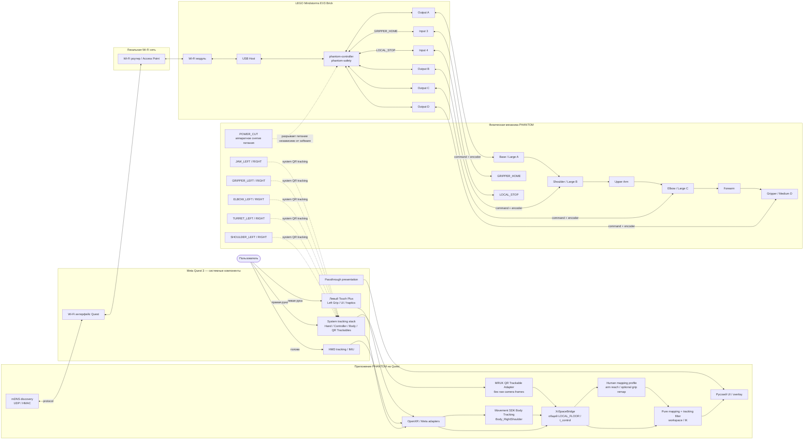

Диаграмма является логической, а не схемой электрических соединений. Критические положения:

- PHANTOM **не получает raw RGB/passthrough camera frames** для QR. QR распознаёт системный Meta Trackables service, а приложение получает `MRUKTrackable`/anchor pose и payload через `QrTrackingAdapter`;
- passthrough используется для визуального совмещения/UI, а не как собственный компьютерно-зрительный pipeline PHANTOM;
- `XrSpaceBridge` — единственный путь преобразования Wrist, Body Tracking и QR pose в согласованный `LOCAL_FLOOR`; смешивание Unity world/OVRCameraRig TrackingSpace координат напрямую в `Mapping` запрещено;
- `LOCAL_STOP` находится на `in4`, `GRIPPER_HOME` — на `in3`; оба читаются локально EV3;
- `POWER_CUT` является отдельным физическим устройством в цепи питания и не представлен software input-портом;
- EV3 не получает видеопоток и не распознаёт QR самостоятельно; Quest не формирует PWM/duty.

<a id="sec-4-2"></a>
## 4.2. Разделение ответственности

| Функция | Quest | EV3 | Конструкция |
|---|---|---|---|
| Отслеживание руки, HMD и Left Grip | получает и валидирует | — | — |
| Проверка `LOCAL_FLOOR`, Spatial Data/QR capabilities | выполняет | — | — |
| Калибровка пользователя | выполняет | — | — |
| `RobotLocalization` | вычисляет только по QR | — | обеспечивает жёсткие QR крепления |
| `CommissioningBundle` (`RobotGeometry`/`DriveCalibration`/`JointSafeSet`/SafetyEnvelope) | использует и сверяет hash | хранит authoritative safety subset и сверяет общий hash | физически определяет исходные измеряемые параметры |
| `DriveCalibration` | измеряет физические углы по QR и рассчитывает модель | собирает отсчёты энкодеров и хранит коэффициенты | физически определяет передачу |
| `JointReference` текущего запуска | измеряет `q_qr` и отправляет данные привязки | связывает текущий исходный отсчёт энкодера с физическим углом | механика остаётся неподвижной во время привязки |
| Абсолютная цель TCP и IK | вычисляет | не пересчитывает IK | задаёт доступную кинематику |
| Скорость/ускорение физического движения | прогнозирует для UI | окончательно ограничивает `q_ref` | допускается только квалифицированный диапазон |
| PWM/duty | не формирует | единственный штатный владелец | исполняется моторами |
| Заклинивание/контакт | отображает | детектирует по энкодеру, скорости, `duty` и состоянию | обеспечивает механическую податливость и механический ограничитель/упор |
| Заклинивание / перегрузка мотора | — | определяет по `duty`, запросу движения, скорости энкодера и ошибке положения | должна выдерживать допустимую нагрузку без разрушения |
| Потеря процесса `phantom-controller` | — | `phantom-safety` перехватывает остановку и включает `BRAKE` | пассивные меры ограничивают последствия |
| Common-mode отказ EV3/Linux/питания | — | software не считается независимым safety channel | внешний `POWER_CUT` снимает энергию; пассивная механика ограничивает последствия |

<a id="sec-4-3"></a>
## 4.3. Состояния системы

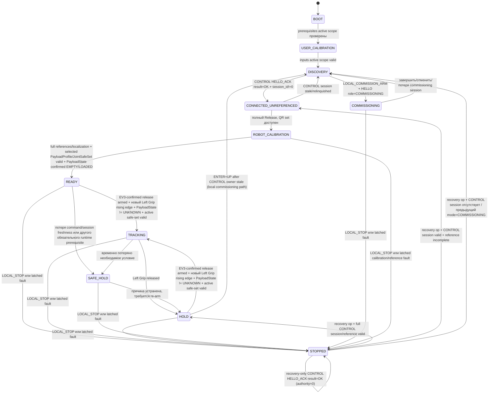

`READY` остаётся состоянием **только полностью собранного и полностью откалиброванного PHANTOM**. Неполный стенд никогда не маскируется под `READY`. При этом `READY` — не синоним «любой привод сейчас может двигаться»: actuator authority вычисляется отдельными gates. В частности, `PayloadState=UNKNOWN` или pending payload transition оставляют A/B/C hard-inhibited; **невыбранный/несовместимый PayloadProfile/JointSafeSet либо startup `PayloadState=UNKNOWN` вообще не допускают переход `ROBOT_CALIBRATION→READY`**; UI обязан явно показывать «ГОТОВНОСТЬ СИСТЕМЫ / ДВИЖЕНИЕ ЗАБЛОКИРОВАНО» и конкретную причину, а новый `Left Grip` rising edge не снимает такой inhibit. `CONNECTED_UNREFERENCED` и `HOLD` являются состояниями CONTROL-domain: они могут сохранять stale-but-replaceable control context при сетевом recovery, но никогда не используются как recovery state бывшей commissioning session. Для network-only scope `0x00` имя `CONNECTED_UNREFERENCED` является legacy wire name: references там `N_A`, состояние означает только authenticated connected-but-not-READY.

Если CONTROL command/session freshness теряется уже в `READY`, система не остаётся формально `READY`: она переходит в `SAFE_HOLD` с отменённым armed-latch и после восстановления валидной CONTROL session — в `HOLD`/deliberate re-arm. `HOLD` может кратковременно сохранять stale-but-replaceable control context без движения; это не даёт actuator authority и не отменяет session freshness gates.

`FAULT` **не является отдельным wire state protocol v1**: любой latched fault condition принудительно передаётся как `state=STOPPED` плюс соответствующий ненулевой `fault_code`. `FAULT_ACK` очищает только устранённый fault latch; `RESET_STOPPED` снимает stop latch `LOCAL_STOP` после физического release. Если одновременно действовали оба latch, для выхода из `STOPPED` должны быть выполнены обе соответствующие операции. Recovery op никогда не armed motion: full CONTROL возвращается в `HOLD` или `CONNECTED_UNREFERENCED` по reference, бывший commissioning/no CONTROL — в `DISCOVERY`; `MAINTENANCE_REQUIRED` остаётся `STOPPED` до завершения обслуживания. `LOCAL_STOP`/fault в `COMMISSIONING` уничтожает session-local commissioning authority, поэтому новый actuator authority требует новой `LOCAL_COMMISSION_ARM → HELLO role=COMMISSIONING → local ENTER`.

`COMMISSIONING` имеет две внутренние, взаимоисключающие фазы, которые не добавляют новый wire-state code:

1. `CALIBRATION` — разрешены только ограниченные `CALIBRATION_JOG`, `MOTION_ENABLE=0`;
2. `ACTUATOR_QUALIFICATION` — разрешается штатный `COMMAND` только на приводах из authoritative `actuator_scope_mask` текущего `qualification_only` bundle. `safety_observation_mask` отдельно задаёт оси, чьё фактическое положение обязательно safety logic и authority не расширяет. Переход в эту фазу возможен только после валидных calibration/reference motor-authorized приводов и, для partial A/B/C, всех safety-observed A/B/C и **явного локального подтверждения `ENTER` на EV3**, пока commissioning session активна. При входе `qualification_armed=false`; сам `ENTER` никогда не разрешает motion. EV3 должен затем в той же session принять безопасный OFF/HOLD `COMMAND` (`MOTION_ENABLE=0`, `HOLD_REQUEST=1`) после фактического release Left Grip на Quest, и только последующий новый rising edge может установить motion permission. Сетевой пакет сам по себе не может включить фазу, а локальный ENTER сам по себе не может вооружить движение.

Для раннего gripper-only стенда допускаются только `actuator_scope_mask=0x08` и `safety_observation_mask=0x08`. В этой фазе A/B/C либо физически отсутствуют, либо остаются hard-inhibited; `JointReference A/B/C`, `RobotLocalization`, `JointSafeSet`, Body Shoulder/Wrist и `human_arm_reach` не требуются. Потеря commissioning session, `LOCAL_STOP`, fault, process/safety heartbeat или несовместимость bundle немедленно запрещают scoped motor output и выводят из qualification phase. Потеря/восстановление grasp или `Left Grip` не может автоматически возобновить движение: требуется фактическое release, принятый EV3 OFF/HOLD с telemetry-confirmed `release_seen` и только затем новый rising edge.

В полном пользовательском режиме `SAFE_HOLD` всегда снимает armed-latch движения. После устранения временной причины система возвращается в `HOLD`; оператор должен отпустить `Left Grip`, после чего Quest выполняет OFF/HOLD release-handshake и остаётся dearmed до свежего telemetry-подтверждения принятого `release_off_sequence`. Только затем новый rising edge разрешает `TRACKING`. Latched fault condition переводит wire-state в `STOPPED`, дополнительно требует предусмотренного fault class подтверждения/обслуживания; reference-invalidating fault инвалидирует соответствующий `JointReference` и/или `GripperReference`.

<a id="sec-4-4"></a>
## 4.4. Последовательность запуска

При полном Release приложение сначала получает пользовательские параметры, необходимые для A/B/C mapping, и только затем переходит к discovery/привязке PHANTOM. В Diagnostic qualification profile `USER_CALIBRATION` зависит от `actuator_scope_mask`: network-only scope `0x00` не требует пользовательских измерений, gripper-only `0x08` проверяет grasp и `Left Grip`, но не требует `Body_RightShoulder`, Wrist-vector mapping или `human_arm_reach`.

```mermaid
sequenceDiagram
  actor U as Пользователь
  participant Q as Quest
  participant X as XR Space
  participant D as mDNS/DNS-SD
  participant R as PHANTOM QR
  participant E as EV3

  U->>Q: запуск приложения
  Q->>X: LOCAL_FLOOR + Spatial Data + Scene/Anchor/QR capabilities
  alt обязательная capability не готова
    Q->>U: русская инструкция по разрешению/настройке XR
    Q->>X: повторная проверка capability после системного UI
  end

  Q->>Q: запустить Upper-Body Body Tracking
  Q->>Q: дождаться valid Body_RightShoulder
  Q->>U: полностью выпрямить руку в нескольких позах
  Q->>Q: human_arm_reach = устойчивое расстояние Body_RightShoulder→Wrist
  Q->>Q: проверить OpenXR graspValue/graspReady
  opt нужен accessibility remap
    Q->>U: выполнить open/closed remap gesture
  end
  Q->>U: проверка виртуального движения руки

  Q->>D: browse type=_phantom-ev3._udp domain=local.
  D-->>Q: robot_id + address + port + protocol
  Q->>E: HELLO + HMAC
  E-->>Q: HELLO_ACK(result_code, session_id) + controller_boot_id + hashes
  alt result_code != OK или session_id == 0
    Q->>U: показать причину, остаться в discovery/recovery, motion authority=0
    Q->>Q: прекратить этот startup attempt; новый путь начинается с fresh discovery/HELLO
  else result_code == OK и session_id != 0
    Q->>U: покажите PHANTOM QR-маркеры
    R-->>Q: base/link/gripper marker poses для startup-калибровки
    E-->>Q: CALIBRATION_SAMPLE raw encoders
    Q->>Q: RobotLocalization + q_qr + jaw opening
    Q->>E: SET_JOINT_REFERENCE(transaction_id, q_qr, encoder sample id)
    E-->>Q: REFERENCE_ACK q_actual
    Q->>Q: QR↔encoder consistency check
    Q->>U: выбрать применимый PayloadProfile
    Q->>E: SET_PAYLOAD_PROFILE в ROBOT_CALIBRATION
    E-->>Q: CONTROL_ACK; active profile/safe-set authoritative
    Q->>U: подтвердить фактическое EMPTY/LOADED
    Q->>E: SET_PAYLOAD_STATE в ROBOT_CALIBRATION
    E-->>Q: CONTROL_ACK; payload state authoritative
    Q->>Q: product-state READY, motion disabled
    Q->>Q: operational-ready indication после valid payload gates
    Q->>Q: armed=false, дождаться Left Grip released
    Q->>E: priority OFF/HOLD COMMAND; remember release_off_sequence
    E-->>Q: fresh TELEMETRY last_accepted_command_sequence >= release_off_sequence
    Q->>Q: armed=true только после подтверждения EV3 release_seen
    alt новый Left Grip rising edge
      Q->>E: COMMAND current absolute q_target + grip_intent
    end
  end
```


Полная sequence diagram выше описывает production startup до `READY`. Для раннего gripper-only стенда используется отдельный **инженерный путь внутри того же приложения и протокола**, без фиктивной полной привязки:

```text
Quest app (Diagnostic, qualification_only, scope=D)
→ grasp + Left Grip readiness
→ discovery нужного robot_id без создания CONTROL session
→ приложение просит локально активировать LOCAL_COMMISSION_ARM на EV3
→ ENTER+UP на EV3 открывает bounded commissioning-arm window в DISCOVERY
→ HELLO role=COMMISSIONING в пределах этого окна → прямой переход в COMMISSIONING
→ при необходимости инженерная калибровка D (§5.16.8)
→ CALIBRATION_SAMPLE только применимого scope
→ QR JAW_LEFT/RIGHT → jaw_opening
→ SET_JOINT_REFERENCE с D-scope semantics
→ REFERENCE_ACK: joint_reference_valid=0, gripper_reference_valid=1
→ пользователь отпускает Left Grip
→ локально нажимает ENTER на EV3: перейти в COMMISSIONING/ACTUATOR_QUALIFICATION
→ Quest передаёт priority OFF/HOLD COMMAND и ждёт fresh TELEMETRY с last_accepted_command_sequence >= release_off_sequence
→ только после EV3-confirmed release_seen Quest armed=true
→ новый Left Grip rising edge разрешает COMMAND.grip_intent только для D
```

Полная кривая `DriveCalibration[D]` **не пересчитывается при каждом запуске**. Она сохраняется после этапа 4 и повторяется только после изменения механики/`GRIPPER_HOME`/QR-to-contact geometry или провала валидации. Обычный запуск gripper-only стенда выполняет только быструю `GripperReference` текущего запуска.

<a id="sec-4-5"></a>
## 4.5. Последовательность движения

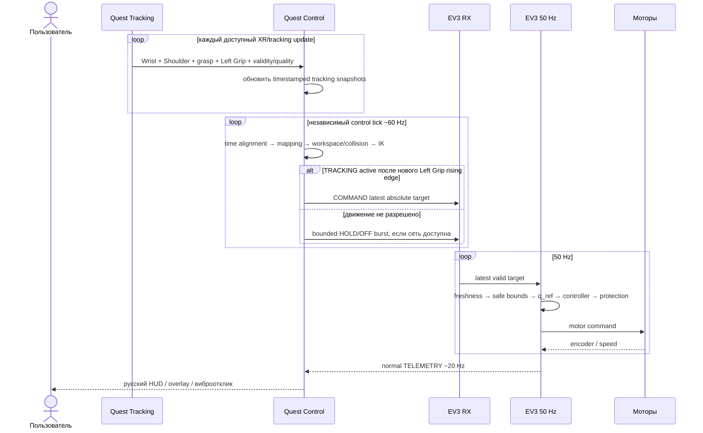

<a id="sec-4-6"></a>
## 4.6. Сетевое обнаружение EV3

EV3 публикует DNS-SD/mDNS service:

```text
service type: _phantom-ev3._udp
browse domain: local.
full browse name: _phantom-ev3._udp.local.
instance:     PHANTOM-<robot_id>
port:         фактический IPv4 UDP command port
TXT:
  robot_id=phantom01
  protocol_major=1
  controller_boot_id=<32 hex chars>
  build_id=<installed build id>
```

На EV3 publication выполняется через системный Avahi по D-Bus; собственная реализация mDNS-пакетов не используется. В API Avahi `type="_phantom-ev3._udp"`, `domain="local."` (либо default domain, подтверждённый как `local.`), publication ограничена IPv4 для protocol v1. Android Quest передаёт `NsdManager` именно service type `_phantom-ev3._udp`; `.local` не является частью serviceType. TXT содержит только публичную identity/compatibility metadata. Wi-Fi credential, control/commissioning PSK, HMAC material, session id и локальные пути к secret files в TXT запрещены.

Scope v1 допускает обнаружение нескольких DNS-SD instances, но активна только одна выбранная/ожидаемая пара Quest↔`robot_id`; одновременное управление несколькими роботами не реализуется.

Quest должен:

1. выполнять browse при запуске и после потери соединения;
2. выбирать сервис по `robot_id`, а не по IP;
3. разрешать текущее имя сервиса в IPv4/port непосредственно перед установлением сессии; IPv6-only result в v1 не используется для control;
4. при изменении адреса закрывать старую сетевую сессию и создавать новую;
5. не переносить `session_id` или `controller_boot_id` на новый обнаруженный сетевой адрес без повторного установления сессии.

Quest discovery adapter использует platform `NsdManager`/DNS-SD и обязан учитывать platform lifecycle/permission contract: discovery останавливается при уничтожении соответствующего app lifecycle owner и запускается заново при возвращении; на старых Android/SDK-extension комбинациях, где foreground mDNS требует ручного `WifiManager.MulticastLock`, lock удерживается только bounded временем discovery и гарантированно освобождается. Local-network permission policy определяется §3.2.6/§8.8 и не подменяется сохранённым IP.

В инженерном `Diagnostic` допускается ручной ввод адреса для лабораторной диагностики, но он не является штатным пользовательским механизмом и не заменяет проверку `robot_id`/HMAC.

<a id="sec-4-7"></a>
## 4.7. Сетевой протокол

<a id="sec-4-7-1"></a>
### 4.7.1. Транспорт

Используется UDP в доверенной локальной сети. **PHANTOM protocol v1 квалифицирует только IPv4 transport**: EV3 listener и DNS-SD publication обязаны предоставлять IPv4 endpoint, а Quest не переключается молча на IPv6. IPv6 может быть добавлен только после отдельной simulator/device/HIL qualification без изменения identity semantics. Поток движения реализует семантику «последняя валидная цель заменяет старую».

```text
порт EV3 по умолчанию: 30470
максимальная датаграмма целиком: 1024 bytes
максимальная полезная часть при header=64 и HMAC=32: 928 bytes
byte order: little-endian
float: IEEE-754 binary32
protocol_version: 1
```

<a id="sec-4-7-2"></a>
### 4.7.2. Аутентификация

Каждая датаграмма завершается:

```text
HMAC-SHA-256(PSK, header || payload)
```

`PSK` содержит не менее 32 случайных байт. HMAC сравнивается constant-time. HMAC не шифрует payload и не скрывает телеметрию.

<a id="sec-4-7-3"></a>
### 4.7.3. Общий заголовок

| Поле | Тип | Смысл |
|---|---|---|
| `magic` | 4 байт | ASCII `PHNT` |
| `version` | `u16` | `1` |
| `message_type` | `u16` | тип сообщения |
| `header_length` | `u16` | `64` |
| `payload_length` | `u16` | длина полезной части сообщения |
| `flags` | `u32` | флаги сообщения |
| `session_id` | 16 байт | `0` в `HELLO` и в отклонённом authenticated `HELLO_ACK`; при успешном `HELLO_ACK(result_code=OK)` EV3 возвращает новый ненулевой CSPRNG 128-bit session id, затем он обязателен во всех сообщениях session |
| `controller_boot_id` | 16 байт | случайный идентификатор запуска `phantom-controller`; Quest получает его из DNS-SD TXT и/или `HELLO_ACK`, `HELLO` обязан адресовать текущий boot id |
| `sequence` | `u64` | монотонный номер сообщения отправителя |
| `sender_monotonic_us` | `u64` | диагностическое монотонное время отправителя |
| `hmac` | 32 байта после полезной части | тег HMAC |

`HELLO` имеет `session_id=0`; его payload содержит `robot_id`, `protocol_minor`, bounded `key_slot`, `session_role` и свежий CSPRNG `client_nonce[16]`. `controller_boot_id` обязан быть взят из актуального DNS-SD TXT. Если он отсутствует/невалиден, Quest не посылает CONTROL `HELLO`, а повторяет discovery; нулевой boot id в v1 не разрешён. После exact HELLO length check принимающая сторона может прочитать фиксированные `key_slot/session_role` **только как недоверенные selectors** для выбора одного заранее установленного PSK, затем проверяет HMAC; `robot_id`, nonce и остальные semantic поля доверяются/валидируются только после HMAC. Только EV3 создаёт `session_id` и возвращает его в `HELLO_ACK` вместе с эхом `client_nonce`. `HELLO_ACK.result_code=OK` означает успешное создание session и требует ненулевой `session_id`; authenticated semantic rejection (`ERR_CONTROL_SESSION_BUSY`, `ERR_COMMISSIONING_NOT_ARMED`, role/key-slot mismatch и аналогичные post-HMAC ошибки) возвращается тем же `HELLO_ACK` с `session_id=0` и ненулевым `result_code`, не создаёт owner/session authority и не разрешает трактовать остальные diagnostic fields как active-session state. Для authenticated rejected `HELLO_ACK` поля `accepted_key_slot/accepted_role` **эхо-повторяют уже HMAC-проверенные selectors запроса**, identity/build/hash/state/reference/capability поля описывают текущий EV3, но не создают authority; safe bounds/limits при отсутствии выбранного применимого runtime profile имеют canonical zero. Для **любого** `HELLO_ACK`, включая successful session, fixed-layout поля с неприменимой для active bundle/runtime семантикой имеют единственное каноническое представление: отсутствующий semantic component hash=`32*0x00`; `active_joint_safe_set_hash=0` при `UNSELECTED`/неприменимом JointSafeSet; reference bit для неприменимого domain=`0`; A/B/C `safe_joint_*` и `joint_max_*` равны `0.0f` для оси, не входящей в применимый A/B/C motor/safety domain. Поэтому network-only `0x00/0x00` возвращает нулевые `robot_geometry_hash/drive_calibration_hash/active_joint_safe_set_hash/payload_profiles_hash`, `reference_flags=0` и все A/B/C limits=0, но **ненулевой** `commissioning_bundle_hash` своего network-only bundle. D-only `0x08/0x08` после gripper commissioning может иметь ненулевые hash gripper-geometry/DriveCalibration subset и `GRIPPER_REFERENCE_VALID`, но `JOINT_REFERENCE_VALID=0`, `active_joint_safe_set_hash=0` и все A/B/C limits=0. Partial A/B/C qualification заполняет limits только для реально применимого A/B/C domain bundle; нули вне него означают `N_A`, а не физическое значение ноль. Unknown/uninstalled key slot и bad HMAC остаются silent drop, чтобы unauthenticated traffic не получал oracle/response. Свежесть COMMAND определяется временем приёма EV3, а не сравнением часов устройств.

Перед type-specific payload parsing выполняются exact length checks из §11.8. Total datagram не превышает `1024` bytes, `header_length=64`, `payload_length<=928`, а `actual_length=64+payload_length+32`.

Session lifecycle:

- одновременно существует не более одной `CONTROL` session; пока она свежая или `TRACKING` активен, иной криптографически валидный `CONTROL HELLO` получает rejected `HELLO_ACK(result_code=ERR_CONTROL_SESSION_BUSY, session_id=0)`;
- `COMMISSIONING` session создаётся только при отсутствии активной CONTROL session, состоянии `DISCOVERY` и действующем локальном arm-window `LOCAL_COMMISSION_ARM`; успешный `HELLO role=COMMISSIONING` напрямую переводит EV3 `DISCOVERY → COMMISSIONING`. Normal CONTROL и commissioning session одновременно не существуют. Protocol v1 **не имеет `SESSION_CLOSE` datagram**: добровольный отказ Quest от CONTROL выполняется bounded OFF/HOLD burst → прекращение CONTROL traffic → локальное удаление session; EV3 после `session_stale_ms` инвалидирует owner/session. Если приложение уже имело CONTROL context, commissioning допускается только после фактического исчезновения fresh CONTROL owner и локального перехода/подтверждения `DISCOVERY`; network packet не может ускорить этот переход. Та же commissioning session может после калибровки перейти во внутреннюю фазу `ACTUATOR_QUALIFICATION`; потеря session немедленно завершает эту фазу;
- `HELLO role=CONTROL` в `STOPPED` допускается как **recovery-only CONTROL session**, если HMAC/key/robot/boot valid и активной commissioning session нет. Пока blocking latch не очищены, такая session никогда не получает actuator authority и допускает только `PING`, telemetry/diagnostics и recovery transactions `FAULT_ACK`/`RESET_STOPPED`; после успешного recovery она продолжает обычный CONTROL lifecycle, но начинает dearmed с `release_seen=false`;
- после timeout/перехода в `HOLD`/`SAFE_HOLD` новая валидная CONTROL session может заменить старую, при этом moving target/sequence/armed-latch/release latch старой session инвалидируются;
- duplicate `HELLO` с тем же `(endpoint, role, client_nonce)` внутри `hello_retry_window_ms` возвращает тот же cached semantic `HELLO_ACK`/session id **только пока соответствующая session/config generation остаётся authoritative**. Любая invalidation session, смена `commissioning_bundle_hash`, `controller_boot_id`, role-owner state или explicit config-commit invalidation немедленно инвалидирует HELLO cache; после этого тот же nonce не может воскресить старую session и обрабатывается как новый/current-state handshake либо reject;
- после retry window такой HELLO является новым handshake и получает новый server-generated session id; replay старых COMMAND не подходит к нему по `session_id`/HMAC;
- `sequence` строго возрастает отдельно по направлению внутри session, начинается с `1` после handshake, wrap запрещён;
- защита от L2/UDP replay-DoS не заявляется как криптографическая гарантия v1; trusted/isolated LAN остаётся обязательным допущением §3.2.6.

Нормативным single source of truth **структуры** wire format является `/protocol/wire_schema.yaml`. Он обязан задавать для **каждого** message type точный порядок полей, scalar type/width, enum numeric values, bit positions, fixed array lengths, reserved bytes и exact payload length; human-readable mirror приведён в §11.8. Контекстные semantic ranges и transition guards (в том числе зависящие от active `CommissioningBundle`) нормативно задаются текстом соответствующих разделов, поскольку их нельзя корректно свести к одному статическому scalar range. Из схемы генерируются canonical projection, C++14/C# constants/size maps и golden vectors. C++/C#/Python serializers/deserializers могут быть hand-written, но не являются отдельным source of truth: CI обязан декодировать/проверять ими общие golden bytes и negative vectors, а stale generated metadata блокирует gate. `protocol_schema_hash=SHA-256(wire_schema.canonical.json JCS bytes)` включается в build manifest/`HELLO_ACK`; canonical JSON projection детерминированно строится из `/protocol/wire_schema.yaml` по §8.2, поэтому YAML whitespace/line endings не входят в identity.

<a id="sec-4-7-4"></a>
### 4.7.4. Типы сообщений

| Значение | Сообщение | Направление | Назначение |
|---:|---|---|---|
| `0x0001` | `HELLO` | Quest→EV3 | начало логической сессии |
| `0x0002` | `HELLO_ACK` | EV3→Quest | идентификатор робота, сборка, конфигурация и возможности |
| `0x0010` | `CALIBRATION_QUERY` | Quest→EV3 | запрос атомарного снимка исходных отсчётов энкодеров |
| `0x0011` | `CALIBRATION_SAMPLE` | EV3→Quest | исходные отсчёты энкодеров и `sample_id` |
| `0x0012` | `SET_JOINT_REFERENCE` | Quest→EV3 | установить текущую QR↔энкодер привязку |
| `0x0013` | `REFERENCE_ACK` | EV3→Quest | результат привязки |
| `0x0014` | `COMMISSIONING_SAMPLE` | Quest→EV3 | принятое после остановки QR↔энкодерное измерение для журнала инженерной калибровки; успешное/идемпотентно повторённое принятие подтверждается `CONTROL_ACK(operation_type=0x0014)` |
| `0x0015` | `CALIBRATION_JOG` | Quest→EV3 | ограниченное малое калибровочное перемещение одной оси |
| `0x0016` | `JOG_ACK` | EV3→Quest | результат перемещения и атомарный итоговый снимок энкодеров |
| `0x0017` | `SET_DRIVE_CALIBRATION` | Quest→EV3 | передать проверенную `DriveCalibration` после контроля на независимых положениях |
| `0x0018` | `DRIVE_CALIBRATION_ACK` | EV3→Quest | результат проверки и атомарного сохранения калибровки |
| `0x0020` | `FAULT_ACK` | Quest→EV3 | подтверждение устранённой неисправности |
| `0x0021` | `CONTROL_ACK` | EV3→Quest | идемпотентный ACK управляющей операции |
| `0x0022` | `RESET_STOPPED` | Quest→EV3 | запрос выхода из latched `STOPPED` после физического отпускания `LOCAL_STOP`; требует re-arm |
| `0x0023` | `SET_PAYLOAD_PROFILE` | Quest→EV3 | выбрать установленный в active bundle `PayloadProfile` и его safe-set; production требует evidence-qualified profile, qualification-only допускает только candidate profile по §4.7.5; production: startup `ROBOT_CALIBRATION` после full reference либо `READY/HOLD`; engineering: только разрешённые qualification cases §4.7.5; всегда stationary |
| `0x0024` | `SET_PAYLOAD_STATE` | Quest→EV3 | подтвердить `EMPTY`/`LOADED`; production: startup `ROBOT_CALIBRATION` либо `READY/HOLD`; engineering: только qualification cases §4.7.5; всегда stationary и arm-invalidating |
| `0x0100` | `COMMAND` | Quest→EV3 | последняя абсолютная цель движения |
| `0x0200` | `TELEMETRY` | EV3→Quest | штатное фактическое состояние |
| `0x0201` | `DIAGNOSTIC_TELEMETRY` | EV3→Quest | расширенные данные только в Diagnostic |
| `0x0300` | `PING` | оба | RTT/доступность |
| `0x0301` | `PONG` | оба | ответ |

Операции, изменяющие persistent/session state или физическое состояние (`FAULT_ACK`, `RESET_STOPPED`, `SET_PAYLOAD_PROFILE`, `SET_PAYLOAD_STATE`, `COMMISSIONING_SAMPLE`, `CALIBRATION_JOG`, reference/calibration writes) сериализованы: Quest не отправляет вторую state-changing transaction, пока первая не завершена/не истёк её bounded retry policy. `transaction_id:u64` строго возрастает **в пределах одной session**.

Transaction layer начинается только после успешных HMAC, session/boot, wire-sequence и exact type-length checks, когда `transaction_id` безопасно доступен. Для `id==last+1` controller вычисляет `canonical_request_hash = SHA-256(message_type_le_u16 || exact_payload_bytes)` **до semantic field/range/state checks**, затем выполняет operation validation. Любой сформированный operation-specific ACK (`OK` или детерминированный `ERR_FORMAT/ERR_RANGE/ERR_STATE/ERR_REFERENCE/ERR_FAULT/ERR_HASH_MISMATCH/...`) считается завершённой transaction: `{id,hash,response_message_type,ack_payload_bytes}` сохраняется и `last_transaction_id` продвигается. Исправленная операция поэтому использует **следующий** transaction id; повтор того же id с изменённым payload является conflict. Пакеты, отброшенные до transaction layer (bad HMAC/session/boot/wire sequence/exact length), transaction id не consume-ят. `ERR_TRANSACTION_STALE/CONFLICT/GAP` также не продвигают `last_transaction_id`.

Exact retry `id==last && hash==last_hash` не повторяет side effect и возвращает тот же semantic ACK payload/result; `phantom-network` оборачивает его в новую ответную wire-datagram с очередным EV3→Quest `sequence`, актуальным `sender_monotonic_us` и заново вычисленным HMAC. Повтор byte-identical старой datagram запрещён. `id==last && hash!=last_hash` → `ERR_TRANSACTION_CONFLICT`; `id<last` → `ERR_TRANSACTION_STALE`; `id>last+1` → `ERR_TRANSACTION_GAP`. В новой session `last_transaction_id=0`, первая операция имеет `transaction_id=1`; session boundary не переносит idempotency физического side effect автоматически. Wire header намеренно не входит в canonical request hash, поэтому retry может иметь новый Quest→EV3 `sequence`.

<a id="sec-4-7-5"></a>
### 4.7.5. Сообщения инженерной калибровки и привязки

`CALIBRATION_QUERY` не двигает моторы. Для **startup/reference snapshot** EV3 атомарно читает все оси из `safety_observation_mask` и возвращает `CALIBRATION_SAMPLE` с уникальным `sample_id`, текущим `controller_boot_id`, скоростью и монотонным временем. Поля массивов A/B/C/D сохраняют fixed wire layout: оси вне `safety_observation_mask` передаются canonical zero/`N_A`; отсутствие/невалидность оси внутри safety-observation является hardware/config failure. Это принципиально шире motor authority при partial A/B/C qualification. Для движущегося `CALIBRATION_JOG` по-прежнему используется только `actuator_scope_mask`. Маски не передаются отдельными полями протокола — они входят в `CommissioningBundle`, хэш которого обязан совпадать на Quest и EV3; EV3 authoritative.

`CALIBRATION_JOG` разрешён только в `COMMISSIONING/CALIBRATION`, когда одновременно активны: session-local authority, полученная из физического `LOCAL_COMMISSION_ARM`, сессия role=`COMMISSIONING`, commissioning PSK, `MOTION_ENABLE=0` и остальные применимые safety predicates. UDP-команда сама по себе не может перевести EV3 в `COMMISSIONING`. Пакет содержит минимум:

```text
transaction_id
axis                    # A/B/C/D; axis обязан входить в actuator_scope_mask
signed_direction        # +1 / -1
max_encoder_delta
max_duration_ms
max_speed_counts_s
max_duty_pct
```

EV3 **не принимает из Quest целевой физический угол для `CALIBRATION_JOG`**. Он только ограниченно вращает вал выбранного мотора и прекращает движение при первом из условий: `max_encoder_delta`, `max_duration_ms`, локальное ограничение скорости или `duty`, признак препятствия/заклинивания, `LOCAL_STOP`, потеря heartbeat процесса безопасности или другая неисправность. Ограничения из пакета могут быть только строже локальных: фактический предел равен `min(requested_limit, local_engineering_limit)`, поэтому Quest не может сетевой командой увеличить разрешённые скорость, `duty`, длительность или изменение энкодера.

После управляемого плавного торможения и `BRAKE` EV3 возвращает `JOG_ACK`:

```text
transaction_id
result_code
axis
start_encoder_count
final_encoder_count
final_motor_speed
stop_reason
sample_id
```

Quest принимает `JOG_ACK`, ждёт полной остановки механики и только затем измеряет новый физический угол или раскрытие по QR. Exact retry `CALIBRATION_JOG` допустим только внутри той же session по общим transaction rules и возвращает сохранённый `JOG_ACK` result без второго движения. Если `JOG_ACK` не получен и session прекращена, Quest помечает шаг `OUTCOME_UNKNOWN` и **не replay-ит старый jog** после reconnect: требуется новый физический `LOCAL_COMMISSION_ARM`, новая commissioning session, подтверждённая stationary condition, новый `CALIBRATION_QUERY`/encoder snapshot и QR-наблюдение фактической позы; только затем рассчитывается следующий bounded jog от реально наблюдаемого состояния. `COMMISSIONING_SAMPLE` содержит согласованную пару `sample_id + encoder_count + physical_value/q_qr/jaw_opening + direction + QR quality` для журнала процедуры. Это сериализованная state-changing transaction: после durable принятия/пометки `sample_id` использованным EV3 возвращает `CONTROL_ACK(operation_type=0x0014)`; exact retry того же `transaction_id+payload` в той же session обязан получить тот же ACK payload/result без повторной записи/повторного consume `sample_id`, но с новым response header sequence/timestamp/HMAC. Quest не использует sample как доказательство принятого commissioning evidence до успешного ACK. Если session потеряна после возможного принятия sample без полученного ACK, старый sample не автоматически replay-ится: новая commissioning session получает новый snapshot/sample evidence и продолжает процедуру от наблюдаемого состояния. Расчёт `DriveCalibration` выполняется на Quest/PC, а не в 50-Hz цикле EV3.

После проверки на независимых контрольных положениях Quest передаёт `SET_DRIVE_CALIBRATION`. Полезная часть содержит `transaction_id`, хэш применимой `RobotGeometry`, новую редакцию/хэш калибровки, измеренные параметры и метрики проверки. Для Gripper передаются две ограниченные по размеру монотонные таблицы `(d_counts, opening_mm)` — для открытия и закрытия — плюс calibration-session closed anchor, signed safety-owned open travel `gripper_open_limit_delta_counts`, QR-измеренный safe-open endpoint и люфт. Wire-поле `gripper_open_limit_delta_counts` здесь является **validation echo** текущего authoritative `SafetyEnvelope`: транзакция обязана совпасть с ним byte-for-value и не может расширить/заменить safety bound; persistent `DriveCalibration[D]` не получает отдельный independently mutable hard-limit field. Число узлов таблицы фиксируется схемой протокола и выбирается минимальным, достаточным для прохождения ошибки §9.14; произвольный неограниченный массив в пакет не допускается.

`SET_DRIVE_CALIBRATION` сохраняет **только calibration subset active scope**. Fixed wire payload остаётся прежним: значения осей вне scope обязаны быть каноническими нулями и не валидируются как физическая калибровка. В gripper-only scope `0x08` учитываются поля D/curves/validation[D], а A/B/C игнорируются. `robot_geometry_hash` при этом относится к qualification bundle, содержащему как минимум версионированную gripper geometry (`JAW_* → contact` transforms); полная геометрия роборуки не требуется и такой bundle не разрешает `READY`.

EV3 принимает `SET_DRIVE_CALIBRATION` только при `MOTION_ENABLE=0`, полностью остановленных **всех физически обнаруженных моторах**, инженерном состоянии калибровки, совпавшей применимой `RobotGeometry`, корректном active scope и отсутствии неисправности безопасности. Он проверяет конечность и допустимость чисел, schema/ranges/монотонность таблиц, записывает candidate через временный файл + `fsync` + атомарное переименование и только после успешного повторного чтения возвращает `DRIVE_CALIBRATION_ACK`. Неуспешная транзакция не повреждает последнюю подтверждённую `DriveCalibration`.

Успешный `SET_DRIVE_CALIBRATION` **создаёт новую `CommissioningBundle` revision**, а не редактирует активный bundle «на месте». Для этой сериализованной transaction обе стороны детерминированно используют `new_bundle_revision = previous_bundle_revision + 1`; переполнение/неожиданный revision gap является config error. **До отправки** Quest durable-сохраняет `pending_candidate={old_bundle_hash,candidate_bundle_hash,candidate_drive_hash,transaction_id}`. EV3 атомарно формирует candidate bundle из новой revision, текущих неизменённых semantic components + принятого `DriveCalibration`, canonicalize по JCS и только затем активирует новый `commissioning_bundle_hash`.

Поскольку transport UDP, commit и получение ACK разделены. После commit EV3 переводит session в `CONFIG_STALE_ACK_ONLY`: actuator authority=0, но в bounded `config_commit_ack_grace_ms` принимает только exact retry последней committed state-changing transaction и возвращает тот же `DRIVE_CALIBRATION_ACK` payload/result, обёрнутый в новую datagram с новым outbound sequence/timestamp/HMAC; новые calibration/motion операции запрещены. После grace session закрывается. Quest после ACK либо после reconnect сверяет `HELLO_ACK.commissioning_bundle_hash`: если он равен durable pending candidate hash — pending revision атомарно становится active local bundle; если равен old hash — commit не состоялся и может быть повторён в новой commissioning session; любое третье значение является `ERR_HASH_MISMATCH`/manual reconciliation. ACK loss поэтому не может оставить Quest и EV3 в неразрешимом split-brain.

Любое принятое изменение `DriveCalibration` инвалидирует текущие `JointReference` и `GripperReference`: reference текущего запуска связан с конкретной calibration revision/hash и не переносится через её изменение. После ACK-only/reconciliation следующая reference/qualification выполняется только после нового discovery/`HELLO` уже с активной revision.

`SET_JOINT_REFERENCE` содержит `transaction_id`, хэш `DriveCalibration`, `sample_id`, `q_qr[3]`, `jaw_opening_qr_mm` и соответствующий атомарный снимок энкодеров A/B/C/D. EV3 принимает привязку только для текущего запуска, exact current `sample_id`/`controller_boot_id`, совместимой конфигурации и полей, требуемых `safety_observation_mask`; отвечает `REFERENCE_ACK` с вычисленными `q_actual`, `grip_actual` и reference flags. Если `REFERENCE_ACK` потерян и session затем прекращена, Quest не предполагает успех по возможному side effect: после нового `HELLO` выполняются новый stationary `CALIBRATION_QUERY`, свежая QR-observation и новый `SET_JOINT_REFERENCE` с новым transaction id. Существующая controller-side reference может быть безопасно заменена свежей; stale UI/cache не является evidence. Этот recovery path обязателен для HIL regression.

Reference-domain определяется **`safety_observation_mask`**:

- network-only `0x00`: A/B/C/D поля canonical zero/`N_A`, обе reference false;
- gripper-only `0x08`: Quest передаёт `q_qr[3]=0`, `raw_encoder_count[A/B/C]=0`; EV3 проверяет JAW gap + D и устанавливает только `GripperReference` (`JOINT_REFERENCE_VALID=0`, `GRIPPER_REFERENCE_VALID=1`);
- partial A/B/C `ACTUATOR_QUALIFICATION`: safety-observation обязана включать все A/B/C; Quest передаёт реальные `q_qr[3]` и raw A/B/C из **одного** snapshot, EV3 устанавливает `JointReference A/B/C` независимо от того, какая их часть находится в `actuator_scope_mask`. Если D не safety-observed, D/jaw fields canonical `N_A`; если D наблюдаем — дополнительно создаётся `GripperReference`;
- полный Release `0x0F`: создаются полные A/B/C/D references.

Motor-disabled safety-observed axis поэтому никогда не получает motor authority, но её реальная reference доступна `JointSafeSet`.

`FAULT_ACK` принимается только для текущего latched `fault_code`, когда причина объективно устранена и fault class не требует незавершённого maintenance. ACK очищает fault latch, но не снимает отдельный `LOCAL_STOP` stop latch и никогда не armed motion. После очистки последнего blocking latch recovery state выбирается по тем же правилам ниже.

`RESET_STOPPED` принимается только когда физический `LOCAL_STOP` уже released, **все физически обнаруженные моторы stationary**, нет unresolved maintenance-required fault и operation transaction новая. Успех снимает только local-stop latch, не очищает независимый fault latch, не вооружает движение и не восстанавливает session-local commissioning authority: после очистки всех blocking latch при живой CONTROL session следующий state выбирается между `HOLD`/`CONNECTED_UNREFERENCED` по reference, а после бывшей commissioning session — `DISCOVERY`.

`SET_PAYLOAD_PROFILE` выбирает только установленный в active `CommissioningBundle` профиль **вместе с его `JointSafeSet`**. В `qualification_only=false` profile обязан быть покрыт active `QualificationEvidenceManifest`; в `qualification_only=true` допускается только candidate profile, разрешённый engineering scope §4.7.5, и его использование само по себе не делает profile production-qualified. После boot active profile=`UNSELECTED` (reserved runtime sentinel, не допустимый ID установленного PayloadProfile), `active_joint_safe_set_hash=0`. Startup-вызов `SET_PAYLOAD_PROFILE` разрешён также в `ROBOT_CALIBRATION` **только после принятой полной JointReference/RobotLocalization**, при `MOTION_ENABLE=0`, stationary A/B/C/D и отсутствии latched fault; успешный ACK является первым payload gate перехода в `READY`. Во время эксплуатации смена профиля остаётся разрешённой только в `READY/HOLD` при тех же stationary условиях. `SET_PAYLOAD_STATE` содержит `transaction_id + profile_id + payload_state + payload_confirmation_nonce`; startup-подтверждение `EMPTY/LOADED` разрешено в `ROBOT_CALIBRATION` только **после** успешного выбора profile, при полной reference/localization, stationary A/B/C/D, `MOTION_ENABLE=0` и отсутствии latched fault. В эксплуатации операция разрешена только в `READY/HOLD`. Успешный startup ACK `SET_PAYLOAD_STATE` является вторым payload gate, и `ROBOT_CALIBRATION→READY` запрещён при `PayloadState=UNKNOWN`. В production CONTROL `payload_confirmation_nonce` генерируется Quest CSPRNG только после явного подтверждения оператора. В `COMMISSIONING/ACTUATOR_QUALIFICATION` HIL AUTO nonce генерируется авторизованным case runner после того, как исходный payload state задан и проверен fixture/case prerequisite **до запуска соответствующего motion segment**; дополнительное действие человека после старта AUTO-case не требуется и запрещено §9.1.4. Nonce служит только audit/correlation evidence, не заменяет HMAC/session/state authorization, а exact retry той же transaction обязан повторять тот же nonce. До ACK нового профиля EV3 загружает/валидирует его safe-set вне 50-Hz loop и атомарно меняет active profile+safe-set; при отсутствии/несовпадении hash операция отклоняется `FAULT_PAYLOAD_PROFILE`.

Смена профиля всегда устанавливает runtime `PayloadState=UNKNOWN` и очищает armed-latch. `UNSELECTED` нельзя передать через `SET_PAYLOAD_PROFILE`; это только локальный startup sentinel. После controller continuity loss ранее активный profile/safe-set не используется как authoritative без нового startup selection. `SET_PAYLOAD_STATE` от оператора принимает только `EMPTY` или `LOADED`; `UNKNOWN` устанавливается системой и не является операторской командой. `LOADED` отклоняется, если выбран профиль `EMPTY` или отсутствует совместимый installed PayloadProfile/JointSafeSet. Для подхода к ожидаемому предмету оператор выбирает non-empty profile, затем при stationary `READY/HOLD` явно подтверждает текущий пустой захват как `EMPTY`; с этого момента уже действуют консервативные limits/safe-set выбранного profile. После подтверждённого object/early contact §7.15.3 state снова становится `UNKNOWN` и A/B/C остаются в `HOLD` до явного `LOADED` либо release→`EMPTY`. После boot/controller continuity loss payload state также `UNKNOWN`; автоматический optimistic `EMPTY` запрещён.

`SET_PAYLOAD_PROFILE`/`SET_PAYLOAD_STATE` имеют отдельную fail-closed engineering semantics и **никогда не превращают `COMMISSIONING` в product `READY/HOLD`**:

- gripper-only `actuator_scope_mask=0x08`: обе операции недоступны; этапы 4–5 квалифицируют D без payload profile/state;
- narrow A/B/C qualification (`actuator_scope_mask` является строгим подмножеством `0x07` либо `0x0F`, но содержит A/B/C): после полной `JointReference A/B/C`, выбранного installed `EMPTY` profile+matching EMPTY `JointSafeSet`, stationary всех safety-observed/motor-authorized осей, `MOTION_ENABLE=0`, локальной commissioning authority и снятого qualification arm разрешается только `SET_PAYLOAD_PROFILE=EMPTY` и `SET_PAYLOAD_STATE=EMPTY`. `LOADED`, non-empty profile, pickup/contact-as-payload и release cases отклоняются `ERR_STATE`;
- full `actuator_scope_mask=safety_observation_mask=0x0F` qualification-only: при валидных A/B/C/D references, stationary A/B/C/D, active commissioning role/local authority, `MOTION_ENABLE=0`, qualification armed-latch=false и отсутствии fault разрешается выбирать установленный квалифицируемый PayloadProfile и подтверждать `EMPTY/LOADED`. Это используется **только** для HIL payload/contact/release evidence до promotion production bundle.

Любой успешный engineering profile/state transition инвалидирует moving target, очищает `release_seen/armed-latch` и требует нового OFF/HOLD→rising edge перед следующим qualification motion. Если ACK payload operation потерян и session затем исчезла, новая session не наследует операторское подтверждение как authority: tooling заново сверяет telemetry/profile hashes и повторяет безопасную явную selection/confirmation transaction перед motion; старый transaction id не переносится.

<a id="sec-4-7-6"></a>
### 4.7.6. `COMMAND`

```c
uint32 motion_flags;
float q_base_rad;
float q_shoulder_rad;
float q_elbow_rad;
float grip_intent;
uint32 reserved;
```

```text
bit0 MOTION_ENABLE
bit1 HOLD_REQUEST
bit2 TRACKING_VALID
bit3 GRASP_VALID
```

В полном `TRACKING` валидное движение требует `MOTION_ENABLE=1`, `HOLD_REQUEST=0`, `TRACKING_VALID=1`; при включённом D дополнительно требуется `GRASP_VALID=1` для изменения gripper target.

В `COMMISSIONING/ACTUATOR_QUALIFICATION` тот же wire `COMMAND` используется без отдельного gripper-протокола. EV3 исполняет **только** поля приводов active `actuator_scope_mask`. Для gripper-only `0x08` поля `q_base/q_shoulder/q_elbow` обязаны быть finite и канонически равны `0`, но не участвуют в actuator path; требуются `MOTION_ENABLE=1`, `HOLD_REQUEST=0`, `TRACKING_VALID=1`, `GRASP_VALID=1`. Здесь `TRACKING_VALID` означает валидность input stack, требуемого active scope, и не подразумевает Body Shoulder/Wrist.

Stop-like `COMMAND` с `MOTION_ENABLE=0` **или** `HOLD_REQUEST=1` всегда обрабатывается fail-safe раньше movement predicates и не требует `TRACKING_VALID`/`GRASP_VALID` для снятия разрешения. Но deliberate-release latch имеет более строгий canonical contract: `release_seen=true` устанавливается **только** после валидного release OFF/HOLD packet с `MOTION_ENABLE=0 && HOLD_REQUEST=1`; противоречивый `MOTION_ENABLE=1,HOLD_REQUEST=1` обязан остановить/удержать, но не может сам по себе доказать release или вооружить следующий edge. **Для любой motion-capable CONTROL/COMMISSIONING session** EV3 держит session-local `release_seen` и `last_motion_enable`: при новой session, входе в `SAFE_HOLD`, **входе в `STOPPED` по `LOCAL_STOP` или latched fault**, STOP/fault recovery, reference-space/lifecycle invalidation, bundle/profile change и иных arm-invalidating events `release_seen=false`, `last_motion_enable=false`. Канонический release OFF/HOLD packet устанавливает `release_seen=true`; первый последующий moving packet допускается только как новый false→true enable edge при `release_seen=true`, после чего обычные scope/input predicates снова обязательны. Quest при deliberate re-arm запоминает sequence первого/актуального release OFF/HOLD как `release_off_sequence` и **не** устанавливает локальный `armed=true`, пока свежая `TELEMETRY` текущей session/boot не покажет `last_accepted_command_sequence >= release_off_sequence`. До подтверждения он может повторять bounded priority OFF/HOLD по обычному sender/rate-limit policy, но moving packet запрещён. Потеря telemetry/session/boot до подтверждения оставляет dearmed. Поэтому retained/replayed `MOTION_ENABLE=1` после reconnect/recovery сам по себе не может возобновить motion.

Все float-поля проверяются на finite и допустимый протокольный диапазон. Ось вне scope всегда hard-inhibited локально независимо от содержимого пакета.

<a id="sec-4-7-7"></a>
### 4.7.7. Принятие команды

Общие условия:

```text
HMAC valid
session binding (включая expected robot_id)/controller_boot valid
sequence > last_accepted_sequence
нет latched fault
numeric fields valid
CommissioningBundle/profile hash compatible
```

Далее применяется state/scope gate:

```text
если state == TRACKING:
    qualification_only == false
    actuator_scope_mask == 0x0F
    JointReference A/B/C valid
    GripperReference valid, если D участвует
    full DriveCalibration/RobotGeometry/JointSafeSet valid
    active PayloadProfile + matching JointSafeSet valid
    PayloadState in {EMPTY, LOADED}; UNKNOWN никогда не допускает A/B/C motion
    PayloadState=LOADED допустим только с non-empty active PayloadProfile

если state == COMMISSIONING и phase == ACTUATOR_QUALIFICATION:
    session role == COMMISSIONING
    qualification_only == true
    local qualification confirmation current
    requested fields outside actuator_scope_mask never execute
    calibration/reference valid для всех motor-authorized приводов и всех осей из safety_observation_mask
    actuator_scope_mask & ~safety_observation_mask == 0
    если scope == 0x08:
        GripperReference + DriveCalibration[D] valid
        JointReference/RobotLocalization/JointSafeSet не требуются
    если actuator_scope включает A/B/C:
        safety_observation_mask обязан включать все A/B/C + каждый motor-authorized bit
        это допускается только после полной RobotGeometry + DriveCalibration + JointReference A/B/C + применимого profile-specific JointSafeSet + pre-motion gates §9/§10.11
        narrow scope: active PayloadProfile/State обязаны быть EMPTY/EMPTY
        full 0x0F qualification-only: PayloadState in {EMPTY, LOADED}, LOADED только с совместимым non-empty profile/safe-set
        сам движущийся HIL case является результатом qualification, а не её prerequisite
```

Таким образом `JointReference` не является глобальным prerequisite Motor D, что согласуется с инвариантами S6/S7. Любая несовместимость scope или попытка задействовать disabled axis отклоняется без motor write и журналируется.

<a id="sec-4-7-8"></a>
### 4.7.8. `TELEMETRY`

Штатная телеметрия должна содержать только данные, необходимые Quest для управления, отображения состояния и watchdog:

```text
robot_id
build_id                  # EV3 component/profile build_id
commissioning_bundle_hash
active_joint_safe_set_hash
state
status_flags
fault_code
incident_id
last_accepted_command_sequence
command_age_ms
q_actual[3]
q_speed[3]
grip_actual
grip_state
battery_mv
loop_health_flags
active_payload_profile_id
payload_state
build_profile
```

В `qualification_only` profile значения `q_actual/q_speed` передаются реальными только для осей из `safety_observation_mask`; оси вне этой маски имеют canonical zero/`N_A`. Поэтому при partial A/B/C `ACTUATOR_QUALIFICATION` неподвижная ось без motor authority всё равно может иметь реальный `q_actual`, если она требуется coupled-safety. Quest знает обе маски из локального `CommissioningBundle`, совпадение которого доказано `commissioning_bundle_hash`; отдельные wire-поля масок не вводятся. `safety_observation_mask` не расширяет motor authority. Все motor writes по-прежнему hard-inhibited вне `actuator_scope_mask`.

До startup profile selection поле `active_payload_profile_id` в EV3→Quest `TELEMETRY` нормативно содержит reserved runtime sentinel ASCII `UNSELECTED` в `id32`, `active_joint_safe_set_hash` состоит из 32 нулевых байт, а `status_flags.payload_profile_valid=0` и `status_flags.active_joint_safe_set_valid=0`; в таком состоянии `ROBOT_CALIBRATION→READY` запрещён. `UNSELECTED` допустим только как EV3→Quest runtime sentinel и никогда не является установленным `PayloadProfile`/допустимым аргументом `SET_PAYLOAD_PROFILE`. После успешного выбора profile telemetry обязана отражать его canonical installed ID и ненулевой совместимый safe-set hash.

`incident_id` равен нулю/пустому значению при отсутствии активного инцидента и содержит текущий корреляционный ID при latched fault/incident package.

`last_accepted_command_sequence` — наибольший wire `sequence` **принятого `COMMAND` текущей session**, включая OFF/HOLD `COMMAND`; rejected/malformed/auth-failed packets его не изменяют. `command_age_ms` — возраст по EV3 monotonic receive time последнего принятого `COMMAND` текущей session, также включая OFF/HOLD. Эти поля не являются общим ACK произвольных transaction messages, но нормативно используются Quest для подтверждения deliberate release-handshake: свежая telemetry с тем же boot/session context и `last_accepted_command_sequence >= release_off_sequence` доказывает, что соответствующий OFF/HOLD дошёл до command acceptance path. После новой session acceptance-context начинается заново и старое подтверждение не переносится.

Wire `state` по-прежнему остаётся `COMMISSIONING`, но active subphase должна быть наблюдаема: `TELEMETRY.status_flags.bit9=commissioning_actuator_qualification_active`. Бит устанавливается **только EV3** после успешного локального `ENTER` и всех qualification prerequisites и сбрасывается при reconnect/session loss, `LOCAL_STOP`, fault или выходе из phase. Quest может показывать собственный workflow-state, но разрешает qualification UI/moving command только когда видит authoritative bit9 в свежей telemetry; UI-state сам по себе actuator authority не создаёт.

`status_flags` bit layout v1 задан в §11.8 и включает `joint_reference_valid`, `gripper_reference_valid`, `commissioning_bundle_valid`, `local_stop_active`, `safety_supervisor_alive`, `grasp_contact`, `battery_derated`, `payload_profile_valid`, `active_joint_safe_set_valid` и authoritative `commissioning_actuator_qualification_active`; остальные reserved bits остаются нулевыми.

`loop_health_flags` сообщает нормальное состояние или факт недавнего overrun без передачи полного массива диагностических timing-счётчиков.

Поля `raw_encoder_count`, `q_ref`, `duty_pct`, детальные временные показатели цикла, счётчики парсера и измерения инженерной калибровки относятся к `DIAGNOSTIC_TELEMETRY` и не должны постоянно передаваться в штатном `Release`-режиме.

<a id="sec-5"></a>
# 5. Приложение Meta Quest 3

<a id="sec-5-1"></a>
## 5.1. Технологическая основа

Приложение работает автономно на Meta Quest 3 и использует:

- Unity с зафиксированной в lock/build manifest версией, совместимой с выбранными Meta XR packages; для текущей baseline-конфигурации версия Unity должна быть не ниже минимума актуальной Multimodal-документации;
- Unity OpenXR;
- Meta XR Core SDK **v83 или новее** и Meta MR Utility Kit **v83 или новее** для QR Trackables; точные версии фиксируются и не обновляются без regression;
- Meta XR Movement SDK с **явно выбранным и P0-квалифицированным Upper-Body provider** для `Body_RightShoulder`; `OVRBody` является возможным adapter, но не считается совместимым с Multimodal только по наличию API;
- Hand Tracking/OpenXR joint `Wrist` для правой руки;
- OpenXR Hand Interaction `grasp_ext/value` + readiness для степени сжатия;
- MRUK QR Trackables через отдельный `QrTrackingAdapter`; приложение использует системные Trackable/Anchor APIs и не получает/не обрабатывает raw RGB frames ради QR;
- OpenXR `LOCAL_FLOOR` как базовую XR reference space;
- Multimodal Input: правая рука без контроллера + левый Touch Plus Controller.

Для actuator profile v1 фиксируется совместимая комбинация features: **Multimodal включён; IOBT, FBS и FMM выключены; WMM не является источником actuator pose и не должен включаться в комбинации passthrough + Multimodal.** Это соответствует платформенной матрице совместимости и предотвращает скрытую смену tracking semantics. Body Tracking плеча остаётся оценочным базовым Body Tracking и допускается только после §9.6 qualification.

SDK-зависимый код изолирован от математики PHANTOM. `Mapping`, `Kinematics`, `WorkspaceProjector`, `RobotCollisionModel`, `DriveCalibration`, протокольные модели и state transitions не зависят от prefab-классов SDK. Все platform adapters возвращают нормализованные snapshots и capability/status, которые можно воспроизводить в replay tests.

<a id="sec-5-2"></a>
## 5.2. Условия запуска и XR readiness

Readiness оценивается относительно active profile; требования полного `READY` нельзя применять к раннему D-only стенду и затем обходить вручную.

**Network-only Stage 3 (`Diagnostic`, `qualification_only=true`, `actuator_scope_mask=0x00`, `safety_observation_mask=0x00`, `required_user_inputs=NONE`).** XR/tracking/QR вообще не являются prerequisite: network subsystem может пройти discovery/CONTROL-session/telemetry проверки без активных Hand/Body/Wrist/Left Grip/`LOCAL_FLOOR`. Требуются только lifecycle самого приложения, разрешённый platform LAN access и совместимый network-only bundle; `READY`/`TRACKING` недоступны. Это позволяет отдельно квалифицировать сеть и не превращает отсутствие надетого HMD в ложный network failure.

**Полный Release (`qualification_only=false`, `actuator_scope_mask=0x0F`, `safety_observation_mask=0x0F`).** Переход в `READY` запрещён, пока не выполнены:

```text
OpenXR session active
LOCAL_FLOOR valid
Spatial Data permission granted
Scene Support = Required и Anchor Support = Enabled (для MRUK QR Trackables)
QR tracking capability available when startup reference is required
right Hand Tracking / Wrist available
upper-body Body Tracking available
Body_RightShoulder valid
left Touch Plus available
Multimodal active
TrackingQualificationProfile matches qualified build/runtime configuration
QualificationEvidenceManifest hash valid for current production semantic component set
```

**Gripper-only qualification (`Diagnostic`, `qualification_only=true`, `actuator_scope_mask=0x08`, `safety_observation_mask=0x08`).** До получения D-only `GripperReference` и входа в `COMMISSIONING/ACTUATOR_QUALIFICATION` требуются только применимые этому actuator path условия:

```text
OpenXR session active + application focus valid
LOCAL_FLOOR / общий XR reference space valid
Spatial Data permission + QR Trackable capability available для JAW reference
right Hand Tracking + graspReady available
left Touch Plus + Left Grip available
Multimodal active
scope-specific TrackingQualificationProfile matches qualified build/runtime configuration
```

`Body_RightShoulder`, Wrist-vector mapping, `human_arm_reach`, `RobotLocalization` и полный QR-набор роборуки для scope `0x08` не требуются.

Сохранённая room mesh, semantic furniture и отдельный Scene floor anchor **не требуются** ни полному core actuator path, ни D-only qualification. Полный path использует `LOCAL_FLOOR` и QR для `RobotBaseFrame`; D-only path использует общий XR space только для согласованного JAW QR measurement.

`Space Setup` остаётся доступным только для опциональных scene-aware UI/room features или когда пользователь явно запускает такую функцию. После возврата приложение повторно проверяет действительно требуемые anchors; cancel не блокирует core actuator path, если scope-specific prerequisites остаются валидны.

При pause/focus loss приложение немедленно снимает `MOTION_ENABLE` и очищает armed-latch. После resume:

- полный A/B/C path заново проверяет Multimodal, Hand/Body Tracking, `LOCAL_FLOOR`, QR capability и при необходимости `RobotLocalization`; физическое движение возвращается только через `HOLD` и deliberate re-arm;
- gripper-only path заново проверяет Hand/grasp, левый Touch Plus, focus/lifecycle и JAW QR capability; система остаётся в `COMMISSIONING`, D остаётся dearmed до deliberate re-arm: release → EV3-confirmed OFF/HOLD → new rising edge. Body Shoulder/Wrist не являются gate.

При `XrEventDataReferenceSpaceChangePending` или эквивалентной смене tracking origin `MOTION_ENABLE` снимается заранее. В полном A/B/C path `RobotLocalization` инвалидируется и требуется новая QR-локализация. В D-only qualification сама смена XR origin не инвалидирует `GripperReference`, поскольку runtime D использует локальный encoder reference и скалярный `grip_intent`; при сомнении в непрерывности JAW↔encoder привязки выполняется новая D-only `GripperReference`.

<a id="sec-5-3"></a>
## 5.3. Внутренняя структура приложения

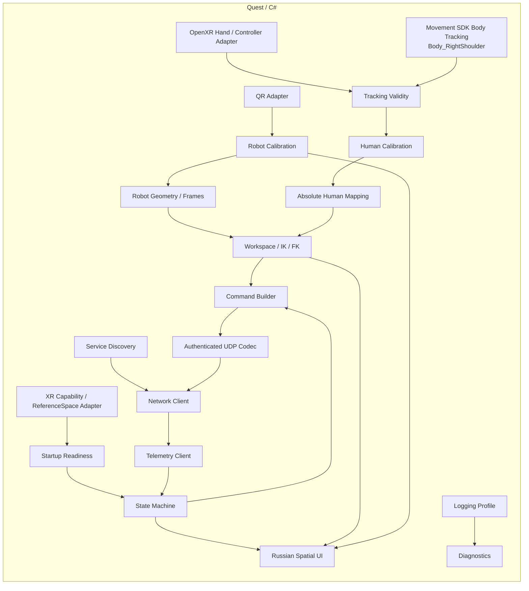

| Модуль | Обязанность |
|---|---|
| `Tracking` | получать `Wrist`, правую кисть, левый Controller, HMD для жизненного цикла XR и `Body_RightShoulder` из Body Tracking вместе с доступными validity/quality/fidelity признаками |
| `XrSpaceBridge` | приводить все actuator-relevant XR/Meta poses к одному `LOCAL_FLOOR` и согласованному `t_control`; скрывать различия OpenXR/OVRCameraRig TrackingSpace |
| `XrReadiness` | проверять `LOCAL_FLOOR`, reference-space change events, Spatial Data/Scene/Anchor/QR capabilities и Multimodal lifecycle; Room/Scene data — только опциональный UX |
| `HumanCalibration` | определять/выбирать `human_arm_reach` и опциональный `GripRemapProfile`; стандартный OpenXR grasp profile по умолчанию не требует endpoint-калибровки |
| `RobotCalibration` | QR-локализация, `q_qr`, раскрытие захвата, проверка `RobotGeometry` и QR↔энкодерная калибровка до `READY` |
| `Mapping` | абсолютное преобразование текущего вектора плечо→запястье в `P_requested_B` |
| `Kinematics` | pure mapping, аналитический `WorkspaceProjector`, fixed-branch IK/FK, `RobotCollisionModel` и validation `JointSafeSet` preview |
| `Discovery` | DNS-SD/mDNS поиск EV3 по `robot_id` |
| `Networking` | установление соединения, HMAC, кодек протокола, команды и телеметрия |
| `StateMachine` | wire/product states `BOOT`, `USER_CALIBRATION`, `DISCOVERY`, `CONNECTED_UNREFERENCED`, `ROBOT_CALIBRATION`, `COMMISSIONING`, `READY`, `TRACKING`, `HOLD`, `SAFE_HOLD`, `STOPPED`; latched fault — orthogonal condition `STOPPED + fault_code`, а не отдельный state code |
| `UI` | полностью русские пользовательские экраны, пространственные наложения, иллюстрации и виброотклик |
| `Diagnostics` | журналирование `Release` или `Diagnostic` без изменения логики управления |

<a id="sec-5-4"></a>
## 5.4. Входные данные пользователя

<a id="sec-5-4-1"></a>
### 5.4.1. Правая рука

Основные данные:

```text
Wrist position + validity/quality
graspValue + graspReady
TrackingQualificationProfile status
```

`Wrist` — управляющая точка. Ориентация ладони не влияет на целевой `TCP`. Остальные суставы кисти могут использоваться для оценки качества жеста, визуализации и диагностического режима, но не должны создавать дополнительную степень свободы робота.

<a id="sec-5-4-2"></a>
### 5.4.2. Левая рука

Левая рука удерживает Touch Plus Controller.

| Вход | Назначение |
|---|---|
| `Left Grip` | непрерывное разрешение физического движения |
| Trigger | выбор элементов UI и подтверждение действий вне активного движения |
| X/Y | подтверждение/назад в мастере |
| Stick | навигация инженерного UI вне `TRACKING` |
| Виброотклик | подтверждения и предупреждения |

`Left Grip` трактуется как разрешающий вход с гистерезисом и armed-latch:

```text
squeeze <= 0.45 → немедленно запретить движение; armed=false после SAFE_HOLD
squeeze >= 0.60 → разрешить только при armed=true и новом rising edge
0.45..0.60      → сохранить текущее логическое состояние
```

Выключение не должно задерживаться искусственной программной задержкой. Для включения допускается короткий debounce, квалифицированный тестом latency. После старта или `SAFE_HOLD` локально наблюдаемого release недостаточно: Quest отправляет canonical OFF/HOLD (`MOTION_ENABLE=0`, `HOLD_REQUEST=1`) и устанавливает `armed=true` только после свежей telemetry текущей session, подтверждающей его принятие через `last_accepted_command_sequence >= release_off_sequence`; уже удерживаемый Grip не запускает движение.

<a id="sec-5-4-3"></a>
### 5.4.3. Временное согласование и фильтрация отслеживания

Положение плеча и запястья может приходить из разных подсистем отслеживания и не обязано иметь одну и ту же временную метку источника. Для точного вектора нельзя просто вычитать «последний Wrist» из «последнего Shoulder», если их возраст существенно различается.

Каждый адаптер отдаёт нормализованный snapshot:

```text
position_LOCAL_FLOOR
sample_or_query_time        # source time, если API её даёт; иначе documented query/locate time
receive_monotonic_time
time_uncertainty_ms          # 0 только если это доказано API; иначе консервативная оценка/UNKNOWN
validity/quality
runtime_quality              # доступные platform fidelity/status flags без выдуманного общего enum
```

Реализация не должна выдумывать sensor timestamp или provenance, которых SDK не предоставляет. Actuator eligibility задаётся `TrackingQualificationProfile`; текущий sample дополнительно обязан пройти validity/quality/fidelity и age checks. По возможности Shoulder и Wrist локализуются/запрашиваются относительно общего `t_control`.

На каждом обновлении управления выбирается общий `t_control`. Shoulder/Wrist приводятся к этому времени интерполяцией между свежими измерениями; ограниченная экстраполяция допускается только в пределах `max_tracking_extrapolation_ms`. Если временной разрыв **с учётом `time_uncertainty_ms`** превышает `max_tracking_alignment_ms`, либо uncertainty неизвестна в режиме, где это не было отдельно HIL-квалифицировано, команда считается невалидной по отслеживанию.

После временного согласования сначала формируется **чистый абсолютный** сигнал, а затем отдельный actuator filter:

```text
S_aligned = Shoulder(t_control) in LOCAL_FLOOR
W_aligned = Wrist(t_control)    in LOCAL_FLOOR
v_aligned_raw = W_aligned - S_aligned
P_requested_B = PureHumanMapping(v_aligned_raw)   # без состояния

v_control = AdaptiveVectorFilter(v_aligned_raw)
P_control_B = PureHumanMapping(v_control)
```

`P_requested_B` является математическим абсолютным запросом пользователя и используется для property/replay проверки path independence. `P_control_B` — единственная цель, которая далее идёт в actuator workspace/IK. Отдельная low-pass фильтрация Shoulder/Wrist до вычитания запрещена.

`AdaptiveVectorFilter` может быть stateful, поэтому его lifecycle нормативен: при startup, смене `RobotLocalization`/user profile/filter config, после tracking dropout/reacquire и перед новым re-arm после tracking-related `SAFE_HOLD` он **seed/reset**-ится текущим валидным `v_aligned_raw`. Старое состояние фильтра из предыдущей reference/session не переносится. При штатном `HOLD` без tracking fault фильтр может продолжать следовать raw signal для плавного preview, но физический output остаётся запрещён.

Начальная реализация — `One Euro filter` либо эквивалент с параметрами, проходящими тест задержки/шума. Фильтр не хранит позиционный интеграл; после фиксированного seed и одинаковой последовательности входов результат детерминирован. `XrSpaceBridge` гарантирует, что обе точки относятся к одному reference space; Unity world transforms не смешиваются с actuator math.

<a id="sec-5-5"></a>
## 5.5. Системы координат приложения

Quest хранит положение головы, запястья, оценку плеча и положение робота в `LOCAL_FLOOR`. Отдельная система направлений пользователя не вводится.

`RobotBaseFrame` строится по физическим точкам пары `SHOULDER_LEFT/RIGHT`. Его начало находится в вычисленном `ShoulderCenter`. Ориентация отдельного QR не используется. Важен явный контракт осей: OpenXR `LOCAL_FLOOR` является Y-up, тогда как внутренняя кинематика PHANTOM остаётся Z-up.

```text
OpenXR LOCAL_FLOOR:
  Up_floor = +Y

P_left  = CorrectedPoint(SHOULDER_LEFT)
P_right = CorrectedPoint(SHOULDER_RIGHT)
origin_B = ShoulderCenter = midpoint(P_left, P_right)

zB_floor = unit_up_of_LOCAL_FLOOR           # OpenXR +Y
lateral  = ProjectToPlane(P_left - P_right, zB_floor)
yB_floor = normalize(lateral)
xB_floor = normalize(cross(yB_floor, zB_floor))

RobotBaseFrame:
  +Z_B = zB_floor
  +Y_B = yB_floor
  +X_B = xB_floor
```

Преобразование XR Y-up → robot Z-up реализуется отдельным тестируемым coordinate adapter; простое переименование компонентов вектора запрещено. Golden-vector tests обязаны проверять базис, handedness, floor-height и несколько известных направлений.

Таким образом даже статическая поперечная ось базы определяется вектором между двумя физически вычисленными точками. Отдельная тройка QR на Base не используется.

Основные преобразования:

```text
T_floor_base — RobotBaseFrame в LOCAL_FLOOR, определяется по SHOULDER_LEFT/RIGHT
T_base_floor — inverse(T_floor_base)
```

Вектор `HumanShoulderCenter → HumanWristCenter` сначала существует непосредственно в `LOCAL_FLOOR`, затем только поворачивается в `RobotBaseFrame` через `T_base_floor`. Поэтому пользователю не требуется смотреть в специальном направлении или задавать «вперёд».

При изменении или потере используемой XR-системы координат:

```text
MOTION_ENABLE = 0
→ SAFE_HOLD
→ дождаться валидного Body Tracking в новой XR-системе координат
→ invalidate RobotLocalization
→ повторно проверить LOCAL_FLOOR и обязательные XR/QR capabilities
→ заново получить RobotBaseFrame по QR
```

Скаляр `human_arm_reach` и `DriveCalibration` EV3 при этом сохраняются, если пользователь и механика не менялись. `JointReference` сохраняется только если подтверждена непрерывность текущих отсчётов энкодеров и процесса контроллера; при сомнении выполняется новая QR-привязка.

<a id="sec-5-6"></a>
## 5.6. Пространственная модель пользователя

Для управления PHANTOM используются две текущие точки в `LOCAL_FLOOR`:

```text
HumanShoulderCenter = Meta Body Tracking Body_RightShoulder
HumanWristCenter    = OpenXR Hand Tracking Wrist
```

`Body_RightShoulder` поступает из Meta XR Movement SDK Body Tracking. Body Tracking формирует скелет верхней части тела и обновляет положение правого плечевого сустава во время работы. PHANTOM не вычисляет плечо самостоятельно из HMD и не восстанавливает его по дугам движения запястья.

Meta Body Tracking является оценкой позы тела, а не отдельным физическим датчиком на плече. Поэтому приложение использует доступные SDK validity/quality/fidelity признаки и фильтрацию шума; качество именно `Body_RightShoulder` подтверждается тестами §9.6.

Основной режим PHANTOM использует Multimodal Input: правая рука отслеживается без контроллера, левая держит Touch Plus. В v1 конфигурация намеренно не использует IOBT, FBS, FMM или WMM в actuator path: актуальная Meta compatibility matrix запрещает/ограничивает их совместное использование с Multimodal и passthrough. `Body_RightShoulder` является **оценкой** базового Body Tracking, а не прямым датчиком; поэтому право этой оценки управлять физическим PHANTOM задаётся не названием режима, а пройденным `TrackingQualificationProfile` §9.6. Если runtime/SDK/feature flags отличаются от квалифицированной комбинации, `READY` блокируется до повторной HIL qualification.

Ориентация HMD (`yaw`, `pitch`, `roll`) не входит в формулу `HumanShoulderCenter`. Поворот головы не должен напрямую вращать или переносить плечо.

<a id="sec-5-7"></a>
## 5.7. Калибровка рабочей длины правой руки

<a id="sec-5-7-1"></a>
### 5.7.1. Параметры

Положение плеча не является результатом пользовательской калибровки. На каждом обновлении Body Tracking оно поступает как `Body_RightShoulder`. Калибровка пользователя определяет только:

```text
human_arm_reach
HumanWristCenter = live Wrist
HumanShoulderCenter = live Body_RightShoulder
```

Положение локтя пользователя не вычисляется и не участвует в формировании `TCP`.

`human_arm_reach` нужен только как коэффициент относительного масштабирования человеческого движения на рабочую длину PHANTOM. Спецификация не вводит антропометрическую «норму» длины руки. Однако численное значение обязано быть finite, положительным и проходить широкие технические sanity bounds; кроме того, `scale = robot_reach / human_arm_reach` ограничивается `max_mapping_scale`. Эти пределы защищают от tracking glitch/почти нулевого делителя и не трактуются как ограничение пользователя.

<a id="sec-5-7-2"></a>
### 5.7.2. Что делает пользователь

Процедура должна занимать минимальное время. Нормальный сценарий собирает **три принятые** устойчивые позы полностью выпрямленной правой руки:

1. пользователь становится в удобную рабочую стойку;
2. полностью выпрямляет правую руку и удерживает её примерно `0.5–1.0 с` в первой подсвеченной позе;
3. повторяет удержание ещё в двух удобных направлениях;
4. приложение одновременно получает `Body_RightShoulder` и `Wrist`;
5. отклонённая по quality/jitter поза не засчитывается и может быть повторена; предыдущие хорошие позы не теряются.

Рекомендуемые направления — вперёд, в сторону и по диагонали вверх. Они нужны не для задания направления управления, а только для проверки, что измерение длины не зависит от одной случайной позы.

Пользователю не требуется водить рукой по сфере. В штатном случае достаточно трёх попыток, но UX не должен объявлять calibration failed только потому, что одна из первых трёх попыток оказалась нестабильной.

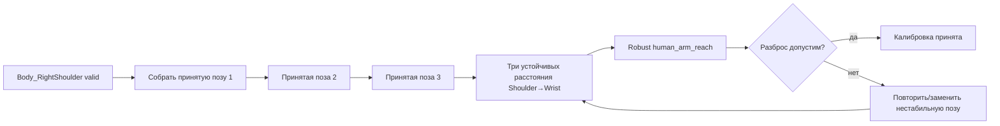

<a id="sec-5-7-3"></a>
### 5.7.3. Расчёт рабочей длины

Для каждого валидного измерения:

```text
d_i = |HumanWristCenter_i - HumanShoulderCenter_i|
```

В расчёт входят только данные, где Body Tracking и Hand Tracking валидны, а рука удерживается выпрямленной. Для каждой **принятой** позы вычисляется медианное расстояние; итоговая `human_arm_reach` определяется как медиана трёх принятых устойчивых значений. Если quality gate отклонил позу, она заменяется новой и не участвует в статистике.

Базовые критерии качества:

| Показатель | Требование |
|---|---:|
| принятые устойчивые позы выпрямленной руки | `3` |
| число попыток | bounded UX policy; отклонённые попытки разрешены |
| валидные совместные Shoulder+Wrist отсчёты | `>=90` суммарно по трём принятым позам |
| p95 разброс расстояния внутри одной удерживаемой позы | `<=20 мм` |
| разница медианных длин между принятыми позами | `<=30 мм` |

Ограничение вида `0.45..0.90 м` не используется. Если три принятых измерения согласованы, абсолютная длина не влияет на корректность алгоритма, потому что дальнейшее отображение выполняется относительно `human_arm_reach`.

Если одна поза нестабильна, повторяется/заменяется только она.

<a id="sec-5-7-4"></a>
### 5.7.4. Результат

```yaml
human_calibration:
  arm_reach_m: 0.xxx
  arm_reach_spread_m: 0.xxx
  body_tracking_joint: Body_RightShoulder
  valid: true
```

`human_arm_reach` сохраняется в именованном user profile вместе с revision алгоритма/SDK и метриками качества. При обычном запуске валидный совместимый профиль может переиспользоваться после короткой sanity-проверки; полная трёхпозная калибровка обязательна для нового/несовместимого/провалившего sanity-check профиля. Шаги, приседание, поворот корпуса или поворот головы не изменяют этот скаляр.

<a id="sec-5-8"></a>
## 5.8. Непрерывное отслеживание положения плеча

`HumanShoulderCenter` обновляется автоматически из `Body_RightShoulder` при каждом доступном обновлении Body Tracking. От пользователя не требуется выполнять отдельные движения для обновления положения плеча.

<a id="sec-5-8-1"></a>
### 5.8.1. Алгоритм во время работы

```text
bodyPose = BodyTracking.current
shoulder = bodyPose.Body_RightShoulder

если shoulder valid и fresh:
    S_raw = TransformToLocalFloor(shoulder.position)
    HumanShoulderCenter = S_raw  # actuator path фильтрует только согласованный W-S; отдельное сглаживание допустимо лишь для UI
```

Для actuator path отдельный Shoulder low-pass здесь не применяется: фильтрация выполняется после временного согласования на `W-S` согласно §5.4.3. Отдельно сглаженный Shoulder допускается только для UI/диагностики. Поза HMD не прибавляется к `S_raw` и не используется как отдельная модель трансляции плеча.

<a id="sec-5-8-2"></a>
### 5.8.2. Как учитываются движения пользователя

| Действие пользователя | Ожидаемое поведение |
|---|---|
| шаг влево/вправо | `Body_RightShoulder` перемещается вместе с телом в `LOCAL_FLOOR`; `HumanShoulderCenter` следует этому перемещению |
| шаг вперёд/назад | положение плеча обновляется Body Tracking по новой позе тела |
| приседание/вставание | вертикальная координата плеча изменяется вместе с body skeleton |
| поворот корпуса | положение правого плеча изменяется относительно мира и автоматически отражается в `Body_RightShoulder` |
| поворот или наклон только головы | PHANTOM не применяет HMD yaw/pitch/roll к плечу; при неподвижном корпусе `HumanShoulderCenter` должен оставаться практически неизменным в пределах шума отслеживания |
| движение правой руки | меняется `Wrist`; положение плеча берётся независимо из body joint и не пересчитывается по траектории кисти |

Таким образом вектор управления всегда вычисляется из двух актуальных мировых точек:

```text
HumanArmVector = HumanWristCenter - HumanShoulderCenter
```

<a id="sec-5-8-3"></a>
### 5.8.3. Валидность, качество и краткие пропуски

Приложение должно проверять актуальность Body Tracking и валидность правого плечевого сустава. Краткий пропуск не запускает калибровку и не показывает пользователю инструкцию двигать рукой.

```text
valid shoulder
→ обновлять HumanShoulderCenter

короткий dropout <= shoulder_dropout_grace_ms
→ не строить новый вектор из stale Shoulder + fresh Wrist
→ заморозить последнюю полностью time-aligned валидную `P_control_B/q_target`

tracking не восстановился до timeout
→ SAFE_HOLD

tracking снова valid
→ получить новый согласованный Shoulder+Wrist snapshot
→ reseed AdaptiveVectorFilter текущим `v_aligned_raw`
→ перейти/остаться в HOLD
→ физический Grip release → canonical OFF/HOLD → дождаться telemetry-confirmed acceptance → только затем новый rising edge (re-arm)
```

`SAFE_HOLD` здесь является реакцией на отсутствие обязательных данных отслеживания, а не способом вычисления плеча. Никакая повторная shoulder-calibration при восстановлении не выполняется.

<a id="sec-5-8-4"></a>
### 5.8.4. Рабочее предположение и диагностическое логирование

Реализация PHANTOM должна исходить из того, что штатный `Body_RightShoulder` достаточно хорошо отражает текущее положение правого плеча для управления. Дополнительная эвристика HMD→плечо в основной алгоритм не добавляется.

Release-кандидат не допускается к физическому движению, пока выбранный `TrackingQualificationProfile` не прошёл §9.6. После такой квалификации приложение не требует per-frame внешнего ground truth и не останавливается только из-за отсутствия отдельного измерительного маркера. `SAFE_HOLD` используется только при фактической потере/устаревании обязательных данных отслеживания либо другом уже определённом условии безопасности.

Во время работы обязательно собираются диагностические признаки качества отслеживания плеча:

```text
Body_RightShoulder valid/quality
source age и временное рассогласование с Wrist
краткие dropout/reacquire events
резкие скачки позиции плеча
неправдоподобно высокая скорость/ускорение shoulder joint
Body Tracking fidelity/status + SDK/runtime version + qualified feature-profile id
state и Left Grip в момент события
```

В `Release` эти данные хранятся агрегированно и в `FlightRecorder`; подробный поток записывается только в `Diagnostic`. События потери отслеживания, резкого скачка, длительного низкого качества/невалидного fidelity-status и повторного восстановления должны иметь отдельные записи журнала.

Физические тесты §9.6 остаются проверкой качества реализации на Quest 3. Если в реальной эксплуатации обнаружится систематическая ошибка положения плеча, сначала анализируются сохранённые данные отслеживания и `FlightRecorder`, после чего алгоритм корректируется на основании измеренной причины. До появления такой ошибки код не должен вводить искусственную остановку или дополнительную пользовательскую процедуру.

<a id="sec-5-9"></a>
## 5.9. Сигнал сжатия кисти и опциональный remap

Primary v1 source — OpenXR `XR_EXT_hand_interaction` через `IGripSignalProvider/OpenXrGraspProvider`:

```text
rawGrasp: 0..1
rawGraspReady: bool
```

При `rawGraspReady=true` базовый профиль **не требует пользовательской endpoint-калибровки**:

```text
humanGrip = clamp(rawGrasp, 0, 1)
```

Это сохраняет нормативную семантику interaction profile и уменьшает число обязательных действий запуска. `rawGraspReady=false` означает «сигнал сейчас не пригоден»: значение не превращается в `0`, текущая физическая цель Gripper удерживается, а `GRASP_VALID=0` передаётся в state/control logic.

Для accessibility или доказанного конкретным runtime/user bias допускается явный `GripRemapProfile`:

```text
g_open < g_closed
usable_span = g_closed - g_open >= remap_min_usable_span
humanGrip = clamp((rawGrasp - g_open)/(g_closed - g_open), 0, 1)
```

Remap создаётся отдельной пользовательской операцией, хранится с `profile_id`, runtime/SDK compatibility metadata и может быть отключён одним действием. Он не применяется автоматически и не должен менять sign/монотонность. При смене runtime/Hand Interaction implementation профиль помечается `needs_revalidation`.

Альтернативный `JointCurlGripProvider` (например, вычисление из hand joints) допускается только как отдельный build/qualification profile, если `XR_EXT_hand_interaction` реально недоступен. Silent переключение providers в активной сессии запрещено: смена provider снимает `MOTION_ENABLE`, требует HIL-квалифицированного профиля и re-arm.

<a id="sec-5-10"></a>
## 5.10. Абсолютное отображение движения руки

Главное правило — PHANTOM повторяет сам пространственный вектор `плечо → запястье`, а не направление взгляда пользователя.

```text
v_human_floor = HumanWristCenter - HumanShoulderCenter
v_human_B     = RotateVector(T_base_floor, v_human_floor)
```

`RotateVector` применяет только вращательную часть преобразования `LOCAL_FLOOR → RobotBaseFrame`; перенос базы к вектору не применяется.

Размер робота отличается от человеческой руки. Сначала проверяется длина управляющего вектора, затем используется нормированный reach:

```text
d_human = norm(v_human_B)
if d_human < human_vector_min_m:
    return TRACKING_TARGET_INVALID

human_reach = calibrated human_arm_reach
robot_nominal_reach = RobotGeometry.robot_nominal_reach_m
mapping_reach = min(robot_nominal_reach, human_reach * max_mapping_scale)
reach_ratio = clamp(d_human / human_reach, 0, 1)
direction_B = v_human_B / d_human
P_requested_B = direction_B * mapping_reach * reach_ratio
```

Таким образом tracking overshoot за выпрямленную откалиброванную руку не создаёт цель дальше `mapping_reach`. Если `robot_nominal_reach / human_arm_reach` превышает `max_mapping_scale`, PHANTOM **не отвергает пользователя и не усиливает tracking noise сверх квалифицированного коэффициента**: используемый mapping reach детерминированно уменьшается. `mapping_reach` является derived runtime value из hash-bound user/Quest config + `RobotGeometry`, не отдельным mutable commissioning параметром. Почти нулевой вектор не превращает шум направления в движение Base.

Поскольку положение и ориентация `RobotBaseFrame` известны из QR-калибровки, одинаковое физическое направление руки в комнате даёт одинаковое физическое направление плеча PHANTOM→TCP независимо от того, куда смотрит пользователь.

Целевая точка вычисляется непосредственно из текущего вектора руки и не зависит от физической позы робота в момент нажатия `Left Grip`. Нажатие только разрешает движение к уже существующей абсолютной цели.

Если текущий физический `TCP` далеко от `P_requested_B`, сетевой `q_target` может существенно отличаться от `q_actual`; EV3 обязан физически сблизить их через ограниченный `q_ref`.

<a id="sec-5-11"></a>
## 5.11. Управление захватом

При валидном `TRACKING`:

```text
grip_intent = humanGrip
```

После `HOLD`/`SAFE_HOLD` при возобновлении `TRACKING` сразу используется текущее значение `humanGrip`. Не применяется ожидание совпадения кисти с текущим физическим раскрытием.

Скачок **команды** допустим; скачок **физического механизма** предотвращается EV3 локальным rate limit и contact/stall logic.

В `HOLD` захват удерживает текущую фактическую позицию или подтверждённое положение контакта.

<a id="sec-5-12"></a>
## 5.12. Геометрическая модель PHANTOM

Конфигурация содержит:

```yaml
geometry:
  revision: 1
  L1_m: MEASURED
  L2_m: MEASURED
  robot_nominal_reach_m: MEASURED_OR_DERIVED_LE_L1_PLUS_L2
  yaw_singularity_hold_radius_m: MEASURED_POSITIVE
  floor_z_B_m: MEASURED_NEGATIVE
  tcp_lateral_offset_m: MEASURED
  tcp_lateral_tolerance_m: MEASURED
  branch_sign: MEASURED
  base_qr_zero_offset_rad: MEASURED
  tcp_reference_tolerance_m: MEASURED
  link_length_residual_tolerance_m: MEASURED
  arm_plane_tolerance_rad: MEASURED
  qr_fixtures_hash: SHA256
  qr_marker_manifest_hash: SHA256
  collision_model_revision: MEASURED
```

Конвенция углов v1 фиксирована и не может зависеть от сборки: `q_base=0` направляет плоскость руки вдоль `+X_B`, положительный Base — right-hand rotation вокруг `+Z_B`; `q_shoulder=0` означает горизонтальный Upper Arm в радиальном направлении, положительный Shoulder поднимает его; `q_elbow=0` означает полностью разогнутые соосные Upper Arm/Forearm, а знак сгибания задаётся `branch_sign`. Все encoder sign/offset приводятся к этой физической конвенции `DriveCalibration`.

`RobotGeometry.robot_nominal_reach_m` является commissioning-параметром конкретной механики, а не локальным Quest default. Обязательные инварианты: finite, `0 < robot_nominal_reach_m <= L1+L2`; значение проходит workspace/JointSafeSet HIL и изменение создаёт новую geometry/bundle revision. `RobotGeometry.yaw_singularity_hold_radius_m` также finite/positive и выбирается по conditioning/повторяемости Base yaw около оси, а не по истории движения.

Для planar-кинематики v1 обязательно `abs(tcp_lateral_offset_m) <= tcp_lateral_tolerance_m`; превышение делает `RobotGeometry` невалидной и запрещает `READY`. Ненулевой offset выше допуска нельзя молча игнорировать — требуется механическое исправление либо отдельная future non-planar kinematics revision. Обычный запуск не переписывает `RobotGeometry`. Изменение конструкции выполняется через инженерную калибровку.

<a id="sec-5-13"></a>
## 5.13. Преобразование положения TCP и углов суставов

Этот раздел описывает связь между **точкой, куда должен прийти захват**, и **углами трёх моторизованных суставов**, которыми реально управляет EV3.

Поток данных:

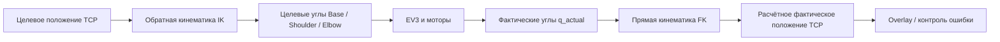

- **IK (inverse kinematics, обратная кинематика)** нужна перед отправкой команды: actuator path вычисляет `q_base`, `q_shoulder`, `q_elbow` по `P_control_B` после tracking filter/workspace projection; чистая `P_requested_B` остаётся только property/replay reference и не отправляется напрямую на actuator path.
- **FK (forward kinematics, прямая кинематика)** нужна после чтения энкодеров: по `q_actual` вычислить, где фактически должен находиться `TCP`, и использовать это для UI, тестов и контроля геометрии.

<a id="sec-5-13-1"></a>
### 5.13.1. Обратная кинематика: TCP → углы

Для `pB_target`. Чисто численный допуск `ik_numeric_epsilon` является schema/code constant `1e-6` (dimensionless), используется только для компенсации округления `D` у границы `[-1,1]` и **не расширяет** физическую рабочую область:

```text
pS = pB_target
r = sqrt(pS.x² + pS.y²)
z = pS.z

q_base = atan2(pS.y, pS.x)

D = (r² + z² - L1² - L2²) / (2 L1 L2)
if D < -1-ik_numeric_epsilon or D > +1+ik_numeric_epsilon:
    return UNREACHABLE   # цель должна быть спроецирована до повторного IK
D = clamp(D, -1, +1)    # только численная погрешность

q_elbow = atan2(
    branch_sign * sqrt(max(0, 1-D²)),
    D
)

q_shoulder =
    atan2(z, r)
    - atan2(L2*sin(q_elbow), L1 + L2*cos(q_elbow))
```

Результат IK не отправляется на моторы напрямую: сначала применяются workspace/безопасные границы, затем EV3 формирует ограниченный по скорости и ускорению `q_ref`.

<a id="sec-5-13-2"></a>
### 5.13.2. Прямая кинематика: углы → TCP

```text
r = L1*cos(q_shoulder) + L2*cos(q_shoulder + q_elbow)
z = L1*sin(q_shoulder) + L2*sin(q_shoulder + q_elbow)

pB = [
  r*cos(q_base),
  r*sin(q_base),
  z
]
```

FK не управляет мотором. Она вычисляет положение TCP из известных углов и используется для сравнения target/actual, визуального overlay и автоматических тестов.

<a id="sec-5-14"></a>
## 5.14. Рабочая область, коллизии и безопасные границы

Quest использует только commissioned `RobotGeometry`, `RobotCollisionModel`, independent joint bounds и `JointSafeSet` из совместимого `CommissioningBundle`. EV3 независимо применяет `JointSafeSet`; Quest не является единственной линией защиты.

Runtime pipeline v1 намеренно **не выполняет generic collision-aware nearest-configuration search**. Это исключает скрытый выбор неожиданной позы робота и делает поведение воспроизводимым:

```text
P_requested_B                # pure raw mapping
P_control_B                  # после tracking filter
→ finite / human-vector sanity
→ AnalyticWorkspaceProjector:
     reachable annulus
     TCP floor clearance
     configured radial constraints
→ fixed-branch IK
→ independent joint-bound clamp, если он однозначен
→ FK → P_projected_B
→ RobotCollisionModel validation
→ JointSafeSet validation
→ q_target или TARGET_INVALID
```

Правила:

- Base находится внутри измеренных cable/hard-stop bounds с margin;
- Shoulder/Elbow находятся внутри commissioned signed bounds; `<=90°` относится к физически определённой flexion, а не encoder zero;
- `pB.z >= floor_z_B + RobotCollisionModel.tcp_floor_clearance_m`;
- если `r_xy < RobotGeometry.yaw_singularity_hold_radius_m`, результат `TARGET_INVALID → SAFE_HOLD`; исторический yaw не используется;
- independent joint clamp допускается только для одиночных limits и после него обязательно пересчитывается FK; UI показывает полученную `projected` цель;
- если полученная конфигурация не проходит `RobotCollisionModel` или coupled `JointSafeSet`, v1 **не ищет другую конфигурацию**: результат `TARGET_INVALID`, пользователь должен изменить руку;
- никакие cost function, random search, bounded iterations или «nearest valid q» в actuator path v1 не используются.

`RobotCollisionModel` содержит conservative primitives для Base/Upper Arm/Forearm/Gripper и forbidden geometry. Он используется offline для построения `JointSafeSet` и на Quest для preview/диагностики. Authoritative EV3 runtime safety representation — `JointSafeSet` §7.16.

UI различает `requested`, `control`, `projected` и `actual`; при collision rejection показывает конкретную категорию (`BASE`, `FLOOR`, `SELF_COLLISION`, `COUPLED_LIMIT`), но не раскрывает пользователю инженерные численные параметры по умолчанию.

<a id="sec-5-15"></a>
## 5.15. QR-маркеры PHANTOM

QR используются только для инженерной калибровки, привязки перед `READY` и явной инженерной проверки остановленного робота. После `READY` видимость QR не требуется.

Все обязательные QR называются по единому правилу: **элемент + положение `LEFT`/`RIGHT`**. Обязательный набор состоит из десяти маркеров:

```text
SHOULDER_LEFT
SHOULDER_RIGHT
TURRET_LEFT
TURRET_RIGHT
ELBOW_LEFT
ELBOW_RIGHT
GRIPPER_LEFT
GRIPPER_RIGHT
JAW_LEFT
JAW_RIGHT
```

Дополнительный `TCP_CAL` допускается для независимой инженерной проверки положения `TCP`. Нормативный payload обязательного QR v1 — bounded canonical ASCII без пробелов: `PHANTOM1|robot_id=<id32-text>|geometry_revision=<u32-decimal>|marker_role=<ROLE>|marker_id=<16-lowerhex>`. Дополнительные/неизвестные поля, duplicate keys, неверный prefix/case/encoding, повтор одного `marker_id` в двух ролях и роль с не тем `marker_id` отклоняются. `qr_marker_manifest` в `RobotGeometry` хранит полный ожидаемый набор `{marker_role, marker_id}`; QR другого `robot_id`/revision/manifest не участвует в `RobotLocalization`/reference. `marker_id` не является секретом/nonce и не заменяет HMAC сетевого протокола.

<a id="sec-5-15-1"></a>
### 5.15.1. Какая точка считается положением QR

Размерной точкой маркера является `QrMarkerCenter` — геометрический центр квадратного QR-символа. Край бумаги, quiet zone, угол наклейки и край держателя не являются размерной базой.

Положение одного QR **никогда не используется как направление звена**. Для каждого маркера `RobotGeometry` хранит постоянное преобразование от `QrMarkerFrame` к физической размерной точке своего элемента. Две точки `LEFT/RIGHT` одного элемента объединяются в вычисленную центральную точку.

```text
ElementCenter = midpoint(
    CorrectedPoint(ELEMENT_LEFT),
    CorrectedPoint(ELEMENT_RIGHT)
)
```

Если крепления не идеально симметричны, `CorrectedPoint(...)` учитывает измеренные постоянные поправки `RobotGeometry`.

<a id="sec-5-15-2"></a>
### 5.15.2. Пары маркеров и вычисляемые точки

**`SHOULDER_LEFT/RIGHT`** находятся по разные стороны физической оси Shoulder на **неподвижной относительно мира/основания части ниже Base-yaw вращения**. Они задают фиксированный `RobotBaseFrame`; установка этой пары на вращающийся turret запрещена, иначе Base yaw поглощался бы самой системой координат. Их исправленные размерные точки дают:

```text
ShoulderCenter = midpoint(
    CorrectedPoint(SHOULDER_LEFT),
    CorrectedPoint(SHOULDER_RIGHT)
)
```

**`TURRET_LEFT/RIGHT`** находятся на жёсткой части, которая вращается **только** вместе с Base yaw и расположена до Shoulder pitch. Их corrected points задают поперечный вектор rotating turret:

```text
TurretLateral = normalize(horizontal(
    CorrectedPoint(TURRET_LEFT) - CorrectedPoint(TURRET_RIGHT)
))
```

Этот вектор не задаёт `RobotBaseFrame`; он сравнивается с неподвижной `+Y_B` и даёт абсолютный физический Base yaw даже когда Upper Arm почти вертикален.

**`ELBOW_LEFT/RIGHT`** находятся по разные стороны физической оси Elbow и дают:

```text
ElbowCenter = midpoint(
    CorrectedPoint(ELBOW_LEFT),
    CorrectedPoint(ELBOW_RIGHT)
)
```

**`GRIPPER_LEFT/RIGHT`** находятся на жёсткой неподвижной относительно предплечья части корпуса захвата, а не на движущихся губках. Их исправленные размерные точки дают `GripperCenter` — опорную точку на продольной оси предплечья около захвата:

```text
GripperCenter = midpoint(
    CorrectedPoint(GRIPPER_LEFT),
    CorrectedPoint(GRIPPER_RIGHT)
)
```

Для v1 `CorrectedPoint(GRIPPER_LEFT/RIGHT)` калибруются так, чтобы их midpoint являлся кинематическим `TCP`; после вычисления проверяется `norm(GripperCenter - TCP_reference) <= tcp_reference_tolerance_m`. Ненулевой runtime `GripperCenter → TCP` offset в v1 запрещён: если конструкция требует такого offset, это новая geometry/kinematics revision, а не скрытая поправка.

**`JAW_LEFT/RIGHT`** закреплены на соответствующих движущихся губках. Они не задают направление предплечья; их назначение — измерять фактическую геометрию раскрытия захвата во время инженерной калибровки и стартовой привязки.

<a id="sec-5-15-3"></a>
### 5.15.3. Как вычисляются направления звеньев

Направление звена всегда является вектором **из одной вычисленной физической точки в другую**, а не ориентацией отдельного QR и не линией между двумя маркерами, случайно размещёнными вдоль звена.

```text
UpperArmVector = ElbowCenter - ShoulderCenter
ForearmVector  = TCP - ElbowCenter

u_upper   = normalize(UpperArmVector)
u_forearm = normalize(ForearmVector)
```

Таким образом:

- положение и направление верхнего звена определяются физическими центрами Shoulder и Elbow;
- положение и направление предплечья определяются физическим центром Elbow и `TCP`; в v1 `GripperCenter` обязан совпадать с `TCP` в пределах допуска;
- перестановка QR внутри допустимого крепления не меняет математический смысл направления, если обновлены постоянные поправки `RobotGeometry`.

Для неподвижной поперечной оси `RobotBaseFrame` используется вектор между двумя **исправленными физическими точками** `SHOULDER_RIGHT → SHOULDER_LEFT`, а не ориентация одного QR. Вертикаль берётся из OpenXR `LOCAL_FLOOR +Y` и становится `+Z_B` через coordinate adapter.

<a id="sec-5-15-4"></a>
### 5.15.4. Требования к движущимся маркерам

QR может двигаться вместе со своим элементом. Требование состоит не в неподвижности относительно комнаты, а в жёсткой и воспроизводимой связи с измеряемой физической точкой.

- `SHOULDER_LEFT/RIGHT` неподвижны относительно основания и не вращаются с Base yaw;
- `TURRET_LEFT/RIGHT` вращаются вместе с Base-yaw turret, но не с Shoulder pitch;
- `ELBOW_LEFT/RIGHT` перемещаются в пространстве вместе с узлом Elbow;
- `GRIPPER_LEFT/RIGHT` перемещаются вместе с предплечьем/корпусом захвата, но не вместе с губками;
- `JAW_LEFT/RIGHT` перемещаются непосредственно вместе со своими губками.

Маркер не обязан быть видим во всех рабочих позах. Он обязан быть видим в предусмотренных положениях инженерной калибровки и стартовой привязки. Во время принятия одного QR-измерения соответствующий узел должен быть полностью остановлен.

<a id="sec-5-15-5"></a>
### 5.15.5. Требования к креплениям

- QR-плоскость не должна заметно изгибаться или люфтить относительно элемента;
- крепление должно обеспечивать воспроизводимую установку `QrMarkerCenter`;
- перестановка или поворот держателя требует повторной затронутой инженерной калибровки;
- все QR одной geometry revision имеют уникальные `marker_id`; `qr_marker_manifest` однозначно связывает `marker_role ↔ marker_id ↔ robot_id ↔ geometry_revision`, перестановка двух физических маркеров поэтому обнаруживается и отклоняется;
- для каждого маркера фиксируются `qr_symbol_size_mm`, quiet-zone и допустимая погрешность печати/масштаба; поверхность должна быть матовой и плоской;
- baseline каждой пары LEFT/RIGHT должен быть не меньше commissioned `pair_baseline_min_m`; обусловленность расчёта и propagated angular uncertainty проверяются до принятия измерения;
- QR не располагаются в зубьях, кабелях и зонах защемления;
- для `JAW_LEFT/RIGHT` сохраняются отдельные преобразования `QrMarkerFrame → JawContactPoint`, потому что QR физически не находится на рабочем краю губки.

<a id="sec-5-16"></a>
## 5.16. Инженерная калибровка геометрии и приводов (`RobotGeometry`, `DriveCalibration`)

Инженерная калибровка связывает реальную LEGO-механику, QR-геометрию и абсолютные отсчёты энкодеров. EV3 не считает номинальное отношение `12T→60T = 5:1` точным измерением физического угла. Оно используется только как консервативная оценка для самого первого малого движения.

Процедура состоит из двух результатов:

1. `RobotGeometry` — геометрия Shoulder, звеньев, TCP, QR-креплений и безопасных объёмов;
2. `DriveCalibration` — измеренная связь энкодеров с физическими углами A/B/C и с раскрытием захвата D.

<a id="sec-5-16-1"></a>
### 5.16.1. Предусловия инженерной калибровки

До любого автоматического калибровочного движения выполняются **общие** условия:

1. для exact installed Quest platform matrix имеется актуальный `P0CompatibilityScope=COMMISSIONING_QR PASS` §9.6; активна OpenXR session и доступны именно те QR capabilities, которые нужны текущему измерению; Room/Scene capture, Body/Wrist и grasp/Hand provider не требуются чистому QR commissioning path;
2. `LOCAL_STOP` доступен и отпущен;
3. `MOTION_ENABLE=0`, phase=`COMMISSIONING/CALIBRATION`;
4. `phantom-safety` работает;
5. выбранный `axis` входит в authoritative `actuator_scope_mask` и соответствующий motor/sensor I/O однозначно обнаружен;
6. зона движения выбранного узла очищена, перед jog задан консервативный bounded travel;
7. одновременно автоматически движется только один привод;
8. commissioning session аутентифицирована commissioning key и имеет current `local_commission_authority`, полученную из локального `LOCAL_COMMISSION_ARM`;
9. установлен и проверен `POWER_CUT`, оператор находится вне swept/pinch volume выбранного узла.

Дополнительные prerequisites зависят от scope.

**Gripper-only (`actuator_scope_mask=0x08`):**

- A/B/C, `SHOULDER_*`, `TURRET_*`, `ELBOW_*`, полная геометрия звеньев и `JointSafeSet` **не требуются**;
- D/Medium Motor и `GRIPPER_HOME` обязательны;
- для QR-измерения раскрытия видимы `JAW_LEFT/RIGHT`, а qualification bundle содержит валидные `T_marker_to_contact`/gripper geometry revision;
- захват жёстко закреплён на стенде либо на уже безопасно собранном Forearm так, чтобы его движение не могло перемещать неоткалиброванные A/B/C.

**Калибровка A/B/C:**

- требуются соответствующие приводы, механические опоры, hard stops и QR-пары, необходимые конкретному измерению;
- до операций Base yaw видимы/согласованы `SHOULDER_LEFT/RIGHT` и `TURRET_LEFT/RIGHT`;
- известна предварительная геометрия звеньев и консервативные габаритные объёмы;
- зависимости безопасных поз выполняются по порядку D → C → B → A. Любая невыбранная нагрузочная ось, для которой ещё нет валидной `DriveCalibration` + текущей reference и отдельно квалифицированного HOLD, должна быть **механически зафиксирована/поддержана fixture**; active q-based HOLD неоткалиброванной оси запрещён. Уже откалиброванная ось может использовать bounded active hold только после собственного static-hold gate, иначе также фиксируется механически.

Scope `qualification_only=true`, включающий A/B/C, запрещён для штатного `COMMAND` до полной `RobotGeometry`/`DriveCalibration`/`JointReference A/B/C`/`EMPTY JointSafeSet` и pre-motion gates §9/§10.11. До выполнения этих prerequisites A/B/C двигаются только через bounded `CALIBRATION_JOG`; после них первое штатное `COMMAND`-движение и есть incremental `ACTUATOR_QUALIFICATION` HIL case, который создаёт собственное evidence, а не требует заранее собственного PASS.

<a id="sec-5-16-2"></a>
### 5.16.2. Как Quest определяет физические углы Base, Shoulder и Elbow

Quest сначала вычисляет три физические точки в `LOCAL_FLOOR`:

```text
S = ShoulderCenter = midpoint(
    CorrectedPoint(SHOULDER_LEFT),
    CorrectedPoint(SHOULDER_RIGHT)
)

E = ElbowCenter = midpoint(
    CorrectedPoint(ELBOW_LEFT),
    CorrectedPoint(ELBOW_RIGHT)
)

T = TCP = GripperCenter = midpoint(
    CorrectedPoint(GRIPPER_LEFT),
    CorrectedPoint(GRIPPER_RIGHT)
)
```

После этого направления звеньев вычисляются только как векторы между физическими точками:

```text
u_upper   = normalize(E - S)
u_forearm = normalize(T - E)
```

Ни ориентация одного QR, ни направление от одного QR к другому на одном звене не используются как направление кинематического звена.

`RobotBaseFrame` имеет начало в `S`. Его вертикаль задаётся OpenXR `LOCAL_FLOOR +Y` и отображается в внутреннюю `+Z_B`, а поперечная ось основания — вектором между исправленными физическими точками `SHOULDER_RIGHT → SHOULDER_LEFT`, спроецированным на горизонтальную плоскость. Это также не использует ориентацию отдельного QR.

После построения неподвижного `RobotBaseFrame` Base yaw определяется **не по Upper Arm**, а по отдельной rotating turret pair:

```text
turret_lateral_B = NormalizeHorizontal(
    CorrectedPoint(TURRET_LEFT) - CorrectedPoint(TURRET_RIGHT)
)
q_base_qr = SignedYaw(+Y_B, turret_lateral_B, +Z_B) + base_qr_zero_offset

u_upper_B   = RotateToBase(u_upper)
u_forearm_B = RotateToBase(u_forearm)

radial     = normalize([cos(q_base_qr), sin(q_base_qr), 0])
z_axis     = [0,0,1]
tangential = normalize(cross(z_axis, radial))
n_arm      = tangential

upper_offplane_sin = clamp(abs(dot(u_upper_B, tangential)), 0, 1)
fore_offplane_sin  = clamp(abs(dot(u_forearm_B, tangential)), 0, 1)
upper_offplane_angle_rad = asin(upper_offplane_sin)
fore_offplane_angle_rad  = asin(fore_offplane_sin)
require upper_offplane_angle_rad <= arm_plane_tolerance_rad
require fore_offplane_angle_rad  <= arm_plane_tolerance_rad

upper_radial   = dot(u_upper_B, radial)
upper_vertical = dot(u_upper_B, z_axis)
q_shoulder_qr  = atan2(upper_vertical, upper_radial)

u1 = normalize(ProjectToPlane(u_upper_B, n_arm))
u2 = normalize(ProjectToPlane(u_forearm_B, n_arm))
q_elbow_raw = atan2(
    dot(n_arm, cross(u1, u2)),
    dot(u1, u2)
)
q_elbow_qr = ApplyCalibratedElbowSignAndZero(q_elbow_raw)
```

Измерение Base отклоняется, если горизонтальная проекция `TurretLateral` плохо обусловлена/слишком коротка; Shoulder/Elbow отклоняются при плохо обусловленной arm-plane projection либо если `upper_offplane_angle_rad/fore_offplane_angle_rad` превышают calibrated `arm_plane_tolerance_rad`. Shoulder использует **знаковую radial component**, поэтому звено, направленное назад относительно текущего Base yaw, не может ошибочно дать тот же угол, что и направленное вперёд. Знак/нулевой offset переводятся в единую физическую конвенцию §5.12; сама функция не имеет скрытого выбора знака.

`q_base_qr` не зависит от наклона Upper Arm, поэтому обычный startup не попадает в bootstrap-singularity при почти вертикальном Upper Arm и не должен двигать непривязанный робот для выбора иной позы.

Quest принимает `q_qr` только если:

- обе метки каждой требуемой пары, включая `TURRET_LEFT/RIGHT`, видимы;
- вычисленные `S`, `E`, `T` стабильны в течение измерительного окна;
- моторные энкодеры подтверждают остановку;
- расстояния `|E-S|` и `|T-E|` согласованы соответственно с `L1` и `L2` в пределах `link_length_residual_tolerance_m`; отдельно выполнен `tcp_reference_tolerance_m` check;
- геометрическая остаточная ошибка ниже допуска;
- propagated 95% angular uncertainty для каждого используемого `q_qr` ниже `qr_joint_angle_uncertainty95_max_deg`;
- результат конечен и находится в физически возможной области.

<a id="sec-5-16-3"></a>
### 5.16.3. Первое безопасное калибровочное движение

До первого измерения `DriveCalibration` EV3 знает только абсолютный `encoder_count`, направление команды мотора и консервативную номинальную передачу. Поэтому первое движение каждой оси ограничивается независимо по:

```text
максимальному изменению encoder_count
максимальному времени
максимальной скорости мотора
максимальному duty
свободному геометрическому объёму
признакам препятствия/заклинивания
```

Последовательность одного измерения:

```text
Quest подтверждает исходную QR-геометрию
→ EV3 получает CALIBRATION_JOG с малым пределом
→ EV3 выполняет ограниченное движение
→ EV3 полностью останавливает мотор
→ EV3 фиксирует encoder_count и sample_id
→ Quest ждёт устойчивое QR-окно
→ Quest вычисляет физический угол
→ сохраняется пара encoder_count ↔ physical_angle
```

QR не используется для управления мотором во время самого движения.

<a id="sec-5-16-4"></a>
### 5.16.4. Порядок автоматической калибровки приводов

Калибровка выполняется в порядке:

```text
D Gripper → C Elbow → B Shoulder → A Base
```

Отдельного привода «кисти» или «предплечья» нет: предплечье перемещается приводом Elbow C.

**D — Gripper.** Сначала определяется безопасный рабочий диапазон и нелинейная зависимость раскрытия; алгоритм описан в §5.16.8.

**C — Elbow.** Base и Shoulder остаются в исходной безопасной позе. Пока B ещё не имеет валидной `DriveCalibration`/`JointReference` и собственного HOLD gate, Shoulder **механически фиксируется или внешне поддерживается**; подавать на B активный HOLD по номинальной передаче запрещено. Base аналогично не получает motor output. Перед каждым малым шагом C проверяется свободный объём Forearm+Gripper и фактическая неподвижность всех невыбранных осей.

**B — Shoulder.** После калибровки C уже откалиброванный Elbow переводит предплечье в `SHOULDER_CAL_POSE`, уменьшающую риск контакта с Base и полом; поза подтверждается QR и после остановки C удерживается только если его calibration/reference и HOLD gate уже валидны. Base остаётся motor-disabled. Если механика Shoulder не является самотормозящейся, до появления валидной B calibration/reference применяется внешняя механическая поддержка/fixture, рассчитанная на ожидаемую нагрузку. После этого калибруется B.

**A — Base.** Калибруется последней. Уже откалиброванные Shoulder и Elbow переводят руку в `BASE_CAL_POSE`, где звенья подняты, TCP находится близко к вертикальной оси Base, а кабель имеет проверенный запас. B/C должны иметь валидные calibration/reference и пройденный HOLD gate либо дополнительно фиксироваться fixture; затем выполняются малые повороты Base.

На всём порядке `D → C → B → A` действует инвариант: **единственная ось с motor-write authority — текущая калибруемая ось**. Не выбранные оси могут наблюдаться энкодерами/QR для safety, но не получают motor output, если только они уже откалиброваны, referenced и явно переведены в заранее квалифицированный HOLD как часть безопасной позы следующего шага. Для ещё не откалиброванной нагрузочной оси механический fixture обязателен; «примерный HOLD» по nominal gear ratio запрещён.

Для A/B/C после определения первоначального знака и масштаба снимается не менее пяти остановленных точек в одном направлении и не менее пяти в обратном. Точки должны быть распределены по безопасной рабочей области, а не сосредоточены рядом друг с другом.

<a id="sec-5-16-5"></a>
### 5.16.5. Определение коэффициента, направления и люфта A/B/C

Для каждой оси сохраняются измерения:

```text
(E_i, q_i, direction_i)
```

где `E_i` — абсолютный отсчёт энкодера моторного вала, `q_i` — физический угол по QR после полной остановки.

В рабочем диапазоне проверяется линейная модель:

```text
q = q0 + k_axis * (E - E0) + backlash_state
```

Определяются:

- знак `k_axis`;
- величина `k_axis`;
- остаточная ошибка прямого и обратного прохода;
- суммарный люфт при смене направления;
- повторяемость одной физической позиции при подходе с двух сторон.

Если остаточная ошибка показывает существенную нелинейность или неповторяемость, калибровка отклоняется и сначала проверяется механика.

<a id="sec-5-16-6"></a>
### 5.16.6. Расчёт положения без накопления ошибки

В рабочем режиме положение сустава не интегрируется из скорости и времени. Используется текущий абсолютный отсчёт энкодера:

```text
q_actual = reference_angle
         + k_axis * (encoder_count_now - reference_encoder_count)
         + backlash_compensation
```

Поэтому пропущенный цикл или изменение длительности цикла не создаёт накопленный программный дрейф положения. Реальные механические люфт, упругость и проскальзывание проверяются отдельно.

<a id="sec-5-16-7"></a>
### 5.16.7. Проверка `DriveCalibration` перед сохранением

Новая калибровка сначала проверяется на отдельных QR-положениях, которые не использовались для расчёта коэффициента — это проверка repeatability/internal consistency, а не независимая метрология. Для каждого положения:

```text
EV3 приходит по encoder target
→ мотор полностью останавливается
→ Quest измеряет угол по QR
→ сравниваются q_actual и q_qr
```

Новая `DriveCalibration` сохраняется атомарно только после прохождения критериев §9.12. Финальная физическая accuracy-квалификация должна дополнительно использовать независимый от QR sensor stack физический jig/угломер/линейку или иную метрологию с известной погрешностью. До этого предыдущая подтверждённая версия остаётся активной, если она совместима с текущей механикой.

<a id="sec-5-16-8"></a>
### 5.16.8. Калибровка захвата с эллиптической траекторией губок

Для Gripper не предполагается линейная зависимость `мм на отсчёт энкодера`. QR находятся не на рабочих краях губок, а сами губки могут двигаться по дугообразной/эллиптической траектории. Поэтому Quest вычисляет зазор между **рабочими поверхностями**, преобразуя позы `JAW_LEFT/RIGHT` через сохранённые `T_marker_to_contact`.

Калибровка выполняется автоматически при пустом захвате. Persistent `DriveCalibration[D]` хранит **относительную** encoder-coordinate, а не абсолютные motor counts конкретного boot.

**1. Закрытая/home граница.** Medium Motor D медленно закрывает пустые губки с пониженным `duty` в состоянии `GRIP_CAL_HOME`. Успешная граница фиксируется по отдельному `GRIPPER_HOME`; в момент устойчивого срабатывания EV3 немедленно прекращает closing command и фиксирует текущий absolute count только как calibration-session anchor:

```text
E_closed_cal = encoder_count при подтверждённом GRIPPER_HOME
```

Stall до home, недостоверное/дребезжащее home-состояние или превышение ограничений времени/encoder delta являются fault. QR в этой точке используются как независимая геометрическая запись. Механический упор не должен регулярно использоваться как датчик home.

**2. Независимо заданная безопасная открытая граница.** До автоматической QR-калибровки конкретная mechanical revision получает signed параметр `gripper_open_limit_delta_counts` из отдельной безопасной стендовой процедуры/fixture measurement. Его знак задаёт encoder-direction открытия, модуль — максимальный безопасный travel от home:

```text
open_encoder_sign = sign(gripper_open_limit_delta_counts) ∈ {-1,+1}
D_open_counts     = abs(gripper_open_limit_delta_counts) > 0
d(E)              = open_encoder_sign * (E - E_closed_cal)
E_open_limit_cal  = E_closed_cal + gripper_open_limit_delta_counts
```

Параметр входит в `SafetyEnvelope`, хранится на EV3 и не может быть расширен Quest-командой. При автоматической калибровке EV3 открывает губки малыми шагами только пока `0 <= d <= D_open_counts`, с независимыми bounded time/speed/duty limits. После каждого шага мотор полностью останавливается, Quest измеряет `jaw_opening_mm` по QR. Достижение `d=D_open_counts` является штатным окончанием диапазона, если все safety/quality predicates валидны.

Если до safe-open endpoint измеренный зазор перестаёт быть однозначно монотонным сверх допуска, появляется механический самопересекающийся участок, неожиданное сопротивление/stall или QR geometry становится недостоверной, calibration **FAIL**; software не выбирает произвольный локальный максимум как рабочую границу.

```text
opening_open_mm = jaw_opening_mm(d = D_open_counts)
```

**3. Калибровочная кривая.** Между `d=0` и `d=D_open_counts` снимаются остановленные точки в направлениях открытия и закрытия. По ним строятся монотонные кусочно-линейные таблицы в нормализованной положительной coordinate:

```text
opening_curve_opening: (d_counts -> jaw_opening_mm)
opening_curve_closing: (d_counts -> jaw_opening_mm)
0 <= d_counts <= D_open_counts
```

Абсолютные `E_closed_cal/E_open_limit_cal` сохраняются только как provenance конкретного calibration run. Runtime после нового boot **не сравнивает** текущий encoder count с этими старыми absolute values: рабочие hard limits заново якорятся через `GripperReference` §7.6. Это необходимо, потому что motor position intercept может измениться между запусками.

<a id="sec-5-16-9"></a>
### 5.16.9. Привязка при обычном запуске

Обычный **полный Release** запуск не двигает робота ради калибровки. Partial A/B/C `ACTUATOR_QUALIFICATION` после полного commissioning использует тот же неподвижный A/B/C QR-reference path, потому что coupled safety требует реальные references всех A/B/C даже если motor authority выдана только одной/двум осям. Gripper-only qualification startup использует сокращённую D-only reference процедуру §4.4/§4.7.5 и не строит `RobotBaseFrame`.

Quest при полном Release **или partial A/B/C qualification**:

1. строит `RobotBaseFrame` по `SHOULDER_LEFT/RIGHT`;
2. вычисляет `q_base_qr` по `TURRET_LEFT/RIGHT` относительно неподвижного `RobotBaseFrame`; отдельно вычисляет `ShoulderCenter`, `ElbowCenter`, `GripperCenter`, затем `q_shoulder_qr/q_elbow_qr` из звеньев;
3. вычисляет текущий зазор губок по `JAW_LEFT/RIGHT` и `T_marker_to_contact`;
4. получает атомарный снимок энкодеров A/B/C/D с `sample_id`;
5. отправляет `SET_JOINT_REFERENCE`.

EV3 связывает текущие абсолютные энкодерные отсчёты с измеренными физическими углами. Для Gripper текущий QR-зазор и encoder snapshot создают `GripperReference={E0, opening0, branch=UNKNOWN}`. До первого последующего движения не выбирается opening/closing hysteresis-ветвь; первый sign движения выбирает соответствующую calibrated branch с консервативным backlash take-up. Если обе ветви в стартовой точке несовместимы с QR-зазором в пределах calibrated hysteresis envelope, reference отклоняется.

После подтверждения привязки повторное QR-измерение проверяет согласованность. Partial A/B/C qualification может получить валидный `JointReference A/B/C`, но это не делает её `READY`: motor writes всё ещё ограничены `actuator_scope_mask`, а coupled safety использует `safety_observation_mask`. Только full Release с обеими масками `0x0F` и complete bundle может разрешить `READY`; D-only `GripperReference` разрешает лишь инженерную qualification phase.

<a id="sec-5-16-10"></a>
### 5.16.10. Причины отклонения калибровки или привязки

Калибровка/привязка отклоняется при любом из условий:

- обязательный QR отсутствует или имеет неверный `marker_id`;
- маркер продолжает двигаться в измерительном окне;
- остаточная ошибка геометрии выше допуска;
- первый малый шаг даёт физическое движение значительно больше ожидаемого безопасного диапазона;
- знак/масштаб оси неповторяем;
- люфт A/B/C превышает механический допуск;
- у Gripper нет однозначной монотонной области на independently commissioned `d∈[0,D_open_counts]`;
- губки движутся заметно несимметрично;
- достигнут stall/препятствие до подтверждённого срабатывания `GRIPPER_HOME` либо вне допустимого homing travel/time;
- `LOCAL_STOP`, watchdog или процесс безопасности сработал во время процедуры.

<a id="sec-5-17"></a>
## 5.17. Пользовательский интерфейс

<a id="sec-5-17-1"></a>
### 5.17.1. Язык и визуальные подсказки

Весь пользовательский текст — русский. Английские слова допускаются только как технические идентификаторы внутри инженерного Diagnostic UI.

Каждое действие, где пользователь должен правильно разместить тело, робота или камеру, должно иметь визуальную подсказку:

| Действие | Обязательная визуализация |
|---|---|
| проверка XR | рисунок пола/оси `LOCAL_FLOOR` и статуса QR capabilities; room mesh показывается только если включён scene-aware UX |
| поиск QR | 3D-схема робота с подсвеченным требуемым маркером |
| привязка робота | показ текущей видимости каждого QR и требуемого обзора |
| калибровка длины руки | 3D-подсказки трёх поз полностью выпрямленной правой руки |
| открывание/закрывание кисти | рисунок открытой и закрытой кисти |
| ошибка механики/QR | выделение конкретного узла робота |

Иллюстрации должны поставляться локально с приложением; сетевой доступ не требуется.

<a id="sec-5-17-2"></a>
### 5.17.2. Пространственная компоновка

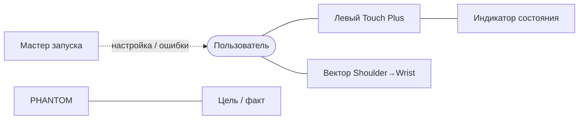

Слои:

1. мастер запуска;
2. компактный HUD возле правой руки или безопасно перед пользователем;
3. badge около левого Controller;
4. вектор правой руки `Shoulder→Wrist`;
5. target/actual overlay на физическом PHANTOM.

<a id="sec-5-17-3"></a>
### 5.17.3. Мастер запуска

Полный Release-мастер до `READY`:

```text
1. XR и отслеживание
2. Выбор/проверка профиля длины правой руки
3. Проверка сигнала сжатия кисти; remap только при необходимости
4. Проверка виртуального движения
5. Поиск PHANTOM
6. Подключение и проверка версии/config hashes
7. QR робота
8. Привязка энкодеров
9. Выбор PayloadProfile / подтверждение EMPTY
10. ГОТОВО
```

Diagnostic gripper-only мастер этапа 5 является отдельным явно инженерным flow того же приложения:

```text
1. XR session + Hand/grasp + левый Touch Plus
2. Поиск PHANTOM и проверка qualification bundle scope=D
3. Если DriveCalibration[D] отсутствует/несовместима → перейти в инженерную калибровку этапа 4
4. Попросить LOCAL_COMMISSION_ARM: ENTER+UP на EV3
5. Создать commissioning session
6. Показать JAW_LEFT/RIGHT → получить быструю GripperReference текущего запуска
7. Попросить локальное ENTER для ACTUATOR_QUALIFICATION; UI не симулирует сетевое подтверждение этого физического шага
8. Дождаться Left Grip released → armed
9. ЗАХВАТ ГОТОВ — ИНЖЕНЕРНЫЙ РЕЖИМ
```

Этот flow не просит `human_arm_reach`, Body Shoulder/Wrist, полный набор QR, `RobotLocalization` или PayloadProfile и никогда не показывает продуктовый статус «ГОТОВО/READY».

Diagnostic network-only flow этапа 3 (`qualification_only=true`, `scope=0x00`, `required_user_inputs=NONE`) ещё проще и **не запускает XR tracking/QR readiness как gate**:

```text
1. Проверить local-network permission/runtime network availability
2. Ищу PHANTOM… — DNS-SD type `_phantom-ev3._udp` в domain `local.`
3. Найден ожидаемый `robot_id` → resolve IPv4 endpoint
4. CONTROL HELLO/HMAC → session active
5. PING/PONG + TELEMETRY freshness
6. СЕТЬ ГОТОВА — ДИАГНОСТИКА, ДВИЖЕНИЕ ЗАПРЕЩЕНО
```

Экран показывает connection/session state, battery, remote `state/fault`, telemetry age, `ev3_build_id`/hashes/`incident_id`; Diagnostic panel может показывать endpoint/RTT/counters. Он никогда не показывает `READY/TRACKING`, не требует Hand/Body/Left Grip/QR/`LOCAL_FLOOR` и не формирует moving `COMMAND`.

Примеры текста:

```text
Сначала настроим управление под вашу правую руку.
Выпрямите правую руку и проведите запястьем через подсвеченные области.
[3D-дуги вокруг плеча]

Откройте и сожмите правую кисть. Проверяю стандартный сигнал сжатия.
Если потребуется индивидуальная настройка диапазона, приложение предложит её отдельно.
[изображение открытой и сжатой кисти]

Проверьте движение виртуальной руки PHANTOM.

Калибровка пользователя завершена.
Ищу PHANTOM в локальной сети…

Найден PHANTOM phantom01.
Подключаюсь…

Покажите шлему отмеченные QR-маркеры робота.
Поверните голову к указанной части PHANTOM.
[иллюстрация]

Система откалибрована.
Подтвердите текущую нагрузку: захват пуст / предмет удерживается.

Движение готово.
Отпустите кнопку захвата на левом контроллере, затем удерживайте её для начала движения робота.
```

<a id="sec-5-17-4"></a>
### 5.17.4. Рабочая панель состояния

Пример пользовательского интерфейса профиля `Release`:

```text
PHANTOM — ДВИЖЕНИЕ

РОБОТ          ● ГОТОВ
ПРАВАЯ РУКА    ● ВИДНА
РАЗРЕШЕНИЕ      ● ВКЛЮЧЕНО
ЦЕЛЬ           ● В РАБОЧЕЙ ОБЛАСТИ
ЗАХВАТ         62%
КОНТАКТ        НЕТ
```

В обычном UI не показываются `q_ref`, исходные отсчёты, duty, счётчики HMAC, микросекунды цикла или номер пакета.

<a id="sec-5-17-5"></a>
### 5.17.5. Модель пользователя

Визуальная модель должна показывать:

- `HumanShoulderCenter`;
- текущий `HumanWristCenter`;
- прямой вектор `плечо → запястье`;
- текущий целевой `TCP`;
- спроецированная цель, если цель ограничена.

Это позволяет визуально проверить, что приложение правильно понимает текущий пространственный вектор от плеча к запястью. Положение локтя пользователя в управляющей модели не отображается и не требуется.

<a id="sec-5-17-6"></a>
### 5.17.6. Наложение на PHANTOM

При валидном `RobotLocalization`:

- `actual` строится из `q_actual` через FK;
- `target` строится из `q_target`;
- `actual` во время обычной работы определяется только по `q_actual` из энкодеров и действующей калибровке; QR observation после `READY` в рабочий overlay не входит.

<a id="sec-5-17-7"></a>
### 5.17.7. Экраны и действия

| Экран | Что показывает | Действия |
|---|---|---|
| XR и отслеживание | `LOCAL_FLOOR`, permissions, Multimodal/Hand/Body/QR capabilities | исправить разрешение / повторить; `Space Setup` только для опциональной scene-aware функции |
| Поиск робота | найденные `robot_id` | выбрать ожидаемый PHANTOM |
| QR робота | карта необходимых маркеров | сканировать / повторить |
| Привязка приводов | согласованность QR↔энкодер | повторить привязку |
| Длина руки | текущая поза + расстояние плечо→запястье | полностью выпрямить руку в показанных позах |
| Сжатие кисти | `graspReady`, текущий стандартный `graspValue`; состояние optional remap | проверить жест / при необходимости настроить remap |
| Проверка | виртуальная рука и target без движения | подтвердить / повторить |
| Нагрузка | выбранный PayloadProfile, `PayloadState`, совместимость JointSafeSet | подтвердить фактическое `EMPTY`/`LOADED`; при `UNKNOWN` A/B/C движение недоступно |
| ГОТОВО | состояние системы | удерживать кнопку захвата на левом контроллере для движения |
| ДВИЖЕНИЕ | минимальная панель состояния + выбранный PayloadProfile/State | двигать рукой / отпустить кнопку захвата на левом контроллере |
| УДЕРЖАНИЕ | состояние робота | менять позу руки / настройки |
| БЕЗОПАСНОЕ УДЕРЖАНИЕ | временная причина | устранить причину |
| ОШИБКА | причина + конкретный узел + действие | исправить / подтвердить |
| Диагностика | расширенные технические поля | только вне активного движения |

<a id="sec-5-17-8"></a>
### 5.17.8. Виброотклик левого контроллера

`Haptic feedback` — это вибрация Touch Plus Controller. Пользователь ничего не должен интерпретировать по английскому термину: в UI используется слово **«виброотклик»**.

| Вибросигнал | Значение |
|---|---|
| короткий | вход в `TRACKING` |
| двойной короткий | подтверждён контакт захвата |
| редкий короткий | цель ограничена рабочей областью |
| длинный | `SAFE_HOLD`, `STOPPED` или UI-отображение latched fault (`STOPPED + fault_code`) |

<a id="sec-5-18"></a>
## 5.18. Ошибки Quest и восстановление

Quest снимает `MOTION_ENABLE` при применимой текущему actuator scope ошибке. Для полного A/B/C path это включает:

- потерю валидного `Wrist` дольше краткого допустимого окна;
- потере левого Controller или `Left Grip` release;
- потере application focus;
- изменении/потере `LOCAL_FLOOR`;
- устаревшей EV3 telemetry;
- невалидном или устаревшем `Body_RightShoulder` после допустимого короткого пропуска;
- инвалидной `RobotLocalization`;
- несовпадении geometry/calibration hash;
- fault от EV3.

При временной причине полного A/B/C path используется `SAFE_HOLD`. После устранения причины система возвращается в `HOLD`, снимает armed-latch и требует полного deliberate re-arm: физический `Left Grip released` → canonical OFF/HOLD → свежая telemetry с подтверждённым `release_off_sequence` → только затем новый rising edge. Автоматическое движение по удерживаемому до сбоя Grip запрещено. При latched fault EV3 сообщает `STOPPED + fault_code`; требуется предусмотренное fault class подтверждение после исправления, а class может дополнительно требовать новую reference или обслуживание.

Для gripper-only `actuator_scope_mask=0x08` потеря `Body_RightShoulder`, Wrist-vector mapping, `RobotLocalization` или `human_arm_reach` не является причиной остановки D, потому что эти данные не входят в его actuator path. Обязательными остаются `graspReady`, левый Touch Plus/`Left Grip`, application focus, свежая authenticated session/telemetry, `GripperReference`, локальные safety predicates и совместимый qualification bundle. Потеря любого из них снимает `MOTION_ENABLE`; восстановление не возобновляет движение без физического release → canonical OFF/HOLD → telemetry-confirmed acceptance → нового rising edge.

<a id="sec-5-19"></a>
## 5.19. Конфигурация Quest

```yaml
schema_version: 1
robot_id: phantom01

qualification:
  qualification_only: false   # разрешено только после PASS QualificationEvidenceManifest
  qualification_evidence_manifest_hash: SHA256_OR_ZERO_FOR_QUALIFICATION_ONLY
  actuator_scope_mask: 0x0F   # motor authority: Release 0x0F; network-only 0x00; gripper-only 0x08
  safety_observation_mask: 0x0F  # Release 0x0F; network-only 0x00; gripper-only 0x08; partial A/B/C qualification >=0x07
  required_user_inputs: FULL_ARM  # FULL_ARM | GRIPPER_ONLY | NONE

human_mapping:
  # robot_nominal_reach_m authoritative value comes from RobotGeometry in CommissioningBundle
  arm_reach_min_technical_m: MEASURED
  arm_reach_max_technical_m: MEASURED
  max_mapping_scale: MEASURED

hand_tracking:
  required_for_full_arm: true
  required_grasp_for_gripper_only: true
  wrist_joint: Wrist
  wrist_max_pose_age_ms: 50
  wrist_dropout_grace_ms: MEASURED

body_tracking:
  required_for_full_arm: true
  required_for_gripper_only: false
  joint_set: UPPER_BODY
  shoulder_joint: Body_RightShoulder
  require_iobt: false
  max_pose_age_ms: 50
  shoulder_dropout_grace_ms: MEASURED
  max_tracking_alignment_ms: MEASURED
  max_tracking_extrapolation_ms: MEASURED
  control_vector_filter: ONE_EURO
  filter_params: MEASURED
  qualification_profile_id: MEASURED_QUALIFIED_PROFILE
  require_runtime_profile_match: true
  human_vector_min_m: MEASURED

space:
  require_local_floor: true
  require_spatial_data_permission: true
  require_scene_support_for_qr: true
  require_anchor_support_for_qr: true
  require_current_room: false
  require_scene_floor_anchor: false
  scene_aware_ux_enabled: false

qr:
  # В полном Release required_markers = все 10 ниже.
  # При qualification_only scope=D обязательны только JAW_LEFT/JAW_RIGHT;
  # остальные marker requirements являются N_A для этого стенда.
  required_markers:
    - SHOULDER_LEFT
    - SHOULDER_RIGHT
    - TURRET_LEFT
    - TURRET_RIGHT
    - ELBOW_LEFT
    - ELBOW_RIGHT
    - GRIPPER_LEFT
    - GRIPPER_RIGHT
    - JAW_LEFT
    - JAW_RIGHT
  required_only_before_ready: true
  runtime_tracking_required: false
  stationary_min_updates: MEASURED
  marker_center_jitter_max_m: MEASURED
  multi_marker_residual_max_m: MEASURED
  pair_baseline_min_m: MEASURED
  joint_angle_uncertainty95_max_deg: MEASURED
  marker_payload_revision_required: true
  calibration_jog_max_encoder_delta: MEASURED
  calibration_jog_max_duty_pct: MEASURED

grasp:
  provider: OPENXR_HAND_INTERACTION
  require_grasp_ready: true
  default_mapping: IDENTITY
  optional_remap_enabled: true
  remap_min_usable_span: 0.20
  fallback_provider: DISABLED

commissioning_bundle:
  path: /data/phantom/commissioning_bundle.json
  expected_hash: SHA256
  # RobotGeometry, DriveCalibration, collision model, payload profiles and safe-sets
  # загружаются только из этого versioned artifact и не дублируются ручными полями Quest config.

network:
  discovery_service_type: _phantom-ev3._udp
  discovery_domain: local.
  ip_family: IPV4
  default_port: 30470
  protocol_version: 1
  control_key_id: phantom01-control
  commissioning_key_id: null    # Release=null; Diagnostic actuator qualification uses separately provisioned commissioning key_id
  telemetry_max_age_ms: 100

build_profile: Release   # Release | Diagnostic
```

Поля Quest `qualification.qualification_only`, `qualification.actuator_scope_mask` и `qualification.safety_observation_mask` являются **ожидаемым локальным profile selection**, а не источником actuator authority. Authoritative значения находятся в установленном `CommissioningBundle` EV3; Quest обязан загрузить совпадающий локальный semantic bundle и проверить его `commissioning_bundle_hash` через `HELLO_ACK`. Любое расхождение local expected profile ↔ bundle (`qualification_only`, motor scope, safety-observation scope) блокирует motion и отображается как configuration mismatch; сеть не может расширить scope. `required_user_inputs` остаётся частью Quest config/`quest_config_hash` и проверяется локально по текущему product/commissioning phase и `TrackingQualificationProfile`; EV3 не использует это поле как источник actuator authority.

<a id="sec-6"></a>
# 6. Конструкция манипулятора

<a id="sec-6-1"></a>
## 6.1. Кинематическая схема

PHANTOM имеет три моторизованные степени свободы позиционирования и отдельный мотор захвата:

```text
A — Base yaw
B — Shoulder pitch
C — Elbow pitch
D — Gripper
```

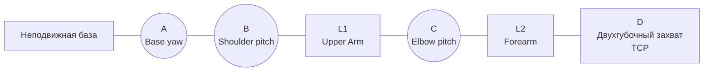

Опорные точки:

```text
B0 = физическая точка пересечения оси Base yaw с опорной плоскостью; НЕ начало RobotBaseFrame
S  = центр оси Shoulder pitch и начало RobotBaseFrame
E  = центр оси Elbow pitch
TCP = фиксированная рабочая точка между губками захвата
```

<a id="sec-6-2"></a>
## 6.2. Геометрические требования

Конструкция должна обеспечивать следующую модель:

```text
RobotBaseFrame origin = ShoulderCenter = [0, 0, 0]
L1 = |S → E| ≈ 230 мм
L2 = |E → TCP| ≈ 220 мм
```

Точные `L1`, `L2` и `floor_z_B` определяются измерением собранной конструкции. `shoulder_height = -floor_z_B` является производной величиной и не хранится вторым независимым параметром.

Механика должна удовлетворять условиям:

- ось Shoulder pitch пересекает вертикальную ось Base yaw в точке `S` в пределах допуска сборки;
- ось Elbow pitch параллельна оси Shoulder pitch;
- `S`, `E` и TCP лежат в одной вращающейся вертикальной плоскости в пределах допуска сборки;
- боковое смещение TCP относительно этой плоскости должно удовлетворять `abs(tcp_lateral_offset_m) <= tcp_lateral_tolerance_m`; точный математический ноль не требуется;
- две опоры Shoulder должны быть соосны;
- две опоры Elbow должны быть соосны;
- физические механические ограничители должны находиться за программной рабочей областью и до зоны натяжения кабеля.

<a id="sec-6-3"></a>
## 6.3. Общая компоновка

```text
                         ЗАХВАТ
                    Medium Motor D
                          │
                 симметричные губки
                          │
             ╔══════════════════════╗
             ║       FOREARM        ║
             ║  лёгкая 3D ферма     ║
             ╚══════════╤═══════════╝
                        │
              ┌──────[60T]──────┐
              │      ELBOW C     │
              └──────[60T]──────┘
                    ▲       ▲
                   12T     12T
                     \     /
                     Large C
               рядом с Elbow
                        │
             ╔══════════════════════╗
             ║      UPPER ARM       ║
             ║ жёсткая 3D ферма     ║
             ╚══════════╤═══════════╝
                        │
              ┌──────[60T]──────┐
              │   SHOULDER B     │
              └──────[60T]──────┘
                    ▲       ▲
                   12T     12T
                     \     /
                     Large B
                        +
                 симметричный
                  противовес
                        │
                     TURRET
                        │
                      [60T]
                        ▲
                       12T
                        │
                     Large A
                        │
             ╔══════════════════════╗
             ║   НЕПОДВИЖНАЯ БАЗА  ║
             ║ EV3 + питание внизу ║
             ╚══════════════════════╝
```

<a id="sec-6-4"></a>
## 6.4. Передачи Base, Shoulder и Elbow

<a id="sec-6-4-1"></a>
### 6.4.1. Общие требования

Для трёх силовых осей механическая схема проектируется как `12T → 60T = 5:1`. Это номинальная геометрия передачи. Управляющее ПО не должно выводить реальный коэффициент `encoder_count → joint angle` только из отношения зубьев: фактический коэффициент, знак и offset определяются QR↔энкодер инженерная калибровка конкретной собранной оси.

Рабочие 60T turntable:

```text
Base      1
Shoulder  2
Elbow     2
----------------
в конструкции 5
запас при закупке 1
```

Детали:

```text
18938 — Technic Turntable 60 Tooth Bevel, Top
18939 — совместимая нижняя часть
32270 — Technic Gear 12 Tooth Double Bevel
```

Каждый нагруженный 12T должен иметь локальную опору с обеих сторон или эквивалентную жёсткую опорную схему. Длинный неподдержанный вал между двумя силовыми шестернями не допускается.

<a id="sec-6-4-2"></a>
### 6.4.2. Base

```text
Large Motor A
    │
   12T
    ▼
   60T
    │
 Base yaw
```

Номинальное отношение — `5:1`; реальный `encoder_scale` определяется инженерная калибровка.

Turntable должен воспринимать структурную нагрузку основания. Вал Large Motor A не должен использоваться как несущая опора.

Base должен иметь два физических механических ограничителя до натяжения кабельного жгута. После сборки инженерная калибровка измеряет:

```text
physical_hard_stop_negative_deg
physical_hard_stop_positive_deg
cable_safe_negative_deg
cable_safe_positive_deg
```

Рабочий программный диапазон выбирается **внутри** пересечения этих диапазонов с отдельным safety margin. Универсальное значение `±120°` не является требованием спецификации.

Для калибровки привода Base собираются QR/encoder измерения в нескольких yaw-положениях, максимально разнесённых внутри безопасного диапазона. Тем самым измеряется, сколько реальных отсчёты энкодера соответствует известному физическому повороту Base, вместо предположения, что номинальная передача идеально равна 5:1.

<a id="sec-6-4-3"></a>
### 6.4.3. Shoulder

Shoulder должен иметь две соосные 60T turntable и два синхронизированных 12T:

```text
        UPPER ARM
            │
     [60T]───┼───[60T]
       ▲           ▲
      12T         12T
        \         /
         синхронный привод
                │
             Large B
```

Обе стороны имеют отношение `5:1`. Двойная схема распределяет нагрузку, но не изменяет передаточное отношение.

Large Motor B должен находиться непосредственно около Shoulder. Shoulder должен быть собран в замкнутой жёсткой рамной кассете.

Конструкция Shoulder должна иметь механическую геометрию, исключающую разрушительный перегиб. После определения нейтрального/разогнутого направления инженерная калибровка задаёт рабочий software limit не более `90°` сгибания; физический механический ограничитель должен находиться немного за программной границей, но до зоны, где звенья, шестерни или кабели могут быть повреждены.

<a id="sec-6-4-4"></a>
### 6.4.4. Elbow

Elbow должен иметь две соосные 60T turntable и два синхронизированных 12T:

```text
        FOREARM
           │
    [60T]───┼───[60T]
      ▲           ▲
     12T         12T
       \         /
        синхронный привод
              │
           Large C
```

Large Motor C должен находиться на Upper Arm непосредственно перед Elbow. Между Shoulder и Elbow не должен использоваться длинный силовой крутильный вал.

Для Elbow инженерная калибровка определяет разогнутое направление. Рабочий software limit не допускает сгибание более `90°`; физическая конструкция должна иметь резервный механический ограничитель до опасной зоны механики.

<a id="sec-6-5"></a>
## 6.5. Требования к соосности силовых суставов

До установки приводных шестерён Shoulder и Elbow должны свободно вращаться вручную.

Узел не допускается к дальнейшей сборке при наличии хотя бы одного признака:

- периодическое закусывание;
- заметно меняющееся трение при полном проходе рабочего угла;
- раздвигание рам при вращении;
- осевое перемещение шестерни под нагрузкой;
- необходимость большого моторного момента только для преодоления несоосности.

Программное увеличение duty не должно использоваться как средство компенсации механической несоосности.

<a id="sec-6-6"></a>
## 6.6. Верхнее звено

Upper Arm должен быть пространственной коробчатой или ферменной конструкцией.

Целевые размеры:

```text
L1 ≈ 230 мм
ориентировочно ≈29 Technic studs между центрами осей
поперечное сечение порядка 5×5 studs
```

Основные элементы:

- `64179` — Frame Thick 5×7;
- `67491` — длинная рама 3×19;
- `4526` — рама 3×13;
- `64178` — Frame Thick 5×11;
- 15L/11L/7L thick liftarms;
- элементы с перпендикулярными отверстиями (`flip-flop`) для связи плоскостей.

Продольные стыки левой и правой силовых линий не должны находиться в одном поперечном сечении.

<a id="sec-6-7"></a>
## 6.7. Предплечье

Forearm должен быть пространственной облегчённой коробчатой или ферменной конструкцией.

Целевой размер:

```text
L2 ≈ 220 мм
ориентировочно 27–28 Technic studs
```

Forearm должен быть легче Upper Arm. Конструкция должна использовать поперечные связи и диагональное усиление только в объёме, необходимом для требуемой жёсткости.

<a id="sec-6-8"></a>
## 6.8. Противовес Shoulder

<a id="sec-6-8-1"></a>
### 6.8.1. Назначение

Shoulder должен иметь пассивную симметричную компенсацию собственного веса звеньев. Она должна уменьшать постоянное усилие мотора при горизонтальном положении руки и ограничивать скорость падения при потере питания.

<a id="sec-6-8-2"></a>
### 6.8.2. Схема

```text
                  Upper Arm
                      \
                       O Shoulder
                      / \
             elastic /   \ elastic
                    /     \
               base L     base R
```

Две ветви должны действовать симметрично относительно механики Shoulder.

<a id="sec-6-8-3"></a>
### 6.8.3. Настройка

Положение креплений и упругость подбираются после окончательной сборки по результату, а не по расчётной массе поднимаемого предмета.

В наиболее тяжёлом горизонтальном положении полностью собранной руки без внешней нагрузки система должна обеспечить:

```text
средний steady duty Shoulder <= 40%
p95 steady duty Shoulder <= 50%
```

Если удержание не проходит критерий, до изменения программного регулятора должны быть проверены:

1. несоосность;
2. трение;
3. масса подвижных деталей;
4. противовес;
5. зацепление шестерён.

Противовес не должен самостоятельно уводить руку в противоположную сторону при снятом моторном усилии.

<a id="sec-6-9"></a>
## 6.9. Крепления QR и физические точки калибровки

Обязательный набор:

```text
SHOULDER_LEFT / SHOULDER_RIGHT
TURRET_LEFT / TURRET_RIGHT
ELBOW_LEFT / ELBOW_RIGHT
GRIPPER_LEFT / GRIPPER_RIGHT
JAW_LEFT / JAW_RIGHT
опционально TCP_CAL
```

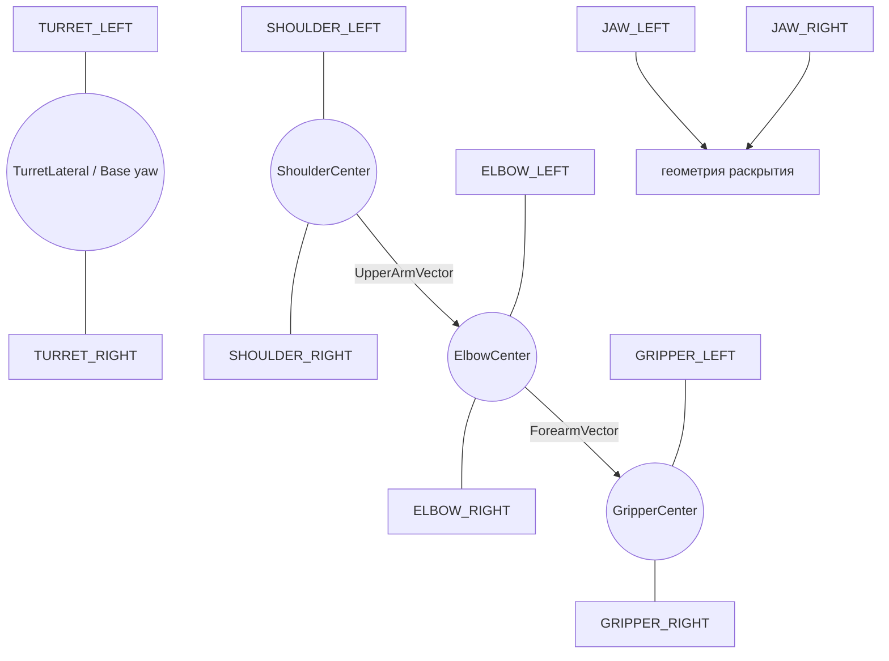

`SHOULDER_LEFT/RIGHT` устанавливаются по разные стороны оси Shoulder на неподвижной части **ниже Base-yaw вращения**; их держатель не должен вращаться с turret. После применения измеренных поправок их середина должна давать `ShoulderCenter`.

`TURRET_LEFT/RIGHT` устанавливаются на вращающейся Base-yaw части до Shoulder pitch так, чтобы их corrected baseline жёстко вращался с Base и оставался достаточно горизонтальным/длинным для измерения yaw. Эта пара нужна именно для абсолютного Base yaw при startup и не определяет начало/оси `RobotBaseFrame`.

`ELBOW_LEFT/RIGHT` располагаются по разные стороны оси Elbow так, чтобы после применения поправок их середина давала `ElbowCenter`. Эти маркеры перемещаются вместе с узлом Elbow.

`GRIPPER_LEFT/RIGHT` закрепляются на жёсткой части корпуса захвата/предплечья, не связанной с относительным движением губок. После применения поправок их середина даёт `GripperCenter`, лежащий на известной продольной геометрии предплечья.

`JAW_LEFT/RIGHT` закрепляются на соответствующих движущихся губках и используются только для определения геометрии раскрытия.

Направления силовых звеньев не извлекаются из ориентации QR. Они строятся как:

```text
UpperArmVector = ElbowCenter - ShoulderCenter
ForearmVector  = TCP - ElbowCenter
```

Требования к креплениям:

- QR-плоскость не должна изгибаться относительно элемента при обычном движении;
- маркер должен быть заменяемым без изменения локальной посадочной геометрии либо после замены выполняется новая затронутая инженерная калибровка;
- маркеры на соседних элементах должны оставаться различимыми в калибровочных позах;
- маркеры не должны попадать в зубья, кабели или зоны защемления;
- координаты каждого маркера относительно локальной системы элемента входят в `RobotGeometry` и измеряются от `QrMarkerCenter`;
- для `JAW_LEFT/RIGHT` дополнительно хранятся преобразования от центра QR к рабочей поверхности соответствующей губки;
- перестановка или поворот держателя требует новой затронутой инженерной калибровки;
- после `READY` видимость QR не требуется.

На держателе рекомендуется иметь механическую центральную метку или размерную схему, позволяющую при замене QR совместить новый `QrMarkerCenter` с прежней точкой. Верхний левый угол QR не используется как размерная база.

Абсолютная привязка суставов не требует отдельных механических reference-сенсоров: её источником является QR-привязка при запуске.

<a id="sec-6-10"></a>
## 6.10. LOCAL_STOP

`LOCAL_STOP` — отдельный физический нажимной элемент, подключённый к выделенному входу EV3, по умолчанию `in4`.

Он должен:

- быть доступен без входа рукой в рабочий объём шестерён;
- иметь однозначные состояния pressed/released;
- контролироваться `phantom-safety` независимо от Quest и сетевого соединения;
- при нажатии фиксировать `STOPPED` и переводить **все физически обнаруженные моторы** в `BRAKE`/`stop`; отсутствие out-of-scope A/B/C на qualification stand является `N_A`, а не ошибкой stop path;
- требовать явного восстановления после отпускания.

`LOCAL_STOP` не является сертифицированным промышленным E-stop и работает через тот же EV3/software stack.

Отдельно должен быть установлен **аппаратный `POWER_CUT`**, физически снимающий энергию с приводов независимо от Linux, `phantom-controller`, `phantom-safety` и сети. Его орган управления располагается вне swept volume, имеет однозначное состояние и проверяется перед HIL с автоматическим движением. Для EV3 power topology `POWER_CUT` должен физически разрывать питание Brick/моторных выходов (например, внешним latching disconnect в цепи питания); программный GPIO/Touch Sensor этим требованием не является. После его срабатывания питание запускается заново, старая session/reference теряется, затем выполняются **применимая active scope startup reference** и deliberate re-arm.

<a id="sec-6-11"></a>
## 6.11. Фиксация основания

Неподвижная база должна быть закреплена к рабочей поверхности или иметь эквивалентную противоскользящую фиксацию, исключающую заметное перемещение во время `TRACKING`.

EV3 brick и питание должны располагаться низко на неподвижной части, чтобы не увеличивать момент на поворотной конструкции.

Физическое перемещение/поворот всей неподвижной базы **после получения `RobotLocalization` запрещено в пределах активного запуска**, даже если `TRACKING` уже остановлен: такое перемещение меняет преобразование `LOCAL_FLOOR↔RobotBaseFrame`, а энкодеры его не наблюдают. Для переноса оператор обязан остановить движение, выполнить shutdown/`POWER_CUT`, физически переставить и заново жёстко зафиксировать основание. Следующий запуск обязан создать новую `RobotLocalization` по `SHOULDER_LEFT/RIGHT`; старая localization/session не может восстанавливаться из сохранённого значения. PHANTOM v1 **не заявляет online-обнаружение любого проскальзывания базы после отключения QR tracking**: безопасность опирается на квалифицированную механическую фиксацию и operator/maintenance detection. Любое наблюдаемое или подозреваемое смещение/ослабление требует немедленного release `Left Grip`/`LOCAL_STOP`, инвалидации `RobotLocalization`, проверки фиксации и новой QR localization до re-arm. Опциональная QR recheck при полностью остановленной системе может использоваться как диагностический gate, но не заменяет физическую фиксацию.

До физической приёмки для конкретной assembly revision фиксируется safety envelope:

```yaml
safety_envelope:
  gripper_open_limit_delta_counts: MEASURED_SIGNED_NONZERO
  payload_mass_max_kg: MEASURED
  payload_cog_offset_max_m: MEASURED
  tcp_static_moment_max_Nm: MEASURED
  swept_volume_margin_m: MEASURED
  pinch_exclusion_margin_m: MEASURED
  external_power_cut_required: true
  power_cut_max_disconnect_ms: MEASURED
  local_stop_response_limit_ms: MEASURED
  power_loss_peak_tcp_speed_limit_mps: MEASURED
  payload_profiles_hash: SHA256
```

Работа с неизвестным/превышающим квалифицированный envelope предметом запрещена. Для каждого разрешённого класса задаётся `PayloadProfile{id,mass_max,cog_offset_max,motion_scale,feedforward_params}`; `EMPTY` всегда отдельный профиль. Перед попыткой захвата выбирается ожидаемый профиль: его консервативные motion limits применяются сразу. После фактического захвата оператор в `READY/HOLD` при полной остановке явно подтверждает `PayloadState=LOADED`; только тогда включается payload gravity feed-forward. Начало освобождения при `PayloadState=LOADED` не должно происходить одновременно с продолжением A/B/C trajectory: EV3 release interlock §7.15.4 фиксирует текущие A/B/C и допускает только bounded D-opening до снятия контакта, затем принудительно остаётся в `HOLD`. После открытия/освобождения `PayloadState` системно становится `UNKNOWN`; оператор при полной остановке подтверждает `EMPTY`, и до ACK A/B/C `TRACKING` остаётся запрещён. Любой переход снимает armed-latch. При автоматическом движении оператор и другие люди находятся вне swept volume и pinch-exclusion zones; рабочая стойка оператора проектируется так, чтобы его Hand Tracking workspace не пересекался с swept volume. QR-сканирование вблизи робота выполняется только при полной остановке.

<a id="sec-6-12"></a>
## 6.12. Кабельный диапазон Base

Кабельный жгут вокруг Base должен иметь service loop.

Требования:

```text
при software limit кабель имеет свободный запас
при mechanical hard stop кабель всё ещё не натянут
разъём никогда не является mechanical stop
```

механический ограничитель должен воспринимать механическую нагрузку раньше, чем кабель или коннектор окажутся натянуты.

<a id="sec-6-13"></a>
## 6.13. Кабельная разводка по звеньям

Используются только кабели моторов, совместимые с EV3/NXT.

Планирование длины:

```text
Base A      — короткий кабель по фактической компоновке
Shoulder B  — короткий или средний кабель
Elbow C     — примерно 50–80 см после макета трассы
Gripper D   — около 100 см, предпочтительно одним непрерывным кабелем
```

Кабельный жгут должен:

- находиться вне зубьев шестерён;
- иметь strain relief;
- иметь запас при полном рабочем диапазоне;
- не ограничивать движение раньше программных ограничений;
- не пересекать зоны защемления без физической фиксации.

<a id="sec-6-14"></a>
## 6.14. Конструкция захвата

<a id="sec-6-14-1"></a>
### 6.14.1. Функция

Захват должен преобразовывать `grip_intent=0..1` в пропорциональное симметричное раскрытие двух губок.

<a id="sec-6-14-2"></a>
### 6.14.2. Схема

```text
Medium Motor D
      │
   редуктор ~3:1
      │
симметричная тяга / две встречные рейки
      │
две податливые губки
```

<a id="sec-6-14-3"></a>
### 6.14.3. Геометрические требования

```text
максимальное раскрытие: 55–60 мм
полезный минимальный зазор: <=15 мм
полный ход: 0.8–1.2 с
TCP: фиксированный центр между рабочими поверхностями губок
```

Губки должны иметь мягкие или податливые контактные поверхности. Изменение раскрытия не должно менять определение TCP.

<a id="sec-6-14-4"></a>
### 6.14.4. QR-калибровка захвата

QR `JAW_LEFT/RIGHT` закрепляются на движущихся губках, но не обязаны находиться на их рабочих краях. В `RobotGeometry` для каждой губки хранится постоянное преобразование от `QrMarkerCenter` к рабочей контактной точке/поверхности.

Во время инженерной калибровки:

1. закрытое положение определяется низкоскоростным движением до подтверждённого `GRIPPER_HOME`; stall до home считается fault;
2. отдельной стендовой безопасной процедурой заранее устанавливается `gripper_open_limit_delta_counts`, не зависящий от QR-поиска максимума;
3. губки открываются малыми остановленными шагами только внутри `d∈[0,D_open_counts]` и независимых EV3 time/speed/duty bounds;
4. после каждого шага Quest по QR вычисляет фактический зазор между рабочими поверхностями;
5. между closed и safe-open endpoint строится нелинейная двунаправленная калибровочная кривая `encoder_count ↔ jaw_opening_mm`; немонотонность до endpoint считается ошибкой механики/калибровки, а не поводом выбрать локальный максимум.

Это необходимо, потому что траектория губок может быть дугообразной/эллиптической и расстояние между ними не обязано линейно зависеть от угла мотора.

`GRIPPER_HOME` устанавливается до силового механического упора либо с такой геометрией, чтобы его срабатывание не требовало существенного сжатия упора. В обычной работе регулярное силовое упирание в mechanical stop запрещено; home sensor используется только engineering/reference процедурами, а не как realtime servo feedback.

<a id="sec-6-15"></a>
## 6.15. Пассивное поведение при потере питания

Конструкция должна быть испытана на полное отключение питания в нескольких наиболее тяжёлых позах и с квалифицированными payload cases. Активный HOLD не считается частью защиты в этом тесте.

Критерии:

- ни одно звено/груз не ударяется о mechanical stop, стол, базу или другое звено с разрушительной/опасной энергией;
- кабель не натягивается и не попадает в pinch/gear path;
- детали, QR fixtures, payload или модули не отсоединяются/не выбрасываются;
- основание не смещается;
- пиковая наблюдаемая скорость TCP в квалифицированной worst-case конфигурации должна быть не более `power_loss_peak_tcp_speed_limit_mps`, где предел является safety-critical `MEASURED` из `SafetyEnvelope`, полученным из hazard/stopping-distance/containment qualification конкретной механической revision; произвольный универсальный числовой предел не допускается;
- дополнительно фиксируются peak TCP displacement, time-to-rest и максимальная скорость каждого tested payload case; результаты входят в SafetyEnvelope evidence, а не только в свободный текст;
- swept/pinch zone испытания физически ограждается: руки оператора не используются для ловли механизма/предмета;
- если payload retention без питания конструктивно не гарантируется, acceptance fixture обязан безопасно принять падающий предмет; эксплуатационный swept volume учитывает этот сценарий.

Испытание выполняется сначала с пустым захватом, затем с каждым разрешённым PayloadProfile в representative worst-case pose. После изменения противовеса, масс, transmission friction, payload envelope или power topology тест повторяется.

<a id="sec-6-16"></a>
## 6.16. Жёсткость и повторяемость

Конструкция должна обеспечивать:

- отсутствие видимого пропуска зубьев в рабочем диапазоне;
- отсутствие остаточного смещения рам после обычной упругой нагрузки;
- воспроизводимость TCP при подходе к одной точке с разных направлений;
- отсутствие свободного осевого перемещения силовых turntable и шестерён;
- стабильное положение QR-крепления относительно соответствующих деталей.

Программная компенсация backlash не должна вводиться до измерения физического hysteresis на собранной конструкции.

<a id="sec-6-17"></a>
## 6.17. Порядок сборки

Конструкция собирается и проверяется модульно:

```text
1. Стендовый модуль Shoulder
   2×60T + 2×12T + Large Motor B + жёсткая кассета

2. Проверка свободного вращения Shoulder

3. Противовес Shoulder

4. Стендовый модуль Elbow
   2×60T + 2×12T + Large Motor C

5. Проверка свободного вращения Elbow

6. Верхнее звено

7. Предплечье

8. Захват

9. Base + механические ограничители + кабельная петля

10. LOCAL_STOP

11. Жёсткие крепления QR на Shoulder / Elbow / корпусе захвата / обеих губках

12. Полная сборка

13. Инженерная калибровка RobotGeometry

14. QR↔энкодерная DriveCalibration четырёх приводов

15. Низкоскоростные испытания EV3

16. Полные системные испытания
```

Для каждой механической revision обязательным release artifact является versioned LEGO Studio/CAD assembly: точные позиции/оси, QR fixtures, фазировка двухсторонних Shoulder/Elbow передач, mechanical stops, cable routing и BOM. Только текстовое описание главы 6 не считается достаточным для воспроизводимой сборки.

<a id="sec-6-18"></a>
## 6.18. Минимальная комплектность конструкции

<a id="sec-6-18-1"></a>
### 6.18.1. Электроника и маркеры

| Количество | Элемент | Назначение |
|---:|---|---|
| 1 | LEGO Mindstorms EV3 brick | контроллер |
| 3 | EV3 Large Motor | Base, Shoulder, Elbow |
| 1 | EV3 Medium Motor | захват |
| 2 | EV3 Touch Sensor или эквивалент | `LOCAL_STOP` (`in4`) и `GRIPPER_HOME` (`in3`) |
| 1 | Netgear `WNA1100` / N150 Wireless USB Adapter | штатный Wi-Fi adapter Quest↔EV3 для этой сборки |
| 1 | microSDHC | ev3dev |
| 1 | квалифицированный источник питания EV3/приводов | питание конкретной сборки; voltage/battery thresholds квалифицируются с этим источником |
| 1 | аппаратный `POWER_CUT` в общей цепи питания Brick/моторных выходов | независимое от EV3/Linux latching снятие энергии, доступное вне swept volume; обязателен для physical HIL/эксплуатации v1 |
| 10 | физические QR-маркеры с жёсткими держателями | `SHOULDER_LEFT/RIGHT`, `TURRET_LEFT/RIGHT`, `ELBOW_LEFT/RIGHT`, `GRIPPER_LEFT/RIGHT`, `JAW_LEFT/RIGHT` |
| 1 опционально | `TCP_CAL` маркер | инженерная калибровка TCP |

<a id="sec-6-18-2"></a>
### 6.18.2. Силовые элементы

| Количество | Деталь | Назначение |
|---:|---|---|
| 6 комплектов | `18938 + 18939` 60T bevel turntable | 5 рабочих + 1 запас |
| 12 | `32270` 12T Double Bevel | рабочие передачи + запас |
| 30 | `64179` Frame Thick 5×7 | рамы и силовые кассеты |
| 8 | `64178` Frame Thick 5×11 | основание и крупные поперечные рамы |
| 6 | `67491` Frame Thick 3×19 | длинные продольные элементы |
| 6 | `4526` Frame Thick 3×13 | продольные элементы и перекрытия |
| 8–12 | perpendicular/flip-flop элементы | пространственные связи |
| 16–24 | 15L thick liftarm | продольные связи |
| 12–16 | 11L thick liftarm | связи |
| 12–16 | 7L thick liftarm | локальные кассеты |

<a id="sec-6-18-3"></a>
### 6.18.3. Пины, втулки и оси LEGO

Рекомендуемый запас:

```text
~200 friction pin 2L
40–50 long friction pin
50–60 axle-pin
~50 bush
~50 half-bush
короткие axles 5L/6L/7L с запасом
axles 8L — около 12
axles 10L — 8–10
axles 12L — только там, где действительно нужны
```

Силовой вал должен быть минимальной достаточной длины и иметь близкие опоры.

<a id="sec-6-19"></a>
## 6.19. Конфигурация механики

Все результаты устанавливаются как единый immutable `CommissioningBundle`. Quest хранит геометрическую часть, EV3 — authoritative safety/control subset. Полный `READY` возможен только при `qualification_only=false`, `actuator_scope_mask=0x0F`, `safety_observation_mask=0x0F`, полном bundle, ненулевом/валидном `qualification_evidence_manifest_hash` и совпадении общего hash. Полный component set, полученный инженерной калибровкой, до физической HIL-квалификации остаётся **production-candidate** внутри `qualification_only=true` bundle; полнота геометрии сама по себе не является доказательством готовности к Release. Для этапов 3–5 Diagnostic допускает отдельную qualification-only revision: обе маски `0x00` или обе `0x08`, неполные A/B/C geometry/safe-set sections и полный gripper subset; она может разрешить только `COMMISSIONING`, никогда `READY`. Любое изменение subset всё равно создаёт новую bundle revision; скрытое частичное редактирование файла запрещено.

После сборки инженерная калибровка фиксирует:

```yaml
geometry:
  revision: 1
  L1_m: MEASURED
  L2_m: MEASURED
  robot_nominal_reach_m: MEASURED_OR_DERIVED_LE_L1_PLUS_L2
  yaw_singularity_hold_radius_m: MEASURED_POSITIVE
  floor_z_B_m: MEASURED_NEGATIVE
  tcp_lateral_offset_m: MEASURED
  tcp_lateral_tolerance_m: MEASURED
  branch_sign: MEASURED
  base_qr_zero_offset_rad: MEASURED
  tcp_reference_tolerance_m: MEASURED
  link_length_residual_tolerance_m: MEASURED
  arm_plane_tolerance_rad: MEASURED
  qr_fixtures_hash: SHA256
  qr_marker_manifest_hash: SHA256
  mechanical_assembly_hash: SHA256
  collision_model_revision: MEASURED

drive_calibration:
  revision: 1
  base_encoder_scale_rad_per_count: MEASURED
  shoulder_encoder_scale_rad_per_count: MEASURED
  elbow_encoder_scale_rad_per_count: MEASURED
  gripper:
    opening_curve: MEASURED_PIECEWISE_MONOTONIC
    closing_curve: MEASURED_PIECEWISE_MONOTONIC
    closed_endpoint: MEASURED_GRIPPER_HOME
    curve_domain_counts: MEASURED_0_TO_D_OPEN_COUNTS  # bound is referenced from SafetyEnvelope
    backlash_encoder_counts: MEASURED

safety_envelope:
  payload_mass_max_kg: MEASURED
  payload_cog_offset_max_m: MEASURED
  tcp_static_moment_max_Nm: MEASURED
  swept_volume_margin_m: MEASURED
  pinch_exclusion_margin_m: MEASURED
  external_power_cut_required: true
  power_cut_max_disconnect_ms: MEASURED
  local_stop_response_limit_ms: MEASURED
  power_loss_peak_tcp_speed_limit_mps: MEASURED
  gripper_open_limit_delta_counts: MEASURED_SIGNED_NONZERO
  payload_profiles_hash: SHA256

collision_model:
  revision: MEASURED
  primitives: MEASURED_BOUNDED_SET
  floor_clearance_m: MEASURED
  tcp_floor_clearance_m: MEASURED
  collision_margin_m: MEASURED

joint_safe_sets:
  - payload_profile_id: EMPTY
    revision: MEASURED
    representation: GRID3D_V1
    hash: SHA256
  - payload_profile_id: MEASURED_PROFILE_ID
    revision: MEASURED
    representation: GRID3D_V1
    hash: SHA256

payload_profiles:
  hash: SHA256
  profiles: MEASURED_QUALIFIED_SET

safe_bounds:
  base_min_deg: MEASURED_WITH_MARGIN
  base_max_deg: MEASURED_WITH_MARGIN
  shoulder_flexion_max_deg: 90
  elbow_flexion_max_deg: 90
  base_hard_stop_negative_deg: MEASURED
  base_hard_stop_positive_deg: MEASURED
  cable_safe_negative_deg: MEASURED
  cable_safe_positive_deg: MEASURED
```

Изменение физической величины, влияющей на IK, QR pose, передаточное соответствие, безопасные границы или TCP, требует новой revision соответствующей конфигурации и повторных затронутых приёмочные тесты.

<a id="sec-7"></a>
# 7. Программа LEGO Mindstorms EV3

<a id="sec-7-1"></a>
## 7.1. Среда выполнения

Целевая среда v1:

```text
ev3dev Stretch class system (legacy/EOL)
ARMv5TEJ / armel / gnueabi
C++14
systemd 232 compatibility baseline
Python 3.5 compatibility для device/deployment helpers
```

Этот software base рассматривается как legacy/EOL: он допускается для исследовательского прототипа только с pinned image SHA-256, pinned toolchain, SBOM, vulnerability/risk record, SSH keys и изолированной LAN без Internet exposure. Код компилируется вне EV3 кросс-компилятором. На EV3 устанавливаются готовые бинарные артефакты и конфигурация.

Hardware-specific sysfs код изолируется за интерфейсом `MotorBackend` (`Ev3SysfsBackend` в v1). State machine, safety policy, protocol, trajectory/reference и controller math не должны зависеть от EV3 sysfs API, чтобы future controller migration не требовала изменения управляющей семантики.

Все устанавливаемые unit-файлы обязаны проходить `systemd-analyze verify` на реальном baseline systemd 232. Директивы, появившиеся позже systemd 232 (например, `StateDirectory=`, `LogsDirectory=` или `RuntimeDirectoryPreserve=`), запрещены без совместимого fallback. Вспомогательные скрипты, выполняемые на Brick, не используют синтаксис/API Python новее 3.5 до смены pinned ev3dev image.

Python-компоненты EV3 предварительно компилируются через совместимый `compileall` при установке. Сетевые long-lived services используют `Type=notify` и объявляют READY только после фактического открытия UDP listener либо успешной DNS-SD publication. Для проверенного legacy Brick startup timeout этих services равен `90 s`: медленный cold import на ARMv5TEJ не должен создавать ложный restart loop, но отсутствие READY по истечении timeout остаётся ошибкой запуска.

Проверенный 03.09.2026 development fingerprint текущего Brick: `ev3dev-stretch`, Debian `9.12`, kernel `4.14.117-ev3dev-2.3.5-ev3`, machine `armv5tejl`, systemd `232`, Python `3.5.3`. Этот fingerprint задаёт фактически проверенный compatibility floor, но не заменяет обязательный SHA-256 полного ev3dev image и device SBOM из §3.2.7/§8.5.

<a id="sec-7-2"></a>
## 7.2. Процессы

EV3 runtime содержит четыре long-lived PHANTOM service и один bounded boot helper:

1. `phantom-controller` — моторный/state-machine процесс, владелец controller boot identity и heartbeat;
2. `phantom-safety` — отдельный software supervisor основного процесса и `LOCAL_STOP` на том же EV3; он не является независимым аппаратным safety channel;
3. `phantom-network` — изолированный UDP/HMAC/session/telemetry worker;
4. `phantom-mdns` — publisher DNS-SD identity через системный Avahi;
5. `phantom-wifi-autoconnect` — `oneshot` helper для уже provisioned ConnMan profile; после успешного подключения он не остаётся сетевым менеджером.

В network-only profile worker/publisher могут быть совместимыми с Python 3.5 отдельными процессами. Они не выполняются внутри 50-Hz motor loop. Переход к иному языку реализации не должен объединять socket receive, HMAC, DNS/mDNS, packet parsing, filesystem I/O, string formatting или blocking logging с критическим motor-loop path.

`phantom.target` требует `phantom-safety` и только wants остальные PHANTOM units: отказ controller/network/mDNS не должен останавливать supervisor. Wi-Fi helper запускается после `connman` и до controller/network/mDNS; network требует готовый controller boot identity; mDNS требует network и `avahi-daemon`. Restart controller обязан быть обнаружен network/mDNS plane: старая session инвалидируется, TXT перепубликуется с новым boot id; workers могут остаться запущенными либо безопасно перезапуститься. Safety при этом не останавливается.

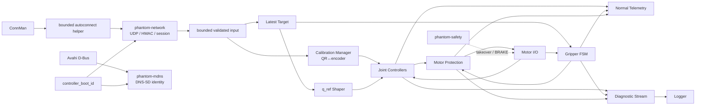

<a id="sec-7-2-1"></a>
### 7.2.1. `phantom-controller`

Процесс выполняет:

- создание нового CSPRNG `controller_boot_id` при каждом запуске и атомарную публикацию его локальным network/mDNS workers;
- QR↔энкодер инженерная калибровка/reference protocol;
- хранение последней валидной цели;
- цикл управления моторами `50 Hz`;
- safe-bound checks;
- `q_ref` shaping;
- PD + feed-forward;
- stall/tracking protection;
- gripper contact/stall logic;
- normal и diagnostic telemetry;
- heartbeat к `phantom-safety` и контроль обратного heartbeat;
- неблокирующее логирование.

<a id="sec-7-2-2"></a>
### 7.2.2. `phantom-network`

`phantom-network` является сетевым фронтендом **без actuator authority и без прямого motor-write path**. Он проверяет exact packet bounds, protocol/header/reserved fields, HMAC, `robot_id`, role/key slot, current `controller_boot_id`, endpoint/session и wire `sequence`, отвечает на `PING`, ограничивает входной поток и сериализует `TELEMETRY`. Он запускается **без** прав записи motor sysfs и сам по себе не может создавать CONTROL/COMMISSIONING actuator authority, менять reference/calibration/payload/fault state либо принимать решение о локальном commissioning arm.

Это разделение является **fault-containment boundary, а не Byzantine/security sandbox**. Оно обязано выдерживать crash/restart worker, loss/overflow, malformed/duplicated/stale IPC, повреждённую/ошибочную сетевую datagram и parser rejection без прямой записи motor sysfs или обхода controller safety predicates. Однако `phantom-network` владеет wire PSK и является частью trusted computing base для результата HMAC/session authentication: спецификация v1 **не утверждает**, что произвольно скомпрометированный либо логически Byzantine `phantom-network`, который сознательно генерирует syntactically-valid IPC от собственного разрешённого service identity, криптографически изолирован от actuator path. Controller уменьшает последствия такого класса ошибок повторной проверкой state/scope/reference/re-arm/safety predicates, но не может независимо доказать исходную сетевую аутентичность, не владея wire key. Компрометация EV3 OS/root или trusted runtime process находится вне v1 remote-LAN threat model и рассматривается как common-mode host compromise; `POWER_CUT`, host hardening и контролируемый provisioning остаются обязательными. Это ограничение не ослабляет HMAC/LAN-isolation требования к удалённому сетевому атакующему.

Граница `phantom-network ↔ phantom-controller` является отдельным safety boundary. Обмен идёт только через nonblocking `AF_UNIX/SOCK_DGRAM` endpoints в заранее созданных `tmpfiles.d` runtime-каталогах. Процесс-владелец создаёт socket endpoint до объявления readiness, устанавливает group `phantom-ipc` и mode `0660`, а peer не продолжает handshake до успешного обмена; заранее созданный обычный файл на месте Unix socket запрещён. `phantom-controller` проверяет Linux peer credentials (`SO_PASSCRED`/`SCM_CREDENTIALS` либо эквивалентный connected-peer credential check, квалифицированный на pinned kernel). `phantom-controller` запускается как `phantom-ctrl`, `phantom-network` — как `phantom-net`; оба могут входить в `phantom-ipc`, но только `phantom-ctrl` входит в motor-I/O group. `phantom-net` не входит в motor-I/O group и не должен иметь DAC-доступ на запись к motor sysfs/lease. Все IPC structures имеют фиксированный `ipc_version`, exact fixed/bounded length и canonical zero reserved bytes; динамически растущие IPC payload/очереди запрещены. Queue/socket overflow, malformed IPC, peer restart или потеря event не блокируют 50-Hz loop и трактуются fail-safe.

Для Stage-3 network-only slice общий `ControllerRequestV1` имеет exact length `120` bytes и little-endian scalar fields: `magic="PHIP":u8[4]`, `ipc_version:u16=1`, `request_type:u16` (`SESSION_OPEN=1`, `COMMAND_SNAPSHOT=3`, `SESSION_INVALIDATE=4`), `reserved0:u32=0`, `controller_boot_id:u8[16]`, `session_generation:u64`, `session_id:u8[16]`, `role:u8`, `key_slot:u8`, `remote_family:u8=4`, `reserved1:u8=0`, `remote_ipv4_network_order:u8[4]`, `remote_port_network_order:u8[2]`, `reserved2:u16=0`, `client_nonce:u8[16]`, `wire_sequence:u64`, `rx_monotonic_us:u64`, `command_payload:u8[24]`. Для `SESSION_OPEN` `wire_sequence=0`, `command_payload=0`; для `COMMAND_SNAPSHOT` `client_nonce=0`, а последние 24 bytes являются exact decoded `COMMAND` payload и повторно валидируются controller-ом; для `SESSION_INVALIDATE` nonce/sequence/command payload равны zero. `ControllerReplyV1` имеет exact length `64` bytes: те же magic/version, `reply_type=2`, canonical reserved, boot/generation/session, `request_wire_sequence:u64`, `result_code:u16`, `reserved_tail:u16=0`. Controller обрабатывает не более 16 queued IPC datagrams за один 50-Hz tick, принимает только ожидаемый `phantom-net` uid из `SCM_CREDENTIALS` и freshness `rx_monotonic_us<=500 ms`; любой timeout/loss/malformed/stale reply означает отсутствие новой authority/target.

**Установление session.** После криптографически валидного `HELLO` network worker может только предложить CSPRNG `session_id` через bounded `SessionOpenRequestV1{ipc_version,controller_boot_id,session_generation_candidate,session_id,role,key_slot,client_nonce,remote_endpoint,wire_sequence,rx_monotonic_us}`. `phantom-controller` независимо проверяет текущий state, отсутствие несовместимого свежего owner, active bundle/scope, build/profile compatibility, role и применимые recovery predicates. Runtime `active_payload_profile_id` при startup может быть `UNSELECTED` и **не является prerequisite открытия CONTROL session**: эта session нужна для последующих `SET_PAYLOAD_PROFILE/SET_PAYLOAD_STATE`; actuator authority всё равно остаётся заблокированной их отдельными gates. Для role=`COMMISSIONING` только controller проверяет и атомарно consume-ит текущий `LOCAL_COMMISSION_ARM`; network process не может синтезировать этот факт. Только после `SESSION_OPEN_ACCEPT` session generation/id становятся authoritative, и network отправляет успешный `HELLO_ACK(result_code=OK, session_id!=0)`. После `SESSION_OPEN_REJECT` wire-session/owner side effect не создаётся, но если исходный `HELLO` уже прошёл HMAC и selector validation, network **может и должен** вернуть authenticated rejected `HELLO_ACK(session_id=0,result_code=<error>)` по §4.7.3/§11.8; bad HMAC/unknown slot остаются silent drop. Restart любого peer инвалидирует pending/open handshake; старая `session_generation` никогда не наследуется новым `phantom-network`.

**Поток движения.** Нормативный `NetworkCommandSnapshotV1` содержит как минимум `ipc_version`, current `controller_boot_id`, authoritative `session_generation`, `session_id`, wire `sequence`, `rx_monotonic_us`, `motion_flags`, `q_target[3]`, `grip_intent`. Controller **не доверяет IPC как actuator authority**: повторно сверяет boot id, active session generation/id, строго возрастающий wire sequence, receive age, current scope/profile/reference/safety predicates и `release_seen` до атомарного обновления latest target. В scope `0x00` authenticated `COMMAND` учитывается только как protocol evidence и не создаёт motor target.

**Control/commissioning transactions.** `CALIBRATION_QUERY`, `SET_JOINT_REFERENCE`, `COMMISSIONING_SAMPLE`, `CALIBRATION_JOG`, `SET_DRIVE_CALIBRATION`, `FAULT_ACK`, `RESET_STOPPED`, `SET_PAYLOAD_PROFILE` и `SET_PAYLOAD_STATE` передаются controller через `NetworkTransactionEnvelopeV1`. Envelope содержит как минимум `ipc_version`, boot/session generation/id, wire request sequence, receive monotonic time, `wire_message_type`, exact `payload_length` и bounded payload buffer размером не меньше максимального protocol-v1 payload (`436 bytes`); bytes после `payload_length` canonical zero. Controller заново проверяет operation type/length, session role/state, transaction monotonicity/hash, stationary/scope/reference/safety predicates и только затем выполняет side effect. Факт успешной HMAC-проверки network worker не заменяет эту авторизацию.

Controller отвечает `ControllerProtocolReplyV1{ipc_version,controller_boot_id,session_generation,session_id,request_wire_sequence,transaction_id,response_message_type,payload_length,payload[...]}`. Он возвращает **нормативный response payload/result**, а `phantom-network` всегда назначает свежий outbound EV3→Quest `sequence`, актуальный `sender_monotonic_us` и вычисляет новый HMAC. При exact retry state transaction controller возвращает сохранённый ACK payload/result, но повтор старой wire-datagram/header запрещён (§4.7.4). Потеря transaction IPC до controller означает отсутствие side effect; потеря reply после side effect разрешается только transaction-specific retry/reconciliation правилами.

`SESSION_INVALIDATE` event немедленно сбрасывает controller-side latest target/re-arm/session authority. Даже если invalidate IPC потерян, controller command-freshness/session watchdog обязан прекратить motion; новый network peer не может продолжить старую generation. `CALIBRATION_QUERY`/atomic encoder snapshot и иные read operations, состояние которых принадлежит controller, также проходят этот IPC, а не читают motor sysfs из network process.

Обратный `ControllerTelemetrySnapshotV1` передаёт network worker только bounded snapshot состояния controller/battery/reference/gripper/incident; network worker сериализует wire `TELEMETRY` вне 50-Hz loop. Потеря обратного IPC может сделать telemetry stale, но не изменяет actuator state. IPC schema/version, peer-credential/permission, session-open authorization, stale-generation, queue-overflow и restart tests входят в PRE-INSTALL/DEVICE/HIL regression.

<a id="sec-7-2-3"></a>
### 7.2.3. `phantom-mdns`

`phantom-mdns` читает только validated public identity и текущий boot id, публикует §4.6 через Avahi и перепубликует service при смене boot id. Падение либо задержка mDNS не даёт actuator authority и не блокирует `phantom-safety`.

<a id="sec-7-2-4"></a>
### 7.2.4. `phantom-safety`

`phantom-safety` не выполняет штатное регулирование. Он является программным fallback на том же EV3 и не защищает от common-mode отказа kernel/CPU/power/motor driver. Независимое снятие энергии обеспечивает `POWER_CUT`.

Локальный liveness channel между процессами — pre-created nonblocking `AF_UNIX/SOCK_DGRAM` с fixed-size binary heartbeat. Оба процесса отправляют heartbeat не реже `20 Hz`; freshness измеряется только `CLOCK_MONOTONIC` получателя. Socket receive/parse никогда не блокирует `LOCAL_STOP`/takeover path.

Heartbeat socket endpoints после `bind` обязаны иметь mode `0660` и dedicated group `phantom-safety-ipc` (либо root-owned equivalent с минимальными ACL); `phantom-ctrl` имеет только необходимый доступ к этому channel. Эта группа не даёт доступа к PSK и не заменяет motor-I/O permissions; umask процесса не должен случайно открыть channel посторонним service accounts.

Он:

- при запуске независимо от `phantom-controller` перечисляет физически присутствующие EV3 tacho-motor devices по `address=outA..outD`, открывает необходимый stop/takeover I/O заранее и обновляет этот bounded hardware snapshot только вне takeover critical path; отсутствие ожидаемого scoped устройства сообщается controller/device-auto, но физически присутствующая out-of-scope ось всё равно входит в emergency stop set;
- независимо читает `LOCAL_STOP`;
- контролирует heartbeat `phantom-controller`;
- в штатном режиме не пишет управляющее воздействие `duty` мотора;
- при потере heartbeat выполняет takeover;
- устанавливает duty=0, `stop_action=brake`, `stop` для всех физически обнаруженных моторных портов; оси вне qualification scope тоже тормозятся, если устройство присутствует;
- фиксирует причину;
- не снимает fault автоматически.

<a id="sec-7-2-5"></a>
### 7.2.5. `phantom-wifi-autoconnect`

`phantom-wifi-autoconnect` — bounded `oneshot` boot helper, а не второй network manager. Он работает только с уже provisioned ConnMan profiles, не принимает actuator protocol и не имеет доступа к motor sysfs. Helper динамически обнаруживает Wi-Fi interface, может инициировать подключение только сохранённого `Favorite+AutoConnect` profile, никогда не читает/логирует/копирует `Passphrase` и завершает работу после success либо bounded timeout. После boot обычным reconnect управляет ConnMan; постоянный competing daemon запрещён. Provisioning/permission/negative tests определены §8.11–§8.12 и §9.18.

<a id="sec-7-3"></a>
## 7.3. Единственный владелец моторных команд

В штатном режиме только `phantom-controller` может записывать команды движения в sysfs-интерфейс моторов.

`phantom-controller` обязан удерживать exclusive OS lease `/run/phantom/motor-control.lock` всё время, когда имеет право писать motor sysfs. Runtime controller identity — `phantom-ctrl`; lock/runtime objects создаются `root:phantom-motor 0660` / `root:phantom-motor 0770`, и только `phantom-ctrl` плюс root `phantom-safety` имеют доступ к `phantom-motor`. `phantom-net`, `phantom-mdns` и Wi-Fi helper **не** входят в `phantom-motor`. `phantom-ctrl` имеет только необходимую supplementary motor-I/O group для EV3 sysfs; network credential groups ему не выдаются. Ошибка открытия/lease или неожиданно широкие effective groups являются fail-closed DEVICE-AUTO error.

`phantom-safety` имеет **единый reason-driven takeover primitive**. Trigger может быть `CONTROLLER_HEARTBEAT_TIMEOUT`, `LOCAL_STOP` или собственная safety fault. При живом controller `LOCAL_STOP` сначала использует cooperative path, чтобы не уничтожать без необходимости текущий boot/session/reference:

```text
LOCAL_STOP/safety inhibit latch
→ controller независимо видит inhibit, немедленно duty=0 / brake / stop
→ controller освобождает motor-control lease
→ safety подтверждает освобождение в bounded cooperative timeout
→ safety получает lease и повторно применяет zero/brake/stop ко всем физически обнаруженным моторам
→ safety удерживает lease, пока stop latch активен
```

Если controller heartbeat уже просрочен либо cooperative release не подтверждён в limit, применяется принудительный path:

```text
→ SIGKILL phantom-controller (SIGSTOP недостаточен: stopped process сохраняет lock/FD)
→ подтвердить исчезновение PID / освобождение file lock в bounded timeout
→ если lease не освобождён к timeout: зафиксировать split-brain и выполнить break-glass best-effort brake/stop writes; оператор обязан использовать POWER_CUT
→ иначе phantom-safety получает exclusive motor-control lease
→ duty=0; stop_action=brake; stop всех физически обнаруженных моторов
→ latch process/safety fault согласно reason
```

`LOCAL_STOP` **не обязан убивать исправный controller**. Если cooperative path завершён, `controller_boot_id`, current session и runtime references могут сохраниться, но actuator authority остаётся нулевой до reset/re-arm. Если controller был убит/перезапущен, новый boot id безусловно инвалидирует старую session, `JointReference` и `GripperReference`; recovery требует нового `HELLO` и применимой QR reference.

После `RESET_STOPPED` safety освобождает takeover lease только когда stop input released, blocking fault отсутствует и controller готов принять lease; controller получает его заново до возможного `HOLD`. Для motion-capable profile process-liveness fault по-прежнему запрещает actuator authority до explicit reset/reference. `POWER_CUT` остаётся единственным независимым средством при common-mode отказе EV3/Linux.

Одновременная штатная запись двух процессов в один sysfs-интерфейс моторов запрещена.

Если `phantom-controller` перестал получать heartbeat `phantom-safety`, он сам должен отменить движение, выполнить `BRAKE`, освободить motor lease, перейти/остаться в `STOPPED` и latch process-liveness fault. В protocol v1 legacy code `107` используется как общий process-liveness fault для обязательной пары controller/safety; `event_code/axis_or_subsystem` различает, какой процесс потерян.

<a id="sec-7-4"></a>
## 7.4. Инициализация EV3

При каждом запуске `phantom-controller` должен:

1. создать случайный `controller_boot_id` 128 bit;
2. загрузить и валидировать текущий `CommissioningBundle`, включая `qualification_only`, authoritative `actuator_scope_mask` и `safety_observation_mask`;
3. проверить профиль:
   - `Release`: `qualification_only=false`, обе маски=`0x0F`, полный `RobotGeometry/DriveCalibration/JointSafeSet/payload profiles` обязателен;
   - `Diagnostic`: на этапах 3–5 обе маски могут быть соответственно `0x00` или `0x08`; на этапах 6–7 engineering `COMMISSIONING/CALIBRATION` может использовать одну versioned mask всех фактически подключённых осей текущего стенда (например, `0x0F` после полной сборки), но motor authority выдаётся только отдельному `CALIBRATION_JOG.axis`; partial bundle допускается лишь для функций текущего calibration gate, а `ACTUATOR_QUALIFICATION` A/B/C остаётся запрещён до полного RobotGeometry/DriveCalibration/JointReference A/B/C/EMPTY JointSafeSet + pre-motion prerequisites §9/§10.11; движущийся HIL case не является собственной предпосылкой;
4. открыть `LOCAL_STOP`, battery и все обязательные motor/sensor I/O для `actuator_scope_mask | safety_observation_mask`; `GRIPPER_HOME` обязателен, если D входит хотя бы в одну из масок;
5. дополнительно обнаружить прочие A/B/C/D, если они физически подключены, но держать все оси вне `actuator_scope_mask` hard-inhibited;
6. установить все обнаруженные моторы в безопасное состояние;
7. установить `JointReference=invalid` для A/B/C и `GripperReference=invalid` для D;
8. начать heartbeat с `phantom-safety`;
9. атомарно записать новый boot id в `/run/phantom/controller/boot-id`; directory имеет mode `0771` (`phantom-ctrl:phantom-ipc`), сам public identity file — `0644`, поэтому mDNS может прочитать точный файл, но не получает доступ к group-writable IPC socket; только после этого отдельные `phantom-network` и `phantom-mdns` открывают UDP listener и публикуют DNS-SD;
10. разрешить чтение raw энкодеров осей из `actuator_scope_mask | safety_observation_mask` для reference/safety; при partial A/B/C qualification safety-observed motor-disabled оси читаются, но остаются hard-inhibited;
11. запрещать любое автоматическое движение до валидной reference всех motor-authorized и safety-observed осей и выполнения остальных применимых safety predicates.

В fixed-size snapshots/telemetry поля осей **вне `safety_observation_mask`** заполняются каноническими нулями/`N_A`. Safety-observed, но motor-disabled ось передаёт реальное encoder-derived положение; это не даёт ей motor authority.

Перезапуск не восстанавливает старые `q_target`, `q_hold`, session, reference или motion permission. Persistent `DriveCalibration` сохраняется только как коэффициенты совместимой механики; текущая encoder reference устанавливается заново по применимой QR-привязке.

Успешное открытие hardware backend и допуск к движению являются разными результатами. Ошибка обнаружения/открытия любого общего обязательного I/O (`LOCAL_STOP`, battery telemetry) либо любого I/O из `actuator_scope_mask | safety_observation_mask` должна быть явно залогирована и завершать соответствующий service с ненулевым кодом; запрещено оставлять process `active`, если обязательный backend фактически не инициализирован. Отсутствие A/B/C при `qualification_only=true, scope=0x08` является ожидаемой конфигурацией, а не fault; попытка motor write на такую ось остаётся невозможной. Полный Release при отсутствии любого A/B/C/D, `LOCAL_STOP`, battery telemetry или `GRIPPER_HOME` обязан fail-closed.

<a id="sec-7-5"></a>
## 7.5. Реализация QR↔энкодерной калибровки Base/Shoulder/Elbow на EV3

Геометрический алгоритм и полный процедура инженерной калибровки заданы в §5.16. EV3 отвечает за безопасное движение на стороне мотора, точный снимок энкодеров, хранение принятой `DriveCalibration` и вычисление `q_actual` после привязка при запуске.

<a id="sec-7-5-1"></a>
### 7.5.1. Абсолютный отсчёт энкодера как основной источник положения на стороне EV3

EV3 Large/Medium Motor имеют встроенный Rotation Sensor с разрешением `1°` вал мотора. ev3dev представляет его как абсолютный tacho `position/count`, а `count_per_rot` для EV3 motor составляет `360`.

PHANTOM использует абсолютный count:

```text
E_now = motor position attribute
```

Положение сустава никогда не строится как:

```text
q += measured_speed * dt     # запрещено как источник положения
```

Скорость вычисляется/фильтруется отдельно и используется только в регуляторе и safety predicates. Благодаря этому пропущенный tick 50-Hz цикла управления моторами не создаёт накопленного position drift в программной модели.

<a id="sec-7-5-2"></a>
### 7.5.2. `CALIBRATION_JOG`

`CALIBRATION_JOG` доступен только в состоянии `COMMISSIONING/CALIBRATION`, при `local_commission_authority=true`, полученной из физического `LOCAL_COMMISSION_ARM` для текущей session, role=`COMMISSIONING`, валидном commissioning key и `MOTION_ENABLE=0`.

`LOCAL_COMMISSION_ARM` v1 активируется только на EV3: одновременно удерживать физические кнопки `ENTER+UP` не менее `2000 ms` **в `DISCOVERY`, либо в локальном `HOLD` при уже отсутствующем fresh CONTROL owner (с атомарным локальным переходом `HOLD→DISCOVERY`)**, при всех физически обнаруженных моторах stationary, отпущенном `LOCAL_STOP` и без latched fault. Жест создаёт одноразовое локальное arm-window максимум на `60000 ms`. Только `HELLO role=COMMISSIONING` с валидным commissioning key внутри этого окна может его consume и одновременно latch `local_commission_authority=true` на срок созданной commissioning session. После этого исходное окно закрыто, но session-local authority остаётся до выхода/timeout/fault/`LOCAL_STOP`; сетевой пакет не может создать или продлить её. Если до arm существовала CONTROL session, protocol v1 не посылает фиктивный close-packet: Quest сначала передаёт bounded OFF/HOLD burst и прекращает CONTROL traffic; после истечения `session_stale_ms` EV3 инвалидирует owner. `ENTER+UP` принимается только когда fresh CONTROL owner уже отсутствует; если EV3 ещё находится в локальном `HOLD` после прошлой CONTROL session, тот же физический gesture атомарно переводит его в `DISCOVERY` **без actuator authority** и только затем открывает arm-window. LED/UI всё время явно показывают engineering state. Для перехода из `CALIBRATION` в `ACTUATOR_QUALIFICATION` после валидной scoped reference требуется отдельное короткое локальное подтверждение кнопкой `ENTER`; network-only transition запрещён. Переход всегда устанавливает `qualification_armed=false`. После него EV3 обязан увидеть в этой же commissioning session безопасный OFF/HOLD `COMMAND` (`MOTION_ENABLE=0`, `HOLD_REQUEST=1`), сформированный Quest после фактического `Left Grip released`; только следующий новый rising edge может разрешить scoped motion. Поэтому состояние Grip не требуется угадывать/доверять UI в момент физического ENTER.

Запрос содержит:

```text
transaction_id
axis
sign
max_encoder_delta
max_duration_ms
max_duty_pct
max_speed_counts_s
expected_geometry_revision
```

EV3 перед началом проверяет:

```text
LOCAL_STOP released
phantom-safety heartbeat current
requested axis connected and correct driver
other axes not in calibration motion
max_encoder_delta <= engineering configured maximum
max_duty/speed <= engineering profile
no latched fault
```

Во время калибровочное перемещение локальный предохранитель отслеживает:

```text
abs(E_now - E_start)
elapsed time
motor speed
duty
stall predicate
LOCAL_STOP
safety heartbeat
```

Достижение любого limit завершает калибровочное перемещение. Нормальное завершение выполняется через управляемого плавного торможения и `BRAKE`, после чего EV3 ждёт stationary condition и возвращает `JOG_ACK` с final encoder count и motor-side diagnostics.

<a id="sec-7-5-3"></a>
### 7.5.3. Атомарное калибровочное измерение

QR measurement выполняется только после остановки. Для исключения путаницы измерение получает уникальный `sample_id`.

EV3 создаёт snapshot:

```text
sample_id
axis
raw_encoder_count[4]
motor_speed[4]
duty[4]
battery_mv
controller_boot_id
monotonic_us
```

Snapshot immutable. `COMMISSIONING_SAMPLE` является идемпотентной сериализованной transaction и подтверждается `CONTROL_ACK`. Для **нового** `transaction_id` он принимается только если:

- `sample_id` существует и ещё не использован;
- снимок энкодеров относится к текущему `controller_boot_id`;
- скорость мотора остаётся ниже stationary threshold;
- `RobotGeometry` hash совпадает;
- `q_qr` конечен и находится в инженерной физической области;
- качество QR/residual поля проходят протокольные пределы.

После durable append/commit EV3 атомарно помечает snapshot использованным и сохраняет последний transaction replay record `{id, canonical_request_hash, response_message_type, ack_payload_bytes}` по §4.7.4. Exact retry уже принятой transaction не повторяет side effect и не проверяется заново как «новый sample»; controller возвращает сохранённый ACK payload/result, а network worker формирует fresh wire header/sequence/HMAC; conflict/stale/gap обрабатываются общими transaction rules. `RobotGeometry` для проверки берётся из уже аутентифицированного активного `CommissioningBundle` текущей session; отдельного скрытого geometry field в payload `COMMISSIONING_SAMPLE` нет.

расчёт выполняется на Quest/PC, чтобы не нагружать EV3 нелинейной/robust оптимизацией. EV3 получает уже рассчитанную candidate `DriveCalibration` только через authenticated `SET_DRIVE_CALIBRATION`, проверяет engineering state/schema/ranges/RobotGeometry hash и сохраняет её через temp+fsync+atomic rename; `DRIVE_CALIBRATION_ACK` возвращается только после успешного повторного чтения/валидации сохранённого файла.

<a id="sec-7-5-4"></a>
### 7.5.4. `JointReference` при запуске

При запуске для каждой A/B/C из `safety_observation_mask` Quest передаёт current physical angle `q0=q_qr` и один `sample_id`, связанный с атомарным исходным отсчётом `E0`. В partial A/B/C qualification это выполняется для **всех A/B/C**, а не только motor-authorized subset.

EV3 хранит для каждой оси:

```text
reference_encoder_count = E0
reference_physical_angle = q0
encoder_scale = k
backlash_half_angle = h
q_actual = q0
```

Для следующего цикл управления моторами:

```text
x_now = q0 + k * (E_now - E0)
q_actual = BacklashPlayOperator(x_now, q_actual_prev, h)
```

Таким образом запуск intercept не переносится между reboot. Он каждый раз определяется QR. Persistent остаются только scale/backlash/диапазон и метрики самой механической передачи.

<a id="sec-7-5-5"></a>
### 7.5.5. Смена направления и выбор люфта

Контроллер хранит знак последнего подтверждённого движения output estimate. При reversal:

1. `q_ref` продолжает изменяться только в пределах acceleration limit;
2. duty проходит через ноль;
3. пока motor-side coordinate находится внутри измеренного backlash band, применяется `backlash_takeup_duty_limit`;
4. после выхода output estimate из band включается обычный PD/duty limit;
5. резкий отдельный «kick» для выбора люфта запрещён.

Это уменьшает удар зубьев и не превращает компенсацию точности в дополнительный источник износа.

<a id="sec-7-5-6"></a>
### 7.5.6. Валидация и инвалидация

`DriveCalibration` принимается только после hold-out проверки §9.12. `JointReference` устанавливается только после второго QR verification §9.13.

`JointReference` немедленно инвалидируется при:

- перезапуске `phantom-controller` или EV3;
- motor `position` reset/discontinuity;
- изменении motor port/driver;
- несовместимом `DriveCalibration`/`RobotGeometry` hash;
- механическом вмешательстве после reference;
- ударе или событии, после которого возможен пропуск/проворот передачи;
- явной calibration fault.

После `READY` отсутствие QR visibility само по себе reference не инвалидирует: источник положения во время работы — absolute motor encoder + действующая calibration.

<a id="sec-7-6"></a>
## 7.6. Привязка энкодера захвата к фактическому раскрытию

`SafetyEnvelope` authoritative хранит signed `gripper_open_limit_delta_counts`; `DriveCalibration[D]` **не владеет независимой копией hard limit**. Его opening/closing curves обязаны иметь домен `d_counts∈[0,D_open_counts]`, где `D_open_counts=abs(SafetyEnvelope.gripper_open_limit_delta_counts)` и `open_encoder_sign=sign(...)`; endpoint curve-domain проверяется против текущего SafetyEnvelope при создании/активации `CommissioningBundle`. Сам calibration artifact хранит измеренный backlash и две монотонные кусочно-линейные кривые в этой относительной coordinate — для открытия и закрытия:

```text
opening_curve_opening(d_counts) -> jaw_opening_mm
opening_curve_closing(d_counts) -> jaw_opening_mm
```

Absolute `E_closed_cal/E_open_limit_cal` инженерного запуска не являются runtime bounds следующего boot. При обычном запуске Quest измеряет текущий зазор губок `opening0_qr` по `JAW_LEFT/RIGHT`, EV3 атомарно фиксирует текущий `E0`, а для обеих ветвей вычисляются допустимые inverse coordinates:

```text
d0_opening = inverse(opening_curve_opening, opening0_qr)
d0_closing = inverse(opening_curve_closing, opening0_qr)
GripperReference = {E0, opening0_qr, d0_opening, d0_closing, branch=UNKNOWN}
```

Обе inverse точки обязаны существовать внутри `[0,D_open_counts]` и согласовываться с измеренным hysteresis envelope; иначе reference отклоняется. До первого подтверждённого выходного движения `grip_actual=opening0_qr`.

При первом направлении либо reversal контроллер входит в `BACKLASH_TAKEUP`: motor travel ограничен `gripper_backlash_counts`/independent duty-time bounds, а последнее валидное раскрытие сохраняется. После подтверждённого выбора люфта фиксируются `E_branch_anchor` и соответствующий `d_branch_anchor` для выбранной OPENING/CLOSING ветви. Затем runtime-coordinate вычисляется только относительно текущей reference/anchor:

```text
d_now = d_branch_anchor
      + open_encoder_sign * (E_now - E_branch_anchor)
require 0 <= d_now <= D_open_counts
jaw_opening_mm = branch_curve(d_now)
```

Таким образом reboot/controller restart не переносит старый encoder intercept. Команда, которая с учётом conservative remaining backlash/travel могла бы вывести `d_now` за `[0,D_open_counts]`, запрещается **до** motor write. При неопределённой ветви используется худшая из двух inverse-точек и максимальный calibrated backlash bound; расширять range из-за uncertainty запрещено.

Рабочий `grip_actual` вычисляется из `jaw_opening_mm`; QR после принятой `GripperReference` в realtime loop не используется.

<a id="sec-7-7"></a>
## 7.7. Основной цикл управления

<a id="sec-7-7-1"></a>
### 7.7.1. Частота и планирование

цикл управления моторами использует абсолютное планирование:

```text
clock = CLOCK_MONOTONIC
period = 20 ms
frequency = 50 Hz
sleep = clock_nanosleep(..., TIMER_ABSTIME, next_deadline)
```

Пропущенный период не компенсируется несколькими быстрыми итерациями подряд. Следующий временной предел вычисляется от абсолютной временной сетки, а не как `now + period`, чтобы дрожание не превращался в накопленный дрейф частоты цикла.

<a id="sec-7-7-2"></a>
### 7.7.2. Подготовка до допуска real-time движения

До входа в полный `READY` **или** `COMMISSIONING/ACTUATOR_QUALIFICATION` процесс должен подготовить authoritative motor-authority/safety-observation domains и всё общее safety/I/O:

- найти motor devices по `address`, а не по номеру `/sys/class/tacho-motor/motorN`; полный Release требует `outA..outD`, D-only qualification — `outD`, partial A/B/C qualification дополнительно обязана иметь read-capable devices всех safety-observed A/B/C; physically present остальные motors обнаруживаются для zero-output/stop policy;
- проверить `driver_name` и `count_per_rot` всех motor-authorized **и safety-observed** моторов;
- открыть необходимые read/control sysfs FD один раз до real-time движения; наличие read FD safety-observed disabled оси не создаёт для неё control authority;
- заранее подготовить fixed-size структуры controller state, telemetry snapshot и FlightRecorder;
- загрузить/валидировать YAML/JSON и active `CommissioningBundle` вне real-time loop;
- вычислить коэффициенты `DriveCalibration` всех safety-observed осей, а controller/output constants — только motor-authorized subset, bounds/safe-set — для полного coupled-safety state;
- создать network/logger threads и bounded queues;
- по возможности prefault/lock рабочую память процесса и использовать фиксированные размеры буферов;
- установить приоритеты так, чтобы safety stop path имел более высокий приоритет, чем цикл управления моторами, а цикл управления моторами — выше network/logging work; конкретные scheduler settings допускаются только после HIL-проверки отсутствия starvation.

Release build EV3 компилируется с оптимизацией (`-O2` или эквивалентной проверенной конфигурацией). Исключительно диагностический код не должен менять управляющую математику или safety predicates.

<a id="sec-7-7-3"></a>
### 7.7.3. Состав критического участка

На каждой итерации выполняется scope-aware последовательность:

```text
1. прочитать encoder_count/speed всех осей из safety_observation_mask; physically present остальные оси читаются только если это требуется общей stop/diagnostic policy
2. для safety-observed A/B/C: обновить q_actual через JointReference + backlash model
   для safety-observed D: обновить grip_actual через GripperReference + calibrated branch
3. проверить общие LOCAL_STOP/watchdog/battery/motor protection
   + если actuator_scope содержит любую A/B/C: проверить full observed A/B/C JointSafeSet/independent limits и reference continuity
   + если actuator_scope содержит D: gripper range/contact/jam predicates
4. атомарно прочитать latest_target и проверить freshness/flags/state/masks; для A/B/C также active PayloadProfile/JointSafeSet и PayloadState != UNKNOWN
5. построить effective A/B/C state: authorized axes получают bounded q_ref к COMMAND target, disabled safety-observed axes используют текущий q_actual как fixed coordinate; выполнить 3D DDA по полному effective step
6. только для motor-authorized A/B/C вычислить PD/feed-forward; только для motor-authorized D обновить bounded Gripper FSM target/controller
7. применить duty/reversal/stress limits motor-authorized приводов; hard-inhibit все оси вне actuator_scope_mask до motor-write layer
8. записать motor output только motor-authorized axes через заранее открытые control FD; safety-observed disabled axes не получают q-based HOLD/output
9. записать fixed-size sample в RAM FlightRecorder с обеими масками и реальными q всех safety-observed axes
10. опубликовать малый telemetry snapshot в bounded queue
```

D-only scope **не вычисляет** `JointReference`, `JointSafeSet`, joint-space `q_ref` или A/B/C PD/feed-forward. Observation-поля оси имеют canonical zero/`N_A` только если ось находится вне `safety_observation_mask`; target/control/output-поля не имеют actuator semantics вне `actuator_scope_mask`, а duty там всегда zero. Реальное `q_actual` motor-disabled, но safety-observed A/B/C никогда не обнуляется и никогда не становится motor authority.

В критическом участке запрещены:

- heap allocation/free;
- форматирование JSON/CSV/YAML;
- filesystem path lookup и повторный `open()` sysfs files;
- файловые операции/flush/fsync;
- console I/O;
- HMAC, DNS/mDNS и сетевой encode/send;
- блокирующий socket I/O;
- чтение батареи на каждом tick, если значение уже обновляется отдельным low-rate sampler;
- динамически растущие контейнеры;
- блокирующие mutex с неограниченным временем ожидания.

Для обмена с RX/logger используются atomics, double-buffered snapshots либо bounded lock-free/ограниченно блокирующие очереди с доказанным верхним временем операции.

<a id="sec-7-7-4"></a>
### 7.7.4. Политика превышения периода

```text
dt <= 25 ms
    normal

25 ms < dt <= 40 ms
    increment loop_jitter_counter

40 ms < dt <= 60 ms
    serious overrun event + FlightRecorder marker

60 ms < dt <= 100 ms
    transient motion inhibit:
      full READY/TRACKING path -> SAFE_HOLD
      ACTUATOR_QUALIFICATION -> clear qualification armed-latch + scoped hold/stop,
                                state remains COMMISSIONING

dt > 100 ms
    FAULT_LOOP_OVERRUN + BRAKE/stop всех физически обнаруженных моторов
```

После transient inhibit motion не возобновляется автоматически. Полный path использует обычный `SAFE_HOLD → HOLD → deliberate re-arm`; qualification остаётся инженерным `COMMISSIONING`, но после устранения причины также требует release → EV3-confirmed OFF/HOLD → new rising edge. Новый локальный `ENTER` не требуется только для transient inhibit, пока та же commissioning session/local qualification authority остаётся валидной.

Событие overrun сохраняет текущую CPU/load diagnostic context вне цикла управления моторами. Diagnostic telemetry автоматически снижает собственную частоту, если очередь/CPU budget приближаются к пределу.

<a id="sec-7-8"></a>
## 7.8. Приём сетевой цели

UDP RX работает вне критического цикл управления моторами.

После полной проверки пакета RX должен атомарно заменить структуру `latest_target`.

`latest_target` содержит:

```text
sequence
receive_monotonic_time
motion_flags
q_target[3]
grip_intent
```

Старый или повторный `sequence` не должен обновлять структуру.

цикл управления моторами не ждёт достижения предыдущего `q_target`. При поступлении более новой цели она немедленно становится входом локального формирователя `q_ref`.

<a id="sec-7-9"></a>
## 7.9. Контроль свежести сетевой команды

Начальное значение:

```text
command_timeout_ms = 120
```

Возраст измеряется как:

```text
command_age = now_monotonic - last_valid_command_receive_time
```

При превышении порога в состоянии/фазе, где ожидалось движение, старая движущаяся цель всегда инвалидируется, но state semantics зависят от режима:

```text
full READY/TRACKING path:
    -> SAFE_HOLD
    -> q_hold = q_actual; grip_hold = current safe grip position
    -> clear armed-latch

COMMISSIONING/ACTUATOR_QUALIFICATION:
    -> MOTION_ENABLE locally forbidden for active scope
    -> scoped hold/stop from current actual position
    -> clear qualification armed-latch
    -> remain COMMISSIONING while authenticated commissioning session is still valid
```

Если сама commissioning session потеряна/истекла, qualification phase немедленно завершается и возврат к actuator authority требует нового `LOCAL_COMMISSION_ARM` + commissioning `HELLO` + локального `ENTER` согласно §7.5.2. Если transport восстановился в ещё валидной session после обычного command timeout, старый target всё равно не восстанавливается: требуется полный deliberate re-arm release → OFF/HOLD acceptance confirmation → новый rising edge.

Нормативный предел формулируется как `p95 link/command freshness loss → запрет дальнейшего actuator motion ≤150 ms`. Для полного режима наблюдаемое состояние — `SAFE_HOLD/HOLD`; для gripper-only qualification — scoped inhibit/hold внутри `COMMISSIONING`, без фиктивного перехода в product `HOLD`.

При локальном обнаружении release Quest немедленно передаёт приоритетный короткий burst пакетов `MOTION_ENABLE=0/HOLD_REQUEST=1` в течение `hold_burst_ms`; OFF-пакеты не coalesce'ятся с обычными motion updates. Это уменьшает риск задержки HOLD/inhibit при потере одного UDP-пакета и проверяется с искусственной packet loss.

<a id="sec-7-10"></a>
## 7.10. Формирование опорной траектории q_ref

EV3 является единственным компонентом, который окончательно ограничивает скорость и ускорение суставов. Перед обновлением `q_ref` target и каждый промежуточный step проверяются по локальному `JointSafeSet`; траектория не должна «перескакивать» через запрещённую coupled-область даже если конечная точка допустима.

Quest может прогнозировать ограничения для UI, но не должен последовательно применять второй независимый нелинейный формирователь, создающий дополнительную скрытую задержку.

Для каждой оси:

```text
q_target_network
→ ограничение скорости
→ ограничение ускорения
→ q_ref
```

Для пользовательского профиля задаются **design ceilings**, но фактические production значения являются `MEASURED` для конкретной assembly/PayloadProfile и могут быть только ниже или равны этим потолкам:

| Ось | Design ceiling скорости | Design ceiling ускорения |
|---|---:|---:|
| Base | `90°/с` | `180°/с²` |
| Shoulder | `60°/с` | `120°/с²` |
| Elbow | `90°/с` | `180°/с²` |

Инженерный низкоскоростной профиль:

```text
все A/B/C:
скорость <= 20°/с
ускорение <= 40°/с²
```

Production config использует измеренные `user_max_vel/user_max_accel <=` этих ceilings после HIL braking/tracking/stop qualification для каждого применимого PayloadProfile. Более высокие ceilings могут быть введены только отдельной новой safety revision после hazard/stopping-distance анализа и полной повторной механической квалификации. Обычный пользовательский режим не должен автоматически использовать пределы свободного мотора.

<a id="sec-7-11"></a>
## 7.11. Регулятор суставов

Для каждой оси A/B/C регулятор работает в единицах **duty percent**; физический момент в `N·m` никогда напрямую не складывается с `% duty`:

```text
e = q_ref - q_actual
u_pd_pct = Kp_duty_pct_per_rad * e
           + Kd_duty_pct_per_rad_s * (qdot_ref - qdot_filtered)

u_model_pct = FeedForwardMap(axis, tau_model_Nm, battery_mv, PayloadProfile, PayloadState)
u_friction_pct = friction_gain_duty_pct
                 * tanh(qdot_ref / friction_transition_speed_rad_s)
                 только при запрошенном движении

u_pct = clamp(
    u_pd_pct + u_model_pct + u_friction_pct,
    -duty_limit_pct,
    +duty_limit_pct
)
```

`Ki=0` в основной реализации. `Kd` действует по ошибке скорости `qdot_ref-qdot_actual_filtered`; это важно при движущейся `q_ref`, иначе derivative-on-measurement создаёт систематический velocity lag. Для каждой оси config явно хранит `kp_duty_pct_per_rad`, `kd_duty_pct_per_rad_s`, параметры bounded velocity filter, friction parameters и identity/hash feed-forward model. Любая таблица/аппроксимация feed-forward является versioned semantic component/controller-tuning data внутри `CommissioningBundle`; изменение коэффициентов требует повторных применимых HIL-тестов.

Для неподвижного Shoulder/Elbow `u_model_pct` может оставаться ненулевым, если это требуется для компенсации остаточного момента собственного веса. Base может использовать нулевой gravity term, но всё равно проходит тот же dimensional/config validation.

<a id="sec-7-12"></a>
## 7.12. Модель гравитации и преобразование момента в duty

Для Shoulder/Elbow допускается параметрическая модель физического момента:

```text
tau_shoulder_Nm ≈
g * [
  m1*c1*cos(q1)
  + m2*(L1*cos(q1) + c2*cos(q1+q2))
  + m_tool*(L1*cos(q1) + L2*cos(q1+q2))
]
- tau_counterbalance_Nm


tau_elbow_Nm ≈
g * [
  m2*c2*cos(q1+q2)
  + m_tool*L2*cos(q1+q2)
]
```

Значения масс, центров масс и counterbalance относятся к конкретной assembly revision. Консервативные motion limits активного `PayloadProfile` применяются сразу после выбора профиля; дополнительный payload gravity term добавляется в `tau_model_Nm` только при подтверждённом `PayloadState=LOADED`. При `UNKNOWN` масса не угадывается и A/B/C `TRACKING` запрещён. Поля `PayloadProfile.feedforward_params` содержат только физические параметры/поправки torque model (например, квалифицированные масса/CoG/tool term) и **не являются direct duty gains**; преобразование момента в `% duty` принадлежит отдельному versioned `feedforward_models.<axis>` и его hash/domain.

Физический `tau_model_Nm` преобразуется в motor command **только** через HIL-измеренную bounded функцию `FeedForwardMap(axis, tau_model_Nm, battery_mv, ...) -> duty_pct`. Ее domain/range, interpolation/extrapolation policy, saturation, battery bins/normalization и hash фиксируются в config/evidence. Экстраполяция за квалифицированный torque/battery domain запрещена; применяется safe derating/inhibit. Альтернативно допускается напрямую измеренная duty-table по `(q, payload, battery)` без промежуточной torque model, если она имеет те же bounded/versioned свойства и проходит те же HIL. В обоих вариантах сложение `N·m + % duty` запрещено по schema/code review/property test.

<a id="sec-7-13"></a>
## 7.13. HOLD, SAFE_HOLD и qualification inhibit

При входе полного PHANTOM в `HOLD`:

```text
q_hold = q_actual
grip_hold = contactPosition if CONTACT_HOLD else gripActual

latest moving target = invalid
состояние q_ref = текущие q_actual / qdot_actual
q_ref target = q_hold
qdot_ref target = 0
gripper target = grip_hold
```

`READY` и `HOLD` используют одну и ту же active position-hold law от текущего `q_actual`; startup-вход в `READY` уже гарантирует выбранные/валидные PayloadProfile+JointSafeSet **и явно подтверждённый `PayloadState=EMPTY/LOADED`**, поэтому hold law не запускается с `UNSELECTED` profile или startup-неизвестной нагрузкой. После уже состоявшегося запуска runtime-события (смена profile, object contact/release) могут снова установить `PayloadState=UNKNOWN`; тогда A/B/C остаются в HOLD/hard-inhibit до нового подтверждения. Различается FSM-смысл: `READY` — startup-ready/disarmed до первого разрешающего edge, `HOLD` — уже эксплуатировавшаяся сессия после release/temporary recovery. `HOLD` используется при штатном отпускании Left Grip.

`SAFE_HOLD` является **product state полного PHANTOM** для временной ненормальной ситуации, при которой сохранение движения невозможно или небезопасно: потеря команд/tracking/focus, изменение необходимой системы координат либо иная временная потеря full-path prerequisite. Он отменяет старую moving target, очищает armed-latch и после восстановления ведёт в `HOLD`, а не сразу обратно в `TRACKING`.

В `COMMISSIONING/ACTUATOR_QUALIFICATION` transient причины, которые в полном path дали бы `SAFE_HOLD` (command timeout, focus/grasp loss, умеренный loop overrun, battery stop threshold), **не переводят систему в product `SAFE_HOLD/HOLD`**. EV3 остаётся в `COMMISSIONING`, немедленно запрещает новое scoped motion, фиксирует безопасный текущий hold/stop target и очищает qualification armed-latch. После устранения причины требуется deliberate re-arm release → EV3-confirmed OFF/HOLD → new rising edge; при потере commissioning session/local authority qualification phase завершается полностью и требует новой локальной процедуры. Latched fault condition остаётся общим blocking overlay: оно принудительно даёт wire-state `STOPPED + fault_code` и не маскируется qualification inhibit.

<a id="sec-7-14"></a>
## 7.14. Защита суставов от перегрузки, заклинивания и проскальзывания

EV3 контролирует несколько независимых признаков. Ни один механизм защиты не должен пытаться компенсировать препятствие увеличением duty до предела. Для каждого axis fault commissioning config содержит `fault_stop_mode`: `BRAKE_ZERO_DUTY` либо `LIMITED_HOLD_NO_FORCE_GROWTH`. Второй режим разрешён для Shoulder/Elbow только если HIL доказал, что он предотвращает опасное падение и при этом не увеличивает усилие в сторону препятствия; иначе применяется `BRAKE_ZERO_DUTY`. Base при obstruction по умолчанию использует `BRAKE_ZERO_DUTY`.

<a id="sec-7-14-1"></a>
### 7.14.1. Ошибка следования

```text
e_track = q_ref - q_actual
```

Устойчивое превышение настроенного tracking threshold означает, что механизм не следует допустимой опорной траектории.

Нормативный порог задаётся per-axis измеренными `tracking_error_limit_deg` + `tracking_error_timeout_ms` в safety config и должен быть получен из backlash/dynamics HIL; фиксированное универсальное `8°/300 ms` не считается production requirement. Ошибка отслеживания используется вместе со speed/duty, а не как единственный признак stall.

<a id="sec-7-14-2"></a>
### 7.14.2. Двухступенчатое обнаружение препятствия и заклинивания

Stall означает, что было запрошено заметное движение, управляющее воздействие `duty` уже значимо, но абсолютный encoder практически не менялся. Защита не должна сама маскировать доказательство stall после того, как начала торможение.

Нормативный предикат A/B/C параметризуется per-axis измеренными `stall_requested_speed_min_deg_s`, `stall_actual_speed_max_deg_s`, `stall_duty_min_pct`, `obstruction_candidate_ms` и `main_joint_stall_ms` из safety config. Фиксированные универсальные 15°/s, 5°/s, 70% и 400 ms не используются как production defaults; значения определяются controlled obstruction/stall HIL и обязаны сохранять достаточный detection margin относительно backlash, nominal load и encoder noise.

Защита двухступенчатая:

```text
predicate stable >= obstruction_candidate_ms
→ latch OBSTRUCTION_CANDIDATE evidence:
   pre-inhibit requested speed/duty/error/encoder position/time
→ запрет дальнейшего роста duty
→ быстро снизить q_ref speed к 0

после latch candidate classification timer НЕ зависит от уже сниженного q_ref:
  если encoder movement/ошибка подтверждают освобождение → candidate clear
  если отсутствие движения сохраняется до per-axis `main_joint_stall_ms`
      → FAULT_JOINT_STALL
      → moving target invalid
      → BRAKE / безопасная hold policy
```

Общий tracking-error `SAFE_HOLD` не должен сбрасывать/замораживать уже latched candidate timer. Candidate либо доказанно очищается, либо заканчивается stall classification. Это предотвращает ситуацию, когда собственное защитное замедление делает `requested_speed` малым и тем самым «исцеляет» предикат.

Любое изменение квалифицированных `obstruction_candidate_ms`/`main_joint_stall_ms` после принятого HIL evidence требует повторного controlled obstruction/stall HIL; безопасное направление изменения не предполагается без измерения.

Для захвата `OBSTRUCTION_CANDIDATE` может означать нормальный контакт только при закрывании и только через FSM §7.15. Для Base/Shoulder/Elbow препятствие никогда не считается нормальным способом достижения target.

<a id="sec-7-14-3"></a>
### 7.14.3. Ограничение мощности и реверса

Для каждой оси config задаёт:

```text
duty_limit_pct
hold_duty_limit_pct
backlash_takeup_duty_limit_pct
max_high_duty_ms
max_duty_slew_pct_s
```

Правила:

- регулятор всегда clamp-ится до `duty_limit_pct`;
- duty не меняет знак скачком через высокий модуль;
- reversal проходит через controlled zero crossing;
- во время выбора backlash действует пониженный duty limit;
- длительный high duty запрещён даже при наличии position error;
- после stall никакой автоматический retry с повышенным duty не выполняется.

<a id="sec-7-14-4"></a>
### 7.14.4. `MotorStressScore`: защита от длительной нагрузки

EV3 motor не предоставляет PHANTOM достоверную температуру обмоток. Поэтому применяется консервативная **оценка накопленной нагрузки**, а не утверждение о фактической температуре:

```text
load = abs(duty_pct) / 100
stress = stress * exp(-dt / cool_tau_s)
         + load² * dt
```

Отдельный score ведётся для A/B/C/D.

```text
stress < warn_threshold
    normal

warn_threshold <= stress < critical_threshold
    derate max speed/duty
    создать warning event

stress >= critical_threshold
    отменить moving target
    BRAKE / STOP policy
    FAULT_MOTOR_OVERLOAD
    требовать cooldown/подтверждение
```

`cool_tau_s`, thresholds и derating определяются контролируемыми испытаниями. Score нельзя обнулить reboot-ом или командой пользователя. При переходе `WARN/CRITICAL` EV3 вне real-time loop атомарно сохраняет coarse stress checkpoint. После неожиданного reboot каждая затронутая ось стартует не ниже `motor_stress_restart_floor`. `CLOCK_MONOTONIC` **не используется для доказательства времени охлаждения через reboot**. По умолчанию движение остаётся derated/запрещено полный `motor_stress_restart_cooldown_s`; уменьшить этот cooldown по фактическому off-time разрешено только при наличии отдельно квалифицированного доверенного persistent wall-clock/time source с rollback/tamper sanity checks. Потеря/повреждение checkpoint или недостоверное время трактуются fail-closed.

Отдельно действует жёсткий `max_high_duty_ms`, чтобы краткая ошибочная конфигурация не могла ждать накопления интегрального score.

<a id="sec-7-14-5"></a>
### 7.14.5. Удержание без работы мотора на износ

Shoulder/Elbow должны быть механически сбалансированы настолько, чтобы штатный HOLD не требовал длительного duty около общего ограничение мотора.

Если:

```text
|hold_duty| > hold_duty_limit_pct
for > hold_overload_ms
```

это считается `FAULT_HOLD_OVERLOAD` класса `MAINTENANCE_REQUIRED`, а не причиной продолжать увеличивать ток. EV3 отменяет moving target, выполняет configured safe brake/stop, запрещает дальнейший `TRACKING` и требует проверки payload/балансировки/трения. `JointReference` сохраняется только если нет признака slip/impact; иначе fault дополнительно инвалидирует reference. Допустимое поведение после снятия активного момента обеспечивается механикой/противовесом и тестом потери питания.

<a id="sec-7-14-6"></a>
### 7.14.6. Что можно и нельзя обнаружить по энкодеру мотора

EV3 Large/Medium Motor измеряет вращение на стороне моторного вала. Поэтому локально EV3 обнаруживает motor-side stall: мотору требуется движение, а encoder практически не изменяется.

Если после encoder передача пропустила зуб/провернулась, а вал мотора продолжил вращение, без отдельного выходного датчика это событие достоверно не наблюдается в runtime.

После удара, разборки передачи, видимого пропуска зуба или другого события, способного нарушить encoder↔joint relation:

```text
MOTION_ENABLE = 0
→ HOLD / STOPPED
→ maintenance lock
→ механическая проверка
→ startup QR reference или новый DriveCalibration при необходимости
→ только затем READY
```

QR не включается в 50-Hz servo loop для попытки решить эту задачу.

<a id="sec-7-14-7"></a>
### 7.14.7. Защита с учётом напряжения батареи

Battery voltage считывается отдельным low-rate sampler и преобразуется в детерминированный `battery_health` вне motor I/O path:

```text
battery_mv >= battery_warn_mv
    NORMAL

battery_stop_mv <= battery_mv < battery_warn_mv
    DERATED: speed *= battery_derate_speed_factor; duty_limit *= battery_derate_duty_factor

battery_mv < battery_stop_mv for battery_stop_debounce_ms
    cancel moving target
    full path -> SAFE_HOLD
    ACTUATOR_QUALIFICATION -> scoped qualification inhibit/hold, remain COMMISSIONING

battery_mv < battery_stop_mv continuously for battery_fault_ms
    FAULT_BATTERY_LOW (RECOVERABLE_LATCHED) + BRAKE/stop
```

Возврат выше `battery_warn_mv` не возобновляет motion автоматически. После full-path `SAFE_HOLD` действует обычный deliberate re-arm; после qualification inhibit также требуется release→EV3-confirmed OFF/HOLD→new rising edge. После `FAULT_BATTERY_LOW` дополнительно требуется явный ACK после устранения причины. Нельзя компенсировать низкое питание повышением duty. Пороги/времена задаются после испытаний конкретного питания EV3; 50-Hz loop получает только snapshot `battery_health`.

<a id="sec-7-15"></a>
## 7.15. Автомат захвата

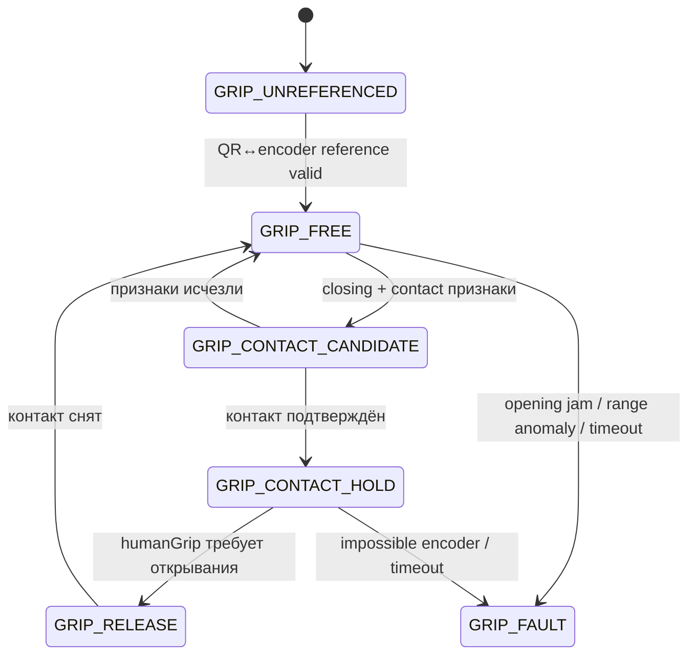

<a id="sec-7-15-1"></a>
### 7.15.1. Обычное управление

При полном `TRACKING` **или** `COMMISSIONING/ACTUATOR_QUALIFICATION` с bit D в `actuator_scope_mask`, валидном `GripperReference`, `GRASP_VALID` и `MOTION_ENABLE`:

```text
gripTarget = grip_intent = humanGrip
```

Локальный контроллер ограничивает скорость, duty и физический диапазон. В qualification phase q-поля A/B/C не участвуют, а motor writes вне scope запрещены до controller layer. После повторного включения управления используется актуальное значение `grip_intent` без ожидания синхронизации с предыдущим физическим положением.

<a id="sec-7-15-2"></a>
### 7.15.2. Кандидат контакта

Контакт при закрывании может считаться кандидатом, если одновременно:

```text
closing requested
requested travel since direction change >= contact_min_travel_ratio * D_open_counts
duty >= contact_duty_min_pct
abs(motor_speed_counts_s) <= contact_speed_max_counts_s
position_error_counts >= contact_position_error_min_counts
condition stable >= contact_confirm_ms
```

<a id="sec-7-15-3"></a>
### 7.15.3. Подтверждённый контакт

```text
contactPosition = grip_actual
contactHumanGrip = grip_intent
gripTarget = contactPosition
```

Дальнейшее закрывание прекращается, чтобы мотор не продолжал давить в объект.

Для полного A/B/C режима контакт является также **payload-transition boundary**:

- в production `TRACKING`, если активный профиль non-empty и до контакта был `PayloadState=EMPTY`, EV3 фиксирует `q_payload_contact_hold=q_actual`, инвалидирует moving A/B/C target, переводит product state в `HOLD`, снимает armed/release latch и устанавливает `PayloadState=UNKNOWN`; D остаётся в `GRIP_CONTACT_HOLD`;
- в production при profile `EMPTY` ранний contact до подтверждённого `GRIPPER_HOME` трактуется как неожиданный объект/препятствие: тот же `HOLD + UNKNOWN`, A/B/C автоматически не продолжаются;
- в full `0x0F` `COMMISSIONING/ACTUATOR_QUALIFICATION` аналогичный contact **не** создаёт product `HOLD`: wire state остаётся `COMMISSIONING`, A/B/C q_ref замораживаются, qualification moving target/armed-latch инвалидируются и `PayloadState=UNKNOWN`; разрешены только bounded D release либо новая stationary engineering payload confirmation по §4.7.5, затем новый qualification re-arm;
- narrow A/B/C qualification является EMPTY-only: ранний/object contact считается qualification failure/inhibit и не может быть повышен до `LOADED`;
- если пустые губки штатно дошли до подтверждённого `GRIPPER_HOME` без раннего contact condition, `PayloadState=EMPTY` может сохраниться;
- из `UNKNOWN` production пользователь либо подтверждает `LOADED` с подходящим profile в stationary `HOLD`, либо безопасно открывает D при замороженных A/B/C и затем явно подтверждает `EMPTY`; full qualification выполняет эквивалентную engineering transaction, оставаясь в `COMMISSIONING`.

Таким образом масса не может измениться во время продолжающейся A/B/C trajectory под старой EMPTY gravity/safety model.

<a id="sec-7-15-4"></a>
### 7.15.4. Освобождение

Если:

```text
grip_intent <= contactHumanGrip - release_intent_hysteresis
```

и подтверждённо `PayloadState=EMPTY` **и** contact был классифицирован как пустое штатное закрытие, контроллер начинает обычное ограниченное открывание и возвращается к `GRIP_FREE` после снятия контакта.

Если `PayloadState in {LOADED, UNKNOWN}` либо contact был ранним/объектным, применяется payload-release interlock:

```text
release intent detected while GRIP_CONTACT_HOLD
→ latch q_payload_release_hold = current q_actual A/B/C
→ freeze q_ref A/B/C at this pose; ignore further A/B/C target advancement
→ keep selected PayloadProfile/JointSafeSet/limits authoritative
→ allow only bounded D opening under normal gripper speed/duty/jam protection
→ contact released / configured release opening reached
→ invalidate moving target; armed=false; release_seen=false
→ production: state = HOLD; qualification: state remains COMMISSIONING with qualification inhibit
→ PayloadState = UNKNOWN
→ production operator or full-qualification engineering SET_PAYLOAD_STATE=EMPTY while all motors stationary
→ ACK → deliberate release→EV3-confirmed OFF/HOLD→new rising edge required before next permitted motion
```

Если D jam/fault происходит во время release, A/B/C остаются frozen/held и обычная fault policy имеет приоритет. Отсутствие подтверждения `EMPTY` не должно автоматически угадываться по D encoder/contact.

<a id="sec-7-15-5"></a>
### 7.15.5. Ошибки

- stall при открывании → `FAULT_GRIPPER`;
- невозможный encoder range → `FAULT_GRIPPER`;
- слишком долгое движение без допустимого результата → `FAULT_GRIPPER`;
- потеря `GRASP_VALID` → удерживать текущую позицию, не открывать автоматически.

<a id="sec-7-16"></a>
## 7.16. Калиброванные безопасные границы и `JointSafeSet`

EV3 не выполняет runtime collision geometry. Authoritative coupled safety representation v1 — заранее сгенерированная **3D conservative occupancy grid** по `(q_base,q_shoulder,q_elbow)` **для каждого установленного `PayloadProfile`**. 4D grid по раскрытию Gripper не нужен: `RobotCollisionModel` использует union-envelope Gripper по всему разрешённому диапазону открытия; payload profile добавляет conservative collision primitive предмета/CoG envelope.

Артефакт содержит:

```text
schema_version
base_min_deg, base_step_deg, base_count
shoulder_min_deg, shoulder_step_deg, shoulder_count
elbow_min_deg, elbow_step_deg, elbow_count
cell_inflation_margin_m
bitset SAFE/UNSAFE
source_collision_model_hash
payload_profile_id
payload_collision_model_hash
joint_safe_set_hash
```

Генератор работает offline из `RobotCollisionModel`, union-envelope Gripper, collision primitive текущего PayloadProfile, floor/base forbidden geometry, independent joint bounds и safety margins. Cell помечается `SAFE` только если **вся** его угловая область консервативно доказана безопасной. Для v1 safety proof использует **консервативную верхнюю границу** worst-case Cartesian displacement всех collision primitives внутри всей cell (из interval/bounded kinematic calculation либо заведомо большей аналитической bound) и соответствующее inflation forbidden/payload geometry. Corner/edge/interior sampling используется только как validation этого bound, а не как доказательство отсутствия collision между samples. Величина bound/inflation и grid resolution входят в commissioning metrics и подтверждаются exhaustive simulation + HIL boundary tests. Если whole-cell bound получить/проверить нельзя, cell=`UNSAFE`.

Runtime EV3:

1. в полном scope проверяет обычный `q_target`; в partial A/B/C `ACTUATOR_QUALIFICATION` строит `q_target_effective`: координаты осей с motor authority берутся из принятого `COMMAND`, а A/B/C без authority, но входящие в `safety_observation_mask`, фиксируются на текущем локальном `q_actual`; wire-нули disabled axes никогда не подменяют их физическую позу;
2. отклоняет `q_target_effective`, если соответствующая cell `UNSAFE`/out-of-grid;
3. при каждом 50-Hz обновлении `q_ref` проверяет все grid cells, пересечённые от предыдущего полного observed `(A,B,C)` state к новому effective state, детерминированным 3D DDA traversal;
4. запрещает step, если хотя бы одна cell unsafe, и переходит в `SAFE_HOLD`/`FAULT_LIMIT` согласно origin причины;
5. отдельно проверяет точные independent cable/hard-stop joint bounds, чтобы grid rounding не расширял допустимый диапазон.

Если reference/encoder continuity любой A/B/C из `safety_observation_mask` теряется, EV3 не имеет права продолжать partial qualification по последнему/нулевому значению: A/B/C motion немедленно inhibits до новой reference. `safety_observation_mask` сам по себе никогда не разрешает motor write.

Grid имеет build-time максимальный размер (`joint_safe_set_max_bytes`). Превышение лимита является commissioning/build error, а не причиной динамически уменьшать resolution. `EMPTY` и каждый non-empty PayloadProfile обязаны иметь отдельный safe-set/hash. `SET_PAYLOAD_PROFILE` загружает и полностью валидирует новый set вне 50-Hz loop, затем атомарно переключает active `{profile,set}`; до завершения swap `TRACKING` запрещён. Quest использует тот же active hash/grid для preview, но EV3 остаётся authoritative.

<a id="sec-7-17"></a>
## 7.17. Поведение при LOCAL_STOP

`LOCAL_STOP` является входом, authoritative для `phantom-safety`; чтение того же состояния controller является дополнительным быстрым path.

При `LOCAL_STOP=pressed` safety-inhibit и stop latch устанавливаются немедленно; controller/session-local `release_seen=false`, `last_motion_enable=false`, Quest-side armed state при следующей telemetry обязан стать false. Далее выполняется §7.3 cooperative-or-forced takeover:

```text
MOTION_ENABLE = locally forbidden
state = STOPPED
duty = 0
stop_action = brake
command = stop
stop latch = true
```

При исправном controller ожидается bounded cooperative zero/brake + release motor lease; `phantom-safety` затем сам получает lease и удерживает zero/brake authority до reset. Если cooperative path не завершён, safety принудительно завершает controller и выполняет takeover. Если и принудительный takeover не завершился в bounded timeout, software не заявляет успешный STOP только по записи события — оператор использует независимый `POWER_CUT`.

Recovery разделяется явно:

- **controller continuity сохранена** (`controller_boot_id`, CONTROL session и references те же): после released physical input + успешного `RESET_STOPPED` + возврата lease controller система возвращается в `HOLD` либо `CONNECTED_UNREFERENCED` по фактической reference validity, всегда dearmed;
- **controller был убит/перезапущен**: old session/references invalid; после reset используется новый discovery/`HELLO`, новая применимая QR reference и deliberate re-arm;
- бывшая commissioning session всегда теряет session-local commissioning authority и после reset возвращается в `DISCOVERY`; новое qualification motion требует новой локальной commissioning procedure.

Сетевые команды не могут снять `STOPPED` без `RESET_STOPPED`, отпущенного физического входа и живого `phantom-safety`.

<a id="sec-7-18"></a>
## 7.18. Поведение при потере питания

Активный `HOLD` не работает без питания; соответствующие риски ограничиваются механикой и противовесом.

После нового включения:

```text
network session invalid
controller_boot_id new
JointReference invalid
GripperReference invalid
current encoder offsets unknown
motion forbidden
```

Persistent `DriveCalibration` может быть загружена только при совпадении revision/hash механики. Перед движением требуется новый QR-привязка.

<a id="sec-7-19"></a>
## 7.19. Телеметрия

<a id="sec-7-19-1"></a>
### 7.19.1. Штатная `TELEMETRY`

Формируется около `20 Hz` и содержит только необходимые для Quest данные:

```text
robot_id
build_id                  # EV3 component/profile build_id
commissioning_bundle_hash
active_joint_safe_set_hash
state
status_flags
fault_code
incident_id
last_accepted_command_sequence
command_age_ms
q_actual[3]
q_speed[3]
grip_actual
grip_state
battery_mv
loop_health_flags
active_payload_profile_id
payload_state
build_profile
```

Это достаточно для:

- проверки живости и актуальности EV3;
- отображения фактической модели робота;
- показа grip/contact состояния;
- обнаружения fault/stop/reference состояния;
- пользовательского состояния сети;
- проверки active PayloadProfile/PayloadState и соответствующего safe-set hash.
- authoritative подтверждения `COMMISSIONING/ACTUATOR_QUALIFICATION` через `status_flags.bit9`, а не по локальному состоянию UI.

<a id="sec-7-19-2"></a>
### 7.19.2. `DIAGNOSTIC_TELEMETRY`

Только Diagnostic профиль может дополнительно передавать с регулируемой частотой:

```text
raw_encoder_count[4]
q_target[3]
q_ref[3]
duty_pct[4]
grip_target
contact_position
loop_dt_us
loop_overrun_count
parser/drop/hmac counters
log_drop_count
calibration residuals / sample ids
```

Diagnostic telemetry никогда не должна блокировать цикл управления моторами. Все сообщения имеют sequence и HMAC.

Семантика полей подчиняется двум независимым маскам active `CommissioningBundle`: `raw_encoder_count` и фактические `q_actual/q_speed` считаются измерениями для всех осей из `safety_observation_mask`, даже если соответствующая ось не имеет motor authority; вне `safety_observation_mask` observation-поля имеют canonical zero/`N_A`. `q_target/q_ref/duty_pct` имеют actuator semantics только для осей из `actuator_scope_mask`; для motor-disabled осей target/output не должны интерпретироваться как команда и duty обязан быть zero. В partial A/B/C qualification diagnostic packet поэтому может содержать реальные raw/q фактические значения A/B/C при motor authority только C или B+C. Отсутствие отдельного wire-поля масок не создаёт неоднозначности: обе стороны уже обязаны доказать один `commissioning_bundle_hash`.

<a id="sec-7-20"></a>
## 7.20. Логирование, FlightRecorder и профили сборки

Product control/safety core, регуляторы, limits, fault logic и обычные `READY/TRACKING/HOLD` semantics одинаковы в `Release` и `Diagnostic`. `Diagnostic` дополнительно может экспонировать qualification-only commissioning surfaces, описанные §4.3/§7.5.2; они используют те же motor protection/safety primitives, требуют локальный arm и не существуют как доступная функция Release. Для одного и того же product-mode входа различается только объём диагностики, а actuator result обязан совпадать.

<a id="sec-7-20-1"></a>
### 7.20.1. Структурированные события

Каждое существенное событие получает фиксированную структуру:

```text
monotonic_us
wall_time_if_valid
incident_id
session_id
controller_boot_id
build_id
commissioning_bundle_hash
active_joint_safe_set_hash
robot_geometry_hash
drive_calibration_hash
state_before
state_after
event_code
axis_or_subsystem
command_sequence
human_readable_context_id
```

Для motor/safety events snapshots различают authority и observation: full A/B/C — `q_target/q_ref/q_actual`, speed/duty; partial A/B/C qualification — реальные encoder/`q_actual` всех safety-observed A/B/C плюс target/duty только motor-authorized subset; gripper-only — D encoder/speed/duty и gripper FSM/target/actual; network-only motor snapshot не выдумывается. Battery и временные показатели цикла сохраняются во всех профилях.

События, которые обязательно логируются:

- запуск/штатное завершение и unclean previous shutdown;
- все state transitions;
- latched fault condition (`STOPPED + fault_code`), `STOPPED`, `SAFE_HOLD` с причиной;
- `OBSTRUCTION_CANDIDATE`, stall, motor overload/stress derating;
- `LOCAL_STOP`;
- watchdog timeout/переподключение;
- controller/safety process loss;
- превышение периода цикла/временной предел anomaly;
- calibration/reference success/rejection с quality metrics;
- config/hash incompatibility;
- `WIFI_AVAILABLE`, `WIFI_LOST`, `WIFI_RECOVERED`, `WIFI_RECOVERY_FAILED` без SSID credential;
- `NETWORK_READY`, `UDP_LISTENER_STARTED`, `DNS_SD_PUBLISHED`/publication failure;
- `HELLO_ACCEPTED`/`HELLO_REJECTED`, `SESSION_CREATED`/`SESSION_ENDED`, `STALE_REPLAY_REJECTED`, категоризированный `AUTH_FAILURE`, `CONTROLLER_RESTART`;
- maintenance lock / encoder discontinuity / подтверждённое механическое вмешательство;
- parser/HMAC anomaly aggregates;
- log subsystem failure.

<a id="sec-7-20-2"></a>
### 7.20.2. EV3 `FlightRecorder`

Даже в Release цикл управления моторами пишет **не на диск**, а в фиксированный RAM ring buffer. По умолчанию буфер хранит последние `10 s` с частотой цикл управления моторами (`50 Hz`); размер записи фиксирован и задаётся при сборке/старте.

Каждая запись содержит общий header (`monotonic_us`, active profile, `actuator_scope_mask`, `safety_observation_mask`, `state/status_flags/fault_code`, command sequence/age, battery, loop timing, safety flags) и scope-specific payload. Full A/B/C записывает raw encoders, `q_target/q_ref/q_actual/q_speed`, duty/stress и gripper. Partial A/B/C qualification сохраняет `q_actual`/raw encoder всех safety-observed A/B/C, но target/duty authority только motor-enabled осей; duty disabled осей остаётся zero. Gripper-only — D encoder/speed/duty/stress и gripper target/actual/FSM; network-only — controller/session/network counters и battery/loop health без фиктивных q. Реализация может использовать один fixed-size union/record с canonical zero для полей вне `safety_observation_mask`, но semantics обязана явно маркировать обе маски и не трактовать нули как измерения.

При incident:

```text
1. сначала выполнить safety action / BRAKE
2. atomically freeze pre-fault ring generation
3. присвоить incident_id
4. продолжить краткий post-fault capture в отдельный bounded tail buffer
5. logger thread асинхронно сохранить incident metadata + flight data
```

цикл управления моторами никогда не ждёт завершения записи.

<a id="sec-7-20-3"></a>
### 7.20.3. Минимальный аварийный журнал `phantom-safety`

Если основной controller погиб/завис, `phantom-safety` после выполнения `BRAKE` обязан самостоятельно записать маленькое emergency event:

```text
controller_boot_id
last_heartbeat_monotonic_us
stop_reason
LOCAL_STOP state
motor addresses/states if readable
safety process build_id
```

Торможение имеет приоритет над файловой записью. Failure emergency log не отменяет stop action.

<a id="sec-7-20-4"></a>
### 7.20.4. Контекст инцидента на Quest

Quest держит собственный короткий RAM ring buffer без изображений камер. Общие поля: profile/scope, monotonic time, state/fault, network sequence/RTT/telemetry age и correlation id. Scope-specific payload: full path — Wrist/Body_RightShoulder validity/quality/timestamps, requested/control/projected TCP и `q_target`; gripper-only — grasp validity/value, Left Grip, `grip_intent`/gripper telemetry; network-only — discovery/session/config/telemetry transitions без mandatory tracking fields.

При получении EV3 fault condition либо локальном XR/network fault Quest сохраняет ring buffer под тем же `session_id` и согласованным `incident_id`/event correlation id. Это позволяет восстановить именно применимую цепочку «input/network → command/session → EV3 response → fault» без фиктивных samples.

<a id="sec-7-20-5"></a>
### 7.20.5. Release

На диск постоянно записываются только низкочастотные структурированные events и summaries. Полная high-frequency trajectory не пишется постоянно.

При incident Release сохраняет FlightRecorder, поэтому отладочный контекст ошибки доступен без постоянного износа SD-карты.

<a id="sec-7-20-6"></a>
### 7.20.6. Diagnostic

Diagnostic может дополнительно постоянно/сеансово записывать с ограничиваемой частотой:

- raw encoders;
- `q_target/q_ref/q_actual`;
- duty/speed/stress;
- измерения инженерной калибровки и QR residuals;
- network timing/счётчики парсера;
- измерения отслеживания без passthrough images;
- расширенные gripper FSM transitions.

Если logger/telemetry queue растёт, сначала автоматически уменьшается/отключается непрерывная diagnostic запись. Motor временной предел имеет приоритет.

<a id="sec-7-20-7"></a>
### 7.20.7. Реализация очередей и файлов

цикл управления моторами помещает fixed-size record в preallocated ring/queue. Отдельный logger выполняет serialization, compression при необходимости, write и rotation.

При переполнении:

- diagnostic periodic records могут быть отброшены;
- fault/state/safety events имеют приоритет и отдельный резерв queue slots;
- `log_drop_count` увеличивается;
- факт потери diagnostic records включается в следующий доступный event/telemetry;
- цикл управления моторами не блокируется.

Production state и журналы располагаются соответственно в `/var/lib/phantom` и `/var/log/phantom`; runtime sockets/lease — в `/run/phantom`. Каталог `/home/robot/phantom-bench/results/ev3/raw` принадлежит только инженерному bench harness и не является production log storage. Bench logs имеют отдельную bounded rotation/cleanup policy; перед ручной очисткой нужные evidence-файлы копируются на host, точный canonical target path проверяется, а удаление никогда не затрагивает release/config/state каталоги.

Stage-3 network worker раз в секунду atomically заменяет bounded snapshot `/run/phantom/network-status.json`. Он содержит только public profile/identity, текущий boot id, session-active flag и счётчики `rx`, `rx_drop`, `hmac_fail`, `parser_reject`, `hello_accept`, `hello_reject`, `replay_reject`, `pong`, `telemetry`, `command_scope_zero`, `nonzero_motor_writes`; PSK, HMAC tags, nonce, session id и payload в файл не попадают.

<a id="sec-7-21"></a>
## 7.21. Конфигурация EV3

YAML является authoring-форматом. Нормативная machine-readable schema — `/config/schema/commissioning_bundle.schema.json`; parser/build gate обязан отклонять duplicate mapping keys, unknown fields, неверные units/types и незаполненные `MEASURED`, достигшие своего `required_before`. Last-key-wins/first-key-wins поведение YAML parser как способ разрешить дубликат запрещено. Build/commissioning pipeline валидирует schema и формирует **два логически раздельных артефакта**: canonical semantic JSON и необязательный provenance sidecar. Compatibility `content_hash`/`commissioning_bundle_hash` считается по RFC 8785 JCS UTF-8 bytes именно semantic artifact. Нормативный `qualification_evidence_manifest_hash` является **semantic gate field** и входит в production compatibility identity; при этом человеческие/временные provenance-детали самого evidence (`created_at`, workstation/operator, raw report paths/comments) находятся только в provenance sidecar и не входят в compatibility hash. Runtime ничего не пересериализует ради actuator-совместимости — он хэширует установленные canonical semantic artifact bytes и сравнивает их с ожидаемым hash до real-time режима. Provenance может иметь собственный file hash, но не влияет на `READY`/qualification. Derived `commissioning_bundle_hash`, `bundle_id` и component hashes хранятся в manifest/envelope и не входят в собственные hashed component bytes; поле с собственным hash внутри semantic payload schema запрещено.

```yaml
schema_version: 1
robot_id: phantom01
build_profile: Release
qualification_only: false       # production only after PASS QualificationEvidenceManifest
qualification_evidence_manifest_hash: SHA256_OR_ZERO_FOR_QUALIFICATION_ONLY
actuator_scope_mask: 0x0F       # motor-write authority: A=1, B=2, C=4, D=8; Release 0x0F
safety_observation_mask: 0x0F  # encoder/reference observations required for safety; never grants motor authority
# commissioning_bundle_hash является derived envelope identity и НЕ входит в bytes, которые он хэширует
protocol_schema_hash: SHA256
specification_sha256: SHA256

drive_calibration:
  revision: 1
  hash: SHA256
  base:
    encoder_scale_rad_per_count: MEASURED
    backlash_half_angle_rad: MEASURED
    calibrated_encoder_min: MEASURED
    calibrated_encoder_max: MEASURED
  shoulder:
    encoder_scale_rad_per_count: MEASURED
    backlash_half_angle_rad: MEASURED
    calibrated_encoder_min: MEASURED
    calibrated_encoder_max: MEASURED
  elbow:
    encoder_scale_rad_per_count: MEASURED
    backlash_half_angle_rad: MEASURED
    calibrated_encoder_min: MEASURED
    calibrated_encoder_max: MEASURED
  gripper:
    closed_endpoint_method: GRIPPER_HOME
    opening_curve:
      - [delta_encoder_0, opening_mm_0]
      - [delta_encoder_1, opening_mm_1]
      - [...]
    closing_curve:
      - [delta_encoder_0, opening_mm_0]
      - [delta_encoder_1, opening_mm_1]
      - [...]
    opening_open_mm: MEASURED_AT_SAFE_OPEN_LIMIT
    opening_closed_mm: MEASURED_AT_CLOSED_ENDPOINT
    curve_domain_counts: MEASURED_0_TO_D_OPEN_COUNTS  # endpoint MUST equal authoritative SafetyEnvelope D_open_counts
    backlash_encoder_counts: MEASURED

axes:
  base:
    motor_port: outA
    motor_type: ev3-large
    min_deg: MEASURED_WITH_MARGIN
    max_deg: MEASURED_WITH_MARGIN
    user_max_vel_deg_s: MEASURED_LE_90
    user_max_accel_deg_s2: MEASURED_LE_180
    kp_duty_pct_per_rad: MEASURED
    kd_duty_pct_per_rad_s: MEASURED
    velocity_filter_params: MEASURED_BOUNDED
    friction_gain_duty_pct: MEASURED
    friction_transition_speed_rad_s: MEASURED
    feedforward_model_hash: SHA256_OR_ZERO_IF_DISABLED
    duty_limit_pct: MEASURED
    hold_duty_limit_pct: MEASURED
    backlash_takeup_duty_limit_pct: MEASURED
    max_duty_slew_pct_s: MEASURED
    max_high_duty_ms: MEASURED
    tracking_error_limit_deg: MEASURED
    tracking_error_timeout_ms: MEASURED
    obstruction_candidate_ms: MEASURED
    main_joint_stall_ms: MEASURED
    stall_requested_speed_min_deg_s: MEASURED
    stall_actual_speed_max_deg_s: MEASURED
    stall_duty_min_pct: MEASURED
  shoulder:
    motor_port: outB
    motor_type: ev3-large
    neutral_deg: MEASURED
    flexion_max_deg: 90
    user_max_vel_deg_s: MEASURED_LE_60
    user_max_accel_deg_s2: MEASURED_LE_120
    kp_duty_pct_per_rad: MEASURED
    kd_duty_pct_per_rad_s: MEASURED
    velocity_filter_params: MEASURED_BOUNDED
    friction_gain_duty_pct: MEASURED
    friction_transition_speed_rad_s: MEASURED
    feedforward_model_hash: SHA256
    duty_limit_pct: MEASURED
    hold_duty_limit_pct: MEASURED
    backlash_takeup_duty_limit_pct: MEASURED
    max_duty_slew_pct_s: MEASURED
    max_high_duty_ms: MEASURED
    tracking_error_limit_deg: MEASURED
    tracking_error_timeout_ms: MEASURED
    obstruction_candidate_ms: MEASURED
    main_joint_stall_ms: MEASURED
    stall_requested_speed_min_deg_s: MEASURED
    stall_actual_speed_max_deg_s: MEASURED
    stall_duty_min_pct: MEASURED
  elbow:
    motor_port: outC
    motor_type: ev3-large
    extended_deg: MEASURED
    flexion_max_deg: 90
    user_max_vel_deg_s: MEASURED_LE_90
    user_max_accel_deg_s2: MEASURED_LE_180
    kp_duty_pct_per_rad: MEASURED
    kd_duty_pct_per_rad_s: MEASURED
    velocity_filter_params: MEASURED_BOUNDED
    friction_gain_duty_pct: MEASURED
    friction_transition_speed_rad_s: MEASURED
    feedforward_model_hash: SHA256
    duty_limit_pct: MEASURED
    hold_duty_limit_pct: MEASURED
    backlash_takeup_duty_limit_pct: MEASURED
    max_duty_slew_pct_s: MEASURED
    max_high_duty_ms: MEASURED
    tracking_error_limit_deg: MEASURED
    tracking_error_timeout_ms: MEASURED
    obstruction_candidate_ms: MEASURED
    main_joint_stall_ms: MEASURED
    stall_requested_speed_min_deg_s: MEASURED
    stall_actual_speed_max_deg_s: MEASURED
    stall_duty_min_pct: MEASURED

  gripper:
    motor_port: outD
    motor_type: ev3-medium
    max_speed_counts_s: MEASURED
    duty_limit_pct: MEASURED
    contact_duty_limit_pct: MEASURED
    max_high_duty_ms: MEASURED
    contact_min_travel_ratio: MEASURED
    contact_duty_min_pct: MEASURED
    contact_speed_max_counts_s: MEASURED
    contact_position_error_min_counts: MEASURED
    contact_confirm_ms: MEASURED
    release_intent_hysteresis: MEASURED

feedforward_models:
  base:
    model_type: ZERO_OR_BOUNDED_MAP_V1
    model_hash: SHA256_OR_ZERO_IF_DISABLED
    torque_domain_Nm: MEASURED_BOUNDED_OR_ZERO
    battery_domain_mv: MEASURED_BOUNDED
    interpolation: LINEAR_BOUNDED
    extrapolation: FORBID
    table_or_coefficients_hash: SHA256_OR_ZERO_IF_DISABLED
  shoulder:
    model_type: TORQUE_BATTERY_TO_DUTY_V1
    model_hash: SHA256
    torque_domain_Nm: MEASURED_BOUNDED
    battery_domain_mv: MEASURED_BOUNDED
    interpolation: LINEAR_BOUNDED
    extrapolation: FORBID
    table_or_coefficients_hash: SHA256
  elbow:
    model_type: TORQUE_BATTERY_TO_DUTY_V1
    model_hash: SHA256
    torque_domain_Nm: MEASURED_BOUNDED
    battery_domain_mv: MEASURED_BOUNDED
    interpolation: LINEAR_BOUNDED
    extrapolation: FORBID
    table_or_coefficients_hash: SHA256

local_stop:
  sensor_port: in4

gripper_home:
  sensor_port: in3
  debounce_ms: MEASURED

commissioning:
  require_local_arm: true
  local_arm_input: EV3_BUTTON_CHORD_ENTER_UP
  local_arm_hold_ms: 2000
  local_arm_window_ms: 60000
  required_session_role: COMMISSIONING
  commissioning_key_id: phantom01-commissioning
  initial_jog_max_encoder_delta: MEASURED
  jog_max_duration_ms: MEASURED
  jog_max_speed_counts_s: MEASURED
  jog_max_duty_pct: MEASURED
  stationary_speed_counts_s: MEASURED
  stationary_min_ms: MEASURED
  gripper_calibration_max_duration_ms: MEASURED
  gripper_calibration_max_speed_counts_s: MEASURED
  gripper_calibration_max_duty_pct: MEASURED
  config_commit_ack_grace_ms: MEASURED

network:
  discovery_service_type: _phantom-ev3._udp
  discovery_domain: local.
  ip_family: IPV4
  listen_port_udp: 30470
  command_timeout_ms: 120
  max_packet_bytes: 1024
  max_payload_bytes: 928
  rx_rate_limit_pps: MEASURED
  rx_burst_packets: MEASURED
  hello_retry_window_ms: 2000
  session_stale_ms: 5000
  max_concurrent_control_sessions: 1
  state_transaction_policy: ONE_IN_FLIGHT_LAST_ACK
  transaction_gap_policy: REJECT
  hold_burst_ms: MEASURED
  protocol_schema_hash: SHA256

safety:
  external_power_cut_required: true
  power_cut_max_disconnect_ms: MEASURED
  local_stop_response_limit_ms: MEASURED
  power_loss_peak_tcp_speed_limit_mps: MEASURED
  gripper_open_limit_delta_counts: MEASURED_SIGNED_NONZERO   # authoritative SafetyEnvelope; sign=open direction, abs=safe travel from GRIPPER_HOME
  payload_mass_max_kg: MEASURED
  payload_cog_offset_max_m: MEASURED
  tcp_static_moment_max_Nm: MEASURED
  swept_volume_margin_m: MEASURED
  pinch_exclusion_margin_m: MEASURED
  # immutable semantic components, not mutable runtime selections
  joint_safe_set_format: GRID3D_V1
  joint_safe_set_max_bytes: MEASURED
  joint_safe_set_base_step_deg: MEASURED
  joint_safe_set_shoulder_step_deg: MEASURED
  joint_safe_set_elbow_step_deg: MEASURED
  joint_safe_set_cell_inflation_margin_m: MEASURED
  payload_profiles_hash: SHA256

runtime_defaults:
  startup_payload_profile_id: UNSELECTED   # reserved runtime sentinel; не является installed PayloadProfile
  startup_payload_state: UNKNOWN   # runtime-only; startup confirmation EMPTY/LOADED is required before READY
  # active_joint_safe_set_hash/profile/state живут в runtime state/telemetry и не мутируют CommissioningBundle
  controller_heartbeat_transport: AF_UNIX_DGRAM
  controller_heartbeat_rate_hz: 20
  controller_heartbeat_timeout_ms: MEASURED
  controller_watchdog_takeover_limit_ms: MEASURED
  loop_safe_hold_ms: 60
  loop_fault_ms: 100
  hold_overload_ms: MEASURED
  motor_stress_cool_tau_s: MEASURED
  motor_stress_warn: MEASURED
  motor_stress_critical: MEASURED
  motor_stress_restart_floor: MEASURED
  motor_stress_restart_cooldown_s: MEASURED
  battery_warn_mv: MEASURED
  battery_stop_mv: MEASURED
  battery_stop_debounce_ms: MEASURED
  battery_fault_ms: MEASURED
  battery_derate_speed_factor: MEASURED
  battery_derate_duty_factor: MEASURED

logging:
  flight_recorder_seconds: 10
  flight_recorder_rate_hz: 50
  post_fault_seconds: MEASURED
  release_retention_days: 7
  release_max_mb: 250
```

Для Stage-3 network-only worker дополнительно фиксированы bounded implementation limits: не более `32` datagrams за один drain, UDP receive buffer request `16384 bytes`, неблокирующий poll не дольше `10 ms`, telemetry `20 Hz`, atomic status snapshot `1 Hz`. Rate limit является общим token bucket процесса, а не отдельным неограниченным bucket для каждого source endpoint. Эти значения входят в regression/DEVICE AUTO baseline; их изменение требует повторных flood и timing tests, но не изменения wire v1.

Параметры `MEASURED` не получают произвольное значение по умолчанию во время работы в actuator path: до qualification соответствующая функция остаётся в engineering/disabled состоянии. Safety-critical `MEASURED` (границы, payload envelope, `POWER_CUT` status, rate/loop limits, mapping sanity bounds) дополнительно блокируют переход в `READY` до заполнения и прохождения соответствующих acceptance tests.

Для `build_profile=Release` authoring schema обязана отклонять `qualification_only=true`, `actuator_scope_mask != 0x0F` и `safety_observation_mask != 0x0F`. Нулевой `qualification_evidence_manifest_hash` разрешён в source/generated config только как явно заблокированный `UNQUALIFIED_RELEASE_CANDIDATE`: runtime остаётся fail-closed и такой config нельзя установить/опубликовать как production release. Release **packaging/publication gate**, в отличие от schema/generator и compile-only build, обязательно отклоняет нулевой/отсутствующий evidence hash либо manifest, чей component-set hash не совпадает с production bundle, и проверяет PASS всех обязательных evidence refs. Простая ручная смена `qualification_only:true→false` не создаёт допустимый release и должна fail packaging/release validation. На этапах 3–5 ранний Diagnostic mechanical/safety bundle разрешает только пары масок `0x00/0x00` (network-only) и `0x08/0x08` (Gripper). Соответствующий Quest profile отдельно использует `required_user_inputs=NONE` для Stage 3 и phase-specific QR commissioning либо `GRIPPER_ONLY` для user-driven Stage 5. На этапах 6–7 Diagnostic `COMMISSIONING/CALIBRATION` может использовать versioned scope всех фактически подключённых осей текущего стенда, если их motor/mechanics/safety prerequisites §5.16.1 выполнены; отдельный `CALIBRATION_JOG.axis` выбирает единственную движущуюся ось, а штатный `COMMAND` для A/B/C при этом запрещён. Scoped A/B/C `ACTUATOR_QUALIFICATION` допускается только с полными `RobotGeometry`, `DriveCalibration`, `JointReference A/B/C`, `EMPTY` profile-specific `JointSafeSet`, `safety_observation_mask & 0x07 == 0x07`, `actuator_scope_mask & ~safety_observation_mask == 0` и пройденными **pre-motion** prerequisites §9 (exhaustive safe-set proof, mechanical/fixture inspection, `LOCAL_STOP`/`POWER_CUT`, DEVICE AUTO/zero-output и применимые P0 gates). Сам движущийся incremental HIL case не может быть prerequisite самому себе: он последовательно создаёт qualification evidence по §9.15.7/§9.17–§9.19 и §10.11. Маска motor authority может быть уже (`C`, `B+C` и т.п.), но безопасность всегда вычисляется по реальным observed A/B/C.

Для incremental A/B/C HIL узкая authority **не является runtime override** production bundle. Все narrow authority cases (`C`, `B+C`, затем A+B+C narrow/full-authority bring-up до payload qualification) выполняются только с **пустым Gripper без внешнего payload** и используют installed `EMPTY` PayloadProfile + matching `EMPTY` JointSafeSet. После reference tooling явно устанавливает engineering `SET_PAYLOAD_PROFILE=EMPTY` и `SET_PAYLOAD_STATE=EMPTY` при stationary motors и снятом qualification arm; это не product state, а доказуемый input safety gate. `LOADED`, non-empty profile, pickup/release и object-contact-as-payload в narrow qualification запрещены. Loaded-payload cases допускаются только в отдельном full `0x0F/0x0F qualification_only=true` bundle с полными A/B/C/D references и специальными engineering payload gates §4.7.5. Engineering tooling создаёт каждую immutable derived revision из принятого production-candidate semantic component set: narrow bundles ссылаются на те же geometry/DriveCalibration/collision/SafetyEnvelope hashes и EMPTY profile/safe-set; full qualification bundle может переключать только уже установленные candidate payload profiles/safe-sets, не меняя их bytes. Каждая revision имеет собственный `commissioning_bundle_hash`, проходит двухсторонний deployment/hash check и при активации инвалидирует session/JointReference/GripperReference. После qualification production bundle создаётся/promote-ится отдельной revision; HIL никогда не переписывает masks in-place.

<a id="sec-7-22"></a>
## 7.22. Обнаружение EV3 и установление соединения

EV3 публикует DNS-SD type `_phantom-ev3._udp` в domain `local.` (полный browse-name `_phantom-ev3._udp.local.`) с текущим `robot_id`, IPv4 port и protocol major. IP-адрес не является identity. V1 publisher/listener квалифицирован только для IPv4; Avahi publication не должна рекламировать IPv6-only endpoint.

USB gadget network допускается только как maintenance/bench transport. Host-side инструменты используют проверенное имя `ev3dev.local` либо явно заданный endpoint и pin сохранённого SSH host key; они не должны предполагать, что `192.168.0.1` всегда принадлежит Brick, поскольку этот адрес может совпасть с LAN gateway. IPv4 link-local адрес после USB enumeration допустим для обслуживания при подтверждённой привязке к LEGO RNDIS interface/MAC. Production control остаётся в изолированной Wi-Fi/LAN согласно §8.12.

`HELLO_ACK` содержит:

```text
robot_id
build_id                  # wire field; semantic value = EV3 component/profile build_id
specification_sha256
protocol_schema_hash
commissioning_bundle_hash
robot_geometry_hash
drive_calibration_hash
active_joint_safe_set_hash
controller_boot_id
result_code
state
joint_reference_valid
gripper_reference_valid
safe_joint_min[3]
safe_joint_max[3]
joint_max_velocity[3]
joint_max_acceleration[3]
gripper_capabilities
build_profile
```

Несовпадение `robot_id`, protocol major, `protocol_schema_hash`, `commissioning_bundle_hash` или safety-critical subhash запрещает `READY`.

Если DHCP меняет IP или endpoint меняется, Quest выполняет новый `HELLO` с `session_id=0` и новым `client_nonce`; **EV3**, а не Quest, генерирует новую session id. Совпадение прошлого IP не восстанавливает session, sequence, target или armed-latch. Пока старая CONTROL session свежая/активная, competing HELLO отклоняется; после stale/HOLD она может быть заменена. Exact HELLO retry внутри `hello_retry_window_ms` получает тот же cached semantic ACK/session id только при неизменных authoritative `controller_boot_id`, session generation и `commissioning_bundle_hash`; любая их invalidation очищает cache, поэтому старый nonce не воскресит прежнюю session.

<a id="sec-7-23"></a>
## 7.23. Ограничение частоты пакетов и защита парсера

EV3 должен ограничивать объём входящего трафика до уровня, при котором сеть не способна вытеснить цикл управления моторами.

Требования:

```text
fixed receive buffer; total datagram <= 1024 bytes
header_length == 64
payload_length <= 928
actual_length == 64 + payload_length + 32
recv → cheap total/header length + magic/version + known message_type + reserved checks
     → exact type-specific payload length from generated schema
     → HIL-derived token bucket + bounded work queue
     → constant-time HMAC verify
     → session/controller_boot/sequence validation
     → payload field decode + finite/range validation
неизвестные типы сообщений отбрасываются до HMAC
парсер не выделяет память пропорционально заявленной длине пакета
```

Число `500 packets/s` не является нормативным значением. `rx_rate_limit_pps` и burst capacity определяются HIL так, чтобы flood/authentication work не нарушал бюджет 50-Hz motor loop.

Счётчики невалидных HMAC и отброшенных пакетов должны попадать в инженерную телеметрию с ограниченной частотой.

<a id="sec-7-24"></a>
## 7.24. Сетевые, моторные и процессные сценарии отказа

Fault policy использует как минимум три класса:

```text
RECOVERABLE_LATCHED      # причина устранена + explicit ACK + re-arm
REFERENCE_INVALIDATING   # дополнительно Joint/GripperReference invalid; нужна новая QR-привязка
MAINTENANCE_REQUIRED     # движение запрещено до механической проверки/обслуживания
```

Impact, подозрение на slip/пропуск зуба, encoder discontinuity и аналогичные события не могут считаться обычным recoverable fault только потому, что сеть/процесс восстановились.

### Сценарии

| Событие | Обнаружение | Действие |
|---|---|---|
| старый/reordered COMMAND | sequence | drop |
| exact retry последней state transaction в той же session | last completed id/hash/ACK payload | вернуть тот же semantic ACK payload/result без side effect; wire response получает новый EV3→Quest sequence/timestamp/HMAC |
| stale/conflicting/gap transaction | monotonic transaction id + canonical hash | `ERR_TRANSACTION_STALE/CONFLICT/GAP`, state без изменения |
| неверный HMAC | HMAC | drop без actuator change |
| чужая session/boot id | header проверка | drop |
| потеря command stream | `command_age` | full product path: `SAFE_HOLD`; `ACTUATOR_QUALIFICATION`: scoped inhibit/dearm без product HOLD, а потеря commissioning session завершает qualification и возвращает к `DISCOVERY` |
| IP изменился | discovery/connectivity | новая discovery + установление сессии; старую session локально инвалидировать/прекратить traffic, без несуществующего `SESSION_CLOSE` packet |
| `phantom-controller` завис | safety heartbeat | takeover + `BRAKE` |
| `phantom-safety` завис | controller health | `BRAKE` + `STOPPED` + legacy `FAULT_CONTROLLER_PROCESS`; structured subsystem=SAFETY |
| превышение периода цикла | `dt` | `SAFE_HOLD`/`FAULT_LOOP_OVERRUN` |
| `LOCAL_STOP` | physical input | `STOPPED` + `BRAKE` |
| motor stall A/B/C | requested speed + motor encoder speed + duty | `FAULT_JOINT_STALL` |
| механическое вмешательство / подозрение на пропуск передачи | operator/maintenance state | движение запрещено до новой QR-привязки |
| gripper contact | closing + duty + speed + error | `CONTACT_HOLD` |
| gripper opening jam | gripper FSM | `FAULT_GRIPPER` |


<a id="sec-8"></a>
# 8. Разработка, сборка и развёртывание

<a id="sec-8-1"></a>
## 8.1. Структура репозитория

```text
phantom/
├── PhantomQuest/
│   ├── Assets/Phantom/
│   │   ├── Tracking/
│   │   ├── Calibration/
│   │   ├── Mapping/
│   │   ├── Kinematics/
│   │   ├── RobotCalibration/
│   │   ├── Localization/
│   │   ├── Discovery/
│   │   ├── Networking/
│   │   ├── Telemetry/
│   │   ├── UI/
│   │   ├── Security/
│   │   └── Tests/
│   ├── Packages/
│   │   ├── manifest.json
│   │   └── packages-lock.json
│   └── ProjectSettings/
├── ev3/
│   ├── src/
│   ├── include/
│   ├── safety/
│   ├── generated/
│   ├── tests/
│   └── CMakeLists.txt
├── protocol/
│   ├── wire_schema.yaml
│   ├── protocol.md
│   ├── golden_vectors/
│   └── fuzz_corpus/
├── config/
│   ├── schema/
│   │   └── commissioning_bundle.schema.json
│   ├── source/
│   └── generated/
├── tools/
│   ├── configgen.py
│   ├── protocolgen.py
│   ├── qr-calibration/
│   └── commissioning/
├── sim/
│   ├── ev3-simulator/
│   └── tracking-replay/
├── deploy/
│   ├── systemd/
│   └── scripts/
├── scripts/
│   └── build/test/deploy entrypoints
├── toolchains/
│   └── ev3dev-stretch.lock.json
├── docs/
│   └── PHANTOM_SPECIFICATION.md
├── README.md
└── .github/workflows/
```

<a id="sec-8-2"></a>
## 8.2. Общие правила исходного кода

Репозиторий должен обеспечивать:

- единый источник описания wire-протокола;
- единый источник схем конфигурации;
- автоматическое создание канонического хэша конфигурации; derived hash никогда не входит в байты, которые он хэширует;
- отсутствие вручную дублируемых числовых констант между Quest и EV3 там, где они должны совпадать;
- тестируемое разделение чистой математики и SDK/I/O адаптеров;
- невозможность случайно включить секретный ключ в исходники или артефакт логов;
- детерминированный `protocol_schema_hash`: schema pipeline сначала преобразует `wire_schema.yaml` в canonical JSON projection (`wire_schema.canonical.json`, RFC 8785 JCS), и SHA-256 считается именно по этим bytes; checkout line endings YAML не влияют на identity;
- детерминированный `specification_sha256`: SHA-256 считается по точным bytes нормативного Markdown в Git; файл обязан быть UTF-8 без BOM с LF line endings, а gate отвергает иную encoding/line-ending форму. Host tooling не выполняет скрытую нормализацию перед hashing, поэтому manifest всегда ссылается на фактически использованный файл.

<a id="sec-8-3"></a>
## 8.3. Симулятор EV3

До подключения физической механики должен существовать PC-симулятор, реализующий тот же сетевой протокол и state model.

Симулятор должен уметь:

- отвечать на `HELLO/HELLO_ACK`;
- публиковать/имитировать обнаруживаемый `robot_id`;
- выдавать `CALIBRATION_SAMPLE` с raw отсчёты энкодера;
- принимать `SET_JOINT_REFERENCE`;
- имитировать валидную/невалидную `DriveCalibration`;
- принимать `COMMAND` и выдавать `TELEMETRY`;
- моделировать q_ref shaping и безопасные границы;
- моделировать stall, потерю/инвалидацию reference, maintenance lock после подозрения на проблему передачи, gripper contact и gripper fault;
- имитировать latency/loss/reordering/duplicate packets;
- менять `controller_boot_id` и IP сетевой адрес;
- воспроизводить `SAFE_HOLD`, `STOPPED`, latched fault overlays (`STOPPED + fault_code`) и recovery.

<a id="sec-8-4"></a>
## 8.4. Повторное воспроизведение отслеживания

Инженерный инструмент `tracking-replay` должен уметь записывать и воспроизводить:

```text
head pose для XR lifecycle
Body_RightShoulder pose + validity/quality/fidelity + sample_or_query_time + receive time + timing uncertainty
Wrist pose + validity/quality + sample_or_query_time + receive time + timing uncertainty
степень сжатия + валидность
Left Grip / валидность Controller
receive timestamps / frame ids
```

Запись включается явно. Воспроизведение должно проходить через те же алгоритмы калибровки, отображения движения, рабочей области и IK, что и реальные данные.

<a id="sec-8-5"></a>
## 8.5. Непрерывная интеграция

CI разделяется на быстрые проверки исходного кода, сборку артефактов и обязательный post-build gate §9.1.2. Артефакт не считается разрешённым к установке только потому, что компиляция завершилась успешно.

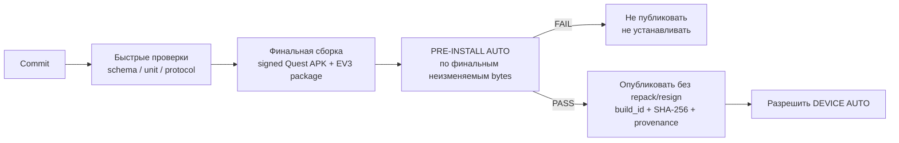

До и во время сборки выполняются быстрые проверки, чтобы раньше обнаруживать ошибки. После сборки обязательный `PRE-INSTALL AUTO` повторно выполняет весь набор, необходимый для допуска конкретного `build_id` к установке.

Обязательные проверки включают:

- JSON Schema конфигураций;
- C#↔C++ эталонные протокольные векторы;
- HMAC эталонные векторы;
- IK/FK тесты свойств;
- тесты абсолютного shoulder-relative mapping;
- тесты преобразования координат;
- тесты QR-геометрии и QR↔encoder calibration на синтетических данных;
- тесты автомата состояний;
- fuzz парсера протокола;
- host-native C++ тесты EV3 core и `MockMotorBackend`;
- ARM/armel кросс-сборку;
- Unity EditMode/PlayMode и доступные simulator/spatial tests;
- проверку `Release` и `Diagnostic` профилей;
- проверку lock-файлов пакетов;
- поиск секретов;
- проверку, что сгенерированные файлы соответствуют источникам;
- проверку метаданных, архитектуры, обязательных файлов и SHA-256 готовых артефактов.

CI сохраняет отчёт `PRE-INSTALL AUTO` вместе с `commit SHA`, component/profile-specific `build_id` и SHA-256 артефактов. Без успешного отчёта штатный deployment job не должен принимать этот build.

После PASS байты проверенных APK/EV3 package являются immutable для данного evidence: последующая подпись, repack, изменение manifest внутри артефакта или иная byte-level модификация требует нового `build_id`/artifact SHA-256 и повторного PRE-INSTALL. Post-gate разрешено только публиковать внешние provenance/signature metadata, которые не меняют проверенный artifact.


Обязательные дополнительные CI gates для финальной baseline:

- host C++ tests с ASan/UBSan;
- `clang-tidy`/эквивалентный static analysis и C# analyzers;
- SBOM и known-vulnerability/risk record, включая legacy EV3 image/toolchain;
- SHA-256 pinned image/toolchain artifacts;
- exact datagram-length/golden-vector tests;
- sequence/session/reconnect/replay tests;
- transaction ordering/conflict/gap/no-eviction semantics tests;
- parser fuzz и controlled flood tests;
- Mermaid syntax/undefined-node lint;
- coordinate golden-vector tests OpenXR Y-up → RobotBaseFrame Z-up.
<a id="sec-8-6"></a>
## 8.6. Сборка EV3

CI формирует два профиля из одного исходного кода:

```text
Release
Diagnostic
```

Оба профиля должны собираться из одного control/state/safety core. Для product-mode одинаковые входы обязаны давать одинаковые state/control results; различаться могут logging/diagnostic surfaces и символы/инструменты отладки. `Diagnostic` дополнительно может включать явно инженерные qualification-only entry/UI/commissioning surfaces, но они обязаны использовать общий controller/safety implementation, требовать локальную физическую авторизацию и быть compile/config-disabled либо недоступны в `Release`.

Воспроизводимая baseline-кросс-сборка EV3 выполняется в legacy-образе `ev3dev/debian-stretch-cross:latest`, но release/CI никогда не полагается на изменяемый тег и запускает образ по digest:

```text
ev3dev/debian-stretch-cross@sha256:819ea7442bbe109d2b39c6c7766e7d1fe635bb98b86c4f6c3b636c0ce176a29f
arm-linux-gnueabi-g++ 6.3.0-18
CMake 3.7.2 compatible project
target: ARMv5TEJ / armel / gnueabi
required flags: -march=armv5te -mfloat-abi=soft
```

Тег `latest` допускается только как понятное человеку имя источника при первоначальном получении образа. Фактический digest, версия и SHA-256 бинарника компилятора проверяются по `toolchains/ev3dev-stretch.lock.json`. Exact ev3dev image, установленный на Brick, его SHA-256, package snapshot/SBOM и vulnerability/risk record являются отдельными обязательными release inputs; пока они имеют `UNRESOLVED`/`PENDING`, сборка может использоваться для разработки и DEVICE AUTO, но не является финальным release candidate.

`build_id` является component/profile-specific **raw SHA-256[32]** (wire `u8[32]`; human/text manifest form — 64 lowercase hex symbols), а не общим номером всего проекта. Он вычисляется до packaging **только** из UTF-8 bytes RFC 8785 JCS canonical object:

```json
{
  "schema": "PHANTOM-BUILD-V1",
  "component_id": "<EV3|QUEST>",
  "build_profile": "<Release|Diagnostic>",
  "git_commit": "<40-hex>",
  "source_tree_hash": "<64-hex>",
  "specification_sha256": "<64-hex>",
  "protocol_schema_hash": "<64-hex>",
  "component_config_hash": "<64-hex>",
  "toolchain_or_package_lock_hash": "<64-hex>"
}
```

```text
build_id = SHA-256(JCS_UTF8(build_identity_object))
```

Имена полей, отсутствие лишних полей и lowercase hex encoding нормативны; string concatenation/разделители/implementation-specific dictionary order для вычисления identity запрещены. `component_id` как минимум различает `EV3` и `QUEST`; `build_profile` различает `Release`/`Diagnostic`. Вычисление identity централизовано в детерминированном host build tooling и покрывается golden vectors; C++/C# runtime не реализуют независимый JCS/hash алгоритм, а валидируют/передают уже вычисленный 64-hex `build_id`, что исключает расхождение трёх реализаций canonicalization. `source_tree_hash` вычисляется только по tracked source inputs clean worktree; для явно помеченной непубликуемой audit-snapshot сборки допустим hash точных текущих source inputs при `worktree_dirty=true`. `component_config_hash` считается по semantic authored/generated config **до** добавления build identity/provenance; build outputs, generated manifest с самим `build_id`, signatures и timestamps исключены из обоих hash inputs. Hash финального `.tar.gz`/APK, signing fingerprint и wall-clock timestamp **не входят** в `build_id`, иначе возникает self/provenance cycle. Один публикуемый PRE-INSTALL/HIL release candidate связывает несколько component build IDs общим clean `git_commit`/spec/protocol revision, но не требует равенства `quest_build_id == ev3_build_id`.

Артефакт включает:

```text
phantom-controller
phantom-safety
phantom-device-auto
config.generated.json
build-manifest.json
SHA256SUMS
systemd units
tmpfiles.d policy
```

`SHA256SUMS` содержит относительные POSIX paths для всех файлов release, кроме самого `SHA256SUMS`, кодируется ASCII и использует только LF line endings. Пакет отвергается, если inventory неполон, содержит duplicate/absolute/`..` path, CRLF либо hash mismatch. `phantom-controller`, `phantom-safety` и `phantom-device-auto` сохраняют executable bit; остальные файлы данных не становятся исполняемыми.

`build-manifest.json` внутри EV3 release является **детерминированной embedded build identity** и не может содержать hash самого итогового архива либо wall-clock build time:

```text
component: EV3
build_id
git_commit
source_tree_hash / worktree_dirty
build_profile
protocol_version
compiler/toolchain
cross_image_digest
specification_sha256
protocol_schema_hash
config_hash
drive_calibration_schema_version
source_date_epoch_or_reproducible_epoch
```

После создания финального `.tar.gz` pipeline создаёт **внешний** immutable artifact provenance/report (не включённый обратно в архив) с `build_id`, final `artifact_sha256`, `created_at`, signing/provenance metadata и hash embedded manifest. Это устраняет self-hash cycle и не ломает bit-for-bit reproducibility; `created_at` является provenance, а не semantic build input.

Референсная последовательность Windows/CI для EV3:

```powershell
powershell -NoProfile -ExecutionPolicy Bypass -File scripts/ev3-host-build.ps1 -Profile Release
powershell -NoProfile -ExecutionPolicy Bypass -File scripts/ev3-host-build.ps1 -Profile Diagnostic
powershell -NoProfile -ExecutionPolicy Bypass -File scripts/ev3-armel-docker.ps1
powershell -NoProfile -ExecutionPolicy Bypass -File scripts/ev3-package.ps1
powershell -NoProfile -ExecutionPolicy Bypass -File scripts/pre-install-auto.ps1
```

Перед `pre-install-auto.ps1` уже должны существовать **финальные** EV3 package artifacts и Quest Release/Diagnostic APK того же clean commit согласно §8.8; gate записывает отдельные `ev3_build_id`/`quest_build_id` для каждого profile и вычисляет/проверяет их внешние SHA-256. Старый APK либо repack после gate делает общий report неприменимым и требует новый PRE-INSTALL. ARMEL build и упаковка разрешены только из clean committed worktree. Упаковщик повторно проверяет внутренние hashes, нормализует modes и создаёт `.tar.gz` с детерминированными owner/group, порядком файлов, mtime и gzip header. Release и Diagnostic упаковываются раздельно и не могут разделять один `build_id`.

<a id="sec-8-7"></a>
## 8.7. Развёртывание EV3

Штатное развёртывание принимает только артефакт, для которого сохранён успешный `PRE-INSTALL AUTO` отчёт §9.1.2 и совпадают `build_id`/SHA-256. Локальная инженерная установка непроверенного build допускается только как явно помеченная отладочная операция и не может участвовать в приёмке.

Installer работает с root privilege. Runtime identities разделены: `phantom-ctrl` (controller + motor-I/O group), `phantom-net` (UDP/HMAC + credential read), `phantom-mdns` (public identity only), dedicated `phantom-ipc`/`phantom-safety-ipc` groups; `phantom-safety` работает как root только для supervisor/takeover I/O. `/run/phantom` и его subdirectories создаются через совместимую с systemd 232 `tmpfiles.d` policy с минимальными owner/group/mode для каждого endpoint, а `/var/lib/phantom/secrets` недоступен controller/mDNS. Общая writable `phantom:phantom` область, которая одновременно даёт network и motor authority, запрещена. Общий unrestricted passwordless sudo для пользователя `robot` запрещён; maintenance harness получает только явно перечисленную команду, а production install требует отдельного контролируемого root/sudo шага.

До распаковки проверяются безопасный release id и отсутствие absolute/`..` members. Внутри распакованного release выполняется `sha256sum -c SHA256SUMS`; PRE-INSTALL report обязан перечислять этот `build_id`, совпавшие `specification_sha256`/`protocol_schema_hash` и SHA-256 обоих production ELF. Совпадения одного только `git_commit` недостаточно.

Каталоги:

```text
/opt/phantom/
  releases/
    <release-id>/
  current -> releases/<release-id>
  previous -> releases/<previous-id>
```

Установка должна выполняться атомарно:

```text
загрузить новый release directory
→ проверить SHA-256
→ проверить schema/config hash
→ выполнить --self-test
→ убедиться, что движение запрещено
→ обновить previous
→ атомарно переключить current symlink
→ restart systemd target
→ выполнить health check
→ выполнить `phantom-device-auto`
```

Если health check не проходит:

```text
остановить процессы
→ вернуть current на previous
→ restart
→ JointReference оставить invalid
```

Остановка/перезапуск `phantom.target` обязана распространяться на оба service через `PartOf=` либо эквивалентную явную остановку, чтобы старые процессы не продолжали работать после смены symlink. При failed first install `current` удаляется; при failed upgrade он возвращается на `previous`; неуспешно распакованный новый release удаляется только после проверки, что canonical path находится внутри `/opt/phantom/releases/`.

Развёртывание во время `TRACKING` запрещено.

<a id="sec-8-8"></a>
## 8.8. Сборка Quest

Quest также имеет два build профиль. APK разрешается устанавливать в рамках штатного тестового/Release-конвейера только после успешного `PRE-INSTALL AUTO` §9.1.2 для **его `quest_build_id`** и SHA-256. После установки выполняется `DEVICE AUTO` §9.1.3; только затем build допускается к HIL и ручной приёмке.


<a id="sec-8-8-1"></a>
### 8.8.1. Release

- оптимизированная сборка;
- обычный русский пользовательский UI;
- штатная телеметрия;
- только критические/агрегированные логи;
- raw XR trajectory recording выключена;
- engineering panels скрыты.

<a id="sec-8-8-2"></a>
### 8.8.2. Diagnostic

- тот же control/state/safety code;
- расширенный engineering UI;
- `DIAGNOSTIC_TELEMETRY`;
- явно сконфигурированные `qualification_only`/`actuator_scope_mask`/`safety_observation_mask` для HIL milestones, причём actuator authority всё равно требует commissioning key + локальный arm/confirmation;
- QR/encoder residuals, raw tracking и сетевые counters при явном включении;
- developer symbols/профилирование допускаются согласно build policy.

Diagnostic qualification не является альтернативным пользовательским режимом и не может перейти в `READY`, если bundle неполный. Release binary/config отвергает `qualification_only=true`.

Оба APK встраивают **детерминированную build identity**, которая не содержит hash самого APK:

```yaml
build:
  component: QUEST
  build_id: ...
  app_version: 1.x.y
  git_commit: ...
  source_tree_hash: ...
  worktree_dirty: false
  build_profile: Release|Diagnostic
  protocol_version: 1
  specification_sha256: ...
  protocol_schema_hash: ...
  unity_version: ...
  package_lock_sha256: ...
  meta_xr_core_version: ...
  movement_sdk_version: ...
  body_tracking_provider: ...
  mruk_version: ...
  openxr_plugin_version: ...
  meta_openxr_version: ...
  xr_hands_version: ...
  quest_config_hash: ...
  target_sdk: ...
  local_network_permission_mode: ...
```

Смежный **внешний** `*.build-manifest.json`, создаваемый после финальной подписи APK, дополнительно содержит `apk_sha256`, signing certificate fingerprint/key id (без secret) и provenance `created_at`; он ссылается на hash embedded identity и не встраивается обратно в APK.

Обновление Unity/OpenXR/Meta packages требует повторных platform/integration tests.

Baseline этапов 1–2 собирается Unity Editor `6000.3.22f1` в batch mode вызовом `Phantom.Editor.PhantomBuild.BuildAndroid`. Входы signing передаются только через локальные файлы/переменные окружения, отсутствующие в Git: путь к keystore, файл пароля, alias и Meta App ID. Ожидаемые артефакты — `build/quest/PhantomQuest-release.apk` и `build/quest/PhantomQuest-diagnostic.apk` с соседними `*.build-manifest.json`. Release и Diagnostic подписываются разрешённым ключом, но Diagnostic отличается только разрешёнными §8.8.2 поверхностями.

Перед `BuildPipeline.BuildPlayer` build process временно встраивает в APK exact **semantic build identity без `apk_sha256`/wall-clock provenance** и `quest.generated.json`, чтобы установленное приложение могло само сообщить `build_id` и проверить config hash. После финальной подписи отдельный host step вычисляет `apk_sha256` и формирует смежный внешний manifest. После сборки временные Resources удаляются, signing/development settings восстанавливаются и сохраняются; путь к локальному keystore, alias и профиль не должны оставлять tracked diff. После каждого профиля Gradle daemon штатно останавливается, чтобы последовательная сборка Release→Diagnostic на Windows не зависела от удерживаемого handle в сгенерированном launcher.

Для текущей pinned Meta XR matrix APK обязан содержать и post-build gate обязан проверять как минимум:

```text
android.permission.INTERNET
# platform-conditional LAN access: target API 37+ -> android.permission.ACCESS_LOCAL_NETWORK;
# Android 16 restriction-opt-in/testing -> android.permission.NEARBY_WIFI_DEVICES where required
com.oculus.permission.HAND_TRACKING
com.oculus.permission.BODY_TRACKING
com.oculus.permission.USE_SCENE
com.oculus.permission.USE_ANCHOR_API
```

Build pipeline выбирает LAN permission policy по actual `targetSdk`/platform APIs, а DEVICE/P0 проверяет её на установленном runtime. Для target API 37+ default v1 использует broad `ACCESS_LOCAL_NETWORK`, поскольку PHANTOM автоматически выбирает configured `robot_id` и открывает UDP; переход на system-mediated per-service NSD access допускается только как отдельная UX/security revision. Для старых platform extension combinations adapter отдельно тестирует необходимость foreground multicast lock и всегда освобождает его по lifecycle. Denied/revoked permission не деградирует в hardcoded IP.

Build-time manifest фиксирует версии Unity и пакетов. Фактический Horizon OS/runtime конкретного Quest неизвестен сборщику APK и записывается в DEVICE/P0 qualification report вместе с `build_id` и внешним `apk_sha256`; только эта связанная пара документов образует tested platform matrix.

<a id="sec-8-9"></a>
## 8.9. Совместимость конфигурации

Каждая persistent конфигурация разделяет детерминированное содержимое и provenance:

```text
semantic_payload:
  schema_version
  revision
  safety/config fields или component hashes
content_hash = SHA-256(JCS(semantic_payload))

provenance_sidecar:         # отдельный artifact; не входит в content_hash
  semantic_content_hash
  created_by_build
  created_at
  transaction_id / evidence reference, если применимо
```

Build/commissioning pipeline сохраняет `semantic_payload` как отдельный canonical JCS JSON artifact и provenance как отдельный sidecar/envelope. Runtime actuator path проверяет SHA-256 **установленных semantic artifact bytes**; повторная runtime-сериализация объекта ради hash запрещена. Provenance sidecar может иметь собственный file hash и обязан ссылаться на `semantic_content_hash`, но его отсутствие/другое время создания не меняет actuator compatibility.

`CommissioningBundle` использует тот же принцип. `commissioning_bundle_hash = SHA-256(JCS(bundle_semantic_payload))` хранится только в envelope/manifest/runtime metadata и **никогда не включается в `bundle_semantic_payload`**, иначе возник бы рекурсивный self-hash. То же правило действует для component hashes: hash компонента находится в содержащем его bundle/envelope, но не внутри bytes самого компонента. `commissioning_bundle_hash` нельзя зависеть от wall-clock Quest/EV3, имени workstation или иных локально созданных metadata; provenance не участвует в actuator compatibility decision.

Чтобы `bundle_id` не создавал циклический или недетерминированный hash, он **не входит** в `semantic_payload`. После вычисления `commissioning_bundle_hash` он детерминированно выводится как:

```text
bundle_id = "cb-" + lowercase_hex(first_16_bytes(commissioning_bundle_hash))
```

Следовательно, Quest и EV3 независимо получают один и тот же `bundle_id`; случайный UUID/timestamp/hostname не может участвовать в идентичности bundle.


**Нормативный путь установки geometry/safety artifacts.** Runtime UDP v1 намеренно не имеет `SET_ROBOT_GEOMETRY`/chunked file-transfer сообщений: `RobotGeometry`, `RobotCollisionModel`, PayloadProfiles и `JointSafeSet` могут быть больше безопасного control datagram и не должны частично обновляться через actuator protocol. Engineering calibration сохраняет candidate geometry на Quest/commissioning workstation как canonical semantic artifact; host tooling собирает полный **qualification-only production-candidate** `CommissioningBundle`, выполняет schema/offline collision/traceability gates и устанавливает **одни и те же canonical component bytes** на EV3 и Quest maintenance path (ADB для Quest package/profile; SSH/USB maintenance installer для EV3) только при запрещённом motion. Production `qualification_only=false` revision из этого component set создаётся отдельным release-tooling step только после PASS `QualificationEvidenceManifest`; component bytes/hashes менять при promotion запрещено, кроме добавления/ссылки на evidence manifest и production qualification metadata, поэтому изменение geometry/calibration после HIL требует новой qualification. EV3 activation выполняется temp+fsync+atomic rename/symlink swap с сохранением предыдущей revision. После установки все runtime sessions/references invalid, затем новый `HELLO` обязан вернуть ожидаемый `commissioning_bundle_hash` до любой reference/motion. Если deploy одной стороны не завершён, hash mismatch fail-closed; частично активированный bundle не используется.

`SET_DRIVE_CALIBRATION` остаётся специализированной bounded commissioning transaction для калибровочного subset и использует ACK-loss reconciliation §4.7.5; финальная сборка/замена geometry/collision/safe-set всё равно проходит описанный artifact deployment gate.

Правила:

- изменение передачи, motor mounting, encoder semantics или `encoder_scale` требует новой `DriveCalibration`;
- изменение QR-держателя/крепления, оси, `L1`, `L2`, положения пола относительно Shoulder или TCP требует новой `RobotGeometry` revision;
- изменение Base mechanical hard-stop/cable routing или pitch mechanical range требует повторной инженерной калибровки safe bounds;
- перезапуск EV3 **или `phantom-controller`/смена `controller_boot_id`** не уничтожает persistent `DriveCalibration`, но всегда инвалидирует runtime `JointReference`/`GripperReference` текущего запуска и старые sessions;
- принятие нового `DriveCalibration` создаёт новую immutable `CommissioningBundle` revision детерминированной заменой только соответствующего component и `new_bundle_revision = previous_bundle_revision + 1`; скрытое редактирование уже активной revision запрещено;
- после активации новой bundle revision все существующие sessions считаются config-stale для actuator authority и закрываются; новый `HELLO` обязан увидеть новый `commissioning_bundle_hash` до reference/motion;
- Quest и EV3 независимо вычисляют hash candidate bundle из одних canonical components; mismatch блокирует motion и требует исправления provisioning/artefacts;
- смена HMAC key требует новой сетевой сессии;
- изменение только UI не инвалидирует RobotGeometry/DriveCalibration.

<a id="sec-8-10"></a>
## 8.10. Откат программного обеспечения

Откат допускается только на сборку, которая понимает текущую схему конфигурации, **текущую нормативную семантику протокола** и ранее прошла применимые PRE-INSTALL/DEVICE/HIL gates для того же либо явно совместимого safety-critical component set. Простое совпадение `protocol major`/JSON schema version недостаточно: если более новая ревизия изменила state/handshake/safety semantics без изменения major, старый build не считается автоматически совместимым. Rollback tooling сверяет `specification_sha256`, `protocol_schema_hash`, semantic config migrations, `CommissioningBundle`/component hashes и applicable qualification evidence; при отсутствии доказанной совместимости rollback выполняется только в maintenance/no-motion режиме до новой qualification.

После любого отката EV3:

```text
JointReference = invalid
старый session = invalid
новый controller_boot_id
```

Старые запуск encoder offsets не должны восстанавливаться; требуется новый QR-привязка.

<a id="sec-8-11"></a>
## 8.11. Первичное сопряжение Quest и EV3

PHANTOM использует **два независимых PSK**, а не один общий секрет:

```text
control PSK        -> HELLO role=CONTROL / обычный COMMAND
commissioning PSK  -> HELLO role=COMMISSIONING / CALIBRATION_JOG / calibration writes / ACTUATOR_QUALIFICATION
```

Процедура provisioning:

1. доверенная commissioning workstation генерирует CSPRNG **два независимых секрета минимум по 32 случайных байта каждый**;
2. секреты получают разные `key_id`/key slots (`phantom01-control`, `phantom01-commissioning`) и не выводятся друг из друга KDF без отдельного пересмотра threat model;
3. оба секрета устанавливаются на EV3 в раздельные защищённые credential files/slots с минимальными permissions;
4. control PSK передаётся на Quest вне исполнительного UDP-протокола и хранится через app-private credential service; plaintext в `PlayerPrefs`, Resources/StreamingAssets или build manifest запрещён. Android Keystore используется для wrapping/encryption key там, где он доступен текущему Quest runtime, а фактический backend/permissions фиксируются P0/DEVICE evidence;
5. commissioning PSK устанавливается только в доверенный Diagnostic/engineering credential store; Release profile не должен иметь доступного `commissioning_key_id`/секрета;
6. role/key-slot mismatch отклоняется до создания session: control PSK не авторизует commissioning operations, commissioning role не повышается из CONTROL session;
7. ротация каждого ключа выполняется независимо только при запрещённом actuator motion; после ротации соответствующие sessions инвалидируются и обе стороны должны получить согласованный новый credential;
8. секреты не входят в Git, build manifest, `CommissioningBundle`, обычные логи или telemetry; там допускаются только `key_id`/slot metadata.

Проверенный EV3 layout для control credential: `/var/lib/phantom/secrets/control.psk`, каталог `root:phantom-net 0750`, файл `root:phantom-net 0640`, `key_slot=0`. Только `phantom-net` читает wire PSK; `phantom-ctrl`, `phantom-mdns` и helpers не получают эту группу/файл. Commissioning credential имеет тот же owner model, но устанавливается только Diagnostic/engineering profile. Loader принимает минимум 32 raw random bytes; совместимый provisioning также может хранить ровно 64 ASCII hex symbols, декодируемых в 32 bytes. Содержимое не выводится даже при startup/config error. Commissioning PSK хранится отдельным файлом/slot и не требуется для network-only gate.

Такое разделение является обязательным для этапов 4–5: раннее управление Gripper остаётся engineering qualification и не получает commissioning authority из обычного control credential.

<a id="sec-8-12"></a>
## 8.12. Сетевая изоляция

EV3 должен принимать исполнительный UDP-трафик только из настроенной локальной сети.

Первичная настройка SSID/пароля для WNA1100 является инженерным provisioning шагом (локальная консоль/USB/SSH из доверенной сети или эквивалентный администрируемый path) и выполняется до обычного запуска этапа 3. Credential хранится только в локальной сетевой конфигурации EV3 с ограниченными правами, не экспортируется в PHANTOM logs/bundle и не передаётся через UDP protocol. После provisioning EV3 обязан автоматически поднимать эту сеть при boot/reconnect без PC; смена сети является отдельной инженерной операцией.

На проверенном ev3dev Stretch сетью управляет существующий `ConnMan 1.36`; второй network manager запрещён. ConnMan profile обязан быть явно provisioned с `Favorite=true` и `AutoConnect=true`, а его settings доступны только root. Так как USB probe `ath9k_htc` может завершиться позже запуска `connmand`, `phantom-wifi-autoconnect` выполняет bounded boot recovery: динамически обнаруживает wireless interface через `/sys/class/net/*/wireless`, выбирает только уже сохранённые Favorite+AutoConnect profiles и просит ConnMan подключить их. Helper никогда не читает, не копирует и не печатает `Passphrase`, не содержит SSID/credential в репозитории и завершается с ошибкой после bounded timeout. Обычный link down/up после boot восстанавливается самим ConnMan; helper не становится конкурирующим daemon.

SSH используется только для инженерного обслуживания. Для него должны применяться ключи, а не пароль как основной способ автоматического развёртывания.

Исполнительный `phantom-network` UDP socket в Release должен bind-иться к адресу/интерфейсу provisioned Wi-Fi LAN, а не к `0.0.0.0` при наличии иных routable interfaces. Host firewall (на ev3dev Stretch — воспроизводимо provisioned `iptables`/эквивалент с сохранённой конфигурацией) разрешает CONTROL/COMMISSIONING UDP только с configured trusted subnet на этом интерфейсе; loopback допускается только для явно определённых local tests. Default policy для исполнительного порта на остальных интерфейсах/источниках — drop/reject до user-space parser. Discovery mDNS ограничивается link-local LAN semantics.

Проброс исполнительного порта (`port forwarding`), UPnP/NAT-PMP automatic publication и Internet-facing route запрещены. Provisioning/DEVICE AUTO обязаны проверять effective bind address, firewall rules и отсутствие неожиданного listener на других интерфейсах; после смены SSID/subnet эти проверки повторяются до допуска HIL/Release.

<a id="sec-8-13"></a>
## 8.13. Хранение логов и инцидентов

<a id="sec-8-13-1"></a>
### 8.13.1. Release

Обычные локальные журнал событий и incident packages хранятся до первого ограничения:

```text
7 суток
или
250 MB
```

Incident package содержит metadata/event log и сохранённый FlightRecorder вокруг конкретного сбоя. Passthrough image/video не сохраняются.

<a id="sec-8-13-2"></a>
### 8.13.2. Diagnostic

Расширенные логи имеют отдельную rotation policy и могут занимать больший лимит, заданный engineering config. Запись частой XR/motor telemetry включается явно и имеет видимый индикатор диагностической записи.

<a id="sec-8-13-3"></a>
### 8.13.3. Ротация и целостность

- сначала удаляются наиболее давние non-incident diagnostic files;
- затем обычные журнал событий вне retention window;
- incident package не должен удаляться раньше минимального retention срока, если есть место для безопасной работы системы;
- запись выполняется через temporary file + atomic rename, где это применимо;
- при старте controller создаётся маленький `runtime-active` маркер, удаляемый только при корректном shutdown; если маркер найден после следующего boot, создаётся `UNCLEAN_SHUTDOWN` event, что позволяет зафиксировать power loss/process termination даже когда предыдущий процесс физически не успел записать fault;
- неполный файл после power loss распознаётся при следующем запуск и помечается как incomplete;
- ошибка удаления/записи не влияет на цикл управления моторами и приводит к `LOG_STORAGE_DEGRADED` telemetry/event при первой возможности.

<a id="sec-8-14"></a>
## 8.14. Наблюдаемые показатели

Quest Diagnostic UI может показывать:

```text
state / fault
service discovery status / current endpoint
RTT p50/p95/p99
packet loss / telemetry age
q_target / q_actual
QR visibility and residuals
workspace projection count
Body_RightShoulder/Wrist tracking quality/status and age
human_arm_reach calibration quality
tracking loss/dropout counters
XR CPU/GPU frame time / dropped frames / app refresh target
managed allocation / GC counters в frame-critical path
auth failure counters
incident/log storage status
```

EV3 Diagnostic измеряет:

```text
loop dt p50/p95/p99/max
loop overruns
command age
accepted/dropped/auth-failed packets
raw encoder / q_ref / q_actual error
duty saturation time
stall candidates
motor stress / high-duty time
backlash take-up state
LOCAL_STOP state
fault counters
battery voltage
process CPU time / RSS
RX/telemetry/logger queue high-water marks
log drops
```

В `Release` наружу выводятся только агрегированные/критические subset, необходимый для эксплуатации.

<a id="sec-9"></a>
# 9. Тестирование и критерии готовности

<a id="sec-9-1"></a>
## 9.1. Стратегия и обязательный конвейер тестирования

Тестирование PHANTOM строится как последовательность обязательных ворот. Чем раньше ошибка может быть обнаружена без физического оборудования, тем раньше она должна обнаруживаться. Установка нового приложения на Quest или новых бинарных файлов на EV3 не является первым способом проверить изменение.

Глобальный нормативный инвариант: любой тест с пометкой `AUTO` (`PRE-INSTALL AUTO`, `DEVICE AUTO`, `HIL AUTO`) от запуска case runner до формирования результата выполняется без участия человека. Он не может просить надеть/разбудить Quest, двигать рукой или Touch Plus, показать QR, подтвердить haptics, выполнить pause/resume либо иное действие. Quest в AUTO разрешено лежать на столе. Для HIL инженерная подготовка безопасной зоны и исходной конфигурации является внешним prerequisite до запуска case runner; после запуска конкретного AUTO-case вмешательство запрещено и приводит к `FAIL`, а не к ожиданию пользователя.

Каждый **непрерывный автоматический motion/stress exposure segment** любого HIL/DEVICE/MANUAL сценария ограничен `<=60 s`; предпочтительная длительность — `5..30 s`. Один логический test case или endurance suite может занимать больше и состоять из многих bounded segments/runs с явными checkpoints/reset conditions; отчёт обязан отдельно хранить suite/setup time, каждый segment duration и агрегированный результат. Свойства с большим временным горизонтом проверяются ускоренным monotonic/virtual time, контролируемой инъекцией порога или серией независимых bounded segments. Непрерывно оставлять автоматическое actuator exposure дольше `60 s` одним segment запрещено.

Основной принцип:

```text
изменение кода
→ сборка артефактов
→ автоматические тесты до установки
→ разрешение установки
→ автоматические проверки на устройстве
→ HIL/сценарные проверки
→ ручная системная и пользовательская приёмка
→ Release candidate
```

Провал любого обязательного уровня блокирует переход на следующий уровень. Исключение допускается только для явно помеченной локальной инженерной отладки; такой build не может считаться кандидатом в `Release` и не используется для приёмочных тестов.

<a id="sec-9-1-1"></a>
### 9.1.1. Конвейер от сборки до приёмки

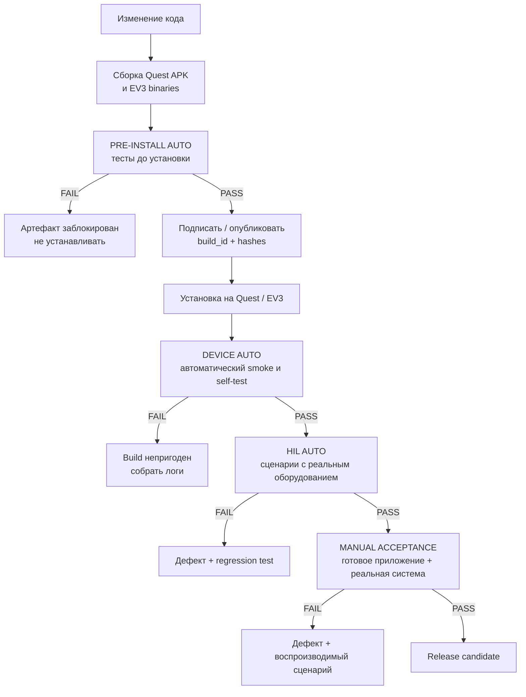

Быстрые статические проверки и часть модульных тестов могут выполняться до или параллельно компиляции, но **после успешной сборки существует отдельный обязательный `PRE-INSTALL` gate**. Он привязан к конкретным `commit`, `build_id` и хэшам артефактов. Нельзя считать достаточным ситуацию, когда тесты прошли для исходников, а устанавливается другой APK или другой EV3 binary.

<a id="sec-9-1-2"></a>
### 9.1.2. Автоматические тесты до установки (`PRE-INSTALL AUTO`)

Эти тесты выполняются на PC/CI непосредственно после получения сборочных артефактов и **до** `adb install` на Quest и до копирования бинарных файлов на EV3.

Обязательный набор:

| Область | Что проверяется |
|---|---|
| Quest pure logic | `IK`/`FK`, системы координат, рабочая область, абсолютное отображение руки, фильтры, state machine |
| Quest Unity | EditMode/PlayMode tests, XR Simulator, MRUK Spatial Testing для виртуальных комнат и пола |
| QR-математика | синтетические позы всех десяти маркеров: `SHOULDER_*`, `TURRET_*`, `ELBOW_*`, `GRIPPER_*`, `JAW_*`; `RobotBaseFrame`, отдельный `q_base_qr`, векторы `ShoulderCenter → ElbowCenter` и `ElbowCenter → GripperCenter`, независимость `GripperCenter` от раскрытия, преобразования `JAW_* → JawContactPoint`, эллиптическая траектория и фактический зазор губок |
| EV3 core | host-native C++ unit/property tests, `MockMotorBackend`, `q_ref`, регулятор, ограничения, fault state machines |
| Калибровка | синтетические QR↔encoder datasets, знак, scale, backlash, rejection плохих точек, нелинейные кривые Gripper |
| Протокол | C#↔C++ golden vectors, HMAC, sequence/session/transaction rules, malformed packets и fuzz |
| Интеграция без устройств | Quest logic ↔ PC EV3 simulator, telemetry, HOLD/SAFE_HOLD, reconnect, injected faults |
| Replay | записанные Shoulder/Wrist traces, timestamp skew, dropped samples и восстановление |
| Конфигурации | `/config/commissioning_bundle.schema.json`, обязательные поля/units/ranges, `MEASURED.required_before`, совместимость `RobotGeometry`/`DriveCalibration`/safe-set/protocol; YAML duplicate keys, unknown fields и last-key-wins parsing обязаны давать FAIL до canonical JSON/hash |
| Артефакты | package/application id Quest, требуемые permissions/features, build metadata; архитектура и зависимости EV3 ELF, отсутствие test/debug secret в Release |

Минимальные правила gate:

```text
0 failed mandatory tests
0 crashed tests
0 unexpected skipped tests
all generated protocol/config golden hashes match
Quest and EV3 build_id recorded
artifact SHA-256 recorded
```

Отчёт имеет versioned machine-readable schema и для каждого нормативного test id хранит как минимум `status`, `introduced_at_stage`, `applicable_to_stage`, команду/runner и ссылку на evidence. Допустимые статусы: `PASS`, `FAIL`, `NOT_RUN`, `N_A`. `N_A` разрешён только если тест ещё не применим к проверяемому этапу и содержит нормативную причину; отсутствие строки или неожиданный `NOT_RUN` эквивалентны FAIL. Итоговый `PASS` запрещён для dirty worktree и обязан содержать `git_commit`, `source_tree_hash`, `specification_sha256`, `protocol_schema_hash`, **все применимые component/profile-specific `quest_build_id`/`ev3_build_id`**, а также SHA-256 каждого проверенного артефакта. Локальный отчёт dirty checkout является только диагностическим и не разрешает установку.

Минимальный набор этапа 1 включает schemas/generated-file checks, protocol/golden/HMAC/parser tests, Quest pure logic и synthetic adapters, EV3 host core/MockMotorBackend, simulator/replay, secret scan и host sanitizers. На этапе 2 дополнительно обязательны Unity EditMode/PlayMode и доступные XR/MRUK simulation tests, Release/Diagnostic APK audit, pinned ARMv5TEJ cross-build, artifact manifests/hashes и автономные startup/self-test сценарии. Проверки функций, впервые вводимых этапом 3+, могут иметь `N_A` до своего этапа, но не должны молча исчезать из отчёта.

Если тест требует настоящей камеры, пользователя, EV3 scheduler или физический мотор, он **не симулируется как доказательство аппаратной готовности**; для него существует следующий уровень. Но вся чистая логика такого теста должна быть вынесена из SDK/I/O слоя и проверена здесь.

<a id="sec-9-1-3"></a>
### 9.1.3. Автоматические тесты после установки (`DEVICE AUTO`)

Установка разрешена только после успешного `PRE-INSTALL AUTO`. После установки выполняется короткий автоматизированный smoke/self-test конкретного артефакта.

**Quest:**

- приложение запускается и сообщает ожидаемый **`quest_build_id`** текущего profile;
- загружаются конфигурации и проверяются их хэши;
- проверяются декларация/config OpenXR и фактическое состояние session, причём неактивная session на лежащем Quest записывается как environment evidence, а не как несовместимость software;
- доступны требуемые Meta XR API/config/permissions; AUTO не запускает интерактивный запрос разрешения, permissions выдаются при установке либо их отсутствие даёт `FAIL`;
- диагностический self-test может запустить synthetic tracking/QR providers без движения реального PHANTOM;
- отсутствует crash/exception при входе/выходе из приложения и повторном запуске;
- Release не содержит включённых инженерных механизмов, которые должны быть Diagnostic-only.

Штатный Quest stage-2 runner — `scripts/quest-device-auto.ps1`. Он принимает только APK со смежным build manifest и существующим `results/quest/pre-install/report.json` со статусом `PASS`, содержащим тот же `quest_build_id`; проверяет единственный авторизованный ADB target `Quest 3/eureka`, SHA-256 APK, выполняет `adb install -r -g`, первый запуск, `force-stop` и повторный запуск. Запуск через ADB не использует неограниченный `am start -W`: runner автоматически посылает bounded wake event, отдельно и с конечным timeout проверяет PID и появление app report; ручное пробуждение/разблокирование не требуется и не запрашивается. Неактивные XR session/focus и отсутствие live observations на лежащем шлеме записываются как `NOT_RUN` environment evidence без software FAIL. Встроенный zero-output self-test проверяет build/config identity, `LOCAL_FLOOR`, permissions, passthrough/MRUK/Multimodal configuration и все adapters, но stage PASS определяется active profile: full-arm profile требует выбранный Body provider/Wrist path, gripper-only profile требует Hand/grasp + left Controller, а Body/Wrist live/provider qualification помечается `N_A` для этого stage gate и остаётся blocker будущего этапа 8/9. При pause сохраняется тот же классифицированный snapshot, а Diagnostic выполняет полный synthetic suite без `RobotTransport`. Raw logcat обоих запусков и объединённый host/app report сохраняются под `results/quest/device-auto/<quest_build_id>/`; серийный номер в отчёт не попадает, используется только сокращённый SHA-256 идентификатор.

Quest `DEVICE AUTO PASS` доказывает запуск конкретного установленного APK и software/platform compatibility, но не доказывает качество реальных Wrist/Shoulder/grasp/Touch/QR observations. Он не заменяет bounded live-observation cases §9.6, camera/QR measurement §9.10 и ручные pause/resume/HMD/haptics сценарии. Provider классифицируется раздельно: API отсутствует — `FAIL`; provider явно отключён или несовместим — `FAIL`; provider сконфигурирован, но XR/focus неактивен и live samples отсутствуют — compatibility `PASS`, live evidence `NOT_RUN`; provider инициализирован — `PASS`, а live sample является дополнительным evidence.

**EV3:**

- `phantom-controller` и `phantom-safety` запускаются через `systemd`;
- версии и **`ev3_build_id`** соответствуют установленному EV3 package/profile;
- конфигурация читается и проходит schema/hash checks;
- sysfs devices обнаруживаются по `address`, а не по нестабильному имени `motorN`; DEVICE AUTO проверяет **ровно обязательный motor/sensor I/O active profile**: Release требует `outA/outB/outC/outD + GRIPPER_HOME + LOCAL_STOP`, gripper-only Diagnostic требует `outD + GRIPPER_HOME + LOCAL_STOP`, network-only Diagnostic не требует motor I/O; battery telemetry является общим обязательным I/O для всех профилей; любой physically present disabled motor дополнительно проверяется на zero-output inhibit; для scoped моторов проверяются ожидаемые `driver_name`/тип и `count_per_rot=360`;
- выполняется короткий timing self-test критического цикла с `duty=0`/безопасным backend;
- DNS-SD/mDNS service публикуется;
- Quest/PC test client может выполнить `HELLO/HELLO_ACK`, `PING/PONG` и получить `TELEMETRY`;
- падение одного процесса обнаруживается вторым по правилам безопасности.

Каждый DEVICE AUTO test также имеет `introduced_at_stage`. На этапе 2 обязательны только автономный запуск, config/hash checks, обнаружение локального I/O, zero-output timing self-test, supervisor heartbeat/takeover и безопасный shutdown. DNS-SD, `HELLO/PING/TELEMETRY` и иные функции этапа 3 становятся обязательными с этапа 3; до этого они записываются как `N_A`, а не как PASS и не как пропущенная строка. DEVICE AUTO никогда не заменяется результатом PC-симулятора.

EV3 stage-2 DEVICE AUTO выполняется установленным `/opt/phantom/current/bin/phantom-device-auto` с root privilege и атомарно сохраняет `/var/lib/phantom/device-auto.json`. Отчёт содержит `git_commit`, один установленный **`ev3_build_id`** текущего profile, hashes controller/safety/config, platform fingerprint, monotonic timestamp и отдельные строки минимум для artifact integrity, config, motor/sensor/battery discovery, обоих on-device self-tests, systemd startup, zero-output startup, supervisor takeover и safe restart. Stage-3 network строки присутствуют как `N_A` с `introduced_at_stage=3`.

Начиная с EV3-side этапа 3 тот же installed runner формирует report `schema_version=2`, `gate="DEVICE AUTO"`, `stage=3` и проверяет дополнительно:

- согласованный network-only profile одновременно в runtime config и authoritative bundle, а также их manifest hashes;
- WNA1100 по sysfs USB VID/PID `0846:9030`, загруженный `ath9k_htc` и динамически обнаруженное имя wireless interface; автоматический gate не зависит от `lsusb`, который на legacy Brick может блокироваться;
- carrier и наличие DHCP IPv4 без записи конкретного DHCP-адреса как identity;
- active state `phantom-safety`, `phantom-wifi-autoconnect`, `phantom-controller`, `phantom-network`, `phantom-mdns`;
- живой multicast DNS-SD response с правильными service type, port, `robot_id`, boot id и build id;
- локальный authenticated `HELLO/HELLO_ACK`, server-generated nonzero session id, `PING/PONG`, `TELEMETRY`, rejection invalid HMAC/replay и authenticated `COMMAND` при scope `0x00`;
- смену boot id после controller kill/restart и сохранение zero/brake для всех физически присутствующих моторов;
- `nonzero_motor_writes=0` в `/run/phantom/network-status.json` и фактическое финальное состояние sysfs motors.

Отсутствующие motor и motor-safety inputs при scope `0x00` получают `N_A` с `reason=OUT_OF_SCOPE`; battery telemetry остаётся обязательной и должна иметь `PASS`. Итоговый report записывается atomically в `/var/lib/phantom/device-auto.json`; пропуск любой применимой Stage-3 строки не считается PASS.

On-device timing self-test выполняет не менее 250 итераций по абсолютной 20-ms сетке с безопасным backend, требует `p99 <= 25 ms`, `max < 50 ms`, нулевое число nonzero motor writes. Для `LOCAL_STOP` DEVICE AUTO без fixture проверяет discovery/текущее released состояние input и software state-transition logic через test backend, но **не выдаёт PASS физическому press/release**. Физический `LOCAL_STOP` press→BRAKE→latched STOP→release/reset проверяется только HIL AUTO с квалифицированным actuator fixture либо отдельной manual safety procedure; человеческое нажатие во время AUTO запрещено. Supervisor test при уже нулевом output посылает `SIGKILL` controller, подтверждает новый emergency event и сохранение `duty=0`, `speed=0`, `stop_action=brake`, после чего полностью перезапускает target. В network-only profile это также доказывает безопасное повторное получение освобождённого lease и смену controller boot identity, но не снимает fault/не выдаёт authority motion-capable profile. Ни один DEVICE AUTO step не выставляет ненулевой duty.

DEVICE AUTO оценивает комплект относительно versioned profile, а не относительно будущей финальной механики. Scope-aware classification является изменением этой ревизии и получает `introduced_at_stage=3` (network-only) / `introduced_at_stage=4` (gripper-only): она не переписывает исторический Stage-2 report, но перед соответствующим новым gate обязательно выполняется regression текущего autonomous-startup behavior. При таком regression gripper-bench report может быть `PASS` при scope `0x08`, если D/`GRIPPER_HOME`/`LOCAL_STOP` присутствуют и A/B/C явно помечены `N_A` с `reason=OUT_OF_SCOPE`; это **не** является evidence production hardware completeness. Финальный Release DEVICE AUTO всё равно требует A/B/C/D, `LOCAL_STOP` и `GRIPPER_HOME`; отсутствие любого обязательного элемента даёт `FAIL`/`NOT_RUN` без попытки движения.

EV3 не имеет надёжного RTC, поэтому control/watchdog/safety freshness используют только `CLOCK_MONOTONIC`. DEVICE AUTO дополнительно фиксирует wall-clock/NTP state; неверные календарные часы не ослабляют stop path, но блокируют использование отчёта как хронологического release/HIL evidence до синхронизации либо надёжной корреляции с host timestamp.

`DEVICE AUTO` не заменяет HIL: успешный запуск процесса ещё не доказывает, что реальная передача, QR, мотор и механика работают правильно.

<a id="sec-9-1-4"></a>
### 9.1.4. Автоматизированные аппаратные тесты (`HIL AUTO`)

После успешного device smoke используется сценарный HIL-исполнитель. Человек до запуска runner подготавливает безопасную зону и переводит стенд в указанную исходную конфигурацию; после старта каждый HIL AUTO **motion/stress segment** выполняется полностью автоматически и завершается не позднее `60 s`, а один логический case может агрегировать несколько таких segments без вмешательства человека либо с новым явно отдельным setup между cases:

```text
setup confirmed by engineer
→ scenario runner
→ controlled commands
→ telemetry + Quest diagnostics
→ automatic metrics
→ PASS / FAIL report
→ incident package on failure
```

К HIL относятся:

- реальная Quest↔EV3 сеть;
- QR→геометрия и QR↔encoder reference;
- инженерная `DriveCalibration`;
- сценарные `q_target` без пользовательской руки;
- tracking performance реального EV3;
- stall/obstruction с безопасным тестовым приспособлением;
- `LOCAL_STOP`, watchdog, process kill, packet loss;
- серия независимых `Release`/`Diagnostic` timing cases по `<=60 s` с агрегированием распределений;
- автоматический сбор всех численных критериев точности и производительности, которые не требуют субъективной оценки человека.

HIL должен выдавать машинно читаемый отчёт со **всеми реально участвующими `quest_build_id`/`ev3_build_id`**, конфигурационными хэшами, временем запуска, сценарием, метриками и итогом. Ручное переписывание результатов в таблицу не является штатным способом приёмки.

<a id="sec-9-1-5"></a>
### 9.1.5. Ручные тесты готового приложения (`MANUAL ACCEPTANCE`)

Ручные **функциональные и пользовательские** тесты проводятся только на установленном build, который уже прошёл `PRE-INSTALL AUTO`, `DEVICE AUTO` и обязательные для данного сценария HIL-проверки.

Именно вручную проверяются свойства, для которых нужен реальный человек или субъективная/физическая оценка:

- качество `Body_RightShoulder` и `Wrist` при движениях пользователя;
- реальное распознавание напечатанных QR системным QR Trackable service Quest при разных ракурсах/освещении;
- удобство запуска, XR permission/recovery flows и обычного управления; `Space Setup` оценивается только при включённой scene-aware функции;
- понятность русского UI, подсказок, состояний и ошибок;
- ощущение задержки и предсказуемости управления;
- физическое соответствие движения руки и PHANTOM;
- поведение Gripper с реальными объектами;
- повторяемые пользовательские сессии, разбитые на независимые cases по `<=60 s`;
- сквозные сценарии HOLD/SAFE_HOLD/восстановления, где важна наблюдаемая реакция системы.

Для ручного теста заранее задаются шаги, ожидаемый результат и автоматически собираемая диагностическая трасса. Формат «попробовать и посмотреть, нормально ли» не является приёмочным тестом.

<a id="sec-9-1-6"></a>
### 9.1.6. Ручные проверки механической безопасности до автоматического движения

Это исключение из правила «ручные тесты на готовом приложении». До первого HIL-движения обязательно вручную проверяются вещи, которые опасно впервые обнаруживать мотором:

- соосность Shoulder/Elbow;
- свободный ход без закусывания;
- правильное зацепление шестерён;
- затяжка/фиксация рам, осей и QR-креплений;
- запас моторных кабелей во всём предполагаемом диапазоне;
- положение физических ограничителей;
- устойчивость основания;
- работоспособность `LOCAL_STOP` при ещё запрещённом автоматическом движении;
- отсутствие посторонних предметов и людей в swept volume.

Эти проверки являются **safety inspection**, а не ручным тестированием пользовательского приложения. Их прохождение разрешает HIL, но не является функциональной приёмкой PHANTOM.

<a id="sec-9-1-7"></a>
### 9.1.7. Классификация подробных тестов главы 9

| Раздел | Основной уровень | Дополнительный уровень |
|---|---|---|
| §9.2–§9.4 | `PRE-INSTALL AUTO` | — |
| §9.5 | `PRE-INSTALL AUTO` capability/state logic | `MANUAL ACCEPTANCE` Quest lifecycle/reference-space; `Space Setup` только для scene-aware UX |
| §9.6 | `PRE-INSTALL AUTO` для replay/alignment | `MANUAL ACCEPTANCE` на Quest 3 с пользователями |
| §9.7 | `PRE-INSTALL AUTO` provider/remap state logic | `MANUAL ACCEPTANCE` реального `graspValue/graspReady` |
| §9.8–§9.9 | `PRE-INSTALL AUTO` | `DEVICE AUTO`/HIL для реальной сети и EV3 |
| §9.10 | `PRE-INSTALL AUTO` для synthetic QR geometry | HIL/ручная камера для физических QR |
| §9.11–§9.14 | `PRE-INSTALL AUTO` для математики | `HIL AUTO` для реального робота |
| §9.15 | manual safety inspection + HIL | часть проверок требует физического наблюдения |
| §9.16–§9.19 | `HIL AUTO` | отдельные опасные сценарии требуют инженера рядом с `LOCAL_STOP` |
| §9.20–§9.23 | `MANUAL ACCEPTANCE` | численные метрики считаются автоматически |
| §9.24 | `PRE-INSTALL AUTO` + `DEVICE AUTO` + HIL | физический power-loss отдельно |
| §9.25–§9.26 | отчётность/Release gate | агрегируют результаты всех уровней |

<a id="sec-9-1-8"></a>
### 9.1.8. Регрессии и доказательства прохождения

Каждый обнаруженный дефект, который можно воспроизвести без человека или физического риска, должен получить автоматический regression test на самом раннем возможном уровне.

```text
дефект найден вручную/HIL
→ минимальный воспроизводимый сценарий
→ по возможности PRE-INSTALL regression
→ исправление
→ локальный набор тестов
→ полный обязательный gate
```

Для каждого build должны сохраняться:

```text
commit SHA
quest_build_id
ev3_build_id
SHA-256 артефактов
версии SDK/toolchain
RobotGeometry hash
DriveCalibration hash
config hash
результаты PRE-INSTALL AUTO
результаты DEVICE AUTO
результаты применимых HIL
идентификаторы ручных приёмочных сценариев
```

Тестовый отчёт является частью доказательства готовности конкретного build. Результат другого commit/build нельзя переносить на текущий артефакт без повторного прохождения соответствующего gate.

<a id="sec-9-2"></a>
## 9.2. Модульные тесты и тесты свойств кинематики

**Уровень:** `PRE-INSTALL AUTO`.

Минимум `10 000` случайных валидных наборов:

```text
q → FK → IK на фиксированной branch → q_reconstructed
```

Вне сингулярностей:

```text
|q_base - q_base_reconstructed| <= 0.1°
|q_shoulder - q_shoulder_reconstructed| <= 0.1°
|q_elbow - q_elbow_reconstructed| <= 0.1°
```

Проверяются:

- границы геометрической достижимости;
- `RobotBaseFrame.origin == ShoulderCenter`;
- commissioned joint bounds;
- Shoulder/Elbow 90° flexion rule;
- yaw singularity;
- отсутствие `NaN/Inf`;
- отсутствие переключения зафиксированного `branch_sign`;
- constrained projection;
- `norm(HumanArmVector) < human_vector_min_m` и yaw singularity hold-zone дают invalid target/`SAFE_HOLD`, не используют исторический/произвольный Base yaw;
- `reach_ratio` всегда clamp-ится в `[0,1]`, а `mapping_reach_m=min(RobotGeometry.robot_nominal_reach_m, human_arm_reach*max_mapping_scale)`: tracking overshoot не может вынести `P_requested_B` дальше `mapping_reach_m`, и property test отдельно покрывает пользователя, для которого nominal scale превышал бы limit;
- independent joint-bound clamp после IK даёт документированный `P_projected_B` через FK;
- coupled collision/`JointSafeSet` не заменяется поиском «ближайшей» IK-ветви: такой target получает `TARGET_INVALID`.

<a id="sec-9-3"></a>
## 9.3. Тест абсолютного отображения руки

**Уровень:** `PRE-INSTALL AUTO`.

Для фиксированных `RobotBaseFrame`, `human_arm_reach` и заданного `HumanShoulderCenter` генерируется множество поз правой руки.

Должно выполняться:

```text
same(HumanWristCenter - HumanShoulderCenter)
→ same physical Shoulder_PHANTOM→TCP direction
→ same P_requested_B
```

независимо от:

- положения локтя пользователя при тех же плечевом центре и запястье;
- ориентации HMD при неизменной позиции HMD;
- предыдущей траектории руки;
- предыдущей физической позы робота;
- момента нажатия `Left Grip`;
- количества циклов HOLD→TRACKING.

Отдельный regression test доказывает независимость **чистой** цели от исходной позы робота: две разные физические начальные позы при одной и той же aligned-позе руки дают одинаковый `P_requested_B`. При одинаково seeded filter state они также дают одинаковые `P_control_B/q_target`; тест отдельно проверяет, что re-arm/reacquire выполняет seed и не наследует старую траекторию.

<a id="sec-9-4"></a>
## 9.4. Тесты преобразования координат

**Уровень:** `PRE-INSTALL AUTO`.

Для заранее заданного `T_floor_base` проверяются эталонные мировые векторы `плечо → запястье`. После преобразования в `RobotBaseFrame` FK целевого робота должен давать тот же физический вектор при обратном переводе в `LOCAL_FLOOR`.

Тест обязан ловить:

- mirror по любой оси;
- axis swap;
- неверный handedness;
- ошибочное применение translation к вектору;
- зависимость результата от HMD yaw/pitch/roll.

<a id="sec-9-5"></a>
## 9.5. Тесты XR readiness, Multimodal lifecycle и reference-space changes

**Уровень:** `PRE-INSTALL AUTO` для capability/state logic; затем `MANUAL ACCEPTANCE` на Quest 3.

Проверяются сценарии:

| Сценарий | Ожидаемый результат |
|---|---|
| `LOCAL_FLOOR`, Spatial Data, Scene/Anchor support и QR capability валидны; room mesh отсутствует | core startup продолжается |
| spatial permission не выдан | запрос/инструкция; движения нет |
| Scene/Anchor capability для QR выключена | `READY` запрещён до исправления capability |
| room/furniture semantics отсутствуют при `scene_aware_ux_enabled=false` | не блокируют core startup |
| пользователь запускает опциональный `Space Setup` и отменяет | приложение повторяет scene-aware readiness check; core actuator path остаётся зависим только от обязательных capabilities |
| `XrEventDataReferenceSpaceChangePending`/смена tracking origin | full A/B/C: немедленный `SAFE_HOLD`, `RobotLocalization` invalid, новая QR-локализация, затем deliberate re-arm; D-only qualification: scoped inhibit/dearm в `COMMISSIONING`, `GripperReference` не инвалидируется только из-за space change при доказанной encoder/JAW continuity, затем scope-specific readiness + deliberate re-arm |
| pause/focus loss → resume | Multimodal/Hand/Body capabilities повторно включаются/проверяются; held Grip не возобновляет движение |

Golden-vector tests отдельно проверяют OpenXR Y-up → robot Z-up adapter и отсутствие axis mirror/swap.

<a id="sec-9-6"></a>
## 9.6. P0 compatibility, Body Tracking плеча и калибровка длины руки

**Уровень:** replay/time-alignment — `PRE-INSTALL AUTO`; качество реального tracking — `MANUAL ACCEPTANCE` на Quest 3.

Live full-arm Body/Wrist qualification и пользовательские cases этого раздела выполняются на реальном Quest 3 в штатной полной комбинации ниже. **P0 до них является scope-specific** и не обязан включать providers, помеченные `N_A(OUT_OF_SCOPE)` для `COMMISSIONING_QR`/`D_ONLY_USER`:

```text
passthrough enabled
правый Hand Tracking
левый Touch Plus Controller
Multimodal Input
Upper-Body Body Tracking
IOBT = off
FBS = off
FMM = off
WMM = off в actuator profile
```

### P0 Quest platform compatibility AUTO

До первого физического milestone каждого XR path exact pinned platform matrix из build manifest проходит короткий полностью автоматический compatibility case на реальном Quest 3. P0 имеет три независимых applicability-scope и проверяет **только используемые данным path providers/API**:

| `P0CompatibilityScope` | Обязателен до | Проверяемый минимум | Явно `N_A(OUT_OF_SCOPE)` |
|---|---|---|---|
| `COMMISSIONING_QR` | первого QR-driven `CALIBRATION_JOG` этапа 4; повторно перед A/B/C commissioning, если platform matrix изменилась | OpenXR lifecycle/reference-space API, passthrough/Spatial Data permissions, MRUK QR Trackables/anchors и commissioning adapters | Body/Wrist, grasp/Hand, Left Grip/haptics |
| `D_ONLY_USER` | первого user-driven D этапа 5 | Hand/grasp provider, левый Touch Plus Grip+haptics, Multimodal/focus lifecycle, passthrough и требуемый JAW QR path | Body_RightShoulder/Wrist mapping |
| `FULL_ARM_USER` | full-arm live qualification этапа 8 и обязательно до первого user-driven A/B/C этапа 9 | Wrist, выбранный UpperBody provider+`Body_RightShoulder`, Multimodal/focus lifecycle, passthrough, QR/local-space adapters | ничего из full actuator input stack |

Case длится `5..30 s`, допускает лежащий на столе HMD и не требует live движения робота, жестов человека, haptics confirmation или pause/resume. Для каждого применимого provider проверяются наличие API/components, статическая конфигурация feature flags/permissions, отсутствие явного SDK/runtime запрета выбранной комбинации и отсутствие **активной `RobotTransport` session/actuator authority во время P0**. Неиспользуемый provider не может дать `FAIL`; он получает `N_A(OUT_OF_SCOPE)`. **FAIL применимого scope блокирует соответствующий actuator milestone**; его нельзя обходить HMD→shoulder heuristic, отключением Multimodal или silent provider fallback.

P0 evidence сохраняется как отдельный versioned report и содержит `p0_compatibility_scope`, **`quest_build_id`**, `apk_sha256`, модель/серийно обезличенный id устройства, точный Horizon OS/runtime build, Unity/Meta XR Core/Movement SDK/MRUK/OpenXR versions, provider/joint-set, feature flags, permissions, время/длительность case, результаты каждого compatibility check и ссылки на device logs. Только реальный Quest 3 может дать `PASS`; отсутствие устройства даёт `NOT_RUN`, доказанная несовместимость provider/API — `FAIL`.

P0 обязан различать состояния provider:

| Состояние | Итог compatibility |
|---|---|
| требуемый текущим `P0CompatibilityScope` provider API отсутствует | `FAIL` |
| применимый component/joint set сконфигурирован неверно | `FAIL` |
| SDK или runtime явно отключает/запрещает provider в требуемом scope/profile | `FAIL` |
| provider не используется данным P0 scope | `N_A(OUT_OF_SCOPE)`; не блокирует gate |
| provider сконфигурирован, но XR session/focus неактивен и live samples нет | `PASS`; live evidence отдельно `NOT_RUN` |
| provider инициализирован без live sample в данном коротком окне | `PASS`; sample отдельно `NOT_RUN` |
| provider инициализирован и live sample доступен | `PASS` плюс дополнительное live evidence |

Текущее отсутствие live observations на снятом/лежащем HMD никогда не используется как доказательство несовместимости. И наоборот, явный source/runtime guard нельзя переклассифицировать в «HMD не был надет». Наличие `OVRBody` в package не считается PASS само по себе: если pinned package source/runtime отключает выбранный provider при Multimodal, такой provider/profile получает `FAIL` до выбора другой документированной версии/provider и нового P0. При конфликте сначала выполняется дешёвый source/config audit минимального числа package/provider candidates; APK собирается только для кандидата, который не содержит известного запрета и сохраняет все обязательные API.

После `FULL_ARM_USER P0` отдельными `MANUAL ACCEPTANCE` cases проверяется доступность и качество живых full-arm данных:

- `Body_RightShoulder` присутствует в выбранном joint set;
- joint имеет валидную позицию и обновляется непрерывно;
- `Wrist` и `Body_RightShoulder` одновременно доступны при работающем левом Touch Plus;
- приложение получает доступные body tracking calibration/status/fidelity поля и документированную временную информацию; отсутствие sensor timestamp не подменяется выдуманным значением.

Физические сценарии выполняются минимум на `10` пользователях; каждый пронумерованный case имеет собственный отчёт и длительность `<=60 s`:

1. **Голова без корпуса:** пользователь держит корпус и правую руку неподвижно, поворачивает голову примерно на `±90°` и наклоняет её вверх/вниз. Положение `HumanShoulderCenter` не должно повторять HMD yaw/pitch; допускается только шум отслеживания.
2. **Шаг в сторону:** пользователь смещается примерно на `0.30 м` влево и вправо. `Body_RightShoulder` должен отражать соответствующую трансляцию без дополнительной shoulder-калибровки.
3. **Шаг вперёд/назад:** аналогично проверяется продольная координата.
4. **Приседание:** пользователь уменьшает высоту плеча минимум на `0.20 м` и возвращается в исходное положение; вертикальная координата tracked shoulder должна следовать движению.
5. **Поворот корпуса:** пользователь поворачивает корпус примерно на `±45°`, не выполняя специального калибровочного жеста. Положение правого плеча должно обновляться непрерывно.
6. **Движение руки при неподвижном корпусе:** изменение Wrist не должно искусственно переносить tracked shoulder вслед за кистью сверх допустимой ошибки body tracking.
7. **Краткий tracking пропуск:** в grace-window actuator target заморожен; stale Shoulder не смешивается со fresh Wrist. После восстановления filter reseed выполняется текущим aligned-вектором, приложение остаётся в `HOLD` до deliberate re-arm и не просит пользователя двигать рукой для вычисления плеча.

Для проверки пространственной ошибки используются статические контрольные позы и независимая измерительная точка/маркер вблизи правого плеча. Начальные критерии приёмки:

| Метрика | Критерий |
|---|---:|
| p95 ошибка положения плеча в статических контрольных позах | `<=30 мм` |
| p95 ложное смещение плеча при только головы yaw/pitch | `<=20 мм` |
| ошибка изменения положения после шага/приседания | `<=30 мм` |
| автоматическое восстановление после краткого пропуска | без пользовательской перекалибровки |

Если эти критерии не выполняются, тест создаёт диагностический дефект с сохранением `Body_RightShoulder`, `Wrist`, quality/status, временные метки и состояния приложения. Основной алгоритм при этом не переключается на HMD-эвристику и не требует от пользователя дополнительной калибровки: причина сначала анализируется по журналам и `FlightRecorder`. Для финальной готовности системы критерии всё равно должны быть выполнены.

Точность `Wrist` и итогового вектора проверяется в неподвижных контрольных позах. Для квалификационного теста допускается временный жёсткий `WRIST_TEST` маркер/крепление с заранее измеренным offset до анатомической точки Wrist; QR measurement снимается только после полной остановки руки и не используется в runtime управления. Минимум `20` пространственно различных поз на пользователя.

Начальные критерии приёмки:

| Метрика | Критерий |
|---|---:|
| p95 ошибка stationary `Wrist` относительно тестовое крепление | `<=20 мм` |
| p95 ошибка длины `Shoulder→Wrist` | `<=30 мм` |
| p95 ошибка направления `Shoulder→Wrist` | `<=3°` |
| накопленный offset после возврата в ту же неподвижную позу | отсутствует; ошибка остаётся в том же статистическом диапазоне |

Эти критерии измеряют tracking/mapping input до IK. Сквозной физическая точность PHANTOM отдельно проверяется §9.20.

Калибровка `human_arm_reach` проверяется отдельно:

```text
>=10 пользователей
>=5 calibration runs на человека
ровно 3 **принятые устойчивые** позы полностью выпрямленной руки; отклонённые/нестабильные попытки не засчитываются и могут повторяться без искусственного лимита
```

Критерии:

- положение плеча берётся непосредственно из валидного `Body_RightShoulder`, а калибровка измеряет только `human_arm_reach`;
- медианное значение `human_arm_reach` между повторными run одного пользователя отличается не более чем на `20 мм`;
- поворот головы, шаг или приседание после калибровки не меняют сохранённый `human_arm_reach`;
- одинаковые текущие `HumanShoulderCenter` и `HumanWristCenter` дают одинаковую цель независимо от положения локтя.

Отдельно проверяется временное согласование Shoulder/Wrist. `tracking-replay` искусственно вводит известное рассогласование временных меток и дрожание, а затем сравнивает вычисленный `Shoulder→Wrist` с эталоном:

```text
stationary pose
slow arm motion
sinusoidal arm motion
step-like change direction
sample/query-time offsets: 0 / 10 / 20 / 40 / 60 ms + отдельные сценарии timing uncertainty
short dropped samples
```

Критерии:

- измерения старше настроенного alignment/extrapolation window не используются как свежие;
- при допустимом рассогласовании временных меток интерполяция уменьшает ошибку вектора относительно варианта «брать последние два несинхронных измерения»;
- stationary `Shoulder→Wrist` p95 дрожание после фильтра `<=15 мм` в квалифицированных условиях освещения/tracking;
- дополнительная задержка фильтра относительно time-aligned raw vector p95 `<=30 мс` для обычного движения;
- после краткого пропуска нет смешивания stale/fresh joints; `P_requested_B` остаётся pure, а после reseed `P_control_B` стартует от текущего raw-вектора без хвоста старого filter state.

Если реальные платформенные данные требуют других численных filter thresholds, значения меняются только через измеренный config и повторный §9.6, а не скрытым повышением smoothing latency.

<a id="sec-9-7"></a>
## 9.7. Тесты сигнала сжатия кисти

**Уровень:** provider/remap logic — `PRE-INSTALL AUTO`; реальный Hand Tracking — `MANUAL ACCEPTANCE`/P0 на Quest 3.

Default `OpenXrGraspProvider` проверяется так:

- `graspReady=true`, raw `0`, `0.25`, `0.5`, `0.75`, `1` → identity/clamp mapping без обязательной пользовательской калибровки;
- `graspReady=false` → `GRASP_VALID=0`, сохранение текущей физической gripper target, отсутствие автоматического открытия;
- `NaN/Inf/out-of-contract` отклоняются до command builder;
- после HOLD/SAFE_HOLD актуальный `grip_intent` может применяться только после общего deliberate re-arm;
- EV3 rate/duty/contact logic ограничивает физический скачок даже при step input.

Optional `GripRemapProfile` тестируется отдельно:

- `g_open < g_closed`, span `>= remap_min_usable_span`;
- remap монотонен и ограничен `[0,1]`;
- invalid/zero/inverted span отклоняется;
- profile compatibility metadata инвалидируется после несовместимого runtime/provider update;
- включение/выключение remap вне `TRACKING` не переносит stale command.

Если используется альтернативный `JointCurlGripProvider`, он обязан иметь отдельный qualification profile с теми же end-to-end safety tests; runtime silent fallback между providers запрещён.

<a id="sec-9-8"></a>
## 9.8. Тесты DNS-SD/mDNS обнаружения

**Уровень:** `PRE-INSTALL AUTO` с сетевым симулятором; `DEVICE AUTO`/HIL с реальным EV3.

Сценарии:

1. один PHANTOM в сети;
2. два PHANTOM с разными `robot_id`;
3. сервис с неверным protocol major;
4. корректный service type `_phantom-ev3._udp`, но неверный/non-local domain;
5. resolve даёт только IPv6 endpoint при v1;
6. IPv4 меняется после DHCP renew;
7. Wi-Fi interface EV3 переподключается и получает новый IPv4;
8. старый IPv4 занят другим host;
9. сервис исчезает и появляется снова.
10. `HELLO` retransmit с тем же nonce в retry-window возвращает тот же session id только пока исходная session/config generation остаётся authoritative; bundle/session/boot invalidation очищает HELLO cache, и повтор старого nonce не воскресит session. Competing CONTROL HELLO при свежей активной session получает rejected `HELLO_ACK(result_code=ERR_CONTROL_SESSION_BUSY, session_id=0)`; после stale/HOLD новый handshake получает новую EV3-generated session id, а старые COMMAND остаются невалидны.
11. на реальном EV3 publisher использует Avahi D-Bus, а DEVICE AUTO посылает raw multicast DNS query и валидирует service type `_phantom-ev3._udp`, domain `local.`, IPv4 address/SRV port и TXT identity независимо от локального publisher process;
12. restart controller меняет `controller_boot_id` и приводит к перепубликации TXT; restart `phantom-mdns` временно удаляет и затем восстанавливает service;
13. TXT не содержит credential, PSK, HMAC material или session id.
14. Quest LAN permission denied/revoked или platform multicast prerequisite отсутствует → discovery/UDP явно unavailable, старый endpoint/session не используется; после разрешения выполняется fresh discovery.

Критерии приёмки:

- Quest выбирает робота по `robot_id`, а не по сохранённому IP;
- после смены адреса старый сетевой адрес/session не используется;
- новый IPv4 сетевой адрес проходит новый `HELLO/HELLO_ACK`;
- IPv6-only resolve в v1 не создаёт session и не запускает fallback на сохранённый IPv4;
- робот с неверным `robot_id` никогда не получает actuator command текущей сессии.

<a id="sec-9-9"></a>
## 9.9. Тесты сетевого протокола и HMAC

**Уровень:** `PRE-INSTALL AUTO`; performance parser/HMAC дополнительно проверяется на EV3 как `DEVICE AUTO`/HIL.

Каждый message type генерируется из одного `wire_schema.yaml`; C# и C++ encode/decode должны проходить общие golden vectors. CI проверяет `protocol_schema_hash`, exact payload lengths, enum values и запрещает расхождение generated codecs со схемой. Отдельный schema assertion требует, чтобы `COMMAND` содержал только motion flags, абсолютные `q_target[3]`, `grip_intent` и reserved field; PWM/duty/raw motor commands в Quest→EV3 wire отсутствуют.

Security tests:

| Тест | Результат |
|---|---|
| bad magic / wrong version / unknown type / reserved bits != 0 | cheap reject до HMAC/type-specific parsing |
| truncated datagram / bad exact length | cheap reject |
| bit flip полезная часть | HMAC fail |
| wrong PSK / unknown key slot | drop без создания session |
| old/replayed sequence | drop |
| duplicate/reordered packet | drop без repeated side effect |
| wrong session | drop |
| old boot id | drop |
| repeated transaction в той же session | тот же semantic ACK payload/result, no repeated side effect; response datagram имеет новый EV3→Quest sequence/timestamp/HMAC |
| exact retry с повтором старого request payload, но новым Quest→EV3 wire sequence | принимается как transaction retry; canonical request hash остаётся тем же, old header bytes в hash не входят |
| новая state transaction `id=last+1` даёт operation-level `ERR_STATE/ERR_RANGE/...` | error ACK кэшируется как completed transaction и consume-ит id; исправленный payload обязан использовать следующий id |
| bad HMAC/session/exact-length packet с видимыми случайными bytes transaction_id | drop до transaction layer, `last_transaction_id` не меняется |
| повтор того же consumed error transaction id с исправленным payload | `ERR_TRANSACTION_CONFLICT`, state без изменения |
| controller cached ACK payload на retry | `phantom-network` не replay-ит старую datagram: выдаёт fresh outbound sequence; Quest anti-replay принимает ответ |
| `CALIBRATION_JOG`: ACK потерян, затем session потеряна | старый JOG **не** отправляется автоматически в новой session; состояние `OUTCOME_UNKNOWN`, новый `LOCAL_COMMISSION_ARM`/session + stationary `CALIBRATION_QUERY` + QR/encoder observation предшествуют любому следующему jog |
| `COMMISSIONING_SAMPLE` ACK потерян | exact retry в той же session возвращает тот же `CONTROL_ACK` payload/result с fresh response sequence/HMAC; journal append/sample consume выполняются ровно один раз |
| `REFERENCE_ACK` потерян и затем session потеряна | новая session не считает старую reference подтверждённой: fresh `CALIBRATION_QUERY` + QR observation + новый `SET_JOINT_REFERENCE`; старый transaction id не replay-ится |
| HELLO `key_slot/session_role` selector до HMAC | используется только для выбора одного preinstalled PSK; invalid HMAC не создаёт session/semantic side effect |
| authenticated `HELLO` при busy CONTROL / commissioning без local arm | `HELLO_ACK.session_id=0`, `result_code=ERR_CONTROL_SESSION_BUSY/ERR_COMMISSIONING_NOT_ARMED`; session owner/sequence/authority не создаются |
| rejected authenticated `HELLO_ACK` canonical fields | `client_nonce_echo` и HMAC-validated selectors совпадают с запросом; identity/build/hash/state fields декодируются как diagnostics, но не создают authority; profile-dependent safe limits при отсутствии применимого active profile равны canonical zero; Quest **не** применяет rejected ACK как config/reference readiness |
| successful network-only/D-only `HELLO_ACK` canonical N_A | `0x00/0x00`: отсутствующие component hashes и все reference/A-B-C limit fields canonical zero при ненулевом network-only bundle hash; `0x08/0x08`: только присутствующие gripper subset hashes/Gripper reference могут быть ненулевыми, A/B/C JointReference/JointSafeSet/limits canonical zero; `-0.0`, NaN, stale values rejected by golden/schema test |
| HELLO retry-cache invalidation | после cached successful ACK изменить/активировать bundle либо инвалидировать session/controller boot до истечения `hello_retry_window_ms`; повтор того же HELLO/nonce **не** получает старый session id/hash, cache очищен и handshake оценивается по текущей generation |
| successful `HELLO_ACK` | `result_code=OK`, `session_id!=0`; subsequent session messages с zero id rejected |
| role↔key-slot mismatch | при установленном/проверяемом slot authenticated reject `HELLO_ACK(result_code=ERR_AUTH,session_id=0)`; unknown/uninstalled slot — silent drop |
| `SET_DRIVE_CALIBRATION` commit ACK потерян | EV3 остаётся в bounded `CONFIG_STALE_ACK_ONLY`; exact retry возвращает тот же ACK payload/result с fresh response sequence/HMAC, а reconnect/HELLO hash reconciliation однозначно определяет committed old/candidate revision |
| `SET_DRIVE_CALIBRATION` reconnect после неопределённого ACK | Quest durable pending-candidate reconciles по `commissioning_bundle_hash`; third/unexpected hash → manual `ERR_HASH_MISMATCH`, motion authority=0 |
| NaN/Inf target | reject |
| payload_length >928 или total datagram >1024 или exact-length mismatch | reject |
| 1 000 000 malformed host fuzz packets | no crash/UB |
| unauthenticated traffic flood within test limits | no actuator state change |
| `MOTION_ENABLE=1` первым packet новой/recovered session без предыдущего OFF/HOLD | reject/no actuator target; `release_seen=false` |
| противоречивый stop-like `COMMAND`: `MOTION_ENABLE=1,HOLD_REQUEST=1` | fail-safe stop/hold выполняется, moving target не принимается, но `release_seen` **не** становится true; deliberate re-arm требует отдельный canonical `0/1` OFF/HOLD |
| Quest локально увидел release, но OFF/HOLD потерян | `last_accepted_command_sequence` не достигает `release_off_sequence`; Quest остаётся `armed=false`, moving packet не посылается |
| OFF/HOLD принят, но telemetry stale/потеряна | EV3 уже fail-safe снял motion, но Quest остаётся `armed=false` до свежего подтверждения текущей session; automatic resume запрещён |
| OFF/HOLD подтверждён свежей telemetry, затем новый false→true enable edge | допускается только после остальных обычных movement predicates |
| command/session freshness lost while product state=`READY` | state не остаётся READY: `READY→SAFE_HOLD`, armed/release latch очищаются; после новой/восстановленной valid session переход только через `HOLD` и deliberate re-arm |
| `HELLO role=CONTROL` при `STOPPED` | создаёт recovery-only session; COMMAND не имеет authority, разрешены только read/PING + `FAULT_ACK`/`RESET_STOPPED` |
| попытка `SET_PAYLOAD_*`/обычного COMMAND в recovery-only STOPPED session | reject/no actuator change |
| `SET_PAYLOAD_STATE=LOADED` при active profile `EMPTY` | reject/no state change |
| moving A/B/C COMMAND при `PayloadState=UNKNOWN` либо mismatch profile↔safe-set | reject/inhibit, old moving target invalid, no A/B/C motor authority |
| cold boot/controller restart до profile selection | `active_payload_profile_id=UNSELECTED`, active safe-set hash=0, `PayloadState=UNKNOWN`; `ROBOT_CALIBRATION→READY` запрещён до startup `SET_PAYLOAD_PROFILE` **и** `SET_PAYLOAD_STATE=EMPTY/LOADED` |
| `SET_PAYLOAD_PROFILE` в `ROBOT_CALIBRATION` до full reference | reject `ERR_REFERENCE`; после full reference+stationary — accepted без motor motion, остаётся startup flow |
| попытка передать `payload_profile_id=UNSELECTED` | reject; sentinel существует только локально и не является installed profile |
| narrow A/B/C qualification: `SET_PAYLOAD_PROFILE/STATE` | только explicit `EMPTY/EMPTY` при full A/B/C reference, stationary motors, commissioning local authority и dearmed phase; `LOADED`/non-empty reject |
| full 0x0F qualification-only payload transitions | installed profiles + `EMPTY/LOADED` допускаются только stationary/dearmed в `COMMISSIONING`; successful transaction не меняет state на READY/HOLD и требует новый qualification re-arm |
| payload operation ACK потерян + session lost | новая session обязана заново выполнить безопасную profile/state selection/confirmation до motion; stale UI confirmation не переносится |
| «SESSION_CLOSE» как неизвестный message type | cheap reject; v1 voluntary relinquish реализуется прекращением traffic + stale timeout |

EV3 receive path использует общий HIL-квалифицированный token bucket `rx_rate_limit_pps`/`rx_burst_packets`, ограниченный socket receive buffer и не обрабатывает более `32` datagrams за один drain. Тест выполняется ниже, на границе и выше **фактически установленного** threshold; hard-coded `100/20` не является нормативным substitute для `MEASURED`. Oversize/header/length/type/reserved проверки выполняются до HMAC. Ни malformed packet, ни flood не создаёт per-source unbounded state, очередь или thread и не изменяет session/actuator state. Для network-only profile дополнительно проверяется `nonzero_motor_writes=0` после authenticated `COMMAND`, replay и flood.

На реальном EV3 direct on-device benchmark отдельно доказывает:

```text
HMAC + exact-length parse service time p99 < 2 ms на bounded valid-datagram benchmark;
configured rx_rate_limit_pps/rx_burst_packets при valid+invalid flood не нарушают motor-loop p99 и watchdog budgets
```

<a id="sec-9-10"></a>
## 9.10. Тесты QR RobotLocalization

**Уровень:** synthetic geometry — `PRE-INSTALL AUTO`; реальные маркеры/камеры — HIL и `MANUAL ACCEPTANCE`.

Не менее `30` независимых локализаций центра Shoulder и `RobotBaseFrame` после перемещения/повторного запуска.

Критерии приёмки:

```text
coarse ShoulderCenter repeatability p95 <= 25 mm
coarse RobotBaseFrame yaw repeatability p95 <= 5°
accepted commissioning/startup q_qr uncertainty95 <= configured qr_joint_angle_uncertainty95_max_deg
foreign robot_id / geometry_revision accepted = 0
wrong marker_id-for-role / duplicate marker_id / duplicate role accepted = 0
malformed/non-canonical PHANTOM1 QR payload accepted = 0
READY without required QR set = 0
base relocation after RobotLocalization without re-localization → A/B/C motion authority = 0
localization source = MRUK QR Trackables only
```

Проверяются частичная окклюзия, неверный `marker_id`, два маркера с одной role/id, valid QR другого role, переставленное крепление, неверный prefix/geometry revision/encoding canonical payload, недостаточная геометрия видимых точек, слабое освещение, слишком большая дистанция и деформированный/наклонённый держатель. Отдельный PRE-INSTALL parser test round-trip-ит весь `qr_marker_manifest` и гарантирует однозначность role↔id.

Для каждого принятого окна после остановки дополнительно сохраняются дрожание центра маркера и robust-остаточная ошибка расчёта. измерение не принимается, если видимый набор маркеров формально достаточен, но его геометрия плохо обусловлена или центры продолжают заметно двигаться. Пороги jitter, pair baseline, conditioning и propagated angular uncertainty фиксируются по физическим тестам. `25 мм / 5°` — только coarse localization/UI gate; калибровочная/стартовая точка принимается лишь если её собственный uncertainty budget достаточно мал для критериев §9.12/§9.13. Если Quest QR stack не достигает этого бюджета, проект не ослабляет критерий молча: требуется улучшить fixtures/наблюдения или использовать отдельную более точную absolute-reference технологию в следующей revision.

<a id="sec-9-11"></a>
## 9.11. Инженерная калибровка RobotGeometry

**Уровень:** математика — `PRE-INSTALL AUTO`; физическая квалификация — `HIL AUTO`.

Минимум шесть и предпочтительно больше поз, покрывающих Base/Shoulder/Elbow range.

Проверяются:

- `L1`, `L2`, положение пола относительно Shoulder и TCP;
- оси Shoulder/Elbow;
- локальные координаты всех QR-креплений;
- неизменность geometry при обычном запуске;
- FK против независимых измерений/QR observations, не использованных в расчёте.

Критерии приёмки:

```text
QR geometry residual p95 <= 25 mm
FK TCP error against independent measurement p95 <= 15 mm
```

Механическое изменение крепления или звена создаёт новую `geometry_revision`.

<a id="sec-9-12"></a>
## 9.12. Инженерная калибровка `DriveCalibration` Base/Shoulder/Elbow

QR hold-out точки проверяют повторяемость калибровочного sensor stack. Отдельно обязательна независимая физическая validation точности как минимум на нескольких контрольных позах с jig/угломером/линейкой либо иной метрологией известной погрешности; QR не может быть единственным «независимым» ground truth для собственной калибровки.

**Уровень:** алгоритм fit/rejection — `PRE-INSTALL AUTO`; реальная процедура — `HIL AUTO`.

Для каждой оси выполняется не менее `10` независимых запусков инженерной калибровки из разных допустимых исходных положений.

Каждый запуск должен автоматически пройти тот же алгоритм, который описан в §5.16:

```text
неподвижное QR-измерение исходной позы
→ очень малое первое калибровочное перемещение
→ полная остановка
→ QR-измерение и первая оценка знака/коэффициента
→ не менее 5 остановленных измерений в одном направлении
→ проход в обратном направлении
→ не менее 5 новых остановленных измерений
→ расчёт коэффициента, знака и люфта
→ отдельные контрольные положения
```

Непрерывное измерение движущегося QR не используется. Каждая точка принимается только после полной остановки мотора и устойчивого многомаркерного QR-измерения.

На полностью собранном роботе отдельно проверяется автоматический безопасный порядок приводов:

```text
D Gripper → C Elbow → B Shoulder → A Base
```

Проверяется, что:

- одновременно motor-write authority имеет только одна калибруемая ось; чтение safety-observed encoder/QR других осей не считается motor authority;
- перед `Elbow` исходная поза исключает контакт предплечья/захвата с основанием, верхним звеном и полом, а ещё не откалиброванный Shoulder механически фиксирован/поддержан так, что движение C не может вызвать его неконтролируемое опускание;
- перед `Shoulder` уже откалиброванный `Elbow` переводит механизм в `SHOULDER_CAL_POSE`, эта поза подтверждается QR, C имеет валидные calibration/reference+HOLD gate либо дополнительно фиксируется fixture;
- перед `Base` уже откалиброванные `Shoulder`/`Elbow` переводят руку в компактную `BASE_CAL_POSE`, имеют валидные calibration/reference+HOLD gates либо fixture, после чего проверяются кабельный запас и свободный описываемый объём;
- попытка активного HOLD ещё не откалиброванной/не referenced нагрузочной оси считается FAIL теста;
- fixture/support removal выполняется только после получения соответствующей calibration/reference и отдельной проверки удержания;
- риск выхода за безопасный объём, потеря QR, движение motor-disabled оси сверх допуска, препятствие или `LOCAL_STOP` немедленно прекращают автоматическую процедуру.

Для A/B/C проверяются:

- стабильность `count_per_rot` и абсолютного счётчика энкодера;
- знак `k_axis`;
- `encoder_scale_rad_per_count`;
- согласованность прямого и обратного проходов;
- `backlash_total_angle`;
- остаточная ошибка расчёта;
- ошибка на контрольных положениях;
- повторяемость одной физической позиции при подходе с двух сторон;
- независимость результата от порядка сохранённых измерений.

Для номинальной передачи `5:1` ожидаемый порядок `k_axis` — около `0.2°` физического угла на один градус/отсчёт моторного вала. Это только проверка здравого смысла: значительное отклонение требует проверки сборки и конфигурации.

Начальные критерии приёмки A/B/C:

```text
sign(k_axis) stable across runs
scale repeatability p95 <= 0.5% relative
fit residual p95 <= 1.0°
hold-out encoder→QR prediction p95 <= 1.5°
hold-out max error <= 3.0°
backlash_total_angle <= 3.0°
forward/reverse same-pose discrepancy p95 <= 2.0°
```

Имена полей в блоке выше являются служебными метриками; пользовательский отчёт отображает их русские названия.

Если люфт или нелинейность выше допуска, исправляется механика, передача либо крепление QR. Более сложная математическая компенсация не считается успешной калибровкой без отдельной механической квалификации.

Дополнительно выполняется автоматический тест отсутствия программного накопления ошибки:

```text
привязка при запуске
→ 1000 безопасных циклов туда/обратно в квалифицированном диапазоне
→ периодический возврат к заранее выбранным абсолютным отсчётам энкодера
→ сравнение q_actual с независимым QR-измерением после остановки
```

Критерии разделяются:

- **программный:** один и тот же `encoder_count` при одной `DriveCalibration`, одной `JointReference` и одинаковом состоянии модели люфта всегда даёт тот же `q_actual` до численной погрешности, независимо от числа циклов и пропусков периода управления; `speed*dt` никогда не является источником положения;
- **механический:** физическая ошибка при возврате к тому же отсчёту энкодера не должна расти с номером цикла и должна оставаться внутри допуска люфта/повторяемости. Рост ошибки означает проскальзывание, ослабление крепления или износ и блокирует приёмку.

<a id="sec-9-13"></a>
## 9.13. QR→энкодерная `JointReference` при запуске

**Уровень:** protocol/state logic — `PRE-INSTALL AUTO`; реальные QR+encoder — `HIL AUTO`.

Не менее `30` независимых циклов запуска для каждой квалифицируемой конфигурации:

```text
перезапуск EV3
→ обнаружение сервиса и установление сессии
→ робот остаётся неподвижным
→ устойчивое многомаркерное QR-измерение №1
→ атомарный снимок энкодеров / sample_id
→ SET_JOINT_REFERENCE
→ REFERENCE_ACK
→ устойчивое многомаркерное QR-измерение №2
→ сравнение q_actual и q_qr
→ READY только после успешной проверки
```

Все десять QR не обязаны быть видимы одновременно, но весь startup capture относится к одной неподвижной механической позе: EV3 фиксирует pre-scan и post-scan encoder snapshots, и любое изменение сверх stationary threshold отклоняет capture. Каждая marker observation имеет max age; stale pose из прошлого положения не используется.

Обычный запуск **не должен двигать ни один сустав или губку ради привязки**. Инженерная `DriveCalibration` уже существует; QR только сообщает текущую физическую позу, а EV3 связывает её с текущими абсолютными отсчётами энкодеров.

Отдельно, только в инженерном тесте после успешной привязки выполняется малое безопасное движение в обе стороны, затем полная остановка и QR-измерение. Это проверяет, что абсолютная энкодерная модель продолжает предсказывать физический угол.

Критерии:

```text
second QR verification vs q_actual p95 <= 1.5°
second QR verification max <= 3.0°
post-move encoder→QR prediction p95 <= 2.0°
reference without valid QR = 0/30
stale/reused sample_id accepted = 0/30
wrong controller_boot_id accepted = 0/30
incompatible DriveCalibration hash accepted = 0/30
READY before second verification = 0/30
```

Служебные имена метрик сохраняются в машинном отчёте. После перезапуска EV3 или нарушения непрерывности энкодера старая `JointReference` не восстанавливается из файла.

Отдельный partial-qualification regression создаёт bundle с `actuator_scope_mask=C` (затем `B+C`) и `safety_observation_mask=0x07`. `CALIBRATION_QUERY/SET_JOINT_REFERENCE` обязаны получить/принять реальные A/B/C в одном snapshot, `REFERENCE_ACK` подтверждает JointReference, telemetry содержит реальные q всех safety-observed A/B/C, а non-authorized axes получают zero motor writes. Подмена A/B raw/q полей нулями или потеря их reference должна блокировать qualification до motor write.

<a id="sec-9-14"></a>
## 9.14. Калибровка и проверка захвата по QR

**Уровень:** curve/rejection logic — `PRE-INSTALL AUTO`; физическая процедура — `HIL AUTO`.

Инженерная калибровка D повторяется не менее `10` раз из разных допустимых начальных раскрытий.

Автоматически проверяется полный алгоритм:

```text
низкоскоростное закрывание
→ подтверждение GRIPPER_HOME
→ фиксация E_closed; stall до home = fault
→ загрузка signed independently commissioned gripper_open_limit_delta_counts
→ нормализация d=open_encoder_sign*(E-E_closed_cal)
→ пошаговое открывание с полной остановкой только до d=D_open_counts
→ QR-измерение фактического зазора рабочих поверхностей после каждого шага
→ достижение safe open endpoint без stall/unsafe condition
→ двунаправленный сбор промежуточных точек
→ построение двух монотонных кусочно-линейных кривых
→ контрольные положения, не участвовавшие в построении
```

Проверяются:

- абсолютная семантика энкодера;
- корректное определение closed/home по `GRIPPER_HOME`, включая debounce/repeatability;
- отсутствие продолжительного силового давления после определения закрытой границы;
- независимое доказательство безопасного `gripper_open_limit_delta_counts` до автоматической QR-калибровки;
- запрет выхода за `d∈[0,D_open_counts]` независимо от QR и от absolute encoder intercept;
- преобразования `JAW_LEFT/RIGHT → рабочие поверхности губок`;
- фактическое QR-измерение `opening_open_mm` в `d=D_open_counts`;
- нелинейная зависимость `encoder ↔ jaw opening`;
- прямой/обратный люфт и отсутствие скачка реконструкции до фактического backlash take-up;
- симметрия движения губок и стабильность TCP;
- однозначная монотонность всего рабочего участка closed→safe-open endpoint;
- привязка при запуске из произвольного положения без движения к упору;
- независимость contact FSM от QR после `READY`.

Критерии приёмки:

```text
jaw opening reconstruction p95 <= 2 mm
hold-out opening error <= 4 mm
center shift due to symmetric opening p95 <= 2 mm
startup grip_actual error <= 0.05 normalized
false GRIPPER_HOME detection = 0
stall-before-home accepted as closed = 0
encoder command that can exceed d∈[0,D_open_counts] = 0
reboot/new GripperReference never reuses calibration-session absolute E_open_limit_cal
unsafe/non-monotonic section before d=D_open_counts accepted = 0
hysteresis branch switched before qualified take-up = 0
forward/reverse same-opening discrepancy <= configured gripper backlash limit
```

Если кривая раскрытия немонотонна внутри commissioned рабочего диапазона или губки движутся заметно несимметрично, сначала исправляется механика/граница; программная калибровка не должна маскировать такую конструкцию.

<a id="sec-9-15"></a>
## 9.15. Механические тесты

**Уровень:** ранняя manual safety inspection + HIL. Не откладывается до пользовательской приёмки.

<a id="sec-9-15-1"></a>
### 9.15.1. Соосность

Shoulder и Elbow без приводных gears должны свободно вращаться, не закусывать и не раздвигать рамы.

<a id="sec-9-15-2"></a>
### 9.15.2. Shoulder HOLD

Наиболее тяжёлая горизонтальная поза собранной руки без внешнего предмета, `60 s`:

```text
TCP drift <= 10 mm
joint drift <= 1.5°
steady duty average <= 40%
steady duty p95 <= 50%
```

<a id="sec-9-15-3"></a>
### 9.15.3. Безопасные границы

инженерная калибровка должна доказать:

- Base software bounds имеют cable slack с обеих сторон;
- Base mechanical hard-stop срабатывает раньше натяжения connector/cable;
- Shoulder software flexion никогда не превышает `90°`;
- Elbow software flexion никогда не превышает `90°`;
- физические механические ограничители расположены за software bounds и до опасной геометрии.

<a id="sec-9-15-4"></a>
### 9.15.4. Слежение суставов

Репрезентативная траектория:

```text
dynamic q tracking error p95 <= 2.5°
max transient <= 8°
steady velocity tracking bias caused by derivative term <= qualified limit
```

Отдельный trajectory case с постоянной ненулевой `qdot_ref` подтверждает, что D-term использует `qdot_ref-qdot_actual_filtered`, а не только `-qdot_actual`; при одинаковом profile feed-forward отключение/включение не должно менять знак velocity feedback.

Отдельный feed-forward HIL sweep проходит representative `(q, tau_model_Nm, battery_mv, PayloadState)` domain для Base/Shoulder/Elbow: output `FeedForwardMap` конечен, bounded в duty%, монотонность/знак соответствуют измеренному стенду там, где это задано model schema, LOADED payload term появляется только после LOADED ACK, а запрос вне qualified torque/battery domain даёт derating/inhibit вместо extrapolation. Unit/property test отдельно гарантирует, что значение в N·m не может напрямую попасть в сумматор `% duty`.

<a id="sec-9-15-5"></a>
### 9.15.5. Повторяемость TCP

Одна точка достигается с разных направлений:

```text
TCP repeatability p95 <= 10 mm
max <= 15 mm
```

<a id="sec-9-15-6"></a>
### 9.15.6. Потеря питания и независимый POWER_CUT

Проверяются отдельно: отключение питания EV3/приводов, аппаратный `POWER_CUT`, недоступность `phantom-controller` и отсутствие активного HOLD. `POWER_CUT` должен срабатывать независимо от Linux и не требовать нахождения оператора внутри swept volume. После восстановления выполняется новый EV3 boot; старая session/reference не восстанавливается, требуется QR reference и re-arm.

В нескольких worst-case позах физически снимается питание с EMPTY и каждым разрешённым PayloadProfile. Проверяются все критерии §6.15, включая peak TCP speed `<= power_loss_peak_tcp_speed_limit_mps`, displacement/time-to-rest, отсутствие cable tension/part or payload ejection и безопасное containment, если passive payload retention не гарантируется. Отдельно измеряется `POWER_CUT command/actuation → power removed`; результат должен удовлетворять qualified `power_cut_max_disconnect_ms` SafetyEnvelope, а не только визуальному PASS.

<a id="sec-9-15-7"></a>
### 9.15.7. JointSafeSet, coupled collision и проверка пути

**Уровень:** `PRE-INSTALL AUTO` для генератора/математического proof, затем `HIL AUTO` на финальной механике.

Для `EMPTY` и каждого разрешённого `PayloadProfile` проверяется:

1. `JointSafeSet` metadata/hash однозначно связывает exact `RobotCollisionModel`, PayloadProfile, independent bounds, grid resolution и inflation margin;
2. offline validator **исчерпывающе перепроверяет каждую cell, помеченную SAFE** тем же либо более строгим independent conservative proof. Любой unsafe false-negative (`SAFE`, хотя whole-cell safety не доказана) — безусловный FAIL; консервативный false-positive (`UNSAFE` для фактически безопасной cell) допустим как потеря workspace;
3. boundary cases для floor/base/self/payload/joint/cable forbidden geometry классифицируются fail-closed;
4. строится пара безопасных endpoint, путь между которыми пересекает хотя бы одну `UNSAFE` cell: endpoint-only реализация обязана быть поймана тестом, а EV3 DDA — отклонить step;
5. DDA проверяется в обоих направлениях, включая face/edge/corner tie cases и максимальный допустимый `q_ref` step; rounding не может пропустить пересечённую cell;
6. missing/corrupt/wrong-hash set, неверный PayloadProfile, out-of-grid target и set больше `joint_safe_set_max_bytes` дают fail-closed до motion;
7. Quest coupled-collision preview даёт `TARGET_INVALID` без generic nearest-point/alternate-branch search; EV3 независимо отклоняет тот же unsafe target/path;
8. `SET_PAYLOAD_PROFILE` атомарно переключает `{profile,set}` и не допускает `TRACKING` между unload/validation/swap;
9. partial A/B/C qualification сначала проходит reference regression §9.13 и выполняется только с пустым Gripper на candidate/installed `EMPTY` PayloadProfile/JointSafeSet; после reference обязательны explicit engineering `SET_PAYLOAD_PROFILE=EMPTY` + `SET_PAYLOAD_STATE=EMPTY`, но pickup/release, LOADED/non-empty и product/user payload transitions запрещены. `actuator_scope_mask` используется только как motor authority, `safety_observation_mask = 0x07 | actuator_scope_mask` как минимум: любой motor-enabled привод наблюдаем, disabled A/B/C encoder/reference остаются реальными fixed coordinates. Нагрузочная disabled ось механически fixture/support-ится; попытка q-based HOLD через запрещённый motor write является FAIL. Injected zero/stale/invalid reference или выход fixture-drift за qualified bound должен inhibit motion; попытка применить LOADED/non-EMPTY profile к narrow qualification case также должна fail-closed;
10. HIL у граничных безопасных/unsafe cells сохраняет cell indices, traversed path, effective q, active hashes и фактический motor result в evidence.

<a id="sec-9-16"></a>
## 9.16. Тесты защиты моторов

**Уровень:** модель fault logic — `PRE-INSTALL AUTO`; реальная защита — `HIL AUTO` под наблюдением инженера.

<a id="sec-9-16-1"></a>
### 9.16.1. Препятствие и заклинивание основных суставов

Каждая ось низкоскоростно блокируется контролируемым тестовым приспособлением. Рукой оператора или хрупким предметом блокировать механизм запрещено.

Проверяются обе стадии:

```text
OBSTRUCTION_CANDIDATE latched with pre-inhibit evidence
→ duty больше не растёт
→ q_ref speed уменьшается
→ candidate timer продолжается независимо от уже сниженного q_ref

persistent obstruction
→ FAULT_JOINT_STALL
→ moving target invalid
→ configured fault_stop_mode без роста усилия
```

Критерии приёмки:

```text
candidate response <= configured candidate timeout + 1 motor-loop period
no duty growth after candidate
stall fault <= configured stall timeout + 1 motor-loop period
no automatic high-duty retry
incident log + FlightRecorder created
```

<a id="sec-9-16-2"></a>
### 9.16.2. Реверс и выбор люфта

На каждой A/B/C выполняются многократные смены направления на малой, средней и максимально квалифицированной user speed.

Проверяется:

- duty проходит через zero crossing;
- acceleration limits не нарушаются;
- внутри measured backlash band применяется пониженный take-up duty;
- нет отдельного ударного motor kick;
- зубчатая передача не получает видимого ударного расхождения;
- `q_actual` не совершает математического скачка на величину motor-side backlash.

<a id="sec-9-16-3"></a>
### 9.16.3. Длительная нагрузка / `MotorStressScore`

На motor bench и затем на собранной оси выполняются сценарии:

1. bounded HOLD с нормальной нагрузкой (`<=60 s`) и ускоренным временем `MotorStressScore`;
2. повторяющиеся движения с умеренным duty;
3. искусственно повышенная, но безопасная нагрузка;
4. high-duty состояние, доведённое до warning/derating threshold без повреждения оборудования.

Проверяется:

```text
stress растёт при нагрузке
stress уменьшается во время охлаждения
warn threshold → derating + event
critical threshold → motion cancelled + fault/stop policy
hard max_high_duty_ms действует независимо от integral score
```

`MotorStressScore` не сравнивается с градусами температуры; задача серии bounded cases — доказать консервативное ограничение накопленной motor load. В software/bench case используется ускоренный monotonic time, а физический case безопасно достигает инъецированного квалификационного порога не дольше `60 s`. Отдельный HIL case перезапускает controller/EV3 при WARN и CRITICAL и доказывает, что restart floor/cooldown не позволяет обнулить защиту. Case отдельно проверяет, что `CLOCK_MONOTONIC` после reboot не засчитывается как off-time; без квалифицированного persistent time source применяется полный restart cooldown.

<a id="sec-9-16-4"></a>
### 9.16.4. Перегрузка при удержании

В тяжёлых, но квалифицированных позах проверяется duty удержания Shoulder/Elbow. Если `hold_duty_limit_pct` устойчиво превышается, система должна зафиксировать `FAULT_HOLD_OVERLOAD`, прекратить high-duty HOLD и требовать mechanical/payload inspection согласно §7.14.5.

Одновременно механические тесты потери питания должны доказывать, что снятие активного момента не создаёт разрушительного падения.

<a id="sec-9-16-5"></a>
### 9.16.5. Подозрение на нарушение передачи

Поскольку post-gear slip не наблюдается motor encoder напрямую, тест проверяет maintenance lock, а не несуществующее live detection.

Инжектируются:

- флаг механического вмешательства;
- encoder discontinuity;
- изменение `DriveCalibration` hash;
- оператором подтверждённый пропуск зуба/проворот.

Во всех случаях:

```text
новое движение запрещено
JointReference invalid или maintenance lock active
→ механическая проверка
→ QR reference / DriveCalibration по необходимости
→ только затем READY
```

<a id="sec-9-16-6"></a>
### 9.16.6. Контакт и заклинивание захвата

Не менее `100` open/close cycles, плюс отдельные payload-state transition cases:

- без предмета;
- мягкий compliant object;
- small rigid cylinder;
- medium rigid block/cylinder;
- объект около максимального раскрытия.

Критерии:

```text
false contact <= 1/100
opening jam never treated as normal contact
confirmed closing contact stops further force growth
soft object has no visible damage from continued motor forcing
full stroke within commissioned timing range
stall/contact incident is logged when applicable
```

`contact_min_travel_ratio`, `contact_duty_min_pct`, `contact_speed_max_counts_s`, `contact_position_error_min_counts`, `contact_confirm_ms` и `release_intent_hysteresis` подбираются только по этому HIL dataset с разделением nominal closing / backlash take-up / compliant contact / rigid contact / jam / release. Принятые значения обязаны удовлетворять false-contact критерию и не маскировать opening jam; изменение любого из них требует повторного §9.16.6.

Дополнительно payload-state HIL обязан проверить **оба state-domain**: production и full `0x0F` qualification-only. В production cold boot/controller restart даёт `active_payload_profile_id=UNSELECTED`, safe-set hash=0 и `PayloadState=UNKNOWN`; `ROBOT_CALIBRATION→READY` до startup `SET_PAYLOAD_PROFILE` и последующего `SET_PAYLOAD_STATE=EMPTY/LOADED` отклоняется; startup profile selection после reference загружает совместимый safe-set без motor motion, затем state confirmation также проходит без motor motion; выбор non-empty `PayloadProfile` без предмета (limits уже conservative, feed-forward payload=off), startup-подтверждение `EMPTY/LOADED` допускается в `ROBOT_CALIBRATION` после full reference+profile selection; последующие runtime-подтверждения — только в `READY/HOLD` при stationary motors, включение payload feed-forward после `LOADED` ACK, запрет `TRACKING` при неизвестном/несогласованном state; при release из `GRIP_CONTACT_HOLD + LOADED/UNKNOWN` A/B/C должны замереть до начала D-opening, D открывается bounded, после снятия контакта система остаётся `HOLD + UNKNOWN`, а переход `UNKNOWN→EMPTY` возможен только явной confirmation transaction при stationary motors; до ACK/new re-arm продолжение `TRACKING` запрещено.


Обязательно проверяются переходы `EMPTY → contact → UNKNOWN → LOADED`, `LOADED/UNKNOWN → bounded release → UNKNOWN → EMPTY`, unexpected contact при profile `EMPTY`, смена profile → `UNKNOWN`, reboot/controller continuity loss → `UNKNOWN`. Во всех этих cases A/B/C не продолжают старую trajectory до явного подтверждения допустимого payload state. В full qualification-only те же contact/release transitions обязаны оставлять wire state=`COMMISSIONING` (не `HOLD/READY`), очищать qualification armed-latch и разрешать `SET_PAYLOAD_*` только stationary/dearmed по §4.7.5; narrow A/B/C qualification при object contact fail/inhibit и остаётся EMPTY-only.

<a id="sec-9-17"></a>
## 9.17. EV3 HIL: точность, временной бюджет и ресурсы

**Уровень:** `HIL AUTO` на установленном build после успешного `DEVICE AUTO`.

Конфигурация:

```text
3 Large + 1 Medium active
real mechanisms connected
authenticated Wi-Fi
Release: набор независимых representative-movement cases, каждый <=60 s
Diagnostic: тот же набор независимых cases, каждый <=60 s
```

Проверяются одновременно:

- `50 Hz` цикл управления моторами;
- absolute encoder reads всех четырёх моторов;
- q_ref/regulator/protection;
- UDP/HMAC traffic;
- штатная телеметрия;
- FlightRecorder ring writes;
- logger rotation/incident flush;
- `phantom-safety` heartbeat;
- worst-case разрешённый Diagnostic traffic.

Критерии временного бюджета:

```text
loop p99 <= 25 ms
max normal interval < 50 ms
scheduler-induced SAFE_HOLD = 0
unexplained missed deadline = 0
```

Критерии ресурсов:

```text
no unbounded heap growth after READY
bounded RX/log/telemetry queues
no motor-loop filesystem open/path lookup
no motor-loop JSON/YAML/HMAC/network send
Diagnostic backpressure reduces diagnostic rate before motor deadline is affected
```

Отдельно измеряются cross-device cadence contracts:

- Quest logical control sender следует configured `~60 Гц` независимо от выбранной поддерживаемой HMD render refresh rate; изменение refresh rate не меняет sender semantics;
- EV3 штатная `TELEMETRY` следует configured `~20 Гц` при нормальной нагрузке; backpressure сначала снижает/отбрасывает Diagnostic stream и не вытесняет motor loop/штатную telemetry.

Отдельно создаётся worst-case logger test: медленная SD-card write/temporary storage stall. цикл управления моторами обязан сохранять заданный временной бюджет; допускается потеря diagnostic records с `log_drop_count`, но не потеря safety events в резервной очереди.

Точность во время HIL:

```text
absolute encoder-derived position never uses integrated speed as source
same encoder/reference/backlash state → same q_actual
no position drift after repeated HOLD/TRACKING cycles without mechanical motion
```

Если `Diagnostic` не способен сохранять `p99<=25 ms` при максимальном объёме данных, его частота выборки обязана автоматически уменьшаться до выполнения временного бюджета.

<a id="sec-9-18"></a>
## 9.18. Сетевые тесты отказов

**Уровень:** `PRE-INSTALL AUTO` в симуляции + `HIL AUTO` на реальной сети.

Сценарии:

```text
single packet loss
10% burst loss
50% burst loss
full link loss
reordering
duplicates
Quest process kill
wrong session/HMAC traffic
DHCP address change
mDNS service disappear/reappear
traffic to actuator port from disallowed interface/subnet
wildcard-listener / firewall-misconfiguration negative check
unexpected routed/Internet-side source (lab-isolated test path)
```

Критерии приёмки:

- старая цель не восстанавливается после более новой;
- full link loss → full product path: `SAFE_HOLD` p95 `<=150 ms`; `ACTUATOR_QUALIFICATION`: scoped inhibit/dearm в `COMMISSIONING`, а при утрате commissioning session/local authority qualification полностью завершается и recovery начинается с `DISCOVERY`;
- после transient command/telemetry loss **при всё ещё свежей той же CONTROL session** допускается восстановление этой session, но она остаётся dearmed до полного release-handshake; если session stale/lost, endpoint/boot изменился или controller перезапущен — требуется новый authenticated `HELLO`, и новая session также начинается dearmed;
- qualification path при живой той же commissioning session может восстановиться только через deliberate re-arm; если commissioning session/local authority потеряна, требуется новая локальная commissioning procedure;
- если временная причина устранена и `Left Grip` всё ещё удерживается, state machine остаётся в `HOLD`; после release Quest обязан дождаться EV3-confirmed OFF/HOLD прежде чем вооружиться, затем требуется новый rising edge;
- если Grip отпущен — состояние остаётся `HOLD`;
- latched fault condition (`STOPPED + fault_code`) не снимается сетевым восстановлением;
- старый COMMAND из предыдущей session не принимается новой EV3-generated session; exact HELLO retry внутри retry-window возвращает тот же session id без сброса sequence;
- competing CONTROL HELLO при свежей активной session получает `ERR_CONTROL_SESSION_BUSY`; после stale/HOLD новая session не наследует target/sequence/armed-latch;
- exact retry последней state transaction идемпотентен; stale/conflict/gap IDs отклоняются без side effect и без cache-exhaustion режима.
- Release listener существует только на ожидаемом LAN bind address/interface; wildcard listener при наличии иных routable interfaces является FAIL;
- packet к actuator port с разрешённого interface+trusted subnet достигает parser, а тот же packet с disallowed interface/subnet блокируется до actuator authority; spoof/replay/HMAC-негативные cases всё равно безопасно отклоняются;
- effective firewall соответствует provisioned policy после boot/reconnect; отсутствие rules, permissive fallback или автоматический Internet/NAT publication являются FAIL;
- смена provisioned subnet без обновления/повторной DEVICE/HIL policy-check не допускает Release motion.

Дополнительные asymmetric/security cases обязательны:

- **только EV3→Quest `TELEMETRY` потеряна**, Quest→EV3 `COMMAND` ещё проходит: при telemetry age `>100 ms` Quest очищает `MOTION_ENABLE`, выдаёт OFF/HOLD и не re-arm-ится автоматически после восстановления; отдельный bidirectional-loss case подтверждает EV3 command-watchdog;
- LAN permission Quest отозван уже после established session: network subsystem становится unavailable, старая endpoint/session не используются для actuator authority, восстановление идёт через fresh discovery/session;
- CONTROL/COMMISSIONING datagrams с запрещённого interface/subnet, wildcard listener regression и ошибочная firewall policy не достигают actuator parser/motion path;
- release provisioning audit подтверждает отсутствие Wi-Fi credential/control PSK/commissioning PSK в Git, APK/resources, build manifest, `CommissioningBundle`, DNS-SD TXT, telemetry и обычных логах; credential files имеют ожидаемые минимальные ownership/permissions;
- control credential не авторизует commissioning role/operations; Release build не имеет доступного commissioning secret.

<a id="sec-9-19"></a>
## 9.19. Испытания процессов EV3

**Уровень:** `DEVICE AUTO`/`HIL AUTO`.

Не менее `30` повторов каждого критического сценария:

```text
SIGKILL phantom-controller
SIGSTOP phantom-controller
SIGTERM phantom-controller
abort
deadlock
kill phantom-safety
```

Дополнительно для process boundary `phantom-network ↔ phantom-controller` выполняются:

```text
SIGKILL phantom-network
SIGSTOP phantom-network
restart phantom-network with old queued IPC
forged/stale session_generation IPC
malformed payload_length/reserved IPC
transaction IPC queue saturation/drop
reply IPC loss after controller side effect
```

Ожидается: network restart не наследует старую session generation/authority; stale generation, malformed length/reserved, неверные peer credentials и IPC от постороннего uid/gid отвергаются controller/socket policy. Effective uid/gid/groups проверяются на устройстве: `phantom-net` не может открыть motor sysfs или `/run/phantom/motor-control.lock` на запись, `phantom-ctrl` не может прочитать control/commissioning PSK, `phantom-mdns` не имеет ни motor, ни secret access; IPC принимает только ожидаемые peer credentials. Успешный CONTROL/COMMISSIONING `HELLO_ACK(result_code=OK,session_id!=0)` не выдаётся до `SESSION_OPEN_ACCEPT` controller; после `SESSION_OPEN_REJECT` допускается только authenticated rejected `HELLO_ACK(session_id=0,result_code!=OK)`; commissioning session без свежего физического `LOCAL_COMMISSION_ARM` отвергается; loss/overflow IPC не блокирует motor loop и не создаёт непроверенный side effect. Для cached transaction reply network worker обязан завернуть controller ACK payload в **новый** outbound wire sequence/timestamp/HMAC. При потере network process во время движения EV3 command freshness сам переводит motion-capable scope в fail-safe inhibit/HOLD policy даже если explicit `SESSION_INVALIDATE` не дошёл. Отдельный negative test подтверждает границу заявленной гарантии: произвольная compromise/Byzantine логика процесса, уже исполняющегося как `phantom-net`, **не маркируется PASS как "изолированная"**; это threat-model exclusion, а не свойство IPC.

Controller loss:

```text
safety detects heartbeat timeout
→ SIGKILL controller
→ verifies lock/PID release
→ acquires motor lease
→ zero/brake command p99 <= controller_watchdog_takeover_limit_ms from watchdog expiry
```

Для `LOCAL_STOP` отдельно проверяются **оба** path: healthy controller cooperative zero/brake+lease release без смены boot id и forced path при зависшем controller с `SIGKILL`, сменой boot id и invalidation session/references. От физического input edge до выдачи zero/brake/stop на все обнаруженные motor outputs измеряется latency; `p99 <= local_stop_response_limit_ms`. Отдельно измеряется механический time-to-rest/stopping displacement в применимых позах. Ни один path не допускает concurrent motor writers; safety удерживает lease до reset.

Для motion-capable profile отдельно проверяется, что restarted controller не получает actuator authority до explicit safety reset, даже если процесс снова запущен и lease технически доступен. Для network-only scope `0x00` проверяется обратная эксплуатационная гарантия: после takeover safety завершает zero/brake writes и освобождает lease, target перезапускается без ручного вмешательства, boot id меняется, старые sessions уничтожены, а authority и nonzero writes всё равно невозможны.

Safety supervisor loss:

```text
controller detects loss
→ cancels movement
→ BRAKE
→ STOPPED + FAULT_CONTROLLER_PROCESS
→ structured subsystem=SAFETY
```

Ни один тест не оставляет бесконечно активное управляющее воздействие `duty` мотора.

<a id="sec-9-20"></a>
## 9.20. Сквозной тест повторения движения руки

**Уровень:** `MANUAL ACCEPTANCE` готовой системы; численные метрики вычисляются автоматически.

Пользователь выполняет:

```text
forward/back
left/right
up/down
diagonals
closed loops
same hand pose after different robot initial poses
```

Записывается Diagnostic trace:

```text
HumanShoulderCenter
HumanWristCenter
P_requested
P_projected
q_target
q_ref
q_actual
P_actual
```

Для центральных unclipped movements:

```text
|P_actual - P_projected| p95 <=25 mm
```

Ключевой тест абсолютности:

1. робот физически ставится в позу A;
2. пользователь держит одну заданную позу руки;
3. фиксируется `q_target_A`;
4. робот переводится в заметно отличающуюся позу B и выполняется HOLD;
5. пользователь сохраняет ту же позу руки;
6. при новом разрешении движения фиксируется `q_target_B`.

Требование:

```text
q_target_A == q_target_B within numerical/tracking tolerance
```

Физический робот из B должен начать безопасно двигаться к той же абсолютной цели, а не считать B новым origin.

<a id="sec-9-21"></a>
## 9.21. HOLD и SAFE_HOLD

**Уровень:** state machine — `PRE-INSTALL AUTO`; сквозное физическое поведение — HIL/`MANUAL ACCEPTANCE`.

Во время движения вызываются:

```text
Left Grip release
tracking loss
focus loss
Wi-Fi loss
XR reference-space invalidation
LOCAL_STOP
controller SIGKILL
```

Журнал должен доказывать:

```text
event time
state transition time
q_actual at event
q_hold
q_ref evolution
physical stop
```

Старая дальняя цель не должна продолжать выполняться после входа в HOLD/SAFE_HOLD.

Для временного `SAFE_HOLD` обязательно проверяется deliberate re-arm:

- причина восстановилась, Grip всё ещё held → робот **остаётся в HOLD**, движения нет;
- после этого Grip released → Quest посылает priority OFF/HOLD, но armed-latch **ещё не готов**;
- потеря первого OFF/HOLD либо stale telemetry → Quest остаётся `armed=false`; sender может повторять bounded OFF/HOLD, но moving packet не посылается;
- только fresh telemetry текущего boot/session с `last_accepted_command_sequence >= release_off_sequence` → Quest может установить `armed=true`;
- только последующий новый rising edge Grip → разрешён `TRACKING` к **текущей абсолютной** цели руки;
- если при этом `PayloadState=UNKNOWN` или active PayloadProfile/JointSafeSet несовместимы, новый rising edge **не** разрешает A/B/C `TRACKING`; после valid payload confirmation требуется новый deliberate re-arm;
- отдельный PRE-INSTALL/session test подаёт первым packet новой CONTROL session `MOTION_ENABLE=1`: EV3/controller обязан оставить `release_seen=false` и не принять moving target; отдельные lost-OFF/stale-telemetry cases доказывают, что Quest не armed до acceptance-confirmation;
- в полном `TRACKING` потерянный OFF/HOLD UDP datagram не должен нарушать `Left Grip release → HOLD p95 ≤80 мс`; отдельный stage-5 gripper qualification case проверяет тот же `≤80 мс` предел до scoped hold/inhibit без требования состояния `HOLD`.

<a id="sec-9-22"></a>
## 9.22. Физические тесты Quest

**Уровень:** `MANUAL ACCEPTANCE` установленного Quest build; применимость определяется active stage/profile и фиксируется через `applicable_to_stage`/`N_A`.

Для **этапа 5 / gripper-only `0x08`** выполняется отдельный ограниченный subset физических Quest cases:

- одновременная работа правого Hand Tracking/grasp и левого Touch Plus/`Left Grip`;
- применимые haptics предупреждения/подтверждения левого Touch Plus;
- passthrough presentation реального Gripper без нарушения выбранной Multimodal комбинации;
- application focus/pause/resume и Multimodal lifecycle;
- `LOCAL_FLOOR`/Spatial Data/QR Trackable capability, необходимая для JAW startup reference;
- устойчивость `JAW_LEFT/RIGHT` measurement при D-only reference;
- standard grasp signal и optional `GripRemapProfile`, только если он включён;
- русский engineering gripper UI, telemetry и deliberate re-arm после focus/grasp/network interruption;
- stage-5 latency/performance/thermal cases, не требующие full-arm mapping;
- отключение QR Tracking после успешной D-only `GripperReference`.

`Body_RightShoulder`, Wrist-vector time alignment, `human_arm_reach`, full `RobotLocalization`, полный QR-набор, IK/FK overlay и абсолютное A/B/C mapping для этого gate имеют `N_A` с `reason=OUT_OF_SCOPE` и становятся обязательными на этапах 8–9. Они не могут скрыто блокировать завершение этапа 5.

Для **финального полного Release** на реальном Quest 3 выполняется серия независимых cases длительностью `5..60 s` с единым агрегированным отчётом. Нормальная работа, lifecycle faults, QR и performance проверяются раздельно, чтобы ни один case не требовал более `60 s`. Проверяются:

- одновременная работа правого Hand Tracking и левого Touch Plus;
- `LOCAL_FLOOR`, Spatial Data/Scene/Anchor/QR capabilities; опциональный Space Setup тестируется только при включённом scene-aware UX;
- устойчивость и качество распознавания полного предусмотренного QR-набора;
- Body Tracking правого плеча и временное согласование с `Wrist`;
- совпадение runtime feature flags с full-arm `TrackingQualificationProfile`; базовый estimated `Body_RightShoulder` допускается только в квалифицированной комбинации;
- калибровка/повторное использование `human_arm_reach` профиля и проверка standard grasp signal; optional `GripRemapProfile` тестируется только когда включён;
- абсолютное отображение движения без накопления смещения;
- русский пользовательский интерфейс и визуальные подсказки;
- наложение целевой и фактической модели PHANTOM;
- потеря и восстановление фокуса приложения;
- стабильность температуры и производительности;
- удержание выбранной частоты XR-рендеринга и бюджета кадра без устойчивого снижения частоты;
- отсутствие повторяющихся управляемых выделений памяти в критическом коде управления/UI после прогрева;
- отключение QR Tracking после завершения применимой привязки, подтверждённое профилировщиком и состоянием приложения.

<a id="sec-9-23"></a>
## 9.23. UI/UX-приёмка

**Уровень:** `MANUAL ACCEPTANCE` установленного Release candidate.

Испытание проводится с пользователями, которые не читали техническую часть спецификации и получают только короткое описание назначения PHANTOM.


До финальной Release-приёмки этап 5 имеет отдельный `MANUAL HIL` UI gate для gripper-only Diagnostic profile. Он не засчитывается вместо финального §9.23 и проверяет только ранний scope D:

```text
приложение явно показывает ИНЖЕНЕРНЫЙ РЕЖИМ, а не READY
LOCAL_COMMISSION_ARM и локальный ENTER невозможно пропустить
fresh TELEMETRY `status_flags.bit9` обязательно подтверждает ACTUATOR_QUALIFICATION после локального ENTER; без bit9 UI не разрешает moving command и не показывает qualification-ready
мастер не просит human_arm_reach / Body Shoulder/Wrist / полный QR-набор
пользователь видит connection, gripper reference, grip_intent/grip_actual, contact/fault и battery
потеря focus/network/grasp или Left Grip release визуально подтверждает запрет дальнейшего движения
после recovery UI требует deliberate re-arm, а не показывает ложное автоматическое восстановление
```

Проверяются два разных сценария:

1. **Обычный запуск и управление** — без инженерных параметров.
2. **Инженерная калибровка** — только для подготовленного инженера и явно отделена от обычного пользовательского интерфейса.

Критерии обычного сценария:

```text
>=90% пользователей завершают мастер запуска без помощи инженера
100% пользовательского текста на русском языке
100% пространственно неоднозначных шагов имеют картинку, схему или 3D-подсказку
обычный пользователь не вводит IP/порт/коэффициент энкодера/угол сустава/хэш
пользователь различает ГОТОВО / ДВИЖЕНИЕ / УДЕРЖАНИЕ / БЕЗОПАСНОЕ УДЕРЖАНИЕ / ОШИБКА
пользователь понимает: удерживать Left Grip = разрешить движение; отпустить = прекратить следование
при проблеме QR пользователь понимает, какой участок робота нужно показать камерам
UI показывает конкретный отсутствующий или нестабильный QR, а не только общий код ошибки
обычный запуск не показывает CALIBRATION_JOG, encoder_count, k_axis, HMAC и имена сообщений протокола
действие инженерной калибровки, способное двигать мотор, требует явного инженерного режима, показа оси/направления и инструкции CANCEL/LOCAL_STOP
медианное время обычного запуска после обучения <=90 с в квалифицированной комнате и сети
```

Для мастера QR отдельно проверяются плохое освещение, слишком большая дистанция, частичная окклюзия и неверный маркер. Интерфейс должен предлагать понятное действие: улучшить освещение, приблизиться, изменить ракурс или показать конкретный участок робота.

При неисправности обычному пользователю показывается:

```text
что произошло
какой узел затронут
можно ли продолжать
что безопасно сделать дальше
```

`FAULT_JOINT_STALL`, `HMAC`, `JointReference`, `IK` и другие технические идентификаторы доступны в раскрываемом разделе «Технические данные», но не являются основным текстом ошибки.

Инженерная калибровка требует явного перехода в инженерный режим и не запускается случайно из обычного мастера.

<a id="sec-9-24"></a>
## 9.24. Профили `Release`/`Diagnostic` и разбор инцидентов

**Уровень:** `PRE-INSTALL AUTO` + `DEVICE AUTO` + HIL для реальных инцидентов.

Оба профиля проходят одинаковые **product-mode** функциональные тесты и тесты безопасности. Diagnostic qualification-only surfaces проверяются отдельными stage/HIL cases и не засчитываются как различие product control semantics.

Проверяется, что:

- `Release` и `Diagnostic` используют один control/state/safety core и одинаковые regulator/protection coefficients для одного CommissioningBundle;
- для одного и того же full product-mode входа включение `Diagnostic` не меняет `q_target`, переходы `READY/TRACKING/HOLD/SAFE_HOLD`, безопасные границы или команды приводам сверх детерминированной численной погрешности;
- qualification-only `COMMISSIONING/ACTUATOR_QUALIFICATION` surface доступна только Diagnostic, требует локальные `ENTER+UP`/`ENTER` gates и не ослабляет motor protection/safety; Release build/runtime не должен иметь доступного пути включить её;
- дополнительная диагностическая нагрузка не нарушает временные критерии §9.17.

<a id="sec-9-24-1"></a>
### 9.24.1. Тесты инцидентов `FlightRecorder`

Поочерёдно вызываются:

```text
заклинивание сустава
LOCAL_STOP
сетевой watchdog
искусственное FAULT_LOOP_OVERRUN
SIGKILL процесса phantom-controller
потеря heartbeat phantom-safety
отклонение калибровки
заполненное хранилище / ошибка записи журнала
```

Для каждого инцидента проверяется:

- безопасное действие выполняется **до** потенциально долгой записи на диск;
- создаётся `incident_id`, а `session_id`/`controller_boot_id` позволяют межустройственную корреляцию;
- пакет EV3 содержит контекст `FlightRecorder` до события и короткий хвост после события;
- Quest сохраняет **scope-specific** связанный контекст: full-arm — Wrist/Shoulder/aligned target; gripper-only — grasp/Left Grip/grip intent; network-only — discovery/session/RTT/telemetry state;
- присутствуют применимые identifiers/hashes: полный product включает `RobotGeometry`/`DriveCalibration`/safe-set; network-only не обязан выдумывать geometry hashes;
- actuator evidence соответствует `safety_observation_mask`/scope: full-arm — `q_target/q_ref/q_actual`, encoder/speed/duty; gripper-only — D encoder/speed/duty+Gripper FSM; network-only actuator fields canonical `N_A`/zero;
- всегда присутствуют возраст команды, состояние/fault/stop reason, battery/loop health и controller/safety heartbeat context;
- падение `phantom-controller` фиксируется отдельным аварийным событием `phantom-safety`;
- изображения/видео сквозного режима не сохраняются;
- переполнение диска не блокирует цикл управления моторами и отражается как ухудшение доступности журналирования.

<a id="sec-9-24-2"></a>
### 9.24.2. Хранение журналов и некорректное завершение

Проверяются ограничение объёма, удаление старых файлов, отключение питания во время записи инцидента и последующий запуск.

После незавершённой записи приложение показывает, что предыдущая сессия закончилась аварийно или пакет инцидента неполон, и не интерпретирует повреждённый файл как валидный полный журнал.

<a id="sec-9-24-3"></a>
### 9.24.3. Конфиденциальность и права доступа журналов

**Уровень:** `PRE-INSTALL AUTO` + `DEVICE AUTO` + ограниченная `MANUAL ACCEPTANCE` экспорта.

Проверяется:

- Release schema/content scan не находит passthrough image/video и непрерывную историю всех hand joints;
- высокочастотные Wrist/Shoulder/raw tracking записи Diagnostic по умолчанию выключены, включаются только явным engineering action и имеют видимый recording indicator;
- retention фактически соблюдает `7 суток OR 250 MB` для Release; Diagnostic имеет отдельный bounded policy. Тест искусственно создаёт old/oversized файлы и проверяет rotation без блокировки control loop;
- production logs/incident/credential-adjacent directories имеют минимальные OS ownership/permissions и не world-readable;
- экспорт sensitive diagnostic package требует явного действия и показывает состав пакета; manual review подтверждает отсутствие запрещённых данных;
- если threat model данного deployment требует encryption-at-rest, acceptance evidence содержит утверждённый механизм и key handling; если не требует — case имеет явный `N_A` с ссылкой на threat-model decision, а не молчаливый PASS.

<a id="sec-9-24-4"></a>
### 9.24.4. Release artifacts, SBOM и воспроизводимость

**Уровень:** `PRE-INSTALL AUTO`/CI + release review.

Чистый checkout обязан воспроизводимо создать release manifests/evidence, связывающие:

- source commit, `specification_sha256`, `protocol_schema_hash`, отдельные `quest_build_id`/`ev3_build_id` и SHA-256 фактических APK/EV3 artifacts;
- exact EV3 base image/toolchain/container hashes, SBOM и vulnerability/risk record для legacy/EOL компонентов; известная vulnerability без documented disposition/mitigation блокирует Release;
- versioned LEGO Studio/CAD artifact/hash той mechanical revision, на которую ссылаются `RobotGeometry`, QR mounts и cable routing;
- Quest Unity/Meta XR Core/Movement SDK/provider/MRUK/OpenXR versions, tested Horizon OS/runtime, `apk_sha256` и применимые P0 reports; изменение platform matrix инвалидирует старый P0;
- доказательство, что Release/Diagnostic используют один control/state/safety core, а qualification-only surfaces отсутствуют/недоступны в Release;
- rollback artifact с валидными manifests/hashes; несовместимые protocol schema/bundle/config не могут активироваться как actuator-compatible rollback.

<a id="sec-9-25"></a>
## 9.25. Матрица трассируемости

| Область | Основные требования | Приёмка |
|---|---|---|
| tracking и разрешение движения | `FR-TRK-*` | §9.5–§9.7, §9.21–§9.23 |
| абсолютное повторение руки | `FR-MAP-*` | §9.2–§9.4, §9.15.7, §9.20, §9.23 |
| пользовательская калибровка | `FR-CAL-*` | §9.6 |
| пространство Quest / P0 platform gates | `FR-XR-*` | §9.5–§9.6, §9.22 |
| QR-локализация и привязка | `FR-QR-*` | §9.10–§9.14 |
| сетевое обнаружение/LAN permission | `FR-NET-01..03`, `NFR-SEC-09` | §9.5, §9.8, §9.18, §9.22 |
| аутентифицированный протокол | `FR-NET-04..07`, `NFR-SEC-01..04`, `NFR-SEC-07` | §9.9, §9.17–§9.18 |
| LAN isolation и secrets provisioning | `NFR-SEC-02`, `NFR-SEC-05..06`, `NFR-SEC-08` | §8.11–§8.12, §9.18, §9.24.3 |
| захват | `FR-GRP-*` | §9.7, §9.14, §9.16.6 |
| coupled safety, препятствие/заклинивание и обслуживание передачи | `FR-SAFE-*` | §9.15.3, §9.15.7, §9.16, §9.21 |
| точность и отсутствие накопления ошибки | `NFR-ACC-*` | §9.2–§9.6, §9.10–§9.17 |
| временные характеристики и производительность | `NFR-PERF-*` | §9.17–§9.19, §9.22 |
| интерфейс и удобство использования | `FR-UI-*`, `NFR-UX-*` | §9.23 |
| журналирование и разбор инцидентов | `FR-DIAG-*`, `NFR-LOG-*` | §9.17, §9.24 |
| профили сборки | `NFR-MNT-04` | §9.24.1, §9.24.4 |
| механическая безопасность и защита моторов | `FR-SAFE-*`, `NFR-REL-*` | §9.15–§9.17, §9.21 |
| удержание, stop/recovery и локальные остановки | `FR-HOLD-*`, `FR-STOP-*` | §9.15.6, §9.18, §9.19, §9.21 |
| конфиденциальность диагностических данных | `NFR-PRIV-*` | §9.24.1–§9.24.3 |
| воспроизводимость/сопровождаемость | `NFR-MNT-*` | §8.5–§8.10, §9.1, §9.6, §9.24.4, §9.26 |

Дополнительно CI строит machine-readable `requirements_trace.json` из всех ID главы 3 и test metadata. Gate `TRACEABILITY` проходит только если:

```text
requirements_without_test = 0
unknown_test_requirement_ids = 0
duplicate_requirement_definition_ids = 0
unknown_requirement_references = 0
duplicate_section_anchors = 0
broken_internal_links = 0
```

Для требований, которые нельзя полностью автоматизировать, запись содержит ссылку на HIL/MANUAL procedure и evidence artifact. `duplicate_requirement_definition_ids` проверяет только нормативные определения ID главы 3; повтор того же ID как ссылка в §9.25/test metadata ожидаем и не является дубликатом. `unknown_requirement_references` отдельно запрещает test/traceability reference на ID, которого нет среди определений главы 3. Наличие строки в общей матрице без конкретного evidence path не считается покрытием.

<a id="sec-9-26"></a>
## 9.26. Итоговый критерий готовности

Перед обычным пользовательским использованием должны быть выполнены все пункты. Результаты относятся к одному и тому же Release candidate: `commit`, `specification_sha256`, `protocol_schema_hash`, **соответствующие `quest_build_id` и `ev3_build_id`** и хэши их артефактов/конфигураций должны согласованно повторяться во всех отчётах; Quest/EV3 build IDs не сравниваются между собой на равенство.

```text
[ ] PRE-INSTALL AUTO полностью пройден на конкретных Quest/EV3 build artifacts до их установки
[ ] DEVICE AUTO пройден после установки именно соответствующих `quest_build_id` и `ev3_build_id` на Quest и EV3
[ ] обязательные HIL AUTO сценарии пройдены и имеют машинно читаемые отчёты
[ ] ручная функциональная/UX-приёмка выполнялась на том же Release candidate, а не на отдельном development build
[ ] ранняя manual safety inspection механики пройдена до первого автоматического движения
[ ] RobotGeometry измерена, сохранена и имеет хэш
[ ] DriveCalibration A/B/C/D повторяема и прошла контрольные положения
[ ] все 10 QR-креплений, включая неподвижную SHOULDER pair и rotating TURRET pair, жёстко зафиксированы и однозначно идентифицированы
[ ] QR→энкодерная привязка при запуске проходит тест повторяемости
[ ] измерены кабельный диапазон Base и физические механические ограничители
[ ] фиксация основания прошла worst-case slip test; PHANTOM v1 не полагается на отсутствующий online base-slip sensor после выключения QR
[ ] подтверждено ограничение сгибания Shoulder/Elbow <=90°
[ ] проверены `LOCAL_STOP`, `GRIPPER_HOME` и независимый аппаратный `POWER_CUT`
[ ] проверена двухступенчатая защита от препятствия/заклинивания
[ ] проверены ограничения duty, реверса и безопасный выбор люфта
[ ] проверены MotorStressScore, длительная высокая нагрузка и перегрузка HOLD
[ ] reboot при MotorStressScore WARN/CRITICAL не обнуляет защиту; restart floor/cooldown проверены
[ ] battery NORMAL→DERATED→SAFE_HOLD→FAULT_BATTERY_LOW transitions и re-arm/ACK проверены
[ ] для EMPTY и каждого разрешённого PayloadProfile загружен/проверен собственный JointSafeSet, atomic profile→safe-set swap и payload-release interlock (freeze A/B/C → D release → HOLD+UNKNOWN → explicit EMPTY)
[ ] exhaustive SAFE-cell proof и 3D DDA path cases §9.15.7 пройдены; unsafe cell не может быть пропущена endpoint-only/rounding реализацией
[ ] partial A/B/C qualification доказала actuator_scope_mask ⊆ safety_observation_mask и separation authority/observation: disabled axes не получают motor write, нагрузочные disabled axes fixture/support-ятся, но их реальные reference/q_actual участвуют в coupled safety; narrow scopes пройдены только EMPTY-only и отвергают LOADED/non-EMPTY payload
[ ] после нарушения непрерывности энкодера или механического вмешательства движение блокируется до новой привязки
[ ] проверены контакт захвата и QR-калибровка захвата
[ ] FlightRecorder формирует пригодный для разбора scope-specific пакет по критическим классам ошибок
[ ] privacy/retention/permissions/export gates §9.24.3 пройдены
[ ] release manifests, CAD hash, SBOM, vulnerability/risk record и reproducibility/rollback gates §9.24.4 пройдены
[ ] профиль Release проходит 50-Гц HIL по времени
[ ] профиль Diagnostic проходит HIL по времени
[ ] тесты отказа процессов приводят к BRAKE
[ ] протокол, HMAC и fuzz-тесты пройдены
[ ] повторное обнаружение после DHCP/mDNS изменений пройдено
[ ] все применимые scope-specific P0CompatibilityScope reports PASS для exact installed Quest platform matrix этого Release candidate; изменение matrix инвалидирует соответствующий PASS
[ ] `LOCAL_FLOOR`, Spatial Data, Scene/Anchor/QR capabilities и Multimodal lifecycle проходят проверку; room mesh не является core gate
[ ] Body_RightShoulder и human_arm_reach проходят критерии точности
[ ] абсолютное отображение не зависит от исходной позы робота
[ ] сквозное повторение движения руки проходит приёмку
[ ] русский UI и визуальные подсказки проходят пользовательскую приёмку
[ ] откат, развёртывание и проверки хэшей конфигурации пройдены
```

До выполнения всех пунктов физический манипулятор используется только в инженерном низкоскоростном режиме.

<a id="sec-10"></a>
# 10. Порядок реализации

Разработка PHANTOM организуется как последовательность проверяемых состояний готовности. Этап закрывается не по факту «код написан», а только когда получен наблюдаемый результат и выполнен его критерий завершения. Этапы 1 и 2 на момент этой ревизии считаются завершёнными. Для этапа 3 сохранён исторический EV3-side hardware/network PASS от 05.09.2026, однако текущая ревизия уточнила DNS-SD type/domain/IPv4 и network→controller IPC contracts; поэтому перед закрытием этапа требуется EV3 migration regression текущего build, Quest-side реализация и сквозная Quest↔EV3 проверка. Изменение требований этой главы не требует повторять закрытые этапы целиком, однако все затронутые protocol/config/safety regressions должны оставаться зелёными.

Главный принцип последующих этапов — **наращивать один и тот же конечный путь вертикальными срезами**. Сначала реальная сеть, затем один физический исполнитель D, затем вся механика A/B/C, затем полный mapping/IK и общий actuator path. Отдельный gripper-протокол или отдельное приложение не создаются.

Штатный полный физический путь управления остаётся тем же, что и в исходной архитектуре:

```text
Quest tracking
→ Shoulder/Wrist mapping
→ IK
→ q_target / grip_intent
→ штатный COMMAND
→ Wi-Fi
→ EV3 state/safety gate
→ q_ref / регуляторы / Gripper FSM / защита
→ A/B/C/D
→ TELEMETRY
→ Quest UI
```

Ранний D-only vertical slice **не заменяет** этот путь, а использует его подмножество:

```text
Quest Hand/grasp + Left Grip
→ grip_intent
→ тот же COMMAND
→ Wi-Fi
→ EV3 commissioning/state/safety gate
→ Gripper FSM
→ Motor D
→ TELEMETRY
→ Quest UI
```

Для ранних этапов используется `build_profile=Diagnostic`, `qualification_only=true` и explicit `actuator_scope_mask` + `safety_observation_mask`. Полный `READY/TRACKING` остаётся доступен только Release-compatible complete PHANTOM.

<a id="sec-10-1"></a>
## 10.1. Общая последовательность этапов

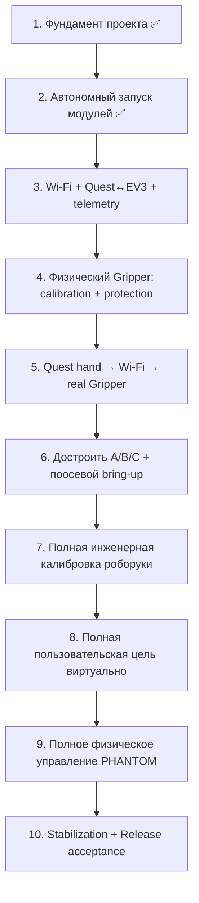

Механическая сборка A/B/C может идти параллельно этапам 3–5. Разработка Shoulder/Wrist mapping и IK также может идти параллельно, но системный gate этапа 8 закрывается после появления финальной `RobotGeometry`, чтобы виртуальная модель проверялась уже против реальной сборки.

<a id="sec-10-2"></a>
## 10.2. Сквозные требования к каждому этапу

Для каждого этапа используется один и тот же принцип `Definition of Done`.

| Направление | Что обязательно проверяется на каждом применимом этапе |
|---|---|
| Безопасность и восстановление | отказ входных данных, потеря связи, неверное состояние или выход за допустимые границы не должны приводить к неконтролируемому движению; до первого физического движения конкретного узла уже работают его локальные limits, `LOCAL_STOP`, watchdog/`phantom-safety`, безопасное отключение motor output и проверенный `POWER_CUT` |
| Scope isolation | любой привод вне `actuator_scope_mask` имеет hard-inhibit на стороне EV3; сетевой пакет, ошибка Quest или неверное поле `COMMAND` не могут расширить scope |
| Журналирование и диагностируемость | значимые переходы состояний, ошибки и отказы должны оставлять структурированный диагностический след; новые классы отказов добавляются в события и, где требуется, в `FlightRecorder` |
| Точность | для новой функции заранее определяется измеряемая ошибка; расчёты не должны накапливать программный drift; физические допуски проверяются по мере появления соответствующего оборудования |
| Производительность | новая функция не должна нарушать бюджет кадра Quest, 50-Hz цикл EV3, ограничения очередей, памяти и сетевого обмена; критический путь профилируется сразу, а не в конце проекта |
| Удобство использования | пользовательские действия и ошибки сразу проектируются с русскими понятными сообщениями; инженерные детали не попадают в обычный UI; новые обязательные действия не добавляются без необходимости |
| Автоматические тесты | всё, что можно проверить без человека и физической неопределённости, получает unit/property/protocol/replay/simulation regression и входит в `PRE-INSTALL AUTO` |
| Аппаратные и ручные проверки | по мере появления физической функции добавляются `DEVICE AUTO`, HIL и необходимые ручные safety/UX проверки из главы 9; применимость определяется active stage/profile, но финальный Release требует полный production комплект |

Если дефект обнаружен на более позднем этапе, исправление возвращается в тот слой, где он должен был быть обнаружен. Если дефект воспроизводим программно, вместе с исправлением добавляется автоматический regression test. После исправления повторяется затронутый stage gate и применимый regression.

<a id="sec-10-3"></a>
## 10.3. Этап 1 — фундамент проекта

**Статус:** завершён по исходному gate.

Цель этапа — создать общий технический фундамент, позволяющий Quest и EV3 разрабатываться независимо без расхождения в математике, состояниях и формате данных. Исторический Stage-1 PASS относится к тогдашней foundation revision и не превращается задним числом в FAIL. Однако текущая спецификация уже меняла semantic wire schema/reserved-bit allocation/field semantics при сохранении fixed payload framing v1; поэтому codecs, generated schema/hash и golden vectors текущего build обязаны пройти migration regression. Исторический PASS не считается доказательством текущего `protocol_schema_hash`.

| Направление | Работы |
|---|---|
| Общее | структура репозитория; воспроизводимая сборка; CI; единицы измерения; системы координат; состояния и fault-коды; единый бинарный протокол; golden vectors; схема конфигурации |
| Quest | каркас Unity/OpenXR; `XrSpaceBridge`, `IGripSignalProvider`, tracking/QR adapters и `RobotTransport`; возможность подавать синтетические входы |
| EV3 | каркас `phantom-controller` и `phantom-safety`; `MotorBackend`; host-сборка; `MockMotorBackend`; безопасное состояние по умолчанию |
| Инструменты | PC-симулятор EV3; replay отслеживания; синтетические QR-позы; общая инфраструктура тестовых отчётов |

С самого этапа 1 действуют проверки протокола, парсинга, математических контрактов, ограниченности очередей/буферов и отсутствия секретов в артефактах. **Исторический Stage-1 PASS относится к исходному foundation gate и не является доказательством позднее добавленного scope-specific P0.** P0 §9.6 рассматривается как migration/regression gate текущей архитектуры: его `PASS` обязателен перед первым actuator milestone соответствующего scope, а при отсутствии сохранённого evidence статус P0 — `NOT_RUN`, не ретроактивный FAIL Stage 1. Качество live observations квалифицируется отдельными bounded physical cases.

**Этап считается выполненным по историческому исходному gate, если:** чистый checkout воспроизводимо собирается; исходный `PRE-INSTALL AUTO` проходит; Quest способен работать с симулятором EV3, EV3 controller — с mock-моторами; ошибки фундамента наблюдаемы и журналируются. Позднее введённые P0 **не считаются автоматически пройденными** этим статусом: `COMMISSIONING_QR` нужен до первого QR-driven движения этапа 4, `D_ONLY_USER` — до этапа 5, `FULL_ARM_USER` — до full-arm live qualification/этапа 9; отсутствие evidence = `NOT_RUN`. Live tracking quality также квалифицируется отдельно.

<a id="sec-10-4"></a>
## 10.4. Этап 2 — автономный запуск модулей и доступного I/O

**Статус:** завершён по исходному autonomous-startup gate.

Цель — Quest и EV3 запускаются независимо; EV3 безопасен при zero output. Полная механика и Wi-Fi не являются gate. Исторический Stage-2 PASS сохраняется; новые `qualification_only`/`actuator_scope_mask`/`safety_observation_mask` и scope-aware DEVICE AUTO строки вводятся начиная с этапов 3–4. До первого движения D на этапе 4 установленный build обязан повторно пройти применимый DEVICE AUTO уже с gripper-only profile; это regression/migration gate новой функции, а не задним числом изменение старого отчёта этапа 2.

**Этап считается выполненным, если:** Quest и EV3 воспроизводимо запускаются на реальном оборудовании; `phantom-controller`/`phantom-safety` heartbeat и takeover проходят zero-output tests; scoped I/O обнаруживается корректно; отсутствующий out-of-scope I/O не считается fault; ни startup, ни shutdown не создают ненулевой motor output; применимые `PRE-INSTALL AUTO`/`DEVICE AUTO` имеют PASS.

<a id="sec-10-5"></a>
## 10.5. Этап 3 — Wi-Fi EV3, Quest↔EV3 и телеметрия

Цель — реальная сеть без actuator motion. Используется `qualification_only=true`, **authoritative `actuator_scope_mask=safety_observation_mask=0x00`** и `required_user_inputs=NONE`; «эквивалентный» профиль с иной маской не считается Stage-3 network-only gate.

**Implementation baseline 05.09.2026:** состояние исходного кода `c7bf63bf` (`70c5f541` EV3 network-only runtime → `ede71687` EV3 Stage-3 baseline docs → `c7bf63bf` Quest Stage-3 networking) имеет clean worktree. EV3-side software+реальный Brick и Quest-side implementation+host/simulator automated validation завершены; Android NSD/UDP/lifecycle на реальном Quest 3 и общий Quest↔real EV3 acceptance gate не выполнялись (`NOT_RUN`). Поэтому Stage 3 **не закрыт**.

Важно: этот статус относится к implementation baseline `c7bf63bf`, а не автоматически к нормативной ревизии данного документа. После `c7bf63bf` спецификация была дополнительно ужесточена; все затронутые migration/regression gates ниже должны быть повторно выполнены на коде, который заявляет соответствие этой ревизии.

Проверенный EV3-side development baseline:

| Область | Полученное evidence |
|---|---|
| Adapter | Netgear WNA1100, USB `0846:9030`; driver `ath9k_htc`; firmware `htc_9271` версии `1.4`; имя interface определяется динамически |
| Network stack | ev3dev Stretch, ConnMan `1.36`, DHCP, Avahi; после cold boot late USB probe компенсируется bounded helper, повторный ввод Wi-Fi password/PC не требуется |
| Runtime | `phantom-safety`, `phantom-controller`, отдельные `phantom-network` и `phantom-mdns`, `phantom-wifi-autoconnect`; config/bundle mismatch приводит к fail-closed startup |
| Historical protocol evidence | baseline `c7bf63bf` проверял действовавшую тогда wire-v1/schema revision: HELLO retry/busy/stale, PING/PONG, TELEMETRY, invalid HMAC, wrong identity/session/boot id, replay/reorder/malformed traffic; development flood `20000` datagrams за `141 ms` не остановил services и не создал motor output. Эти результаты не переносятся автоматически на текущий `protocol_schema_hash` |
| Recovery | cold reboot, controller/network/mDNS restart и Wi-Fi interface down/up восстанавливаются; в одном development run ConnMan восстановил interface за `15 s`, при этом нормативный bounded-case timeout остаётся `<=60 s`; controller restart создаёт новый boot id и инвалидирует старую session |
| Safety | scope `0x00` не требует motor I/O и не допускает `READY`/`TRACKING`; присутствующие outB/outC/outD остались `duty_cycle_sp=0`, `duty_cycle=0`, `speed=0`, `stop_action=brake`; `nonzero_motor_writes=0` |
| Gates | clean `PRE-INSTALL AUTO`: `16/16 PASS`; EV3 DEVICE AUTO schema v2: `20 PASS`, две normative `N_A` (`OUT_OF_SCOPE`) |

Quest-side software baseline `c7bf63bf`:

| Область | Реализация и evidence |
|---|---|
| Discovery | `IServiceDiscoveryBackend` отделяет lifecycle/business logic от backend; реализованы deterministic `FakeDiscoveryBackend` и Android `NsdManager` adapter с Java/C# callback bridge, main-thread polling, resolve, add/update/remove, несколькими сервисами и выбором configured `robot_id` |
| Identity/recovery | IP не используется как identity; непосредственно перед handshake выполняется свежий resolve. Endpoint change, `controller_boot_id` change, service loss/reappearance уничтожают старые endpoint/session/sequence/RTT/freshness state и требуют нового HELLO/session |
| Credential | `IControlCredentialStore`; production Android implementation хранит control PSK только как AES-GCM ciphertext в app-private preferences, а non-exportable wrapping key — в Android Keystore; Keystore/decrypt failure является fail-closed. Host test implementation использует ephemeral copy и очищает её. PSK не хранится в plaintext-файле, `PlayerPrefs`, Resources/StreamingAssets/config/bundle/build manifest/log/UI |
| Transport | `UdpRobotTransport`: один background worker на socket lifecycle, bounded send/receive queues по `64` datagram, datagram limit `1024`, bounded cancellation/close без task/thread-per-packet; restart создаёт новый socket state |
| Historical protocol/session | baseline использовал generated wire v1 действовавшей тогда schema: CSPRNG HELLO nonce, bounded retry с тем же nonce, HELLO_ACK identity/profile/hash/range validation, server-issued nonzero session id, independent increasing sequences, authenticated PING/PONG и monotonic RTT. Stage-3 public runtime path не имел COMMAND/motor-target API |
| Telemetry | постоянный receive path проверял framing/HMAC/endpoint/session/boot/sequence, enums/bits/reserved/range/finite constraints и обновлял remote state/fault, battery, command age, status/loop flags, build/component/bundle hashes и `incident_id`; freshness разделял `NoTelemetry/Fresh/Stale/Invalid` |
| Diagnostics/UI | structured discovery/handshake/session/recovery/auth/config/protocol/telemetry events, Quest JSONL и bounded RAM `FlightRecorder` (`256` записей) без secret; русский экран показывал connection/session, remote state/fault, battery, freshness, endpoint, RTT, build/boot/hash и packet counters; network runtime не зависел от Hand/Body/QR/user calibration |
| Simulator | общий generated codec использовался в network-only host mode; покрыты normal, lost HELLO_ACK, telemetry stop/resume, bad HMAC, wrong robot/protocol/schema/bundle, duplicate/stale packet и controller boot change; fake discovery покрывал add/update/remove, multiple/malformed/wrong identity и endpoint/boot changes |
| Automated evidence | schema/generated/config, HMAC/parser/fuzz, Stage-1/2 regressions, EV3 network tests, Quest pure core, Unity EditMode, Android NSD source/signature audit и четыре localhost UDP scenarios проходили; Diagnostic и Release Android APK компилировались с Java bridge/network permissions. Hardware-dependent проверки не считались PASS |

Текущая классификация implementation baseline:

```text
EV3-side software + real EV3 validation:        COMPLETE
Quest-side implementation:                      COMPLETE
Quest-side host/simulator automated validation: COMPLETE
Quest-side real Quest 3 validation:             NOT_RUN
Quest ↔ real EV3 integration:                   NOT_RUN
Stage 3 overall:                                NOT COMPLETE
```

Это development evidence фиксирует реализованное состояние `c7bf63bf`, но не заменяет повторный `PRE-INSTALL AUTO`/`DEVICE AUTO` для каждого нового installed build, реальный Quest-3 validation и сквозной Quest↔EV3 acceptance. Конкретный DHCP-адрес и значения секретов намеренно не являются частью спецификации.

После указанного implementation baseline данная ревизия уточнила DNS-SD/IPC contracts и **изменила semantic wire schema v1 при сохранении fixed payload sizes**: в частности, `HELLO_ACK.reserved0` получил нормативную семантику `result_code`, добавлен `PayloadState.UNKNOWN`, определён `TELEMETRY.status_flags.bit9`, Gripper safe-open endpoint стал относительным к текущему reference, `build_id` нормирован как raw `u8[32]`, а retry/idempotency semantics state-changing transactions стали session-scoped. Поэтому до закрытия Stage 3 код, заявляющий соответствие этой ревизии, обязан regenerate `wire_schema.canonical.json`, generated constants/size maps, `protocol_schema_hash` и golden vectors, повторно проверить production serializers/deserializers общими cross-codec vectors, затем пройти migration regression по DNS-SD `type/domain/IPv4`, rejected/success HELLO_ACK, selector/HMAC ordering, session/retry/replay, enum/status-bit и `phantom-network↔phantom-controller` IPC permission/session/fail-safe contracts. Исторический PASS остаётся evidence предыдущей revision, но не считается PASS новой schema автоматически.

| Направление | Работы до закрытия текущей ревизии |
|---|---|
| EV3/Wi-Fi | проверить WNA1100; DHCP/auto reconnect; DNS-SD/mDNS `type=_phantom-ev3._udp`, `domain=local.` (full browse-name `_phantom-ev3._udp.local.`); network logs без credential |
| Security | provision независимый `control` PSK/key_id по §8.11 и проверить CONTROL-authenticated network-only session; commissioning PSK отдельный и не требуется для Stage-3 gate |
| Quest | повторный discovery по `robot_id`; success/rejected `HELLO/HELLO_ACK`; HMAC; `PING/PONG`; receive current-schema `TELEMETRY`; русский экран состояния |
| Reliability | IP change; Wi-Fi loss/reconnect; controller/network/mDNS restart; stale session; loss/duplicate/replay; bounded telemetry/network bursts `<=60 s`; bounded queues; CPU/network budget |
| UI/telemetry | connection/session state, battery, controller state/fault, command age, `ev3_build_id` + Quest local `quest_build_id`, component/config hashes, `incident_id`; Diagnostic raw counters where available |
| Диагностика | structured connection/session events; bounded `FlightRecorder`; наблюдаемость loss/duplicate/restart/config mismatch без блокировки motor loop |

Motor output от сети на этом этапе невозможен из-за empty actuator scope.

**Этап считается выполненным, если:**

1. EV3 после обычного включения стабильно поднимает Wi-Fi через WNA1100;
2. реальный Quest 3 находит нужный `robot_id` без сохранённого IP и проходит Android NSD lifecycle cases;
3. CONTROL session с отдельно provisioned control PSK аутентифицируется по **текущей** wire schema; success/rejected HELLO_ACK, `PING/PONG`, retry/replay/session invalidation соответствуют §4.7/§11.8, secret/key material не попадает в telemetry/logs;
4. реальный Quest 3 непрерывно получает и валидирует актуальную `TELEMETRY` текущей schema;
5. reboot/restart/IP change/краткая потеря Wi-Fi корректно обнаруживаются и восстанавливаются только новой валидной session;
6. stale/replayed/duplicate packets не меняют state/authority;
7. network/telemetry load не нарушает EV3 timing budget и bounded-resource invariants;
8. `ev3_build_id` + Quest local `quest_build_id`, component/config hashes, `incident_id` и structured events позволяют однозначно связать Quest↔EV3 evidence; применимый `FlightRecorder` работает без unbounded logging;
9. Wi-Fi credential отсутствует в Git/build manifest/CommissioningBundle/обычных логах, а после первоначального provisioning EV3 повторно подключается без PC;
10. за весь gate зарегистрировано ноль motor writes с nonzero duty;
11. migration regression текущей normative schema и IPC contracts имеет PASS на тех же installed artifacts, которые используются для реального Quest↔real EV3 acceptance.

<a id="sec-10-6"></a>
## 10.6. Этап 4 — физический Gripper: калибровка и локальная защита

Цель — получить полностью квалифицированный Motor D + Gripper **без Base/Shoulder/Elbow**. Profile: `Diagnostic`, `qualification_only=true`, `actuator_scope_mask=0x08`, `safety_observation_mask=0x08`. **До первого QR-driven физического `CALIBRATION_JOG` на D exact installed Quest platform matrix обязана иметь `P0CompatibilityScope=COMMISSIONING_QR PASS`.** Body/Wrist/Hand/grasp не являются prerequisite этого commissioning gate.

| Направление | Работы |
|---|---|
| Механика | законченный Gripper; жёсткое безопасное крепление стенда; `GRIPPER_HOME`; JAW_LEFT/RIGHT; pinch zone; `POWER_CUT` |
| EV3 | D encoder; bounded `CALIBRATION_JOG`; home; `E_closed`; bounded safe-open sweep до независимо подтверждённой границы (не поиск внутреннего максимума); timeout/stall/contact; scoped hard-inhibit A/B/C |
| Security | provision отдельный commissioning PSK/key_id по §8.11 в Diagnostic build/Quest secure storage; control PSK не должен авторизовать `COMMISSIONING` |
| Quest/QR | JAW poses → contact points → actual gap; build opening/closing curves; validation points |
| Persistence | сохранить partial qualification `DriveCalibration[D]`; изменение D mechanics/QR/contact transforms инвалидирует его |

Полная curve calibration выполняется после сборки/изменения Gripper, **не при каждом запуске**.

**Этап считается выполненным, если:**

1. D и `GRIPPER_HOME` однозначно обнаруживаются, A/B/C могут отсутствовать;
2. отдельный commissioning PSK provisioned/валиден; control key не авторизует commissioning; local commissioning arm создаётся только физическим ENTER+UP: нормально в `DISCOVERY`, либо после истечения fresh CONTROL owner через локальный `HOLD→DISCOVERY` transition §7.5.2; commissioning `HELLO` может consume только bounded arm-window, сеть сама по себе не может создать authority;
3. процедура §5.16.8 полностью проходит на реальном Gripper;
4. определены calibration-session `E_closed_cal`, signed `gripper_open_limit_delta_counts`/`D_open_counts`, `opening_open_mm`, opening/closing curves и measured hysteresis;
5. контрольные раскрытия удовлетворяют §9.14;
6. stall до home, opening jam и timeout дают fault, а не ложный endpoint; open-search hard bound по encoder/time/speed/duty никогда не превышается; достижение независимо подтверждённого `D_open_counts` является штатным safe-open endpoint даже если локальная производная QR gap остаётся положительной. FAIL возникает только при unsafe/non-monotonic/quality violation или jam/stall **до** endpoint, либо при попытке выйти за `D_open_counts`;
7. закрытие на объекте переходит в contact policy и не продолжает длительно наращивать усилие;
8. `LOCAL_STOP`, safety heartbeat loss и `POWER_CUT` корректно прекращают движение;
9. A/B/C имеют zero motor writes независимо от входных данных;
10. calibration D сохраняется атомарно и после reload проходит hash/schema validation;
11. успешное сохранение создаёт новую qualification `CommissioningBundle` revision, старая session становится config-stale, а новый `HELLO` подтверждает новый bundle hash до перехода к этапу 5.

<a id="sec-10-7"></a>
## 10.7. Этап 5 — Quest управляет реальным Gripper

Это первый пользовательски наблюдаемый end-to-end milestone. До первого user-driven D exact installed Quest build/runtime matrix обязана иметь `P0CompatibilityScope=D_ONLY_USER PASS`; предыдущий `COMMISSIONING_QR PASS` его не заменяет:


```text
запустить то же Quest-приложение
→ найти EV3 по Wi-Fi
→ проверить сохранённую DriveCalibration[D]/bundle revision
→ LOCAL_COMMISSION_ARM на EV3 (ENTER+UP)
→ новая commissioning session
→ быстро получить текущую GripperReference по JAW_LEFT/RIGHT + encoder D
→ local ENTER confirmation → COMMISSIONING/ACTUATOR_QUALIFICATION
→ отпустить Left Grip
→ priority OFF/HOLD COMMAND → fresh TELEMETRY подтверждает last_accepted_command_sequence >= release_off_sequence
→ только затем armed=true
→ новый Left Grip rising edge
→ правая кисть / OpenXR grasp
→ grip_intent
→ штатный COMMAND
→ EV3 Gripper FSM
→ Motor D
→ предмет схвачен / отпущен
→ TELEMETRY обратно в Quest
```

Отдельного gripper-приложения и отдельного wire protocol нет. `q_base/q_shoulder/q_elbow=0` и игнорируются; A/B/C hard-inhibited.

Минимальный HUD показывает: connection/session, engineering gripper-ready state, `grip_intent`, `grip_actual`, `grip_state` (`FREE/CONTACT/...`), battery, command freshness/RTT и fault. RTT вычисляется по `PING/PONG`.

**Этап считается выполненным, если:**

1. пользователь запускает приложение и без PC/USB вручную подключается Quest↔EV3 через Wi-Fi;
2. startup не повторяет полную curve calibration, если сохранённый D calibration совместим;
3. QR+encoder startup создаёт только `GripperReference`, при этом `JointReference A/B/C` остаётся invalid;
4. commissioning session создаётся только после локального `ENTER+UP` arm window; отдельное локальное `ENTER` подтверждение qualification обязательно и не может быть подделано сетью; отсутствие подтверждения означает, что EV3 не исполняет qualification `COMMAND`, даже если Quest продолжил UI flow;
5. при отпущенном `Left Grip` D не выполняет новое движение;
6. после deliberate rising edge сжатие правой кисти пропорционально закрывает реальный Gripper, раскрытие — открывает;
7. реальный предмет можно взять, удержать без постоянного продавливания и отпустить;
8. потеря `graspReady`, focus, Wi-Fi/session, watchdog или `LOCAL_STOP` прекращает дальнейшее движение безопасным образом;
9. после восстановления движение само не возобновляется — нужен фактический release, OFF/HOLD acceptance подтверждённый свежей telemetry текущей session, и только затем новый rising edge;
10. telemetry на Quest отражает реальное `grip_actual/grip_state`, battery, session/fault и command freshness;
11. серия повторных grab/release bounded runs не даёт накопленного encoder drift/зависания FSM;
12. A/B/C отсутствуют либо неподвижны; число nonzero motor writes на них равно 0.

После выполнения этого этапа существует законченный стенд **Quest 3 + EV3 + Gripper**, способный калиброваться/привязываться при запуске, хватать и отпускать предметы рукой пользователя и показывать телеметрию.

<a id="sec-10-8"></a>
## 10.8. Этап 6 — завершение механики и поосевой bring-up Base/Shoulder/Elbow

Цель — достроить физическую роборуку и доказать исправность A/B/C без user tracking control. Перед первым QR-driven A/B/C jog должен быть актуален `P0CompatibilityScope=COMMISSIONING_QR PASS`; его можно переиспользовать с этапа 4 только при неизменной exact platform matrix, иначе gate повторяется.

| Направление | Работы |
|---|---|
| Механика | Base, Shoulder, Elbow, links, Forearm, установленный Gripper; gears/turntables; alignment; counterweight; cables; hard stops; все QR mounts |
| EV3 | provision/version engineering `qualification_only=true` calibration bundle/profile для фактически собранного набора осей (после сборки обычно scope `0x0F`), без user `COMMAND` authority; A/B/C discovery; encoder direction; bounded low-duty `CALIBRATION_JOG`; stop/reversal; provisional limits; bring-up выполняется только в `COMMISSIONING/CALIBRATION`; scope может содержать все фактически подключённые оси стенда, но каждый JOG двигает ровно одну, а `ACTUATOR_QUALIFICATION` пользовательскими командами A/B/C ещё запрещён |
| Safety | only one commissioning axis has motor-write authority; все motor-disabled нагрузочные оси механически фиксированы/поддержаны до собственной calibration/reference+HOLD qualification; local stop/watchdog/process crash; mechanical clearance |

**Этап считается выполненным, если:**

1. полная механика собрана по зафиксированной mechanical revision;
2. установлен versioned Diagnostic calibration profile/bundle с осознанным scope собранных осей; его hash совпадает на используемых engineering tools/EV3; A, B и C однозначно обнаружены и типы/encoder resolution верны;
3. каждая ось отдельно выполняет малые jog в обе стороны и корректно останавливается; во время каждого jog все остальные motor-disabled нагрузочные оси остаются механически зафиксированы/поддержаны и не получают motor writes;
4. sign encoder↔physical direction установлен без попытки считать номинальные 5:1 точной калибровкой;
5. hard-stop/cable margin и basic jam protection проверены; использование active HOLD для ещё не откалиброванной оси отсутствует;
6. `LOCAL_STOP`, controller crash и safety takeover прекращают движение;
7. пользовательская рука не может управлять A/B/C на этом этапе.

<a id="sec-10-9"></a>
## 10.9. Этап 7 — инженерная калибровка всей роборуки

Цель — получить complete **production-candidate semantic component set** и полный `qualification_only=true` `CommissioningBundle`, пригодный для последующей физической qualification, но ещё не способный войти в product `READY`.

Порядок движущейся калибровки сохраняется `D → C → B → A`. До любого QR-driven calibration motion на этом этапе должен оставаться актуальным `P0CompatibilityScope=COMMISSIONING_QR PASS` для exact installed Quest platform matrix; PASS этапа 6 переиспользуется только при неизменной matrix, иначе P0 повторяется. D не разрабатывается заново: его этап-4 calibration переносится только если mechanical/QR/contact revision совместима, затем обязательно повторно валидируется после установки на Forearm. На каждом шаге все невыбранные нагрузочные оси без собственной валидной calibration/reference и уже пройденного hold gate механически фиксируются/поддерживаются; active HOLD по номинальной передаче не используется как замена ещё не полученной калибровке.

**Этап считается выполненным, если:**

1. `RobotGeometry` полной сборки измерена и имеет hash;
2. `DriveCalibration A/B/C/D` прошла fit + holdout validation;
3. Gripper calibration после окончательной установки подтверждена либо корректно пересоздана;
4. mechanical/cable bounds зафиксированы;
5. `RobotCollisionModel` и PayloadProfile-specific `JointSafeSet` сгенерированы/проверены;
6. обычная неподвижная startup QR-привязка создаёт `JointReference A/B/C` + `GripperReference` без автоматического движения;
7. повторное QR measurement согласуется с `q_actual/grip_actual` в допусках главы 9;
8. geometry/collision/safe-set artifacts прошли normative §8.9 deployment на Quest+EV3, новый `HELLO_ACK` подтверждает один `commissioning_bundle_hash`;
9. полный candidate bundle остаётся `qualification_only=true`, имеет `actuator_scope_mask=safety_observation_mask=0x0F`, содержит все production-required component bytes/hashes, но **не может перейти в `READY`** и ещё не имеет production `qualification_evidence_manifest_hash`; promotion в Release выполняется только после этапа 9.

<a id="sec-10-10"></a>
## 10.10. Этап 8 — полная пользовательская цель и виртуальная проверка

Цель — завершить весь Quest-side full-arm path без user-driven physical A/B/C motion. Перед live Shoulder/Wrist qualification на реальном Quest exact installed platform matrix должна иметь `P0CompatibilityScope=FULL_ARM_USER PASS`; этот gate всё ещё не разрешает физический A/B/C motor output.

```text
Body_RightShoulder + Wrist
→ time alignment/filter
→ P_requested / P_control
→ workspace
→ fixed-branch IK
→ JointSafeSet/collision preview
→ q_target
```

Gripper channel продолжает использовать проверенный `grip_intent` и остаётся regression path.

**Этап считается выполненным, если:**

1. `human_arm_reach` calibration проходит требуемые тесты;
2. Shoulder/Wrist temporal alignment и tracking qualification §9.6 пройдены;
3. IK/FK/property/replay tests проходят;
4. одинаковый time-aligned текущий Shoulder→Wrist vector даёт одинаковую чистую `P_requested_B` независимо от истории; возможная краткая история `P_control_B` ограничена только tracking filter по `NFR-ACC-07`;
5. virtual PHANTOM корректно следует руке и показывает clipping/invalid target;
6. tracking drop/reference-space change/Left Grip semantics дают ожидаемые HOLD/SAFE_HOLD predicates;
7. calculated `q_target` проходит generated wire codec и полный controller/state/safety path в PC simulator/`MockMotorBackend`; на реальном EV3 этого этапа выполняется только explicit zero-actuator/network regression — motion-capable user A/B/C `COMMAND` ему ещё не выдаётся;
8. физические A/B/C всё ещё не получают user-driven motor output; первый реальный user authority A/B/C появляется только после gates этапа 9.

<a id="sec-10-11"></a>
## 10.11. Этап 9 — сквозное физическое управление всей роборукой

Цель — расширить уже работающий D vertical slice на A/B/C после complete commissioning.

В HIL привод authority наращивается постепенно. Рекомендуемый default order — **C → B+C → A+B+C**, Base последней; конкретный порядок может быть изменён только documented safety result. Все incremental narrow-authority cases выполняются с **пустым Gripper, без внешнего payload**, на `EMPTY` PayloadProfile/`EMPTY` JointSafeSet; захват/освобождение объекта и LOADED state проверяются только в последующем full-`0x0F` qualification case. Каждый incremental case использует **отдельную immutable `qualification_only=true` revision `CommissioningBundle`**, детерминированно производную от полного production-candidate component set этапа 7: component bytes/hashes `RobotGeometry`, `DriveCalibration`, `RobotCollisionModel`, `EMPTY` PayloadProfile/`JointSafeSet` и `SafetyEnvelope` не меняются, меняются только qualification metadata/`actuator_scope_mask`/`safety_observation_mask`, поэтому каждый derived bundle имеет собственный `commissioning_bundle_hash`. In-place изменение candidate/production bundle или масок запрещено. Переключение bundle инвалидирует session/reference; после каждого switch выполняются новый `HELLO`, проверка hash и новая QR↔encoder reference до motor write.

`actuator_scope_mask` на каждом шаге ограничивает только motor writes, но `safety_observation_mask` для любого A/B/C qualification шага обязан быть как минимум **`0x07 | actuator_scope_mask`**: их полные `JointReference` заново устанавливаются для текущего derived bundle, а неподвижные неразрешённые оси нужны как реальные fixed coordinates 3D `JointSafeSet`. Нулевые q-поля disabled axes не могут подменять их физическое состояние. Любая motor-disabled ось, способная двигаться под тяжестью/внешней нагрузкой, на этом incremental case механически фиксируется/поддерживается; active HOLD через запрещённый motor write не используется как fixture. До первого **real Quest-driven** A/B/C, в том числе если он выполняется в Diagnostic `ACTUATOR_QUALIFICATION`, обязателен актуальный `P0CompatibilityScope=FULL_ARM_USER PASS` для exact installed Quest build/runtime matrix; изменение platform matrix после этапа 8 требует повторного P0.

После narrow cases активируется отдельный **full `0x0F/0x0F` qualification-only bundle** с теми же production-candidate component hashes. После полной A/B/C/D reference при снятом motion-arm engineering path §4.7.5 явно выбирает профиль/safe-set и подтверждает `EMPTY`; затем выполняются EMPTY HIL. Для разрешённых payload cases между движениями при stationary motors используются те же wire `SET_PAYLOAD_PROFILE/SET_PAYLOAD_STATE` с commissioning role/local authority; после contact/release `UNKNOWN` закрывается явным engineering ACK и новым re-arm. Product `READY/TRACKING/HOLD` при этом недоступны: wire state остаётся `COMMISSIONING` до завершения qualification. Только когда все обязательные HIL/P0/stop/power-loss/resource/accuracy cases PASS, tooling формирует `QualificationEvidenceManifest` и затем новую immutable production revision `qualification_only=false`, `actuator_scope_mask=safety_observation_mask=0x0F`, с теми же квалифицированными component hashes и `qualification_evidence_manifest_hash`. После установки production revision старые session/reference инвалидируются, выполняются новый `HELLO`, startup QR reference + payload selection/state confirmation, и лишь тогда разрешаются обычные `READY/TRACKING/HOLD/SAFE_HOLD`. Любое изменение квалифицированного component byte/hash после manifest делает evidence несовместимым и требует повторной qualification.

**Этап считается выполненным, если:**

1. каждый incremental motor-authority scope проходит low-limit **EMPTY-only** HIL на собственной immutable derived qualification bundle revision без collision/safety violation; component hashes production-candidate geometry/calibration/EMPTY-safe-set совпадают с этапом 7, bundle switch даёт новый hash/session/reference, LOADED/non-EMPTY/pickup operation fail-closed, оси вне authority имеют zero motor write, нагрузочные disabled оси имеют documented fixture/support, все A/B/C остаются safety-observed и их reference-loss/fixture drift немедленно inhibits qualification;
2. затем full `0x0F` **qualification-only** A+B+C+D path работает через штатный `COMMAND` от реального Quest tracking и проходит EMPTY + разрешённые payload/contact/release cases без использования product `READY`;
3. TCP повторяет Shoulder→Wrist с требуемой точностью/latency, Gripper — кисть;
4. скорость/ускорение/duty/reversal/PD/feed-forward/`MotorStressScore` проходят HIL;
5. HOLD/SAFE_HOLD, tracking loss, network loss, stale command, `LOCAL_STOP`, stall/contact и process failure работают безопасно;
6. payload transitions `EMPTY → contact → UNKNOWN → LOADED` и `LOADED/UNKNOWN → release → UNKNOWN → EMPTY` проходят без продолжения старой A/B/C trajectory; в qualification они выполняются оставаясь в `COMMISSIONING`, в production smoke — через `HOLD`; смена profile/reboot также даёт `UNKNOWN` до явного подтверждения;
7. робот не выходит из `JointSafeSet` и independent bounds;
8. 50-Hz EV3/XR budgets выполняются;
9. target/actual/incident telemetry достаточна для разбора отказа;
10. после успешной qualification сформирован PASS `QualificationEvidenceManifest`; из неизменившегося component set создан/установлен complete production bundle `qualification_only=false`, `0x0F/0x0F`, его evidence hash проверен обеими сторонами, после нового startup product `READY/TRACKING` проходит отдельный финальный smoke/end-to-end case.

<a id="sec-10-12"></a>
## 10.12. Этап 10 — стабилизация и финальная приёмка

На этом этапе не «добавляются потом» safety/accuracy/logging/UX; выполняется финальная квалификация уже законченной системы.

**Этап считается выполненным, если:**

1. один зафиксированный Release candidate проходит полный `PRE-INSTALL AUTO`;
2. именно эти артефакты установлены на Quest/EV3;
3. полный production `DEVICE AUTO` проходит с A/B/C/D и обязательными sensors;
4. все применимые HIL/safety/network/calibration/accuracy/resource tests главы 9 PASS;
5. серия независимых bounded runs `<=60 s` и повторных starts/restarts не выявляет blocking regressions;
6. Release/Diagnostic, rollback, config/bundle/schema hashes согласованы; CAD/mechanical artifact hash, SBOM, legacy-EOL vulnerability/risk record и exact toolchain/image provenance закрыты по §9.24.4;
7. manual functional/UI/UX acceptance и privacy/export acceptance §9.24.3 выполнены на том же Release candidate; все применимые scope-specific P0 reports (`COMMISSIONING_QR`, `D_ONLY_USER`, `FULL_ARM_USER`) относятся к его exact Quest platform matrix либо имеют документированное `N_A`, а изменение matrix инвалидирует acceptance;
8. checklist §9.26 полностью закрыт;
9. конкретная физическая сборка имеет зафиксированные mechanical revision, `RobotGeometry`, `DriveCalibration`, payload/safe-set configs и software versions;
10. blocking defects отсутствуют.

<a id="sec-11"></a>
# 11. Приложения

<a id="sec-11-1"></a>
## 11.1. Формулы

<a id="sec-11-1-1"></a>
### 11.1.1. Абсолютное отображение движения пользователя

```text
v_human_floor = HumanWristCenter - HumanShoulderCenter
v_human_B     = RotateVector(T_base_floor, v_human_floor)

d_human = norm(v_human_B)
require d_human >= human_vector_min_m
mapping_reach_m = min(
    RobotGeometry.robot_nominal_reach_m,
    human_arm_reach * max_mapping_scale
)
reach_ratio = clamp(d_human / human_arm_reach, 0, 1)
direction_B = v_human_B / d_human
P_requested_B = direction_B * mapping_reach_m * reach_ratio
```

`Left Grip` не участвует в вычислении origin/offset этой формулы; он только разрешает или запрещает физическое выполнение текущей цели.

<a id="sec-11-1-2"></a>
### 11.1.2. IK

```text
pS = pB
r = sqrt(pS.x² + pS.y²)
z = pS.z

require r >= RobotGeometry.yaw_singularity_hold_radius_m
q_base = atan2(pS.y, pS.x)
D = (r² + z² - L1² - L2²) / (2 L1 L2)
if D outside [-1-eps,+1+eps]: UNREACHABLE
D = clamp(D,-1,+1)  # numeric epsilon only
q_elbow = atan2(s*sqrt(max(0,1-D²)), D)
q_shoulder = atan2(z,r)
             - atan2(L2*sin(q_elbow), L1 + L2*cos(q_elbow))
```

<a id="sec-11-1-3"></a>
### 11.1.3. FK

```text
r = L1*cos(q_shoulder) + L2*cos(q_shoulder + q_elbow)
z = L1*sin(q_shoulder) + L2*sin(q_shoulder + q_elbow)
x = r*cos(q_base)
y = r*sin(q_base)
pB = [x,y,z]
```

<a id="sec-11-1-4"></a>
### 11.1.4. QR↔энкодерная инженерная калибровка

Неподвижные измерения обоих направлений рассчитываются совместно:

```text
q_qr_i ≈ k_axis * E_i + b + direction_i * h
backlash_total_angle ≈ 2 * |h|
```

где `E_i` — абсолютный отсчёт энкодера мотора, `k_axis` — физический угол на один отсчёт, `h` — половина измеренного люфта.

При обычном запуске постоянные параметры `k_axis/h` сохраняются, а QR-привязка после остановки задаёт текущую пару:

```text
E0 = encoder_count_startup
q0 = q_qr_startup
x  = q0 + k_axis * (E_now - E0)
```

`q_actual` с учётом люфта определяется моделью мёртвой зоны:

```text
if x > q_prev + h:      q_actual = x - h
else if x < q_prev - h: q_actual = x + h
else:                   q_actual = q_prev
```

Позиция никогда не вычисляется интегрированием `motor_speed * dt`; пропуск/задержка одного control cycle поэтому не создаёт накопленного программного углового offset.

<a id="sec-11-1-5"></a>
### 11.1.5. Захват

Persistent calibration задаёт:

```text
s = sign(gripper_open_limit_delta_counts)
D = abs(gripper_open_limit_delta_counts)
opening_curve_opening(d), opening_curve_closing(d), 0<=d<=D
```

После startup `GripperReference` текущий QR-зазор инвертируется в обе calibrated branches. Absolute count инженерной калибровки не используется:

```text
E0 = encoder_count_startup
d0_open  = inverse(opening_curve_opening, opening0_qr)
d0_close = inverse(opening_curve_closing, opening0_qr)
branch = UNKNOWN
```

После подтверждённого backlash take-up выбранная ветвь якорится в текущем encoder count:

```text
E_anchor = encoder_count_at_takeup_end
d_anchor = corresponding d0/current d preserved across reversal
d_now = d_anchor + s * (E_now - E_anchor)
require 0 <= d_now <= D
jaw_opening_mm = interpolate(selected_branch_curve, d_now)

grip_actual = clamp(
    (opening_open_mm - jaw_opening_mm)
    / (opening_open_mm - opening_closed_mm),
    0, 1
)
```

Во время `BACKLASH_TAKEUP` `jaw_opening_mm` сохраняет последнее валидное значение; branch не переключается только по знаку команды. При `UNKNOWN`/reversal hard range рассчитывается консервативно с учётом обеих inverse coordinates и calibrated backlash bound. Runtime никогда не расширяет `[0,D]` и не использует старый `E_open_limit_cal` после reboot.

<a id="sec-11-1-6"></a>
### 11.1.6. Номинальная скорость передачи

Для механического sanity check:

```text
omega_joint[rpm] = omega_motor[rpm] / R_nominal
omega_joint[deg/s] = omega_motor[rpm] * 6 / R_nominal
```

Управление углом использует измеренный `k_axis`, а не только `R_nominal`.

<a id="sec-11-1-7"></a>
### 11.1.7. Статический момент

```text
tau ≈ m * g * r
```

Формула применяется при расчёте собственного веса подвижных узлов и настройки противовеса.

<a id="sec-11-2"></a>
## 11.2. Коды состояний и ошибок

**State codes (`TELEMETRY.state`)** — protocol v1 не имеет отдельного state code `FAULT`:

| Code | State |
|---:|---|
| 0 | `BOOT` |
| 1 | `USER_CALIBRATION` |
| 2 | `DISCOVERY` |
| 3 | `CONNECTED_UNREFERENCED` |
| 4 | `ROBOT_CALIBRATION` |
| 5 | `READY` |
| 6 | `HOLD` |
| 7 | `TRACKING` |
| 8 | `SAFE_HOLD` |
| 9 | `STOPPED` |
| 10 | `COMMISSIONING` |

**Fault codes (`TELEMETRY.fault_code`)**: `0` означает отсутствие latched fault. Любой ненулевой fault принудительно сочетается с `state=STOPPED` до recovery; UI может отображать это как `FAULT/ОШИБКА`.

| Code | Fault |
|---:|---|
| 100 | `FAULT_TIMEOUT` |
| 101 | `FAULT_CONFIG` |
| 102 | `FAULT_LIMIT` |
| 103 | `FAULT_JOINT_STALL` |
| 104 | `FAULT_GRIPPER` |
| 105 | `FAULT_REFERENCE` |
| 106 | `FAULT_LOCALIZATION` |
| 107 | `FAULT_CONTROLLER_PROCESS` |
| 108 | `FAULT_LOOP_OVERRUN` |
| 109 | `FAULT_SECURITY` |
| 110 | `FAULT_MOTOR_OVERLOAD` |
| 111 | `FAULT_SPACE` |
| 112 | `FAULT_GRIPPER_HOME` |
| 113 | `FAULT_COLLISION_SET` |
| 114 | `FAULT_PAYLOAD_PROFILE` |
| 115 | `FAULT_HOLD_OVERLOAD` |
| 116 | `FAULT_BATTERY_LOW` |

Legacy symbol `FAULT_CONTROLLER_PROCESS=107` в v1 покрывает потерю любого обязательного process-liveness peer пары `phantom-controller`/`phantom-safety`; structured event `axis_or_subsystem`/`event_code` обязан различать `CONTROLLER` и `SAFETY`. Нового wire code для этого аудита не вводится.

<a id="sec-11-3"></a>
## 11.3. Инварианты безопасности и управления

```text
S1  Нет валидного Left Grip/разрешения → нет нового движения.
S2  Один и тот же shoulder→Wrist vector → одна и та же математическая TCP target.
S3  Физическая поза робота при включении движения не становится coordinate origin.
S4  Старый/replayed packet → нет изменения цели.
S5  Неверный HMAC/session/boot id → нет actuator change.
S6  Нет JointReference → A/B/C не двигаются автоматически.
S7  Нет GripperReference → D не двигается автоматически.
S8  HOLD/SAFE_HOLD отменяют старую движущуюся цель.
S9  После SAFE_HOLD/arm-invalidating event движение не возобновляется автоматически: причина должна быть устранена, Quest должен увидеть Grip released, передать OFF/HOLD и получить свежую telemetry текущей session с `last_accepted_command_sequence >= release_off_sequence`; только затем `armed=true` и новый rising edge. Потерянный OFF/HOLD/stale telemetry/reconnect не считаются re-arm. Latched fault condition дополнительно держит `state=STOPPED` и требует предусмотренный ACK/maintenance.
S10 Main-joint stall никогда не считается gripper contact.
S11 QR не является 50-Hz servo feedback.
S12 После механического вмешательства или подозрения на пропуск передачи движение запрещено до новой QR-привязки.
S13 `Release`/`Diagnostic` используют один product control/state/safety core и не могут различаться safety predicates или actuator result для одинакового product-mode input; `Diagnostic` дополнительно может экспонировать qualification-only engineering surfaces и richer diagnostics, но только с отдельной локальной авторизацией и без доступности этих surfaces в `Release`.
S14 Ошибка логирования не блокирует цикл управления моторами.
S15 RobotGeometry/DriveCalibration не меняются автоматически во время обычного движения.
S16 Кабель Base защищён физическими механическими ограничителями независимо от программного обеспечения.
S17 Программные границы Shoulder/Elbow не допускают сгибание более 90°.
S18 Безопасность при crash/power loss не зависит от активного `HOLD`; учитываются пассивная механика/`BRAKE` и независимый `POWER_CUT`.
S19 Только `phantom-controller` штатно записывает команды моторам; `phantom-safety` делает это только при аварийном перехвате.
S20 Потеря phantom-safety запрещает движение, но сам phantom-safety не считается независимым аппаратным safety channel.
S21 LOCAL_STOP имеет приоритет над сетью.
S22 `q_actual` вычисляется только из абсолютного отсчёта энкодера, `DriveCalibration` и текущей привязки; скорость мотора не интегрируется в положение.
S23 Калибровочное QR-измерение принимается только после полной остановки оси и устойчивого многомаркерного расчёта.
S24 Признак препятствия запрещает дальнейшее наращивание усилия; подтверждённое заклинивание прекращает движение без автоматического повторного продавливания.
S25 Критический инцидент сначала обрабатывается контуром управления и безопасности и только затем записывается на диск.
S26 OpenXR `LOCAL_FLOOR` трактуется как Y-up; внутренняя Z-up кинематика получает данные только через явный coordinate adapter.
S27 Одинаковый валидный input не может получать разный q_target из-за предыдущего Base yaw в singularity.
S28 Actuator input разрешён только при совпадении runtime/SDK/feature flags с квалифицированным `TrackingQualificationProfile`; приложение не выдумывает per-sample provenance, отсутствующий в API.
S29 HMAC не считается механизмом confidentiality; v1 требует доверенную/изолированную LAN.
S30 Неизвестный safety-critical `MEASURED` запрещает READY.
S31 Превышение квалифицированного payload/swept-volume envelope запрещено.
S32 Каждый исполняемый A/B/C `q_target` и каждый промежуточный `q_ref` принадлежит локальному EV3 `JointSafeSet`; D-only scope не использует joint-space `q_ref`.
S33 `GRIPPER_HOME`, а не stall, является closed reference Gripper; stall до home = fault.
S34 Session id генерируется только EV3 после authenticated HELLO; client nonce retry идемпотентен лишь в bounded retry-window, а новая session никогда не наследует старые sequence/targets/armed/release state. Recovery-only CONTROL session в STOPPED не имеет actuator authority до очистки blocking latches и deliberate re-arm.
S35 Войти в `COMMISSIONING` одной UDP-командой невозможно: `LOCAL_COMMISSION_ARM` создаётся только локальным ENTER+UP. Нормальный вход выполняется в `DISCOVERY`; если после добровольно оставленной CONTROL session EV3 локально остаётся в `HOLD`, fresh CONTROL owner должен уже отсутствовать, а тот же физический gesture сначала локально переводит `HOLD→DISCOVERY`, затем открывает bounded arm-window. `HELLO role=COMMISSIONING` обязан consume это окно; перейти в `ACTUATOR_QUALIFICATION` также нельзя без отдельного локального ENTER confirmation.
S36 Любой reference-space change/resume снимает motion permission и требует deliberate re-arm; в полном A/B/C path старая `RobotLocalization` инвалидируется и используется `SAFE_HOLD/HOLD`, а D-only qualification не требует `RobotLocalization`, но остаётся dearmed до повторной проверки применимых inputs.
S36a Физическое перемещение/поворот/ослабление основания после `RobotLocalization` инвалидирует её; motor encoder continuity не делает старую localization валидной. A/B/C motion запрещён до повторной фиксации и новой QR localization.
S37 Room mesh/Scene floor anchor не является обязательным условием core actuator path.
S38 `P_requested_B` является pure function aligned Shoulder/Wrist + static mapping config; tracking filter state не меняет эту математическую цель.
S39 В full-arm path during Shoulder/Wrist dropout grace stale joint никогда не комбинируется со fresh second joint; замораживается последняя aligned actuator target. Это не применяется к D-only scope, где actuator input — grasp.
S40 В эксплуатации PayloadProfile/PayloadState меняются только в `READY/HOLD` при stationary motors; startup-исключение в `ROBOT_CALIBRATION` разрешает последовательные `SET_PAYLOAD_PROFILE` → `SET_PAYLOAD_STATE=EMPTY|LOADED` после full reference/localization и до `READY`. Engineering-исключение существует только в `COMMISSIONING/ACTUATOR_QUALIFICATION`: narrow A/B/C — строго EMPTY/EMPTY, full 0x0F — квалифицируемые EMPTY/LOADED transitions при полной reference, stationary motors, local authority и снятом motion-arm; wire state остаётся COMMISSIONING. Любой profile/state transition снимает armed-latch. Release payload сначала замораживает A/B/C и открывает только D; после снятия контакта остаётся UNKNOWN до явного EMPTY.
S41 State-changing transactions строго one-in-flight и возрастают без дырок. Любой operation-level ACK для нового id (успех или детерминированная semantic error) завершает/consume-ит transaction и кэширует id/hash/ACK payload; pre-transaction bad HMAC/session/sequence/exact-length drop id не consume-ит. Retry completed id не повторяет side effect; corrected payload после error использует следующий id.
S42 `JointSafeSet` runtime format v1 — GRID3D_V1 для активного PayloadProfile; q_ref path не перескакивает unsafe cells.
S43 Reboot не обнуляет накопленную motor-stress protection: warning/critical checkpoint восстанавливается fail-closed по restart floor/cooldown policy.
S44 Ось вне actuator_scope_mask никогда не получает nonzero motor write; motor authority задаётся только versioned bundle/config и не расширяется сетью. safety_observation_mask может требовать чтение реального q disabled оси для coupled-safety, но никогда не даёт ей motor write.
S45 D-only qualification может двигать Gripper при JointReference A/B/C invalid, но только при валидных DriveCalibration[D]+GripperReference и commissioning qualification gates; READY при этом запрещён.
S46 DNS-SD v1 использует service type `_phantom-ev3._udp` и domain `local.` отдельно; control transport v1 — IPv4-only до отдельной qualification.
S47 `phantom-network` не имеет motor-write authority; controller повторно валидирует bounded IPC/session/sequence/age/scope/re-arm перед принятием target, а IPC failure fail-safe эквивалентен отсутствию свежей команды.
S48 `quest_build_id` и `ev3_build_id` являются разными component/profile identities; release evidence связывает их общим clean commit/spec/protocol revision, а не равенством IDs.
S49 Нельзя удерживать неоткалиброванную нагрузочную ось q-based controller-ом как prerequisite к калибровке другой оси; до собственной calibration/reference она механически фиксируется/поддерживается.
S50 Derived content hash никогда не входит в bytes собственного semantic payload; CommissioningBundle/component identity не может быть рекурсивным self-hash.
S51 После boot/controller continuity loss active payload profile становится UNSELECTED, active safe-set hash=0, PayloadState=UNKNOWN; READY запрещён до нового startup profile selection **и** явного startup EMPTY/LOADED confirmation. После READY runtime-события могут снова установить UNKNOWN; A/B/C TRACKING остаётся запрещён до следующего явного confirmation. Смена profile или object/early contact также устанавливает UNKNOWN.
S52 После controller_boot_id change старые CONTROL/COMMISSIONING sessions, JointReference и GripperReference недействительны независимо от сохранности motor encoder counts.
S53 Всегда actuator_scope_mask ⊆ safety_observation_mask. При partial A/B/C ACTUATOR_QUALIFICATION safety_observation_mask включает 0x07|actuator_scope_mask; q disabled A/B/C берётся из локальной reference/encoder модели и входит в JointSafeSet, а нагрузочная disabled ось fixture/support-ится. Wire zero не может заменить физический fixed joint state.
S54 Retry state transaction сохраняет semantic ACK payload/result, но никогда не replay-ит старую wire datagram: каждый EV3→Quest ответ имеет новый sequence/timestamp/HMAC.
S55 Idempotency state-changing transaction ограничена текущей session. После session loss операция с физическим side effect и неизвестным исходом, особенно CALIBRATION_JOG, не может автоматически повторяться; сначала восстанавливается наблюдаемое физическое состояние.
S56 `phantom-network` не может единолично создать CONTROL/COMMISSIONING actuator authority: session становится authoritative только после controller-side SESSION_OPEN_ACCEPT, а commissioning требует consume свежего физического LOCAL_COMMISSION_ARM controller-ом.
S57 Incremental partial A/B/C ACTUATOR_QUALIFICATION является EMPTY-only: narrow motor authority требует явных engineering EMPTY profile+state gates и не разрешает LOADED/non-EMPTY payload, pickup/release или расширение safety envelope. Payload HIL допускается только в full 0x0F/0x0F qualification bundle с отдельными commissioning payload transactions.
```

<a id="sec-11-4"></a>
## 11.4. Быстрая проверка перед движением

Проверка зависит от режима; нельзя применять production checklist к раннему стенду и затем обходить пункты вручную.

<a id="sec-11-4-1"></a>
### 11.4.1. Полный `READY/TRACKING`

```text
[ ] Quest spatial permission granted
[ ] LOCAL_FLOOR + required QR capabilities valid
[ ] expected robot_id discovered; authenticated CONTROL session valid
[ ] qualification_only=false; actuator_scope_mask=0x0F; safety_observation_mask=0x0F; qualification_evidence_manifest_hash valid/nonzero и относится к текущему semantic component set
[ ] P0CompatibilityScope=FULL_ARM_USER PASS для exact installed platform matrix
[ ] complete CommissioningBundle/RobotGeometry/DriveCalibration hashes compatible
[ ] RobotLocalization valid
[ ] JointReference A/B/C valid
[ ] GripperReference valid
[ ] Body_RightShoulder + Wrist current/valid; temporal alignment valid
[ ] human_arm_reach valid
[ ] IGripSignalProvider ready; optional GripRemapProfile valid/compatible or disabled
[ ] startup не использовал optimistic EMPTY: после boot profile был UNSELECTED; затем active PayloadProfile/JointSafeSet/CollisionModel явно выбран/валиден; до входа в `READY` PayloadState explicitly confirmed `EMPTY` or `LOADED` (not `UNKNOWN`); no payload transition/release interlock pending
[ ] MotorStressScore of every axis/battery/loop health permit motion
[ ] Base cable service loop free
[ ] workspace free of people/unexpected obstacles; operator outside swept/pinch zones
[ ] LOCAL_STOP released; GRIPPER_HOME healthy; POWER_CUT checked
[ ] no latched fault
[ ] Left Grip observed released since last arm-invalidating event
```

<a id="sec-11-4-2"></a>
### 11.4.2. Gripper-only `COMMISSIONING/ACTUATOR_QUALIFICATION`

```text
[ ] build_profile=Diagnostic
[ ] qualification_only=true; actuator_scope_mask=0x08; safety_observation_mask=0x08
[ ] P0CompatibilityScope=D_ONLY_USER PASS; для новой QR-driven commissioning calibration также актуален COMMISSIONING_QR PASS
[ ] OpenXR session/focus valid; Hand/grasp + left Touch Plus + Multimodal scope prerequisites valid
[ ] QR Trackable capability valid until current-run GripperReference is accepted
[ ] expected robot_id discovered; authenticated COMMISSIONING session valid
[ ] current bundle hash matches on Quest/EV3
[ ] Motor D present/type/count_per_rot valid
[ ] DriveCalibration[D] compatible and validated
[ ] GripperReference current-run valid
[ ] GRIPPER_HOME healthy
[ ] grasp provider ready; GRASP_VALID current
[ ] left Touch Plus present
[ ] commissioning session создана из локального ENTER+UP arm-window; session-local authority current
[ ] пользователь выполнил local ENTER qualification confirmation; fresh TELEMETRY bit9 подтверждает authoritative ACTUATOR_QUALIFICATION phase; qualification_armed=false
[ ] после local ENTER при фактически отпущенном Left Grip Quest получил fresh TELEMETRY текущей session с last_accepted_command_sequence >= release_off_sequence для своего OFF/HOLD COMMAND; только после этого armed=true, и лишь следующий rising edge может разрешить motion
[ ] LOCAL_STOP released; POWER_CUT checked; pinch zone clear
[ ] safety supervisor/watchdog/battery/loop health permit motion
[ ] no latched fault
[ ] A/B/C are out of scope and hard-inhibited; nonzero writes = 0
```

Для этого checklist **не требуются** `RobotLocalization`, `JointReference A/B/C`, Body Shoulder/Wrist, `human_arm_reach`, PayloadProfile или `JointSafeSet`, потому что ни один из них не участвует в D-only actuator path.

<a id="sec-11-5"></a>
## 11.5. Технические источники

Технические источники задают платформенные API/возможности; требования PHANTOM определяются этой спецификацией и собственными приёмочными тестами. Для конфликтующих страниц одного вендора применяется более новая специализированная документация, а exact pinned combination всё равно подтверждается P0 gate §9.6.

<a id="sec-11-5-1"></a>
### 11.5.1. Meta Quest / OpenXR

- **Meta — Simultaneous Hands and Controllers / Multimodality**  
  https://developers.meta.com/horizon/documentation/unity/unity-multimodal/

- **Meta — Unity and OpenXR compatibility**  
  https://developers.meta.com/horizon/documentation/unity/unity-and-openxr-compatibility/

- **Meta — MRUK Sample Overview / Trackables**  
  QR/trackable configuration в используемой SDK-ветке должна быть pinned и P0/HIL-проверена; `configureTrackers()` на актуальной странице помечен как experimental/API subject to change.  
  https://developers.meta.com/horizon/documentation/spatial-sdk/spatial-sdk-sample-mruk/

- **Khronos — OpenXR `XR_REFERENCE_SPACE_TYPE_LOCAL_FLOOR`**  
  https://registry.khronos.org/OpenXR/specs/1.1/man/html/XR_REFERENCE_SPACE_TYPE_LOCAL_FLOOR.html

- **Unity — OpenXR Hand Interaction профиль**  
  https://docs.unity.cn/Packages/com.unity.xr.openxr@1.18/manual/features/handinteractionprofile.html

- **Khronos — OpenXR 1.1, `XR_EXT_hand_interaction`**  
  Стандартный `grasp_ext/value` является primary v1 grasp signal; PHANTOM использует identity mapping по умолчанию, а пользовательский endpoint remap является опциональным профилем.  
  https://registry.khronos.org/OpenXR/specs/1.1/man/html/XR_EXT_hand_interaction.html

- **Meta — Body Tracking for Movement SDK for Unity**  
  Body Tracking предоставляет обновляемый body skeleton; верхний joint set содержит `Body_RightShoulder`. Конкретный provider/API (`OVRBody` либо иной Movement SDK provider) и его совместимость с `Controllers and Hands`/Multimodal не предполагаются по названию функции, а фиксируются exact package matrix и P0. Если source/runtime конкретной pinned package revision содержит guard, отключающий выбранный provider при Multimodal, такая revision считается несовместимой до подтверждённого provider/version решения на реальном Quest 3; локальное наблюдение не формулируется как универсальное свойство всех Meta XR Core версий.
  https://developers.meta.com/horizon/documentation/unity/move-body-tracking/

- **Meta — Simultaneous Hands and Controllers (Multimodal), compatibility**  
  Актуальная документация указывает несовместимость Multimodal с IOBT/FBS и FMM, а также ограничение passthrough + Multimodal + WMM. Это не доказывает совместимость конкретного `OVRBody` в каждой версии SDK. Поэтому actuator profile v1 фиксирует эти функции выключенными, квалифицирует выбранный базовый Body Tracking provider отдельно и остаётся заблокированным при расхождении документации с фактическим package source/runtime.
  https://developers.meta.com/horizon/documentation/unity/unity-multimodal/

- **Meta — MRUK / Trackables / spatial capabilities**  
  https://developers.meta.com/horizon/documentation/spatial-sdk/spatial-sdk-mruk/

- **Meta — Scene/Space Setup**  
  `Space Setup` относится к Scene/Room данным и используется PHANTOM только для включённых scene-aware UX-возможностей; core actuator gate не требует сохранённой room mesh/floor anchor. После системной операции приложение повторно проверяет именно capability/anchors, требуемые этой опциональной функцией.  
  https://developers.meta.com/horizon/documentation/unity/unity-mr-utility-kit-manage-scene-data/

- **Meta — MRUK Spatial Testing**  
  Средство автоматического тестирования пространственно-зависимой логики на нескольких конфигурациях помещений; интегрируется с Unity Test Runner и подходит для CI.  
  https://developers.meta.com/horizon/documentation/unity/unity-mr-utility-kit-debug/


- **Meta — Unity MRUK QR Trackables**  
  QR detection на Quest 3/3S требует Meta XR Core SDK v83+ и MRUK v83+, Spatial Data permission, Scene Support и Anchor Support. API предоставляет `MRUKTrackable`, 6DoF pose, `PlaneRect`/`PlaneBoundary2D` и payload; moving QR updates не являются realtime.  
  https://developers.meta.com/horizon/documentation/unity/unity-mr-utility-kit-qrcode-detection/

- **Meta — Track QR codes in MR Utility Kit**  
  QR tracking используется для инженерной калибровки и привязки при запуске; документация отдельно указывает, что moving QR pose обновляется не с частотой кадра и не подходит для realtime tracking.  
  https://developers.meta.com/horizon/documentation/unity/unity-mr-utility-kit-qrcode-detection/

- **Android — Network обнаружение сервиса (`NsdManager`, DNS-SD/mDNS)**  
  `NsdManager` принимает service type вида `_service._udp`/`_service._tcp`; PHANTOM поэтому передаёт `_phantom-ev3._udp`, а `local.` остаётся DNS-SD domain. Lifecycle discovery/resolve выполняется через platform NSD, а IP не является стабильной identity.
  https://developer.android.com/develop/connectivity/wifi/use-nsd

- **Android — Local network permission / `NsdManager` API**  
  Android 17 (target SDK 37+) требует runtime `ACCESS_LOCAL_NETWORK` для broad LAN access; Android 16 restriction opt-in использует `NEARBY_WIFI_DEVICES`. System-mediated NSD picker может дать per-service access без broad permission, но PHANTOM v1 default использует explicit broad permission, пока picker UX не квалифицирован отдельно.
  https://developer.android.com/privacy-and-security/local-network-permission
  https://developer.android.com/reference/android/net/nsd/NsdManager

<a id="sec-11-5-2"></a>
### 11.5.2. EV3

- **LEGO Education — EV3 User Guide**  
  Встроенный Rotation Sensor Large/Medium Motor имеет разрешение `1°`; это измерение вала мотора, а физический угол сустава определяется через фактическую передачу.  
  https://assets.education.lego.com/v3/assets/blt293eea581807678a/blta17299b86de85c10/5f8806b7ed5ccb12e4342e8e/ev3_user_guide_engb.pdf?locale=en-gb

- **ev3dev — Using the Tacho-Motor Class**  
  Для LEGO NXT/EV3 motors один tacho pulse соответствует одному градусу вал мотора, `count_per_rot=360`; `position` используется как абсолютный tacho count. При запуск PHANTOM проверяет motor `address` и `count_per_rot`, а не полагается на имя `motorN`.  
  https://www.ev3dev.org/docs/tutorials/tacho-motors/

- **ev3dev — EV3 sensor data**  
  https://docs.ev3dev.org/projects/lego-linux-drivers/en/ev3dev-stretch/sensor_data.html

- **ev3dev — Networking**  
  https://www.ev3dev.org/docs/networking/

- **Avahi — service publishing/browsing API**  
  Avahi принимает service `type` (например `_http._tcp`) и `domain` отдельными параметрами; default domain обычно `.local`. PHANTOM v1 использует `type=_phantom-ev3._udp`, `domain=local.` и IPv4-only publication до отдельной IPv6 qualification.
  https://avahi.org/doxygen/html/publish_8h.html
  https://avahi.org/doxygen/html/lookup_8h.html

<a id="sec-11-5-3"></a>
### 11.5.3. Сетевой протокол и аутентификация

- **RFC 768 — User Datagram Protocol**  
  https://www.rfc-editor.org/info/rfc768/

- **RFC 2104 — HMAC**  
  https://www.rfc-editor.org/info/rfc2104/

- **RFC 7518 — HMAC SHA-256 key-size guidance**  
  https://www.rfc-editor.org/rfc/rfc7518.html

<a id="sec-11-5-4"></a>
### 11.5.4. Visual Studio Code / Mermaid

- **Visual Studio Code — Markdown diagram rendering**  
  https://code.visualstudio.com/docs/languages/markdown#_mermaid-diagram-rendering

- **Visual Studio Code 1.121 — Mermaid Markdown Features встроен в VS Code**  
  https://code.visualstudio.com/updates/v1_121#_mermaid-diagrams-in-markdown-preview-and-notebooks

<a id="sec-11-6"></a>
## 11.6. Параметры, фиксируемые измерением

| Параметр | Процедура |
|---|---|
| `L1`, `L2`, `robot_nominal_reach_m`, `yaw_singularity_hold_radius_m`, `floor_z_B`, `TCP` | инженерная калибровка `RobotGeometry` + kinematic conditioning/workspace HIL |
| координаты креплений QR | инженерная калибровка `RobotGeometry` |
| `k_base`, `k_shoulder`, `k_elbow` | двунаправленная многопозиционная QR↔энкодерная `DriveCalibration` |
| `backlash_half_angle` A/B/C | прямой/обратный QR↔энкодерный проход + контрольные положения |
| нелинейные кривые `d_counts→opening`, calibration-session `E_closed_cal` по GRIPPER_HOME, QR-зазор в authoritative `D_open_counts` endpoint и люфт | автоматическая QR-калибровка Gripper по §5.16.8; curve-domain сверяется с SafetyEnvelope |
| пороги jitter QR, pair baseline, residual, conditioning и propagated joint-angle uncertainty | квалификация QR + повторные тесты запуска |
| `RobotCollisionModel`, `JointSafeSet`, general floor/collision margins и `tcp_floor_clearance_m` | CAD/измеренная механика + exhaustive simulation + HIL boundary tests |
| PayloadProfiles, PayloadState policy и допустимые масса/CoG/motion scale | статические/динамические нагрузочные HIL-тесты каждого разрешённого класса + state-transition tests |
| JointSafeSet grid resolution/inflation/max bytes | exhaustive offline collision generation + boundary HIL; unsafe false-negative запрещён |
| Quest pinned platform matrix / `P0CompatibilityScope` | scope-specific P0 на реальном Quest 3: `COMMISSIONING_QR`, `D_ONLY_USER`, `FULL_ARM_USER`; изменение exact matrix инвалидирует применимые PASS |
| пределы первого/последующих `CALIBRATION_JOG`: изменение энкодера, время, скорость, `duty`, критерий остановки | моторный стенд + поэтапная QR-калибровка, начиная с консервативного малого перемещения |
| `gripper_open_limit_delta_counts`, calibration duration/speed/duty bounds | безопасный пустой Gripper стенд/fixture: open endpoint доказывается независимо от QR-кривой, затем repeated HIL подтверждает монотонность/безопасность всего диапазона |
| `wrist_dropout_grace_ms`, `shoulder_dropout_grace_ms`, пределы временного согласования и экстраполяции Shoulder/Wrist | replay dropout/timestamp сценариев + физические тесты движения |
| `max_mapping_scale`, `human_vector_min_m` | replay/property tests noise amplification + physical mapping HIL; scale ceiling не может превышаться даже при малом `human_arm_reach` |
| параметры адаптивного фильтра и допустимая добавленная задержка | воспроизведение отслеживания + физические тесты Quest |
| механические ограничители Base / безопасный кабельный диапазон | измерение на собранной механике |
| фиксация основания / slip относительно `LOCAL_FLOOR` при worst-case квалифицированных траекториях и payload | HIL/механический тест фиксации; смещение должно оставаться внутри бюджета RobotLocalization/коллизий, а наблюдаемое/подозреваемое ослабление требует re-localization |
| `power_cut_max_disconnect_ms` | instrumented HIL: физический `POWER_CUT` actuation → подтверждённое снятие энергии с приводов |
| `local_stop_response_limit_ms` | hazard/stopping-distance qualification + instrumented healthy/forced `LOCAL_STOP` process tests; software-response измеряется отдельно от physical time-to-rest |
| `power_loss_peak_tcp_speed_limit_mps` | hazard/stopping-distance/containment qualification конкретной mechanical revision + instrumented power-loss HIL для EMPTY и каждого разрешённого PayloadProfile; предел фиксируется до физической приёмки и пересматривается при изменении массы/балансировки/передачи/payload envelope |
| `rx_rate_limit_pps`, `rx_burst_packets` | EV3 HIL flood sweep valid/invalid traffic при одновременном 50-Hz motor-loop timing; выбирается максимум, сохраняющий parser/network/loop budgets |
| нейтраль Shoulder и максимальное безопасное сгибание | механическая и QR-калибровка |
| разогнутое направление Elbow и максимальное безопасное сгибание | механическая и QR-калибровка |
| пределы `duty`, удержания, выбора люфта и скорости изменения `duty` | нагрузочные тесты осей и реверса |
| `kp_duty_pct_per_rad`, `kd_duty_pct_per_rad_s`, velocity-filter/friction parameters и `FeedForwardMap` torque→duty/battery domain+hash | нагрузочные HIL осей в диапазоне поз/скоростей/напряжений; property test запрещает смешение N·m и duty% |
| production `user_max_vel/user_max_accel` каждой оси (не выше design ceilings §7.10) | динамические HIL tracking/braking/stop tests для EMPTY и применимых PayloadProfile |
| `tracking_error_limit/timeout`, `obstruction_candidate_ms`, `main_joint_stall_ms`, stall speed/duty predicates | controlled obstruction/stall HIL по каждой оси с nominal/backlash/noise cases; универсальные hard-coded defaults запрещены |
| Gripper `max_speed_counts_s`, contact predicates (`contact_min_travel_ratio`, duty/speed/error thresholds, `contact_confirm_ms`) и `release_intent_hysteresis` | §9.16.6 open/close/contact/jam/release dataset; false contact <=1/100 и opening jam never contact |
| `controller_heartbeat_timeout_ms`, `controller_watchdog_takeover_limit_ms` | instrumented SIGSTOP/deadlock controller HIL: heartbeat loss → watchdog expiry → safety takeover zero/brake command; выбираются вместе с 20-Hz heartbeat jitter и stopping-distance evidence |
| пороги `MotorStressScore`, restart floor/cooldown и persistence policy | повторные тесты высокой нагрузки/удержания, reboot при WARN/CRITICAL и подтверждение fail-closed восстановления |
| пороги NORMAL/DERATED/SAFE_HOLD/`FAULT_BATTERY_LOW`, debounce/fault timing по батарее | нагрузочные тесты при пониженном напряжении |
| окно `FlightRecorder` до/после инцидента | HIL-тесты восстановления картины инцидента |
| точки крепления противовеса | тесты Shoulder HOLD |

Изменение измеряемой механики требует новой редакции соответствующей конфигурации и повторной приёмки затронутой функции.

Каждый `MEASURED` в machine-readable config schema имеет метаданные `owner`, `measurement_procedure`, `required_before` (`BUILD`/`HIL`/`READY`), units, validity range и evidence reference. `MEASURED` не означает «неизвестно навсегда»: для соответствующего gate оно обязано быть заменено числом/артефактом и связано с результатом теста.

<a id="sec-11-7"></a>
## 11.7. Итоговый поток данных

```text
Полный PHANTOM / A+B+C:
Правая рука пользователя
→ OpenXR Wrist
→ live Body_RightShoulder + live Wrist (time-aligned)
→ текущий Shoulder→Wrist vector
→ абсолютный P_requested_B в RobotBaseFrame
→ аналитические reach/floor constraints
→ fixed-branch IK на Quest
→ independent joint-bound projection + FK(P_projected_B), если требуется
→ Quest RobotCollisionModel/JointSafeSet preview; coupled violation = TARGET_INVALID
→ локальная authoritative проверка EV3 JointSafeSet endpoint + DDA пути
→ аутентифицированный абсолютный q_target
→ безопасные границы EV3 + формирователь q_ref + локальный регулятор
→ Base / Shoulder / Elbow
→ физическое повторение текущей позы руки

Gripper / D (одинаковый functional path в полном режиме и D-only qualification):
Правая кисть
→ IGripSignalProvider / optional remapped humanGrip
→ grip_intent
→ authenticated COMMAND
→ EV3 Gripper FSM + local rate/duty/contact protection
→ Motor D
→ фактическое раскрытие губок
→ TELEMETRY.grip_actual/grip_state → Quest

QR full PHANTOM:
→ RobotLocalization + проверка RobotGeometry
→ q_qr A/B/C + jaw opening при engineering calibration/startup reference
→ JointReference A/B/C + GripperReference

QR partial A/B/C qualification после полного commissioning:
→ full RobotLocalization + q_qr A/B/C
→ CALIBRATION_QUERY snapshot всех A/B/C из safety_observation_mask
→ JointReference A/B/C даже при motor authority только C/B+C
→ motor-disabled A/B/C остаются hard-inhibited, но их q_actual участвует в JointSafeSet

QR D-only qualification:
→ JAW_LEFT/RIGHT + gripper geometry
→ jaw opening + encoder D
→ только GripperReference; JointReference A/B/C остаётся invalid

После успешной **применимой** startup reference QR tracking выключается на время encoder-based движения:
- full Release: после полного reference и перехода к READY/TRACKING;
- partial A/B/C qualification: после принятой JointReference A/B/C и qualification gates;
- D-only: после GripperReference и допуска ACTUATOR_QUALIFICATION.
QR снова включается только для новой reference, engineering calibration или явной диагностической проверки.
```

<a id="sec-11-8"></a>
## 11.8. Нормативный wire contract протокола v1

Этот раздел является human-readable mirror `/protocol/wire_schema.yaml`. При расхождении build **должен быть заблокирован** CI: schema, generated C++/C# codecs, golden vectors и этот раздел обязаны иметь один `protocol_schema_hash`. Все integer — unsigned/signed little-endian указанной ширины; `f32` — IEEE-754 binary32; UUID/nonce/hash — raw bytes; строки `id32` — ASCII/UTF-8, NUL-padded fixed 32 bytes, без встроенного NUL до padding. Неизвестные reserved bits/bytes обязаны быть нулём при отправке и проверяются на ноль при приёме v1.

### Общая датаграмма

```text
HeaderV1 (64 bytes)
  0   u8[4]  magic = "PHNT"
  4   u16    version = 1
  6   u16    message_type
  8   u16    header_length = 64
 10   u16    payload_length
 12   u32    flags
 16   u8[16] session_id
 32   u8[16] controller_boot_id
 48   u64    sequence
 56   u64    sender_monotonic_us
Payload (exact type-specific length)
HMAC-SHA-256 (32 bytes) over HeaderV1 || Payload
```

`total_length = 64 + payload_length + 32 <= 1024`. HMAC **не** входит в `header_length`/`payload_length`. Для `HELLO` `session_id=0`; rejected authenticated `HELLO_ACK` также имеет `session_id=0`; только успешный `HELLO_ACK(result_code=OK)` выдаёт ненулевой session id, обязательный для последующих session messages. `HELLO/HELLO_ACK` используют `sequence=0`; после handshake первый обычный message каждого направления имеет `sequence=1`. Header `flags=0` для protocol v1; любой неизвестный ненулевой header flag отклоняется `ERR_FORMAT`. `controller_boot_id` в `HELLO` обязан совпасть с текущим опубликованным boot id EV3.

### Общие enum

```text
SessionRole: CONTROL=0, COMMISSIONING=1
KeySlot: CONTROL=0, COMMISSIONING=1
Axis: A=0, B=1, C=2, D=3
PayloadState: EMPTY=0, LOADED=1, UNKNOWN=2
BuildProfile: RELEASE=0, DIAGNOSTIC=1
ResultCode:
  OK=0
  ERR_FORMAT=1
  ERR_AUTH=2
  ERR_SESSION=3
  ERR_SEQUENCE=4
  ERR_STATE=5
  ERR_RANGE=6
  ERR_REFERENCE=7
  ERR_FAULT=8
  ERR_TRANSACTION_STALE=9
  ERR_TRANSACTION_CONFLICT=10
  ERR_TRANSACTION_GAP=11
  ERR_CONTROL_SESSION_BUSY=12
  ERR_COMMISSIONING_NOT_ARMED=13
  ERR_HASH_MISMATCH=14
  ERR_UNSUPPORTED=15

MeasurementKind: JOINT_ANGLE_RAD=0, JAW_OPENING_MM=1
JogStopReason: ENCODER_LIMIT=0, DURATION_LIMIT=1, STALL=2, LOCAL_STOP=3, SAFETY_HEARTBEAT=4, FAULT=5, CANCELLED=6
GripState: UNREFERENCED=0, FREE=1, CONTACT_CANDIDATE=2, CONTACT_HOLD=3, RELEASE=4, FAULT=5
```

Для protocol v1 `SessionRole=CONTROL` допускает только `KeySlot=CONTROL(0)`, а `SessionRole=COMMISSIONING` — только `KeySlot=COMMISSIONING(1)`. Несовпадение role↔slot после успешной HMAC-проверки выбранным установленным slot даёт rejected `HELLO_ACK(result_code=ERR_AUTH, session_id=0)` и не создаёт session. Release EV3/Quest не содержит commissioning credential/slot; запрос отсутствующего/unknown slot отбрасывается без ответа до возможности аутентифицированного reject.

Bit layouts v1:

```text
COMMAND.motion_flags:
  bit0 MOTION_ENABLE
  bit1 HOLD_REQUEST
  bit2 TRACKING_VALID
  bit3 GRASP_VALID
  bits4..31 = 0
  canonical deliberate-release OFF/HOLD = bit0=0, bit1=1
  bit0=1 + bit1=1 is stop-like/fail-safe, but MUST NOT set release_seen

HELLO.capabilities_requested:
  protocol v1 canonical value = 0
  любое ненулевое значение после успешной HMAC-проверки -> authenticated HELLO_ACK(ERR_UNSUPPORTED, session_id=0)
  поле зарезервировано для versioned negotiation будущего protocol minor и не меняет layout v1

REFERENCE_ACK.reference_flags / HELLO_ACK.reference_flags:
  bit0 JOINT_REFERENCE_VALID
  bit1 GRIPPER_REFERENCE_VALID
  bits2..15 = 0

TELEMETRY.status_flags:
  bit0 joint_reference_valid
  bit1 gripper_reference_valid
  bit2 commissioning_bundle_valid
  bit3 local_stop_active
  bit4 safety_supervisor_alive
  bit5 grasp_contact
  bit6 battery_derated
  bit7 payload_profile_valid
  bit8 active_joint_safe_set_valid
  bit9 commissioning_actuator_qualification_active
  bits10..31 = 0

TELEMETRY.loop_health_flags:
  bit0 recent_jitter_over_25ms
  bit1 recent_serious_overrun_over_40ms
  bit2 safe_hold_overrun_seen
  bit3 logger_backpressure_seen
  bit4 network_backpressure_seen
  bits5..31 = 0

CALIBRATION_SAMPLE.stationary_flags:
  bits0..3 = axis A..D stationary только для осей в `safety_observation_mask`; вне observation mask bits = 0
  bits4..15 = 0

HELLO_ACK.gripper_capabilities:
  bit0 GRIPPER_HOME_PRESENT
  bit1 BIDIRECTIONAL_CURVE_PRESENT
  bits2..7 = 0

COMMISSIONING_SAMPLE.quality_flags:
  bit0 required_markers_visible
  bit1 marker_age_ok
  bit2 residual_ok
  bit3 uncertainty_ok
  bit4 encoder_stationary
  bits5..31 = 0
```

Canonical `N_A` encoding для fixed `HELLO_ACK` обязателен и входит в golden vectors: hash отсутствующего semantic component=`u8[32]{0}`; неприменимый reference flag=`0`; неприменимые A/B/C `safe_joint_min/max` и `joint_max_velocity/acceleration`=`+0.0f` с canonical IEEE-754 bytes `0x00000000`. `-0.0f`, `NaN`, sentinel infinity и произвольные stale values запрещены. Network-only `0x00/0x00` использует эти значения для всех geometry/calibration/safe-set/payload-profile hashes и A/B/C fields, кроме ненулевого `commissioning_bundle_hash`; D-only `0x08/0x08` может заполнять только реально присутствующие gripper subset hashes и Gripper reference bit, но A/B/C limits/reference остаются `N_A`. Это правило не позволяет Quest выводить scope из нулей: authoritative scope по-прежнему определяется совпавшим `CommissioningBundle`.

`CONTROL_ACK.operation_type` равен исходному `message_type`; `related_id` содержит payload-profile id для payload operations и нули для остальных.

`State/Fault` numeric values определены только §11.2. Любое неизвестное enum value в v1 → `ERR_FORMAT`/drop без state change.

### Exact payload layouts

```text
0x0001 HELLO — 56 bytes
  id32 robot_id
  u16  protocol_minor          # v1 = 0
  u8   key_slot
  u8   session_role
  u8[16] client_nonce
  u32  capabilities_requested

0x0002 HELLO_ACK — 364 bytes
  u8[16] client_nonce_echo
  id32 robot_id
  u8[32] build_id
  u16 protocol_minor
  u8  accepted_key_slot
  u8  accepted_role
  u8[32] specification_sha256
  u8[32] protocol_schema_hash
  u8[32] commissioning_bundle_hash
  u8[32] robot_geometry_hash
  u8[32] drive_calibration_hash
  u8[32] active_joint_safe_set_hash
  u8[32] payload_profiles_hash
  u16 state
  u16 reference_flags
  u8  build_profile
  u8  gripper_capabilities
  u16 result_code              # OK для successful session; authenticated reject error при session_id=0
  f32 safe_joint_min_rad[3]
  f32 safe_joint_max_rad[3]
  f32 joint_max_velocity_rad_s[3]
  f32 joint_max_acceleration_rad_s2[3]

0x0010 CALIBRATION_QUERY — 8 bytes
  u64 request_id

0x0011 CALIBRATION_SAMPLE — 68 bytes
  u64 request_id
  u64 sample_id
  i32 raw_encoder_count[4]
  f32 motor_speed_counts_s[4]
  i16 duty_permille[4]
  u16 battery_mv
  u16 stationary_flags
  u64 sample_monotonic_us

0x0012 SET_JOINT_REFERENCE — 112 bytes
  u64 transaction_id
  u8[32] commissioning_bundle_hash
  u8[32] drive_calibration_hash
  u64 sample_id
  f32 q_qr_rad[3]
  f32 jaw_opening_qr_mm
  i32 raw_encoder_count[4]

0x0013 REFERENCE_ACK — 36 bytes
  u64 transaction_id
  u16 result_code
  u16 reference_flags
  u64 sample_id
  f32 q_actual_rad[3]
  f32 grip_actual

0x0014 COMMISSIONING_SAMPLE — 40 bytes
  u64 transaction_id
  u64 sample_id
  u8 axis
  i8 direction
  u8 measurement_kind
  u8 reserved0
  i32 encoder_count
  f32 physical_value
  f32 qr_residual
  f32 uncertainty95
  u32 quality_flags

0x0015 CALIBRATION_JOG — 28 bytes
  u64 transaction_id
  u8 axis
  i8 signed_direction
  u16 reserved0
  u32 max_encoder_delta
  u32 max_duration_ms
  u32 max_speed_counts_s
  u16 max_duty_permille
  u16 reserved1

0x0016 JOG_ACK — 36 bytes
  u64 transaction_id
  u16 result_code
  u8 axis
  u8 stop_reason
  i32 start_encoder_count
  i32 final_encoder_count
  f32 final_motor_speed_counts_s
  u64 sample_id
  u32 diagnostics_flags

0x0017 SET_DRIVE_CALIBRATION — 436 bytes
  u64 transaction_id
  u8[32] robot_geometry_hash
  u8[32] candidate_drive_calibration_hash
  u32 calibration_revision
  AxisCalibration axis[3]       # each 16 bytes: f32 k_rad_per_count, f32 backlash_half_rad, f32 fit_rms_rad, f32 holdout_max_error_rad
  i32 gripper_e_closed
  i32 gripper_open_limit_delta_counts  # signed: sign=open direction, abs=D_open_counts
  f32 gripper_closed_mm
  f32 gripper_open_limit_mm
  i32 gripper_backlash_counts
  u8 opening_node_count         # <=16
  u8 closing_node_count         # <=16
  u16 reserved0
  CurveNode opening_nodes[16]   # each 8 bytes: i32 delta_encoder, f32 opening_mm; unused nodes zero
  CurveNode closing_nodes[16]
  f32 validation_max_error[4]
  f32 validation_repeatability[4]

0x0018 DRIVE_CALIBRATION_ACK — 44 bytes
  u64 transaction_id
  u16 result_code
  u16 reserved0
  u8[32] accepted_drive_calibration_hash

0x0020 FAULT_ACK — 12 bytes
  u64 transaction_id
  u16 fault_code
  u16 reserved0

0x0022 RESET_STOPPED — 8 bytes
  u64 transaction_id

0x0023 SET_PAYLOAD_PROFILE — 40 bytes
  u64 transaction_id
  id32 payload_profile_id

0x0024 SET_PAYLOAD_STATE — 60 bytes
  u64 transaction_id
  id32 payload_profile_id
  u8 payload_state             # requests accept only EMPTY/LOADED; UNKNOWN is system-assigned
  u8 reserved0[3]
  u8[16] payload_confirmation_nonce

0x0021 CONTROL_ACK — 48 bytes
  u64 transaction_id
  u16 result_code
  u16 operation_type
  u16 state
  u16 fault_code
  id32 related_id

0x0100 COMMAND — 24 bytes
  u32 motion_flags
  f32 q_base_rad
  f32 q_shoulder_rad
  f32 q_elbow_rad
  f32 grip_intent
  u32 reserved0

0x0200 TELEMETRY — 236 bytes
  id32 robot_id
  u8[32] build_id
  u8[32] commissioning_bundle_hash
  u8[32] active_joint_safe_set_hash
  u16 state
  u16 fault_code
  u32 status_flags
  u8[16] incident_id
  u64 last_accepted_command_sequence
  u32 command_age_ms
  f32 q_actual_rad[3]
  f32 q_speed_rad_s[3]
  f32 grip_actual
  u16 grip_state
  u16 battery_mv
  u32 loop_health_flags
  id32 active_payload_profile_id
  u8 payload_state
  u8 build_profile
  u16 reserved0

0x0201 DIAGNOSTIC_TELEMETRY — 120 bytes
  i32 raw_encoder_count[4]
  f32 motor_speed_counts_s[4]
  f32 q_ref_rad[3]
  i16 duty_permille[4]
  f32 motor_stress_score[4]
  u32 loop_dt_us
  u32 loop_max_recent_us
  u32 rx_drop_count
  u32 hmac_fail_count
  u32 parser_reject_count
  u64 last_rx_sequence
  u64 last_transaction_id
  u16 logger_queue_depth
  u16 network_queue_depth
  u8 reserved0[12]

0x0300 PING — 16 bytes
  u64 ping_id
  u64 sender_time_echo_token

0x0301 PONG — 16 bytes
  u64 ping_id
  u64 sender_time_echo_token
```

Для `SET_DRIVE_CALIBRATION` дополнительно обязательно: `gripper_open_limit_delta_counts != 0 && != INT32_MIN`; его значение **в точности** совпадает с authoritative `SafetyEnvelope`; `D_open_counts=abs(value)` помещается в configured/HIL-qualified bound; все используемые `CurveNode.delta_encoder` находятся в `[0,D_open_counts]`, строго возрастают по `d_counts`, endpoint nodes покрывают `0` и `D_open_counts`, а `opening_mm` монотонен с допуском schema. Calibration-session `gripper_e_closed` не превращается в persistent runtime hard limit.

Для всех `f32` приёмник обязан проверить `isfinite`; диапазоны определяются schema и active `CommissioningBundle`. `DIAGNOSTIC_TELEMETRY` не расширяет actuator authority. `payload_length` обязан **точно** совпадать с указанной длиной; variable-length payload v1 отсутствуют. Для gripper curves длина остаётся fixed 16+16 узлов, а реальные counts задают число используемых элементов — это исключает allocator/parser ambiguity.

`actuator_scope_mask` и `safety_observation_mask` намеренно **не добавляются в v1 datagram layouts**: обе являются частью versioned `CommissioningBundle`, а стороны обязаны сверять `commissioning_bundle_hash`. `actuator_scope_mask` определяет motor-write authority; `safety_observation_mask` — какие реальные encoder/reference values необходимы safety logic. Поэтому в partial A/B/C qualification `q_actual/q_speed` safety-observed, но motor-disabled осей **не** канонизируются в zero; zero/`N_A` используется только вне `safety_observation_mask`. `COMMAND` fields вне motor authority не исполняются; effective coupled-safety target строится EV3 с fixed локальными coordinates этих осей (§7.16). Fixed payload lengths остаются неизменными.

`protocol_minor=0` сам по себе не является доказательством semantic compatibility внутри pre-release v1: authoritative compatibility identity — exact `protocol_schema_hash`, который проверяется до actuator authority. Любое изменение enum/reserved-bit/field semantics требует нового schema hash и повторного golden/migration gate даже при неизменном fixed payload length. Несовпадение schema hash fail-closed; старый client не может продолжить motion только потому, что major/minor numeric fields совпали.

### Schema/code-generation gate

CI обязан:

1. parse `wire_schema.yaml` → deterministic semantic projection → RFC 8785 JCS `wire_schema.canonical.json` и hash именно canonical JSON bytes;
2. сгенерировать C++14/C# constants/size maps, canonical schema artifact и compile-time size assertions; hand-written production codecs скомпилировать против этих definitions;
3. выполнить cross-codec golden-vector decode/round-trip для каждого message type и отдельные semantic vectors для каждого enum/error path;
4. проверить corrupted length/reserved/NaN/Inf/endian/HMAC/fuzz cases;
5. проверить machine-readable extractor-ом, что numeric type/length/field mirror этого §11.8 согласован со schema; ручное рассогласование блокирует release.
