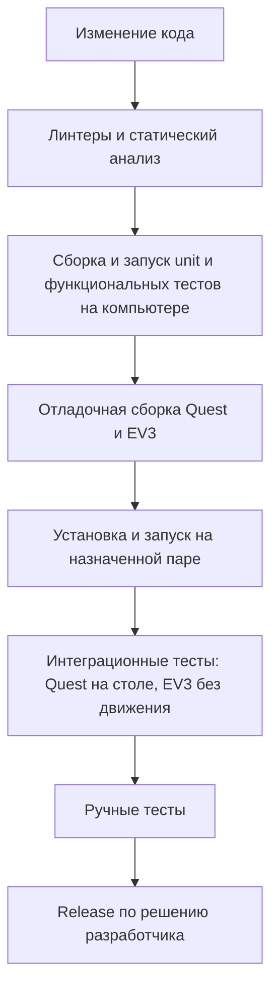

<a id="sec-8"></a>
# PHANTOM — разработка, сборка и установка

Документ описывает рабочий конвейер и результат каждой операции.
Форматы пакетов, расчёт идентификаторов и настройки установщиков —
[технические контракты](tooling.md). Метрики, журналы и отчёты —
[метрики и анализ](metrics-and-logs.md).

<!-- BEGIN GENERATED TOC -->
<details>
<summary>Оглавление</summary>

- [1. Проект и среда разработки](#sec-8-1)
  - [1.1. Среда разработчика](#sec-8-1-1)
  - [1.2. Технологический стек](#sec-engineering-stack)
  - [1.3. Исходники и рабочие файлы](#sec-engineering-source-layout)
- [2. Правила разработки](#sec-8-2)
- [3. Тестовые подмены](#sec-engineering-test-doubles)
- [4. Конвейер разработки и проверки](#sec-8-5)
  - [4.1. Последовательность](#sec-engineering-pipeline)
  - [4.2. Инструменты и место выполнения](#sec-8-5-1)
  - [4.3. Линтеры и статический анализ](#sec-engineering-static-checks)
  - [4.4. Автоматизация в GitHub Actions](#sec-engineering-ci-tests)
  - [4.5. Зависимости](#sec-engineering-dependency-checks)
- [5. Сборка](#sec-engineering-build)
  - [5.1. Режимы](#sec-engineering-build-profiles)
  - [5.2. Идентификатор версии](#sec-engineering-build-identity)
  - [5.3. Результат сборки и выпуск релиза](#sec-engineering-build-validation)
  - [5.4. EV3](#sec-8-6)
  - [5.5. Quest](#sec-8-8)
    - [5.5.1. Релизный интерфейс](#sec-8-8-1)
    - [5.5.2. Отладочный интерфейс](#sec-8-8-2)
    - [5.5.3. Готовый APK](#sec-engineering-quest-packaging)
- [6. Подготовка устройств](#sec-engineering-device-setup)
  - [6.1. Первичное сопряжение](#sec-8-11)
  - [6.2. Quest](#sec-8-11-1)
  - [6.3. EV3](#sec-8-12)
- [7. Установка и запуск](#sec-engineering-deployment)
  - [7.1. EV3](#sec-8-7)
  - [7.2. Quest](#sec-engineering-deploy-quest)
- [8. Совместимость конфигурации](#sec-8-9)
  - [8.1. Каноническая конфигурация](#sec-engineering-contracts-configuration)
    - [8.1.1. Ревизии конфигурации для квалификации и Release](#sec-engineering-contracts-qualification-bundles)
- [9. Диагностика и сопровождение](#sec-engineering-diagnostics)

</details>
<!-- END GENERATED TOC -->

<a id="sec-8-1"></a>
## 1. Проект и среда разработки

<a id="sec-8-1-1"></a>
### 1.1. Среда разработчика

Пути определяет [PHANTOM CLI](tooling.md) по
[настройках Quest](../config/quest/project.json). Обычно настройка путей не требуется.

| Инструмент | Для чего | Как выбирается |
|---|---|---|
| Unity Editor | Сборка Quest и тесты C# | Версия из `PhantomQuest/ProjectSettings/ProjectVersion.txt`, установленная через Unity Hub |
| `adb` | Установка, запуск и проверки Quest | Android SDK из Unity, затем `PATH` |
| WSL | Сборка и тесты C++ на компьютере | `Ubuntu` с `cmake`, `ninja-build`, `g++` |
| Docker | Кросс-сборка EV3 | База по digest и ARM dev-пакеты из `ev3/docker/Dockerfile`; подготовленный image ID фиксирует CLI |

При нестандартной установке используются `PHANTOM_UNITY_ROOT`, `PHANTOM_ADB`,
`PHANTOM_WSL_DISTRO`. Они задают расположение, а не другие версии.

<a id="sec-engineering-stack"></a>
### 1.2. Технологический стек

| Область | Технологии | Источники версий |
|---|---|---|
| Quest 3 | Android/Meta Horizon OS, Unity/C#, IL2CPP, Java; OpenXR, Meta XR Core/MRUK >=v83, Meta XR Movement | [Unity](../PhantomQuest/ProjectSettings/ProjectVersion.txt), [пакеты](../PhantomQuest/Packages/manifest.json), [закреплённые зависимости](../PhantomQuest/Packages/packages-lock.json) |
| EV3 | ev3dev Debian Stretch, ARMv5TEJ/armel/gnueabi/soft-float, C++14, systemd 232 | [CMake](../ev3/CMakeLists.txt), [Dockerfile](../ev3/docker/Dockerfile) |
| Компьютер разработчика | Windows/PowerShell, Python для инструментов, WSL/Linux, Docker, Unity Editor, Android SDK/adb | [Инструменты](../config/tooling/environment.json) |
| Обмен данными | UDP Quest↔EV3, локальный Unix datagram IPC, генерируемые кодеки и конфигурации | [Протокол](../schemas/shared/protocol/wire-schema.json), [IPC](../schemas/shared/protocol/ipc-schema.json), [конфигурации](../config/) |

Все прикладные службы EV3, включая сетевой обмен и обнаружение, разрабатываются на C++14.
Сеть, discovery и файловый ввод-вывод остаются отдельными от моторного цикла процессами.
Python используется только для инструмента на компьютере. Проверки и обработка JSON
на EV3 выполняются на C++14; системные операции используют короткие POSIX обёртки.
Сеть использует OpenSSL для HMAC/SHA-256 и случайных идентификаторов;
`phantom-mdns` публикует сервис через системный Avahi.

Для Quest возможности C#/BCL/JNI определяются выбранной Unity и Android.
Unity должна поддерживать используемые Multimodal APIs; обновление Unity/Meta packages
требует регрессионных тестов и проверки платформенной совместимости P0.
Оси и разводка описаны в [EV3](ev3-specification.md) и
[механической спецификации](mechanical-specification.md).

<a id="sec-engineering-source-layout"></a>
### 1.3. Исходники и рабочие файлы

| Каталог | Содержимое |
|---|---|
| [docs](../README.md) | Спецификации, руководства и справочники; [каталог скриптов и инструментов](tooling.md) |
| [PhantomQuest](../PhantomQuest/) | Приложение Quest: Unity/C# и Android-адаптеры |
| [ev3](../ev3/) | Прикладные службы EV3 и тесты |
| [protocol](../protocol/) | Канонизатор, генерируемые кодеки и эталонные данные протокола/IPC |
| [config](../config/) | Исходные настройки разработки и семантика протокола |
| [schemas](../schemas/) | Машинные схемы конфигураций, данных робота и wire/IPC |
| [tooling](../tooling/) | Единый CLI, общие модули, устанавливаемые ресурсы и регрессии инструмента |
| [ev3/toolchains](../ev3/toolchains/) | Штатный CMake toolchain-файл ARM-компилятора |
| `build/**` | Готовые пакеты и промежуточные файлы сборки |
| `results/**` | Локальные результаты инструментов |

<a id="sec-8-2"></a>
## 2. Правила разработки

Правила исходников обеих платформ и инструментов — в
[code-guidelines.md](code-guidelines.md). Порядок проверки — в [плане тестирования](test-plan.md).
Инструкции для агентов находятся в `.agents/skills/` и не заменяют документацию проекта.

<a id="sec-engineering-test-doubles"></a>
## 3. Тестовые подмены

Подмены внешних источников позволяют тестировать настоящий код приложения на компьютере.

Состав, запуск и ограничения подмен EV3/Quest описаны в
[плане тестирования](test-plan.md#sec-8-3).

<a id="sec-8-5"></a>
## 4. Конвейер разработки и проверки

Следующий этап начинается после успешного предыдущего. Проверки затронутой области
используются при разработке, полный применимый набор — при приёмке.
Сценарии проверок описаны в [плане тестирования](test-plan.md).

<a id="sec-engineering-pipeline"></a>
### 4.1. Последовательность



<a id="sec-8-5-1"></a>
### 4.2. Инструменты и место выполнения

Все операции вызывает [PHANTOM CLI](tooling.md). Установка, запуск и тесты — отдельные команды.

| Работа | Команда `python tooling` | Место выполнения |
|---|---|---|
| Линтеры, схемы и документация | `check` | Компьютер разработчика / CI |
| Регрессии инструмента | `self-test` | Компьютер / CI, без устройств |
| Тесты EV3 | `test --target ev3` | C++ в WSL на Windows, Linux в CI |
| Тесты Quest | `test --target quest` | .NET и Unity на компьютере; C++ interop fixture в WSL |
| Сборка EV3 | `build --target ev3` | Компьютер, Docker ARM cross compiler |
| Сборка Quest | `build --target quest` | Компьютер, Unity и Android SDK |
| Настройка и установка | `install --target ev3/quest --artifact <file>` | Компьютер → назначенное устройство через SSH/ADB |
| Запуск | `start --target ev3/quest --build-id <id>` | Установленная система на устройстве |
| Интеграционные тесты | `integration-test --target ev3/quest --build-id <id>` | Назначенные устройства, без движения |
| Получение диагностики | `logs --target ev3/quest` | Компьютер получает данные устройства и анализирует их |

<a id="sec-engineering-static-checks"></a>
### 4.3. Линтеры и статический анализ

До сборки проверяются исходники обеих платформ, инструменты, схемы, сгенерированные
файлы и документация. Ошибки устраняются, предупреждения — устраняются или обосновываются.
C++ проверяется `clang-tidy` или эквивалентом, C# — анализаторами.
`python tooling check` проверяет схемы, документацию, Mermaid, host Python,
POSIX ресурсы и Android bridge. Проверки C++ и C# выполняются средствами проектов;
полнота статического анализа отражается в текущем статусе.

<a id="sec-engineering-ci-tests"></a>
### 4.4. Автоматизация в GitHub Actions

CI — автоматический запуск проверок в GitHub Actions при push и pull request.
Конфигурация уже есть в [.github/workflows/ci.yml](../.github/workflows/ci.yml).
Она описывает проверки документации, схем и Python-инструментов, host-тесты C++ и C#,
ASan/UBSan и кросс-сборку EV3 на GitHub runner `ubuntu-24.04`.
Наличие workflow не подтверждает успешный запуск. Полнота проверок отражается в статусе;
текущий workflow не содержит полного Unity test/build job и не устанавливает ПО на устройства.
Локальные тесты Quest включают .NET/NUnit host-проект и Unity EditMode,
оба запускает `python tooling test --target quest`. Host unit и functional части выбираются
через `--category`, host/Unity — через `--suite`. .NET SDK закреплён в
[global.json](../PhantomQuest/Tests/Host/global.json), пакеты — в
[packages.lock.json](../PhantomQuest/Tests/Host/packages.lock.json).
Требования к покрытию —
[план тестирования](test-plan.md#sec-9-1-2).

<a id="sec-engineering-dependency-checks"></a>
### 4.5. Зависимости

Для релиза фиксируются образ/компилятор, состав зависимостей (SBOM) и известные уязвимости.
Устаревшая EV3-платформа требует оценки риска; изоляция LAN не заменяет её.
Уязвимость без принятой меры снижения риска блокирует Release.

<a id="sec-engineering-build"></a>
## 5. Сборка

<a id="sec-engineering-build-profiles"></a>
### 5.1. Режимы

| Режим | Имя в инструментах | Результат |
|---|---|---|
| Отладочный | `Diagnostic` | Проверяемая версия с диагностикой |
| Релизный | `Release` | Версия для обычной эксплуатации |

По умолчанию собирается Diagnostic. Release выбирает разработчик после проверки.
Логика управления, состояний и безопасности одна. Диагностика не расширяет полномочия приводов.
Профилирование — настройка отладочной сборки, а не третий режим; дополнительная
инструментализация помечается `qualification_eligible=false` и не подтверждает приёмку.

<a id="sec-engineering-build-identity"></a>
### 5.2. Идентификатор версии

`build_id` позволяет отличить установленный компонент и связать его с результатами проверки.
Он меняется при изменении исходников, конфигурации, протокола, режима или закреплённых
инструментов, поскольку они могут изменить поведение пакета.
Не зависит от документации, времени сборки, имени компьютера, номера commit и наличия отчётов.
Тестовые исходники EV3 также не меняют `build_id` штатного пакета.
Quest и EV3 имеют отдельные идентификаторы. SHA-256 готового пакета отдельно проверяет
точные переданные байты, включая упаковку и подпись.
Алгоритм и поля — [контракт идентичности](tooling.md#sec-engineering-contracts-build-identity).

<a id="sec-engineering-build-validation"></a>
### 5.3. Результат сборки и выпуск релиза

Успех сборки означает готовый устанавливаемый пакет, а не только успешную компиляцию.
Проверка упаковки входит в скрипт сборки: нужны все файлы, правильная архитектура,
конфигурация, права и подпись. Она не повторяет unit/functional tests и не является
дополнительным этапом. Например, скомпилированный controller без safety в пакете
не считается готовой сборкой.

После установки Release проверяется именно этот пакет. При изменении управления,
безопасности, конфигурации, SDK или временных характеристик повторяются затронутые проверки.
Результат Diagnostic не выдаётся за результат другого артефакта.
Форматы и воспроизводимость — [контракт пакетов](tooling.md#sec-engineering-contracts-package-validation).

<a id="sec-8-6"></a>
### 5.4. EV3

На компьютере кросс-компилируются C++14-службы для EV3 и создаётся пакет с бинарниками,
конфигурацией и systemd units. На EV3 компиляция не выполняется.
Базовый образ и ARM dev-пакеты закреплены в [Dockerfile](../ev3/docker/Dockerfile); ожидаемые compiler facts — в [настройках EV3](../config/ev3/project.json).
Команда отладочной сборки: `python tooling build --target ev3 --profile diagnostic`.
Точный состав — [контракт пакета EV3](tooling.md#sec-engineering-contracts-ev3-package).

| Конфигурационный файл | Назначение |
|---|---|
| [ev3/CMakeLists.txt](../ev3/CMakeLists.txt) | Состав C++ проекта, зависимости, C++14 и CTest. Используется для ARM-сборки и тестов на компьютере. |
| [ev3/toolchains/armel.cmake](../ev3/toolchains/armel.cmake) | Компилятор и параметры ARM/soft-float. Применяется только при кросс-сборке. |
| [ev3/docker/Dockerfile](../ev3/docker/Dockerfile) | Единственный источник имени/digest базового образа и версий ARM dev-пакетов OpenSSL/Avahi. |
| [config/ev3/project.json](../config/ev3/project.json) | Ожидаемые версия/SHA-256 компилятора; runtime-настройки разработки. |

Поиск инструментов Quest задаётся в `config/quest/project.json`, общая среда WSL —
в `config/tooling/environment.json`. Версии Unity и .NET читаются из обязательных
файлов Unity ProjectVersion и .NET global.json.
Локальная сборка и CI используют одну команду CLI. Перед ARM-компиляцией CLI
собирает `ev3/docker/Dockerfile` с минимальным build context и Docker cache;
база и прямые ARM dev-зависимости закреплены в самом рецепте. Stretch-пакеты
получаются из Debian archive, подписи проверяются; отключается только проверка
срока действия архивного Release. Компилятор не обновляется.
Кросс-сборка запускается по неизменяемому image ID, а не по изменяемому тегу.
SHA-256 Dockerfile и фактический image ID входят в toolchain hash;
Docker context также входит в EV3 source hash. Манифест фиксирует image ID,
исходный FROM и SHA-256 рецепта. Изменение среды создаёт новую build identity.
Зависимости на EV3 проверяются provisioning отдельно от среды кросс-сборки.
Имя фактически выбранного компилятора экспортирует CMake, версия и SHA-256
измеряются при сборке и сохраняются в манифесте. Ожидаемые версия и хеш
компилятора заданы только в Dockerfile и проверяются при создании образа после
установки зависимостей; несовпадение прерывает Docker build. Compiler triple получается
командой выбранного компилятора `-dumpmachine` и экспортируется CMake как
`compiler_target`; редактируемого `build.toolchain.target` нет. Этот факт в
манифесте сверяется с экспортированными compiler facts, а действительная
архитектура/ABI проверяется по ELF. CPU/soft-float флаги принадлежат toolchain CMake.
CMake остаётся версии закреплённого образа; presets в этой версии не поддерживаются.

<a id="sec-8-8"></a>
### 5.5. Quest

Unity Editor создаёт подписанный APK с конфигурацией выбранного режима.
Команда: `python tooling build --target quest --profile diagnostic`.
Путь к keystore и пароль берутся из закрытой локальной настройки, не из исходников.

<a id="sec-8-8-1"></a>
#### 5.5.1. Релизный интерфейс

Русский пользовательский интерфейс, штатная телеметрия, скрытые инженерные панели.
Непрерывная запись XR-траектории выключена.

<a id="sec-8-8-2"></a>
#### 5.5.2. Отладочный интерфейс

Инженерные панели, `DIAGNOSTIC_TELEMETRY` и явно включаемая подробная запись.
Область разрешённого движения задаётся конфигурацией; commissioning key и локальное
разрешение остаются обязательными. Неполный bundle не допускает `READY`,
Release отвергает `qualification_only=true`.

<a id="sec-engineering-quest-packaging"></a>
#### 5.5.3. Готовый APK

APK содержит выбранную конфигурацию, идентификатор версии и обязательные разрешения.
Скрипт восстанавливает временно изменённые настройки Unity и не сохраняет секреты в проекте.
Детали подписи и встроенных данных — [контракт APK](tooling.md#sec-engineering-contracts-quest-package).

<a id="sec-engineering-device-setup"></a>
## 6. Подготовка устройств

Общий результат — назначенная пара, общая доверенная LAN, ключи аутентификации и
готовность к установке. Настройка сохраняется между обновлениями.

<a id="sec-8-11"></a>
### 6.1. Первичное сопряжение

1. Назначить точный Quest по ADB serial и EV3 по hostname и проверенному SSH fingerprint.
2. Подключить оба устройства к одной доверенной LAN.
3. Создать общий для пары CONTROL key и безопасно установить его на обе стороны.
4. Когда этап требует калибровочного движения, отдельно подготовить commissioning key.
5. Сохранить назначение пары на компьютере и проверить обнаружение правильного `robot_id`,
   совместимость конфигурации и аутентифицированный handshake после установки.

Ключи здесь — секреты для проверки подлинности сетевых сообщений, а не параметры движения.
CONTROL обслуживает обычную связь; commissioning key даёт право запрашивать инженерные
операции, но не заменяет локальное разрешение и safety-проверки.
Настройка входит в `install --target ev3` и `install --target quest`; отдельной команды настройки нет.
При первом назначении пары установщик принимает доверенный `--host-fingerprint` EV3
и `--quest-serial` (либо выбирает единственный подключённый и авторизованный Quest 3).
Явный serial позволяет установить EV3 без подключённого шлема. Повторная установка
использует локальное назначение пары, сохраняет ключи и не меняет fingerprint.
Изменение Wi-Fi, восстановление credential или ротация требуют явного `--repair`;
ротация SSH/CONTROL и repin EV3 дополнительно требуют соответствующего флага установщика EV3.
Секреты не передаются исполнительным UDP и не выводятся в журналы.

<a id="sec-8-11-1"></a>
### 6.2. Quest

Указать назначенный ADB serial, выдать нужные разрешения и установить CONTROL key в закрытое
хранилище приложения через отладочную сборку. Приложение должно расшифровать ключ и
подтвердить готовность без диалогов. Обычное обновление APK сохраняет ключ и данные.
Подробности импорта — [контракт ключей](tooling.md#sec-engineering-contracts-quest-credentials).

<a id="sec-8-12"></a>
### 6.3. EV3

Подготовить ev3dev с `libssl1.0.2`, `avahi-daemon`, `libavahi-client3`, службы и пользователей,
SSH по ключу, автоматическое подключение LAN,
закрытые файлы сетевых ключей и firewall. Сеть не получает доступа к моторному вводу-выводу.
CONTROL/COMMISSIONING UDP доступен только из доверенной подсети; публикация порта в интернете
запрещена. На EV3 работает один менеджер сети ConnMan; штатный запуск PHANTOM сеть не ремонтирует.
Проверить автоматическое подключение после загрузки; при смене подсети повторить проверку доступа.
Детали — [контракт сети](tooling.md#sec-engineering-contracts-network).

<a id="sec-engineering-deployment"></a>
<a id="sec-8-10"></a>
## 7. Установка и запуск

Принимается явно выбранный готовый пакет. До изменения устройства проверяются назначенная
пара и соответствие пакета. Установка и запуск вызываются отдельно; тесты — следующим шагом.
При дефекте исправляется код и устанавливается новая версия, отдельного этапа отката нет.
Ошибка оставляет систему в безопасном состоянии, прежние sessions/references не восстанавливаются.

<a id="sec-8-7"></a>
### 7.1. EV3

Передать пакет через SSH, сверить хэш, остановить службы при запрещённом движении,
установить файлы с правильными правами и атомарно выбрать новую версию.
Неподтверждённая безопасная остановка блокирует установку. Незавершённая установка
не должна повреждать прежнюю версию; это атомарность, а не откат после ошибки запуска.
Настройка пользователей и credentials допускается только при остановленных службах EV3;
активная система блокирует этот шаг до штатной безопасной остановки.

`python tooling install --target ev3 --artifact <архив>` выполняет настройку EV3, передачу
пакета и установку. `build_id` и SHA-256 берутся из проверенного пакета и sidecar.
`python tooling start --target ev3 --build-id <id>` отдельно запускает safety → controller → network → mDNS,
показывает результат каждой службы и первый отказ. Во время `TRACKING` установка запрещена.
Форматы, права и порядок переключения — [контракт установки EV3](tooling.md#sec-engineering-contracts-ev3-install).

<a id="sec-engineering-deploy-quest"></a>
### 7.2. Quest

`python tooling install --target quest --artifact <APK>` проверяет APK, выполняет `adb install -r -g` на назначенном Quest
и сверяет установленную версию. Первая установка требует Diagnostic APK и подготавливает
CONTROL credential для импорта при запуске. При обновлении credential повторно не передаётся;
данные и ключи приложения сохраняются;
`adb uninstall` и `pm clear` не выполняются.
`python tooling start --target quest --build-id <id>` отдельно запускает приложение и проверяет процесс и готовность.
Отсутствующий или повреждённый ключ даёт ошибку, а не скрытую повторную настройку.

<a id="sec-8-9"></a>
## 8. Совместимость конфигурации

Quest и EV3 должны использовать согласованный протокол, геометрию, калибровку и область движения.
Несовпадение блокирует движение. Конфигурация устанавливается как согласованный набор,
не редактируется частично через исполнительный UDP.
Изменение механики требует новой соответствующей калибровки; перезапуск сохраняет её,
но требует новой runtime-привязки. Изменение только интерфейса калибровку не инвалидирует.
Условия смены ревизий и хэширования — [контракт конфигурации](engineering.md#sec-engineering-contracts-configuration).

<a id="sec-engineering-contracts-configuration"></a>
### 8.1. Каноническая конфигурация

Конфигурация разделяется по жизненному циклу. В репозитории хранятся только
настройки разработки, схемы форматов и синтетические тестовые данные. Результаты
измерений конкретного робота не являются исходниками и не входят в BUILD.
Значения настроек находятся в `config/`, машинные схемы — в соседней `schemas/`.
В обеих директориях сохраняется разделение по компонентам. Wire/IPC-схемы
принадлежат `schemas/shared/protocol/`; источник семантики протокола остаётся
`config/shared/protocol/semantics.json`.

| Тип | Источник и хранение | Жизненный цикл |
|---|---|---|
| Настройки разработки | `config/ev3/project.json`, `config/quest/project.json`, общие настройки `config/shared/` и CLI `config/tooling/` | Редактируются при разработке; компонуются в `build/config/` |
| Постоянные данные робота | Только схема `schemas/ev3/commissioning.schema.json` в Git; authoritative результат инженерных процессов — `/var/lib/phantom/robot/commissioning.json` на EV3, совместимая копия/неизменяемый артефакт вне исходников | Создаются после сборки/калибровки и обновляются после изменения механики или повторной квалификации |
| Идентичность установленной платформы | Только схема `schemas/ev3/device-identity.schema.json`; результат provisioning/qualification хранится вне исходников | Наблюдается для конкретного устройства; обновляется при смене образа |
| Привязка текущего запуска | Схема `schemas/ev3/startup-reference.schema.json`; состояние `JointReference`/`GripperReference` в памяти EV3 | Заново устанавливается при каждом controller boot; не восстанавливается из старого файла |
| Локализация Quest | Схема `schemas/quest/startup-localization.schema.json`; состояние в памяти Quest | Заново определяется при запуске и инвалидируется при утрате непрерывности reference space |
| Сетевой режим без приводов | Схема `schemas/ev3/network-only-session.schema.json`; описатель создаётся в памяти | Не содержит геометрии, калибровок или измеренных ограничений; обе маски нулевые |

В EV3 и Quest `project.json` содержит общую основу. Компоновщик выводит
`qualification_only`, `actuator_scope_mask`, `safety_observation_mask` и Quest
`required_user_inputs` из выбранного профиля: текущий Diagnostic — только сеть
(`true`, `0`, `0`, `NONE`), Release — штатный профиль (`false`, `15`, `15`, `FULL_ARM`).
Эти поля сохраняются в полных generated configs и проверяются загрузчиками;
задавать или переопределять их в исходных настройках запрещено. Пустые профильные
JSON-файлы не хранятся. Если появятся реальные настраиваемые отличия, необязательные
`diagnostic.json`/`release.json` могут содержать только их.
Будущие аппаратные режимы Diagnostic требуют отдельного реализованного контракта;
выбор Diagnostic сейчас не разрешает испытания приводов. Authoritative флаг и маски
в данных конкретного робота сохраняются и не выводятся автоматически из BUILD.
Компоновщик рекурсивно объединяет объекты; массив заменяется целиком.
Повторение значения основы в профиле и повторение одинакового отличия в обоих
профилях считаются ошибками. `check --target schemas` проверяет исходники в памяти;
`build` и `test` создают только проверенные настройки разработки. Синтетический
сетевой описатель для software tests создаётся отдельно в `build/config/test-fixtures/`
и не поставляется как калибровка робота.

| Источник | Потребитель |
|---|---|
| EV3 `ev3/docker/Dockerfile` и `ev3/toolchains/armel.cmake` | Compiler facts/ABI, подготовка Docker environment и идентичность сборки |
| EV3 `runtime` | Службы, фиксированная разводка, сетевые baseline bounds, safety timings, журналы и верхняя граница scope профиля |
| Quest `build` и `runtime` | Поиск инструментов, упаковка, сетевой клиент и ожидаемый scope профиля |
| Shared `pair.json` | Публичный key ID и параметры discovery; реальные credentials, SSH/ADB identity и provisioning state остаются вне исходников |
| Shared `protocol/` | Генерация C++/C# wire/IPC-контрактов |
| Tooling `settings.json`, `environment.json` | CLI, deadlines и WSL |
| Данные конкретного робота | Runtime admission и будущие физические алгоритмы; не источник build/config hashes |

Робот в проекте единственный. Его фиксированный protocol ID `phantom01` задан
как `const` в EV3 runtime schema и автоматически включается в runtime configs
обоих компонентов. Он не является исходной настройкой и не переопределяется
через CLI. Поля wire/telemetry/DNS-SD сохраняются для проверки ожидаемого сервиса.

`commissioning`, `device`, незаполненная геометрия, статусы измерений и
qualification evidence не задаются в `project.json` или профилях. Для измеренных
значений нет второго реестра. Настройки разработчика задают policy/верхнюю границу;
результаты калибровки задают подтверждённые характеристики конкретной механики.
Сеть, профиль или новый пакет не расширяют authoritative actuator scope робота.

Компиляция и software tests Release не требуют файла калибровки конкретного экземпляра. Готовность
продуктового релиза и разрешение движения по-прежнему требуют применимых
platform/SBOM/risk inputs, квалифицированного bundle и всех safety prerequisites.
Текущий `build --profile release` выполняет packaging/publication и остаётся
заблокированным до реализации проверки внешнего qualification evidence; software
компиляция проверяется `test --profile release`. Отсутствие данных не разрешает `READY`. Неполные, повреждённые или несовместимые
данные не подменяются номинальными коэффициентами.

Пакеты ПО не содержат и не перезаписывают постоянные данные робота. INSTALL,
rollback ПО и очистка `/run` сохраняют `/var/lib/phantom/robot/`.
Принятие новых данных инженерной процедурой выполняется с проверкой схемы,
совместимости, evidence и atomic temp+fsync+rename; прежняя подтверждённая ревизия
сохраняется при ошибке. Алгоритмы формирования физических данных и полная
motion admission относятся к соответствующим этапам реализации; наличие схем
само по себе их не реализует.

В существующем Stage-3 Diagnostic сеть использует созданный в памяти канонический
нулевой описатель. Его хэш вычисляется независимо одинаково EV3 и Quest и сверяется
через `HELLO_ACK`; реальные robot data не используются и не изменяются. Поле
`commissioning_bundle_hash` манифеста BUILD Diagnostic обозначает этот bootstrap
контракт, а в BUILD Release содержит нулевой sentinel отсутствия привязки к роботу.
Для продуктового runtime активный bundle hash определяется установленными
данными робота и доказывается до движения; его нельзя брать из BUILD-манифеста.

Обновление схемы или алгоритма может сделать сохранённые данные несовместимыми:
это ошибка допуска с необходимостью повторной калибровки/миграции, а не разрешение
автоматически заменить их. Синтетические fixtures не подтверждают hardware PASS.
Настройки и схемы PHANTOM используют JSON; CMake, Unity, systemd и workflow
сохраняют штатные форматы. Credentials не входят в конфиги, схемы или журналы.

Конфигурация разделяет данные, определяющие поведение, и сведения об их происхождении:

```text
semantic_payload:
  schema_version
  revision
  safety/config fields или component hashes
content_hash = SHA-256(JCS(semantic_payload))

provenance_sidecar:         # отдельный файл; не входит в content_hash
  semantic_content_hash
  created_by_build
  created_at
  transaction_id / evidence reference, если применимо
```

При сборке и калибровке `semantic_payload` сохраняется как канонический JCS JSON,
а сведения о происхождении — отдельным файлом. Runtime проверяет SHA-256 установленных
байтов, не сериализуя объект заново. Внешний файл может иметь свой хэш и ссылается
на `semantic_content_hash`; его отсутствие или время создания не меняет совместимость приводов.

`CommissioningBundle` использует тот же принцип:
`commissioning_bundle_hash = SHA-256(JCS(bundle_semantic_payload))` хранится в оболочке,
манифесте или runtime metadata, но не внутри `bundle_semantic_payload`.
Хэш компонента хранится в содержащем его bundle, а не в хэшируемом компоненте.
Время, имя компьютера и локальные metadata не влияют на допуск приводов.

`bundle_id` не входит в `semantic_payload` и вычисляется после хэша:

```text
bundle_id = "cb-" + lowercase_hex(first_16_bytes(commissioning_bundle_hash))
```

Обе стороны получают одинаковый идентификатор без случайного UUID, времени или hostname.

Установка геометрии и данных безопасности выполняется через инженерный доступ,
а не исполнительный UDP. В протоколе v1 нет `SET_ROBOT_GEOMETRY` или передачи файлов
по частям: `RobotGeometry`, `RobotCollisionModel`, PayloadProfiles и `JointSafeSet`
могут превышать размер управляющего пакета и не должны обновляться частично.

1. Сохранить результат инженерной калибровки на Quest или компьютере как канонические данные.
2. Собрать полный `CommissioningBundle` для проверки (`qualification_only=true`);
   проверить схемы, коллизии и связи с требованиями.
3. При запрещённом движении установить одинаковые байты компонентов на обе стороны:
   ADB для Quest, SSH/USB для EV3.
4. После успешной проверки `QualificationEvidenceManifest` подготовить рабочую ревизию
   (`qualification_only=false`). Байты компонентов и их хэши сохраняются; добавляются
   только сведения о результатах проверки. Изменение геометрии/калибровки требует новой приёмки.
5. Активировать ревизию через временный файл, fsync и атомарное переключение,
   сохраняя предыдущую ревизию на случай незавершённой установки.

Установка инвалидирует runtime sessions и привязки. Новый `HELLO` должен вернуть ожидаемый
`commissioning_bundle_hash` до привязки и движения. Неполная установка пары или несовпадение
хэшей блокирует движение; частично установленный bundle не используется.
`SET_DRIVE_CALIBRATION` остаётся ограниченной транзакцией калибровки с обработкой потери ACK
по [протоколу §2.5](protocol-specification.md#sec-4-7-5). Итоговая замена данных следует правилам выше.

Изменения конфигурации обрабатываются так:

| Изменение | Что требуется |
|---|---|
| Передача, крепление мотора, смысл encoder или `encoder_scale` | Новая `DriveCalibration` |
| Крепление QR, ось, `L1`, `L2`, положение пола относительно Shoulder, TCP | Новая ревизия `RobotGeometry` |
| Упор Base, прокладка кабеля или диапазон pitch | Повторная калибровка безопасных границ |
| Перезапуск EV3/controller или новый `controller_boot_id` | Сохранить persistent `DriveCalibration`; инвалидировать runtime `JointReference`, `GripperReference` и старые sessions |
| Новая `DriveCalibration` | Создать неизменяемую bundle revision с заменой соответствующего компонента, `new_bundle_revision = previous_bundle_revision + 1` |
| Активация новой bundle revision | Закрыть прежние sessions; новый `HELLO` подтверждает новый хэш до движения |
| Новый HMAC key | Новая сетевая сессия |
| Только пользовательский интерфейс | `RobotGeometry` и `DriveCalibration` сохраняются |

Quest и EV3 вычисляют хэш кандидата из одинаковых канонических компонентов.
Несовпадение требует исправления настройки или файлов; изменение активной ревизии на месте запрещено.

<a id="sec-engineering-contracts-qualification-bundles"></a>
#### 8.1.1. Ревизии конфигурации для квалификации и Release

Для `build_profile=Release` authoring schema обязана отклонять `qualification_only=true`, `actuator_scope_mask != 0x0F` и `safety_observation_mask != 0x0F`. Evidence не входит в source/generated настройки разработки. Нулевой или отсутствующий `qualification_evidence_manifest_hash` в постоянных данных робота означает неподтверждённый candidate: runtime остаётся fail-closed; такой набор нельзя активировать как production данные. Software compilation не подтверждает квалификацию конкретного робота. Release **packaging/publication gate**, в отличие от schema/generator и compile-only build, обязательно отклоняет нулевой/отсутствующий evidence hash либо manifest, чей component-set hash не совпадает с production bundle, и проверяет PASS всех обязательных evidence refs. Простая ручная смена `qualification_only:true→false` не создаёт допустимый release и должна fail packaging/release validation. На этапах 3–5 ранний Diagnostic mechanical/safety bundle разрешает только пары масок `0x00/0x00` (network-only) и `0x08/0x08` (Gripper). Соответствующий Quest profile отдельно использует `required_user_inputs=NONE` для Stage 3 и phase-specific QR commissioning либо `GRIPPER_ONLY` для user-driven Stage 5. На этапах 6–7 Diagnostic `COMMISSIONING/CALIBRATION` может использовать versioned scope всех фактически подключённых осей текущего стенда, если их motor/mechanics/safety prerequisites [Спецификация Quest §16.1](quest-specification.md#sec-5-16-1) выполнены; отдельный `CALIBRATION_JOG.axis` выбирает единственную движущуюся ось, а штатный `COMMAND` для A/B/C при этом запрещён. Scoped A/B/C `ACTUATOR_QUALIFICATION` допускается только с полными `RobotGeometry`, `DriveCalibration`, `JointReference A/B/C`, `EMPTY` profile-specific `JointSafeSet`, `safety_observation_mask & 0x07 == 0x07`, `actuator_scope_mask & ~safety_observation_mask == 0` и пройденными **pre-motion** prerequisites [План проверки](test-plan.md#sec-9) (exhaustive safe-set proof, mechanical/fixture inspection, `LOCAL_STOP`/`POWER_CUT`, интеграционные тесты с нулевым выходом приводов и применимые P0 gates). Сам движущийся incremental MANUAL case не может быть prerequisite самому себе: он последовательно создаёт qualification evidence по [Метрики и анализ §4.7.7](metrics-and-logs.md#sec-9-15-7)/[Метрики и анализ §4.9](metrics-and-logs.md#sec-9-17)–[Метрики и анализ §4.10](metrics-and-logs.md#sec-9-19) и [Этапы реализации §11](implementation-stages.md#sec-10-11). Маска motor authority может быть уже (`C`, `B+C` и т.п.), но безопасность всегда вычисляется по реальным observed A/B/C.

Для incremental A/B/C MANUAL узкая authority **не является runtime override** production bundle. Все narrow authority cases (`C`, `B+C`, затем A+B+C narrow/full-authority bring-up до payload qualification) выполняются только с **пустым Gripper без внешнего payload** и используют installed `EMPTY` PayloadProfile + matching `EMPTY` JointSafeSet. После reference tooling явно устанавливает engineering `SET_PAYLOAD_PROFILE=EMPTY` и `SET_PAYLOAD_STATE=EMPTY` при stationary motors и снятом qualification arm; это не product state, а доказуемый input safety gate. `LOADED`, non-empty profile, pickup/release и object-contact-as-payload в narrow qualification запрещены. Loaded-payload cases допускаются только в отдельном full `0x0F/0x0F qualification_only=true` bundle с полными A/B/C/D references и специальными engineering payload gates [Спецификация протокола §2.5](protocol-specification.md#sec-4-7-5). Engineering tooling создаёт каждую immutable derived revision из принятого production-candidate semantic component set: narrow bundles ссылаются на те же geometry/DriveCalibration/collision/SafetyEnvelope hashes и EMPTY profile/safe-set; full qualification bundle может переключать только уже установленные candidate payload profiles/safe-sets, не меняя их bytes. Каждая revision имеет собственный `commissioning_bundle_hash`, проходит двухсторонний deployment/hash check и при активации инвалидирует session/JointReference/GripperReference. После qualification production bundle создаётся/promote-ится отдельной revision; MANUAL никогда не переписывает masks in-place.


<a id="sec-engineering-diagnostics"></a>
## 9. Диагностика и сопровождение

При обнаружении проблемы выполните `python tooling logs --target ev3/quest`.
Команда получает данные и анализирует их; `--skip-analysis` оставляет только сбор.
Сохранённые данные обрабатываются через `analyze`. Форматы и хранение —
в [метриках и журналах](metrics-and-logs.md), параметры команд — в [CLI](tooling.md#sec-tooling-diagnostics).
После исправления повторите затронутые проверки. Диагностика работает и вне тестов.

Очистка: `python tooling clean --target build/results` показывает выбранные данные;
`--apply` удаляет их. Состояние пары и секреты хранятся отдельно.
