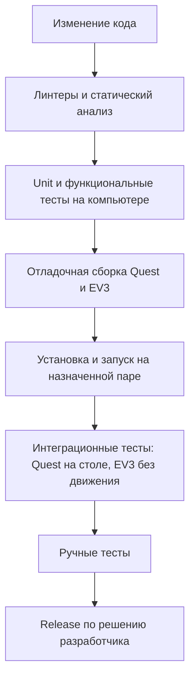

# PHANTOM — разработка, сборка и установка

Документ описывает рабочий конвейер и результат каждой операции.
Форматы пакетов, расчёт идентификаторов и настройки установщиков —
[технические контракты](engineering-contracts.md). Метрики, журналы и отчёты —
[метрики и анализ](metrics-and-logs.md).

<!-- BEGIN GENERATED TOC -->

Оглавление

- [1. Проект и среда разработки](#sec-8-1)
  - [1.1. Среда разработчика](#sec-8-1-1)
  - [1.2. Технологический стек](#sec-engineering-stack)
  - [1.3. Исходники и рабочие файлы](#sec-engineering-source-layout)
- [2. Правила разработки](#sec-8-2)
- [3. Тестовые подмены](#sec-engineering-test-doubles)
  - [3.1. Stub EV3 для тестов](#sec-8-3)
  - [3.2. Stub Quest3 для тестов](#sec-8-4)
- [4. Конвейер разработки и проверки](#sec-8-5)
  - [4.1. Последовательность](#sec-engineering-pipeline)
  - [4.2. Инструменты и место выполнения](#sec-8-5-1)
  - [4.3. Линтеры и статический анализ](#sec-engineering-static-checks)
  - [4.4. Автоматизация в GitHub Actions](#sec-engineering-ci-tests)
  - [4.5. Зависимости](#sec-engineering-dependency-checks)
- [5. Сборка](#sec-engineering-build)
  - [5.1. Режимы](#sec-engineering-build-profiles)
  - [5.2. Идентификатор версии](#sec-engineering-build-identity)
  - [5.3. Результат сборки и выпуск релиза](#sec-engineering-build-validation)
  - [5.4. EV3](#sec-8-6)
  - [5.5. Quest](#sec-8-8)
    - [5.5.1. Релизный интерфейс](#sec-8-8-1)
    - [5.5.2. Отладочный интерфейс](#sec-8-8-2)
    - [5.5.3. Готовый APK](#sec-engineering-quest-packaging)
- [6. Подготовка устройств](#sec-engineering-device-setup)
  - [6.1. Первичное сопряжение](#sec-8-11)
  - [6.2. Quest](#sec-8-11-1)
  - [6.3. EV3](#sec-8-12)
- [7. Установка и запуск](#sec-engineering-deployment)
  - [7.1. EV3](#sec-8-7)
  - [7.2. Quest](#sec-engineering-deploy-quest)
- [8. Совместимость конфигурации](#sec-8-9)

<!-- END GENERATED TOC -->

## 1. Проект и среда разработки

### 1.1. Среда разработчика

Пути определяет [toolchain.ps1](../tools/toolchain.ps1) по
[host-tools.json](../toolchains/host-tools.json). Обычно настройка путей не требуется.

| Инструмент | Для чего | Как выбирается |
|---|---|---|
| Unity Editor | Сборка Quest и тесты C# | Версия из `PhantomQuest/ProjectSettings/ProjectVersion.txt`, установленная через Unity Hub |
| `adb` | Установка, запуск и проверки Quest | Android SDK из Unity, затем `PATH` |
| WSL | Сборка и тесты C++ на компьютере | `Ubuntu` с `cmake`, `ninja-build`, `g++` |
| Docker | Кросс-сборка EV3 | Образ по digest из `toolchains/ev3dev-stretch.lock.json` |

При нестандартной установке используются `PHANTOM_UNITY_ROOT`, `PHANTOM_ADB`,
`PHANTOM_WSL_DISTRO`. Они задают расположение, а не другие версии.

### 1.2. Технологический стек

| Область | Технологии | Источники версий |
|---|---|---|
| Quest 3 | Android/Meta Horizon OS, Unity/C#, IL2CPP, Java; OpenXR, Meta XR Core/MRUK >=v83, Meta XR Movement | [Unity](../PhantomQuest/ProjectSettings/ProjectVersion.txt), [пакеты](../PhantomQuest/Packages/manifest.json), [закреплённые зависимости](../PhantomQuest/Packages/packages-lock.json) |
| EV3 | ev3dev Debian Stretch, ARMv5TEJ/armel/gnueabi/soft-float, C++14, systemd 232 | [CMake](../ev3/CMakeLists.txt), [компилятор и образ](../toolchains/ev3dev-stretch.lock.json) |
| Компьютер разработчика | Windows/PowerShell, Python для инструментов, WSL/Linux, Docker, Unity Editor, Android SDK/adb | [Инструменты](../toolchains/host-tools.json) |
| Обмен данными | UDP Quest↔EV3, локальный Unix datagram IPC, генерируемые кодеки и конфигурации | [Протокол](../protocol/wire_schema.yaml), [IPC](../protocol/ipc_schema.yaml), [конфигурации](../config/schema/) |

Все прикладные службы EV3, включая сетевой обмен и обнаружение, разрабатываются на C++14.
Сеть, discovery и файловый ввод-вывод остаются отдельными от моторного цикла процессами.
Python используется для инструментов на компьютере; наличие системного Python в ev3dev
не определяет язык приложения. Состояние переноса существующих Python-служб —
[current-status.md](current-status.md).

Для Quest возможности C#/BCL/JNI определяются выбранной Unity и Android.
Unity должна поддерживать используемые Multimodal APIs; обновление Unity/Meta packages
требует регрессионных тестов и проверки платформенной совместимости P0.
Оси и разводка описаны в [EV3](ev3-specification.md) и
[механической спецификации](mechanical-specification.md).

### 1.3. Исходники и рабочие файлы

| Каталог | Содержимое |
|---|---|
| [docs](../README.md) | Спецификации, руководства и справочники; [каталог скриптов и инструментов](python-scripts.md) |
| [PhantomQuest](../PhantomQuest/) | Приложение Quest: Unity/C# и Android-адаптеры |
| [ev3](../ev3/) | Прикладные службы EV3 и тесты |
| [protocol](../protocol/) | Схемы, семантика, генераторы и эталонные данные протокола/IPC |
| [config](../config/) | Исходные и сгенерированные конфигурации, схемы |
| [tools](../tools/) | Анализаторы, генераторы и проверки на компьютере |
| [scripts](../scripts/), [deploy](../deploy/) | Сборка и установка |
| [toolchains](../toolchains/) | Закреплённые инструменты и общий ARM toolchain |
| [mechanical](../mechanical/) | Модель и состав деталей |
| `build/**` | Готовые пакеты и промежуточные файлы сборки |
| `results/**` | Локальные результаты инструментов |

## 2. Правила разработки

Правила исходников обеих платформ и инструментов — в
[code-guidelines.md](code-guidelines.md). Порядок проверки — в [плане тестирования](test-plan.md).
Инструкции для агентов находятся в `.agents/skills/` и не заменяют документацию проекта.

## 3. Тестовые подмены

Подмены внешних источников позволяют тестировать настоящий код приложения на компьютере.

### 3.1. Stub EV3 для тестов

Stub EV3 воспроизводит протокол и состояния устройства для разработки и тестов Quest.
Он поддерживает handshake/discovery, калибровочные отсчёты и привязку, команды и телеметрию,
ограничения движения, ошибки приводов/привязки/захвата, потерю и задержки пакетов,
смену адреса/boot identity, остановку и восстановление.
Проверки состояния `SAFE_HOLD`, `STOPPED`, `STOPPED + fault_code`, валидной/невалидной
`DriveCalibration`, shaping `q_ref`, maintenance lock, reorder/duplicate остаются обязательными.

### 3.2. Stub Quest3 для тестов

Подменяет входные данные и внешние зависимости Quest; состав расширяется по потребностям тестов.
Для последовательности tracking frames используется C#
[TrackingReplaySource](../PhantomQuest/Assets/Phantom/Replay/TrackingReplaySource.cs),
реализующий тот же tracking interface, что и live provider. Тесты должны подавать
эти frames в настоящие алгоритмы приложения. Запись включается явно.

| Данные | Что сохраняется и воспроизводится |
|---|---|
| Голова | Поза для XR lifecycle |
| `Body_RightShoulder` | Поза, validity/quality/fidelity, время измерения/запроса и получения, неопределённость времени |
| Wrist | Поза, validity/quality, время измерения/запроса и получения, неопределённость времени |
| Захват | Степень сжатия и валидность |
| Левый контроллер | Left Grip и валидность Controller |
| Последовательность | Receive timestamps и frame IDs |

## 4. Конвейер разработки и проверки

Следующий этап начинается после успешного предыдущего. Проверки затронутой области
используются при разработке, полный применимый набор — при приёмке.
Сценарии проверок описаны в [плане тестирования](test-plan.md).

### 4.1. Последовательность

### 4.2. Инструменты и место выполнения

Ниже указаны существующие скрипты. Их имена соответствуют работе;
тесты, сборка, установка и запуск вызываются отдельно.

| Работа | Скрипт | Где выполняется |
|---|---|---|
| Unit/functional tests EV3 | [ev3-test.ps1](../scripts/ev3-test.ps1) | Windows-компьютер разработчика; C++-тесты запускаются в WSL |
| Unit/functional tests Quest | [quest-test.ps1](../scripts/quest-test.ps1) | Компьютер разработчика, Unity Editor |
| Сборка EV3 | [ev3-build.ps1](../scripts/ev3-build.ps1) | Компьютер разработчика, Docker с ARM cross compiler |
| Сборка Quest | [quest-build.ps1](../scripts/quest-build.ps1) | Компьютер разработчика, Unity Editor и Android SDK |
| Настройка пары | [provision-fixed-pair.ps1](../scripts/provision-fixed-pair.ps1) | Компьютер, назначенные EV3 через SSH и Quest через ADB |
| Передача и установка EV3 | [ev3-deploy-install.ps1](../scripts/ev3-deploy-install.ps1) | Компьютер отправляет пакет; установщик выполняется на EV3 |
| Установка Quest | [quest-install.ps1](../scripts/quest-install.ps1) | Компьютер через ADB устанавливает APK на назначенный Quest |
| Запуск EV3 | [ev3-start.ps1](../scripts/ev3-start.ps1) | Компьютер через SSH запускает службы установленного пакета EV3 |
| Запуск Quest | [quest-start.ps1](../scripts/quest-start.ps1) | Компьютер через ADB запускает установленное приложение Quest |
| Интеграционные тесты EV3 | [ev3-device-integration-test.ps1](../scripts/ev3-device-integration-test.ps1) | Runner на компьютере и проверки на назначенном EV3 |
| Интеграционные тесты Quest | [quest-device-integration-test.ps1](../scripts/quest-device-integration-test.ps1) | Runner на компьютере и приложение на назначенном Quest |

Dispatcher [phantom.cmd](../scripts/phantom.cmd) вызывает эти скрипты по машинным именам
операций (`TEST`, `BUILD`, `INSTALL`, `START`, `DEVICE`); это не отдельные виды проверок.
Каждая операция имеет timeout и показывает первый отказ; установка не запускает тесты.

### 4.3. Линтеры и статический анализ

До сборки проверяются исходники обеих платформ, инструменты, схемы, сгенерированные
файлы и документация. Ошибки устраняются, предупреждения — устраняются или обосновываются.
C++ проверяется `clang-tidy` или эквивалентом, C# — анализаторами.
Документация: `tools/docindex.py --check`, `tools/doclint.py`,
`tools/implementation_map_check.py`, `tools/spec_contract_check.py`, проверка Mermaid.
Для схем выполняются генераторы в режиме проверки.

### 4.4. Автоматизация в GitHub Actions

CI — автоматический запуск проверок в GitHub Actions при push и pull request.
Конфигурация уже есть в [.github/workflows/ci.yml](../.github/workflows/ci.yml).
Она описывает проверки документации, схем и Python-инструментов, host-тесты C++,
ASan/UBSan и кросс-сборку EV3 на GitHub runner `ubuntu-24.04`.
Наличие workflow не подтверждает успешный запуск. Полнота проверок отражается в статусе;
текущий workflow не содержит полного Unity test/build job и не устанавливает ПО на устройства.
Локальные тесты Quest выполняются через Unity Editor; требования к покрытию —
[план тестирования](test-plan.md#sec-9-1-2).

### 4.5. Зависимости

Для релиза фиксируются образ/компилятор, состав зависимостей (SBOM) и известные уязвимости.
Устаревшая EV3-платформа требует оценки риска; изоляция LAN не заменяет её.
Уязвимость без принятой меры снижения риска блокирует Release.

## 5. Сборка

### 5.1. Режимы

| Режим | Имя в инструментах | Результат |
|---|---|---|
| Отладочный | `Diagnostic` | Проверяемая версия с диагностикой |
| Релизный | `Release` | Версия для обычной эксплуатации |

По умолчанию собирается Diagnostic. Release выбирает разработчик после проверки.
Логика управления, состояний и безопасности одна. Диагностика не расширяет полномочия приводов.
Профилирование — настройка отладочной сборки, а не третий режим; дополнительная
инструментализация помечается `qualification_eligible=false` и не подтверждает приёмку.

### 5.2. Идентификатор версии

`build_id` позволяет отличить установленный компонент и связать его с результатами проверки.
Он меняется при изменении исходников, конфигурации, протокола, режима или закреплённых
инструментов, поскольку они могут изменить поведение пакета.
Не зависит от документации, времени сборки, имени компьютера, номера commit и наличия отчётов.
Тестовые исходники EV3 также не меняют `build_id` штатного пакета.
Quest и EV3 имеют отдельные идентификаторы. SHA-256 готового пакета отдельно проверяет
точные переданные байты, включая упаковку и подпись.
Алгоритм и поля — [контракт идентичности](engineering-contracts.md#sec-engineering-contracts-build-identity).

### 5.3. Результат сборки и выпуск релиза

Успех сборки означает готовый устанавливаемый пакет, а не только успешную компиляцию.
Проверка упаковки входит в скрипт сборки: нужны все файлы, правильная архитектура,
конфигурация, права и подпись. Она не повторяет unit/functional tests и не является
дополнительным этапом. Например, скомпилированный controller без safety в пакете
не считается готовой сборкой.

После установки Release проверяется именно этот пакет. При изменении управления,
безопасности, конфигурации, SDK или временных характеристик повторяются затронутые проверки.
Результат Diagnostic не выдаётся за результат другого артефакта.
Форматы и воспроизводимость — [контракт пакетов](engineering-contracts.md#sec-engineering-contracts-package-validation).

### 5.4. EV3

На компьютере кросс-компилируются C++14-службы для EV3 и создаётся пакет с бинарниками,
конфигурацией и systemd units. На EV3 компиляция не выполняется.
Образ и компилятор выбираются по [закреплённым версиям](../toolchains/ev3dev-stretch.lock.json).
Команда отладочной сборки: `scripts/ev3-build.ps1 -Profile Diagnostic`.
Точный состав — [контракт пакета EV3](engineering-contracts.md#sec-engineering-contracts-ev3-package).

### 5.5. Quest

Unity Editor создаёт подписанный APK с конфигурацией выбранного режима.
Команда: `scripts/quest-build.ps1 -Profile Diagnostic`.
Путь к keystore и пароль берутся из закрытой локальной настройки, не из исходников.

#### 5.5.1. Релизный интерфейс

Русский пользовательский интерфейс, штатная телеметрия, скрытые инженерные панели.
Непрерывная запись XR-траектории выключена.

#### 5.5.2. Отладочный интерфейс

Инженерные панели, `DIAGNOSTIC_TELEMETRY` и явно включаемая подробная запись.
Область разрешённого движения задаётся конфигурацией; commissioning key и локальное
разрешение остаются обязательными. Неполный bundle не допускает `READY`,
Release отвергает `qualification_only=true`.

#### 5.5.3. Готовый APK

APK содержит выбранную конфигурацию, идентификатор версии и обязательные разрешения.
Скрипт восстанавливает временно изменённые настройки Unity и не сохраняет секреты в проекте.
Детали подписи и встроенных данных — [контракт APK](engineering-contracts.md#sec-engineering-contracts-quest-package).

## 6. Подготовка устройств

Общий результат — назначенная пара, общая доверенная LAN, ключи аутентификации и
готовность к установке. Настройка сохраняется между обновлениями.

### 6.1. Первичное сопряжение

1. Назначить точный Quest по ADB serial и EV3 по hostname и проверенному SSH fingerprint.
2. Подключить оба устройства к одной доверенной LAN.
3. Создать общий для пары CONTROL key и безопасно установить его на обе стороны.
4. Когда этап требует калибровочного движения, отдельно подготовить commissioning key.
5. Сохранить назначение пары на компьютере и проверить обнаружение правильного `robot_id`,
   совместимость конфигурации и аутентифицированный handshake после установки.

Ключи здесь — секреты для проверки подлинности сетевых сообщений, а не параметры движения.
CONTROL обслуживает обычную связь; commissioning key даёт право запрашивать инженерные
операции, но не заменяет локальное разрешение и safety-проверки.
Команда первичной настройки — `scripts/provision-fixed-pair.ps1`.
Секреты не передаются исполнительным UDP и не выводятся в журналы.

### 6.2. Quest

Указать назначенный ADB serial, выдать нужные разрешения и установить CONTROL key в закрытое
хранилище приложения через отладочную сборку. Приложение должно расшифровать ключ и
подтвердить готовность без диалогов. Обычное обновление APK сохраняет ключ и данные.
Подробности импорта — [контракт ключей](engineering-contracts.md#sec-engineering-contracts-quest-credentials).

### 6.3. EV3

Подготовить ev3dev, службы и пользователей, SSH по ключу, автоматическое подключение LAN,
закрытые файлы сетевых ключей и firewall. Сеть не получает доступа к моторному вводу-выводу.
CONTROL/COMMISSIONING UDP доступен только из доверенной подсети; публикация порта в интернете
запрещена. На EV3 работает один менеджер сети ConnMan; штатный запуск PHANTOM сеть не ремонтирует.
Проверить автоматическое подключение после загрузки; при смене подсети повторить проверку доступа.
Детали — [контракт сети](engineering-contracts.md#sec-engineering-contracts-network).

## 7. Установка и запуск

Принимается явно выбранный готовый пакет. До изменения устройства проверяются назначенная
пара и соответствие пакета. Установка и запуск вызываются отдельно; тесты — следующим шагом.
При дефекте исправляется код и устанавливается новая версия, отдельного этапа отката нет.
Ошибка оставляет систему в безопасном состоянии, прежние sessions/references не восстанавливаются.

### 7.1. EV3

Передать пакет через SSH, сверить хэш, остановить службы при запрещённом движении,
установить файлы с правильными правами и атомарно выбрать новую версию.
Неподтверждённая безопасная остановка блокирует установку. Незавершённая установка
не должна повреждать прежнюю версию; это атомарность, а не откат после ошибки запуска.

`scripts/ev3-deploy-install.ps1` объединяет передачу и установку.
`scripts/ev3-start.ps1` отдельно запускает safety → controller → network → mDNS,
показывает результат каждой службы и первый отказ. Во время `TRACKING` установка запрещена.
Форматы, права и порядок переключения — [контракт установки EV3](engineering-contracts.md#sec-engineering-contracts-ev3-install).

### 7.2. Quest

`scripts/quest-install.ps1` проверяет APK, выполняет `adb install -r` на назначенном Quest
и сверяет установленную версию. Данные и ключи приложения сохраняются;
`adb uninstall` и `pm clear` не выполняются.
`scripts/quest-start.ps1` отдельно запускает приложение и проверяет процесс и готовность.
Отсутствующий или повреждённый ключ даёт ошибку, а не скрытую повторную настройку.

## 8. Совместимость конфигурации

Quest и EV3 должны использовать согласованный протокол, геометрию, калибровку и область движения.
Несовпадение блокирует движение. Конфигурация устанавливается как согласованный набор,
не редактируется частично через исполнительный UDP.
Изменение механики требует новой соответствующей калибровки; перезапуск сохраняет её,
но требует новой runtime-привязки. Изменение только интерфейса калибровку не инвалидирует.
Условия смены ревизий и хэширования — [контракт конфигурации](engineering-contracts.md#sec-engineering-contracts-configuration).
