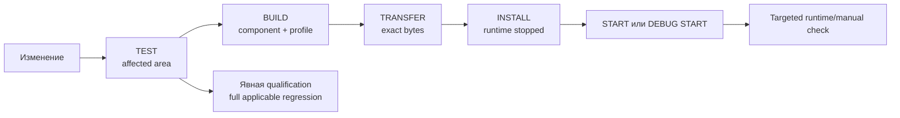

<a id="sec-8"></a>
# PHANTOM — разработка, сборка и развёртывание

Нормативные правила разработки, CI, build/deploy, совместимости конфигурации, release engineering, logs и observability.

<!-- BEGIN GENERATED TOC -->
<details>
<summary>Оглавление</summary>

- [1. Структура репозитория](#sec-8-1)
  - [1.1. Среда разработчика](#sec-8-1-1)
- [2. Общие правила исходного кода](#sec-8-2)
- [3. Симулятор EV3](#sec-8-3)
- [4. Повторное воспроизведение отслеживания](#sec-8-4)
- [5. Непрерывная интеграция](#sec-8-5)
  - [5.1. Границы фаз и место выполнения инструментов](#sec-8-5-1)
- [6. Сборка EV3](#sec-8-6)
- [7. Развёртывание EV3](#sec-8-7)
- [8. Сборка Quest](#sec-8-8)
  - [8.1. Release](#sec-8-8-1)
  - [8.2. Diagnostic](#sec-8-8-2)
- [9. Совместимость конфигурации](#sec-8-9)
- [10. Откат программного обеспечения](#sec-8-10)
- [11. Первичное сопряжение Quest и EV3](#sec-8-11)
  - [11.1. Provisioning CONTROL PSK на Quest](#sec-8-11-1)
- [12. Сетевая изоляция](#sec-8-12)
- [13. Хранение логов и инцидентов](#sec-8-13)
  - [13.1. Release](#sec-8-13-1)
  - [13.2. Diagnostic](#sec-8-13-2)
  - [13.3. Ротация и целостность](#sec-8-13-3)
- [14. Наблюдаемые показатели](#sec-8-14)

</details>
<!-- END GENERATED TOC -->

<a id="sec-8-1"></a>
## 1. Структура репозитория

Спецификация фиксирует границы исходников, артефактов и состояния. Конкретные
подкаталоги определяются кодом и build inputs; перечислять каждый файл здесь не требуется.

| Область | Ответственность |
|---|---|
| [PhantomQuest](../PhantomQuest/) | Unity-приложение, C# control core и Android adapters |
| [ev3](../ev3/) | Production controller, supervisor, network и их тесты |
| [protocol](../protocol/) | Wire/IPC schemas, semantics, генераторы и golden vectors |
| [config](../config/) | Config schemas, authored sources и generated artifacts |
| [tools](../tools/), [scripts](../scripts/), [deploy](../deploy/) | Проверки, сборка и отдельные lifecycle-фазы |
| [toolchains](../toolchains/) | Версии и locks инструментов |
| [mechanical](../mechanical/) | Сборка, BOM и физические проверки |
| `build/**`, `results/**` | Восстанавливаемые artifacts и локальные reports; не device state |


`ev3/bench/**`, `scripts/ev3-bench-*` и `tools/ev3_validation/**` являются **инженерной
оснасткой вне production и вне safety-периметра**: собственная разводка портов, прямые
`run-direct` записи и собственная привилегированная модель. Их результаты никогда не являются
DEVICE/HIL evidence production-сборки. `deploy/scripts/install-release` удаляет
`/etc/sudoers.d/phantom-ev3-bench` перед установкой и отказывается продолжать, если правило
не удалось убрать: NOPASSWD root на writable для `robot` путь обходит разделение
`phantom-ctrl`/`phantom-net`, на котором построена часть safety-аргументации [Спецификация EV3 §2.2](ev3-specification.md#sec-7-2-2).

`results/**` является полностью удаляемым локальным workspace для machine-readable runner
outputs и игнорируется Git. Ни одна lifecycle-фаза не использует local result как prerequisite
другой фазы. Требуемое долговечное TEST/BUILD/DEVICE/HIL/release evidence публикуется как
immutable CI/release artifact; status/release record хранит его URI, SHA-256 и candidate
identity, но не копирует raw logs в историю исходников. Удаление `results/**` теряет только
локальную историю.

`build/**` также является полностью удаляемым generated output. После его очистки BUILD
обязан восстановить artifacts из source/config/protocol/toolchain; credentials, SSH trust,
provisioned Wi-Fi и иное device state никогда не хранятся в `build/**`.

<a id="sec-8-1-1"></a>
### 1.1. Среда разработчика

Host-инструменты объявлены в `toolchains/host-tools.json` и разрешаются единственным модулем
`tools/toolchain.ps1`; абсолютные пути не дублируются по скриптам. Каждый инструмент имеет
override через переменную окружения:

| инструмент | зачем | override | по умолчанию |
|---|---|---|---|
| Unity Editor | Quest build, EditMode tests, Roslyn/mono для host-компиляции | `PHANTOM_UNITY_ROOT` | Hub-путь для версии из `PhantomQuest/ProjectSettings/ProjectVersion.txt` |
| `adb` | Quest PROVISION/INSTALL/START/DEVICE INTEGRATION TEST | `PHANTOM_ADB` | platform-tools из Unity Android SDK, затем `PATH` |
| WSL distribution | host-сборка и sanitizers EV3 | `PHANTOM_WSL_DISTRO` | `Ubuntu` (нужны `cmake`, `ninja-build`, `g++`) |
| Docker | pinned ARMv5TEJ cross image | — | образ по digest из `toolchains/ev3dev-stretch.lock.json` |
| Git Bash | POSIX-скрипты bench | `PHANTOM_GIT_BASH` | `C:\Program Files\Git\bin\bash.exe` |

Версия Unity закреплена самим проектом (`ProjectVersion.txt`), а не скриптом: скрипт ищет
именно её и завершается с понятным сообщением, если она не установлена.

<a id="sec-8-2"></a>
## 2. Общие правила исходного кода

Репозиторий должен обеспечивать:

- единый источник описания wire-протокола;
- единый источник схем конфигурации;
- автоматическое создание канонического хэша конфигурации; derived hash никогда не входит в байты, которые он хэширует;
- отсутствие вручную дублируемых числовых констант между Quest и EV3 там, где они должны совпадать;
- тестируемое разделение чистой математики и SDK/I/O адаптеров;
- невозможность случайно включить секретный ключ в исходники или артефакт логов;
- совместимость wire/semantics по контракту [Спецификация протокола](protocol-specification.md#sec-11-8);
- согласованность документации по [Правила спецификации](specification-governance.md#sec-specification-governance-1), проверяемая отдельно от BUILD.

<a id="sec-8-3"></a>
## 3. Симулятор EV3

До подключения физической механики должен существовать PC-симулятор, реализующий тот же сетевой протокол и state model.

Симулятор должен уметь:

- отвечать на `HELLO/HELLO_ACK`;
- публиковать/имитировать обнаруживаемый `robot_id`;
- выдавать `CALIBRATION_SAMPLE` с raw отсчёты энкодера;
- принимать `SET_JOINT_REFERENCE`;
- имитировать валидную/невалидную `DriveCalibration`;
- принимать `COMMAND` и выдавать `TELEMETRY`;
- моделировать q_ref shaping и безопасные границы;
- моделировать stall, потерю/инвалидацию reference, maintenance lock после подозрения на проблему передачи, gripper contact и gripper fault;
- имитировать latency/loss/reordering/duplicate packets;
- менять `controller_boot_id` и IP сетевой адрес;
- воспроизводить `SAFE_HOLD`, `STOPPED`, latched fault overlays (`STOPPED + fault_code`) и recovery.

<a id="sec-8-4"></a>
## 4. Повторное воспроизведение отслеживания

Инженерный инструмент `tracking-replay` должен уметь записывать и воспроизводить:

```text
head pose для XR lifecycle
Body_RightShoulder pose + validity/quality/fidelity + sample_or_query_time + receive time + timing uncertainty
Wrist pose + validity/quality + sample_or_query_time + receive time + timing uncertainty
степень сжатия + валидность
Left Grip / валидность Controller
receive timestamps / frame ids
```

Запись включается явно. Воспроизведение должно проходить через те же алгоритмы калибровки, отображения движения, рабочей области и IK, что и реальные данные.

<a id="sec-8-5"></a>
## 5. Непрерывная интеграция

CI владеет полным набором программных тестов, а BUILD — только созданием и дешёвой проверкой
конкретного deployable artifact. Обычный development cycle запускает targeted tests
затронутой области. Полный regression suite запускается только CI либо явной командой
qualification. Успех BUILD не заменяет TEST, а успешный TEST не создаёт artifact.



CI выполняет generated/schema consistency, unit/property/golden/replay/simulator/fuzz/security
tests, Quest EditMode/PlayMode, EV3 host tests и sanitizers, а также component builds. Для
release или закрытия этапа CI публикует неизменяемые test/build/device/HIL artifacts с URI,
SHA-256 и candidate identity. Локальные `results/**` являются удаляемым output и не могут
служить admission token другой фазы.

Проверка документации включает `tools/doclint.py`: каждый FR/NFR должен иметь
владельца решения и процедуру проверки в [Плане проверки §25](test-plan.md#sec-9-25),
а каждый критерий — приёмочную процедуру. Полнота этих ссылок не является evidence
прохождения TEST/DEVICE/HIL/MANUAL; финальная приёмка отдельно связывает реальные
результаты с критериями и редакцией требований.

BUILD каждого компонента завершается дешёвой проверкой именно созданных bytes: manifest,
детерминированный `build_id`, artifact SHA-256, config/protocol hashes, signing identity,
структура APK либо EV3 inventory/`SHA256SUMS`/modes и отсутствие unsafe archive paths. BUILD
пишет machine-readable result рядом с artifact; этот result описывает BUILD, но ни одна
следующая фаза не требует его сохранения — она повторно проверяет фактический input.

<a id="sec-8-5-1"></a>
### 5.1. Границы фаз и место выполнения инструментов

Каждая фаза имеет одного владельца результата и не запускает предыдущую или следующую фазу
неявно. Фаза проверяет фактический input/device state, а не наличие result-файла предыдущей
фазы. Отсутствующий артефакт, staging directory или установленный runtime означает быстрый
`FAIL`, а не автоматическую пересборку, установку или квалификацию.

| Фаза | Где выполняется | Разрешённая работа | Запрещённая скрытая работа |
|---|---|---|---|
| `TEST` | PC/CI | targeted либо явно полный software regression | build, provisioning, deployment, hardware PASS |
| `BUILD` | PC/CI | компиляция, подпись, упаковка и дешёвая проверка одного component/profile artifact | полный test suite, доступ к устройствам, provisioning, install |
| `PROVISION` | доверенная workstation + устройство | долговременные credentials, SSH trust, Wi-Fi и platform bootstrap | software build/deploy, автоматическая ротация при missing state |
| `TRANSFER` | PC→устройство | копирование во staging и сверка end-to-end SHA-256 | распаковка/activation, запуск services/app, тесты |
| `INSTALL` | устройство | hash/schema validation, атомарное размещение и выбор версии при запрещённом motion | чтение result-файлов, build, provision, host tests, runtime activation |
| `START` | устройство | bounded запуск уже установленной версии и readiness каждого runtime component | установка, fault injection, полный test suite |
| `DEBUG` | устройство + host | тот же установленный Diagnostic artifact с расширенным bounded сбором diagnostics | rebuild, изменение control/safety semantics, qualification PASS |
| `DEVICE INTEGRATION TEST` | устройство + host | автоматическая интеграция exact installed runtime, restart/fault cases и evidence | build, install, provision, HIL, неявный rollback |
| `HIL` | реальный робот | явно выбранные физические cases | подмена физических результатов software-only или DEVICE evidence |
| `MANUAL ACCEPTANCE` | пользователь + устройства | явно выбранные UX/physical cases | скрытый build/install/provision |
| `RECOVERY` | устройство | явный возврат `current` к `previous`, runtime остаётся остановленным | автоматический rollback после иного FAIL, START |

Unity Editor существует только на PC/CI: он собирает Quest APK и выполняет Quest
EditMode/PlayMode/simulator tests. Unity не входит в EV3 package, не устанавливается на EV3 и
не запускается EV3 installer’ом.

Python имеет две разные роли. На PC/CI он обслуживает generators, linters и test tooling. На
EV3 закреплённый base image предоставляет системный Python runtime для поставляемых
`phantom-network`, `phantom-mdns` и device integration runner; это runtime dependency, а не build
tool на Brick. Installer не устанавливает и не обновляет Python, не скачивает packages и не
выполняет полный `compileall`: syntax/generated/import regressions проверяются до установки,
a совместимость фактического device runtime — в bounded `START`/`DEVICE INTEGRATION TEST`.

Все hardware-side фазы обязаны иметь отдельный declared deadline, выдавать progress не реже
границ внутренних steps и сохранять machine-readable result с `build_id`, artifact SHA-256,
start/end/duration, step durations, первым непосредственным отказом и terminal safe state.
Локальная копия по умолчанию пишется в `results/**`, но отсутствие, очистка либо stale
содержимое этого каталога не меняют поведение фазы и не мешают установленному runtime.
Общий wrapper может последовательно вызвать фазы только по явному списку пользователя и
должен показывать начало/окончание каждой; имя `install` не может означать весь pipeline.

Нормативное толкование пользовательских команд:

| Намерение | Выполняемые фазы |
|---|---|
| `test` | только запрошенные/затронутые TEST |
| `build` | только BUILD указанного компонента/profile |
| `install` | TRANSFER при необходимости + INSTALL |
| `start` / `run` | только START |
| `install and start` | TRANSFER при необходимости + INSTALL + START |
| `start debug` / `run debug` | только DEBUG START тех же установленных bytes |
| `device auto` / `device integration test` | только DEVICE INTEGRATION TEST |
| `recover` | только RECOVERY |
| `qualify Stage N` / `release qualification` | только явно применимый qualification pipeline [План проверки §1](test-plan.md#sec-9-1) |

Ни `install`, ни `start`, ни `run` не подразумевают BUILD, полный regression, PROVISION,
DEVICE INTEGRATION TEST, HIL, MANUAL ACCEPTANCE или RECOVERY.


EV3 использует legacy/EOL software base: исправления уязвимостей не предполагаются
доступными. Изоляция LAN и key-based SSH ограничивают exposure, но не заменяют review
конкретного image/toolchain. Незакрытая уязвимость без documented disposition/mitigation
блокирует Release. Отчёт review публикуется вместе с release evidence; его текущая
готовность отражается в `current-status.md`.

Обязательные дополнительные CI gates для финальной baseline:

- host C++ tests с ASan/UBSan;
- `clang-tidy`/эквивалентный static analysis и C# analyzers;
- SBOM и known-vulnerability/risk record, включая legacy EV3 image/toolchain;
- SHA-256 pinned image/toolchain artifacts;
- exact datagram-length/golden-vector tests;
- sequence/session/reconnect/replay tests;
- transaction ordering/conflict/gap/no-eviction semantics tests;
- parser fuzz и controlled flood tests;
- Mermaid syntax/undefined-node lint;
- coordinate golden-vector tests OpenXR Y-up → RobotBaseFrame Z-up.
<a id="sec-8-6"></a>
## 6. Сборка EV3

BUILD принимает один явно выбранный profile:

```text
Release
Diagnostic
DeepDebug
```

По умолчанию для Stage 3 строится только `Diagnostic`; `Release` строится по явному запросу
или для release qualification. Все профили используют один control/state/safety core.
`Diagnostic` может включать engineering surfaces только через общий controller/safety path.
`DeepDebug` отличается только developer instrumentation/symbols, маркируется
`qualification_eligible=false` и никогда не принимается как qualification evidence.

Воспроизводимая baseline-кросс-сборка EV3 выполняется в legacy-образе `ev3dev/debian-stretch-cross:latest`, но release/CI никогда не полагается на изменяемый тег и запускает образ по digest:

Платформа EV3: `ARMv5TEJ / armel / gnueabi`; обязательные flags:
`-march=armv5te -mfloat-abi=soft`. Exact image/compiler versions и digest берутся из
[toolchain lock](../toolchains/ev3dev-stretch.lock.json), CMake compatibility — из
[EV3 project](../ev3/CMakeLists.txt). Эти значения не дублируются в prose.

Тег `latest` допускается только как понятное человеку имя источника при первоначальном получении образа. Фактический digest, версия и SHA-256 бинарника компилятора проверяются по `toolchains/ev3dev-stretch.lock.json`. Exact ev3dev image, установленный на Brick, его SHA-256, package snapshot/SBOM и vulnerability/risk record являются отдельными обязательными release inputs; пока они имеют `UNRESOLVED`/`PENDING`, сборка может использоваться для разработки и DEVICE INTEGRATION TEST, но не является финальным release candidate.

Документация не входит в BUILD prerequisites или identity inputs. `source_tree_hash`
исключает Markdown, reStructuredText, AsciiDoc, каталоги `docs/` и interpreter caches,
в том числе generated `protocol/protocol.md`. Prose/config consistency проверяется
отдельным documentation gate; BUILD использует machine config/protocol sources.

`build_id` является component/profile-specific **raw SHA-256[32]** (wire `u8[32]`; human/text manifest form — 64 lowercase hex symbols), а не общим номером всего проекта. Он вычисляется до packaging **только** из UTF-8 bytes RFC 8785 JCS canonical object:

```json
{
  "schema": "PHANTOM-BUILD-V4",
  "component_id": "<EV3|QUEST>",
  "build_profile": "<Release|Diagnostic|DeepDebug>",
  "source_tree_hash": "<64-hex>",
  "protocol_contract_hash": "<64-hex>",
  "component_config_hash": "<64-hex>",
  "toolchain_or_package_lock_hash": "<64-hex>"
}
```

```text
build_id = SHA-256(JCS_UTF8(build_identity_object))
```

Имена полей, отсутствие лишних полей и lowercase hex encoding нормативны; string concatenation/разделители/implementation-specific dictionary order для вычисления identity запрещены. `component_id` как минимум различает `EV3` и `QUEST`; `build_profile` различает `Release`, `Diagnostic` и `DeepDebug`. Вычисление identity централизовано в детерминированном host build tooling и покрывается golden vectors; C++/C# runtime не реализуют независимый JCS/hash алгоритм, а валидируют/передают уже вычисленный 64-hex `build_id`. `source_tree_hash` вычисляется по точным bytes объявленных component source inputs независимо от их Git status; локальные `results/**`, build outputs и прочие не-входы исключены. `git_commit` и `worktree_dirty` допускаются только как provenance-поля внешнего/embedded manifest и не входят в `build_id`. `component_config_hash` считается по semantic authored/generated config **до** добавления build identity/provenance; generated manifest с самим `build_id`, signatures и timestamps исключены из hash inputs. Hash финального `.tar.gz`/APK, signing fingerprint и wall-clock timestamp также не входят в `build_id`, иначе возникает self/provenance cycle. Qualification evidence связывает component build IDs общими protocol/config identities и точными artifact hashes, но не требует общего commit либо равенства `quest_build_id == ev3_build_id`.

Артефакт включает:

```text
phantom-controller
phantom-safety
phantom-network / phantom-mdns и Python runtime modules
phantom-device-integration-test
config.generated.json
build-manifest.json
SHA256SUMS
systemd units
tmpfiles.d policy
```

`SHA256SUMS` содержит относительные POSIX paths для всех файлов release, кроме самого `SHA256SUMS`, кодируется ASCII и использует только LF line endings. Пакет отвергается, если inventory неполон, содержит duplicate/absolute/`..` path, CRLF либо hash mismatch. `phantom-controller`, `phantom-safety` network/mDNS entrypoints и device integration runner сохраняют executable bit; остальные файлы данных не становятся исполняемыми.

`build-manifest.json` внутри EV3 release является **детерминированной embedded build identity** и не может содержать hash самого итогового архива либо wall-clock build time:

```text
component: EV3
build_identity_schema: PHANTOM-BUILD-V4
build_id
git_commit
source_tree_hash / worktree_dirty
build_profile
protocol_version
compiler/toolchain
cross_image_digest
protocol_schema_hash
protocol_semantics_hash
protocol_contract_hash
config_hash
drive_calibration_schema_version
source_date_epoch_or_reproducible_epoch
```

После создания финального `.tar.gz` pipeline создаёт **внешний** immutable artifact provenance/report (не включённый обратно в архив) с `build_id`, final `artifact_sha256`, `created_at`, signing/provenance metadata и hash embedded manifest. Это устраняет self-hash cycle и не ломает bit-for-bit reproducibility; `created_at` является provenance, а не semantic build input.

Референсная development-сборка Windows для EV3:

```powershell
powershell -NoProfile -ExecutionPolicy Bypass -File scripts/ev3-build.ps1 -Profile Diagnostic
```

Команда строит только ARM artifact выбранного profile, упаковывает его и выполняет дешёвую
artifact validation. Host tests запускаются отдельной TEST-командой. BUILD разрешён из dirty
worktree: `git_commit` и `worktree_dirty` честно записываются как provenance, но не влияют на
identity либо install permission. Упаковщик нормализует owner/group, порядок файлов, mtime и
gzip header. Профили упаковываются раздельно и не разделяют `build_id`.

Для одинаковых semantic source/config/protocol/toolchain inputs `build_identity_stable=true`
означает совпадение `build_id`. Это не равнозначно
`artifact_byte_reproducible=true`: второе требует совпадения SHA-256 двух независимо созданных
финальных artifacts. Reproducibility report обязан хранить оба признака и
`difference_class`; EV3 qualification требует обоих, а отличие Quest APK bytes требует
явного анализа toolchain nondeterminism. Старый build directory не является доказательством
ни одного свойства.

<a id="sec-8-7"></a>
## 7. Развёртывание EV3

Развёртывание принимает явно выбранный артефакт без чтения предыдущих report-файлов.
TRANSFER/INSTALL проверяют sidecar, внешний SHA-256, embedded manifest и внутренний
`SHA256SUMS`; установка сама по себе не создаёт DEVICE/HIL/Release evidence и не расширяет
motor authority.

PHANTOM развёртывается на одну заранее назначенную пару: один Quest 3 и один EV3. Штатный
maintenance hostname единственного brick — стандартный для ev3dev `ev3dev.local`; отдельный
SSH alias и сохранённый IP не используются. mDNS каждый раз разрешает актуальный адрес USB
RNDIS либо LAN, а identity brick подтверждается закреплённым SSH host fingerprint. One-time
PROVISION создаёт private workstation state вне Git/`build/**`/`results/**`: exact Quest ADB
serial, EV3 hostname, pinned SSH fingerprint, отдельный deployment private key и CONTROL PSK.
SSH policy использует `Host ev3dev.local`, `AddressFamily any` по умолчанию, root identity
file и strict host-key checking. Изменение fingerprint даёт
`HOST_KEY_MISMATCH`, недоступность имени/устройства — `DEVICE_NOT_FOUND`; auto-accept, автоматическая
подмена на найденный IP и изменение SSH/Wi-Fi запрещены. Прямой IP допускается только как
явный диагностический fallback с отдельной проверкой того же fingerprint и не становится
штатной deployment identity.

Installer работает с root privilege. Runtime identities разделены: `phantom-ctrl` (controller + motor-I/O group), `phantom-net` (UDP/HMAC + credential read), `phantom-mdns` (public identity only), dedicated `phantom-ipc`/`phantom-safety-ipc` groups; `phantom-safety` работает как root только для supervisor/takeover I/O. `/run/phantom` и его subdirectories создаются через совместимую с systemd 232 `tmpfiles.d` policy с минимальными owner/group/mode для каждого endpoint, а `/var/lib/phantom/secrets` недоступен controller/mDNS. Общая writable `phantom:phantom` область, которая одновременно даёт network и motor authority, запрещена. Общий unrestricted passwordless sudo для пользователя `robot` запрещён; maintenance harness получает только явно перечисленную команду, а production install требует отдельного контролируемого root/sudo шага.

До распаковки проверяются отсутствие absolute/`..` members, sidecar hash финального архива и
hash embedded manifest. Внутри распакованного release выполняется `sha256sum -c SHA256SUMS`,
а безопасный release id выводится только из валидного 64-hex `build_id`; commit не
используется как artifact admission key.

Каталоги:

```text
/opt/phantom/
  releases/
    <release-id>/
  current -> releases/<release-id>
  previous -> releases/<previous-id>
```

EV3 workflow разделяется на `PROVISION`, `TRANSFER`, `INSTALL`, `START`, `DEBUG START`,
`DEVICE INTEGRATION TEST` и `RECOVERY`. Они могут быть оркестрированы последовательно, но имеют отдельные команды,
deadlines, отчёты и failure semantics.

`TRANSFER` открывает минимальное число SSH/SCP sessions, копирует только
`phantom-<build_id>.tar.gz` в staging, сверяет локальный/удалённый SHA-256 и не меняет
`current`, units либо services. Installer/helpers уже установлены PROVISION-фазой и не
передаются с каждым build. Если финальный staging file уже имеет exact SHA-256, фаза
завершается `SKIPPED_ALREADY_PRESENT`; другой hash по тому же `build_id` даёт
`ARTIFACT_MISMATCH`. Новые bytes сначала передаются в `.partial`, проверяются на EV3 и только
затем атомарно переименовываются.

`INSTALL` выполняется атомарно при запрещённом motion:

```text
проверить sidecar/embedded manifest и внешний SHA-256 staging package
→ безопасно распаковать новый release directory
→ проверить schema/config hash
→ проверить inventory, внутренние SHA-256, modes и runtime prerequisites
→ остановить runtime и подтвердить terminal zero-output/safe state
→ обновить previous
→ сравнить versioned units/tmpfiles metadata с установленной
→ обновить только изменившиеся metadata; daemon-reload/tmpfiles выполнить только при изменении
→ атомарно переключить current symlink последним activation step
→ завершиться, оставив runtime остановленным
```

До переключения `current` разрешены только короткие bounded package admission checks.
Controller/safety self-tests, Python `compileall`, systemd activation, network readiness,
process kill/restart и device integration runner не являются установкой и не выполняются этой
операцией. Ошибка остановки runtime либо неподтверждённый safe state блокирует переключение;
она не игнорируется ради продолжения deployment.

`START` активирует уже установленный release по dependency graph с отдельной проверкой после
каждого шага. Минимальная последовательность: `phantom-safety` → `phantom-controller` →
быстрая read-only проверка provisioned network prerequisite → `phantom-network` →
`phantom-mdns`. ConnMan/autoconnect является platform boot/reconnect mechanism и не
запускается либо ремонтируется software START. Следующий dependent service не запускается после первого
`FAIL`. Один общий `systemctl start phantom.target` может быть transport mechanism, только
если orchestrator всё равно показывает per-service deadline/result и однозначно находит
первый непосредственный отказ, а не объявляет cascade dependency failures отдельными causes.

При startup failure сохраняются journal/status первого failed unit,
`Result`, `ExecMainCode`, `ExecMainStatus`, dependency/cascade outcomes, identity failed
release и terminal zero-output/safe state. START никогда не вызывает rollback автоматически;
failed activated release не удаляется до завершения диагностики. `START` не запускает on-device self-tests с fault injection и не
вызывает DEVICE INTEGRATION TEST. `START -Debug` запускает те же установленные Diagnostic
bytes и лишь включает/собирает расширенные bounded journal, stack/runtime/config/network
diagnostics без секретов. Если их недостаточно, отдельный BUILD `DeepDebug` создаёт
неqualification artifact.

`DEVICE INTEGRATION TEST` запускается отдельной явной командой только после успешного `START` и следует
[План проверки §1.3](test-plan.md#sec-9-1-3). Он может выполнять документированные restart/process-failure cases, но не устанавливает
release, не меняет `current` и не выполняет rollback.

Штатные host-команды используют provisioned target и вызываются по одной:

```powershell
scripts\phantom.cmd TRANSFER EV3 -Package <package.tar.gz>
scripts\phantom.cmd INSTALL EV3 -BuildId <ev3_build_id> -PackageSha256 <package_sha256>
scripts\phantom.cmd START EV3 -BuildId <ev3_build_id>
scripts\phantom.cmd DEBUG EV3 -BuildId <ev3_build_id>
scripts\phantom.cmd DEVICE EV3 -BuildId <ev3_build_id>
scripts\phantom.cmd RECOVERY EV3 -FailedBuildId <ev3_build_id>
```

Последняя команда выполняется только как явно выбранное recovery. Ни одна из остальных не
вызывает следующую автоматически. Recovery report возвращает восстановленный `build_id`; для
его отдельного запуска допускается использовать уже переданный generic start tool:
`ev3-start.ps1 -BuildId <restored>`.

`scripts/ev3-deploy-install.ps1` является явно названным convenience-orchestrator для
последовательности `TRANSFER → INSTALL`: он печатает обе границы фаз и останавливается при
первом FAIL. Это не реализация фазы `INSTALL`; стабильный dispatcher `phantom.cmd INSTALL EV3`
вызывает только INSTALL над уже переданным staging package.

Rollback/recovery является отдельной видимой операцией:

```text
остановить процессы
→ вернуть current на previous
→ восстановить versioned units/tmpfiles metadata предыдущей версии
→ подтвердить safe state и оставить JointReference invalid
→ завершить RECOVERY с остановленным runtime; START восстановленной версии — отдельная команда
```

Rollback не повторяет INSTALL/DEVICE INTEGRATION TEST и не скрывает первоначальный result. Если отдельный START восстановленной версии не проходит, система остаётся остановленной в safe state, а оба отказа записываются
раздельно. Остановка/перезапуск `phantom.target` обязана распространяться на все runtime
services через `PartOf=` либо эквивалентную явную остановку, чтобы старые процессы не
продолжали работать после смены symlink. Откат незавершённой INSTALL-транзакции восстанавливает её собственные изменения metadata:
при failed first install `current` удаляется; при failed upgrade возвращается прежний `current`.
Ошибка START сама по себе не переключает установленный release; для этого требуется RECOVERY; неуспешно распакованный staging release можно
удалить только после проверки, что canonical path находится внутри `/opt/phantom/releases/`.

Развёртывание во время `TRACKING` запрещено.

Каждая host/device lifecycle-фаза пишет самостоятельный JSON result по
`config/schema/lifecycle_result.schema.json`. Общая часть содержит как минимум
`schema_version`, `phase`, `component`, `profile`, `status`, canonical `reason`,
`duration_ms`, `terminal_state` и `hardware_evidence_state`; применимые фазы добавляют
`build_id`, artifact hash и массив timed steps. Нормальные диагностические сообщения и
stderr не смешиваются с JSON transport channel. Canonical pre-mutation failures:
`PROVISION_REQUIRED`, `PROVISION_CORRUPT`, `QUEST_NOT_FOUND`,
`QUEST_IDENTITY_MISMATCH`, `HOST_KEY_MISMATCH`, `DEVICE_NOT_FOUND` и
`ARTIFACT_MISMATCH`.

<a id="sec-8-8"></a>
## 8. Сборка Quest

Quest BUILD принимает один profile (`Diagnostic` по умолчанию для Stage 3, `Release` только
явно, `DeepDebug` только для разработки). Явно выбранный APK разрешается устанавливать
независимо от локальных reports. Quest `TRANSFER/INSTALL` ограничен проверкой sidecar/hash и `adb install -r`
уже собранного APK с последующей проверкой installed package/version/hash identity; он не
запускает Unity, не собирает APK и не выполняет app test suite. `START` отдельно запускает
установленное приложение с bounded process/readiness/credential-state check. DEVICE
INTEGRATION TEST [План проверки §1.3](test-plan.md#sec-9-1-3) проверяет exact installed build без зависимости от локального APK или
предыдущего result-файла. Routine Quest phases адресуют только exact ADB serial из complete
fixed-pair record; выбор первого подключённого Android device запрещён. Отсутствие пары,
нужного Quest или совпадения identity даёт соответственно `PROVISION_REQUIRED`,
`QUEST_NOT_FOUND` или `QUEST_IDENTITY_MISMATCH` до install/start mutation.

Штатные Quest-команды также разделены:

```powershell
scripts\phantom.cmd INSTALL QUEST -Apk <artifact.apk>
scripts\phantom.cmd START QUEST -ExpectedBuildId <quest_build_id>
scripts\phantom.cmd DEBUG QUEST -ExpectedBuildId <quest_build_id>
scripts\phantom.cmd DEVICE QUEST -ExpectedBuildId <quest_build_id>
```

INSTALL использует только preserving update (`adb install -r`) и не выполняет `adb uninstall`,
`pm clear` или удаление app-private state. Отсутствующий/нечитаемый CONTROL credential даёт
`PROVISION_REQUIRED`/`PROVISION_CORRUPT` соответственно; START/INSTALL не копируют secret и не
пытаются исправить состояние автоматически.


<a id="sec-8-8-1"></a>
### 8.1. Release

- оптимизированная сборка;
- обычный русский пользовательский UI;
- штатная телеметрия;
- только критические/агрегированные логи;
- raw XR trajectory recording выключена;
- engineering panels скрыты.

<a id="sec-8-8-2"></a>
### 8.2. Diagnostic

- тот же control/state/safety code;
- расширенный engineering UI;
- `DIAGNOSTIC_TELEMETRY`;
- явно сконфигурированные `qualification_only`/`actuator_scope_mask`/`safety_observation_mask` для HIL milestones, причём actuator authority всё равно требует commissioning key + локальный arm/confirmation;
- QR/encoder residuals, raw tracking и сетевые counters при явном включении;
- symbols допускаются; Unity Development Build и profiler instrumentation относятся только к неквалифицированному DeepDebug.

Normal DEBUG START не требует нового APK и отличается только host/runtime verbosity и
сбором diagnostics. `DeepDebug` разрешает дополнительную instrumentation, имеет отдельный
`build_id` и `qualification_eligible=false`.

Diagnostic qualification не является альтернативным пользовательским режимом и не может перейти в `READY`, если bundle неполный. Release binary/config отвергает `qualification_only=true`.

Каждый APK встраивают **детерминированную build identity**, которая не содержит hash самого APK:

```yaml
build:
  component: QUEST
  build_id: ...
  app_version: 1.x.y
  git_commit: ...
  source_tree_hash: ...
  worktree_dirty: false
  build_profile: Release|Diagnostic|DeepDebug
  protocol_version: 1
  protocol_schema_hash: ...
  protocol_semantics_hash: ...
  protocol_contract_hash: ...
  unity_version: ...
  package_lock_sha256: ...
  meta_xr_core_version: ...
  movement_sdk_version: ...
  body_tracking_provider: ...
  mruk_version: ...
  openxr_plugin_version: ...
  meta_openxr_version: ...
  xr_hands_version: ...
  quest_config_hash: ...
  target_sdk: ...
  local_network_permission_mode: ...
```

Смежный **внешний** `*.build-manifest.json`, создаваемый после финальной подписи APK, дополнительно содержит `apk_sha256`, signing certificate fingerprint/key id (без secret) и provenance `created_at`; он ссылается на hash embedded identity и не встраивается обратно в APK.

Обновление Unity/OpenXR/Meta packages требует повторных platform/integration tests.

Baseline собирается Unity Editor версии из [ProjectVersion.txt](../PhantomQuest/ProjectSettings/ProjectVersion.txt) в batch mode вызовом `Phantom.Editor.PhantomBuild.BuildAndroid`. Входы signing передаются только через локальные файлы/переменные окружения, отсутствующие в Git: путь к keystore, файл пароля, alias и Meta App ID. Ожидаемый artifact создаётся только для выбранного profile в `build/quest/` с соседними `*.build-manifest.json` и `*.build-result.json`. Release и Diagnostic подписываются разрешённым ключом, но Diagnostic отличается только разрешёнными [§8.2](#sec-8-8-2) поверхностями.

Перед `BuildPipeline.BuildPlayer` build process временно встраивает в APK exact **semantic build identity без `apk_sha256`/wall-clock provenance** и `quest.generated.json`, чтобы установленное приложение могло само сообщить `build_id` и проверить config hash. После финальной подписи отдельный host step вычисляет `apk_sha256` и формирует смежный внешний manifest. После сборки временные Resources удаляются, signing/development settings восстанавливаются и сохраняются; путь к локальному keystore, alias и профиль не должны оставлять tracked diff. После каждого профиля Gradle daemon штатно останавливается, чтобы последовательная сборка Release→Diagnostic на Windows не зависела от удерживаемого handle в сгенерированном launcher.

Для текущей pinned Meta XR matrix BUILD обязан проверить в APK как минимум:

```text
android.permission.INTERNET
# platform-conditional LAN access: target API 37+ -> android.permission.ACCESS_LOCAL_NETWORK;
# Android 16 restriction-opt-in/testing -> android.permission.NEARBY_WIFI_DEVICES where required
com.oculus.permission.HAND_TRACKING
com.oculus.permission.BODY_TRACKING
com.oculus.permission.USE_SCENE
com.oculus.permission.USE_ANCHOR_API
```

Build pipeline выбирает LAN permission policy по actual `targetSdk`/platform APIs, а DEVICE/P0 проверяет её на установленном runtime. Для target API 37+ default v1 использует broad `ACCESS_LOCAL_NETWORK`, поскольку PHANTOM автоматически выбирает configured `robot_id` и открывает UDP; переход на system-mediated per-service NSD access допускается только как отдельная UX/security revision. Для старых platform extension combinations adapter отдельно тестирует необходимость foreground multicast lock и всегда освобождает его по lifecycle. Denied/revoked permission не деградирует в hardcoded IP.

Build-time manifest фиксирует версии Unity и пакетов. Фактический Horizon OS/runtime конкретного Quest неизвестен сборщику APK и записывается в DEVICE/P0 qualification report вместе с `build_id` и внешним `apk_sha256`; только эта связанная пара документов образует tested platform matrix.

<a id="sec-8-9"></a>
## 9. Совместимость конфигурации

Каждая persistent конфигурация разделяет детерминированное содержимое и provenance:

```text
semantic_payload:
  schema_version
  revision
  safety/config fields или component hashes
content_hash = SHA-256(JCS(semantic_payload))

provenance_sidecar:         # отдельный artifact; не входит в content_hash
  semantic_content_hash
  created_by_build
  created_at
  transaction_id / evidence reference, если применимо
```

Build/commissioning pipeline сохраняет `semantic_payload` как отдельный canonical JCS JSON artifact и provenance как отдельный sidecar/envelope. Runtime actuator path проверяет SHA-256 **установленных semantic artifact bytes**; повторная runtime-сериализация объекта ради hash запрещена. Provenance sidecar может иметь собственный file hash и обязан ссылаться на `semantic_content_hash`, но его отсутствие/другое время создания не меняет actuator compatibility.

`CommissioningBundle` использует тот же принцип. `commissioning_bundle_hash = SHA-256(JCS(bundle_semantic_payload))` хранится только в envelope/manifest/runtime metadata и **никогда не включается в `bundle_semantic_payload`**, иначе возник бы рекурсивный self-hash. То же правило действует для component hashes: hash компонента находится в содержащем его bundle/envelope, но не внутри bytes самого компонента. `commissioning_bundle_hash` не должен зависеть от wall-clock Quest/EV3, имени workstation или иных локально созданных metadata; provenance не участвует в actuator compatibility decision.

Чтобы `bundle_id` не создавал циклический или недетерминированный hash, он **не входит** в `semantic_payload`. После вычисления `commissioning_bundle_hash` он детерминированно выводится как:

```text
bundle_id = "cb-" + lowercase_hex(first_16_bytes(commissioning_bundle_hash))
```

Следовательно, Quest и EV3 независимо получают один и тот же `bundle_id`; случайный UUID/timestamp/hostname не может участвовать в идентичности bundle.


**Нормативный путь установки geometry/safety artifacts.** Runtime UDP v1 намеренно не имеет `SET_ROBOT_GEOMETRY`/chunked file-transfer сообщений: `RobotGeometry`, `RobotCollisionModel`, PayloadProfiles и `JointSafeSet` могут быть больше безопасного control datagram и не должны частично обновляться через actuator protocol. Engineering calibration сохраняет candidate geometry на Quest/commissioning workstation как canonical semantic artifact; host tooling собирает полный **qualification-only production-candidate** `CommissioningBundle`, выполняет schema/offline collision/traceability gates и устанавливает **одни и те же canonical component bytes** на EV3 и Quest maintenance path (ADB для Quest package/profile; SSH/USB maintenance installer для EV3) только при запрещённом motion. Production `qualification_only=false` revision из этого component set создаётся отдельным release-tooling step только после PASS `QualificationEvidenceManifest`; component bytes/hashes менять при promotion запрещено, кроме добавления/ссылки на evidence manifest и production qualification metadata, поэтому изменение geometry/calibration после HIL требует новой qualification. EV3 activation выполняется temp+fsync+atomic rename/symlink swap с сохранением предыдущей revision. После установки все runtime sessions/references invalid, затем новый `HELLO` обязан вернуть ожидаемый `commissioning_bundle_hash` до любой reference/motion. Если deploy одной стороны не завершён, hash mismatch fail-closed; частично активированный bundle не используется.

`SET_DRIVE_CALIBRATION` остаётся специализированной bounded commissioning transaction для калибровочного subset и использует ACK-loss reconciliation [Спецификация протокола §2.5](protocol-specification.md#sec-4-7-5); финальная сборка/замена geometry/collision/safe-set всё равно проходит описанный artifact deployment gate.

Правила:

- изменение передачи, motor mounting, encoder semantics или `encoder_scale` требует новой `DriveCalibration`;
- изменение QR-держателя/крепления, оси, `L1`, `L2`, положения пола относительно Shoulder или TCP требует новой `RobotGeometry` revision;
- изменение Base mechanical hard-stop/cable routing или pitch mechanical range требует повторной инженерной калибровки safe bounds;
- перезапуск EV3 **или `phantom-controller`/смена `controller_boot_id`** не уничтожает persistent `DriveCalibration`, но всегда инвалидирует runtime `JointReference`/`GripperReference` текущего запуска и старые sessions;
- принятие нового `DriveCalibration` создаёт новую immutable `CommissioningBundle` revision детерминированной заменой только соответствующего component и `new_bundle_revision = previous_bundle_revision + 1`; скрытое редактирование уже активной revision запрещено;
- после активации новой bundle revision все существующие sessions считаются config-stale для actuator authority и закрываются; новый `HELLO` обязан увидеть новый `commissioning_bundle_hash` до reference/motion;
- Quest и EV3 независимо вычисляют hash candidate bundle из одних canonical components; mismatch блокирует motion и требует исправления provisioning/artefacts;
- смена HMAC key требует новой сетевой сессии;
- изменение только UI не инвалидирует RobotGeometry/DriveCalibration.

<a id="sec-8-10"></a>
## 10. Откат программного обеспечения

Откат допускается только на сборку, которая понимает текущую схему конфигурации, **текущую нормативную семантику протокола** и ранее прошла применимые TEST/DEVICE INTEGRATION TEST/HIL gates для того же либо явно совместимого safety-critical component set. Простое совпадение `protocol major`/JSON schema version недостаточно: если более новая ревизия изменила state/handshake/safety semantics без изменения major, старый build не считается автоматически совместимым. Rollback tooling сверяет `protocol_contract_hash`, semantic config migrations, `CommissioningBundle`/component hashes и applicable qualification evidence; при отсутствии доказанной совместимости rollback выполняется только в maintenance/no-motion режиме до новой qualification.

После любого отката EV3:

```text
JointReference = invalid
старый session = invalid
новый controller_boot_id
```

Encoder offsets предыдущего запуска не восстанавливаются; требуется новая QR-привязка.

<a id="sec-8-11"></a>
## 11. Первичное сопряжение Quest и EV3

PHANTOM предусматривает **два независимых PSK**, а не один общий секрет; конкретный scope
provisioning определяется этапом:

```text
control PSK        -> HELLO role=CONTROL / обычный COMMAND
commissioning PSK  -> HELLO role=COMMISSIONING / CALIBRATION_JOG / calibration writes / ACTUATOR_QUALIFICATION
```

CONTROL PSK обязателен начиная с network-only Stage 3. Commissioning PSK впервые появляется
только на этапе с commissioning/motor authority и не provisioned, не проверяется и не
блокирует Stage-3 BUILD/START/DEVICE INTEGRATION TEST.

Процедура provisioning для применимых текущему этапу slots:

1. доверенная workstation генерирует CSPRNG независимый секрет минимум 32 случайных байта для каждого применимого slot;
2. секреты получают разные `key_id`/key slots (`phantom01-control`, `phantom01-commissioning`) и не выводятся друг из друга KDF без отдельного пересмотра threat model;
3. применимые секреты устанавливаются на EV3 в раздельные защищённые credential files/slots с минимальными permissions;
4. control PSK передаётся на Quest вне исполнительного UDP-протокола и хранится через app-private credential service; plaintext в `PlayerPrefs`, Resources/StreamingAssets или build manifest запрещён. Android Keystore используется для wrapping/encryption key там, где он доступен текущему Quest runtime, а фактический backend/permissions фиксируются P0/DEVICE evidence. Порядок provisioning описан в [§11.1](#sec-8-11-1);
5. commissioning PSK устанавливается только в доверенный Diagnostic/engineering credential store; Release profile не должен иметь доступного `commissioning_key_id`/секрета;
6. role/key-slot mismatch отклоняется до создания session: control PSK не авторизует commissioning operations, commissioning role не повышается из CONTROL session;
7. ротация каждого ключа выполняется независимо только при запрещённом actuator motion; после ротации соответствующие sessions инвалидируются и обе стороны должны получить согласованный новый credential;
8. секреты не входят в Git, build manifest, `CommissioningBundle`, обычные логи или telemetry; там допускаются только `key_id`/slot metadata.

Для текущей фиксированной пары provisioning выполняется одной явной idempotent операцией
`phantom.cmd PROVISION PAIR`. Complete local record хранится по умолчанию в
`%LOCALAPPDATA%\PHANTOM\pair.json`, а deployment SSH key, pinned `known_hosts` и CONTROL PSK —
в соседних private subdirectories с ограниченным ACL. Record записывается атомарно последним,
только после успешного EV3 и Quest provisioning. Повтор при complete/valid state возвращает
`ALREADY_PROVISIONED`; partial/corrupt state не ремонтируется молча и требует явного
`-Repair`. Repair не разрешает silent fingerprint repin либо secret rotation: новый trusted
fingerprint и любые заменяемые credentials задаются оператором явно при запрещённом motion
через отдельные `-RepinHost`, `-RotateSshKey` и `-RotateControlSecret`.
Routine TEST/BUILD/TRANSFER/INSTALL/START/DEBUG/DEVICE/RECOVERY никогда не создают и не
изменяют pair state.

Проверенный EV3 layout для control credential: `/var/lib/phantom/secrets/control.psk`, каталог `root:phantom-net 0750`, файл `root:phantom-net 0640`, `key_slot=0`. Только `phantom-net` читает wire PSK; `phantom-ctrl`, `phantom-mdns` и helpers не получают эту группу/файл. Commissioning credential имеет тот же owner model, но устанавливается отдельной PROVISION-операцией только с этапа, реально вводящего commissioning. Loader принимает минимум 32 raw random bytes; совместимый provisioning также может хранить ровно 64 ASCII hex symbols, декодируемых в 32 bytes. Содержимое не выводится даже при startup/config error. Commissioning PSK хранится отдельным файлом/slot и не требуется для network-only gate.

Такое разделение является обязательным для этапов 4–5: раннее управление Gripper остаётся engineering qualification и не получает commissioning authority из обычного control credential.

<a id="sec-8-11-1"></a>
### 11.1. Provisioning CONTROL PSK на Quest

Без установленного credential аутентифицированная CONTROL session физически невозможна,
поэтому этот путь является частью Stage-3 exit criteria, а не опциональным удобством.

```text
доверенная commissioning workstation
  → scripts/quest-provision-credential.ps1 -KeyFile <вне репозитория>
  → adb push в app-specific provisioning directory
  → первый запуск Diagnostic-сборки: importProvisioningDrop()
  → AES-GCM ciphertext в app-private preferences, wrapping key в Android Keystore
  → plaintext drop перезаписывается нулями и удаляется
  → START read-only status: control credential ready
  → DEVICE INTEGRATION TEST строка quest-control-credential-ready = PASS
```

Обязательные свойства:

- ключ никогда не является аргументом командной строки, не печатается скриптом, не попадает в
  APK, `Resources`, `StreamingAssets`, build manifest, build identity или обычные logs;
  наружу выходит только факт наличия credential;
- импорт выполняется один раз; после успешного или отклонённого импорта plaintext-файл
  перезаписывается и удаляется после обработки. Это сокращает время хранения plaintext,
  но не гарантирует физическое стирание flash blocks или резервных копий;
- принимаются только 32+ случайных байта либо ровно 64 ASCII hex-символа (`NFR-SEC-02`);
- путь доступен **только** в `Diagnostic`: Release-сборка не импортирует provisioning drop;
- отсутствующий credential fail-closed и классифицируется как `PROVISION_REQUIRED`;
  read/decrypt/storage failure классифицируется отдельно как `PROVISION_CORRUPT`; в обоих
  случаях клиент остаётся в `AuthenticationFailure` и не отправляет `HELLO`;
- provisioning drop проходит через app-specific external storage, что является известным
  ограничением инженерного пути на неотлаживаемой сборке; окно существования drop
  ограничено одним запуском приложения, и это допущение действует только внутри доверенной
  изолированной лаборатории [§12](#sec-8-12).

Commissioning PSK использует ту же механику с отдельным `key_id` и появляется вместе с
этапом, который его требует.

CONTROL credential является persistent device provisioning state. Stable package id,
app-private preference namespace, Android Keystore alias и wrapping format version не
меняются между обычными Diagnostic/Release updates. `adb install -r` обязан сохранять
credential; provisioning повторяется только для нового/factory-reset Quest, explicit app-data
reset, rotation или recovery. BUILD, INSTALL, START, DEBUG и DEVICE INTEGRATION TEST не
создают, не копируют, не ротируют и не удаляют credential.

Регрессия `scripts/quest-credential-persistence-test.ps1` выполняет на реальном Quest только
по явному запросу: PROVISION → INSTALL/START build A → preserving `adb install -r` build B →
START build B. Она требует два разных `build_id`, не записывает secret и доказывает, что
package id `dev.phantom.questprototype`, preferences namespace `phantom.credentials.v1` и
Keystore alias `dev.phantom.control-credential.v1` переживают обычное обновление. Наличие
файла без успешного decrypt не считается readiness: `absent` и `corrupt` — разные состояния.

<a id="sec-8-12"></a>
## 12. Сетевая изоляция

EV3 должен принимать исполнительный UDP-трафик только из настроенной локальной сети.

Первичная настройка SSID/пароля для WNA1100 является инженерным provisioning шагом (локальная консоль/USB/SSH из доверенной сети или эквивалентный администрируемый path) и выполняется до обычного запуска этапа 3. Credential хранится только в локальной сетевой конфигурации EV3 с ограниченными правами, не экспортируется в PHANTOM logs/bundle и не передаётся через UDP protocol. После provisioning EV3 обязан автоматически поднимать эту сеть при boot/reconnect без PC; смена сети является отдельной инженерной операцией.

На проверенном ev3dev Stretch сетью управляет существующий `ConnMan 1.36`; второй network manager запрещён. ConnMan profile обязан быть явно provisioned с `Favorite=true` и `AutoConnect=true`, а его settings доступны только root. Так как USB probe `ath9k_htc` может завершиться позже запуска `connmand`, provisioned platform unit `phantom-wifi-autoconnect` выполняет bounded boot recovery: динамически обнаруживает wireless interface через `/sys/class/net/*/wireless`, выбирает только уже сохранённые Favorite+AutoConnect profiles и просит ConnMan подключить их. Unit/helper принадлежат platform PROVISION state и не поставляются/не запускаются каждой software release. Обычный START только быстро проверяет готовый interface/address и при отсутствии завершает `NETWORK_NOT_READY`; он не ремонтирует Wi-Fi. Helper никогда не читает, не копирует и не печатает `Passphrase`, не содержит SSID/credential в репозитории и завершается с ошибкой после bounded timeout. Обычный link down/up после boot восстанавливается самим ConnMan; helper не становится конкурирующим daemon.

SSH используется только для инженерного обслуживания. Для него должны применяться ключи, а не пароль как основной способ автоматического развёртывания.

Исполнительный `phantom-network` UDP socket в Release должен bind-иться к адресу/интерфейсу provisioned Wi-Fi LAN, а не к `0.0.0.0` при наличии иных routable interfaces. Host firewall (на ev3dev Stretch — воспроизводимо provisioned `iptables`/эквивалент с сохранённой конфигурацией) разрешает CONTROL/COMMISSIONING UDP только с configured trusted subnet на этом интерфейсе; loopback допускается только для явно определённых local tests. Default policy для исполнительного порта на остальных интерфейсах/источниках — drop/reject до user-space parser. Discovery mDNS ограничивается link-local LAN semantics.

Проброс исполнительного порта (`port forwarding`), UPnP/NAT-PMP automatic publication и Internet-facing route запрещены. Provisioning/DEVICE INTEGRATION TEST обязаны проверять effective bind address, firewall rules и отсутствие неожиданного listener на других интерфейсах; после смены SSID/subnet эти проверки повторяются до допуска HIL/Release.

<a id="sec-8-13"></a>
## 13. Хранение логов и инцидентов

<a id="sec-8-13-1"></a>
### 13.1. Release

Обычные локальные журнал событий и incident packages хранятся до первого ограничения:

```text
7 суток
или
250 MB
```

Incident package содержит metadata/event log и сохранённый FlightRecorder вокруг конкретного сбоя. Passthrough image/video не сохраняются.

<a id="sec-8-13-2"></a>
### 13.2. Diagnostic

Расширенные логи имеют отдельную rotation policy и могут занимать больший лимит, заданный engineering config. Запись частой XR/motor telemetry включается явно и имеет видимый индикатор диагностической записи.

<a id="sec-8-13-3"></a>
### 13.3. Ротация и целостность

- сначала удаляются наиболее давние non-incident diagnostic files;
- затем обычные журнал событий вне retention window;
- incident package не должен удаляться раньше минимального retention срока, если есть место для безопасной работы системы;
- запись выполняется через temporary file + atomic rename, где это применимо;
- при старте controller создаётся маленький `runtime-active` маркер, удаляемый только при корректном shutdown; если маркер найден после следующего boot, создаётся `UNCLEAN_SHUTDOWN` event, что позволяет зафиксировать power loss/process termination даже когда предыдущий процесс физически не успел записать fault;
- неполный файл после power loss распознаётся при следующем запуск и помечается как incomplete;
- ошибка удаления/записи не влияет на цикл управления моторами и приводит к `LOG_STORAGE_DEGRADED` telemetry/event при первой возможности.

<a id="sec-8-14"></a>
## 14. Наблюдаемые показатели

Quest Diagnostic UI может показывать:

```text
state / fault
service discovery status / current endpoint
RTT p50/p95/p99
packet loss / telemetry age
q_target / q_actual
QR visibility and residuals
workspace projection count
Body_RightShoulder/Wrist tracking quality/status and age
human_arm_reach calibration quality
tracking loss/dropout counters
XR CPU/GPU frame time / dropped frames / app refresh target
managed allocation / GC counters в frame-critical path
auth failure counters
incident/log storage status
```

EV3 Diagnostic измеряет:

```text
loop dt p50/p95/p99/max
loop overruns
command age
accepted/dropped/auth-failed packets
raw encoder / q_ref / q_actual error
duty saturation time
stall candidates
motor stress / high-duty time
backlash take-up state
LOCAL_STOP state
fault counters
battery voltage
process CPU time / RSS
RX/telemetry/logger queue high-water marks
log drops
```

В `Release` наружу выводятся только агрегированные/критические subset, необходимый для эксплуатации.
