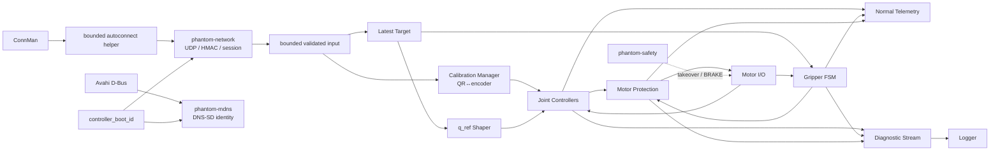
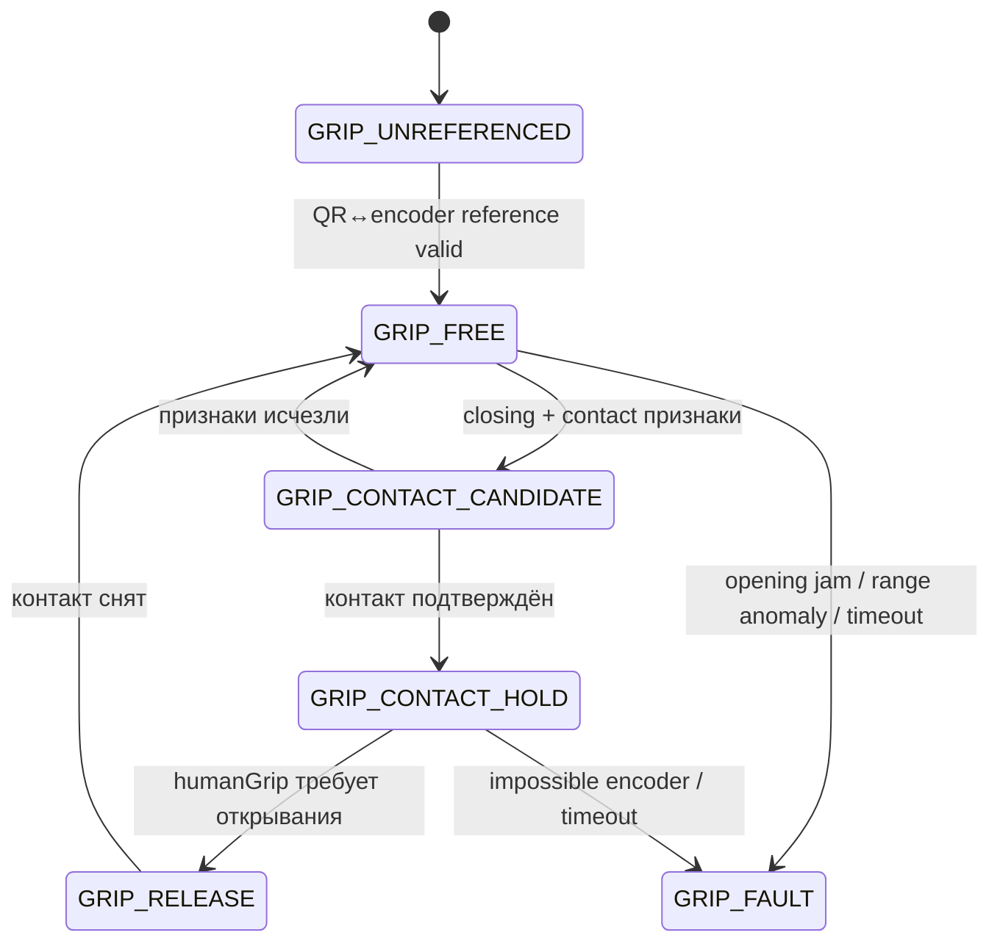

<a id="sec-7"></a>
# PHANTOM — спецификация EV3

EV3 принимает цели от Quest, управляет приводами по энкодерам и применяет локальные ограничения и защиты.

<!-- BEGIN GENERATED TOC -->
<details>
<summary>Оглавление</summary>

- [1. Среда выполнения](#sec-7-1)
- [2. Процессы](#sec-7-2)
  - [2.1. `phantom-controller`](#sec-7-2-1)
  - [2.2. `phantom-network`](#sec-7-2-2)
  - [2.3. `phantom-mdns`](#sec-7-2-3)
  - [2.4. `phantom-safety`](#sec-7-2-4)
  - [2.5. `phantom-wifi-autoconnect`](#sec-7-2-5)
- [3. Единственный владелец моторных команд](#sec-7-3)
- [4. Инициализация EV3](#sec-7-4)
- [5. Реализация QR↔энкодерной калибровки Base/Shoulder/Elbow на EV3](#sec-7-5)
  - [5.1. Абсолютный отсчёт энкодера как основной источник положения на стороне EV3](#sec-7-5-1)
  - [5.2. `CALIBRATION_JOG`](#sec-7-5-2)
  - [5.3. Атомарное калибровочное измерение](#sec-7-5-3)
  - [5.4. `JointReference` при запуске](#sec-7-5-4)
  - [5.5. Смена направления и выбор люфта](#sec-7-5-5)
  - [5.6. Валидация и инвалидация](#sec-7-5-6)
- [6. Привязка энкодера захвата к фактическому раскрытию](#sec-7-6)
- [7. Основной цикл управления](#sec-7-7)
  - [7.1. Частота и планирование](#sec-7-7-1)
  - [7.2. Подготовка до допуска real-time движения](#sec-7-7-2)
  - [7.3. Состав критического участка](#sec-7-7-3)
  - [7.4. Политика превышения периода](#sec-7-7-4)
- [8. Приём сетевой цели](#sec-7-8)
- [9. Контроль свежести сетевой команды](#sec-7-9)
- [10. Формирование опорной траектории q_ref](#sec-7-10)
- [11. Регулятор суставов](#sec-7-11)
- [12. Модель гравитации и преобразование момента в duty](#sec-7-12)
- [13. HOLD, SAFE_HOLD и qualification inhibit](#sec-7-13)
- [14. Защита суставов от перегрузки, заклинивания и проскальзывания](#sec-7-14)
  - [14.1. Ошибка следования](#sec-7-14-1)
  - [14.2. Двухступенчатое обнаружение препятствия и заклинивания](#sec-7-14-2)
  - [14.3. Ограничение мощности и реверса](#sec-7-14-3)
  - [14.4. `MotorStressScore`: защита от длительной нагрузки](#sec-7-14-4)
  - [14.5. Удержание без работы мотора на износ](#sec-7-14-5)
  - [14.6. Что можно и нельзя обнаружить по энкодеру мотора](#sec-7-14-6)
  - [14.7. Защита с учётом напряжения батареи](#sec-7-14-7)
- [15. Автомат захвата](#sec-7-15)
  - [15.1. Обычное управление](#sec-7-15-1)
  - [15.2. Кандидат контакта](#sec-7-15-2)
  - [15.3. Подтверждённый контакт](#sec-7-15-3)
  - [15.4. Освобождение](#sec-7-15-4)
  - [15.5. Ошибки](#sec-7-15-5)
- [16. Калиброванные безопасные границы и `JointSafeSet`](#sec-7-16)
- [17. Поведение при LOCAL_STOP](#sec-7-17)
- [18. Поведение при потере питания](#sec-7-18)
- [19. Телеметрия](#sec-7-19)
  - [19.1. Штатная `TELEMETRY`](#sec-7-19-1)
  - [19.2. `DIAGNOSTIC_TELEMETRY`](#sec-7-19-2)
- [20. Логирование, FlightRecorder и профили сборки](#sec-7-20)
  - [20.1. Структурированные события](#sec-7-20-1)
  - [20.2. EV3 `FlightRecorder`](#sec-7-20-2)
  - [20.3. Минимальный аварийный журнал `phantom-safety`](#sec-7-20-3)
  - [20.4. Контекст инцидента на Quest](#sec-7-20-4)
  - [20.5. Release](#sec-7-20-5)
  - [20.6. Diagnostic](#sec-7-20-6)
  - [20.7. Реализация очередей и файлов](#sec-7-20-7)
- [21. Конфигурация EV3](#sec-7-21)
  - [21.1. Поля, которые обязан загружать runtime](#sec-7-21-1)
  - [21.2. Поля будущих этапов](#sec-7-21-2)
- [22. Обнаружение EV3 и установление соединения](#sec-7-22)
- [23. Ограничение частоты пакетов и защита парсера](#sec-7-23)
- [24. Сетевые, моторные и процессные сценарии отказа](#sec-7-24)
  - [24.1. Сценарии](#sec-ev3-specification-24-1)

</details>
<!-- END GENERATED TOC -->

<a id="sec-7-1"></a>
## 1. Среда выполнения

Целевая среда v1:

```text
ev3dev Stretch class system (legacy/EOL)
ARMv5TEJ / armel / gnueabi
C++14
systemd 232 compatibility baseline
Python 3.5 compatibility для device/deployment helpers
```

Этот software base рассматривается как legacy/EOL: он допускается для исследовательского прототипа только с pinned image SHA-256, pinned toolchain, SBOM, vulnerability/risk record, SSH keys и изолированной LAN без Internet exposure. Код компилируется вне EV3 кросс-компилятором. На EV3 устанавливаются готовые бинарные артефакты и конфигурация.

Hardware-specific sysfs код изолируется за интерфейсом `MotorBackend` (`Ev3SysfsBackend` в v1). State machine, safety policy, protocol, trajectory/reference и controller math не должны зависеть от EV3 sysfs API, чтобы future controller migration не требовала изменения управляющей семантики.

Все устанавливаемые unit-файлы обязаны проходить `systemd-analyze verify` на реальном baseline systemd 232. Директивы, появившиеся позже systemd 232 (например, `StateDirectory=`, `LogsDirectory=` или `RuntimeDirectoryPreserve=`), запрещены без совместимого fallback. Вспомогательные скрипты, выполняемые на Brick, не используют синтаксис/API Python новее 3.5 до смены pinned ev3dev image.

Синтаксис Python-компонентов EV3 проверяется совместимым runtime в TEST/BUILD. INSTALL не выполняет `compileall` или self-test; границы фаз определены в [Разработка и развёртывание](engineering.md#sec-8-5-1). Сетевые long-lived services используют `Type=notify` и объявляют READY только после фактического открытия UDP listener либо успешной DNS-SD publication. Для проверенного legacy Brick startup timeout этих services равен `90 s`: медленный cold import на ARMv5TEJ не должен создавать ложный restart loop, но отсутствие READY по истечении timeout остаётся ошибкой запуска.

Точный fingerprint выбранного Brick (образ, kernel, machine, systemd и Python)
фиксируется в DEVICE/release evidence вместе с SHA-256 полного ev3dev image и SBOM.
Наличие совместимой версии systemd/Python само по себе не заменяет этот release gate
из [Требований к продукту §4.7](product-requirements.md#sec-3-2-7) и
[Разработки и развёртывания §5](engineering.md#sec-8-5).

<a id="sec-7-2"></a>
## 2. Процессы

EV3 runtime содержит четыре long-lived PHANTOM service и один bounded boot helper:

1. `phantom-controller` — моторный/state-machine процесс, владелец controller boot identity и heartbeat;
2. `phantom-safety` — отдельный software supervisor основного процесса и `LOCAL_STOP` на том же EV3; он не является независимым аппаратным safety channel;
3. `phantom-network` — изолированный UDP/HMAC/session/telemetry worker;
4. `phantom-mdns` — publisher DNS-SD identity через системный Avahi;
5. `phantom-wifi-autoconnect` — `oneshot` helper для уже provisioned ConnMan profile; после успешного подключения он не остаётся сетевым менеджером.

В network-only profile worker/publisher могут быть совместимыми с Python 3.5 отдельными процессами. Они не выполняются внутри 50-Hz motor loop. Переход к иному языку реализации не должен объединять socket receive, HMAC, DNS/mDNS, packet parsing, filesystem I/O, string formatting или blocking logging с критическим motor-loop path.

`phantom.target` требует `phantom-safety` и только wants остальные PHANTOM units: отказ controller/network/mDNS не должен останавливать supervisor. Wi-Fi helper запускается после `connman` и до controller/network/mDNS; network требует готовый controller boot identity; mDNS требует network и `avahi-daemon`. Restart controller обязан быть обнаружен network/mDNS plane: старая session инвалидируется, TXT перепубликуется с новым boot id; workers могут остаться запущенными либо безопасно перезапуститься. Safety при этом не останавливается.



<a id="sec-7-2-1"></a>
### 2.1. `phantom-controller`

Процесс выполняет:

- создание нового CSPRNG `controller_boot_id` при каждом запуске и атомарную публикацию его локальным network/mDNS workers;
- QR↔энкодер инженерная калибровка/reference protocol;
- хранение последней валидной цели;
- цикл управления моторами `50 Hz`;
- safe-bound checks;
- `q_ref` shaping;
- PD + feed-forward;
- stall/tracking protection;
- gripper contact/stall logic;
- normal и diagnostic telemetry;
- heartbeat к `phantom-safety` и контроль обратного heartbeat;
- неблокирующее логирование.

<a id="sec-7-2-2"></a>
### 2.2. `phantom-network`

`phantom-network` является сетевым фронтендом **без actuator authority и без прямого motor-write path**. Он проверяет exact packet bounds, protocol/header/reserved fields, HMAC, `robot_id`, role/key slot, current `controller_boot_id`, endpoint/session и wire `sequence`, отвечает на `PING`, ограничивает входной поток и сериализует `TELEMETRY`. Он запускается **без** прав записи motor sysfs и сам по себе не может создавать CONTROL/COMMISSIONING actuator authority, менять reference/calibration/payload/fault state либо принимать решение о локальном commissioning arm.

Это разделение является **fault-containment boundary, а не Byzantine/security sandbox**. Оно обязано выдерживать crash/restart worker, loss/overflow, malformed/duplicated/stale IPC, повреждённую/ошибочную сетевую datagram и parser rejection без прямой записи motor sysfs или обхода controller safety predicates. Однако `phantom-network` владеет wire PSK и является частью trusted computing base для результата HMAC/session authentication: спецификация v1 **не утверждает**, что произвольно скомпрометированный либо логически Byzantine `phantom-network`, который сознательно генерирует syntactically-valid IPC от собственного разрешённого service identity, криптографически изолирован от actuator path. Controller уменьшает последствия такого класса ошибок повторной проверкой state/scope/reference/re-arm/safety predicates, но не может независимо доказать исходную сетевую аутентичность, не владея wire key. Компрометация EV3 OS/root или trusted runtime process находится вне v1 remote-LAN threat model и рассматривается как common-mode host compromise; `POWER_CUT`, host hardening и контролируемый provisioning остаются обязательными. Это ограничение не ослабляет HMAC/LAN-isolation требования к удалённому сетевому атакующему.

Граница `phantom-network ↔ phantom-controller` является отдельным safety boundary. Обмен идёт только через nonblocking `AF_UNIX/SOCK_DGRAM` endpoints в заранее созданных `tmpfiles.d` runtime-каталогах. Процесс-владелец создаёт socket endpoint до объявления readiness, устанавливает group `phantom-ipc` и mode `0660`, а peer не продолжает handshake до успешного обмена; заранее созданный обычный файл на месте Unix socket запрещён. `phantom-controller` проверяет Linux peer credentials (`SO_PASSCRED`/`SCM_CREDENTIALS` либо эквивалентный connected-peer credential check, квалифицированный на pinned kernel). `phantom-controller` запускается как `phantom-ctrl`, `phantom-network` — как `phantom-net`; оба могут входить в `phantom-ipc`, но только `phantom-ctrl` входит в motor-I/O group. `phantom-net` не входит в motor-I/O group и не должен иметь DAC-доступ на запись к motor sysfs/lease. Все IPC structures имеют фиксированный `ipc_version`, exact fixed/bounded length и canonical zero reserved bytes; динамически растущие IPC payload/очереди запрещены. Queue/socket overflow, malformed IPC, peer restart или потеря event не блокируют 50-Hz loop и трактуются fail-safe.

Для этапа 3 структура `ControllerRequestV1`, `ControllerReplyV1` и
`ControllerTelemetrySnapshotV1`, типы сообщений, размеры и порядок полей принадлежат
[IPC schema](../protocol/ipc_schema.yaml); constants/codecs и golden vectors генерируются
из неё. Этот раздел определяет только контекстные проверки и условия допуска.

Controller обрабатывает не более 16 queued IPC datagrams за один 50-Hz tick и принимает
только ожидаемый `phantom-net` uid. Возраст запроса по `rx_monotonic_us` не превышает
500 ms; timeout/loss/malformed/stale reply не создаёт authority или target.
Для `SESSION_OPEN` sequence и command payload нулевые; для `COMMAND_SNAPSHOT` нулевой
client nonce; для `SESSION_INVALIDATE` нулевые nonce/sequence/payload. IPv4 family и
reserved bytes проверяются по schema. Session истекает по `session_stale_ms`, даже
если явное событие `SESSION_INVALIDATE` потеряно. Свежий CONTROL owner блокирует
конкурирующий HELLO; после утраты свежести замена выполняется новым authenticated
handshake по [Спецификации протокола §2.3](protocol-specification.md#sec-4-7-3).
Наблюдать завершение процесса на Quest для этого не требуется.

**Установление session.** После криптографически валидного `HELLO` network worker может только предложить CSPRNG `session_id` через `ControllerRequestV1` типа `SESSION_OPEN`. `phantom-controller` независимо проверяет текущий state, отсутствие несовместимого свежего owner, active bundle/scope, build/profile compatibility, role и применимые recovery predicates. Runtime `active_payload_profile_id` при startup может быть `UNSELECTED` и **не является prerequisite открытия CONTROL session**: эта session нужна для последующих `SET_PAYLOAD_PROFILE/SET_PAYLOAD_STATE`; actuator authority всё равно остаётся заблокированной их отдельными gates. Для role=`COMMISSIONING` только controller проверяет и атомарно consume-ит текущий `LOCAL_COMMISSION_ARM`; network process не может синтезировать этот факт. Только после `SESSION_OPEN_ACCEPT` session generation/id становятся authoritative, и network отправляет успешный `HELLO_ACK(result_code=OK, session_id!=0)`. После `SESSION_OPEN_REJECT` wire-session/owner side effect не создаётся, но если исходный `HELLO` уже прошёл HMAC и selector validation, network **может и должен** вернуть authenticated rejected `HELLO_ACK(session_id=0,result_code=<error>)` по [Спецификация протокола §2.3](protocol-specification.md#sec-4-7-3) и current wire schema/generated contract ([Спецификация протокола §4](protocol-specification.md#sec-11-8)); bad HMAC/unknown slot остаются silent drop. Restart любого peer инвалидирует pending/open handshake; старая `session_generation` никогда не наследуется новым `phantom-network`.

**Поток движения.** `ControllerRequestV1` типа `COMMAND_SNAPSHOT` передаёт `ipc_version`, current `controller_boot_id`, authoritative `session_generation`, `session_id`, wire `sequence`, `rx_monotonic_us`, `motion_flags`, `q_target[3]`, `grip_intent`. Controller **не доверяет IPC как actuator authority**: повторно сверяет boot id, active session generation/id, строго возрастающий wire sequence, receive age, current scope/profile/reference/safety predicates и `release_seen` до атомарного обновления latest target. В scope `0x00` authenticated `COMMAND` учитывается только как protocol evidence и не создаёт motor target.

**IPC транзакций этапа 4 и следующих этапов.** Описанные ниже
`NetworkTransactionEnvelopeV1` и `ControllerProtocolReplyV1` являются контрактом
будущего transaction layer; в Stage-3 IPC schema их ещё нет. Перед реализацией
этого слоя структуры добавляются в `protocol/ipc_schema.yaml`, генерируются codecs
и общие golden/negative vectors. Отсутствующую структуру нельзя вводить только в prose
или hand-written runtime.

**Control/commissioning transactions.** `CALIBRATION_QUERY`, `SET_JOINT_REFERENCE`, `COMMISSIONING_SAMPLE`, `CALIBRATION_JOG`, `SET_DRIVE_CALIBRATION`, `FAULT_ACK`, `RESET_STOPPED`, `SET_PAYLOAD_PROFILE` и `SET_PAYLOAD_STATE` передаются controller через `NetworkTransactionEnvelopeV1`. Envelope содержит как минимум `ipc_version`, boot/session generation/id, wire request sequence, receive monotonic time, `wire_message_type`, exact `payload_length` и bounded payload buffer размером не меньше максимального payload из generated protocol constants; bytes после `payload_length` canonical zero. Controller заново проверяет operation type/length, session role/state, transaction monotonicity/hash, stationary/scope/reference/safety predicates и только затем выполняет side effect. Факт успешной HMAC-проверки network worker не заменяет эту авторизацию.

Controller отвечает `ControllerProtocolReplyV1{ipc_version,controller_boot_id,session_generation,session_id,request_wire_sequence,transaction_id,response_message_type,payload_length,payload[...]}`. Он возвращает **нормативный response payload/result**, а `phantom-network` всегда назначает свежий outbound EV3→Quest `sequence`, актуальный `sender_monotonic_us` и вычисляет новый HMAC. При exact retry state transaction controller возвращает сохранённый ACK payload/result, но повтор старой wire-datagram/header запрещён ([Спецификация протокола §2.4](protocol-specification.md#sec-4-7-4)). Потеря transaction IPC до controller означает отсутствие side effect; потеря reply после side effect разрешается только transaction-specific retry/reconciliation правилами.

`SESSION_INVALIDATE` event немедленно сбрасывает controller-side latest target/re-arm/session authority. Даже если invalidate IPC потерян, controller command-freshness/session watchdog обязан прекратить motion; новый network peer не может продолжить старую generation. `CALIBRATION_QUERY`/atomic encoder snapshot и иные read operations, состояние которых принадлежит controller, также проходят этот IPC, а не читают motor sysfs из network process.

Обратный `ControllerTelemetrySnapshotV1` передаёт network worker только bounded snapshot состояния controller/battery/reference/gripper/incident; network worker сериализует wire `TELEMETRY` вне 50-Hz loop. Snapshot запрашивается отдельным `TELEMETRY_QUERY` по тому же boundary и с теми же credential/freshness проверками. **Отсутствие свежего snapshot запрещает отправку telemetry и запрещает отвечать на `HELLO`**: worker никогда не подставляет собственное представление о состоянии, поэтому неподтверждаемый controller выглядит на Quest как `TelemetryStale`, а не как исправный робот. Battery, `local_stop_active` и `safety_supervisor_alive` приходят только из snapshot; чтение motor/power sysfs из network process запрещено. Потеря обратного IPC может сделать telemetry stale, но не изменяет actuator state.

Точная структура всех IPC-сообщений принадлежит `protocol/ipc_schema.yaml`; из неё
генерируются `protocol/generated/ipc_constants.hpp`, `protocol/generated/ipc_layout.py` и
общие `protocol/golden_vectors/ipc_v1.json`, которыми обе реализации доказывают одинаковое
понимание offsets/размеров. Рукописные копии layout запрещены. IPC schema/version,
peer-credential/permission, session-open authorization, stale-generation, session watchdog,
queue-overflow и restart tests входят в TEST/DEVICE/HIL regression.

<a id="sec-7-2-3"></a>
### 2.3. `phantom-mdns`

`phantom-mdns` читает только validated public identity и текущий boot id, публикует [Спецификация протокола §1](protocol-specification.md#sec-4-6) через Avahi и перепубликует service при смене boot id. Падение либо задержка mDNS не даёт actuator authority и не блокирует `phantom-safety`.

<a id="sec-7-2-4"></a>
### 2.4. `phantom-safety`

`phantom-safety` не выполняет штатное регулирование. Он является программным fallback на том же EV3 и не защищает от common-mode отказа kernel/CPU/power/motor driver. Независимое снятие энергии обеспечивает `POWER_CUT`.

Локальный liveness channel между процессами — pre-created nonblocking `AF_UNIX/SOCK_DGRAM` с fixed-size binary heartbeat. Оба процесса отправляют heartbeat не реже `20 Hz`; freshness измеряется только `CLOCK_MONOTONIC` получателя. Socket receive/parse никогда не блокирует `LOCAL_STOP`/takeover path.

Heartbeat socket endpoints после `bind` обязаны иметь mode `0660` и dedicated group `phantom-safety-ipc` (либо root-owned equivalent с минимальными ACL); `phantom-ctrl` имеет только необходимый доступ к этому channel. Эта группа не даёт доступа к PSK и не заменяет motor-I/O permissions; umask процесса не должен случайно открыть channel посторонним service accounts.

Он:

- при запуске независимо от `phantom-controller` перечисляет физически присутствующие EV3 tacho-motor devices по `address=outA..outD`, открывает необходимый stop/takeover I/O заранее и обновляет этот bounded hardware snapshot только вне takeover critical path; отсутствие ожидаемого scoped устройства сообщается controller/device-integration-test, но физически присутствующая out-of-scope ось всё равно входит в emergency stop set;
- независимо читает `LOCAL_STOP`;
- контролирует heartbeat `phantom-controller`;
- в штатном режиме не пишет управляющее воздействие `duty` мотора;
- при потере heartbeat выполняет takeover;
- устанавливает duty=0, `stop_action=brake`, `stop` для всех физически обнаруженных моторных портов; оси вне qualification scope тоже тормозятся, если устройство присутствует;
- фиксирует причину;
- не снимает fault автоматически.

<a id="sec-7-2-5"></a>
### 2.5. `phantom-wifi-autoconnect`

`phantom-wifi-autoconnect` — bounded `oneshot` boot helper, а не второй network manager. Он работает только с уже provisioned ConnMan profiles, не принимает actuator protocol и не имеет доступа к motor sysfs. Helper динамически обнаруживает Wi-Fi interface, может инициировать подключение только сохранённого `Favorite+AutoConnect` profile, никогда не читает/логирует/копирует `Passphrase` и завершает работу после success либо bounded timeout. После boot обычным reconnect управляет ConnMan; постоянный competing daemon запрещён. Provisioning/permission/negative tests определены [Разработка и развёртывание §11](engineering.md#sec-8-11)–[Разработка и развёртывание §12](engineering.md#sec-8-12) и [План проверки §18](test-plan.md#sec-9-18).

<a id="sec-7-3"></a>
## 3. Единственный владелец моторных команд

В штатном режиме только `phantom-controller` может записывать команды движения в sysfs-интерфейс моторов.

`phantom-controller` обязан удерживать exclusive OS lease `/run/phantom/motor-control.lock` всё время, когда имеет право писать motor sysfs. Runtime controller identity — `phantom-ctrl`; lock/runtime objects создаются `root:phantom-motor 0660` / `root:phantom-motor 0770`, и только `phantom-ctrl` плюс root `phantom-safety` имеют доступ к `phantom-motor`. `phantom-net`, `phantom-mdns` и Wi-Fi helper **не** входят в `phantom-motor`. `phantom-ctrl` имеет только необходимую supplementary motor-I/O group для EV3 sysfs; network credential groups ему не выдаются. Ошибка открытия/lease или неожиданно широкие effective groups являются fail-closed ошибкой DEVICE INTEGRATION TEST.

`phantom-safety` имеет **единый reason-driven takeover primitive**. Trigger может быть `CONTROLLER_HEARTBEAT_TIMEOUT`, `LOCAL_STOP` или собственная safety fault. При живом controller `LOCAL_STOP` сначала использует cooperative path, чтобы не уничтожать без необходимости текущий boot/session/reference:

```text
LOCAL_STOP/safety inhibit latch
→ controller независимо видит inhibit, немедленно duty=0 / brake / stop
→ controller освобождает motor-control lease
→ safety подтверждает освобождение в bounded cooperative timeout
→ safety получает lease и повторно применяет zero/brake/stop ко всем физически обнаруженным моторам
→ safety удерживает lease, пока stop latch активен
```

Если controller heartbeat уже просрочен либо cooperative release не подтверждён в limit, применяется принудительный path:

```text
→ SIGKILL phantom-controller (SIGSTOP недостаточен: stopped process сохраняет lock/FD)
→ подтвердить исчезновение PID / освобождение file lock в bounded timeout
→ если lease не освобождён к timeout: зафиксировать split-brain и выполнить break-glass best-effort brake/stop writes; оператор обязан использовать POWER_CUT
→ иначе phantom-safety получает exclusive motor-control lease
→ duty=0; stop_action=brake; stop всех физически обнаруженных моторов
→ latch process/safety fault согласно reason
```

`LOCAL_STOP` **не обязан убивать исправный controller**. Если cooperative path завершён, `controller_boot_id`, current session и runtime references могут сохраниться, но actuator authority остаётся нулевой до reset/re-arm. Если controller был убит/перезапущен, новый boot id безусловно инвалидирует старую session, `JointReference` и `GripperReference`; recovery требует нового `HELLO` и применимой QR reference.

После `RESET_STOPPED` safety освобождает takeover lease только когда stop input released, blocking fault отсутствует и controller готов принять lease; controller получает его заново до возможного `HOLD`. Для motion-capable profile process-liveness fault по-прежнему запрещает actuator authority до explicit reset/reference. `POWER_CUT` остаётся единственным независимым средством при common-mode отказе EV3/Linux.

Одновременная штатная запись двух процессов в один sysfs-интерфейс моторов запрещена.

Если `phantom-controller` перестал получать heartbeat `phantom-safety`, он сам должен отменить движение, выполнить `BRAKE`, освободить motor lease, перейти/остаться в `STOPPED` и latch process-liveness fault. В protocol v1 legacy code `107` используется как общий process-liveness fault для обязательной пары controller/safety; `event_code/axis_or_subsystem` различает, какой процесс потерян.

<a id="sec-7-4"></a>
## 4. Инициализация EV3

При каждом запуске `phantom-controller` должен:

1. создать случайный `controller_boot_id` 128 bit;
2. загрузить и валидировать текущий `CommissioningBundle`, включая `qualification_only`, authoritative `actuator_scope_mask` и `safety_observation_mask`;
3. проверить профиль:
   - `Release`: `qualification_only=false`, обе маски=`0x0F`, полный `RobotGeometry/DriveCalibration/JointSafeSet/payload profiles` обязателен;
   - `Diagnostic`: на этапах 3–5 обе маски могут быть соответственно `0x00` или `0x08`; на этапах 6–7 engineering `COMMISSIONING/CALIBRATION` может использовать одну versioned mask всех фактически подключённых осей текущего стенда (например, `0x0F` после полной сборки), но motor authority выдаётся только отдельному `CALIBRATION_JOG.axis`; partial bundle допускается лишь для функций текущего calibration gate, а `ACTUATOR_QUALIFICATION` A/B/C остаётся запрещён до полного RobotGeometry/DriveCalibration/JointReference A/B/C/EMPTY JointSafeSet + pre-motion prerequisites [План проверки](test-plan.md#sec-9)/[Этапы реализации §11](implementation-stages.md#sec-10-11); движущийся HIL case не является собственной предпосылкой;
4. открыть `LOCAL_STOP`, battery и все обязательные motor/sensor I/O для `actuator_scope_mask | safety_observation_mask`; `GRIPPER_HOME` обязателен, если D входит хотя бы в одну из масок;
5. дополнительно обнаружить прочие A/B/C/D, если они физически подключены, но держать все оси вне `actuator_scope_mask` hard-inhibited;
6. установить все обнаруженные моторы в безопасное состояние;
7. установить `JointReference=invalid` для A/B/C и `GripperReference=invalid` для D;
8. начать heartbeat с `phantom-safety`;
9. атомарно записать новый boot id в `/run/phantom/controller/boot-id`; directory имеет mode `0771` (`phantom-ctrl:phantom-ipc`), сам public identity file — `0644`, поэтому mDNS может прочитать точный файл, но не получает доступ к group-writable IPC socket; только после этого отдельные `phantom-network` и `phantom-mdns` открывают UDP listener и публикуют DNS-SD;
10. разрешить чтение raw энкодеров осей из `actuator_scope_mask | safety_observation_mask` для reference/safety; при partial A/B/C qualification safety-observed motor-disabled оси читаются, но остаются hard-inhibited;
11. запрещать любое автоматическое движение до валидной reference всех motor-authorized и safety-observed осей и выполнения остальных применимых safety predicates.

В fixed-size snapshots/telemetry поля осей **вне `safety_observation_mask`** заполняются каноническими нулями/`N_A`. Safety-observed, но motor-disabled ось передаёт реальное encoder-derived положение; это не даёт ей motor authority.

Перезапуск не восстанавливает старые `q_target`, `q_hold`, session, reference или motion permission. Persistent `DriveCalibration` сохраняется только как коэффициенты совместимой механики; текущая encoder reference устанавливается заново по применимой QR-привязке.

Успешное открытие hardware backend и допуск к движению являются разными результатами. Ошибка обнаружения/открытия любого общего обязательного I/O (`LOCAL_STOP`, battery telemetry) либо любого I/O из `actuator_scope_mask | safety_observation_mask` должна быть явно залогирована и завершать соответствующий service с ненулевым кодом; запрещено оставлять process `active`, если обязательный backend фактически не инициализирован. Отсутствие A/B/C при `qualification_only=true, scope=0x08` является ожидаемой конфигурацией, а не fault; попытка motor write на такую ось остаётся невозможной. Полный Release при отсутствии любого A/B/C/D, `LOCAL_STOP`, battery telemetry или `GRIPPER_HOME` обязан fail-closed.

<a id="sec-7-5"></a>
## 5. Реализация QR↔энкодерной калибровки Base/Shoulder/Elbow на EV3

Геометрический алгоритм и полный процедура инженерной калибровки заданы в [Спецификация Quest §16](quest-specification.md#sec-5-16). EV3 отвечает за безопасное движение на стороне мотора, точный снимок энкодеров, хранение принятой `DriveCalibration` и вычисление `q_actual` после привязка при запуске.

<a id="sec-7-5-1"></a>
### 5.1. Абсолютный отсчёт энкодера как основной источник положения на стороне EV3

EV3 Large/Medium Motor имеют встроенный Rotation Sensor с разрешением `1°` на валу мотора. ev3dev представляет его как абсолютный tacho `position/count`, а `count_per_rot` для EV3 motor составляет `360`.

PHANTOM использует абсолютный count:

```text
E_now = motor position attribute
```

Положение сустава никогда не строится как:

```text
q += measured_speed * dt     # запрещено как источник положения
```

Скорость вычисляется/фильтруется отдельно и используется только в регуляторе и safety predicates. Благодаря этому пропущенный tick 50-Hz цикла управления моторами не создаёт накопленного position drift в программной модели.

<a id="sec-7-5-2"></a>
### 5.2. `CALIBRATION_JOG`

`CALIBRATION_JOG` доступен только в состоянии `COMMISSIONING/CALIBRATION`, при `local_commission_authority=true`, полученной из физического `LOCAL_COMMISSION_ARM` для текущей session, role=`COMMISSIONING`, валидном commissioning key и `MOTION_ENABLE=0`.

`LOCAL_COMMISSION_ARM` v1 активируется только на EV3: одновременно удерживать физические кнопки `ENTER+UP` не менее `2000 ms` **в `DISCOVERY`, либо в локальном `HOLD` при уже отсутствующем fresh CONTROL owner (с атомарным локальным переходом `HOLD→DISCOVERY`)**, при всех физически обнаруженных моторах stationary, отпущенном `LOCAL_STOP` и без latched fault. Жест создаёт одноразовое локальное arm-window максимум на `60000 ms`. Только `HELLO role=COMMISSIONING` с валидным commissioning key внутри этого окна может его consume и одновременно latch `local_commission_authority=true` на срок созданной commissioning session. После этого исходное окно закрыто, но session-local authority остаётся до выхода/timeout/fault/`LOCAL_STOP`; сетевой пакет не может создать или продлить её. Если до arm существовала CONTROL session, protocol v1 не посылает фиктивный close-packet: Quest сначала передаёт bounded OFF/HOLD burst и прекращает CONTROL traffic; после истечения `session_stale_ms` EV3 инвалидирует owner. `ENTER+UP` принимается только когда fresh CONTROL owner уже отсутствует; если EV3 ещё находится в локальном `HOLD` после прошлой CONTROL session, тот же физический gesture атомарно переводит его в `DISCOVERY` **без actuator authority** и только затем открывает arm-window. LED/UI всё время явно показывают engineering state. Для перехода из `CALIBRATION` в `ACTUATOR_QUALIFICATION` после валидной scoped reference требуется отдельное короткое локальное подтверждение кнопкой `ENTER`; network-only transition запрещён. Переход всегда устанавливает `qualification_armed=false`. После него EV3 обязан увидеть в этой же commissioning session безопасный OFF/HOLD `COMMAND` (`MOTION_ENABLE=0`, `HOLD_REQUEST=1`), сформированный Quest после фактического `Left Grip released`; только следующий новый rising edge может разрешить scoped motion. Поэтому состояние Grip не требуется угадывать/доверять UI в момент физического ENTER.

Запрос содержит:

```text
transaction_id
axis
sign
max_encoder_delta
max_duration_ms
max_duty_permille
max_speed_counts_s
expected_geometry_revision
```

EV3 перед началом проверяет:

```text
LOCAL_STOP released
phantom-safety heartbeat current
requested axis connected and correct driver
other axes not in calibration motion
max_encoder_delta <= engineering configured maximum
max_duty/speed <= engineering profile
no latched fault
```

Во время калибровочного перемещения локальный предохранитель отслеживает:

```text
abs(E_now - E_start)
elapsed time
motor speed
duty
stall predicate
LOCAL_STOP
safety heartbeat
```

Достижение любого limit завершает калибровочное перемещение. Нормальное завершение выполняется через управляемое плавное торможение и `BRAKE`, после чего EV3 ждёт stationary condition и возвращает `JOG_ACK` с final encoder count и motor-side diagnostics.

<a id="sec-7-5-3"></a>
### 5.3. Атомарное калибровочное измерение

QR measurement выполняется только после остановки. Для исключения путаницы измерение получает уникальный `sample_id`.

EV3 создаёт snapshot:

```text
sample_id
axis
raw_encoder_count[4]
motor_speed[4]
duty[4]
battery_mv
controller_boot_id
monotonic_us
```

Snapshot immutable. `COMMISSIONING_SAMPLE` является идемпотентной сериализованной transaction и подтверждается `CONTROL_ACK`. Для **нового** `transaction_id` он принимается только если:

- `sample_id` существует и ещё не использован;
- снимок энкодеров относится к текущему `controller_boot_id`;
- скорость мотора остаётся ниже stationary threshold;
- `RobotGeometry` hash совпадает;
- `q_qr` конечен и находится в инженерной физической области;
- качество QR/residual поля проходят протокольные пределы.

После durable append/commit EV3 атомарно помечает snapshot использованным и сохраняет последний transaction replay record `{id, canonical_request_hash, response_message_type, ack_payload_bytes}` по [Спецификация протокола §2.4](protocol-specification.md#sec-4-7-4). Exact retry уже принятой transaction не повторяет side effect и не проверяется заново как «новый sample»; controller возвращает сохранённый ACK payload/result, а network worker формирует fresh wire header/sequence/HMAC; conflict/stale/gap обрабатываются общими transaction rules. `RobotGeometry` для проверки берётся из уже аутентифицированного активного `CommissioningBundle` текущей session; отдельного скрытого geometry field в payload `COMMISSIONING_SAMPLE` нет.

расчёт выполняется на Quest/PC, чтобы не нагружать EV3 нелинейной/robust оптимизацией. EV3 получает уже рассчитанную candidate `DriveCalibration` только через authenticated `SET_DRIVE_CALIBRATION`, проверяет engineering state/schema/ranges/RobotGeometry hash и сохраняет её через temp+fsync+atomic rename; `DRIVE_CALIBRATION_ACK` возвращается только после успешного повторного чтения/валидации сохранённого файла.

<a id="sec-7-5-4"></a>
### 5.4. `JointReference` при запуске

При запуске для каждой A/B/C из `safety_observation_mask` Quest передаёт current physical angle `q0=q_qr` и один `sample_id`, связанный с атомарным исходным отсчётом `E0`. В partial A/B/C qualification это выполняется для **всех A/B/C**, а не только motor-authorized subset.

EV3 хранит для каждой оси:

```text
reference_encoder_count = E0
reference_physical_angle = q0
encoder_scale = k
backlash_half_angle = h
q_actual = q0
```

На следующей итерации цикла управления моторами:

```text
x_now = q0 + k * (E_now - E0)
q_actual = BacklashPlayOperator(x_now, q_actual_prev, h)
```

Таким образом запуск intercept не переносится между reboot. Он каждый раз определяется QR. Persistent остаются только scale/backlash/диапазон и метрики самой механической передачи.

<a id="sec-7-5-5"></a>
### 5.5. Смена направления и выбор люфта

Контроллер хранит знак последнего подтверждённого движения output estimate. При reversal:

1. `q_ref` продолжает изменяться только в пределах acceleration limit;
2. duty проходит через ноль;
3. пока motor-side coordinate находится внутри измеренного backlash band, применяется `backlash_takeup_duty_limit`;
4. после выхода output estimate из band включается обычный PD/duty limit;
5. резкий отдельный «kick» для выбора люфта запрещён.

Это уменьшает удар зубьев и не превращает компенсацию точности в дополнительный источник износа.

<a id="sec-7-5-6"></a>
### 5.6. Валидация и инвалидация

`DriveCalibration` принимается только после hold-out проверки [План проверки §12](test-plan.md#sec-9-12). `JointReference` устанавливается только после второго QR verification [План проверки §13](test-plan.md#sec-9-13).

`JointReference` немедленно инвалидируется при:

- перезапуске `phantom-controller` или EV3;
- motor `position` reset/discontinuity;
- изменении motor port/driver;
- несовместимом `DriveCalibration`/`RobotGeometry` hash;
- механическом вмешательстве после reference;
- ударе или событии, после которого возможен пропуск/проворот передачи;
- явной calibration fault.

После `READY` отсутствие QR visibility само по себе reference не инвалидирует: источник положения во время работы — absolute motor encoder + действующая calibration.

<a id="sec-7-6"></a>
## 6. Привязка энкодера захвата к фактическому раскрытию

`SafetyEnvelope` authoritative хранит signed `gripper_open_limit_delta_counts`; `DriveCalibration[D]` **не владеет независимой копией hard limit**. Его opening/closing curves обязаны иметь домен `d_counts∈[0,D_open_counts]`, где `D_open_counts=abs(SafetyEnvelope.gripper_open_limit_delta_counts)` и `open_encoder_sign=sign(...)`; endpoint curve-domain проверяется против текущего SafetyEnvelope при создании/активации `CommissioningBundle`. Сам calibration artifact хранит измеренный backlash и две монотонные кусочно-линейные кривые в этой относительной coordinate — для открытия и закрытия:

```text
opening_curve_opening(d_counts) -> jaw_opening_mm
opening_curve_closing(d_counts) -> jaw_opening_mm
```

Absolute `E_closed_cal/E_open_limit_cal` инженерного запуска не являются runtime bounds следующего boot. При обычном запуске Quest измеряет текущий зазор губок `opening0_qr` по `JAW_LEFT/RIGHT`, EV3 атомарно фиксирует текущий `E0`, а для обеих ветвей вычисляются допустимые inverse coordinates:

```text
d0_opening = inverse(opening_curve_opening, opening0_qr)
d0_closing = inverse(opening_curve_closing, opening0_qr)
GripperReference = {E0, opening0_qr, d0_opening, d0_closing, branch=UNKNOWN}
```

Обе inverse точки обязаны существовать внутри `[0,D_open_counts]` и согласовываться с измеренным hysteresis envelope; иначе reference отклоняется. До первого подтверждённого выходного движения `grip_actual=opening0_qr`.

При первом направлении либо reversal контроллер входит в `BACKLASH_TAKEUP`: motor travel ограничен `gripper_backlash_counts`/independent duty-time bounds, а последнее валидное раскрытие сохраняется. После подтверждённого выбора люфта фиксируются `E_branch_anchor` и соответствующий `d_branch_anchor` для выбранной OPENING/CLOSING ветви. Затем runtime-coordinate вычисляется только относительно текущей reference/anchor:

```text
d_now = d_branch_anchor
      + open_encoder_sign * (E_now - E_branch_anchor)
require 0 <= d_now <= D_open_counts
jaw_opening_mm = branch_curve(d_now)
```

Таким образом reboot/controller restart не переносит старый encoder intercept. Команда, которая с учётом conservative remaining backlash/travel могла бы вывести `d_now` за `[0,D_open_counts]`, запрещается **до** motor write. При неопределённой ветви используется худшая из двух inverse-точек и максимальный calibrated backlash bound; расширять range из-за uncertainty запрещено.

Рабочий `grip_actual` вычисляется из `jaw_opening_mm`; QR после принятой `GripperReference` в realtime loop не используется.

<a id="sec-7-7"></a>
## 7. Основной цикл управления

<a id="sec-7-7-1"></a>
### 7.1. Частота и планирование

Цикл управления моторами использует абсолютное планирование:

```text
clock = CLOCK_MONOTONIC
period = 20 ms
frequency = 50 Hz
sleep = clock_nanosleep(..., TIMER_ABSTIME, next_deadline)
```

Пропущенный период не компенсируется несколькими быстрыми итерациями подряд. Следующий временной предел вычисляется от абсолютной временной сетки, а не как `now + period`, чтобы дрожание не превращалось в накопленный дрейф частоты цикла.

<a id="sec-7-7-2"></a>
### 7.2. Подготовка до допуска real-time движения

До входа в полный `READY` **или** `COMMISSIONING/ACTUATOR_QUALIFICATION` процесс должен подготовить authoritative motor-authority/safety-observation domains и всё общее safety/I/O:

- найти motor devices по `address`, а не по номеру `/sys/class/tacho-motor/motorN`; полный Release требует `outA..outD`, D-only qualification — `outD`, partial A/B/C qualification дополнительно обязана иметь read-capable devices всех safety-observed A/B/C; physically present остальные motors обнаруживаются для zero-output/stop policy;
- проверить `driver_name` и `count_per_rot` всех motor-authorized **и safety-observed** моторов;
- открыть необходимые read/control sysfs FD один раз до real-time движения; наличие read FD safety-observed disabled оси не создаёт для неё control authority;
- заранее подготовить fixed-size структуры controller state, telemetry snapshot и FlightRecorder;
- загрузить/валидировать YAML/JSON и active `CommissioningBundle` вне real-time loop;
- вычислить коэффициенты `DriveCalibration` всех safety-observed осей, а controller/output constants — только motor-authorized subset, bounds/safe-set — для полного coupled-safety state;
- создать network/logger threads и bounded queues;
- по возможности prefault/lock рабочую память процесса и использовать фиксированные размеры буферов;
- установить приоритеты так, чтобы safety stop path имел более высокий приоритет, чем цикл управления моторами, а цикл управления моторами — выше network/logging work; конкретные scheduler settings допускаются только после HIL-проверки отсутствия starvation.

Release build EV3 компилируется с оптимизацией (`-O2` или эквивалентной проверенной конфигурацией). Исключительно диагностический код не должен менять управляющую математику или safety predicates.

<a id="sec-7-7-3"></a>
### 7.3. Состав критического участка

На каждой итерации выполняется scope-aware последовательность:

```text
1. прочитать encoder_count/speed всех осей из safety_observation_mask; physically present остальные оси читаются только если это требуется общей stop/diagnostic policy
2. для safety-observed A/B/C: обновить q_actual через JointReference + backlash model
   для safety-observed D: обновить grip_actual через GripperReference + calibrated branch
3. проверить общие LOCAL_STOP/watchdog/battery/motor protection
   + если actuator_scope содержит любую A/B/C: проверить full observed A/B/C JointSafeSet/independent limits и reference continuity
   + если actuator_scope содержит D: gripper range/contact/jam predicates
4. атомарно прочитать latest_target и проверить freshness/flags/state/masks; для A/B/C также active PayloadProfile/JointSafeSet и PayloadState != UNKNOWN
5. построить effective A/B/C state: authorized axes получают bounded q_ref к COMMAND target, disabled safety-observed axes используют текущий q_actual как fixed coordinate; выполнить 3D DDA по полному effective step
6. только для motor-authorized A/B/C вычислить PD/feed-forward; только для motor-authorized D обновить bounded Gripper FSM target/controller
7. применить duty/reversal/stress limits motor-authorized приводов; hard-inhibit все оси вне actuator_scope_mask до motor-write layer
8. записать motor output только motor-authorized axes через заранее открытые control FD; safety-observed disabled axes не получают q-based HOLD/output
9. записать fixed-size sample в RAM FlightRecorder с обеими масками и реальными q всех safety-observed axes
10. опубликовать малый telemetry snapshot в bounded queue
```

D-only scope **не вычисляет** `JointReference`, `JointSafeSet`, joint-space `q_ref` или A/B/C PD/feed-forward. Observation-поля оси имеют canonical zero/`N_A` только если ось находится вне `safety_observation_mask`; target/control/output-поля не имеют actuator semantics вне `actuator_scope_mask`, а duty там всегда zero. Реальное `q_actual` motor-disabled, но safety-observed A/B/C никогда не обнуляется и никогда не становится motor authority.

В критическом участке запрещены:

- heap allocation/free;
- форматирование JSON/CSV/YAML;
- filesystem path lookup и повторный `open()` sysfs files;
- файловые операции/flush/fsync;
- console I/O;
- HMAC, DNS/mDNS и сетевой encode/send;
- блокирующий socket I/O;
- чтение батареи на каждом tick, если значение уже обновляется отдельным low-rate sampler;
- динамически растущие контейнеры;
- блокирующие mutex с неограниченным временем ожидания.

Для обмена с RX/logger используются atomics, double-buffered snapshots либо bounded lock-free/ограниченно блокирующие очереди с доказанным верхним временем операции.

<a id="sec-7-7-4"></a>
### 7.4. Политика превышения периода

```text
dt <= 25 ms
    normal

25 ms < dt <= 40 ms
    increment loop_jitter_counter

40 ms < dt <= 60 ms
    serious overrun event + FlightRecorder marker

60 ms < dt <= 100 ms
    transient motion inhibit:
      full READY/TRACKING path -> SAFE_HOLD
      ACTUATOR_QUALIFICATION -> clear qualification armed-latch + scoped hold/stop,
                                state remains COMMISSIONING

dt > 100 ms
    FAULT_LOOP_OVERRUN + BRAKE/stop всех физически обнаруженных моторов
```

После transient inhibit motion не возобновляется автоматически. Полный path использует обычный `SAFE_HOLD → HOLD → deliberate re-arm`; qualification остаётся инженерным `COMMISSIONING`, но после устранения причины также требует release → EV3-confirmed OFF/HOLD → new rising edge. Новый локальный `ENTER` не требуется только для transient inhibit, пока та же commissioning session/local qualification authority остаётся валидной.

Событие overrun сохраняет текущую CPU/load diagnostic context вне цикла управления моторами. Diagnostic telemetry автоматически снижает собственную частоту, если очередь/CPU budget приближаются к пределу.

<a id="sec-7-8"></a>
## 8. Приём сетевой цели

UDP RX работает вне критического цикла управления моторами.

После полной проверки пакета сетевой worker передаёт bounded snapshot controller-у
через IPC. Только controller после повторной проверки session, sequence, freshness,
scope и условий допуска атомарно заменяет `latest_target` согласно
[§2.2](#sec-7-2-2). Приём пакета сетевым worker сам по себе не разрешает движение.

`latest_target` содержит:

```text
sequence
receive_monotonic_time
motion_flags
q_target[3]
grip_intent
```

Старый или повторный `sequence` не должен обновлять структуру.

Цикл управления моторами не ждёт достижения предыдущего `q_target`. При поступлении более новой цели она немедленно становится входом локального формирователя `q_ref`.

<a id="sec-7-9"></a>
## 9. Контроль свежести сетевой команды

Начальное значение:

```text
command_timeout_ms = 120
```

Возраст измеряется как:

```text
command_age = now_monotonic - last_valid_command_receive_time
```

При превышении порога в состоянии/фазе, где ожидалось движение, старая движущаяся цель всегда инвалидируется, но state semantics зависят от режима:

```text
full READY/TRACKING path:
    -> SAFE_HOLD
    -> q_hold = q_actual; grip_hold = current safe grip position
    -> clear armed-latch

COMMISSIONING/ACTUATOR_QUALIFICATION:
    -> MOTION_ENABLE locally forbidden for active scope
    -> scoped hold/stop from current actual position
    -> clear qualification armed-latch
    -> remain COMMISSIONING while authenticated commissioning session is still valid
```

Если сама commissioning session потеряна/истекла, qualification phase немедленно завершается и возврат к actuator authority требует нового `LOCAL_COMMISSION_ARM` + commissioning `HELLO` + локального `ENTER` согласно [§5.2](#sec-7-5-2). Если transport восстановился в ещё валидной session после обычного command timeout, старый target всё равно не восстанавливается: требуется полный deliberate re-arm release → OFF/HOLD acceptance confirmation → новый rising edge.

Нормативный предел формулируется как `p95 link/command freshness loss → запрет дальнейшего actuator motion ≤150 ms`. Для полного режима наблюдаемое состояние — `SAFE_HOLD/HOLD`; для gripper-only qualification — scoped inhibit/hold внутри `COMMISSIONING`, без фиктивного перехода в product `HOLD`.

При локальном обнаружении release Quest немедленно передаёт приоритетный короткий burst пакетов `MOTION_ENABLE=0/HOLD_REQUEST=1` в течение `hold_burst_ms`; OFF-пакеты не coalesce'ятся с обычными motion updates. Это уменьшает риск задержки HOLD/inhibit при потере одного UDP-пакета и проверяется с искусственной packet loss.

<a id="sec-7-10"></a>
## 10. Формирование опорной траектории q_ref

EV3 является единственным компонентом, который окончательно ограничивает скорость и ускорение суставов. Перед обновлением `q_ref` target и каждый промежуточный step проверяются по локальному `JointSafeSet`; траектория не должна «перескакивать» через запрещённую coupled-область даже если конечная точка допустима.

Quest может прогнозировать ограничения для UI, но не должен последовательно применять второй независимый нелинейный формирователь, создающий дополнительную скрытую задержку.

Для каждой оси:

```text
q_target_network
→ ограничение скорости
→ ограничение ускорения
→ q_ref
```

Для пользовательского профиля задаются **design ceilings**, но фактические production значения являются `MEASURED` для конкретной assembly/PayloadProfile и могут быть только ниже или равны этим потолкам:

| Ось | Design ceiling скорости | Design ceiling ускорения |
|---|---:|---:|
| Base | `90°/с` | `180°/с²` |
| Shoulder | `60°/с` | `120°/с²` |
| Elbow | `90°/с` | `180°/с²` |

Инженерный низкоскоростной профиль:

```text
все A/B/C:
скорость <= 20°/с
ускорение <= 40°/с²
```

Production config использует измеренные `user_max_vel/user_max_accel <=` этих ceilings после HIL braking/tracking/stop qualification для каждого применимого PayloadProfile. Более высокие ceilings могут быть введены только отдельной новой safety revision после hazard/stopping-distance анализа и полной повторной механической квалификации. Обычный пользовательский режим не должен автоматически использовать пределы свободного мотора.

<a id="sec-7-11"></a>
## 11. Регулятор суставов

Для каждой оси A/B/C регулятор работает в единицах **duty percent**; физический момент в `N·m` никогда напрямую не складывается с `% duty`:

```text
e = q_ref - q_actual
u_pd_permille = Kp_duty_permille_per_rad * e
           + Kd_duty_permille_per_rad_s * (qdot_ref - qdot_filtered)

u_model_permille = FeedForwardMap(axis, tau_model_Nm, battery_mv, PayloadProfile, PayloadState)
u_friction_permille = friction_gain_duty_permille
                 * tanh(qdot_ref / friction_transition_speed_rad_s)
                 только при запрошенном движении

u_permille = clamp(
    u_pd_permille + u_model_permille + u_friction_permille,
    -duty_limit_permille,
    +duty_limit_permille
)
```

`Ki=0` в основной реализации. `Kd` действует по ошибке скорости `qdot_ref-qdot_actual_filtered`; это важно при движущейся `q_ref`, иначе derivative-on-measurement создаёт систематический velocity lag. Для каждой оси config явно хранит `kp_duty_permille_per_rad`, `kd_duty_permille_per_rad_s`, параметры bounded velocity filter, friction parameters и identity/hash feed-forward model. Любая таблица/аппроксимация feed-forward является versioned semantic component/controller-tuning data внутри `CommissioningBundle`; изменение коэффициентов требует повторных применимых HIL-тестов.

Для неподвижного Shoulder/Elbow `u_model_permille` может оставаться ненулевым, если это требуется для компенсации остаточного момента собственного веса. Base может использовать нулевой gravity term, но всё равно проходит тот же dimensional/config validation.

<a id="sec-7-12"></a>
## 12. Модель гравитации и преобразование момента в duty

Для Shoulder/Elbow допускается параметрическая модель физического момента:

```text
tau_shoulder_Nm ≈
g * [
  m1*c1*cos(q1)
  + m2*(L1*cos(q1) + c2*cos(q1+q2))
  + m_tool*(L1*cos(q1) + L2*cos(q1+q2))
]
- tau_counterbalance_Nm


tau_elbow_Nm ≈
g * [
  m2*c2*cos(q1+q2)
  + m_tool*L2*cos(q1+q2)
]
```

Значения масс, центров масс и counterbalance относятся к конкретной assembly revision. Консервативные motion limits активного `PayloadProfile` применяются сразу после выбора профиля; дополнительный payload gravity term добавляется в `tau_model_Nm` только при подтверждённом `PayloadState=LOADED`. При `UNKNOWN` масса не угадывается и A/B/C `TRACKING` запрещён. Поля `PayloadProfile.feedforward_params` содержат только физические параметры/поправки torque model (например, квалифицированные масса/CoG/tool term) и **не являются direct duty gains**; преобразование момента в `% duty` принадлежит отдельному versioned `feedforward_models.<axis>` и его hash/domain.

Физический `tau_model_Nm` преобразуется в motor command **только** через HIL-измеренную bounded функцию `FeedForwardMap(axis, tau_model_Nm, battery_mv, ...) -> duty_permille`. Ее domain/range, interpolation/extrapolation policy, saturation, battery bins/normalization и hash фиксируются в config/evidence. Экстраполяция за квалифицированный torque/battery domain запрещена; применяется safe derating/inhibit. Альтернативно допускается напрямую измеренная duty-table по `(q, payload, battery)` без промежуточной torque model, если она имеет те же bounded/versioned свойства и проходит те же HIL. В обоих вариантах сложение `N·m + % duty` запрещено по schema/code review/property test.

<a id="sec-7-13"></a>
## 13. HOLD, SAFE_HOLD и qualification inhibit

При входе полного PHANTOM в `HOLD`:

```text
q_hold = q_actual
grip_hold = contactPosition if CONTACT_HOLD else gripActual

latest moving target = invalid
состояние q_ref = текущие q_actual / qdot_actual
q_ref target = q_hold
qdot_ref target = 0
gripper target = grip_hold
```

`READY` и `HOLD` используют одну и ту же active position-hold law от текущего `q_actual`; startup-вход в `READY` уже гарантирует выбранные/валидные PayloadProfile+JointSafeSet **и явно подтверждённый `PayloadState=EMPTY/LOADED`**, поэтому hold law не запускается с `UNSELECTED` profile или startup-неизвестной нагрузкой. После уже состоявшегося запуска runtime-события (смена profile, object contact/release) могут снова установить `PayloadState=UNKNOWN`; тогда A/B/C остаются в HOLD/hard-inhibit до нового подтверждения. Различается FSM-смысл: `READY` — startup-ready/disarmed до первого разрешающего edge, `HOLD` — уже эксплуатировавшаяся сессия после release/temporary recovery. `HOLD` используется при штатном отпускании Left Grip.

`SAFE_HOLD` является **product state полного PHANTOM** для временной ненормальной ситуации, при которой сохранение движения невозможно или небезопасно: потеря команд/tracking/focus, изменение необходимой системы координат либо иная временная потеря full-path prerequisite. Он отменяет старую moving target, очищает armed-latch и после восстановления ведёт в `HOLD`, а не сразу обратно в `TRACKING`.

В `COMMISSIONING/ACTUATOR_QUALIFICATION` transient причины, которые в полном path дали бы `SAFE_HOLD` (command timeout, focus/grasp loss, умеренный loop overrun, battery stop threshold), **не переводят систему в product `SAFE_HOLD/HOLD`**. EV3 остаётся в `COMMISSIONING`, немедленно запрещает новое scoped motion, фиксирует безопасный текущий hold/stop target и очищает qualification armed-latch. После устранения причины требуется deliberate re-arm release → EV3-confirmed OFF/HOLD → new rising edge; при потере commissioning session/local authority qualification phase завершается полностью и требует новой локальной процедуры. Latched fault condition остаётся общим blocking overlay: оно принудительно даёт wire-state `STOPPED + fault_code` и не маскируется qualification inhibit.

<a id="sec-7-14"></a>
## 14. Защита суставов от перегрузки, заклинивания и проскальзывания

EV3 контролирует несколько независимых признаков. Ни один механизм защиты не должен пытаться компенсировать препятствие увеличением duty до предела. Для каждого axis fault commissioning config содержит `fault_stop_mode`: `BRAKE_ZERO_DUTY` либо `LIMITED_HOLD_NO_FORCE_GROWTH`. Второй режим разрешён для Shoulder/Elbow только если HIL доказал, что он предотвращает опасное падение и при этом не увеличивает усилие в сторону препятствия; иначе применяется `BRAKE_ZERO_DUTY`. Base при obstruction по умолчанию использует `BRAKE_ZERO_DUTY`.

<a id="sec-7-14-1"></a>
### 14.1. Ошибка следования

```text
e_track = q_ref - q_actual
```

Устойчивое превышение настроенного tracking threshold означает, что механизм не следует допустимой опорной траектории.

Нормативный порог задаётся per-axis измеренными `tracking_error_limit_deg` + `tracking_error_timeout_ms` в safety config и должен быть получен из backlash/dynamics HIL; фиксированное универсальное `8°/300 ms` не считается production requirement. Ошибка отслеживания используется вместе со speed/duty, а не как единственный признак stall.

<a id="sec-7-14-2"></a>
### 14.2. Двухступенчатое обнаружение препятствия и заклинивания

Stall означает, что было запрошено заметное движение, управляющее воздействие `duty` уже значимо, но абсолютный encoder практически не менялся. Защита не должна сама маскировать доказательство stall после того, как начала торможение.

Нормативный предикат A/B/C параметризуется per-axis измеренными `stall_requested_speed_min_deg_s`, `stall_actual_speed_max_deg_s`, `stall_duty_min_permille`, `obstruction_candidate_ms` и `main_joint_stall_ms` из safety config. Фиксированные универсальные 15°/s, 5°/s, 700‰ и 400 ms не используются как production defaults; значения определяются controlled obstruction/stall HIL и обязаны сохранять достаточный detection margin относительно backlash, nominal load и encoder noise.

Защита двухступенчатая:

```text
predicate stable >= obstruction_candidate_ms
→ latch OBSTRUCTION_CANDIDATE evidence:
   pre-inhibit requested speed/duty/error/encoder position/time
→ запрет дальнейшего роста duty
→ быстро снизить q_ref speed к 0

после latch candidate classification timer НЕ зависит от уже сниженного q_ref:
  если encoder movement/ошибка подтверждают освобождение → candidate clear
  если отсутствие движения сохраняется до per-axis `main_joint_stall_ms`
      → FAULT_JOINT_STALL
      → moving target invalid
      → BRAKE / безопасная hold policy
```

Общий tracking-error `SAFE_HOLD` не должен сбрасывать/замораживать уже latched candidate timer. Candidate либо доказанно очищается, либо заканчивается stall classification. Это предотвращает ситуацию, когда собственное защитное замедление делает `requested_speed` малым и тем самым «исцеляет» предикат.

Любое изменение квалифицированных `obstruction_candidate_ms`/`main_joint_stall_ms` после принятого HIL evidence требует повторного controlled obstruction/stall HIL; безопасное направление изменения не предполагается без измерения.

Для захвата `OBSTRUCTION_CANDIDATE` может означать нормальный контакт только при закрывании и только через FSM [§15](#sec-7-15). Для Base/Shoulder/Elbow препятствие никогда не считается нормальным способом достижения target.

<a id="sec-7-14-3"></a>
### 14.3. Ограничение мощности и реверса

Для каждой оси config задаёт:

```text
duty_limit_permille
hold_duty_limit_permille
backlash_takeup_duty_limit_permille
max_high_duty_ms
max_duty_slew_permille_s
```

Правила:

- регулятор всегда clamp-ится до `duty_limit_permille`;
- duty не меняет знак скачком через высокий модуль;
- reversal проходит через controlled zero crossing;
- во время выбора backlash действует пониженный duty limit;
- длительный high duty запрещён даже при наличии position error;
- после stall никакой автоматический retry с повышенным duty не выполняется.

<a id="sec-7-14-4"></a>
### 14.4. `MotorStressScore`: защита от длительной нагрузки

EV3 motor не предоставляет PHANTOM достоверную температуру обмоток. Поэтому применяется консервативная **оценка накопленной нагрузки**, а не утверждение о фактической температуре:

```text
load = abs(duty_permille) / 100
stress = stress * exp(-dt / cool_tau_s)
         + load² * dt
```

Отдельный score ведётся для A/B/C/D.

```text
stress < warn_threshold
    normal

warn_threshold <= stress < critical_threshold
    derate max speed/duty
    создать warning event

stress >= critical_threshold
    отменить moving target
    BRAKE / STOP policy
    FAULT_MOTOR_OVERLOAD
    требовать cooldown/подтверждение
```

`cool_tau_s`, thresholds и derating определяются контролируемыми испытаниями. Score нельзя обнулить reboot-ом или командой пользователя. При переходе `WARN/CRITICAL` EV3 вне real-time loop атомарно сохраняет coarse stress checkpoint. После неожиданного reboot каждая затронутая ось стартует не ниже `motor_stress_restart_floor`. `CLOCK_MONOTONIC` **не используется для доказательства времени охлаждения через reboot**. По умолчанию движение остаётся derated/запрещено полный `motor_stress_restart_cooldown_s`; уменьшить этот cooldown по фактическому off-time разрешено только при наличии отдельно квалифицированного доверенного persistent wall-clock/time source с rollback/tamper sanity checks. Потеря/повреждение checkpoint или недостоверное время трактуются fail-closed.

Отдельно действует жёсткий `max_high_duty_ms`, чтобы краткая ошибочная конфигурация не могла ждать накопления интегрального score.

<a id="sec-7-14-5"></a>
### 14.5. Удержание без работы мотора на износ

Shoulder/Elbow должны быть механически сбалансированы настолько, чтобы штатный HOLD не требовал длительного duty около общего предела мотора.

Если:

```text
|hold_duty| > hold_duty_limit_permille
for > hold_overload_ms
```

это считается `FAULT_HOLD_OVERLOAD` класса `MAINTENANCE_REQUIRED`, а не причиной продолжать увеличивать ток. EV3 отменяет moving target, выполняет configured safe brake/stop, запрещает дальнейший `TRACKING` и требует проверки payload/балансировки/трения. `JointReference` сохраняется только если нет признака slip/impact; иначе fault дополнительно инвалидирует reference. Допустимое поведение после снятия активного момента обеспечивается механикой/противовесом и тестом потери питания.

<a id="sec-7-14-6"></a>
### 14.6. Что можно и нельзя обнаружить по энкодеру мотора

EV3 Large/Medium Motor измеряет вращение на стороне моторного вала. Поэтому локально EV3 обнаруживает motor-side stall: мотору требуется движение, а encoder практически не изменяется.

Если после encoder передача пропустила зуб/провернулась, а вал мотора продолжил вращение, без отдельного выходного датчика это событие достоверно не наблюдается в runtime.

После удара, разборки передачи, видимого пропуска зуба или другого события, способного нарушить encoder↔joint relation:

```text
MOTION_ENABLE = 0
→ HOLD / STOPPED
→ maintenance lock
→ механическая проверка
→ startup QR reference или новый DriveCalibration при необходимости
→ только затем READY
```

QR не включается в 50-Hz servo loop для попытки решить эту задачу.

<a id="sec-7-14-7"></a>
### 14.7. Защита с учётом напряжения батареи

Battery voltage считывается отдельным low-rate sampler и преобразуется в детерминированный `battery_health` вне motor I/O path:

```text
battery_mv >= battery_warn_mv
    NORMAL

battery_stop_mv <= battery_mv < battery_warn_mv
    DERATED: speed *= battery_derate_speed_factor; duty_limit *= battery_derate_duty_factor

battery_mv < battery_stop_mv for battery_stop_debounce_ms
    cancel moving target
    full path -> SAFE_HOLD
    ACTUATOR_QUALIFICATION -> scoped qualification inhibit/hold, remain COMMISSIONING

battery_mv < battery_stop_mv continuously for battery_fault_ms
    FAULT_BATTERY_LOW (RECOVERABLE_LATCHED) + BRAKE/stop
```

Возврат выше `battery_warn_mv` не возобновляет motion автоматически. После full-path `SAFE_HOLD` действует обычный deliberate re-arm; после qualification inhibit также требуется release→EV3-confirmed OFF/HOLD→new rising edge. После `FAULT_BATTERY_LOW` дополнительно требуется явный ACK после устранения причины. Нельзя компенсировать низкое питание повышением duty. Пороги/времена задаются после испытаний конкретного питания EV3; 50-Hz loop получает только snapshot `battery_health`.

Ошибка чтения питания, нечисловое/неположительное напряжение либо отсутствие свежего
успешного измерения запрещают движение так же, как потеря обязательного safety input
(`FR-SAFE-11`). Последний `NORMAL` не может сохранять разрешение после отказа sampler.
Допустимый возраст измерения и реакция на зависший sampler проверяются в
[Плане проверки §17](test-plan.md#sec-9-17) для выбранного периода опроса питания.
После восстановления достоверных данных требуется deliberate re-arm; неисправность
питания не устраняется подстановкой значения по умолчанию.

<a id="sec-7-15"></a>
## 15. Автомат захвата



<a id="sec-7-15-1"></a>
### 15.1. Обычное управление

При полном `TRACKING` **или** `COMMISSIONING/ACTUATOR_QUALIFICATION` с bit D в `actuator_scope_mask`, валидном `GripperReference`, `GRASP_VALID` и `MOTION_ENABLE`:

```text
gripTarget = grip_intent = humanGrip
```

Локальный контроллер ограничивает скорость, duty и физический диапазон. В qualification phase q-поля A/B/C не участвуют, а motor writes вне scope запрещены до controller layer. После повторного включения управления используется актуальное значение `grip_intent` без ожидания синхронизации с предыдущим физическим положением.

<a id="sec-7-15-2"></a>
### 15.2. Кандидат контакта

Контакт при закрывании может считаться кандидатом, если одновременно:

```text
closing requested
requested travel since direction change >= contact_min_travel_ratio * D_open_counts
duty >= contact_duty_min_permille
abs(motor_speed_counts_s) <= contact_speed_max_counts_s
position_error_counts >= contact_position_error_min_counts
condition stable >= contact_confirm_ms
```

<a id="sec-7-15-3"></a>
### 15.3. Подтверждённый контакт

```text
contactPosition = grip_actual
contactHumanGrip = grip_intent
gripTarget = contactPosition
```

Дальнейшее закрывание прекращается, чтобы мотор не продолжал давить в объект.

Для полного A/B/C режима контакт является также **payload-transition boundary**:

- в production `TRACKING`, если активный профиль non-empty и до контакта был `PayloadState=EMPTY`, EV3 фиксирует `q_payload_contact_hold=q_actual`, инвалидирует moving A/B/C target, переводит product state в `HOLD`, снимает armed/release latch и устанавливает `PayloadState=UNKNOWN`; D остаётся в `GRIP_CONTACT_HOLD`;
- в production при profile `EMPTY` ранний contact до подтверждённого `GRIPPER_HOME` трактуется как неожиданный объект/препятствие: тот же `HOLD + UNKNOWN`, A/B/C автоматически не продолжаются;
- в full `0x0F` `COMMISSIONING/ACTUATOR_QUALIFICATION` аналогичный contact **не** создаёт product `HOLD`: wire state остаётся `COMMISSIONING`, A/B/C q_ref замораживаются, qualification moving target/armed-latch инвалидируются и `PayloadState=UNKNOWN`; разрешены только bounded D release либо новая stationary engineering payload confirmation по [Спецификация протокола §2.5](protocol-specification.md#sec-4-7-5), затем новый qualification re-arm;
- narrow A/B/C qualification является EMPTY-only: ранний/object contact считается qualification failure/inhibit и не может быть повышен до `LOADED`;
- если пустые губки штатно дошли до подтверждённого `GRIPPER_HOME` без раннего contact condition, `PayloadState=EMPTY` может сохраниться;
- из `UNKNOWN` production пользователь либо подтверждает `LOADED` с подходящим profile в stationary `HOLD`, либо безопасно открывает D при замороженных A/B/C и затем явно подтверждает `EMPTY`; full qualification выполняет эквивалентную engineering transaction, оставаясь в `COMMISSIONING`.

Таким образом масса не может измениться во время продолжающейся A/B/C trajectory под старой EMPTY gravity/safety model.

В D-only qualification контакт оставляет захват в `GRIP_CONTACT_HOLD`, а систему —
в `COMMISSIONING`. Проверка профиля нагрузки и подтверждение `PayloadState` здесь
не применяются: A/B/C отсутствуют в actuator/safety scope и не могут двигаться.

<a id="sec-7-15-4"></a>
### 15.4. Освобождение

Если:

```text
grip_intent <= contactHumanGrip - release_intent_hysteresis
```

то в D-only qualification при действующих `MOTION_ENABLE`, `GRASP_VALID`, Left Grip
и локальном допуске контроллер выполняет ограниченное открывание и возвращается
к `GRIP_FREE` после снятия контакта. `PayloadProfile`, `PayloadState`, A/B/C references
и payload-release interlock для этого режима не требуются; защита от opening jam
и ограничения D остаются обязательными.

Следующие правила относятся к режимам, включающим A/B/C. Если подтверждённо
`PayloadState=EMPTY` **и** contact был классифицирован как пустое штатное закрытие,
контроллер начинает обычное ограниченное открывание и возвращается к `GRIP_FREE`
после снятия контакта.

Если `PayloadState in {LOADED, UNKNOWN}` либо contact был ранним/объектным, применяется payload-release interlock:

```text
release intent detected while GRIP_CONTACT_HOLD
→ latch q_payload_release_hold = current q_actual A/B/C
→ freeze q_ref A/B/C at this pose; ignore further A/B/C target advancement
→ keep selected PayloadProfile/JointSafeSet/limits authoritative
→ allow only bounded D opening under normal gripper speed/duty/jam protection
→ contact released / configured release opening reached
→ invalidate moving target; armed=false; release_seen=false
→ production: state = HOLD; qualification: state remains COMMISSIONING with qualification inhibit
→ PayloadState = UNKNOWN
→ production operator or full-qualification engineering SET_PAYLOAD_STATE=EMPTY while all motors stationary
→ ACK → deliberate release→EV3-confirmed OFF/HOLD→new rising edge required before next permitted motion
```

Если D jam/fault происходит во время release, A/B/C остаются frozen/held и обычная fault policy имеет приоритет. Отсутствие подтверждения `EMPTY` не должно автоматически угадываться по D encoder/contact.

<a id="sec-7-15-5"></a>
### 15.5. Ошибки

- stall при открывании → `FAULT_GRIPPER`;
- невозможный encoder range → `FAULT_GRIPPER`;
- слишком долгое движение без допустимого результата → `FAULT_GRIPPER`;
- потеря `GRASP_VALID` → удерживать текущую позицию, не открывать автоматически.

<a id="sec-7-16"></a>
## 16. Калиброванные безопасные границы и `JointSafeSet`

EV3 не выполняет runtime collision geometry. Authoritative coupled safety representation v1 — заранее сгенерированная **3D conservative occupancy grid** по `(q_base,q_shoulder,q_elbow)` **для каждого установленного `PayloadProfile`**. 4D grid по раскрытию Gripper не нужен: `RobotCollisionModel` использует union-envelope Gripper по всему разрешённому диапазону открытия; payload profile добавляет conservative collision primitive предмета/CoG envelope.

Артефакт содержит:

```text
schema_version
base_min_deg, base_step_deg, base_count
shoulder_min_deg, shoulder_step_deg, shoulder_count
elbow_min_deg, elbow_step_deg, elbow_count
cell_inflation_margin_m
bitset SAFE/UNSAFE
source_collision_model_hash
payload_profile_id
payload_collision_model_hash
joint_safe_set_hash
```

Генератор работает offline из `RobotCollisionModel`, union-envelope Gripper, collision primitive текущего PayloadProfile, floor/base forbidden geometry, independent joint bounds и safety margins. Cell помечается `SAFE` только если **вся** его угловая область консервативно доказана безопасной. Для v1 safety proof использует **консервативную верхнюю границу** worst-case Cartesian displacement всех collision primitives внутри всей cell (из interval/bounded kinematic calculation либо заведомо большей аналитической bound) и соответствующее inflation forbidden/payload geometry. Corner/edge/interior sampling используется только как validation этого bound, а не как доказательство отсутствия collision между samples. Величина bound/inflation и grid resolution входят в commissioning metrics и подтверждаются exhaustive simulation + HIL boundary tests. Если whole-cell bound получить/проверить нельзя, cell=`UNSAFE`.

Runtime EV3:

1. в полном scope проверяет обычный `q_target`; в partial A/B/C `ACTUATOR_QUALIFICATION` строит `q_target_effective`: координаты осей с motor authority берутся из принятого `COMMAND`, а A/B/C без authority, но входящие в `safety_observation_mask`, фиксируются на текущем локальном `q_actual`; wire-нули disabled axes никогда не подменяют их физическую позу;
2. отклоняет `q_target_effective`, если соответствующая cell `UNSAFE`/out-of-grid;
3. при каждом 50-Hz обновлении `q_ref` проверяет все grid cells, пересечённые от предыдущего полного observed `(A,B,C)` state к новому effective state, детерминированным 3D DDA traversal;
4. запрещает step, если хотя бы одна cell unsafe, и переходит в `SAFE_HOLD`/`FAULT_LIMIT` согласно origin причины;
5. отдельно проверяет точные independent cable/hard-stop joint bounds, чтобы grid rounding не расширял допустимый диапазон.

Если reference/encoder continuity любой A/B/C из `safety_observation_mask` теряется, EV3 не имеет права продолжать partial qualification по последнему/нулевому значению: A/B/C motion немедленно inhibits до новой reference. `safety_observation_mask` сам по себе никогда не разрешает motor write.

Grid имеет build-time максимальный размер (`joint_safe_set_max_bytes`). Превышение лимита является commissioning/build error, а не причиной динамически уменьшать resolution. `EMPTY` и каждый non-empty PayloadProfile обязаны иметь отдельный safe-set/hash. `SET_PAYLOAD_PROFILE` загружает и полностью валидирует новый set вне 50-Hz loop, затем атомарно переключает active `{profile,set}`; до завершения swap `TRACKING` запрещён. Quest использует тот же active hash/grid для preview, но EV3 остаётся authoritative.

<a id="sec-7-17"></a>
## 17. Поведение при LOCAL_STOP

`LOCAL_STOP` является входом, authoritative для `phantom-safety`; чтение того же состояния controller является дополнительным быстрым path.

При `LOCAL_STOP=pressed` safety-inhibit и stop latch устанавливаются немедленно; controller/session-local `release_seen=false`, `last_motion_enable=false`, Quest-side armed state при следующей telemetry обязан стать false. Далее выполняется [§3](#sec-7-3) cooperative-or-forced takeover:

```text
MOTION_ENABLE = locally forbidden
state = STOPPED
duty = 0
stop_action = brake
command = stop
stop latch = true
```

При исправном controller ожидается bounded cooperative zero/brake + release motor lease; `phantom-safety` затем сам получает lease и удерживает zero/brake authority до reset. Если cooperative path не завершён, safety принудительно завершает controller и выполняет takeover. Если и принудительный takeover не завершился в bounded timeout, software не заявляет успешный STOP только по записи события — оператор использует независимый `POWER_CUT`.

Recovery разделяется явно:

- **controller continuity сохранена** (`controller_boot_id`, CONTROL session и references те же): после released physical input + успешного `RESET_STOPPED` + возврата lease controller система возвращается в `HOLD` либо `CONNECTED_UNREFERENCED` по фактической reference validity, всегда dearmed;
- **controller был убит/перезапущен**: old session/references invalid; после reset используется новый discovery/`HELLO`, новая применимая QR reference и deliberate re-arm;
- бывшая commissioning session всегда теряет session-local commissioning authority и после reset возвращается в `DISCOVERY`; новое qualification motion требует новой локальной commissioning procedure.

Сетевые команды не могут снять `STOPPED` без `RESET_STOPPED`, отпущенного физического входа и живого `phantom-safety`.

<a id="sec-7-18"></a>
## 18. Поведение при потере питания

Активный `HOLD` не работает без питания; соответствующие риски ограничиваются механикой и противовесом.

После нового включения:

```text
network session invalid
controller_boot_id new
JointReference invalid
GripperReference invalid
current encoder offsets unknown
motion forbidden
```

Persistent `DriveCalibration` может быть загружена только при совпадении revision/hash механики. Перед движением требуется новый QR-привязка.

<a id="sec-7-19"></a>
## 19. Телеметрия

<a id="sec-7-19-1"></a>
### 19.1. Штатная `TELEMETRY`

Формируется около `20 Hz` из authoritative controller snapshot ([§2.2](#sec-7-2-2)).
Семантика полей и подтверждения команд определена в [Спецификация протокола §2.8](protocol-specification.md#sec-4-7-8); точный состав пакета —
в `protocol/wire_schema.yaml` и generated `protocol/protocol.md`.

<a id="sec-7-19-2"></a>
### 19.2. `DIAGNOSTIC_TELEMETRY`

Только Diagnostic профиль может дополнительно передавать с регулируемой частотой:

```text
raw_encoder_count[4]
q_target[3]
q_ref[3]
duty_permille[4]
grip_target
contact_position
loop_dt_us
loop_overrun_count
parser/drop/hmac counters
log_drop_count
calibration residuals / sample ids
```

Diagnostic telemetry никогда не должна блокировать цикл управления моторами. Все сообщения имеют sequence и HMAC.

Семантика полей подчиняется двум независимым маскам active `CommissioningBundle`: `raw_encoder_count` и фактические `q_actual/q_speed` считаются измерениями для всех осей из `safety_observation_mask`, даже если соответствующая ось не имеет motor authority; вне `safety_observation_mask` observation-поля имеют canonical zero/`N_A`. `q_target/q_ref/duty_permille` имеют actuator semantics только для осей из `actuator_scope_mask`; для motor-disabled осей target/output не должны интерпретироваться как команда и duty обязан быть zero. В partial A/B/C qualification diagnostic packet поэтому может содержать реальные raw/q фактические значения A/B/C при motor authority только C или B+C. Отсутствие отдельного wire-поля масок не создаёт неоднозначности: обе стороны уже обязаны доказать один `commissioning_bundle_hash`.

<a id="sec-7-20"></a>
## 20. Логирование, FlightRecorder и профили сборки

Product control/safety core, регуляторы, limits, fault logic и обычные `READY/TRACKING/HOLD` semantics одинаковы в `Release` и `Diagnostic`. `Diagnostic` дополнительно может экспонировать qualification-only commissioning surfaces, описанные [Архитектура системы §5](system-architecture.md#sec-4-3)/[§5.2](#sec-7-5-2); они используют те же motor protection/safety primitives, требуют локальный arm и не существуют как доступная функция Release. Для одного и того же product-mode входа различается только объём диагностики, а actuator result обязан совпадать.

<a id="sec-7-20-1"></a>
### 20.1. Структурированные события

Каждое существенное событие получает фиксированную структуру:

```text
monotonic_us
wall_time_if_valid
incident_id
session_id
controller_boot_id
build_id
commissioning_bundle_hash
active_joint_safe_set_hash
robot_geometry_hash
drive_calibration_hash
state_before
state_after
event_code
axis_or_subsystem
command_sequence
human_readable_context_id
```

Для motor/safety events snapshots различают authority и observation: full A/B/C — `q_target/q_ref/q_actual`, speed/duty; partial A/B/C qualification — реальные encoder/`q_actual` всех safety-observed A/B/C плюс target/duty только motor-authorized subset; gripper-only — D encoder/speed/duty и gripper FSM/target/actual; network-only motor snapshot не выдумывается. Battery и временные показатели цикла сохраняются во всех профилях.

События, которые обязательно логируются:

- запуск/штатное завершение и unclean previous shutdown;
- все state transitions;
- latched fault condition (`STOPPED + fault_code`), `STOPPED`, `SAFE_HOLD` с причиной;
- `OBSTRUCTION_CANDIDATE`, stall, motor overload/stress derating;
- `LOCAL_STOP`;
- watchdog timeout/переподключение;
- controller/safety process loss;
- превышение периода цикла/временной предел anomaly;
- calibration/reference success/rejection с quality metrics;
- config/hash incompatibility;
- `WIFI_AVAILABLE`, `WIFI_LOST`, `WIFI_RECOVERED`, `WIFI_RECOVERY_FAILED` без SSID credential;
- `NETWORK_READY`, `UDP_LISTENER_STARTED`, `DNS_SD_PUBLISHED`/publication failure;
- `HELLO_ACCEPTED`/`HELLO_REJECTED`, `SESSION_CREATED`/`SESSION_ENDED`, `STALE_REPLAY_REJECTED`, категоризированный `AUTH_FAILURE`, `CONTROLLER_RESTART`;
- maintenance lock / encoder discontinuity / подтверждённое механическое вмешательство;
- parser/HMAC anomaly aggregates;
- log subsystem failure.

<a id="sec-7-20-2"></a>
### 20.2. EV3 `FlightRecorder`

Даже в Release цикл управления моторами пишет **не на диск**, а в фиксированный RAM ring buffer. По умолчанию буфер хранит последние `10 s` с частотой цикла управления моторами (`50 Hz`); размер записи фиксирован и задаётся при сборке/старте.

Каждая запись содержит общий header (`monotonic_us`, active profile, `actuator_scope_mask`, `safety_observation_mask`, `state/status_flags/fault_code`, command sequence/age, battery, loop timing, safety flags) и scope-specific payload. Full A/B/C записывает raw encoders, `q_target/q_ref/q_actual/q_speed`, duty/stress и gripper. Partial A/B/C qualification сохраняет `q_actual`/raw encoder всех safety-observed A/B/C, но target/duty authority только motor-enabled осей; duty disabled осей остаётся zero. Gripper-only — D encoder/speed/duty/stress и gripper target/actual/FSM; network-only — controller/session/network counters и battery/loop health без фиктивных q. Реализация может использовать один fixed-size union/record с canonical zero для полей вне `safety_observation_mask`, но semantics обязана явно маркировать обе маски и не трактовать нули как измерения.

При incident:

```text
1. сначала выполнить safety action / BRAKE
2. atomically freeze pre-fault ring generation
3. присвоить incident_id
4. продолжить краткий post-fault capture в отдельный bounded tail buffer
5. logger thread асинхронно сохранить incident metadata + flight data
```

Цикл управления моторами никогда не ждёт завершения записи.

<a id="sec-7-20-3"></a>
### 20.3. Минимальный аварийный журнал `phantom-safety`

Если основной controller погиб/завис, `phantom-safety` после выполнения `BRAKE` обязан самостоятельно записать маленькое emergency event:

```text
controller_boot_id
last_heartbeat_monotonic_us
stop_reason
LOCAL_STOP state
motor addresses/states if readable
safety process build_id
```

Торможение имеет приоритет над файловой записью. Failure emergency log не отменяет stop action.

<a id="sec-7-20-4"></a>
### 20.4. Контекст инцидента на Quest

Quest держит собственный короткий RAM ring buffer без изображений камер. Общие поля: profile/scope, monotonic time, state/fault, network sequence/RTT/telemetry age и correlation id. Scope-specific payload: full path — Wrist/Body_RightShoulder validity/quality/timestamps, requested/control/projected TCP и `q_target`; gripper-only — grasp validity/value, Left Grip, `grip_intent`/gripper telemetry; network-only — discovery/session/config/telemetry transitions без mandatory tracking fields.

При получении EV3 fault condition либо локальном XR/network fault Quest сохраняет ring buffer под тем же `session_id` и согласованным `incident_id`/event correlation id. Это позволяет восстановить именно применимую цепочку «input/network → command/session → EV3 response → fault» без фиктивных samples.

<a id="sec-7-20-5"></a>
### 20.5. Release

На диск постоянно записываются только низкочастотные структурированные events и summaries. Полная high-frequency trajectory не пишется постоянно.

При incident Release сохраняет FlightRecorder, поэтому отладочный контекст ошибки доступен без постоянного износа SD-карты.

<a id="sec-7-20-6"></a>
### 20.6. Diagnostic

Diagnostic может дополнительно постоянно/сеансово записывать с ограничиваемой частотой:

- raw encoders;
- `q_target/q_ref/q_actual`;
- duty/speed/stress;
- измерения инженерной калибровки и QR residuals;
- network timing/счётчики парсера;
- измерения отслеживания без passthrough images;
- расширенные gripper FSM transitions.

Если logger/telemetry queue растёт, сначала автоматически уменьшается/отключается непрерывная diagnostic запись. Motor временной предел имеет приоритет.

<a id="sec-7-20-7"></a>
### 20.7. Реализация очередей и файлов

Цикл управления моторами помещает fixed-size record в preallocated ring/queue. Отдельный logger выполняет serialization, compression при необходимости, write и rotation.

При переполнении:

- diagnostic periodic records могут быть отброшены;
- fault/state/safety events имеют приоритет и отдельный резерв queue slots;
- `log_drop_count` увеличивается;
- факт потери diagnostic records включается в следующий доступный event/telemetry;
- цикл управления моторами не блокируется.

Production state и журналы располагаются соответственно в `/var/lib/phantom` и `/var/log/phantom`; runtime sockets/lease — в `/run/phantom`. Каталог `/home/robot/phantom-bench/results/ev3/raw` принадлежит только инженерному bench harness и не является production log storage. Bench logs имеют отдельную bounded rotation/cleanup policy; перед ручной очисткой нужные evidence-файлы копируются на host, точный canonical target path проверяется, а удаление никогда не затрагивает release/config/state каталоги.

Stage-3 network worker раз в секунду atomically заменяет bounded snapshot `/run/phantom/network/status.json` внутри принадлежащего `phantom-net` runtime directory. Он содержит только public profile/identity, текущий boot id, session-active flag и счётчики `rx`, `rx_drop`, `hmac_fail`, `parser_reject`, `hello_accept`, `hello_reject`, `replay_reject`, `pong`, `telemetry`, `command_scope_zero`, `motor_write_attempts_rejected`, `controller_snapshot_stale`; PSK, HMAC tags, nonce, session id и payload в файл не попадают.

<a id="sec-7-21"></a>
## 21. Конфигурация EV3

EV3 runtime configuration is carried by **two separate machine-readable artifacts**, and
this section describes their semantics rather than restating their structure:

| артефакт | canonical schema | canonical source | что в нём живёт |
|---|---|---|---|
| EV3 runtime config | `config/schema/ev3.schema.json` | `config/source/ev3.json`, `config/source/ev3-network-only.json` | identity, scope masks, port assignment, network/session bounds, safety timings, logging retention |
| `CommissioningBundle` | `config/schema/commissioning_bundle.schema.json` | `config/source/commissioning_bundle.json`, `config/source/commissioning_bundle-network-only.json` | `RobotGeometry`, `DriveCalibration`, collision model, `JointSafeSet`, payload profiles, `SafetyEnvelope` |

Schema владеет **структурой**: именами, вложенностью, типами, диапазонами и обязательностью
полей. Prose уточняет их **смысл** и межполевые условия безопасности в рамках FR/NFR.
Расхождение является дефектом, а не основанием ослабить требование: владелец контракта,
schema, generated artifacts и проверки согласованно исправляются до допуска движения
по [Правилам спецификации §4](specification-governance.md#sec-specification-governance-4).

`tools/configgen.py` validates both artifacts and emits the canonical generated JSON plus
`config/generated/config-manifest.json`. It rejects duplicate mapping keys (никогда не
last-key-wins), unknown fields, out-of-range values, an actuator scope that is not
safety-observed, and a `loop_safe_hold_ms` that does not fire strictly before `loop_fault_ms`.
Compatibility `content_hash`/`commissioning_bundle_hash` считается по RFC 8785 JCS UTF-8 bytes
именно semantic artifact; `protocol/jcs.py` is the single canonicalizer used by every
component so Quest and EV3 derive identical bytes. Нормативный
`qualification_evidence_manifest_hash` является **semantic gate field** и входит в production
compatibility identity; человеческие/временные provenance-детали самого evidence
(`created_at`, workstation/operator, raw report paths/comments) находятся только в provenance
sidecar и не входят в compatibility hash. Runtime ничего не пересериализует ради
actuator-совместимости — он хэширует установленные canonical semantic artifact bytes и
сравнивает их с ожидаемым hash до real-time режима. Derived `commissioning_bundle_hash`,
`bundle_id` и component hashes хранятся в manifest/envelope и не входят в собственные hashed
component bytes; поле с собственным hash внутри semantic payload schema запрещено (S50).

<a id="sec-7-21-1"></a>
### 21.1. Поля, которые обязан загружать runtime

`phantom-controller` и `phantom-safety` читают эти значения через `load_runtime_profile`
(`ev3/src/runtime_profile.cpp`) и **не имеют для них компилируемых значений по умолчанию**:
отсутствующее, нетипизированное или выходящее за диапазон поле — ошибка запуска, а не повод
взять зашитое значение.

| поле | смысл | fail-closed правило |
|---|---|---|
| `network.listen_port_udp` | UDP command port | 1024..65535 |
| `network.command_timeout_ms` | свежесть принятого `COMMAND`; истечение → `SAFE_HOLD`/`FAULT_TIMEOUT` | 20..2000 |
| `network.session_stale_ms` | инвалидация CONTROL owner и controller-side IPC session watchdog | 200..300000 |
| `network.rx_rate_limit_pps`, `network.rx_burst_packets` | HIL-derived token bucket парсера | `MEASURED`; до измерения network-only использует зафиксированный baseline |
| `network.hello_retry_window_ms` | окно идемпотентного повторного `HELLO` | должно покрывать `hello_retry_ms × hello_max_attempts` Quest |
| `safety.controller_heartbeat_rate_hz` | минимальная частота heartbeat обоих процессов | ≥ 20 Hz |
| `safety.controller_heartbeat_timeout_ms` | потеря supervisor → latched `STOPPED` + `FAULT_CONTROLLER_PROCESS` | должен покрывать хотя бы один heartbeat-период |
| `safety.loop_safe_hold_ms` | первый порог превышения периода: `SAFE_HOLD` без latched fault | строго меньше `loop_fault_ms` |
| `safety.loop_fault_ms` | второй порог: `SAFE_HOLD` + `FAULT_LOOP_OVERRUN` | строго больше `loop_safe_hold_ms` |
| `safety.motor_output_default` | безопасное состояние выхода | только `BRAKE_ZERO` |
| `safety.measured_limits_complete` | часть `READY` admission | `false` пока `MEASURED` не заполнены |
| `logging.flight_recorder_seconds`, `logging.flight_recorder_rate_hz` | глубина RAM ring buffer ([§20.2](#sec-7-20-2)) | произведение задаёт число записей |
| `logging.release_retention_days`, `logging.release_max_mb` | retention инцидентов и журналов ([Разработка и развёртывание §13](engineering.md#sec-8-13)) | применяется при старте |

Commissioning admission (`commissioning_valid`, `external_power_cut_tested`) приходит **только
из authoritative bundle**, а не из runtime config: `qualification_only` bundle никогда её не
выдаёт, поэтому `READY` структурно недостижим до установки квалифицированного bundle.

<a id="sec-7-21-2"></a>
### 21.2. Поля будущих этапов

Следующие параметры уже нормативно требуются соответствующими разделами, но **ещё не
существуют** в текущей schema и не читаются runtime. Они появятся вместе с этапом, который
делает их наблюдаемыми, и до этого момента соответствующая функция остаётся
engineering/disabled:

- per-axis controller/protection: `kp_duty_permille_per_rad`, `kd_*`, `duty_limit_permille`,
  `hold_duty_limit_permille`, `max_duty_slew_permille_s`, `tracking_error_limit_deg`,
  `obstruction_candidate_ms`, `main_joint_stall_ms`, `stall_*` ([§11](#sec-7-11), [§14](#sec-7-14)) — этап 6+;
- `DriveCalibration` таблицы и gripper curves ([Спецификация Quest §16](quest-specification.md#sec-5-16), [§6](#sec-7-6)) — этап 4+;
- `SafetyEnvelope` payload/swept-volume/pinch поля и `JointSafeSet` grid параметры
  ([§16](#sec-7-16), [Спецификация протокола §2.5](protocol-specification.md#sec-4-7-5)) — этап 6+;
- battery derating и `MotorStressScore` пороги ([§14.4](#sec-7-14-4), [§14.7](#sec-7-14-7)) — этап 6+;
- `post_fault_seconds` для incident tail ([§20.2](#sec-7-20-2)) — этап 4+;
- `state_transaction_policy`, `transaction_gap_policy`, `hold_burst_ms` transaction layer
  ([Спецификация протокола §2.4](protocol-specification.md#sec-4-7-4)) — этап 4+.

Ни одно из них не должно быть добавлено в prose как «уже действующее поле» раньше, чем оно
появится в schema: именно такое расхождение делает конфигурацию неоднозначной.

Для Stage-3 network-only worker дополнительно фиксированы bounded implementation limits: не более `32` datagrams за один drain, UDP receive buffer request `16384 bytes`, неблокирующий poll не дольше `10 ms`, telemetry `20 Hz`, atomic status snapshot `1 Hz`. Rate limit является общим token bucket процесса, а не отдельным неограниченным bucket для каждого source endpoint. Эти значения входят в regression/DEVICE INTEGRATION TEST baseline; их изменение требует повторных flood и timing tests, но не изменения wire v1.

Параметры `MEASURED` не получают произвольное значение по умолчанию во время работы в actuator path: до qualification соответствующая функция остаётся в engineering/disabled состоянии. Safety-critical `MEASURED` (границы, payload envelope, `POWER_CUT` status, rate/loop limits, mapping sanity bounds) дополнительно блокируют переход в `READY` до заполнения и прохождения соответствующих acceptance tests.

Для `build_profile=Release` authoring schema обязана отклонять `qualification_only=true`, `actuator_scope_mask != 0x0F` и `safety_observation_mask != 0x0F`. Нулевой `qualification_evidence_manifest_hash` разрешён в source/generated config только как явно заблокированный `UNQUALIFIED_RELEASE_CANDIDATE`: runtime остаётся fail-closed и такой config нельзя установить/опубликовать как production release. Release **packaging/publication gate**, в отличие от schema/generator и compile-only build, обязательно отклоняет нулевой/отсутствующий evidence hash либо manifest, чей component-set hash не совпадает с production bundle, и проверяет PASS всех обязательных evidence refs. Простая ручная смена `qualification_only:true→false` не создаёт допустимый release и должна fail packaging/release validation. На этапах 3–5 ранний Diagnostic mechanical/safety bundle разрешает только пары масок `0x00/0x00` (network-only) и `0x08/0x08` (Gripper). Соответствующий Quest profile отдельно использует `required_user_inputs=NONE` для Stage 3 и phase-specific QR commissioning либо `GRIPPER_ONLY` для user-driven Stage 5. На этапах 6–7 Diagnostic `COMMISSIONING/CALIBRATION` может использовать versioned scope всех фактически подключённых осей текущего стенда, если их motor/mechanics/safety prerequisites [Спецификация Quest §16.1](quest-specification.md#sec-5-16-1) выполнены; отдельный `CALIBRATION_JOG.axis` выбирает единственную движущуюся ось, а штатный `COMMAND` для A/B/C при этом запрещён. Scoped A/B/C `ACTUATOR_QUALIFICATION` допускается только с полными `RobotGeometry`, `DriveCalibration`, `JointReference A/B/C`, `EMPTY` profile-specific `JointSafeSet`, `safety_observation_mask & 0x07 == 0x07`, `actuator_scope_mask & ~safety_observation_mask == 0` и пройденными **pre-motion** prerequisites [План проверки](test-plan.md#sec-9) (exhaustive safe-set proof, mechanical/fixture inspection, `LOCAL_STOP`/`POWER_CUT`, DEVICE INTEGRATION TEST/zero-output и применимые P0 gates). Сам движущийся incremental HIL case не может быть prerequisite самому себе: он последовательно создаёт qualification evidence по [План проверки §15.7](test-plan.md#sec-9-15-7)/[План проверки §17](test-plan.md#sec-9-17)–[План проверки §19](test-plan.md#sec-9-19) и [Этапы реализации §11](implementation-stages.md#sec-10-11). Маска motor authority может быть уже (`C`, `B+C` и т.п.), но безопасность всегда вычисляется по реальным observed A/B/C.

Для incremental A/B/C HIL узкая authority **не является runtime override** production bundle. Все narrow authority cases (`C`, `B+C`, затем A+B+C narrow/full-authority bring-up до payload qualification) выполняются только с **пустым Gripper без внешнего payload** и используют installed `EMPTY` PayloadProfile + matching `EMPTY` JointSafeSet. После reference tooling явно устанавливает engineering `SET_PAYLOAD_PROFILE=EMPTY` и `SET_PAYLOAD_STATE=EMPTY` при stationary motors и снятом qualification arm; это не product state, а доказуемый input safety gate. `LOADED`, non-empty profile, pickup/release и object-contact-as-payload в narrow qualification запрещены. Loaded-payload cases допускаются только в отдельном full `0x0F/0x0F qualification_only=true` bundle с полными A/B/C/D references и специальными engineering payload gates [Спецификация протокола §2.5](protocol-specification.md#sec-4-7-5). Engineering tooling создаёт каждую immutable derived revision из принятого production-candidate semantic component set: narrow bundles ссылаются на те же geometry/DriveCalibration/collision/SafetyEnvelope hashes и EMPTY profile/safe-set; full qualification bundle может переключать только уже установленные candidate payload profiles/safe-sets, не меняя их bytes. Каждая revision имеет собственный `commissioning_bundle_hash`, проходит двухсторонний deployment/hash check и при активации инвалидирует session/JointReference/GripperReference. После qualification production bundle создаётся/promote-ится отдельной revision; HIL никогда не переписывает masks in-place.

<a id="sec-7-22"></a>
## 22. Обнаружение EV3 и установление соединения

EV3 публикует DNS-SD type `_phantom-ev3._udp` в domain `local.` (полный browse-name `_phantom-ev3._udp.local.`) с текущим `robot_id`, IPv4 port и protocol major. IP-адрес не является identity. V1 publisher/listener квалифицирован только для IPv4; Avahi publication не должна рекламировать IPv6-only endpoint.

USB gadget network допускается только как maintenance/bench transport. Штатные fixed-pair host-инструменты используют `ev3dev.local` и pin сохранённого SSH host key; произвольный endpoint в routine lifecycle запрещён. Отдельная диагностика не должна предполагать, что `192.168.0.1` всегда принадлежит Brick, поскольку этот адрес может совпасть с LAN gateway. IPv4 link-local адрес после USB enumeration допустим только для явной диагностики при подтверждённой привязке к LEGO RNDIS interface/MAC и том же fingerprint. Production control остаётся в изолированной Wi-Fi/LAN согласно [Разработка и развёртывание §12](engineering.md#sec-8-12).

`HELLO_ACK` содержит:

```text
robot_id
build_id                  # wire field; semantic value = EV3 component/profile build_id
protocol_contract_hash       # compatibility; schema/semantics hashes остаются в manifest/evidence
commissioning_bundle_hash
robot_geometry_hash
drive_calibration_hash
active_joint_safe_set_hash
controller_boot_id
result_code
state
joint_reference_valid
gripper_reference_valid
safe_joint_min[3]
safe_joint_max[3]
joint_max_velocity[3]
joint_max_acceleration[3]
gripper_capabilities
build_profile
```

Несовпадение `robot_id`, protocol major, `protocol_contract_hash`, `commissioning_bundle_hash` или safety-critical subhash запрещает `READY`.

Если DHCP меняет IP или endpoint меняется, Quest выполняет новый `HELLO` с `session_id=0` и новым `client_nonce`; **EV3**, а не Quest, генерирует новую session id. Совпадение прошлого IP не восстанавливает session, sequence, target или armed-latch. Пока старая CONTROL session свежая/активная, competing HELLO отклоняется; после stale/HOLD она может быть заменена. Exact HELLO retry внутри `hello_retry_window_ms` получает тот же cached semantic ACK/session id только при неизменных authoritative `controller_boot_id`, session generation и `commissioning_bundle_hash`; любая их invalidation очищает cache, поэтому старый nonce не воскресит прежнюю session.

<a id="sec-7-23"></a>
## 23. Ограничение частоты пакетов и защита парсера

EV3 должен ограничивать объём входящего трафика до уровня, при котором сеть не способна вытеснить цикл управления моторами.

Требования:

```text
fixed receive buffer; total datagram <= 1024 bytes
header/auth-tag/type-specific payload lengths == current schema-generated contract
actual datagram length == exact schema-derived expected length
recv → cheap total/header length + magic/version + known message_type + reserved checks
     → exact type-specific payload length from generated schema
     → HIL-derived token bucket + bounded work queue
     → constant-time HMAC verify
     → session/controller_boot/sequence validation
     → payload field decode + finite/range validation
неизвестные типы сообщений отбрасываются до HMAC
парсер не выделяет память пропорционально заявленной длине пакета
```

Число `500 packets/s` не является нормативным значением. `rx_rate_limit_pps` и burst capacity определяются HIL так, чтобы flood/authentication work не нарушал бюджет 50-Hz motor loop.

Счётчики невалидных HMAC и отброшенных пакетов должны попадать в инженерную телеметрию с ограниченной частотой.

<a id="sec-7-24"></a>
## 24. Сетевые, моторные и процессные сценарии отказа

Fault policy использует как минимум три класса:

```text
RECOVERABLE_LATCHED      # причина устранена + explicit ACK + re-arm
REFERENCE_INVALIDATING   # дополнительно Joint/GripperReference invalid; нужна новая QR-привязка
MAINTENANCE_REQUIRED     # движение запрещено до механической проверки/обслуживания
```

Impact, подозрение на slip/пропуск зуба, encoder discontinuity и аналогичные события не могут считаться обычным recoverable fault только потому, что сеть/процесс восстановились.

<a id="sec-ev3-specification-24-1"></a>
### 24.1. Сценарии

| Событие | Обнаружение | Действие |
|---|---|---|
| старый/reordered COMMAND | sequence | drop |
| exact retry последней state transaction в той же session | last completed id/hash/ACK payload | вернуть тот же semantic ACK payload/result без side effect; wire response получает новый EV3→Quest sequence/timestamp/HMAC |
| stale/conflicting/gap transaction | monotonic transaction id + canonical hash | `ERR_TRANSACTION_STALE/CONFLICT/GAP`, state без изменения |
| неверный HMAC | HMAC | drop без actuator change |
| чужая session/boot id | header проверка | drop |
| потеря command stream | `command_age` | full product path: `SAFE_HOLD`; `ACTUATOR_QUALIFICATION`: scoped inhibit/dearm без product HOLD, а потеря commissioning session завершает qualification и возвращает к `DISCOVERY` |
| IP изменился | discovery/connectivity | новая discovery + установление сессии; старую session локально инвалидировать/прекратить traffic, без несуществующего `SESSION_CLOSE` packet |
| `phantom-controller` завис | safety heartbeat | takeover + `BRAKE` |
| `phantom-safety` завис | controller health | `BRAKE` + `STOPPED` + legacy `FAULT_CONTROLLER_PROCESS`; structured subsystem=SAFETY |
| превышение периода цикла свыше `loop_safe_hold_ms` | `dt` | `SAFE_HOLD` без latched fault; `loop_health_flags` фиксирует факт |
| превышение периода цикла свыше `loop_fault_ms` | `dt` | `SAFE_HOLD` + `FAULT_LOOP_OVERRUN`; не latched, снимается при возврате тайминга |
| `LOCAL_STOP` | physical input | latched `STOPPED` + `BRAKE`; процесс controller **остаётся живым** и обслуживает `RESET_STOPPED` |
| штатное завершение `phantom-controller` | boot id retired + отсутствие snapshot | network/mDNS перестают подтверждать несуществующий authority; telemetry не отправляется, Quest уходит в `TelemetryStale` |
| потеря controller snapshot по IPC | reverse-IPC timeout | `phantom-network` не отправляет telemetry вообще и не выдумывает state; `HELLO` без snapshot отбрасывается |
| motor stall A/B/C | requested speed + motor encoder speed + duty | `FAULT_JOINT_STALL` |
| механическое вмешательство / подозрение на пропуск передачи | operator/maintenance state | движение запрещено до новой QR-привязки |
| gripper contact | closing + duty + speed + error | `CONTACT_HOLD` |
| gripper opening jam | gripper FSM | `FAULT_GRIPPER` |
