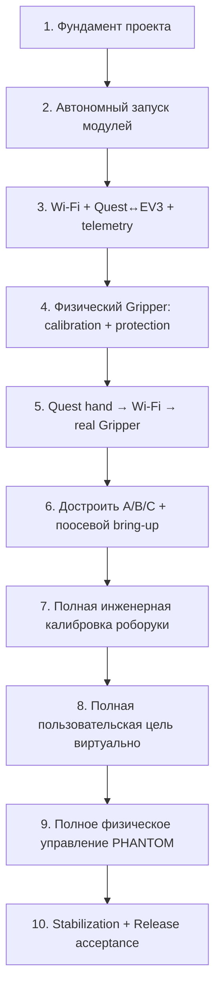

<a id="sec-10"></a>
# PHANTOM — этапы реализации и qualification gates

> **Роль:** Нормативная последовательность этапов разработки, stage gates и критерии Definition of Done.
> Текущий прогресс/результаты не хранятся здесь; они находятся в `current-status.md`.
> Планы конкретных задач — временные `task-*-plan.md` в `docs/`, удаляемые после завершения.

---

Разработка PHANTOM организуется как последовательность проверяемых состояний готовности. Этап закрывается не по факту «код написан», а только когда получен наблюдаемый результат и выполнен его критерий завершения. Текущие статусы этапов и историческое evidence в этом документе не хранятся; они ведутся отдельно. Изменение нормативного контракта не требует повторять незатронутые закрытые этапы целиком, но все затронутые protocol/config/safety regressions должны быть повторены на новом compatible build.

Главный принцип последующих этапов — **наращивать один и тот же конечный путь вертикальными срезами**. Сначала реальная сеть, затем один физический исполнитель D, затем вся механика A/B/C, затем полный mapping/IK и общий actuator path. Отдельный gripper-протокол или отдельное приложение не создаются.

Штатный полный физический путь управления остаётся тем же, что и в исходной архитектуре:

```text
Quest tracking
→ Shoulder/Wrist mapping
→ IK
→ q_target / grip_intent
→ штатный COMMAND
→ Wi-Fi
→ EV3 state/safety gate
→ q_ref / регуляторы / Gripper FSM / защита
→ A/B/C/D
→ TELEMETRY
→ Quest UI
```

Ранний D-only vertical slice **не заменяет** этот путь, а использует его подмножество:

```text
Quest Hand/grasp + Left Grip
→ grip_intent
→ тот же COMMAND
→ Wi-Fi
→ EV3 commissioning/state/safety gate
→ Gripper FSM
→ Motor D
→ TELEMETRY
→ Quest UI
```

Для ранних этапов используется `build_profile=Diagnostic`, `qualification_only=true` и explicit `actuator_scope_mask` + `safety_observation_mask`. Полный `READY/TRACKING` остаётся доступен только Release-compatible complete PHANTOM.

<!-- BEGIN GENERATED TOC -->
<details>
<summary>Оглавление</summary>

- [1. Общая последовательность этапов](#sec-10-1)
- [2. Сквозные требования к каждому этапу](#sec-10-2)
- [3. Этап 1 — фундамент проекта](#sec-10-3)
- [4. Этап 2 — автономный запуск модулей и доступного I/O](#sec-10-4)
- [5. Этап 3 — Wi-Fi EV3, Quest↔EV3 и телеметрия](#sec-10-5)
- [6. Этап 4 — физический Gripper: калибровка и локальная защита](#sec-10-6)
- [7. Этап 5 — Quest управляет реальным Gripper](#sec-10-7)
- [8. Этап 6 — завершение механики и поосевой bring-up Base/Shoulder/Elbow](#sec-10-8)
- [9. Этап 7 — инженерная калибровка всей роборуки](#sec-10-9)
- [10. Этап 8 — полная пользовательская цель и виртуальная проверка](#sec-10-10)
- [11. Этап 9 — сквозное физическое управление всей роборукой](#sec-10-11)
- [12. Этап 10 — стабилизация и финальная приёмка](#sec-10-12)

</details>
<!-- END GENERATED TOC -->

<a id="sec-10-1"></a>
## 1. Общая последовательность этапов



Механическая сборка A/B/C может идти параллельно этапам 3–5. Разработка Shoulder/Wrist mapping и IK также может идти параллельно, но системный gate этапа 8 закрывается после появления финальной `RobotGeometry`, чтобы виртуальная модель проверялась уже против реальной сборки.

<a id="sec-10-2"></a>
## 2. Сквозные требования к каждому этапу

Для каждого этапа используется один и тот же принцип `Definition of Done`.

| Направление | Что обязательно проверяется на каждом применимом этапе |
|---|---|
| Безопасность и восстановление | отказ входных данных, потеря связи, неверное состояние или выход за допустимые границы не должны приводить к неконтролируемому движению; до первого физического движения конкретного узла уже работают его локальные limits, `LOCAL_STOP`, watchdog/`phantom-safety`, безопасное отключение motor output и проверенный `POWER_CUT` |
| Scope isolation | любой привод вне `actuator_scope_mask` имеет hard-inhibit на стороне EV3; сетевой пакет, ошибка Quest или неверное поле `COMMAND` не могут расширить scope |
| Журналирование и диагностируемость | значимые переходы состояний, ошибки и отказы должны оставлять структурированный диагностический след; новые классы отказов добавляются в события и, где требуется, в `FlightRecorder` |
| Точность | для новой функции заранее определяется измеряемая ошибка; расчёты не должны накапливать программный drift; физические допуски проверяются по мере появления соответствующего оборудования |
| Производительность | новая функция не должна нарушать бюджет кадра Quest, 50-Hz цикл EV3, ограничения очередей, памяти и сетевого обмена; критический путь профилируется сразу, а не в конце проекта |
| Удобство использования | пользовательские действия и ошибки сразу проектируются с русскими понятными сообщениями; инженерные детали не попадают в обычный UI; новые обязательные действия не добавляются без необходимости |
| Автоматические тесты | вся реализованная программная функциональность EV3 и Quest получает модульное и функциональное покрытие production-кода по [План проверки §3](test-plan.md#sec-9-1-2); применимые property/protocol/replay/simulation и интеграционные сценарии входят в `TEST` |
| Аппаратные и ручные проверки | заключительная проверка кандидата этапа после применимых software TEST и BUILD: интеграционные и ручные safety/UX/физические проверки из [План проверки §1](test-plan.md#sec-9-1); применимость определяется active stage/profile, но финальный Release требует полный production комплект |

Если дефект обнаружен на более позднем этапе, исправление возвращается в тот слой, где он должен был быть обнаружен. Если дефект воспроизводим программно, вместе с исправлением добавляется автоматический regression test. После исправления повторяется затронутый stage gate и применимый regression.

<a id="sec-10-3"></a>
## 3. Этап 1 — фундамент проекта

Цель этапа — создать общий технический фундамент, позволяющий Quest и EV3 разрабатываться
независимо без расхождения в математике, состояниях и формате данных.

| Направление | Работы |
|---|---|
| Общее | структура репозитория; воспроизводимая сборка; CI; единицы измерения; системы координат; состояния и fault-коды; единый бинарный протокол; golden vectors; схема конфигурации |
| Quest | каркас Unity/OpenXR; `XrSpaceBridge`, `IGripSignalProvider`, tracking/QR adapters и `RobotTransport`; возможность подавать синтетические входы |
| EV3 | каркас `phantom-controller` и `phantom-safety`; `MotorBackend`; host-сборка; `MockMotorBackend`; безопасное состояние по умолчанию |
| Инструменты | PC-симулятор EV3; replay отслеживания; синтетические QR-позы; общая инфраструктура тестовых отчётов |

С этапа 1 действуют проверки протокола, парсинга, математических контрактов, ограниченности
очередей/буферов и отсутствия секретов в артефактах. Изменение semantic wire schema после
закрытия этапа требует migration regression codecs/generated schema/hash/golden vectors
текущего build; старый PASS не доказывает новый `protocol_contract_hash` либо его schema/semantics constituents.

**Этап считается выполненным, если:** чистый checkout воспроизводимо собирается; применимый
`TEST` проходит; Quest способен работать с симулятором EV3, EV3 controller — с
mock-моторами; ошибки фундамента наблюдаемы и журналируются. Scope-specific P0 [Метрики и анализ §4.1](metrics-and-logs.md#sec-9-6) остаётся
отдельным prerequisite соответствующего actuator milestone: `COMMISSIONING_QR` до первого
QR-driven движения этапа 4, `D_ONLY_USER` до этапа 5, `FULL_ARM_USER` до full-arm live
qualification/этапа 9. Отсутствие required evidence = `NOT_RUN`. Качество live observations квалифицируется отдельными bounded physical cases.

<a id="sec-10-4"></a>
## 4. Этап 2 — автономный запуск модулей и доступного I/O

Цель — Quest и EV3 запускаются независимо; EV3 безопасен при zero output. Полная механика и
Wi-Fi не являются gate. Scope-aware `qualification_only`/`actuator_scope_mask`/
`safety_observation_mask` вводятся последующими этапами. До первого движения D на этапе 4
установленный build обязан повторно пройти применимые интеграционные тесты уже с gripper-only
profile; для каждого последующего нового actuator scope выполняется его применимый DEVICE
regression. Это новый gate соответствующей функции, а не переоценка более раннего этапа.

**Этап считается выполненным, если:** Quest и EV3 воспроизводимо запускаются на реальном
оборудовании; `phantom-controller`/`phantom-safety` heartbeat и takeover проходят zero-output
tests; scoped I/O обнаруживается корректно; отсутствующий out-of-scope I/O не считается
fault; ни startup, ни shutdown не создают ненулевой motor output; применимые
Программные и интеграционные тесты имеют PASS.

<a id="sec-10-5"></a>
## 5. Этап 3 — Wi-Fi EV3, Quest↔EV3 и телеметрия

Цель — реальная сеть без actuator motion. Используется `qualification_only=true`,
**authoritative `actuator_scope_mask=safety_observation_mask=0x00`** и
`required_user_inputs=NONE`; профиль с иной маской не считается Stage-3 network-only gate.

При изменении DNS-SD/IPC/wire semantics после любого предыдущего evidence code/build,
заявляющий соответствие текущей specification revision, обязан regenerate canonical schema,
generated constants/size maps, все три protocol hashes и golden vectors, повторно проверить
production serializers/deserializers общими cross-codec/negative vectors и затем повторить
затронутые migration regressions. Старый PASS другой schema/build не переносится.

| Направление | Работы |
|---|---|
| EV3/Wi-Fi | проверить WNA1100; DHCP/auto reconnect; DNS-SD/mDNS `type=_phantom-ev3._udp`, `domain=local.` (full browse-name `_phantom-ev3._udp.local.`); network logs без credential |
| Security | provision независимый `control` PSK/key_id по [Разработка и развёртывание §6.1](engineering.md#sec-8-11) и проверить CONTROL-authenticated network-only session; commissioning PSK отдельный и не требуется для Stage-3 gate |
| Quest | discovery по `robot_id`; success/rejected `HELLO/HELLO_ACK`; HMAC; `PING/PONG`; receive current-schema `TELEMETRY`; русский экран состояния |
| Reliability | IP change; Wi-Fi loss/reconnect; controller/network/mDNS restart; stale session; loss/duplicate/replay; bounded telemetry/network bursts `<=60 s`; bounded queues; CPU/network budget |
| UI/telemetry | connection/session state, battery, controller state/fault, command age, `ev3_build_id` + Quest local `quest_build_id`, component/config hashes, `incident_id`; Diagnostic raw counters where available |
| Диагностика | structured connection/session events; bounded `FlightRecorder`; наблюдаемость loss/duplicate/restart/config mismatch без блокировки motor loop |

Motor output от сети на этом этапе невозможен из-за empty actuator scope.

**Этап считается выполненным, если:**

1. EV3 после обычного включения стабильно поднимает Wi-Fi через WNA1100;
2. реальный Quest 3 находит нужный `robot_id` без сохранённого IP и проходит Android NSD lifecycle cases;
3. CONTROL session с отдельно provisioned control PSK аутентифицируется по текущей wire schema; success/rejected HELLO_ACK, `PING/PONG`, retry/replay/session invalidation соответствуют [Спецификация протокола §2](protocol-specification.md#sec-4-7) и current schema/generated contract ([Спецификация протокола §4](protocol-specification.md#sec-11-8)), secret/key material не попадает в telemetry/logs;
4. реальный Quest 3 непрерывно получает и валидирует актуальную `TELEMETRY` текущей schema;
5. reboot/restart/IP change/краткая потеря Wi-Fi корректно обнаруживаются и восстанавливаются только новой валидной session;
6. stale/replayed/duplicate packets не меняют state/authority;
7. network/telemetry load не нарушает EV3 timing budget и bounded-resource invariants;
8. `ev3_build_id` + Quest local `quest_build_id`, component/config hashes, `incident_id` и structured events позволяют однозначно связать Quest↔EV3 evidence; применимый `FlightRecorder` работает без unbounded logging;
9. Wi-Fi credential отсутствует в Git/build manifest/CommissioningBundle/обычных логах, а после первоначального provisioning EV3 повторно подключается без PC;
10. за весь gate зарегистрировано ноль motor writes с nonzero duty;
11. migration regression текущей normative schema и IPC contracts имеет PASS на тех же installed artifacts, которые используются для реального Quest↔real EV3 acceptance.

<a id="sec-10-6"></a>
## 6. Этап 4 — физический Gripper: калибровка и локальная защита

Цель — получить полностью квалифицированный Motor D + Gripper **без Base/Shoulder/Elbow**. Profile: `Diagnostic`, `qualification_only=true`, `actuator_scope_mask=0x08`, `safety_observation_mask=0x08`. **До первого QR-driven физического `CALIBRATION_JOG` на D exact installed Quest platform matrix обязана иметь `P0CompatibilityScope=COMMISSIONING_QR PASS`.** Body/Wrist/Hand/grasp не являются prerequisite этого commissioning gate.

| Направление | Работы |
|---|---|
| Механика | законченный Gripper; жёсткое безопасное крепление стенда; `GRIPPER_HOME`; JAW_LEFT/RIGHT; pinch zone; `POWER_CUT` |
| EV3 | D encoder; bounded `CALIBRATION_JOG`; home; `E_closed`; bounded safe-open sweep до независимо подтверждённой границы (не поиск внутреннего максимума); timeout/stall/contact; scoped hard-inhibit A/B/C |
| Security | provision отдельный commissioning PSK/key_id по [Разработка и развёртывание §6.1](engineering.md#sec-8-11) в Diagnostic build/Quest secure storage; control PSK не должен авторизовать `COMMISSIONING` |
| Quest/QR | JAW poses → contact points → actual gap; build opening/closing curves; validation points |
| Persistence | сохранить partial qualification `DriveCalibration[D]`; изменение D mechanics/QR/contact transforms инвалидирует его |

Полная curve calibration выполняется после сборки/изменения Gripper, **не при каждом запуске**.

**Этап считается выполненным, если:**

1. D и `GRIPPER_HOME` однозначно обнаруживаются, A/B/C могут отсутствовать;
2. отдельный commissioning PSK provisioned/валиден; control key не авторизует commissioning; local commissioning arm создаётся только физическим ENTER+UP: нормально в `DISCOVERY`, либо после истечения fresh CONTROL owner через локальный `HOLD→DISCOVERY` transition [Спецификация EV3 §5.2](ev3-specification.md#sec-7-5-2); commissioning `HELLO` может consume только bounded arm-window, сеть сама по себе не может создать authority;
3. процедура [Спецификация Quest §16.8](quest-specification.md#sec-5-16-8) полностью проходит на реальном Gripper;
4. определены calibration-session `E_closed_cal`, signed `gripper_open_limit_delta_counts`/`D_open_counts`, `opening_open_mm`, opening/closing curves и measured hysteresis;
5. контрольные раскрытия удовлетворяют [Метрики и анализ §4.6](metrics-and-logs.md#sec-9-14);
6. stall до home, opening jam и timeout дают fault, а не ложный endpoint; open-search hard bound по encoder/time/speed/duty никогда не превышается; достижение независимо подтверждённого `D_open_counts` является штатным safe-open endpoint даже если локальная производная QR gap остаётся положительной. FAIL возникает только при unsafe/non-monotonic/quality violation или jam/stall **до** endpoint, либо при попытке выйти за `D_open_counts`;
7. закрытие на объекте переходит в contact policy и не продолжает длительно наращивать усилие;
8. `LOCAL_STOP`, safety heartbeat loss и `POWER_CUT` корректно прекращают движение;
9. A/B/C имеют zero motor writes независимо от входных данных;
10. calibration D сохраняется атомарно и после reload проходит hash/schema validation;
11. успешное сохранение создаёт новую qualification `CommissioningBundle` revision, старая session становится config-stale, а новый `HELLO` подтверждает новый bundle hash до перехода к этапу 5.

<a id="sec-10-7"></a>
## 7. Этап 5 — Quest управляет реальным Gripper

Это первый пользовательски наблюдаемый end-to-end milestone. До первого user-driven D exact installed Quest build/runtime matrix обязана иметь `P0CompatibilityScope=D_ONLY_USER PASS`; предыдущий `COMMISSIONING_QR PASS` его не заменяет:


```text
запустить то же Quest-приложение
→ найти EV3 по Wi-Fi
→ проверить сохранённую DriveCalibration[D]/bundle revision
→ LOCAL_COMMISSION_ARM на EV3 (ENTER+UP)
→ новая commissioning session
→ быстро получить текущую GripperReference по JAW_LEFT/RIGHT + encoder D
→ local ENTER confirmation → COMMISSIONING/ACTUATOR_QUALIFICATION
→ отпустить Left Grip
→ priority OFF/HOLD COMMAND → fresh TELEMETRY подтверждает last_accepted_command_sequence >= release_off_sequence
→ только затем armed=true
→ новый Left Grip rising edge
→ правая кисть / OpenXR grasp
→ grip_intent
→ штатный COMMAND
→ EV3 Gripper FSM
→ Motor D
→ предмет схвачен / отпущен
→ TELEMETRY обратно в Quest
```

Отдельного gripper-приложения и отдельного wire protocol нет. `q_base/q_shoulder/q_elbow=0` и игнорируются; A/B/C hard-inhibited.

Минимальный HUD показывает: connection/session, engineering gripper-ready state, `grip_intent`, `grip_actual`, `grip_state` (`FREE/CONTACT/...`), battery, command freshness/RTT и fault. RTT вычисляется по `PING/PONG`.

**Этап считается выполненным, если:**

1. пользователь запускает приложение и без PC/USB вручную подключается Quest↔EV3 через Wi-Fi;
2. startup не повторяет полную curve calibration, если сохранённый D calibration совместим;
3. QR+encoder startup создаёт только `GripperReference`, при этом `JointReference A/B/C` остаётся invalid;
4. commissioning session создаётся только после локального `ENTER+UP` arm window; отдельное локальное `ENTER` подтверждение qualification обязательно и не может быть подделано сетью; отсутствие подтверждения означает, что EV3 не исполняет qualification `COMMAND`, даже если Quest продолжил UI flow;
5. при отпущенном `Left Grip` D не выполняет новое движение;
6. после deliberate rising edge сжатие правой кисти пропорционально закрывает реальный Gripper, раскрытие — открывает;
7. реальный предмет можно взять, удержать без постоянного продавливания и отпустить;
8. потеря `graspReady`, focus, Wi-Fi/session, watchdog или `LOCAL_STOP` прекращает дальнейшее движение безопасным образом;
9. после восстановления движение само не возобновляется — нужен фактический release, OFF/HOLD acceptance подтверждённый свежей telemetry текущей session, и только затем новый rising edge;
10. telemetry на Quest отражает реальное `grip_actual/grip_state`, battery, session/fault и command freshness;
11. серия повторных grab/release bounded runs не даёт накопленного encoder drift/зависания FSM;
12. A/B/C отсутствуют либо неподвижны; число nonzero motor writes на них равно 0.

После выполнения этого этапа существует законченный стенд **Quest 3 + EV3 + Gripper**, способный калиброваться/привязываться при запуске, хватать и отпускать предметы рукой пользователя и показывать телеметрию.

<a id="sec-10-8"></a>
## 8. Этап 6 — завершение механики и поосевой bring-up Base/Shoulder/Elbow

Цель — достроить физическую роборуку и доказать исправность A/B/C без user tracking control. Перед первым QR-driven A/B/C jog должен быть актуален `P0CompatibilityScope=COMMISSIONING_QR PASS`; его можно переиспользовать с этапа 4 только при неизменной exact platform matrix, иначе gate повторяется.

| Направление | Работы |
|---|---|
| Механика | Base, Shoulder, Elbow, links, Forearm, установленный Gripper; gears/turntables; alignment; counterweight; cables; hard stops; все QR mounts |
| EV3 | provision/version engineering `qualification_only=true` calibration bundle/profile для фактически собранного набора осей (после сборки обычно scope `0x0F`), без user `COMMAND` authority; A/B/C discovery; encoder direction; bounded low-duty `CALIBRATION_JOG`; stop/reversal; provisional limits; bring-up выполняется только в `COMMISSIONING/CALIBRATION`; scope может содержать все фактически подключённые оси стенда, но каждый JOG двигает ровно одну, а `ACTUATOR_QUALIFICATION` пользовательскими командами A/B/C ещё запрещён |
| Safety | only one commissioning axis has motor-write authority; все motor-disabled нагрузочные оси механически фиксированы/поддержаны до собственной calibration/reference+HOLD qualification; local stop/watchdog/process crash; mechanical clearance |

**Этап считается выполненным, если:**

1. полная механика собрана по зафиксированной mechanical revision;
2. установлен versioned Diagnostic calibration profile/bundle с осознанным scope собранных осей; его hash совпадает на используемых engineering tools/EV3; A, B и C однозначно обнаружены и типы/encoder resolution верны;
3. каждая ось отдельно выполняет малые jog в обе стороны и корректно останавливается; во время каждого jog все остальные motor-disabled нагрузочные оси остаются механически зафиксированы/поддержаны и не получают motor writes;
4. sign encoder↔physical direction установлен без попытки считать номинальные 5:1 точной калибровкой;
5. hard-stop/cable margin и basic jam protection проверены; использование active HOLD для ещё не откалиброванной оси отсутствует;
6. `LOCAL_STOP`, controller crash и safety takeover прекращают движение;
7. пользовательская рука не может управлять A/B/C на этом этапе.

<a id="sec-10-9"></a>
## 9. Этап 7 — инженерная калибровка всей роборуки

Цель — получить complete **production-candidate semantic component set** и полный `qualification_only=true` `CommissioningBundle`, пригодный для последующей физической qualification, но ещё не способный войти в product `READY`.

Порядок движущейся калибровки сохраняется `D → C → B → A`. До любого QR-driven calibration motion на этом этапе должен оставаться актуальным `P0CompatibilityScope=COMMISSIONING_QR PASS` для exact installed Quest platform matrix; PASS этапа 6 переиспользуется только при неизменной matrix, иначе P0 повторяется. D не разрабатывается заново: его этап-4 calibration переносится только если mechanical/QR/contact revision совместима, затем обязательно повторно валидируется после установки на Forearm. На каждом шаге все невыбранные нагрузочные оси без собственной валидной calibration/reference и уже пройденного hold gate механически фиксируются/поддерживаются; active HOLD по номинальной передаче не используется как замена ещё не полученной калибровке.

**Этап считается выполненным, если:**

1. `RobotGeometry` полной сборки измерена и имеет hash;
2. `DriveCalibration A/B/C/D` прошла fit + holdout validation;
3. Gripper calibration после окончательной установки подтверждена либо корректно пересоздана;
4. mechanical/cable bounds зафиксированы;
5. `RobotCollisionModel` и PayloadProfile-specific `JointSafeSet` сгенерированы/проверены;
6. обычная неподвижная startup QR-привязка создаёт `JointReference A/B/C` + `GripperReference` без автоматического движения;
7. повторное QR measurement согласуется с `q_actual/grip_actual` в допусках [План проверки](test-plan.md);
8. geometry/collision/safe-set artifacts прошли normative [Разработка и развёртывание §8](engineering.md#sec-8-9) deployment на Quest+EV3, новый `HELLO_ACK` подтверждает один `commissioning_bundle_hash`;
9. полный candidate bundle остаётся `qualification_only=true`, имеет `actuator_scope_mask=safety_observation_mask=0x0F`, содержит все production-required component bytes/hashes, но **не может перейти в `READY`** и ещё не имеет production `qualification_evidence_manifest_hash`; promotion в Release выполняется только после этапа 9.

<a id="sec-10-10"></a>
## 10. Этап 8 — полная пользовательская цель и виртуальная проверка

Цель — завершить весь Quest-side full-arm path без user-driven physical A/B/C motion. Перед live Shoulder/Wrist qualification на реальном Quest exact installed platform matrix должна иметь `P0CompatibilityScope=FULL_ARM_USER PASS`; этот gate всё ещё не разрешает физический A/B/C motor output.

```text
Body_RightShoulder + Wrist
→ time alignment/filter
→ P_requested / P_control
→ workspace
→ fixed-branch IK
→ JointSafeSet/collision preview
→ q_target
```

Gripper channel продолжает использовать проверенный `grip_intent` и остаётся regression path.

**Этап считается выполненным, если:**

1. `human_arm_reach` calibration проходит требуемые тесты;
2. Shoulder/Wrist temporal alignment и tracking qualification [Метрики и анализ §4.1](metrics-and-logs.md#sec-9-6) пройдены;
3. IK/FK/property/replay tests проходят;
4. одинаковый time-aligned текущий Shoulder→Wrist vector даёт одинаковую чистую `P_requested_B` независимо от истории; возможная краткая история `P_control_B` ограничена только tracking filter по `NFR-ACC-07`;
5. virtual PHANTOM корректно следует руке и показывает clipping/invalid target;
6. tracking drop/reference-space change/Left Grip semantics дают ожидаемые HOLD/SAFE_HOLD predicates;
7. calculated `q_target` проходит production wire codec, проверяемый current schema/golden vectors, и полный controller/state/safety path в PC simulator/`MockMotorBackend`; на реальном EV3 этого этапа выполняется только explicit zero-actuator/network regression — motion-capable user A/B/C `COMMAND` ему ещё не выдаётся;
8. физические A/B/C всё ещё не получают user-driven motor output; первый реальный user authority A/B/C появляется только после gates этапа 9.

<a id="sec-10-11"></a>
## 11. Этап 9 — сквозное физическое управление всей роборукой

Цель — расширить уже работающий D vertical slice на A/B/C после complete commissioning.

В MANUAL привод authority наращивается постепенно. Рекомендуемый default order — **C → B+C → A+B+C**, Base последней; конкретный порядок может быть изменён только documented safety result. Все incremental narrow-authority cases выполняются с **пустым Gripper, без внешнего payload**, на `EMPTY` PayloadProfile/`EMPTY` JointSafeSet; захват/освобождение объекта и LOADED state проверяются только в последующем full-`0x0F` qualification case. Каждый incremental case использует **отдельную immutable `qualification_only=true` revision `CommissioningBundle`**, детерминированно производную от полного production-candidate component set этапа 7: component bytes/hashes `RobotGeometry`, `DriveCalibration`, `RobotCollisionModel`, `EMPTY` PayloadProfile/`JointSafeSet` и `SafetyEnvelope` не меняются, меняются только qualification metadata/`actuator_scope_mask`/`safety_observation_mask`, поэтому каждый derived bundle имеет собственный `commissioning_bundle_hash`. In-place изменение candidate/production bundle или масок запрещено. Переключение bundle инвалидирует session/reference; после каждого switch выполняются новый `HELLO`, проверка hash и новая QR↔encoder reference до motor write.

`actuator_scope_mask` на каждом шаге ограничивает только motor writes, но `safety_observation_mask` для любого A/B/C qualification шага обязан быть как минимум **`0x07 | actuator_scope_mask`**: их полные `JointReference` заново устанавливаются для текущего derived bundle, а неподвижные неразрешённые оси нужны как реальные fixed coordinates 3D `JointSafeSet`. Нулевые q-поля disabled axes не могут подменять их физическое состояние. Любая motor-disabled ось, способная двигаться под тяжестью/внешней нагрузкой, на этом incremental case механически фиксируется/поддерживается; active HOLD через запрещённый motor write не используется как fixture. До первого **real Quest-driven** A/B/C, в том числе если он выполняется в Diagnostic `ACTUATOR_QUALIFICATION`, обязателен актуальный `P0CompatibilityScope=FULL_ARM_USER PASS` для exact installed Quest build/runtime matrix; изменение platform matrix после этапа 8 требует повторного P0.

После narrow cases активируется отдельный **full `0x0F/0x0F` qualification-only bundle** с теми же production-candidate component hashes. После полной A/B/C/D reference при снятом motion-arm engineering path [Спецификация протокола §2.5](protocol-specification.md#sec-4-7-5) явно выбирает профиль/safe-set и подтверждает `EMPTY`; затем выполняются EMPTY MANUAL. Для разрешённых payload cases между движениями при stationary motors используются те же wire `SET_PAYLOAD_PROFILE/SET_PAYLOAD_STATE` с commissioning role/local authority; после contact/release `UNKNOWN` закрывается явным engineering ACK и новым re-arm. Product `READY/TRACKING/HOLD` при этом недоступны: wire state остаётся `COMMISSIONING` до завершения qualification. Только когда все обязательные MANUAL/P0/stop/power-loss/resource/accuracy cases PASS, tooling формирует `QualificationEvidenceManifest` и затем новую immutable production revision `qualification_only=false`, `actuator_scope_mask=safety_observation_mask=0x0F`, с теми же квалифицированными component hashes и `qualification_evidence_manifest_hash`. После установки production revision старые session/reference инвалидируются, выполняются новый `HELLO`, startup QR reference + payload selection/state confirmation, и лишь тогда разрешаются обычные `READY/TRACKING/HOLD/SAFE_HOLD`. Любое изменение квалифицированного component byte/hash после manifest делает evidence несовместимым и требует повторной qualification.

**Этап считается выполненным, если:**

1. каждый incremental motor-authority scope проходит low-limit **EMPTY-only** MANUAL на собственной immutable derived qualification bundle revision без collision/safety violation; component hashes production-candidate geometry/calibration/EMPTY-safe-set совпадают с этапом 7, bundle switch даёт новый hash/session/reference, LOADED/non-EMPTY/pickup operation fail-closed, оси вне authority имеют zero motor write, нагрузочные disabled оси имеют documented fixture/support, все A/B/C остаются safety-observed и их reference-loss/fixture drift немедленно inhibits qualification;
2. затем full `0x0F` **qualification-only** A+B+C+D path работает через штатный `COMMAND` от реального Quest tracking и проходит EMPTY + разрешённые payload/contact/release cases без использования product `READY`;
3. TCP повторяет Shoulder→Wrist с требуемой точностью/latency, Gripper — кисть;
4. скорость/ускорение/duty/reversal/PD/feed-forward/`MotorStressScore` проходят MANUAL;
5. HOLD/SAFE_HOLD, tracking loss, network loss, stale command, `LOCAL_STOP`, stall/contact и process failure работают безопасно;
6. payload transitions `EMPTY → contact → UNKNOWN → LOADED` и `LOADED/UNKNOWN → release → UNKNOWN → EMPTY` проходят без продолжения старой A/B/C trajectory; в qualification они выполняются оставаясь в `COMMISSIONING`, в production smoke — через `HOLD`; смена profile/reboot также даёт `UNKNOWN` до явного подтверждения;
7. робот не выходит из `JointSafeSet` и independent bounds;
8. выполняются раздельные budgets: authoritative EV3 control loop 50 Hz, Quest command updates около 60 Hz независимо от выбранной квалифицированной частоты XR rendering, network telemetry nominal 20 Hz; частоты tracking providers проверяются отдельно, ни один budget не подменяет другой;
9. target/actual/incident telemetry достаточна для разбора отказа;
10. после успешной qualification сформирован PASS `QualificationEvidenceManifest`; из неизменившегося component set создан/установлен complete production bundle `qualification_only=false`, `0x0F/0x0F`, его evidence hash проверен обеими сторонами, после нового startup product `READY/TRACKING` проходит отдельный финальный smoke/end-to-end case.

<a id="sec-10-12"></a>
## 12. Этап 10 — стабилизация и финальная приёмка

На этом этапе не «добавляются потом» safety/accuracy/logging/UX; выполняется финальная квалификация уже законченной системы.

**Этап считается выполненным, если:**

1. один зафиксированный Release candidate проходит полный `TEST`;
2. именно эти артефакты установлены на Quest/EV3;
3. полный набор интеграционных тестов production-системы проходит с A/B/C/D и обязательными sensors;
4. все применимые MANUAL/safety/network/calibration/accuracy/resource tests по [План проверки](test-plan.md) имеют PASS;
5. серия независимых bounded runs `<=60 s` и повторных starts/restarts не выявляет blocking regressions;
6. Release/Diagnostic и config/bundle/schema hashes согласованы; CAD/mechanical artifact hash, SBOM, legacy-EOL vulnerability/risk record и exact toolchain/image provenance закрыты по [Разработка §5.3](engineering.md#sec-engineering-build-validation);
7. manual functional/UI/UX acceptance и privacy/export acceptance [Метрики и журналы §2.1](metrics-and-logs.md#sec-8-13) выполнены на том же Release candidate; все применимые scope-specific P0 reports (`COMMISSIONING_QR`, `D_ONLY_USER`, `FULL_ARM_USER`) относятся к его exact Quest platform matrix либо имеют документированное `N_A`, а изменение matrix инвалидирует acceptance;
8. checklist [План проверки §7](test-plan.md#sec-9-26) полностью закрыт;
9. конкретная физическая сборка имеет зафиксированные mechanical revision, `RobotGeometry`, `DriveCalibration`, payload/safe-set configs и software versions;
10. blocking defects отсутствуют.
