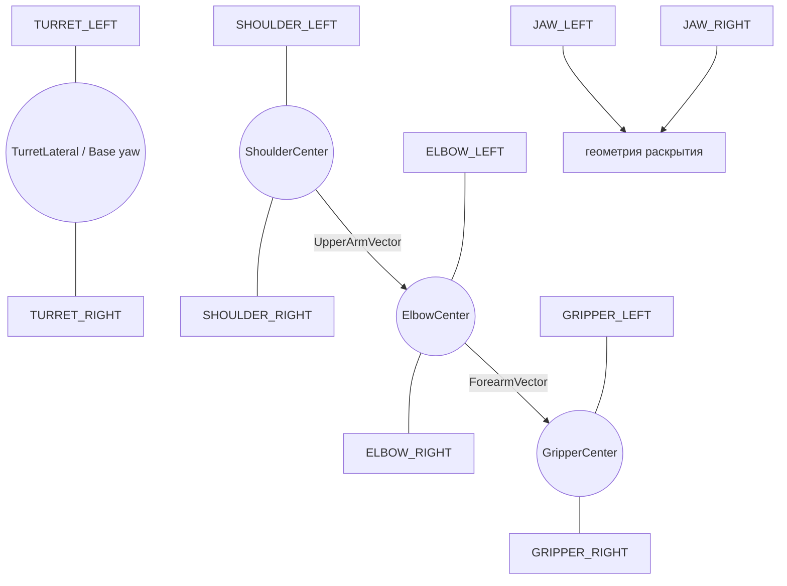

<a id="sec-6"></a>
# PHANTOM — спецификация механики

Нормативная физическая конструкция манипулятора и механические ограничения.

<!-- BEGIN GENERATED TOC -->
<details>
<summary>Оглавление</summary>

- [1. Кинематическая схема](#sec-6-1)
- [2. Геометрические требования](#sec-6-2)
- [3. Общая компоновка](#sec-6-3)
- [4. Передачи Base, Shoulder и Elbow](#sec-6-4)
  - [4.1. Общие требования](#sec-6-4-1)
  - [4.2. Base](#sec-6-4-2)
  - [4.3. Shoulder](#sec-6-4-3)
  - [4.4. Elbow](#sec-6-4-4)
- [5. Требования к соосности силовых суставов](#sec-6-5)
- [6. Верхнее звено](#sec-6-6)
- [7. Предплечье](#sec-6-7)
- [8. Противовес Shoulder](#sec-6-8)
  - [8.1. Назначение](#sec-6-8-1)
  - [8.2. Схема](#sec-6-8-2)
  - [8.3. Настройка](#sec-6-8-3)
- [9. Крепления QR и физические точки калибровки](#sec-6-9)
- [10. LOCAL_STOP](#sec-6-10)
- [11. Фиксация основания](#sec-6-11)
- [12. Кабельный диапазон Base](#sec-6-12)
- [13. Кабельная разводка по звеньям](#sec-6-13)
- [14. Конструкция захвата](#sec-6-14)
  - [14.1. Функция](#sec-6-14-1)
  - [14.2. Схема](#sec-6-14-2)
  - [14.3. Геометрические требования](#sec-6-14-3)
  - [14.4. QR-калибровка захвата](#sec-6-14-4)
- [15. Пассивное поведение при потере питания](#sec-6-15)
- [16. Жёсткость и повторяемость](#sec-6-16)
- [17. Порядок сборки](#sec-6-17)
- [18. Минимальная комплектность конструкции](#sec-6-18)
  - [18.1. Электроника и маркеры](#sec-6-18-1)
  - [18.2. Силовые элементы](#sec-6-18-2)
  - [18.3. Пины, втулки и оси LEGO](#sec-6-18-3)
- [19. Конфигурация механики](#sec-6-19)

</details>
<!-- END GENERATED TOC -->

<a id="sec-6-1"></a>
## 1. Кинематическая схема

PHANTOM имеет три моторизованные степени свободы позиционирования и отдельный мотор захвата:

```text
A — Base yaw
B — Shoulder pitch
C — Elbow pitch
D — Gripper
```


Опорные точки:

```text
B0 = физическая точка пересечения оси Base yaw с опорной плоскостью; НЕ начало RobotBaseFrame
S  = центр оси Shoulder pitch и начало RobotBaseFrame
E  = центр оси Elbow pitch
TCP = фиксированная рабочая точка между губками захвата
```

<a id="sec-6-2"></a>
## 2. Геометрические требования

Конструкция должна обеспечивать следующую модель:

```text
RobotBaseFrame origin = ShoulderCenter = [0, 0, 0]
L1 = |S → E| ≈ 230 мм
L2 = |E → TCP| ≈ 220 мм
```

Точные `L1`, `L2` и `floor_z_B` определяются измерением собранной конструкции. `shoulder_height = -floor_z_B` является производной величиной и не хранится вторым независимым параметром.

Механика должна удовлетворять условиям:

- ось Shoulder pitch пересекает вертикальную ось Base yaw в точке `S` в пределах допуска сборки;
- ось Elbow pitch параллельна оси Shoulder pitch;
- `S`, `E` и TCP лежат в одной вращающейся вертикальной плоскости в пределах допуска сборки;
- боковое смещение TCP относительно этой плоскости должно удовлетворять `abs(tcp_lateral_offset_m) <= tcp_lateral_tolerance_m`; точный математический ноль не требуется;
- две опоры Shoulder должны быть соосны;
- две опоры Elbow должны быть соосны;
- физические механические ограничители должны находиться за программной рабочей областью и до зоны натяжения кабеля.

<a id="sec-6-3"></a>
## 3. Общая компоновка

```text
                         ЗАХВАТ
                    Medium Motor D
                          │
                 симметричные губки
                          │
             ╔══════════════════════╗
             ║       FOREARM        ║
             ║  лёгкая 3D ферма     ║
             ╚══════════╤═══════════╝
                        │
              ┌──────[60T]──────┐
              │      ELBOW C     │
              └──────[60T]──────┘
                    ▲       ▲
                   12T     12T
                     \     /
                     Large C
               рядом с Elbow
                        │
             ╔══════════════════════╗
             ║      UPPER ARM       ║
             ║ жёсткая 3D ферма     ║
             ╚══════════╤═══════════╝
                        │
              ┌──────[60T]──────┐
              │   SHOULDER B     │
              └──────[60T]──────┘
                    ▲       ▲
                   12T     12T
                     \     /
                     Large B
                        +
                 симметричный
                  противовес
                        │
                     TURRET
                        │
                      [60T]
                        ▲
                       12T
                        │
                     Large A
                        │
             ╔══════════════════════╗
             ║   НЕПОДВИЖНАЯ БАЗА  ║
             ║ EV3 + питание внизу ║
             ╚══════════════════════╝
```

<a id="sec-6-4"></a>
## 4. Передачи Base, Shoulder и Elbow

<a id="sec-6-4-1"></a>
### 4.1. Общие требования

Для трёх силовых осей механическая схема проектируется как `12T → 60T = 5:1`. Это номинальная геометрия передачи. Управляющее ПО не должно выводить реальный коэффициент `encoder_count → joint angle` только из отношения зубьев: фактический коэффициент, знак и offset определяются QR↔энкодер инженерная калибровка конкретной собранной оси.

Рабочие 60T turntable:

```text
Base      1
Shoulder  2
Elbow     2
----------------
в конструкции 5
запас при закупке 1
```

Детали:

```text
18938 — Technic Turntable 60 Tooth Bevel, Top
18939 — совместимая нижняя часть
32270 — Technic Gear 12 Tooth Double Bevel
```

Каждый нагруженный 12T должен иметь локальную опору с обеих сторон или эквивалентную жёсткую опорную схему. Длинный неподдержанный вал между двумя силовыми шестернями не допускается.

<a id="sec-6-4-2"></a>
### 4.2. Base

```text
Large Motor A
    │
   12T
    ▼
   60T
    │
 Base yaw
```

Номинальное отношение — `5:1`; реальный `encoder_scale` определяется инженерная калибровка.

Turntable должен воспринимать структурную нагрузку основания. Вал Large Motor A не должен использоваться как несущая опора.

Base должен иметь два физических механических ограничителя до натяжения кабельного жгута. После сборки инженерная калибровка измеряет:

```text
physical_hard_stop_negative_deg
physical_hard_stop_positive_deg
cable_safe_negative_deg
cable_safe_positive_deg
```

Рабочий программный диапазон выбирается **внутри** пересечения этих диапазонов с отдельным safety margin. Универсальное значение `±120°` не является требованием спецификации.

Для калибровки привода Base собираются QR/encoder измерения в нескольких yaw-положениях, максимально разнесённых внутри безопасного диапазона. Тем самым измеряется, сколько реальных отсчёты энкодера соответствует известному физическому повороту Base, вместо предположения, что номинальная передача идеально равна 5:1.

<a id="sec-6-4-3"></a>
### 4.3. Shoulder

Shoulder должен иметь две соосные 60T turntable и два синхронизированных 12T:

```text
        UPPER ARM
            │
     [60T]───┼───[60T]
       ▲           ▲
      12T         12T
        \         /
         синхронный привод
                │
             Large B
```

Обе стороны имеют отношение `5:1`. Двойная схема распределяет нагрузку, но не изменяет передаточное отношение.

Large Motor B должен находиться непосредственно около Shoulder. Shoulder должен быть собран в замкнутой жёсткой рамной кассете.

Конструкция Shoulder должна иметь механическую геометрию, исключающую разрушительный перегиб. После определения нейтрального/разогнутого направления инженерная калибровка задаёт рабочий software limit не более `90°` сгибания; физический механический ограничитель должен находиться немного за программной границей, но до зоны, где звенья, шестерни или кабели могут быть повреждены.

<a id="sec-6-4-4"></a>
### 4.4. Elbow

Elbow должен иметь две соосные 60T turntable и два синхронизированных 12T:

```text
        FOREARM
           │
    [60T]───┼───[60T]
      ▲           ▲
     12T         12T
       \         /
        синхронный привод
              │
           Large C
```

Large Motor C должен находиться на Upper Arm непосредственно перед Elbow. Между Shoulder и Elbow не должен использоваться длинный силовой крутильный вал.

Для Elbow инженерная калибровка определяет разогнутое направление. Рабочий software limit не допускает сгибание более `90°`; физическая конструкция должна иметь резервный механический ограничитель до опасной зоны механики.

<a id="sec-6-5"></a>
## 5. Требования к соосности силовых суставов

До установки приводных шестерён Shoulder и Elbow должны свободно вращаться вручную.

Узел не допускается к дальнейшей сборке при наличии хотя бы одного признака:

- периодическое закусывание;
- заметно меняющееся трение при полном проходе рабочего угла;
- раздвигание рам при вращении;
- осевое перемещение шестерни под нагрузкой;
- необходимость большого моторного момента только для преодоления несоосности.

Программное увеличение duty не должно использоваться как средство компенсации механической несоосности.

<a id="sec-6-6"></a>
## 6. Верхнее звено

Upper Arm должен быть пространственной коробчатой или ферменной конструкцией.

Целевые размеры:

```text
L1 ≈ 230 мм
ориентировочно ≈29 Technic studs между центрами осей
поперечное сечение порядка 5×5 studs
```

Основные элементы:

- `64179` — Frame Thick 5×7;
- `67491` — длинная рама 3×19;
- `4526` — рама 3×13;
- `64178` — Frame Thick 5×11;
- 15L/11L/7L thick liftarms;
- элементы с перпендикулярными отверстиями (`flip-flop`) для связи плоскостей.

Продольные стыки левой и правой силовых линий не должны находиться в одном поперечном сечении.

<a id="sec-6-7"></a>
## 7. Предплечье

Forearm должен быть пространственной облегчённой коробчатой или ферменной конструкцией.

Целевой размер:

```text
L2 ≈ 220 мм
ориентировочно 27–28 Technic studs
```

Forearm должен быть легче Upper Arm. Конструкция должна использовать поперечные связи и диагональное усиление только в объёме, необходимом для требуемой жёсткости.

<a id="sec-6-8"></a>
## 8. Противовес Shoulder

<a id="sec-6-8-1"></a>
### 8.1. Назначение

Shoulder должен иметь пассивную симметричную компенсацию собственного веса звеньев. Она должна уменьшать постоянное усилие мотора при горизонтальном положении руки и ограничивать скорость падения при потере питания.

<a id="sec-6-8-2"></a>
### 8.2. Схема

```text
                  Upper Arm
                      \
                       O Shoulder
                      / \
             elastic /   \ elastic
                    /     \
               base L     base R
```

Две ветви должны действовать симметрично относительно механики Shoulder.

<a id="sec-6-8-3"></a>
### 8.3. Настройка

Положение креплений и упругость подбираются после окончательной сборки по результату, а не по расчётной массе поднимаемого предмета.

В наиболее тяжёлом горизонтальном положении полностью собранной руки без внешней нагрузки система должна обеспечить:

```text
средний steady duty Shoulder <= 40%
p95 steady duty Shoulder <= 50%
```

Если удержание не проходит критерий, до изменения программного регулятора должны быть проверены:

1. несоосность;
2. трение;
3. масса подвижных деталей;
4. противовес;
5. зацепление шестерён.

Противовес не должен самостоятельно уводить руку в противоположную сторону при снятом моторном усилии.

<a id="sec-6-9"></a>
## 9. Крепления QR и физические точки калибровки

Обязательный набор:

```text
SHOULDER_LEFT / SHOULDER_RIGHT
TURRET_LEFT / TURRET_RIGHT
ELBOW_LEFT / ELBOW_RIGHT
GRIPPER_LEFT / GRIPPER_RIGHT
JAW_LEFT / JAW_RIGHT
опционально TCP_CAL
```



`SHOULDER_LEFT/RIGHT` устанавливаются по разные стороны оси Shoulder на неподвижной части **ниже Base-yaw вращения**; их держатель не должен вращаться с turret. После применения измеренных поправок их середина должна давать `ShoulderCenter`.

`TURRET_LEFT/RIGHT` устанавливаются на вращающейся Base-yaw части до Shoulder pitch так, чтобы их corrected baseline жёстко вращался с Base и оставался достаточно горизонтальным/длинным для измерения yaw. Эта пара нужна именно для абсолютного Base yaw при startup и не определяет начало/оси `RobotBaseFrame`.

`ELBOW_LEFT/RIGHT` располагаются по разные стороны оси Elbow так, чтобы после применения поправок их середина давала `ElbowCenter`. Эти маркеры перемещаются вместе с узлом Elbow.

`GRIPPER_LEFT/RIGHT` закрепляются на жёсткой части корпуса захвата/предплечья, не связанной с относительным движением губок. После применения поправок их середина даёт `GripperCenter`, лежащий на известной продольной геометрии предплечья.

`JAW_LEFT/RIGHT` закрепляются на соответствующих движущихся губках и используются только для определения геометрии раскрытия.

Направления силовых звеньев не извлекаются из ориентации QR. Они строятся как:

```text
UpperArmVector = ElbowCenter - ShoulderCenter
ForearmVector  = TCP - ElbowCenter
```

Требования к креплениям:

- QR-плоскость не должна изгибаться относительно элемента при обычном движении;
- маркер должен быть заменяемым без изменения локальной посадочной геометрии либо после замены выполняется новая затронутая инженерная калибровка;
- маркеры на соседних элементах должны оставаться различимыми в калибровочных позах;
- маркеры не должны попадать в зубья, кабели или зоны защемления;
- координаты каждого маркера относительно локальной системы элемента входят в `RobotGeometry` и измеряются от `QrMarkerCenter`;
- для `JAW_LEFT/RIGHT` дополнительно хранятся преобразования от центра QR к рабочей поверхности соответствующей губки;
- перестановка или поворот держателя требует новой затронутой инженерной калибровки;
- после `READY` видимость QR не требуется.

На держателе рекомендуется иметь механическую центральную метку или размерную схему, позволяющую при замене QR совместить новый `QrMarkerCenter` с прежней точкой. Верхний левый угол QR не используется как размерная база.

Абсолютная привязка суставов не требует отдельных механических reference-сенсоров: её источником является QR-привязка при запуске.

Для каждой geometry revision фиксируются `qr_symbol_size_mm`, quiet zone и
допустимая погрешность печати/масштаба. Поверхность QR должна быть матовой и плоской;
держатель воспроизводимо задаёт `QrMarkerCenter`. Baseline каждой пары LEFT/RIGHT
не меньше commissioned `pair_baseline_min_m`; установка должна обеспечивать
квалифицированную точность расчёта по [Quest §15.5](quest-specification.md#sec-5-15-5).

<a id="sec-6-10"></a>
## 10. LOCAL_STOP

`LOCAL_STOP` — отдельный физический нажимной элемент, подключённый к выделенному входу EV3, по умолчанию `in4`.

Он должен:

- быть доступен без входа рукой в рабочий объём шестерён;
- иметь однозначные состояния pressed/released;
- контролироваться `phantom-safety` независимо от Quest и сетевого соединения;
- при нажатии фиксировать `STOPPED` и переводить **все физически обнаруженные моторы** в `BRAKE`/`stop`; отсутствие out-of-scope A/B/C на qualification stand является `N_A`, а не ошибкой stop path;
- требовать явного восстановления после отпускания.

`LOCAL_STOP` не является сертифицированным промышленным E-stop и работает через тот же EV3/software stack.

Отдельно должен быть установлен **аппаратный `POWER_CUT`**, физически снимающий энергию с приводов независимо от Linux, `phantom-controller`, `phantom-safety` и сети. Его орган управления располагается вне swept volume, имеет однозначное состояние и проверяется перед MANUAL с автоматическим движением. Для EV3 power topology `POWER_CUT` должен физически разрывать питание Brick/моторных выходов (например, внешним latching disconnect в цепи питания); программный GPIO/Touch Sensor этим требованием не является. После его срабатывания питание запускается заново, старая session/reference теряется, затем выполняются **применимая active scope startup reference** и deliberate re-arm.

<a id="sec-6-11"></a>
## 11. Фиксация основания

Неподвижная база должна быть закреплена к рабочей поверхности или иметь эквивалентную противоскользящую фиксацию, исключающую заметное перемещение во время `TRACKING`.

EV3 brick и питание должны располагаться низко на неподвижной части, чтобы не увеличивать момент на поворотной конструкции.

Физическое перемещение/поворот всей неподвижной базы **после получения `RobotLocalization` запрещено в пределах активного запуска**, даже если `TRACKING` уже остановлен: такое перемещение меняет преобразование `LOCAL_FLOOR↔RobotBaseFrame`, а энкодеры его не наблюдают. Для переноса оператор обязан остановить движение, выполнить shutdown/`POWER_CUT`, физически переставить и заново жёстко зафиксировать основание. Следующий запуск обязан создать новую `RobotLocalization` по `SHOULDER_LEFT/RIGHT`; старая localization/session не может восстанавливаться из сохранённого значения. PHANTOM v1 **не заявляет online-обнаружение любого проскальзывания базы после отключения QR tracking**: безопасность опирается на квалифицированную механическую фиксацию и operator/maintenance detection. Любое наблюдаемое или подозреваемое смещение/ослабление требует немедленного release `Left Grip`/`LOCAL_STOP`, инвалидации `RobotLocalization`, проверки фиксации и новой QR localization до re-arm. Опциональная QR recheck при полностью остановленной системе может использоваться как диагностический gate, но не заменяет физическую фиксацию.

До физической приёмки для конкретной assembly revision фиксируется safety envelope:

```yaml
safety_envelope:
  gripper_open_limit_delta_counts: MEASURED_SIGNED_NONZERO
  payload_mass_max_kg: MEASURED
  payload_cog_offset_max_m: MEASURED
  tcp_static_moment_max_Nm: MEASURED
  swept_volume_margin_m: MEASURED
  pinch_exclusion_margin_m: MEASURED
  external_power_cut_required: true
  power_cut_max_disconnect_ms: MEASURED
  local_stop_response_limit_ms: MEASURED
  power_loss_peak_tcp_speed_limit_mps: MEASURED
  payload_profiles_hash: SHA256
```

Работа с неизвестным/превышающим квалифицированный envelope предметом запрещена. Для каждого разрешённого класса задаётся `PayloadProfile{id,mass_max,cog_offset_max,motion_scale,feedforward_params}`; `EMPTY` всегда отдельный профиль. Перед попыткой захвата выбирается ожидаемый профиль: его консервативные motion limits применяются сразу. После фактического захвата оператор в `READY/HOLD` при полной остановке явно подтверждает `PayloadState=LOADED`; только тогда включается payload gravity feed-forward. Начало освобождения при `PayloadState=LOADED` не должно происходить одновременно с продолжением A/B/C trajectory: EV3 release interlock [Спецификация EV3 §15.4](ev3-specification.md#sec-7-15-4) фиксирует текущие A/B/C и допускает только bounded D-opening до снятия контакта, затем принудительно остаётся в `HOLD`. После открытия/освобождения `PayloadState` системно становится `UNKNOWN`; оператор при полной остановке подтверждает `EMPTY`, и до ACK A/B/C `TRACKING` остаётся запрещён. Любой переход снимает armed-latch. При автоматическом движении оператор и другие люди находятся вне swept volume и pinch-exclusion zones; рабочая стойка оператора проектируется так, чтобы его Hand Tracking workspace не пересекался с swept volume. QR-сканирование вблизи робота выполняется только при полной остановке.

<a id="sec-6-12"></a>
## 12. Кабельный диапазон Base

Кабельный жгут вокруг Base должен иметь service loop.

Требования:

```text
при software limit кабель имеет свободный запас
при mechanical hard stop кабель всё ещё не натянут
разъём никогда не является mechanical stop
```

механический ограничитель должен воспринимать механическую нагрузку раньше, чем кабель или коннектор окажутся натянуты.

<a id="sec-6-13"></a>
## 13. Кабельная разводка по звеньям

Используются только кабели моторов, совместимые с EV3/NXT.

Планирование длины:

```text
Base A      — короткий кабель по фактической компоновке
Shoulder B  — короткий или средний кабель
Elbow C     — примерно 50–80 см после макета трассы
Gripper D   — около 100 см, предпочтительно одним непрерывным кабелем
```

Кабельный жгут должен:

- находиться вне зубьев шестерён;
- иметь strain relief;
- иметь запас при полном рабочем диапазоне;
- не ограничивать движение раньше программных ограничений;
- не пересекать зоны защемления без физической фиксации.

<a id="sec-6-14"></a>
## 14. Конструкция захвата

<a id="sec-6-14-1"></a>
### 14.1. Функция

Захват должен преобразовывать `grip_intent=0..1` в пропорциональное симметричное раскрытие двух губок.

<a id="sec-6-14-2"></a>
### 14.2. Схема

```text
Medium Motor D
      │
   редуктор ~3:1
      │
симметричная тяга / две встречные рейки
      │
две податливые губки
```

<a id="sec-6-14-3"></a>
### 14.3. Геометрические требования

```text
максимальное раскрытие: 55–60 мм
полезный минимальный зазор: <=15 мм
полный ход: 0.8–1.2 с
TCP: фиксированный центр между рабочими поверхностями губок
```

Губки должны иметь мягкие или податливые контактные поверхности. Изменение раскрытия не должно менять определение TCP.

<a id="sec-6-14-4"></a>
### 14.4. QR-калибровка захвата

QR `JAW_LEFT/RIGHT` закрепляются на движущихся губках, но не обязаны находиться на их рабочих краях. В `RobotGeometry` для каждой губки хранится постоянное преобразование от `QrMarkerCenter` к рабочей контактной точке/поверхности.

Во время инженерной калибровки:

1. закрытое положение определяется низкоскоростным движением до подтверждённого `GRIPPER_HOME`; stall до home считается fault;
2. отдельной стендовой безопасной процедурой заранее устанавливается `gripper_open_limit_delta_counts`, не зависящий от QR-поиска максимума;
3. губки открываются малыми остановленными шагами только внутри `d∈[0,D_open_counts]` и независимых EV3 time/speed/duty bounds;
4. после каждого шага Quest по QR вычисляет фактический зазор между рабочими поверхностями;
5. между closed и safe-open endpoint строится нелинейная двунаправленная калибровочная кривая `encoder_count ↔ jaw_opening_mm`; немонотонность до endpoint считается ошибкой механики/калибровки, а не поводом выбрать локальный максимум.

Это необходимо, потому что траектория губок может быть дугообразной/эллиптической и расстояние между ними не обязано линейно зависеть от угла мотора.

`GRIPPER_HOME` устанавливается до силового механического упора либо с такой геометрией, чтобы его срабатывание не требовало существенного сжатия упора. В обычной работе регулярное силовое упирание в mechanical stop запрещено. Датчик подтверждает закрытую границу при инженерной калибровке и позволяет отличать штатное пустое закрытие от раннего контакта в [автомате захвата EV3](ev3-specification.md#sec-7-15-3); непрерывная обратная связь по раскрытию обеспечивается энкодером и текущей привязкой.

<a id="sec-6-15"></a>
## 15. Пассивное поведение при потере питания

Конструкция должна быть испытана на полное отключение питания в нескольких наиболее тяжёлых позах и с квалифицированными payload cases. Активный HOLD не считается частью защиты в этом тесте.

Критерии:

- ни одно звено/груз не ударяется о mechanical stop, стол, базу или другое звено с разрушительной/опасной энергией;
- кабель не натягивается и не попадает в pinch/gear path;
- детали, QR fixtures, payload или модули не отсоединяются/не выбрасываются;
- основание не смещается;
- пиковая наблюдаемая скорость TCP в квалифицированной worst-case конфигурации должна быть не более `power_loss_peak_tcp_speed_limit_mps`, где предел является safety-critical `MEASURED` из `SafetyEnvelope`, полученным из hazard/stopping-distance/containment qualification конкретной механической revision; произвольный универсальный числовой предел не допускается;
- дополнительно фиксируются peak TCP displacement, time-to-rest и максимальная скорость каждого tested payload case; результаты входят в SafetyEnvelope evidence, а не только в свободный текст;
- swept/pinch zone испытания физически ограждается: руки оператора не используются для ловли механизма/предмета;
- если payload retention без питания конструктивно не гарантируется, acceptance fixture обязан безопасно принять падающий предмет; эксплуатационный swept volume учитывает этот сценарий.

Испытание выполняется сначала с пустым захватом, затем с каждым разрешённым PayloadProfile в representative worst-case pose. После изменения противовеса, масс, transmission friction, payload envelope или power topology тест повторяется.

<a id="sec-6-16"></a>
## 16. Жёсткость и повторяемость

Конструкция должна обеспечивать:

- отсутствие видимого пропуска зубьев в рабочем диапазоне;
- отсутствие остаточного смещения рам после обычной упругой нагрузки;
- воспроизводимость TCP при подходе к одной точке с разных направлений;
- отсутствие свободного осевого перемещения силовых turntable и шестерён;
- стабильное положение QR-крепления относительно соответствующих деталей.

Программная компенсация backlash не должна вводиться до измерения физического hysteresis на собранной конструкции.

<a id="sec-6-17"></a>
## 17. Порядок сборки

Конструкция собирается и проверяется модульно:

```text
1. Стендовый модуль Shoulder
   2×60T + 2×12T + Large Motor B + жёсткая кассета

2. Проверка свободного вращения Shoulder

3. Противовес Shoulder

4. Стендовый модуль Elbow
   2×60T + 2×12T + Large Motor C

5. Проверка свободного вращения Elbow

6. Верхнее звено

7. Предплечье

8. Захват

9. Base + механические ограничители + кабельная петля

10. LOCAL_STOP

11. Жёсткие крепления QR на Shoulder / Elbow / корпусе захвата / обеих губках

12. Полная сборка

13. Инженерная калибровка RobotGeometry

14. QR↔энкодерная DriveCalibration четырёх приводов

15. Низкоскоростные испытания EV3

16. Полные системные испытания
```

Для каждой механической revision обязательным release artifact является versioned LEGO Studio/CAD assembly: точные позиции/оси, QR fixtures, фазировка двухсторонних Shoulder/Elbow передач, mechanical stops, cable routing и BOM. Только текстовое описание механики не считается достаточным для воспроизводимой сборки.

<a id="sec-6-18"></a>
## 18. Минимальная комплектность конструкции

<a id="sec-6-18-1"></a>
### 18.1. Электроника и маркеры

| Количество | Элемент | Назначение |
|---:|---|---|
| 1 | LEGO Mindstorms EV3 brick | контроллер |
| 3 | EV3 Large Motor | Base, Shoulder, Elbow |
| 1 | EV3 Medium Motor | захват |
| 2 | EV3 Touch Sensor или эквивалент | `LOCAL_STOP` (`in4`) и `GRIPPER_HOME` (`in3`) |
| 1 | Netgear `WNA1100` / N150 Wireless USB Adapter | штатный Wi-Fi adapter Quest↔EV3 для этой сборки |
| 1 | microSDHC | ev3dev |
| 1 | квалифицированный источник питания EV3/приводов | питание конкретной сборки; voltage/battery thresholds квалифицируются с этим источником |
| 1 | аппаратный `POWER_CUT` в общей цепи питания Brick/моторных выходов | независимое от EV3/Linux latching снятие энергии, доступное вне swept volume; обязателен для physical MANUAL/эксплуатации v1 |
| 10 | физические QR-маркеры с жёсткими держателями | `SHOULDER_LEFT/RIGHT`, `TURRET_LEFT/RIGHT`, `ELBOW_LEFT/RIGHT`, `GRIPPER_LEFT/RIGHT`, `JAW_LEFT/RIGHT` |
| 1 опционально | `TCP_CAL` маркер | инженерная калибровка TCP |

<a id="sec-6-18-2"></a>
### 18.2. Силовые элементы

| Количество | Деталь | Назначение |
|---:|---|---|
| 6 комплектов | `18938 + 18939` 60T bevel turntable | 5 рабочих + 1 запас |
| 12 | `32270` 12T Double Bevel | рабочие передачи + запас |
| 30 | `64179` Frame Thick 5×7 | рамы и силовые кассеты |
| 8 | `64178` Frame Thick 5×11 | основание и крупные поперечные рамы |
| 6 | `67491` Frame Thick 3×19 | длинные продольные элементы |
| 6 | `4526` Frame Thick 3×13 | продольные элементы и перекрытия |
| 8–12 | perpendicular/flip-flop элементы | пространственные связи |
| 16–24 | 15L thick liftarm | продольные связи |
| 12–16 | 11L thick liftarm | связи |
| 12–16 | 7L thick liftarm | локальные кассеты |

<a id="sec-6-18-3"></a>
### 18.3. Пины, втулки и оси LEGO

Рекомендуемый запас:

```text
~200 friction pin 2L
40–50 long friction pin
50–60 axle-pin
~50 bush
~50 half-bush
короткие axles 5L/6L/7L с запасом
axles 8L — около 12
axles 10L — 8–10
axles 12L — только там, где действительно нужны
```

Силовой вал должен быть минимальной достаточной длины и иметь близкие опоры.

<a id="sec-6-19"></a>
## 19. Конфигурация механики

Все результаты устанавливаются как единый immutable `CommissioningBundle`. Quest хранит геометрическую часть, EV3 — authoritative safety/control subset. Полный `READY` возможен только при `qualification_only=false`, `actuator_scope_mask=0x0F`, `safety_observation_mask=0x0F`, полном bundle, ненулевом/валидном `qualification_evidence_manifest_hash` и совпадении общего hash. Полный component set, полученный инженерной калибровкой, до физической MANUAL-квалификации остаётся **production-candidate** внутри `qualification_only=true` bundle; полнота геометрии сама по себе не является доказательством готовности к Release. Для этапов 3–5 Diagnostic допускает отдельную qualification-only revision: обе маски `0x00` или обе `0x08`, неполные A/B/C geometry/safe-set sections и полный gripper subset; она может разрешить только `COMMISSIONING`, никогда `READY`. Любое изменение subset всё равно создаёт новую bundle revision; скрытое частичное редактирование файла запрещено.

После сборки инженерная калибровка фиксирует:

```yaml
geometry:
  revision: 1
  L1_m: MEASURED
  L2_m: MEASURED
  robot_nominal_reach_m: MEASURED_OR_DERIVED_LE_L1_PLUS_L2
  yaw_singularity_hold_radius_m: MEASURED_POSITIVE
  floor_z_B_m: MEASURED_NEGATIVE
  tcp_lateral_offset_m: MEASURED
  tcp_lateral_tolerance_m: MEASURED
  branch_sign: MEASURED
  base_qr_zero_offset_rad: MEASURED
  tcp_reference_tolerance_m: MEASURED
  link_length_residual_tolerance_m: MEASURED
  arm_plane_tolerance_rad: MEASURED
  qr_fixtures_hash: SHA256
  qr_marker_manifest_hash: SHA256
  mechanical_assembly_hash: SHA256
  collision_model_revision: MEASURED

drive_calibration:
  revision: 1
  base_encoder_scale_rad_per_count: MEASURED
  shoulder_encoder_scale_rad_per_count: MEASURED
  elbow_encoder_scale_rad_per_count: MEASURED
  gripper:
    opening_curve: MEASURED_PIECEWISE_MONOTONIC
    closing_curve: MEASURED_PIECEWISE_MONOTONIC
    closed_endpoint: MEASURED_GRIPPER_HOME
    curve_domain_counts: MEASURED_0_TO_D_OPEN_COUNTS  # bound is referenced from SafetyEnvelope
    backlash_encoder_counts: MEASURED

safety_envelope:
  payload_mass_max_kg: MEASURED
  payload_cog_offset_max_m: MEASURED
  tcp_static_moment_max_Nm: MEASURED
  swept_volume_margin_m: MEASURED
  pinch_exclusion_margin_m: MEASURED
  external_power_cut_required: true
  power_cut_max_disconnect_ms: MEASURED
  local_stop_response_limit_ms: MEASURED
  power_loss_peak_tcp_speed_limit_mps: MEASURED
  gripper_open_limit_delta_counts: MEASURED_SIGNED_NONZERO
  payload_profiles_hash: SHA256

collision_model:
  revision: MEASURED
  primitives: MEASURED_BOUNDED_SET
  floor_clearance_m: MEASURED
  tcp_floor_clearance_m: MEASURED
  collision_margin_m: MEASURED

joint_safe_sets:
  - payload_profile_id: EMPTY
    revision: MEASURED
    representation: GRID3D_V1
    hash: SHA256
  - payload_profile_id: MEASURED_PROFILE_ID
    revision: MEASURED
    representation: GRID3D_V1
    hash: SHA256

payload_profiles:
  hash: SHA256
  profiles: MEASURED_QUALIFIED_SET

safe_bounds:
  base_min_deg: MEASURED_WITH_MARGIN
  base_max_deg: MEASURED_WITH_MARGIN
  shoulder_flexion_max_deg: 90
  elbow_flexion_max_deg: 90
  base_hard_stop_negative_deg: MEASURED
  base_hard_stop_positive_deg: MEASURED
  cable_safe_negative_deg: MEASURED
  cable_safe_positive_deg: MEASURED
```

Изменение физической величины, влияющей на IK, QR pose, передаточное соответствие, безопасные границы или TCP, требует новой revision соответствующей конфигурации и повторных приёмочных тестов затронутой области.
