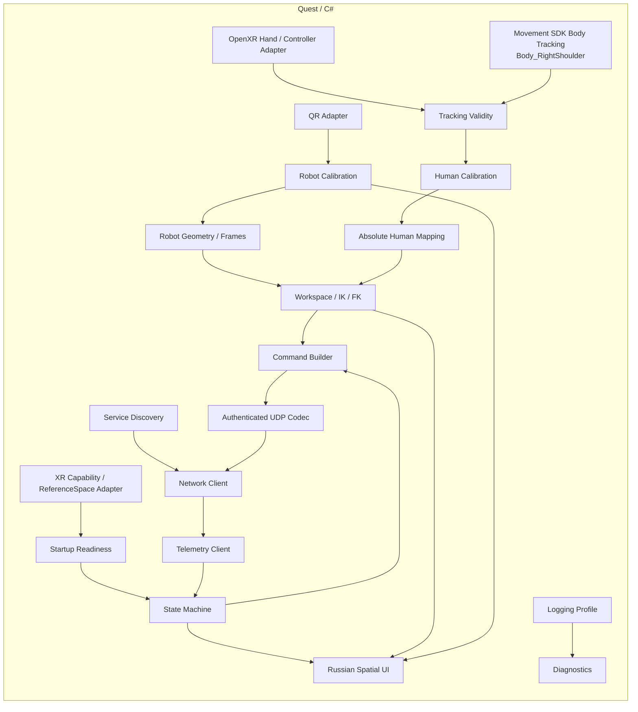
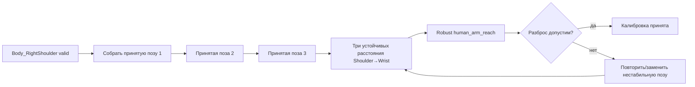
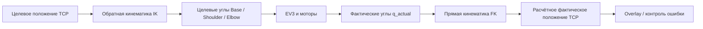
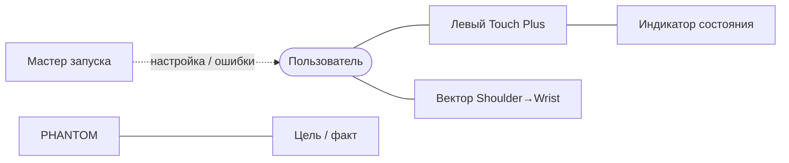

<a id="sec-5"></a>
# PHANTOM — спецификация Meta Quest 3

Quest преобразует отслеживаемые движения пользователя в цели робота, выполняет QR-калибровку и отображает состояние системы.

<!-- BEGIN GENERATED TOC -->
<details>
<summary>Оглавление</summary>

- [1. Технологическая основа](#sec-5-1)
- [2. Условия запуска и XR readiness](#sec-5-2)
- [3. Внутренняя структура приложения](#sec-5-3)
- [4. Входные данные пользователя](#sec-5-4)
  - [4.1. Правая рука](#sec-5-4-1)
  - [4.2. Левая рука](#sec-5-4-2)
  - [4.3. Временное согласование и фильтрация отслеживания](#sec-5-4-3)
- [5. Системы координат приложения](#sec-5-5)
- [6. Пространственная модель пользователя](#sec-5-6)
- [7. Калибровка рабочей длины правой руки](#sec-5-7)
  - [7.1. Параметры](#sec-5-7-1)
  - [7.2. Что делает пользователь](#sec-5-7-2)
  - [7.3. Расчёт рабочей длины](#sec-5-7-3)
  - [7.4. Результат](#sec-5-7-4)
- [8. Непрерывное отслеживание положения плеча](#sec-5-8)
  - [8.1. Алгоритм во время работы](#sec-5-8-1)
  - [8.2. Как учитываются движения пользователя](#sec-5-8-2)
  - [8.3. Валидность, качество и краткие пропуски](#sec-5-8-3)
  - [8.4. Рабочее предположение и диагностическое логирование](#sec-5-8-4)
- [9. Сигнал сжатия кисти и опциональный remap](#sec-5-9)
- [10. Абсолютное отображение движения руки](#sec-5-10)
- [11. Управление захватом](#sec-5-11)
- [12. Геометрическая модель PHANTOM](#sec-5-12)
- [13. Преобразование положения TCP и углов суставов](#sec-5-13)
  - [13.1. Обратная кинематика: TCP → углы](#sec-5-13-1)
  - [13.2. Прямая кинематика: углы → TCP](#sec-5-13-2)
- [14. Рабочая область, коллизии и безопасные границы](#sec-5-14)
- [15. QR-маркеры PHANTOM](#sec-5-15)
  - [15.1. Какая точка считается положением QR](#sec-5-15-1)
  - [15.2. Пары маркеров и вычисляемые точки](#sec-5-15-2)
  - [15.3. Как вычисляются направления звеньев](#sec-5-15-3)
  - [15.4. Требования к движущимся маркерам](#sec-5-15-4)
  - [15.5. Требования к креплениям](#sec-5-15-5)
- [16. Инженерная калибровка геометрии и приводов (`RobotGeometry`, `DriveCalibration`)](#sec-5-16)
  - [16.1. Предусловия инженерной калибровки](#sec-5-16-1)
  - [16.2. Как Quest определяет физические углы Base, Shoulder и Elbow](#sec-5-16-2)
  - [16.3. Первое безопасное калибровочное движение](#sec-5-16-3)
  - [16.4. Порядок автоматической калибровки приводов](#sec-5-16-4)
  - [16.5. Определение коэффициента, направления и люфта A/B/C](#sec-5-16-5)
  - [16.6. Расчёт положения без накопления ошибки](#sec-5-16-6)
  - [16.7. Проверка `DriveCalibration` перед сохранением](#sec-5-16-7)
  - [16.8. Калибровка захвата с эллиптической траекторией губок](#sec-5-16-8)
  - [16.9. Привязка при обычном запуске](#sec-5-16-9)
  - [16.10. Причины отклонения калибровки или привязки](#sec-5-16-10)
- [17. Пользовательский интерфейс](#sec-5-17)
  - [17.1. Язык и визуальные подсказки](#sec-5-17-1)
  - [17.2. Пространственная компоновка](#sec-5-17-2)
  - [17.3. Мастер запуска](#sec-5-17-3)
  - [17.4. Рабочая панель состояния](#sec-5-17-4)
  - [17.5. Модель пользователя](#sec-5-17-5)
  - [17.6. Наложение на PHANTOM](#sec-5-17-6)
  - [17.7. Экраны и действия](#sec-5-17-7)
  - [17.8. Виброотклик левого контроллера](#sec-5-17-8)
- [18. Ошибки Quest и восстановление](#sec-5-18)
- [19. Конфигурация Quest](#sec-5-19)
  - [19.1. Смысл текущих полей](#sec-5-19-1)
  - [19.2. Поля будущих этапов](#sec-5-19-2)

</details>
<!-- END GENERATED TOC -->

<a id="sec-5-1"></a>
## 1. Технологическая основа

Приложение работает автономно на Meta Quest 3 и использует:

- Unity с зафиксированной в lock/build manifest версией, совместимой с выбранными Meta XR packages; для текущей baseline-конфигурации версия Unity должна быть не ниже минимума актуальной Multimodal-документации;
- Unity OpenXR;
- Meta XR Core SDK **v83 или новее** и Meta MR Utility Kit **v83 или новее** для QR Trackables; точные версии фиксируются и не обновляются без regression;
- Meta XR Movement SDK с **явно выбранным и P0-квалифицированным Upper-Body provider** для `Body_RightShoulder`; `OVRBody` является возможным adapter, но не считается совместимым с Multimodal только по наличию API;
- Hand Tracking/OpenXR joint `Wrist` для правой руки;
- OpenXR Hand Interaction `grasp_ext/value` + readiness для степени сжатия;
- MRUK QR Trackables через отдельный `QrTrackingAdapter`; приложение использует системные Trackable/Anchor APIs и не получает/не обрабатывает raw RGB frames ради QR;
- OpenXR `LOCAL_FLOOR` как базовую XR reference space;
- Multimodal Input: правая рука без контроллера + левый Touch Plus Controller.

Для actuator profile v1 фиксируется совместимая комбинация features: **Multimodal включён; IOBT, FBS и FMM выключены; WMM не является источником actuator pose и не должен включаться в комбинации passthrough + Multimodal.** Это соответствует платформенной матрице совместимости и предотвращает скрытую смену tracking semantics. Body Tracking плеча остаётся оценочным базовым Body Tracking и допускается только после [План проверки §6](test-plan.md#sec-9-6) qualification.

SDK-зависимый код изолирован от математики PHANTOM. `Mapping`, `Kinematics`, `WorkspaceProjector`, `RobotCollisionModel`, `DriveCalibration`, протокольные модели и state transitions не зависят от prefab-классов SDK. Все platform adapters возвращают нормализованные snapshots и capability/status, которые можно воспроизводить в replay tests.

<a id="sec-5-2"></a>
## 2. Условия запуска и XR readiness

Readiness оценивается относительно active profile; требования полного `READY` нельзя применять к раннему D-only стенду и затем обходить вручную.

**Network-only Stage 3 (`Diagnostic`, `qualification_only=true`, `actuator_scope_mask=0x00`, `safety_observation_mask=0x00`, `required_user_inputs=NONE`).** XR/tracking/QR вообще не являются prerequisite: network subsystem может пройти discovery/CONTROL-session/telemetry проверки без активных Hand/Body/Wrist/Left Grip/`LOCAL_FLOOR`. Требуются только lifecycle самого приложения, разрешённый platform LAN access и совместимый network-only bundle; `READY`/`TRACKING` недоступны. Это позволяет отдельно квалифицировать сеть и не превращает отсутствие надетого HMD в ложный network failure.

**Полный Release (`qualification_only=false`, `actuator_scope_mask=0x0F`, `safety_observation_mask=0x0F`).** Переход в `READY` запрещён, пока не выполнены:

```text
OpenXR session active
LOCAL_FLOOR valid
Spatial Data permission granted
Scene Support = Required и Anchor Support = Enabled (для MRUK QR Trackables)
QR tracking capability available when startup reference is required
right Hand Tracking / Wrist available
upper-body Body Tracking available
Body_RightShoulder valid
left Touch Plus available
user presence confirmed for user-driven motion
Multimodal active
TrackingQualificationProfile matches qualified build/runtime configuration
QualificationEvidenceManifest hash valid for current production semantic component set
```

**Gripper-only qualification (`Diagnostic`, `qualification_only=true`, `actuator_scope_mask=0x08`, `safety_observation_mask=0x08`).** До получения D-only `GripperReference` и входа в `COMMISSIONING/ACTUATOR_QUALIFICATION` требуются только применимые этому actuator path условия:

```text
OpenXR session active + application focus valid
LOCAL_FLOOR / общий XR reference space valid
Spatial Data permission + QR Trackable capability available для JAW reference
right Hand Tracking + graspReady available
left Touch Plus + Left Grip available
user presence confirmed for user-driven D motion
Multimodal active
scope-specific TrackingQualificationProfile matches qualified build/runtime configuration
```

`Body_RightShoulder`, Wrist-vector mapping, `human_arm_reach`, `RobotLocalization` и полный QR-набор роборуки для scope `0x08` не требуются.

Сохранённая room mesh, semantic furniture и отдельный Scene floor anchor **не требуются** ни полному core actuator path, ни D-only qualification. Полный path использует `LOCAL_FLOOR` и QR для `RobotBaseFrame`; D-only path использует общий XR space только для согласованного JAW QR measurement.

`Space Setup` остаётся доступным только для опциональных scene-aware UI/room features или когда пользователь явно запускает такую функцию. После возврата приложение повторно проверяет действительно требуемые anchors; cancel не блокирует core actuator path, если scope-specific prerequisites остаются валидны.

При pause/focus loss приложение немедленно снимает `MOTION_ENABLE` и очищает armed-latch. После resume:

- полный A/B/C path заново проверяет Multimodal, Hand/Body Tracking, `LOCAL_FLOOR`, QR capability и при необходимости `RobotLocalization`; физическое движение возвращается только через `HOLD` и deliberate re-arm;
- gripper-only path заново проверяет Hand/grasp, левый Touch Plus, focus/lifecycle и JAW QR capability; система остаётся в `COMMISSIONING`, D остаётся dearmed до deliberate re-arm: release → EV3-confirmed OFF/HOLD → new rising edge. Body Shoulder/Wrist не являются gate.

При `XrEventDataReferenceSpaceChangePending` или эквивалентной смене tracking origin `MOTION_ENABLE` снимается заранее. В полном A/B/C path `RobotLocalization` инвалидируется и требуется новая QR-локализация. В D-only qualification сама смена XR origin не инвалидирует `GripperReference`, поскольку runtime D использует локальный encoder reference и скалярный `grip_intent`; при сомнении в непрерывности JAW↔encoder привязки выполняется новая D-only `GripperReference`.

<a id="sec-5-3"></a>
## 3. Внутренняя структура приложения



| Модуль | Обязанность |
|---|---|
| `Tracking` | получать `Wrist`, правую кисть, левый Controller, HMD для жизненного цикла XR и `Body_RightShoulder` из Body Tracking вместе с доступными validity/quality/fidelity признаками |
| `XrSpaceBridge` | приводить все actuator-relevant XR/Meta poses к одному `LOCAL_FLOOR` и согласованному `t_control`; скрывать различия OpenXR/OVRCameraRig TrackingSpace |
| `XrReadiness` | проверять `LOCAL_FLOOR`, reference-space change events, Spatial Data/Scene/Anchor/QR capabilities и Multimodal lifecycle; Room/Scene data — только опциональный UX |
| `HumanCalibration` | определять/выбирать `human_arm_reach` и опциональный `GripRemapProfile`; стандартный OpenXR grasp profile по умолчанию не требует endpoint-калибровки |
| `RobotCalibration` | QR-локализация, `q_qr`, раскрытие захвата, проверка `RobotGeometry` и QR↔энкодерная калибровка до `READY` |
| `Mapping` | абсолютное преобразование текущего вектора плечо→запястье в `P_requested_B` |
| `Kinematics` | pure mapping, аналитический `WorkspaceProjector`, fixed-branch IK/FK, `RobotCollisionModel` и validation `JointSafeSet` preview |
| `Discovery` | DNS-SD/mDNS поиск EV3 по `robot_id` |
| `Networking` | установление соединения, HMAC, кодек протокола, команды и телеметрия |
| `StateMachine` | wire/product states `BOOT`, `USER_CALIBRATION`, `DISCOVERY`, `CONNECTED_UNREFERENCED`, `ROBOT_CALIBRATION`, `COMMISSIONING`, `READY`, `TRACKING`, `HOLD`, `SAFE_HOLD`, `STOPPED`; latched fault — orthogonal condition `STOPPED + fault_code`, а не отдельный state code |
| `UI` | полностью русские пользовательские экраны, пространственные наложения, иллюстрации и виброотклик |
| `Diagnostics` | журналирование `Release` или `Diagnostic` без изменения логики управления |

<a id="sec-5-4"></a>
## 4. Входные данные пользователя

<a id="sec-5-4-1"></a>
### 4.1. Правая рука

Основные данные:

```text
Wrist position + validity/quality
graspValue + graspReady
TrackingQualificationProfile status
```

`Wrist` — управляющая точка. Ориентация ладони не влияет на целевой `TCP`. Остальные суставы кисти могут использоваться для оценки качества жеста, визуализации и диагностического режима, но не должны создавать дополнительную степень свободы робота.

<a id="sec-5-4-2"></a>
### 4.2. Левая рука

Левая рука удерживает Touch Plus Controller.

Для пользовательского движения также проверяется присутствие пользователя по
доступному platform presence/lifecycle сигналу (`FR-TRK-02`). Снятый шлем или
недостоверное состояние присутствия снимают `MOTION_ENABLE` и armed-latch, даже
если Touch Plus продолжает передавать зажатый Grip. После возвращения пользователя
проверяются входы режима и выполняется deliberate re-arm. Network-only проверки
без motor authority не требуют надетого шлема.

| Вход | Назначение |
|---|---|
| `Left Grip` | непрерывное разрешение физического движения |
| Trigger | выбор элементов UI и подтверждение действий вне активного движения |
| X/Y | подтверждение/назад в мастере |
| Stick | навигация инженерного UI вне `TRACKING` |
| Виброотклик | подтверждения и предупреждения |

`Left Grip` трактуется как разрешающий вход с гистерезисом и armed-latch:

```text
squeeze <= 0.45 → немедленно запретить движение; armed=false после SAFE_HOLD
squeeze >= 0.60 → разрешить только при armed=true и новом rising edge
0.45..0.60      → сохранить текущее логическое состояние
```

Выключение не должно задерживаться искусственной программной задержкой. Для включения допускается короткий debounce, квалифицированный тестом latency. После старта или `SAFE_HOLD` локально наблюдаемого release недостаточно: Quest отправляет canonical OFF/HOLD (`MOTION_ENABLE=0`, `HOLD_REQUEST=1`) и устанавливает `armed=true` только после свежей telemetry текущей session, подтверждающей его принятие через `last_accepted_command_sequence >= release_off_sequence`; уже удерживаемый Grip не запускает движение.

<a id="sec-5-4-3"></a>
### 4.3. Временное согласование и фильтрация отслеживания

Положение плеча и запястья может приходить из разных подсистем отслеживания и не обязано иметь одну и ту же временную метку источника. Для точного вектора нельзя просто вычитать «последний Wrist» из «последнего Shoulder», если их возраст существенно различается.

Каждый адаптер отдаёт нормализованный snapshot:

```text
position_LOCAL_FLOOR
sample_or_query_time        # source time, если API её даёт; иначе documented query/locate time
receive_monotonic_time
time_uncertainty_ms          # 0 только если это доказано API; иначе консервативная оценка/UNKNOWN
validity/quality
runtime_quality              # доступные platform fidelity/status flags без выдуманного общего enum
```

Реализация не должна выдумывать sensor timestamp или provenance, которых SDK не предоставляет. Actuator eligibility задаётся `TrackingQualificationProfile`; текущий sample дополнительно обязан пройти validity/quality/fidelity и age checks. По возможности Shoulder и Wrist локализуются/запрашиваются относительно общего `t_control`.

На каждом обновлении управления выбирается общий `t_control`. Shoulder/Wrist приводятся к этому времени интерполяцией между свежими измерениями; ограниченная экстраполяция допускается только в пределах `max_tracking_extrapolation_ms`. Если временной разрыв **с учётом `time_uncertainty_ms`** превышает `max_tracking_alignment_ms`, либо uncertainty неизвестна в режиме, где это не было отдельно HIL-квалифицировано, команда считается невалидной по отслеживанию.

После временного согласования сначала формируется **чистый абсолютный** сигнал, а затем отдельный actuator filter:

```text
S_aligned = Shoulder(t_control) in LOCAL_FLOOR
W_aligned = Wrist(t_control)    in LOCAL_FLOOR
v_aligned_raw = W_aligned - S_aligned
P_requested_B = PureHumanMapping(v_aligned_raw)   # без состояния

v_control = AdaptiveVectorFilter(v_aligned_raw)
P_control_B = PureHumanMapping(v_control)
```

`P_requested_B` является математическим абсолютным запросом пользователя и используется для property/replay проверки path independence. `P_control_B` — единственная цель, которая далее идёт в actuator workspace/IK. Отдельная low-pass фильтрация Shoulder/Wrist до вычитания запрещена.

`AdaptiveVectorFilter` может быть stateful, поэтому его lifecycle нормативен: при startup, смене `RobotLocalization`/user profile/filter config, после tracking dropout/reacquire и перед новым re-arm после tracking-related `SAFE_HOLD` он **seed/reset**-ится текущим валидным `v_aligned_raw`. Старое состояние фильтра из предыдущей reference/session не переносится. При штатном `HOLD` без tracking fault фильтр может продолжать следовать raw signal для плавного preview, но физический output остаётся запрещён.

Начальная реализация — `One Euro filter` либо эквивалент с параметрами, проходящими тест задержки/шума. Фильтр не хранит позиционный интеграл; после фиксированного seed и одинаковой последовательности входов результат детерминирован. `XrSpaceBridge` гарантирует, что обе точки относятся к одному reference space; Unity world transforms не смешиваются с actuator math.

<a id="sec-5-5"></a>
## 5. Системы координат приложения

Quest хранит положение головы, запястья, оценку плеча и положение робота в `LOCAL_FLOOR`. Отдельная система направлений пользователя не вводится.

`RobotBaseFrame` строится по физическим точкам пары `SHOULDER_LEFT/RIGHT`. Его начало находится в вычисленном `ShoulderCenter`. Ориентация отдельного QR не используется. Важен явный контракт осей: OpenXR `LOCAL_FLOOR` является Y-up, тогда как внутренняя кинематика PHANTOM остаётся Z-up.

```text
OpenXR LOCAL_FLOOR:
  Up_floor = +Y

P_left  = CorrectedPoint(SHOULDER_LEFT)
P_right = CorrectedPoint(SHOULDER_RIGHT)
origin_B = ShoulderCenter = midpoint(P_left, P_right)

zB_floor = unit_up_of_LOCAL_FLOOR           # OpenXR +Y
lateral  = ProjectToPlane(P_left - P_right, zB_floor)
yB_floor = normalize(lateral)
xB_floor = normalize(cross(yB_floor, zB_floor))

RobotBaseFrame:
  +Z_B = zB_floor
  +Y_B = yB_floor
  +X_B = xB_floor
```

Преобразование XR Y-up → robot Z-up реализуется отдельным тестируемым coordinate adapter; простое переименование компонентов вектора запрещено. Golden-vector tests обязаны проверять базис, handedness, floor-height и несколько известных направлений.

Таким образом даже статическая поперечная ось базы определяется вектором между двумя физически вычисленными точками. Отдельная тройка QR на Base не используется.

Основные преобразования:

```text
T_floor_base — RobotBaseFrame в LOCAL_FLOOR, определяется по SHOULDER_LEFT/RIGHT
T_base_floor — inverse(T_floor_base)
```

Вектор `HumanShoulderCenter → HumanWristCenter` сначала существует непосредственно в `LOCAL_FLOOR`, затем только поворачивается в `RobotBaseFrame` через `T_base_floor`. Поэтому пользователю не требуется смотреть в специальном направлении или задавать «вперёд».

При изменении или потере используемой XR-системы координат:

```text
MOTION_ENABLE = 0
→ SAFE_HOLD
→ дождаться валидного Body Tracking в новой XR-системе координат
→ invalidate RobotLocalization
→ повторно проверить LOCAL_FLOOR и обязательные XR/QR capabilities
→ заново получить RobotBaseFrame по QR
```

Скаляр `human_arm_reach` и `DriveCalibration` EV3 при этом сохраняются, если пользователь и механика не менялись. `JointReference` сохраняется только если подтверждена непрерывность текущих отсчётов энкодеров и процесса контроллера; при сомнении выполняется новая QR-привязка.

<a id="sec-5-6"></a>
## 6. Пространственная модель пользователя

Для управления PHANTOM используются две текущие точки в `LOCAL_FLOOR`:

```text
HumanShoulderCenter = Meta Body Tracking Body_RightShoulder
HumanWristCenter    = OpenXR Hand Tracking Wrist
```

`Body_RightShoulder` поступает из Meta XR Movement SDK Body Tracking. Body Tracking формирует скелет верхней части тела и обновляет положение правого плечевого сустава во время работы. PHANTOM не вычисляет плечо самостоятельно из HMD и не восстанавливает его по дугам движения запястья.

Meta Body Tracking является оценкой позы тела, а не отдельным физическим датчиком на плече. Поэтому приложение использует доступные SDK validity/quality/fidelity признаки и фильтрацию шума; качество именно `Body_RightShoulder` подтверждается тестами [План проверки §6](test-plan.md#sec-9-6).

Основной режим PHANTOM использует Multimodal Input: правая рука отслеживается без контроллера, левая держит Touch Plus. В v1 конфигурация намеренно не использует IOBT, FBS, FMM или WMM в actuator path: актуальная Meta compatibility matrix запрещает/ограничивает их совместное использование с Multimodal и passthrough. `Body_RightShoulder` является **оценкой** базового Body Tracking, а не прямым датчиком; поэтому право этой оценки управлять физическим PHANTOM задаётся не названием режима, а пройденным `TrackingQualificationProfile` [План проверки §6](test-plan.md#sec-9-6). Если runtime/SDK/feature flags отличаются от квалифицированной комбинации, `READY` блокируется до повторной HIL qualification.

Ориентация HMD (`yaw`, `pitch`, `roll`) не входит в формулу `HumanShoulderCenter`. Поворот головы не должен напрямую вращать или переносить плечо.

<a id="sec-5-7"></a>
## 7. Калибровка рабочей длины правой руки

<a id="sec-5-7-1"></a>
### 7.1. Параметры

Положение плеча не является результатом пользовательской калибровки. На каждом обновлении Body Tracking оно поступает как `Body_RightShoulder`. Калибровка пользователя определяет только:

```text
human_arm_reach
HumanWristCenter = live Wrist
HumanShoulderCenter = live Body_RightShoulder
```

Положение локтя пользователя не вычисляется и не участвует в формировании `TCP`.

`human_arm_reach` нужен только как коэффициент относительного масштабирования человеческого движения на рабочую длину PHANTOM. Спецификация не вводит антропометрическую «норму» длины руки. Однако численное значение обязано быть finite, положительным и проходить широкие технические sanity bounds; кроме того, `scale = robot_reach / human_arm_reach` ограничивается `max_mapping_scale`. Эти пределы защищают от tracking glitch/почти нулевого делителя и не трактуются как ограничение пользователя.

<a id="sec-5-7-2"></a>
### 7.2. Что делает пользователь

Процедура должна занимать минимальное время. Нормальный сценарий собирает **три принятые** устойчивые позы полностью выпрямленной правой руки:

1. пользователь становится в удобную рабочую стойку;
2. полностью выпрямляет правую руку и удерживает её примерно `0.5–1.0 с` в первой подсвеченной позе;
3. повторяет удержание ещё в двух удобных направлениях;
4. приложение одновременно получает `Body_RightShoulder` и `Wrist`;
5. отклонённая по quality/jitter поза не засчитывается и может быть повторена; предыдущие хорошие позы не теряются.

Рекомендуемые направления — вперёд, в сторону и по диагонали вверх. Они нужны не для задания направления управления, а только для проверки, что измерение длины не зависит от одной случайной позы.

Пользователю не требуется водить рукой по сфере. В штатном случае достаточно трёх попыток, но UX не должен объявлять calibration failed только потому, что одна из первых трёх попыток оказалась нестабильной.



<a id="sec-5-7-3"></a>
### 7.3. Расчёт рабочей длины

Для каждого валидного измерения:

```text
d_i = |HumanWristCenter_i - HumanShoulderCenter_i|
```

В расчёт входят только данные, где Body Tracking и Hand Tracking валидны, а рука удерживается выпрямленной. Для каждой **принятой** позы вычисляется медианное расстояние; итоговая `human_arm_reach` определяется как медиана трёх принятых устойчивых значений. Если quality gate отклонил позу, она заменяется новой и не участвует в статистике.

Базовые критерии качества:

| Показатель | Требование |
|---|---:|
| принятые устойчивые позы выпрямленной руки | `3` |
| число попыток | bounded UX policy; отклонённые попытки разрешены |
| валидные совместные Shoulder+Wrist отсчёты | `>=90` суммарно по трём принятым позам |
| p95 разброс расстояния внутри одной удерживаемой позы | `<=20 мм` |
| разница медианных длин между принятыми позами | `<=30 мм` |

Ограничение вида `0.45..0.90 м` не используется. Если три принятых измерения согласованы, абсолютная длина не влияет на корректность алгоритма, потому что дальнейшее отображение выполняется относительно `human_arm_reach`.

Если одна поза нестабильна, повторяется/заменяется только она.

<a id="sec-5-7-4"></a>
### 7.4. Результат

```yaml
human_calibration:
  arm_reach_m: 0.xxx
  arm_reach_spread_m: 0.xxx
  body_tracking_joint: Body_RightShoulder
  valid: true
```

`human_arm_reach` сохраняется в именованном user profile вместе с revision алгоритма/SDK и метриками качества. При обычном запуске валидный совместимый профиль может переиспользоваться после короткой sanity-проверки; полная трёхпозная калибровка обязательна для нового/несовместимого/провалившего sanity-check профиля. Шаги, приседание, поворот корпуса или поворот головы не изменяют этот скаляр.

<a id="sec-5-8"></a>
## 8. Непрерывное отслеживание положения плеча

`HumanShoulderCenter` обновляется автоматически из `Body_RightShoulder` при каждом доступном обновлении Body Tracking. От пользователя не требуется выполнять отдельные движения для обновления положения плеча.

<a id="sec-5-8-1"></a>
### 8.1. Алгоритм во время работы

```text
bodyPose = BodyTracking.current
shoulder = bodyPose.Body_RightShoulder

если shoulder valid и fresh:
    S_raw = TransformToLocalFloor(shoulder.position)
    HumanShoulderCenter = S_raw  # actuator path фильтрует только согласованный W-S; отдельное сглаживание допустимо лишь для UI
```

Для actuator path отдельный Shoulder low-pass здесь не применяется: фильтрация выполняется после временного согласования на `W-S` согласно [§4.3](#sec-5-4-3). Отдельно сглаженный Shoulder допускается только для UI/диагностики. Поза HMD не прибавляется к `S_raw` и не используется как отдельная модель трансляции плеча.

<a id="sec-5-8-2"></a>
### 8.2. Как учитываются движения пользователя

| Действие пользователя | Ожидаемое поведение |
|---|---|
| шаг влево/вправо | `Body_RightShoulder` перемещается вместе с телом в `LOCAL_FLOOR`; `HumanShoulderCenter` следует этому перемещению |
| шаг вперёд/назад | положение плеча обновляется Body Tracking по новой позе тела |
| приседание/вставание | вертикальная координата плеча изменяется вместе с body skeleton |
| поворот корпуса | положение правого плеча изменяется относительно мира и автоматически отражается в `Body_RightShoulder` |
| поворот или наклон только головы | PHANTOM не применяет HMD yaw/pitch/roll к плечу; при неподвижном корпусе `HumanShoulderCenter` должен оставаться практически неизменным в пределах шума отслеживания |
| движение правой руки | меняется `Wrist`; положение плеча берётся независимо из body joint и не пересчитывается по траектории кисти |

Таким образом вектор управления всегда вычисляется из двух актуальных мировых точек:

```text
HumanArmVector = HumanWristCenter - HumanShoulderCenter
```

<a id="sec-5-8-3"></a>
### 8.3. Валидность, качество и краткие пропуски

Приложение должно проверять актуальность Body Tracking и валидность правого плечевого сустава. Краткий пропуск не запускает калибровку и не показывает пользователю инструкцию двигать рукой.

```text
valid shoulder
→ обновлять HumanShoulderCenter

короткий dropout <= shoulder_dropout_grace_ms
→ не строить новый вектор из stale Shoulder + fresh Wrist
→ заморозить последнюю полностью time-aligned валидную `P_control_B/q_target`

tracking не восстановился до timeout
→ SAFE_HOLD

tracking снова valid
→ получить новый согласованный Shoulder+Wrist snapshot
→ reseed AdaptiveVectorFilter текущим `v_aligned_raw`
→ перейти/остаться в HOLD
→ физический Grip release → canonical OFF/HOLD → дождаться telemetry-confirmed acceptance → только затем новый rising edge (re-arm)
```

`SAFE_HOLD` здесь является реакцией на отсутствие обязательных данных отслеживания, а не способом вычисления плеча. Никакая повторная shoulder-calibration при восстановлении не выполняется.

<a id="sec-5-8-4"></a>
### 8.4. Рабочее предположение и диагностическое логирование

Реализация PHANTOM должна исходить из того, что штатный `Body_RightShoulder` достаточно хорошо отражает текущее положение правого плеча для управления. Дополнительная эвристика HMD→плечо в основной алгоритм не добавляется.

Release-кандидат не допускается к физическому движению, пока выбранный `TrackingQualificationProfile` не прошёл [План проверки §6](test-plan.md#sec-9-6). После такой квалификации приложение не требует per-frame внешнего ground truth и не останавливается только из-за отсутствия отдельного измерительного маркера. `SAFE_HOLD` используется только при фактической потере/устаревании обязательных данных отслеживания либо другом уже определённом условии безопасности.

Во время работы обязательно собираются диагностические признаки качества отслеживания плеча:

```text
Body_RightShoulder valid/quality
source age и временное рассогласование с Wrist
краткие dropout/reacquire events
резкие скачки позиции плеча
неправдоподобно высокая скорость/ускорение shoulder joint
Body Tracking fidelity/status + SDK/runtime version + qualified feature-profile id
state и Left Grip в момент события
```

В `Release` эти данные хранятся агрегированно и в `FlightRecorder`; подробный поток записывается только в `Diagnostic`. События потери отслеживания, резкого скачка, длительного низкого качества/невалидного fidelity-status и повторного восстановления должны иметь отдельные записи журнала.

Физические тесты [План проверки §6](test-plan.md#sec-9-6) остаются проверкой качества реализации на Quest 3. Если в реальной эксплуатации обнаружится систематическая ошибка положения плеча, сначала анализируются сохранённые данные отслеживания и `FlightRecorder`, после чего алгоритм корректируется на основании измеренной причины. До появления такой ошибки код не должен вводить искусственную остановку или дополнительную пользовательскую процедуру.

<a id="sec-5-9"></a>
## 9. Сигнал сжатия кисти и опциональный remap

Primary v1 source — OpenXR `XR_EXT_hand_interaction` через `IGripSignalProvider/OpenXrGraspProvider`:

```text
rawGrasp: 0..1
rawGraspReady: bool
```

При `rawGraspReady=true` базовый профиль **не требует пользовательской endpoint-калибровки**:

```text
humanGrip = clamp(rawGrasp, 0, 1)
```

Это сохраняет нормативную семантику interaction profile и уменьшает число обязательных действий запуска. `rawGraspReady=false` означает «сигнал сейчас не пригоден»: значение не превращается в `0`, текущая физическая цель Gripper удерживается, а `GRASP_VALID=0` передаётся в state/control logic.

Для accessibility или доказанного конкретным runtime/user bias допускается явный `GripRemapProfile`:

```text
g_open < g_closed
usable_span = g_closed - g_open >= remap_min_usable_span
humanGrip = clamp((rawGrasp - g_open)/(g_closed - g_open), 0, 1)
```

Remap создаётся отдельной пользовательской операцией, хранится с `profile_id`, runtime/SDK compatibility metadata и может быть отключён одним действием. Он не применяется автоматически и не должен менять sign/монотонность. При смене runtime/Hand Interaction implementation профиль помечается `needs_revalidation`.

Альтернативный `JointCurlGripProvider` (например, вычисление из hand joints) допускается только как отдельный build/qualification profile, если `XR_EXT_hand_interaction` реально недоступен. Silent переключение providers в активной сессии запрещено: смена provider снимает `MOTION_ENABLE`, требует HIL-квалифицированного профиля и re-arm.

<a id="sec-5-10"></a>
## 10. Абсолютное отображение движения руки

Главное правило — PHANTOM повторяет сам пространственный вектор `плечо → запястье`, а не направление взгляда пользователя.

```text
v_human_floor = HumanWristCenter - HumanShoulderCenter
v_human_B     = RotateVector(T_base_floor, v_human_floor)
```

`RotateVector` применяет только вращательную часть преобразования `LOCAL_FLOOR → RobotBaseFrame`; перенос базы к вектору не применяется.

Размер робота отличается от человеческой руки. Сначала проверяется длина управляющего вектора, затем используется нормированный reach:

```text
d_human = norm(v_human_B)
if d_human < human_vector_min_m:
    return TRACKING_TARGET_INVALID

human_reach = calibrated human_arm_reach
robot_nominal_reach = RobotGeometry.robot_nominal_reach_m
mapping_reach = min(robot_nominal_reach, human_reach * max_mapping_scale)
reach_ratio = clamp(d_human / human_reach, 0, 1)
direction_B = v_human_B / d_human
P_requested_B = direction_B * mapping_reach * reach_ratio
```

Таким образом tracking overshoot за выпрямленную откалиброванную руку не создаёт цель дальше `mapping_reach`. Если `robot_nominal_reach / human_arm_reach` превышает `max_mapping_scale`, PHANTOM **не отвергает пользователя и не усиливает tracking noise сверх квалифицированного коэффициента**: используемый mapping reach детерминированно уменьшается. `mapping_reach` является derived runtime value из hash-bound user/Quest config + `RobotGeometry`, не отдельным mutable commissioning параметром. Почти нулевой вектор не превращает шум направления в движение Base.

Поскольку положение и ориентация `RobotBaseFrame` известны из QR-калибровки, одинаковое физическое направление руки в комнате даёт одинаковое физическое направление плеча PHANTOM→TCP независимо от того, куда смотрит пользователь.

Целевая точка вычисляется непосредственно из текущего вектора руки и не зависит от физической позы робота в момент нажатия `Left Grip`. Нажатие только разрешает движение к уже существующей абсолютной цели.

Если текущий физический `TCP` далеко от `P_requested_B`, сетевой `q_target` может существенно отличаться от `q_actual`; EV3 обязан физически сблизить их через ограниченный `q_ref`.

<a id="sec-5-11"></a>
## 11. Управление захватом

При валидном `TRACKING`:

```text
grip_intent = humanGrip
```

После `HOLD`/`SAFE_HOLD` при возобновлении `TRACKING` сразу используется текущее значение `humanGrip`. Не применяется ожидание совпадения кисти с текущим физическим раскрытием.

Скачок **команды** допустим; скачок **физического механизма** предотвращается EV3 локальным rate limit и contact/stall logic.

В `HOLD` захват удерживает текущую фактическую позицию или подтверждённое положение контакта.

<a id="sec-5-12"></a>
## 12. Геометрическая модель PHANTOM

Конфигурация содержит:

```yaml
geometry:
  revision: 1
  L1_m: MEASURED
  L2_m: MEASURED
  robot_nominal_reach_m: MEASURED_OR_DERIVED_LE_L1_PLUS_L2
  yaw_singularity_hold_radius_m: MEASURED_POSITIVE
  floor_z_B_m: MEASURED_NEGATIVE
  tcp_lateral_offset_m: MEASURED
  tcp_lateral_tolerance_m: MEASURED
  branch_sign: MEASURED
  base_qr_zero_offset_rad: MEASURED
  tcp_reference_tolerance_m: MEASURED
  link_length_residual_tolerance_m: MEASURED
  arm_plane_tolerance_rad: MEASURED
  qr_fixtures_hash: SHA256
  qr_marker_manifest_hash: SHA256
  collision_model_revision: MEASURED
```

Конвенция углов v1 фиксирована и не может зависеть от сборки: `q_base=0` направляет плоскость руки вдоль `+X_B`, положительный Base — right-hand rotation вокруг `+Z_B`; `q_shoulder=0` означает горизонтальный Upper Arm в радиальном направлении, положительный Shoulder поднимает его; `q_elbow=0` означает полностью разогнутые соосные Upper Arm/Forearm, а знак сгибания задаётся `branch_sign`. Все encoder sign/offset приводятся к этой физической конвенции `DriveCalibration`.

`RobotGeometry.robot_nominal_reach_m` является commissioning-параметром конкретной механики, а не локальным Quest default. Обязательные инварианты: finite, `0 < robot_nominal_reach_m <= L1+L2`; значение проходит workspace/JointSafeSet HIL и изменение создаёт новую geometry/bundle revision. `RobotGeometry.yaw_singularity_hold_radius_m` также finite/positive и выбирается по conditioning/повторяемости Base yaw около оси, а не по истории движения.

Для planar-кинематики v1 обязательно `abs(tcp_lateral_offset_m) <= tcp_lateral_tolerance_m`; превышение делает `RobotGeometry` невалидной и запрещает `READY`. Ненулевой offset выше допуска нельзя молча игнорировать — требуется механическое исправление либо отдельная future non-planar kinematics revision. Обычный запуск не переписывает `RobotGeometry`. Изменение конструкции выполняется через инженерную калибровку.

<a id="sec-5-13"></a>
## 13. Преобразование положения TCP и углов суставов

Этот раздел описывает связь между **точкой, куда должен прийти захват**, и **углами трёх моторизованных суставов**, которыми реально управляет EV3.

Поток данных:



- **IK (inverse kinematics, обратная кинематика)** нужна перед отправкой команды: actuator path вычисляет `q_base`, `q_shoulder`, `q_elbow` по `P_control_B` после tracking filter/workspace projection; чистая `P_requested_B` остаётся только property/replay reference и не отправляется напрямую на actuator path.
- **FK (forward kinematics, прямая кинематика)** нужна после чтения энкодеров: по `q_actual` вычислить, где фактически должен находиться `TCP`, и использовать это для UI, тестов и контроля геометрии.

<a id="sec-5-13-1"></a>
### 13.1. Обратная кинематика: TCP → углы

Для `pB_target`. Чисто численный допуск `ik_numeric_epsilon` является schema/code constant `1e-6` (dimensionless), используется только для компенсации округления `D` у границы `[-1,1]` и **не расширяет** физическую рабочую область:

```text
pS = pB_target
r = sqrt(pS.x² + pS.y²)
z = pS.z

q_base = atan2(pS.y, pS.x)

D = (r² + z² - L1² - L2²) / (2 L1 L2)
if D < -1-ik_numeric_epsilon or D > +1+ik_numeric_epsilon:
    return UNREACHABLE   # цель должна быть спроецирована до повторного IK
D = clamp(D, -1, +1)    # только численная погрешность

q_elbow = atan2(
    branch_sign * sqrt(max(0, 1-D²)),
    D
)

q_shoulder =
    atan2(z, r)
    - atan2(L2*sin(q_elbow), L1 + L2*cos(q_elbow))
```

Результат IK не отправляется на моторы напрямую: сначала применяются workspace/безопасные границы, затем EV3 формирует ограниченный по скорости и ускорению `q_ref`.

<a id="sec-5-13-2"></a>
### 13.2. Прямая кинематика: углы → TCP

```text
r = L1*cos(q_shoulder) + L2*cos(q_shoulder + q_elbow)
z = L1*sin(q_shoulder) + L2*sin(q_shoulder + q_elbow)

pB = [
  r*cos(q_base),
  r*sin(q_base),
  z
]
```

FK не управляет мотором. Она вычисляет положение TCP из известных углов и используется для сравнения target/actual, визуального overlay и автоматических тестов.

<a id="sec-5-14"></a>
## 14. Рабочая область, коллизии и безопасные границы

Quest использует только commissioned `RobotGeometry`, `RobotCollisionModel`, independent joint bounds и `JointSafeSet` из совместимого `CommissioningBundle`. EV3 независимо применяет `JointSafeSet`; Quest не является единственной линией защиты.

Runtime pipeline v1 намеренно **не выполняет generic collision-aware nearest-configuration search**. Это исключает скрытый выбор неожиданной позы робота и делает поведение воспроизводимым:

```text
P_requested_B                # pure raw mapping
P_control_B                  # после tracking filter
→ finite / human-vector sanity
→ AnalyticWorkspaceProjector:
     reachable annulus
     TCP floor clearance
     configured radial constraints
→ fixed-branch IK
→ independent joint-bound clamp, если он однозначен
→ FK → P_projected_B
→ RobotCollisionModel validation
→ JointSafeSet validation
→ q_target или TARGET_INVALID
```

Правила:

- Base находится внутри измеренных cable/hard-stop bounds с margin;
- Shoulder/Elbow находятся внутри commissioned signed bounds; `<=90°` относится к физически определённой flexion, а не encoder zero;
- `pB.z >= floor_z_B + RobotCollisionModel.tcp_floor_clearance_m`;
- если `r_xy < RobotGeometry.yaw_singularity_hold_radius_m`, результат `TARGET_INVALID → SAFE_HOLD`; исторический yaw не используется;
- independent joint clamp допускается только для одиночных limits и после него обязательно пересчитывается FK; UI показывает полученную `projected` цель;
- если полученная конфигурация не проходит `RobotCollisionModel` или coupled `JointSafeSet`, v1 **не ищет другую конфигурацию**: результат `TARGET_INVALID`, пользователь должен изменить руку;
- никакие cost function, random search, bounded iterations или «nearest valid q» в actuator path v1 не используются.

`RobotCollisionModel` содержит conservative primitives для Base/Upper Arm/Forearm/Gripper и forbidden geometry. Он используется offline для построения `JointSafeSet` и на Quest для preview/диагностики. Authoritative EV3 runtime safety representation — `JointSafeSet` [Спецификация EV3 §16](ev3-specification.md#sec-7-16).

UI различает `requested`, `control`, `projected` и `actual`; при collision rejection показывает конкретную категорию (`BASE`, `FLOOR`, `SELF_COLLISION`, `COUPLED_LIMIT`), но не раскрывает пользователю инженерные численные параметры по умолчанию.

<a id="sec-5-15"></a>
## 15. QR-маркеры PHANTOM

QR используются только для инженерной калибровки, привязки перед `READY` и явной инженерной проверки остановленного робота. После `READY` видимость QR не требуется.

Все обязательные QR называются по единому правилу: **элемент + положение `LEFT`/`RIGHT`**. Обязательный набор состоит из десяти маркеров:

```text
SHOULDER_LEFT
SHOULDER_RIGHT
TURRET_LEFT
TURRET_RIGHT
ELBOW_LEFT
ELBOW_RIGHT
GRIPPER_LEFT
GRIPPER_RIGHT
JAW_LEFT
JAW_RIGHT
```

Дополнительный `TCP_CAL` допускается для независимой инженерной проверки положения `TCP`. Нормативный payload обязательного QR v1 — bounded canonical ASCII без пробелов: `PHANTOM1|robot_id=<id32-text>|geometry_revision=<u32-decimal>|marker_role=<ROLE>|marker_id=<16-lowerhex>`. Дополнительные/неизвестные поля, duplicate keys, неверный prefix/case/encoding, повтор одного `marker_id` в двух ролях и роль с не тем `marker_id` отклоняются. `qr_marker_manifest` в `RobotGeometry` хранит полный ожидаемый набор `{marker_role, marker_id}`; QR другого `robot_id`/revision/manifest не участвует в `RobotLocalization`/reference. `marker_id` не является секретом/nonce и не заменяет HMAC сетевого протокола.

<a id="sec-5-15-1"></a>
### 15.1. Какая точка считается положением QR

Размерной точкой маркера является `QrMarkerCenter` — геометрический центр квадратного QR-символа. Край бумаги, quiet zone, угол наклейки и край держателя не являются размерной базой.

Положение одного QR **никогда не используется как направление звена**. Для каждого маркера `RobotGeometry` хранит постоянное преобразование от `QrMarkerFrame` к физической размерной точке своего элемента. Две точки `LEFT/RIGHT` одного элемента объединяются в вычисленную центральную точку.

```text
ElementCenter = midpoint(
    CorrectedPoint(ELEMENT_LEFT),
    CorrectedPoint(ELEMENT_RIGHT)
)
```

Если крепления не идеально симметричны, `CorrectedPoint(...)` учитывает измеренные постоянные поправки `RobotGeometry`.

<a id="sec-5-15-2"></a>
### 15.2. Пары маркеров и вычисляемые точки

**`SHOULDER_LEFT/RIGHT`** находятся по разные стороны физической оси Shoulder на **неподвижной относительно мира/основания части ниже Base-yaw вращения**. Они задают фиксированный `RobotBaseFrame`; установка этой пары на вращающийся turret запрещена, иначе Base yaw поглощался бы самой системой координат. Их исправленные размерные точки дают:

```text
ShoulderCenter = midpoint(
    CorrectedPoint(SHOULDER_LEFT),
    CorrectedPoint(SHOULDER_RIGHT)
)
```

**`TURRET_LEFT/RIGHT`** находятся на жёсткой части, которая вращается **только** вместе с Base yaw и расположена до Shoulder pitch. Их corrected points задают поперечный вектор rotating turret:

```text
TurretLateral = normalize(horizontal(
    CorrectedPoint(TURRET_LEFT) - CorrectedPoint(TURRET_RIGHT)
))
```

Этот вектор не задаёт `RobotBaseFrame`; он сравнивается с неподвижной `+Y_B` и даёт абсолютный физический Base yaw даже когда Upper Arm почти вертикален.

**`ELBOW_LEFT/RIGHT`** находятся по разные стороны физической оси Elbow и дают:

```text
ElbowCenter = midpoint(
    CorrectedPoint(ELBOW_LEFT),
    CorrectedPoint(ELBOW_RIGHT)
)
```

**`GRIPPER_LEFT/RIGHT`** находятся на жёсткой неподвижной относительно предплечья части корпуса захвата, а не на движущихся губках. Их исправленные размерные точки дают `GripperCenter` — опорную точку на продольной оси предплечья около захвата:

```text
GripperCenter = midpoint(
    CorrectedPoint(GRIPPER_LEFT),
    CorrectedPoint(GRIPPER_RIGHT)
)
```

Для v1 `CorrectedPoint(GRIPPER_LEFT/RIGHT)` калибруются так, чтобы их midpoint являлся кинематическим `TCP`; после вычисления проверяется `norm(GripperCenter - TCP_reference) <= tcp_reference_tolerance_m`. Ненулевой runtime `GripperCenter → TCP` offset в v1 запрещён: если конструкция требует такого offset, это новая geometry/kinematics revision, а не скрытая поправка.

**`JAW_LEFT/RIGHT`** закреплены на соответствующих движущихся губках. Они не задают направление предплечья; их назначение — измерять фактическую геометрию раскрытия захвата во время инженерной калибровки и стартовой привязки.

<a id="sec-5-15-3"></a>
### 15.3. Как вычисляются направления звеньев

Направление звена всегда является вектором **из одной вычисленной физической точки в другую**, а не ориентацией отдельного QR и не линией между двумя маркерами, случайно размещёнными вдоль звена.

```text
UpperArmVector = ElbowCenter - ShoulderCenter
ForearmVector  = TCP - ElbowCenter

u_upper   = normalize(UpperArmVector)
u_forearm = normalize(ForearmVector)
```

Таким образом:

- положение и направление верхнего звена определяются физическими центрами Shoulder и Elbow;
- положение и направление предплечья определяются физическим центром Elbow и `TCP`; в v1 `GripperCenter` обязан совпадать с `TCP` в пределах допуска;
- перестановка QR внутри допустимого крепления не меняет математический смысл направления, если обновлены постоянные поправки `RobotGeometry`.

Для неподвижной поперечной оси `RobotBaseFrame` используется вектор между двумя **исправленными физическими точками** `SHOULDER_RIGHT → SHOULDER_LEFT`, а не ориентация одного QR. Вертикаль берётся из OpenXR `LOCAL_FLOOR +Y` и становится `+Z_B` через coordinate adapter.

<a id="sec-5-15-4"></a>
### 15.4. Требования к движущимся маркерам

QR может двигаться вместе со своим элементом. Требование состоит не в неподвижности относительно комнаты, а в жёсткой и воспроизводимой связи с измеряемой физической точкой.

- `SHOULDER_LEFT/RIGHT` неподвижны относительно основания и не вращаются с Base yaw;
- `TURRET_LEFT/RIGHT` вращаются вместе с Base-yaw turret, но не с Shoulder pitch;
- `ELBOW_LEFT/RIGHT` перемещаются в пространстве вместе с узлом Elbow;
- `GRIPPER_LEFT/RIGHT` перемещаются вместе с предплечьем/корпусом захвата, но не вместе с губками;
- `JAW_LEFT/RIGHT` перемещаются непосредственно вместе со своими губками.

Маркер не обязан быть видим во всех рабочих позах. Он обязан быть видим в предусмотренных положениях инженерной калибровки и стартовой привязки. Во время принятия одного QR-измерения соответствующий узел должен быть полностью остановлен.

<a id="sec-5-15-5"></a>
### 15.5. Требования к креплениям

- QR-плоскость не должна заметно изгибаться или люфтить относительно элемента;
- крепление должно обеспечивать воспроизводимую установку `QrMarkerCenter`;
- перестановка или поворот держателя требует повторной затронутой инженерной калибровки;
- все QR одной geometry revision имеют уникальные `marker_id`; `qr_marker_manifest` однозначно связывает `marker_role ↔ marker_id ↔ robot_id ↔ geometry_revision`, перестановка двух физических маркеров поэтому обнаруживается и отклоняется;
- для каждого маркера фиксируются `qr_symbol_size_mm`, quiet-zone и допустимая погрешность печати/масштаба; поверхность должна быть матовой и плоской;
- baseline каждой пары LEFT/RIGHT должен быть не меньше commissioned `pair_baseline_min_m`; обусловленность расчёта и propagated angular uncertainty проверяются до принятия измерения;
- QR не располагаются в зубьях, кабелях и зонах защемления;
- для `JAW_LEFT/RIGHT` сохраняются отдельные преобразования `QrMarkerFrame → JawContactPoint`, потому что QR физически не находится на рабочем краю губки.

<a id="sec-5-16"></a>
## 16. Инженерная калибровка геометрии и приводов (`RobotGeometry`, `DriveCalibration`)

Инженерная калибровка связывает реальную LEGO-механику, QR-геометрию и абсолютные отсчёты энкодеров. EV3 не считает номинальное отношение `12T→60T = 5:1` точным измерением физического угла. Оно используется только как консервативная оценка для самого первого малого движения.

Процедура состоит из двух результатов:

1. `RobotGeometry` — геометрия Shoulder, звеньев, TCP, QR-креплений и безопасных объёмов;
2. `DriveCalibration` — измеренная связь энкодеров с физическими углами A/B/C и с раскрытием захвата D.

<a id="sec-5-16-1"></a>
### 16.1. Предусловия инженерной калибровки

До любого автоматического калибровочного движения выполняются **общие** условия:

1. для exact installed Quest platform matrix имеется актуальный `P0CompatibilityScope=COMMISSIONING_QR PASS` [План проверки §6](test-plan.md#sec-9-6); активна OpenXR session и доступны именно те QR capabilities, которые нужны текущему измерению; Room/Scene capture, Body/Wrist и grasp/Hand provider не требуются чистому QR commissioning path;
2. `LOCAL_STOP` доступен и отпущен;
3. `MOTION_ENABLE=0`, phase=`COMMISSIONING/CALIBRATION`;
4. `phantom-safety` работает;
5. выбранный `axis` входит в authoritative `actuator_scope_mask` и соответствующий motor/sensor I/O однозначно обнаружен;
6. зона движения выбранного узла очищена, перед jog задан консервативный bounded travel;
7. одновременно автоматически движется только один привод;
8. commissioning session аутентифицирована commissioning key и имеет current `local_commission_authority`, полученную из локального `LOCAL_COMMISSION_ARM`;
9. установлен и проверен `POWER_CUT`, оператор находится вне swept/pinch volume выбранного узла.

Дополнительные prerequisites зависят от scope.

**Gripper-only (`actuator_scope_mask=0x08`):**

- A/B/C, `SHOULDER_*`, `TURRET_*`, `ELBOW_*`, полная геометрия звеньев и `JointSafeSet` **не требуются**;
- D/Medium Motor и `GRIPPER_HOME` обязательны;
- для QR-измерения раскрытия видимы `JAW_LEFT/RIGHT`, а qualification bundle содержит валидные `T_marker_to_contact`/gripper geometry revision;
- захват жёстко закреплён на стенде либо на уже безопасно собранном Forearm так, чтобы его движение не могло перемещать неоткалиброванные A/B/C.

**Калибровка A/B/C:**

- требуются соответствующие приводы, механические опоры, hard stops и QR-пары, необходимые конкретному измерению;
- до операций Base yaw видимы/согласованы `SHOULDER_LEFT/RIGHT` и `TURRET_LEFT/RIGHT`;
- известна предварительная геометрия звеньев и консервативные габаритные объёмы;
- зависимости безопасных поз выполняются по порядку D → C → B → A. Любая невыбранная нагрузочная ось, для которой ещё нет валидной `DriveCalibration` + текущей reference и отдельно квалифицированного HOLD, должна быть **механически зафиксирована/поддержана fixture**; active q-based HOLD неоткалиброванной оси запрещён. Уже откалиброванная ось может использовать bounded active hold только после собственного static-hold gate, иначе также фиксируется механически.

Scope `qualification_only=true`, включающий A/B/C, запрещён для штатного `COMMAND` до полной `RobotGeometry`/`DriveCalibration`/`JointReference A/B/C`/`EMPTY JointSafeSet` и pre-motion gates [План проверки](test-plan.md#sec-9)/[Этапы реализации §11](implementation-stages.md#sec-10-11). До выполнения этих prerequisites A/B/C двигаются только через bounded `CALIBRATION_JOG`; после них первое штатное `COMMAND`-движение и есть incremental `ACTUATOR_QUALIFICATION` HIL case, который создаёт собственное evidence, а не требует заранее собственного PASS.

<a id="sec-5-16-2"></a>
### 16.2. Как Quest определяет физические углы Base, Shoulder и Elbow

Quest сначала вычисляет три физические точки в `LOCAL_FLOOR`:

```text
S = ShoulderCenter = midpoint(
    CorrectedPoint(SHOULDER_LEFT),
    CorrectedPoint(SHOULDER_RIGHT)
)

E = ElbowCenter = midpoint(
    CorrectedPoint(ELBOW_LEFT),
    CorrectedPoint(ELBOW_RIGHT)
)

T = TCP = GripperCenter = midpoint(
    CorrectedPoint(GRIPPER_LEFT),
    CorrectedPoint(GRIPPER_RIGHT)
)
```

После этого направления звеньев вычисляются только как векторы между физическими точками:

```text
u_upper   = normalize(E - S)
u_forearm = normalize(T - E)
```

Ни ориентация одного QR, ни направление от одного QR к другому на одном звене не используются как направление кинематического звена.

`RobotBaseFrame` имеет начало в `S`. Его вертикаль задаётся OpenXR `LOCAL_FLOOR +Y` и отображается в внутреннюю `+Z_B`, а поперечная ось основания — вектором между исправленными физическими точками `SHOULDER_RIGHT → SHOULDER_LEFT`, спроецированным на горизонтальную плоскость. Это также не использует ориентацию отдельного QR.

После построения неподвижного `RobotBaseFrame` Base yaw определяется **не по Upper Arm**, а по отдельной rotating turret pair:

```text
turret_lateral_B = NormalizeHorizontal(
    CorrectedPoint(TURRET_LEFT) - CorrectedPoint(TURRET_RIGHT)
)
q_base_qr = SignedYaw(+Y_B, turret_lateral_B, +Z_B) + base_qr_zero_offset

u_upper_B   = RotateToBase(u_upper)
u_forearm_B = RotateToBase(u_forearm)

radial     = normalize([cos(q_base_qr), sin(q_base_qr), 0])
z_axis     = [0,0,1]
tangential = normalize(cross(z_axis, radial))
n_arm      = tangential

upper_offplane_sin = clamp(abs(dot(u_upper_B, tangential)), 0, 1)
fore_offplane_sin  = clamp(abs(dot(u_forearm_B, tangential)), 0, 1)
upper_offplane_angle_rad = asin(upper_offplane_sin)
fore_offplane_angle_rad  = asin(fore_offplane_sin)
require upper_offplane_angle_rad <= arm_plane_tolerance_rad
require fore_offplane_angle_rad  <= arm_plane_tolerance_rad

upper_radial   = dot(u_upper_B, radial)
upper_vertical = dot(u_upper_B, z_axis)
q_shoulder_qr  = atan2(upper_vertical, upper_radial)

u1 = normalize(ProjectToPlane(u_upper_B, n_arm))
u2 = normalize(ProjectToPlane(u_forearm_B, n_arm))
q_elbow_raw = atan2(
    dot(n_arm, cross(u1, u2)),
    dot(u1, u2)
)
q_elbow_qr = ApplyCalibratedElbowSignAndZero(q_elbow_raw)
```

Измерение Base отклоняется, если горизонтальная проекция `TurretLateral` плохо обусловлена/слишком коротка; Shoulder/Elbow отклоняются при плохо обусловленной arm-plane projection либо если `upper_offplane_angle_rad/fore_offplane_angle_rad` превышают calibrated `arm_plane_tolerance_rad`. Shoulder использует **знаковую radial component**, поэтому звено, направленное назад относительно текущего Base yaw, не может ошибочно дать тот же угол, что и направленное вперёд. Знак/нулевой offset переводятся в единую физическую конвенцию [§12](#sec-5-12); сама функция не имеет скрытого выбора знака.

`q_base_qr` не зависит от наклона Upper Arm, поэтому обычный startup не попадает в bootstrap-singularity при почти вертикальном Upper Arm и не должен двигать непривязанный робот для выбора иной позы.

Quest принимает `q_qr` только если:

- обе метки каждой требуемой пары, включая `TURRET_LEFT/RIGHT`, видимы;
- вычисленные `S`, `E`, `T` стабильны в течение измерительного окна;
- моторные энкодеры подтверждают остановку;
- расстояния `|E-S|` и `|T-E|` согласованы соответственно с `L1` и `L2` в пределах `link_length_residual_tolerance_m`; отдельно выполнен `tcp_reference_tolerance_m` check;
- геометрическая остаточная ошибка ниже допуска;
- propagated 95% angular uncertainty для каждого используемого `q_qr` ниже `qr_joint_angle_uncertainty95_max_deg`;
- результат конечен и находится в физически возможной области.

<a id="sec-5-16-3"></a>
### 16.3. Первое безопасное калибровочное движение

До первого измерения `DriveCalibration` EV3 знает только абсолютный `encoder_count`, направление команды мотора и консервативную номинальную передачу. Поэтому первое движение каждой оси ограничивается независимо по:

```text
максимальному изменению encoder_count
максимальному времени
максимальной скорости мотора
максимальному duty
свободному геометрическому объёму
признакам препятствия/заклинивания
```

Последовательность одного измерения:

```text
Quest подтверждает исходную QR-геометрию
→ EV3 получает CALIBRATION_JOG с малым пределом
→ EV3 выполняет ограниченное движение
→ EV3 полностью останавливает мотор
→ EV3 фиксирует encoder_count и sample_id
→ Quest ждёт устойчивое QR-окно
→ Quest вычисляет физический угол
→ сохраняется пара encoder_count ↔ physical_angle
```

QR не используется для управления мотором во время самого движения.

<a id="sec-5-16-4"></a>
### 16.4. Порядок автоматической калибровки приводов

Калибровка выполняется в порядке:

```text
D Gripper → C Elbow → B Shoulder → A Base
```

Отдельного привода «кисти» или «предплечья» нет: предплечье перемещается приводом Elbow C.

**D — Gripper.** Сначала определяется безопасный рабочий диапазон и нелинейная зависимость раскрытия; алгоритм описан в [§16.8](#sec-5-16-8).

**C — Elbow.** Base и Shoulder остаются в исходной безопасной позе. Пока B ещё не имеет валидной `DriveCalibration`/`JointReference` и собственного HOLD gate, Shoulder **механически фиксируется или внешне поддерживается**; подавать на B активный HOLD по номинальной передаче запрещено. Base аналогично не получает motor output. Перед каждым малым шагом C проверяется свободный объём Forearm+Gripper и фактическая неподвижность всех невыбранных осей.

**B — Shoulder.** После калибровки C уже откалиброванный Elbow переводит предплечье в `SHOULDER_CAL_POSE`, уменьшающую риск контакта с Base и полом; поза подтверждается QR и после остановки C удерживается только если его calibration/reference и HOLD gate уже валидны. Base остаётся motor-disabled. Если механика Shoulder не является самотормозящейся, до появления валидной B calibration/reference применяется внешняя механическая поддержка/fixture, рассчитанная на ожидаемую нагрузку. После этого калибруется B.

**A — Base.** Калибруется последней. Уже откалиброванные Shoulder и Elbow переводят руку в `BASE_CAL_POSE`, где звенья подняты, TCP находится близко к вертикальной оси Base, а кабель имеет проверенный запас. B/C должны иметь валидные calibration/reference и пройденный HOLD gate либо дополнительно фиксироваться fixture; затем выполняются малые повороты Base.

На всём порядке `D → C → B → A` действует инвариант: **единственная ось с motor-write authority — текущая калибруемая ось**. Не выбранные оси могут наблюдаться энкодерами/QR для safety, но не получают motor output, если только они уже откалиброваны, referenced и явно переведены в заранее квалифицированный HOLD как часть безопасной позы следующего шага. Для ещё не откалиброванной нагрузочной оси механический fixture обязателен; «примерный HOLD» по nominal gear ratio запрещён.

Для A/B/C после определения первоначального знака и масштаба снимается не менее пяти остановленных точек в одном направлении и не менее пяти в обратном. Точки должны быть распределены по безопасной рабочей области, а не сосредоточены рядом друг с другом.

<a id="sec-5-16-5"></a>
### 16.5. Определение коэффициента, направления и люфта A/B/C

Для каждой оси сохраняются измерения:

```text
(E_i, q_i, direction_i)
```

где `E_i` — абсолютный отсчёт энкодера моторного вала, `q_i` — физический угол по QR после полной остановки.

В рабочем диапазоне проверяется линейная модель:

```text
q = q0 + k_axis * (E - E0) + backlash_state
```

Определяются:

- знак `k_axis`;
- величина `k_axis`;
- остаточная ошибка прямого и обратного прохода;
- суммарный люфт при смене направления;
- повторяемость одной физической позиции при подходе с двух сторон.

Если остаточная ошибка показывает существенную нелинейность или неповторяемость, калибровка отклоняется и сначала проверяется механика.

<a id="sec-5-16-6"></a>
### 16.6. Расчёт положения без накопления ошибки

В рабочем режиме положение сустава не интегрируется из скорости и времени. Используется текущий абсолютный отсчёт энкодера:

```text
q_actual = reference_angle
         + k_axis * (encoder_count_now - reference_encoder_count)
         + backlash_compensation
```

Поэтому пропущенный цикл или изменение длительности цикла не создаёт накопленный программный дрейф положения. Реальные механические люфт, упругость и проскальзывание проверяются отдельно.

<a id="sec-5-16-7"></a>
### 16.7. Проверка `DriveCalibration` перед сохранением

Новая калибровка сначала проверяется на отдельных QR-положениях, которые не использовались для расчёта коэффициента — это проверка repeatability/internal consistency, а не независимая метрология. Для каждого положения:

```text
EV3 приходит по encoder target
→ мотор полностью останавливается
→ Quest измеряет угол по QR
→ сравниваются q_actual и q_qr
```

Новая `DriveCalibration` сохраняется атомарно только после прохождения критериев [План проверки §12](test-plan.md#sec-9-12). Финальная физическая accuracy-квалификация должна дополнительно использовать независимый от QR sensor stack физический jig/угломер/линейку или иную метрологию с известной погрешностью. До этого предыдущая подтверждённая версия остаётся активной, если она совместима с текущей механикой.

<a id="sec-5-16-8"></a>
### 16.8. Калибровка захвата с эллиптической траекторией губок

Для Gripper не предполагается линейная зависимость `мм на отсчёт энкодера`. QR находятся не на рабочих краях губок, а сами губки могут двигаться по дугообразной/эллиптической траектории. Поэтому Quest вычисляет зазор между **рабочими поверхностями**, преобразуя позы `JAW_LEFT/RIGHT` через сохранённые `T_marker_to_contact`.

Калибровка выполняется автоматически при пустом захвате. Persistent `DriveCalibration[D]` хранит **относительную** encoder-coordinate, а не абсолютные motor counts конкретного boot.

**1. Закрытая/home граница.** Medium Motor D медленно закрывает пустые губки с пониженным `duty` в состоянии `GRIP_CAL_HOME`. Успешная граница фиксируется по отдельному `GRIPPER_HOME`; в момент устойчивого срабатывания EV3 немедленно прекращает closing command и фиксирует текущий absolute count только как calibration-session anchor:

```text
E_closed_cal = encoder_count при подтверждённом GRIPPER_HOME
```

Stall до home, недостоверное/дребезжащее home-состояние или превышение ограничений времени/encoder delta являются fault. QR в этой точке используются как независимая геометрическая запись. Механический упор не должен регулярно использоваться как датчик home.

**2. Независимо заданная безопасная открытая граница.** До автоматической QR-калибровки конкретная mechanical revision получает signed параметр `gripper_open_limit_delta_counts` из отдельной безопасной стендовой процедуры/fixture measurement. Его знак задаёт encoder-direction открытия, модуль — максимальный безопасный travel от home:

```text
open_encoder_sign = sign(gripper_open_limit_delta_counts) ∈ {-1,+1}
D_open_counts     = abs(gripper_open_limit_delta_counts) > 0
d(E)              = open_encoder_sign * (E - E_closed_cal)
E_open_limit_cal  = E_closed_cal + gripper_open_limit_delta_counts
```

Параметр входит в `SafetyEnvelope`, хранится на EV3 и не может быть расширен Quest-командой. При автоматической калибровке EV3 открывает губки малыми шагами только пока `0 <= d <= D_open_counts`, с независимыми bounded time/speed/duty limits. После каждого шага мотор полностью останавливается, Quest измеряет `jaw_opening_mm` по QR. Достижение `d=D_open_counts` является штатным окончанием диапазона, если все safety/quality predicates валидны.

Если до safe-open endpoint измеренный зазор перестаёт быть однозначно монотонным сверх допуска, появляется механический самопересекающийся участок, неожиданное сопротивление/stall или QR geometry становится недостоверной, calibration **FAIL**; software не выбирает произвольный локальный максимум как рабочую границу.

```text
opening_open_mm = jaw_opening_mm(d = D_open_counts)
```

**3. Калибровочная кривая.** Между `d=0` и `d=D_open_counts` снимаются остановленные точки в направлениях открытия и закрытия. По ним строятся монотонные кусочно-линейные таблицы в нормализованной положительной coordinate:

```text
opening_curve_opening: (d_counts -> jaw_opening_mm)
opening_curve_closing: (d_counts -> jaw_opening_mm)
0 <= d_counts <= D_open_counts
```

Абсолютные `E_closed_cal/E_open_limit_cal` сохраняются только как provenance конкретного calibration run. Runtime после нового boot **не сравнивает** текущий encoder count с этими старыми absolute values: рабочие hard limits заново якорятся через `GripperReference` [Спецификация EV3 §6](ev3-specification.md#sec-7-6). Это необходимо, потому что motor position intercept может измениться между запусками.

<a id="sec-5-16-9"></a>
### 16.9. Привязка при обычном запуске

Обычный **полный Release** запуск не двигает робота ради калибровки. Partial A/B/C `ACTUATOR_QUALIFICATION` после полного commissioning использует тот же неподвижный A/B/C QR-reference path, потому что coupled safety требует реальные references всех A/B/C даже если motor authority выдана только одной/двум осям. Gripper-only qualification startup использует сокращённую D-only reference процедуру [Архитектура системы §6](system-architecture.md#sec-4-4)/[Спецификация протокола §2.5](protocol-specification.md#sec-4-7-5) и не строит `RobotBaseFrame`.

Quest при полном Release **или partial A/B/C qualification**:

1. строит `RobotBaseFrame` по `SHOULDER_LEFT/RIGHT`;
2. вычисляет `q_base_qr` по `TURRET_LEFT/RIGHT` относительно неподвижного `RobotBaseFrame`; отдельно вычисляет `ShoulderCenter`, `ElbowCenter`, `GripperCenter`, затем `q_shoulder_qr/q_elbow_qr` из звеньев;
3. вычисляет текущий зазор губок по `JAW_LEFT/RIGHT` и `T_marker_to_contact`;
4. получает атомарный снимок энкодеров A/B/C/D с `sample_id`;
5. отправляет `SET_JOINT_REFERENCE`.

EV3 связывает текущие абсолютные энкодерные отсчёты с измеренными физическими углами. Для Gripper текущий QR-зазор и encoder snapshot создают `GripperReference={E0, opening0, branch=UNKNOWN}`. До первого последующего движения не выбирается opening/closing hysteresis-ветвь; первый sign движения выбирает соответствующую calibrated branch с консервативным backlash take-up. Если обе ветви в стартовой точке несовместимы с QR-зазором в пределах calibrated hysteresis envelope, reference отклоняется.

После подтверждения привязки повторное QR-измерение проверяет согласованность. Partial A/B/C qualification может получить валидный `JointReference A/B/C`, но это не делает её `READY`: motor writes всё ещё ограничены `actuator_scope_mask`, а coupled safety использует `safety_observation_mask`. Только full Release с обеими масками `0x0F` и complete bundle может разрешить `READY`; D-only `GripperReference` разрешает лишь инженерную qualification phase.

<a id="sec-5-16-10"></a>
### 16.10. Причины отклонения калибровки или привязки

Калибровка/привязка отклоняется при любом из условий:

- обязательный QR отсутствует или имеет неверный `marker_id`;
- маркер продолжает двигаться в измерительном окне;
- остаточная ошибка геометрии выше допуска;
- первый малый шаг даёт физическое движение значительно больше ожидаемого безопасного диапазона;
- знак/масштаб оси неповторяем;
- люфт A/B/C превышает механический допуск;
- у Gripper нет однозначной монотонной области на independently commissioned `d∈[0,D_open_counts]`;
- губки движутся заметно несимметрично;
- достигнут stall/препятствие до подтверждённого срабатывания `GRIPPER_HOME` либо вне допустимого homing travel/time;
- `LOCAL_STOP`, watchdog или процесс безопасности сработал во время процедуры.

<a id="sec-5-17"></a>
## 17. Пользовательский интерфейс

<a id="sec-5-17-1"></a>
### 17.1. Язык и визуальные подсказки

Весь пользовательский текст — русский. Английские слова допускаются только как технические идентификаторы внутри инженерного Diagnostic UI.

Каждое действие, где пользователь должен правильно разместить тело, робота или камеру, должно иметь визуальную подсказку:

| Действие | Обязательная визуализация |
|---|---|
| проверка XR | рисунок пола/оси `LOCAL_FLOOR` и статуса QR capabilities; room mesh показывается только если включён scene-aware UX |
| поиск QR | 3D-схема робота с подсвеченным требуемым маркером |
| привязка робота | показ текущей видимости каждого QR и требуемого обзора |
| калибровка длины руки | 3D-подсказки трёх поз полностью выпрямленной правой руки |
| открывание/закрывание кисти | рисунок открытой и закрытой кисти |
| ошибка механики/QR | выделение конкретного узла робота |

Иллюстрации должны поставляться локально с приложением; сетевой доступ не требуется.

<a id="sec-5-17-2"></a>
### 17.2. Пространственная компоновка



Слои:

1. мастер запуска;
2. компактный HUD возле правой руки или безопасно перед пользователем;
3. badge около левого Controller;
4. вектор правой руки `Shoulder→Wrist`;
5. target/actual overlay на физическом PHANTOM.

<a id="sec-5-17-3"></a>
### 17.3. Мастер запуска

Полный Release-мастер до `READY`:

```text
1. XR и отслеживание
2. Выбор/проверка профиля длины правой руки
3. Проверка сигнала сжатия кисти; remap только при необходимости
4. Проверка виртуального движения
5. Поиск PHANTOM
6. Подключение и проверка версии/config hashes
7. QR робота
8. Привязка энкодеров
9. Выбор PayloadProfile / явное подтверждение EMPTY или LOADED
10. ГОТОВО
```

Diagnostic gripper-only мастер этапа 5 является отдельным явно инженерным flow того же приложения:

```text
1. XR session + Hand/grasp + левый Touch Plus
2. Поиск PHANTOM и проверка qualification bundle scope=D
3. Если DriveCalibration[D] отсутствует/несовместима → перейти в инженерную калибровку этапа 4
4. Попросить LOCAL_COMMISSION_ARM: ENTER+UP на EV3
5. Создать commissioning session
6. Показать JAW_LEFT/RIGHT → получить быструю GripperReference текущего запуска
7. Попросить локальное ENTER для ACTUATOR_QUALIFICATION; UI не симулирует сетевое подтверждение этого физического шага
8. Left Grip released → OFF/HOLD → свежее подтверждение EV3 → armed; движение только по следующему нажатию
9. ЗАХВАТ ГОТОВ — ИНЖЕНЕРНЫЙ РЕЖИМ
```

Этот flow не просит `human_arm_reach`, Body Shoulder/Wrist, полный набор QR, `RobotLocalization` или PayloadProfile и никогда не показывает продуктовый статус «ГОТОВО/READY».

Diagnostic network-only flow этапа 3 (`qualification_only=true`, `scope=0x00`, `required_user_inputs=NONE`) ещё проще и **не запускает XR tracking/QR readiness как gate**:

```text
1. Проверить local-network permission/runtime network availability
2. Ищу PHANTOM… — DNS-SD type `_phantom-ev3._udp` в domain `local.`
3. Найден ожидаемый `robot_id` → resolve IPv4 endpoint
4. CONTROL HELLO/HMAC → session active
5. PING/PONG + TELEMETRY freshness
6. СЕТЬ ГОТОВА — ДИАГНОСТИКА, ДВИЖЕНИЕ ЗАПРЕЩЕНО
```

Экран показывает connection/session state, battery, remote `state/fault`, telemetry age, `ev3_build_id`/hashes/`incident_id`; Diagnostic panel может показывать endpoint/RTT/counters. Он никогда не показывает `READY/TRACKING`, не требует Hand/Body/Left Grip/QR/`LOCAL_FLOOR` и не формирует moving `COMMAND`.

Примеры текста:

```text
Сначала настроим управление под вашу правую руку.
Выпрямите правую руку и проведите запястьем через подсвеченные области.
[3D-дуги вокруг плеча]

Откройте и сожмите правую кисть. Проверяю стандартный сигнал сжатия.
Если потребуется индивидуальная настройка диапазона, приложение предложит её отдельно.
[изображение открытой и сжатой кисти]

Проверьте движение виртуальной руки PHANTOM.

Калибровка пользователя завершена.
Ищу PHANTOM в локальной сети…

Найден PHANTOM phantom01.
Подключаюсь…

Покажите шлему отмеченные QR-маркеры робота.
Поверните голову к указанной части PHANTOM.
[иллюстрация]

Система откалибрована.
Подтвердите текущую нагрузку: захват пуст / предмет удерживается.

Движение готово.
Отпустите кнопку захвата на левом контроллере, затем удерживайте её для начала движения робота.
```

<a id="sec-5-17-4"></a>
### 17.4. Рабочая панель состояния

Пример пользовательского интерфейса профиля `Release`:

```text
PHANTOM — ДВИЖЕНИЕ

РОБОТ          ● ГОТОВ
ПРАВАЯ РУКА    ● ВИДНА
РАЗРЕШЕНИЕ      ● ВКЛЮЧЕНО
ЦЕЛЬ           ● В РАБОЧЕЙ ОБЛАСТИ
ЗАХВАТ         62%
КОНТАКТ        НЕТ
```

В обычном UI не показываются `q_ref`, исходные отсчёты, duty, счётчики HMAC, микросекунды цикла или номер пакета.

<a id="sec-5-17-5"></a>
### 17.5. Модель пользователя

Визуальная модель должна показывать:

- `HumanShoulderCenter`;
- текущий `HumanWristCenter`;
- прямой вектор `плечо → запястье`;
- текущий целевой `TCP`;
- спроецированная цель, если цель ограничена.

Это позволяет визуально проверить, что приложение правильно понимает текущий пространственный вектор от плеча к запястью. Положение локтя пользователя в управляющей модели не отображается и не требуется.

<a id="sec-5-17-6"></a>
### 17.6. Наложение на PHANTOM

При валидном `RobotLocalization`:

- `actual` строится из `q_actual` через FK;
- `target` строится из `q_target`;
- `actual` во время обычной работы определяется только по `q_actual` из энкодеров и действующей калибровке; QR observation после `READY` в рабочий overlay не входит.

<a id="sec-5-17-7"></a>
### 17.7. Экраны и действия

| Экран | Что показывает | Действия |
|---|---|---|
| XR и отслеживание | `LOCAL_FLOOR`, permissions, Multimodal/Hand/Body/QR capabilities | исправить разрешение / повторить; `Space Setup` только для опциональной scene-aware функции |
| Поиск робота | найденные `robot_id` | выбрать ожидаемый PHANTOM |
| QR робота | карта необходимых маркеров | сканировать / повторить |
| Привязка приводов | согласованность QR↔энкодер | повторить привязку |
| Длина руки | текущая поза + расстояние плечо→запястье | полностью выпрямить руку в показанных позах |
| Сжатие кисти | `graspReady`, текущий стандартный `graspValue`; состояние optional remap | проверить жест / при необходимости настроить remap |
| Проверка | виртуальная рука и target без движения | подтвердить / повторить |
| Нагрузка | выбранный PayloadProfile, `PayloadState`, совместимость JointSafeSet | подтвердить фактическое `EMPTY`/`LOADED`; при `UNKNOWN` A/B/C движение недоступно |
| ГОТОВО | состояние системы | удерживать кнопку захвата на левом контроллере для движения |
| ДВИЖЕНИЕ | минимальная панель состояния + выбранный PayloadProfile/State | двигать рукой / отпустить кнопку захвата на левом контроллере |
| УДЕРЖАНИЕ | состояние робота | менять позу руки / настройки |
| БЕЗОПАСНОЕ УДЕРЖАНИЕ | временная причина | устранить причину |
| ОШИБКА | причина + конкретный узел + действие | исправить / подтвердить |
| Диагностика | расширенные технические поля | только вне активного движения |

<a id="sec-5-17-8"></a>
### 17.8. Виброотклик левого контроллера

`Haptic feedback` — это вибрация Touch Plus Controller. Пользователь ничего не должен интерпретировать по английскому термину: в UI используется слово **«виброотклик»**.

| Вибросигнал | Значение |
|---|---|
| короткий | вход в `TRACKING` |
| двойной короткий | подтверждён контакт захвата |
| редкий короткий | цель ограничена рабочей областью |
| длинный | `SAFE_HOLD`, `STOPPED` или UI-отображение latched fault (`STOPPED + fault_code`) |

<a id="sec-5-18"></a>
## 18. Ошибки Quest и восстановление

Штатное отпускание `Left Grip` снимает `MOTION_ENABLE` и переводит полный режим
`TRACKING → HOLD`; оно не является ошибкой или причиной `SAFE_HOLD`. Инженерная
проверка захвата при этом остаётся в `COMMISSIONING` с запрещённым движением D.

Quest также снимает `MOTION_ENABLE` при применимой текущему actuator scope ошибке. Для полного A/B/C path это включает:

- потерю валидного `Wrist` дольше краткого допустимого окна;
- потере левого Controller;
- отсутствии пользователя или недостоверном состоянии присутствия;
- потере application focus;
- изменении/потере `LOCAL_FLOOR`;
- устаревшей EV3 telemetry;
- невалидном или устаревшем `Body_RightShoulder` после допустимого короткого пропуска;
- инвалидной `RobotLocalization`;
- несовпадении geometry/calibration hash;
- fault от EV3.

При временной причине полного A/B/C path используется `SAFE_HOLD`. После устранения причины система возвращается в `HOLD`, снимает armed-latch и требует полного deliberate re-arm: физический `Left Grip released` → canonical OFF/HOLD → свежая telemetry с подтверждённым `release_off_sequence` → только затем новый rising edge. Автоматическое движение по удерживаемому до сбоя Grip запрещено. При latched fault EV3 сообщает `STOPPED + fault_code`; требуется предусмотренное fault class подтверждение после исправления, а class может дополнительно требовать новую reference или обслуживание.

Для gripper-only `actuator_scope_mask=0x08` потеря `Body_RightShoulder`, Wrist-vector mapping, `RobotLocalization` или `human_arm_reach` не является причиной остановки D, потому что эти данные не входят в его actuator path. Обязательными остаются `graspReady`, левый Touch Plus/`Left Grip`, application focus, свежая authenticated session/telemetry, `GripperReference`, локальные safety predicates и совместимый qualification bundle. Потеря любого из них снимает `MOTION_ENABLE`; восстановление не возобновляет движение без физического release → canonical OFF/HOLD → telemetry-confirmed acceptance → нового rising edge.

<a id="sec-5-19"></a>
## 19. Конфигурация Quest

Структура конфигурации Quest принадлежит `config/schema/quest.schema.json`; canonical
sources — `config/source/quest.json` (Release) и `config/source/quest-network-only.json`
(Stage-3 Diagnostic). Этот раздел описывает **смысл** полей и межполевые правила, а не
повторяет их структуру. Структурные значения задаются schema; поведение и условия
безопасности должны соответствовать требованиям продукта. Расхождение между prose и
schema является дефектом: до допуска движения согласованно исправляются владелец
контракта, schema и проверки по [Правилам спецификации §4](specification-governance.md#sec-specification-governance-4).

<a id="sec-5-19-1"></a>
### 19.1. Смысл текущих полей

| блок | назначение |
|---|---|
| `qualification` | **ожидаемый локальный profile**, а не источник authority: `qualification_only`, обе маски, `required_user_inputs` и `qualification_evidence_manifest_hash`. Authoritative значения находятся в установленном `CommissioningBundle` EV3 |
| `human_mapping` | `arm_reach_min_technical_m`, `arm_reach_max_technical_m`, `max_mapping_scale` — technical sanity bounds и квалифицированный потолок линейного масштаба ([Справочник §2.1](reference.md#sec-11-1-1), `FR-MAP-08`). Все три `MEASURED` и зарегистрированы в `config/source/measured_parameters.json` |
| `space` | обязательные XR capability gates; `require_current_room` никогда не может гейтить core actuator path (S37) |
| `hand_tracking` | Wrist joint, максимальный возраст позы и `MEASURED` dropout grace |
| `body_tracking` | `Body_RightShoulder` provider, joint set, максимальный возраст позы, `TrackingQualificationProfile` id и требование совпадения runtime-профиля (S28) |
| `qr` | набор обязательных маркеров и правило «требуются только до `READY`» |
| `grasp` | `IGripSignalProvider` и fallback; `DISABLED` в network-only |
| `commissioning_bundle.expected_hash` | локально ожидаемый bundle hash, доказываемый через `HELLO_ACK` |
| `network` | DNS-SD identity, порт, protocol version, `control_key_id`, а также **фактические тайминги клиента**: `telemetry_max_age_ms`, `hello_retry_ms`, `hello_max_attempts`, `ping_interval_ms`, `ping_timeout_ms`, `max_missed_pongs`, `reconnect_delay_ms` |

Межполевые правила, которые проверяет `tools/configgen.py`:

- `actuator_scope_mask ⊆ safety_observation_mask` (S53);
- `telemetry_max_age_ms` не превышает EV3 `session_stale_ms` — иначе Quest считал бы telemetry
  свежей после того, как EV3 уже инвалидировал session;
- `ping_timeout_ms` укладывается в собственный liveness-бюджет `ping_interval_ms × max_missed_pongs`;
- Release требует `qualification_only=false`, обе маски `0x0F` и `required_user_inputs=FULL_ARM`;
- network-only требует `Diagnostic`, обе маски `0x00` и `required_user_inputs=NONE`.

`control_key_id` — публичный идентификатор, а не секрет. Сам PSK никогда не находится в
конфигурации, в `Resources`, в APK или в build manifest; он доставляется отдельно по [Разработка и развёртывание §11](engineering.md#sec-8-11) и
живёт только в app-private Keystore-обёрнутом хранилище.

<a id="sec-5-19-2"></a>
### 19.2. Поля будущих этапов

Эти параметры нормативно требуются соответствующими разделами, но **ещё не существуют** в
schema и не читаются runtime; они добавляются вместе с этапом, который делает их
наблюдаемыми:

- фильтрация и временное согласование tracking: `shoulder_dropout_grace_ms`,
  `max_tracking_alignment_ms`, `max_tracking_extrapolation_ms`, `control_vector_filter`,
  `filter_params` ([§4.3](#sec-5-4-3), [§8](#sec-5-8)) — этап 8;
- пороги качества QR: `stationary_min_updates`, `marker_center_jitter_max_m`,
  `multi_marker_residual_max_m`, `pair_baseline_min_m`,
  `joint_angle_uncertainty95_max_deg`, `marker_payload_revision_required`,
  `calibration_jog_max_encoder_delta`, `calibration_jog_max_duty_permille`
  ([§15](#sec-5-15), [§16](#sec-5-16)) — этап 4+;
- `grasp.optional_remap_enabled` и `remap_min_usable_span` ([§9](#sec-5-9)) — этап 5;
- `commissioning_bundle.path` вместе с загрузкой установленного bundle ([§12](#sec-5-12)) — этап 4+;
- `network.commissioning_key_id` как реально используемый slot ([Разработка и развёртывание §11](engineering.md#sec-8-11)) — этап 4+.

Каждое действующее поле, объявленное как `MEASURED`, должно существовать в canonical
config и реестре измеряемых параметров. Связи prose с источниками проверяются отдельным
`tools/spec_contract_check.py`; при добавлении параметра расширяется его проверяемое
сопоставление. `tools/configgen.py` проверяет саму конфигурацию и реестр без чтения
документации. Safety-critical параметр не может существовать только в prose и обходить
блокировку `READY` по S30.

Поля Quest `qualification.qualification_only`, `qualification.actuator_scope_mask` и `qualification.safety_observation_mask` являются **ожидаемым локальным profile selection**, а не источником actuator authority. Authoritative значения находятся в установленном `CommissioningBundle` EV3; Quest обязан загрузить совпадающий локальный semantic bundle и проверить его `commissioning_bundle_hash` через `HELLO_ACK`. Любое расхождение local expected profile ↔ bundle (`qualification_only`, motor scope, safety-observation scope) блокирует motion и отображается как configuration mismatch; сеть не может расширить scope. `required_user_inputs` остаётся частью Quest config/`quest_config_hash` и проверяется локально по текущему product/commissioning phase и `TrackingQualificationProfile`; EV3 не использует это поле как источник actuator authority.
