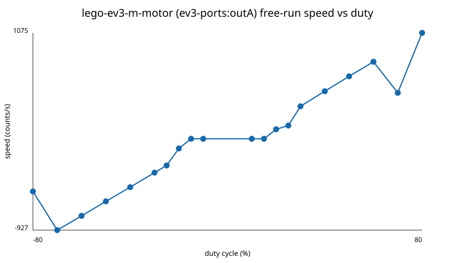
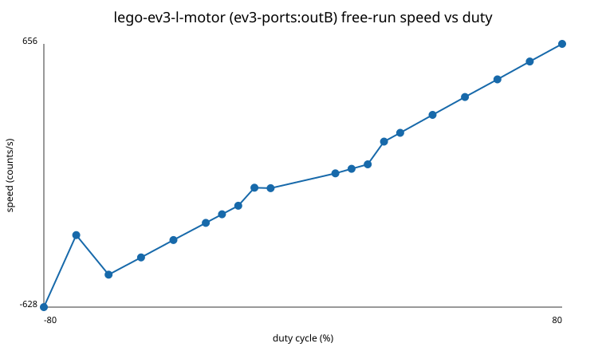

# EV3 validation report

Input: `results/ev3/raw`; CSV rows: 653912; Environment: `results/ev3/environment.json`

> Measurements describe free motors on this brick. They do not establish loaded-arm torque, gearing, gravity compensation, backlash, loaded speed, or four-motor performance.

## E0 environment and sysfs capabilities

- `uname`: `Linux 4.14.117-ev3dev-2.3.5-ev3 #1 PREEMPT Sat Mar 7 12:54:39 CST 2020 armv5tejl`
- Architecture: `armv5tejl`; kernel: `4.14.117-ev3dev-2.3.5-ev3`; libc: `2.24`
- Battery at capture: 7.5058 V

| path | address | driver | count_per_rot | max_speed | commands | stop_actions | polarity | state |
|---|---|---|---:|---:|---|---|---|---|
| /sys/class/tacho-motor/motor0 | ev3-ports:outA | lego-ev3-m-motor | 360 | 1560 | run-forever run-to-abs-pos run-to-rel-pos run-timed run-direct stop reset | coast brake hold | normal |  |
| /sys/class/tacho-motor/motor1 | ev3-ports:outB | lego-ev3-l-motor | 360 | 1050 | run-forever run-to-abs-pos run-to-rel-pos run-timed run-direct stop reset | coast brake hold | normal |  |

Power-supply attributes:

- lego-ev3-battery: `current_now=156000`, `scope=System`, `technology=Unknown`, `type=Battery`, `uevent=POWER_SUPPLY_NAME=lego-ev3-battery
POWER_SUPPLY_TECHNOLOGY=Unknown
POWER_SUPPLY_VOLTAGE_NOW=7505800
POWER_SUPPLY_VOLTAGE_MAX_DESIGN=90000000
POWER_SUPPLY_VOLTAGE_MIN_DESIGN=48000000
POWER_SUPPLY_CURRENT_NOW=156000
POWER_SUPPLY_SCOPE=System`, `voltage_max_design=90000000`, `voltage_min_design=48000000`, `voltage_now=7505800`

## Pipeline smoke verification

| run_id | rows | duration s | motor address / driver | battery range V | loop dt p50 / p99 us |
|---|---:|---:|---|---:|---:|
| 20260824T054714Z | 1000 | 9.984 | ev3-ports:outA (lego-ev3-m-motor), ev3-ports:outB (lego-ev3-l-motor) | 7.429–7.439 | 20000.00 / 24111.24 |
| 20260824T060728Z | 1000 | 9.983 | ev3-ports:outA (lego-ev3-m-motor), ev3-ports:outB (lego-ev3-l-motor) | 7.409–7.429 | 20001.00 / 22987.54 |

## Captured run inventory

This evidence index keeps motor-specific results and individual runs separate.

| source CSV | run ID | test | rows | duration s | motor address / driver | battery range V |
|---|---|---|---:|---:|---|---:|
| c1_c1_20260824T120500Z_start_sustain_randomized.csv | c1_20260824T120500Z | C1 | 46955 | 763.765 | ev3-ports:outA (lego-ev3-m-motor), ev3-ports:outB (lego-ev3-l-motor) | 7.246-7.312 |
| c2_c2_20260824T122000Z_ev3-portsoutA_v2_kp0.200000_kd0.003000_ff24.csv | c2_20260824T122000Z | C2 | 2953 | 81.337 | ev3-ports:outA (lego-ev3-m-motor) | 7.236-7.291 |
| c2_c2_20260824T122000Z_ev3-portsoutA_v2_kp0.280000_kd0.004000_ff24.csv | c2_20260824T122000Z | C2 | 3051 | 81.314 | ev3-ports:outA (lego-ev3-m-motor) | 7.236-7.282 |
| c2_c2_20260824T122000Z_ev3-portsoutA_v2_kp0.350000_kd0.006000_ff24.csv | c2_20260824T122000Z | C2 | 2946 | 81.502 | ev3-ports:outA (lego-ev3-m-motor) | 7.236-7.281 |
| c2_c2_20260824T122000Z_ev3-portsoutB_v2_kp0.200000_kd0.003000_ff16.csv | c2_20260824T122000Z | C2 | 3207 | 81.346 | ev3-ports:outB (lego-ev3-l-motor) | 7.255-7.301 |
| c2_c2_20260824T122000Z_ev3-portsoutB_v2_kp0.280000_kd0.004000_ff16.csv | c2_20260824T122000Z | C2 | 2954 | 81.392 | ev3-ports:outB (lego-ev3-l-motor) | 7.246-7.291 |
| c2_c2_20260824T122000Z_ev3-portsoutB_v2_kp0.350000_kd0.006000_ff16.csv | c2_20260824T122000Z | C2 | 3083 | 81.447 | ev3-ports:outB (lego-ev3-l-motor) | 7.236-7.291 |
| c3_c3_20260824T123200Z_ev3-portsoutA_builtin_reference.csv | c3_20260824T123200Z | C3 | 5000 | 100.061 | ev3-ports:outA (lego-ev3-m-motor) | 7.146-7.281 |
| c3_c3_20260824T123200Z_ev3-portsoutB_builtin_reference.csv | c3_20260824T123200Z | C3 | 5000 | 100.053 | ev3-ports:outB (lego-ev3-l-motor) | 7.104-7.282 |
| c4_c4_20260824T124000Z_ev3-portsoutA_v2_kp0.350000_kd0.006000_ff24.csv | c4_20260824T124000Z | C4 | 5910 | 162.701 | ev3-ports:outA (lego-ev3-m-motor) | 7.206-7.263 |
| c4_c4_20260824T124000Z_ev3-portsoutB_v2_kp0.350000_kd0.006000_ff16.csv | c4_20260824T124000Z | C4 | 6116 | 162.864 | ev3-ports:outB (lego-ev3-l-motor) | 7.023-7.273 |
| c5_c5_20260824T130000Z_v2_sine_stroke0.500000.csv | c5_20260824T130000Z | C5 | 150 | 2.968 | ev3-ports:outA (lego-ev3-m-motor) | 7.207-7.254 |
| c5_c5_20260824T130000Z_v2_sine_stroke1.000000.csv | c5_20260824T130000Z | C5 | 300 | 5.980 | ev3-ports:outA (lego-ev3-m-motor) | 7.216-7.253 |
| c5_c5_20260824T130000Z_v2_sine_stroke2.000000.csv | c5_20260824T130000Z | C5 | 600 | 11.980 | ev3-ports:outA (lego-ev3-m-motor) | 7.215-7.254 |
| c5_c5_20260824T130000Z_v2_triangle_stroke0.500000.csv | c5_20260824T130000Z | C5 | 150 | 2.973 | ev3-ports:outA (lego-ev3-m-motor) | 7.173-7.254 |
| c5_c5_20260824T130000Z_v2_triangle_stroke1.000000.csv | c5_20260824T130000Z | C5 | 300 | 5.980 | ev3-ports:outA (lego-ev3-m-motor) | 7.191-7.254 |
| c5_c5_20260824T130000Z_v2_triangle_stroke2.000000.csv | c5_20260824T130000Z | C5 | 600 | 11.980 | ev3-ports:outA (lego-ev3-m-motor) | 7.181-7.256 |
| c6_c6_20260824T130500Z_abort.csv | c6_20260824T130500Z | E9 | 315 | 13.942 | ev3-ports:outB (lego-ev3-l-motor) | 7.215-7.253 |
| c6_c6_20260824T130500Z_baseline_no_safety.csv | c6_20260824T130500Z | E9 | 153 | 3.946 | ev3-ports:outB (lego-ev3-l-motor) | 7.215-7.243 |
| c6_c6_20260824T130500Z_sigkill.csv | c6_20260824T130500Z | E9 | 420 | 13.883 | ev3-ports:outB (lego-ev3-l-motor) | 7.224-7.253 |
| c6_c6_20260824T130500Z_sigstop.csv | c6_20260824T130500Z | E9 | 417 | 13.888 | ev3-ports:outB (lego-ev3-l-motor) | 7.224-7.253 |
| c6_c6_20260824T130500Z_sigterm.csv | c6_20260824T130500Z | E9 | 407 | 13.864 | ev3-ports:outB (lego-ev3-l-motor) | 7.215-7.253 |
| c6_c6_baseline_20260824T132500Z_baseline_no_safety.csv | c6_baseline_20260824T132500Z | E9 | 317 | 3.567 | ev3-ports:outB (lego-ev3-l-motor) | 7.205-7.233 |
| c7_c7_20260824T131000Z_ev3-portsoutA_moving_stop_30.csv | c7_20260824T131000Z | C7 | 223 | 1.992 | ev3-ports:outA (lego-ev3-m-motor) | 7.243-7.253 |
| c7_c7_20260824T131000Z_ev3-portsoutB_moving_stop_30.csv | c7_20260824T131000Z | C7 | 534 | 2.744 | ev3-ports:outB (lego-ev3-l-motor) | 7.190-7.253 |
| c7_c7_20260824T131000Z_ev3-portsoutB_moving_stop_50.csv | c7_20260824T131000Z | C7 | 515 | 2.751 | ev3-ports:outB (lego-ev3-l-motor) | 7.109-7.253 |
| c7_c7_20260824T131600Z_ev3-portsoutA_moving_stop_30.csv | c7_20260824T131600Z | C7 | 551 | 2.750 | ev3-ports:outA (lego-ev3-m-motor) | 7.205-7.253 |
| c7_c7_20260824T131600Z_ev3-portsoutA_moving_stop_50.csv | c7_20260824T131600Z | C7 | 545 | 2.761 | ev3-ports:outA (lego-ev3-m-motor) | 7.172-7.243 |
| c7_c7_20260824T131600Z_ev3-portsoutB_moving_stop_30.csv | c7_20260824T131600Z | C7 | 551 | 2.749 | ev3-ports:outB (lego-ev3-l-motor) | 7.180-7.253 |
| c7_c7_20260824T131600Z_ev3-portsoutB_moving_stop_50.csv | c7_20260824T131600Z | C7 | 548 | 2.753 | ev3-ports:outB (lego-ev3-l-motor) | 7.110-7.243 |
| d1_d1_20260824T140000Z_m-30_l-30_r0.csv | d1_20260824T140000Z | d1 | 600 | 5.980 | ev3-ports:outA (lego-ev3-m-motor), ev3-ports:outB (lego-ev3-l-motor) | 0.000-6.929 |
| d1_d1_20260824T140000Z_m-30_l-30_r1.csv | d1_20260824T140000Z | d1 | 600 | 5.980 | ev3-ports:outA (lego-ev3-m-motor), ev3-ports:outB (lego-ev3-l-motor) | 0.000-6.929 |
| d1_d1_20260824T140000Z_m-30_l-30_r2.csv | d1_20260824T140000Z | d1 | 600 | 5.980 | ev3-ports:outA (lego-ev3-m-motor), ev3-ports:outB (lego-ev3-l-motor) | 0.000-6.929 |
| d1_d1_20260824T140000Z_m-30_l-30_r3.csv | d1_20260824T140000Z | d1 | 600 | 5.980 | ev3-ports:outA (lego-ev3-m-motor), ev3-ports:outB (lego-ev3-l-motor) | 0.000-6.929 |
| d1_d1_20260824T140000Z_m-30_l-30_r4.csv | d1_20260824T140000Z | d1 | 600 | 5.981 | ev3-ports:outA (lego-ev3-m-motor), ev3-ports:outB (lego-ev3-l-motor) | 0.000-6.921 |
| d1_d1_20260824T140000Z_m-30_l30_r0.csv | d1_20260824T140000Z | d1 | 600 | 5.981 | ev3-ports:outA (lego-ev3-m-motor), ev3-ports:outB (lego-ev3-l-motor) | 0.000-6.901 |
| d1_d1_20260824T140000Z_m-30_l30_r1.csv | d1_20260824T140000Z | d1 | 600 | 5.980 | ev3-ports:outA (lego-ev3-m-motor), ev3-ports:outB (lego-ev3-l-motor) | 0.000-6.911 |
| d1_d1_20260824T140000Z_m-30_l30_r2.csv | d1_20260824T140000Z | d1 | 600 | 5.981 | ev3-ports:outA (lego-ev3-m-motor), ev3-ports:outB (lego-ev3-l-motor) | 0.000-6.911 |
| d1_d1_20260824T140000Z_m-30_l30_r3.csv | d1_20260824T140000Z | d1 | 600 | 5.980 | ev3-ports:outA (lego-ev3-m-motor), ev3-ports:outB (lego-ev3-l-motor) | 0.000-6.911 |
| d1_d1_20260824T140000Z_m-30_l30_r4.csv | d1_20260824T140000Z | d1 | 600 | 5.980 | ev3-ports:outA (lego-ev3-m-motor), ev3-ports:outB (lego-ev3-l-motor) | 0.000-6.901 |
| d1_d1_20260824T140000Z_m-50_l-50_r0.csv | d1_20260824T140000Z | d1 | 600 | 5.980 | ev3-ports:outA (lego-ev3-m-motor), ev3-ports:outB (lego-ev3-l-motor) | 0.000-6.861 |
| d1_d1_20260824T140000Z_m-50_l-50_r1.csv | d1_20260824T140000Z | d1 | 600 | 5.980 | ev3-ports:outA (lego-ev3-m-motor), ev3-ports:outB (lego-ev3-l-motor) | 0.000-6.852 |
| d1_d1_20260824T140000Z_m-50_l-50_r2.csv | d1_20260824T140000Z | d1 | 600 | 5.980 | ev3-ports:outA (lego-ev3-m-motor), ev3-ports:outB (lego-ev3-l-motor) | 0.000-6.842 |
| d1_d1_20260824T140000Z_m-50_l-50_r3.csv | d1_20260824T140000Z | d1 | 600 | 5.980 | ev3-ports:outA (lego-ev3-m-motor), ev3-ports:outB (lego-ev3-l-motor) | 0.000-6.833 |
| d1_d1_20260824T140000Z_m-50_l-50_r4.csv | d1_20260824T140000Z | d1 | 600 | 5.980 | ev3-ports:outA (lego-ev3-m-motor), ev3-ports:outB (lego-ev3-l-motor) | 0.000-6.814 |
| d1_d1_20260824T140000Z_m-50_l50_r0.csv | d1_20260824T140000Z | d1 | 600 | 5.980 | ev3-ports:outA (lego-ev3-m-motor), ev3-ports:outB (lego-ev3-l-motor) | 0.000-5.836 |
| d1_d1_20260824T140000Z_m-50_l50_r1.csv | d1_20260824T140000Z | d1 | 600 | 5.981 | ev3-ports:outA (lego-ev3-m-motor), ev3-ports:outB (lego-ev3-l-motor) | 0.000-5.827 |
| d1_d1_20260824T140000Z_m-50_l50_r2.csv | d1_20260824T140000Z | d1 | 600 | 5.980 | ev3-ports:outA (lego-ev3-m-motor), ev3-ports:outB (lego-ev3-l-motor) | 0.000-5.817 |
| d1_d1_20260824T140000Z_m-50_l50_r3.csv | d1_20260824T140000Z | d1 | 600 | 5.980 | ev3-ports:outA (lego-ev3-m-motor), ev3-ports:outB (lego-ev3-l-motor) | 0.000-5.826 |
| d1_d1_20260824T140000Z_m-50_l50_r4.csv | d1_20260824T140000Z | d1 | 600 | 5.980 | ev3-ports:outA (lego-ev3-m-motor), ev3-ports:outB (lego-ev3-l-motor) | 0.000-5.816 |
| d1_d1_20260824T140000Z_m-70_l-70_r0.csv | d1_20260824T140000Z | d1 | 600 | 5.980 | ev3-ports:outA (lego-ev3-m-motor), ev3-ports:outB (lego-ev3-l-motor) | 0.000-5.758 |
| d1_d1_20260824T140000Z_m-70_l-70_r1.csv | d1_20260824T140000Z | d1 | 600 | 5.981 | ev3-ports:outA (lego-ev3-m-motor), ev3-ports:outB (lego-ev3-l-motor) | 0.000-5.749 |
| d1_d1_20260824T140000Z_m-70_l-70_r2.csv | d1_20260824T140000Z | d1 | 600 | 5.980 | ev3-ports:outA (lego-ev3-m-motor), ev3-ports:outB (lego-ev3-l-motor) | 0.000-5.758 |
| d1_d1_20260824T140000Z_m-70_l-70_r3.csv | d1_20260824T140000Z | d1 | 600 | 5.980 | ev3-ports:outA (lego-ev3-m-motor), ev3-ports:outB (lego-ev3-l-motor) | 0.000-5.748 |
| d1_d1_20260824T140000Z_m-70_l-70_r4.csv | d1_20260824T140000Z | d1 | 600 | 5.980 | ev3-ports:outA (lego-ev3-m-motor), ev3-ports:outB (lego-ev3-l-motor) | 0.000-5.748 |
| d1_d1_20260824T140000Z_m-70_l70_r0.csv | d1_20260824T140000Z | d1 | 600 | 5.980 | ev3-ports:outA (lego-ev3-m-motor), ev3-ports:outB (lego-ev3-l-motor) | 0.000-5.738 |
| d1_d1_20260824T140000Z_m-70_l70_r1.csv | d1_20260824T140000Z | d1 | 600 | 5.980 | ev3-ports:outA (lego-ev3-m-motor), ev3-ports:outB (lego-ev3-l-motor) | 0.000-5.738 |
| d1_d1_20260824T140000Z_m-70_l70_r2.csv | d1_20260824T140000Z | d1 | 600 | 5.980 | ev3-ports:outA (lego-ev3-m-motor), ev3-ports:outB (lego-ev3-l-motor) | 0.000-5.728 |
| d1_d1_20260824T140000Z_m-70_l70_r3.csv | d1_20260824T140000Z | d1 | 600 | 5.981 | ev3-ports:outA (lego-ev3-m-motor), ev3-ports:outB (lego-ev3-l-motor) | 0.000-5.728 |
| d1_d1_20260824T140000Z_m-70_l70_r4.csv | d1_20260824T140000Z | d1 | 600 | 5.980 | ev3-ports:outA (lego-ev3-m-motor), ev3-ports:outB (lego-ev3-l-motor) | 0.000-5.730 |
| d1_d1_20260824T140000Z_m0_l30_r0.csv | d1_20260824T140000Z | d1 | 600 | 5.980 | ev3-ports:outA (lego-ev3-m-motor), ev3-ports:outB (lego-ev3-l-motor) | 0.000-6.891 |
| d1_d1_20260824T140000Z_m0_l30_r1.csv | d1_20260824T140000Z | d1 | 600 | 5.980 | ev3-ports:outA (lego-ev3-m-motor), ev3-ports:outB (lego-ev3-l-motor) | 0.000-6.891 |
| d1_d1_20260824T140000Z_m0_l30_r2.csv | d1_20260824T140000Z | d1 | 600 | 5.980 | ev3-ports:outA (lego-ev3-m-motor), ev3-ports:outB (lego-ev3-l-motor) | 0.000-6.891 |
| d1_d1_20260824T140000Z_m0_l30_r3.csv | d1_20260824T140000Z | d1 | 600 | 5.980 | ev3-ports:outA (lego-ev3-m-motor), ev3-ports:outB (lego-ev3-l-motor) | 0.000-6.891 |
| d1_d1_20260824T140000Z_m0_l30_r4.csv | d1_20260824T140000Z | d1 | 600 | 5.980 | ev3-ports:outA (lego-ev3-m-motor), ev3-ports:outB (lego-ev3-l-motor) | 0.000-6.891 |
| d1_d1_20260824T140000Z_m0_l50_r0.csv | d1_20260824T140000Z | d1 | 600 | 5.980 | ev3-ports:outA (lego-ev3-m-motor), ev3-ports:outB (lego-ev3-l-motor) | 0.000-5.798 |
| d1_d1_20260824T140000Z_m0_l50_r1.csv | d1_20260824T140000Z | d1 | 600 | 5.980 | ev3-ports:outA (lego-ev3-m-motor), ev3-ports:outB (lego-ev3-l-motor) | 0.000-5.798 |
| d1_d1_20260824T140000Z_m0_l50_r2.csv | d1_20260824T140000Z | d1 | 600 | 5.980 | ev3-ports:outA (lego-ev3-m-motor), ev3-ports:outB (lego-ev3-l-motor) | 0.000-5.779 |
| d1_d1_20260824T140000Z_m0_l50_r3.csv | d1_20260824T140000Z | d1 | 600 | 5.980 | ev3-ports:outA (lego-ev3-m-motor), ev3-ports:outB (lego-ev3-l-motor) | 0.000-5.788 |
| d1_d1_20260824T140000Z_m0_l50_r4.csv | d1_20260824T140000Z | d1 | 600 | 5.980 | ev3-ports:outA (lego-ev3-m-motor), ev3-ports:outB (lego-ev3-l-motor) | 0.000-5.778 |
| d1_d1_20260824T140000Z_m0_l70_r0.csv | d1_20260824T140000Z | d1 | 600 | 5.980 | ev3-ports:outA (lego-ev3-m-motor), ev3-ports:outB (lego-ev3-l-motor) | 0.000-5.719 |
| d1_d1_20260824T140000Z_m0_l70_r1.csv | d1_20260824T140000Z | d1 | 600 | 5.980 | ev3-ports:outA (lego-ev3-m-motor), ev3-ports:outB (lego-ev3-l-motor) | 0.000-5.719 |
| d1_d1_20260824T140000Z_m0_l70_r2.csv | d1_20260824T140000Z | d1 | 600 | 5.980 | ev3-ports:outA (lego-ev3-m-motor), ev3-ports:outB (lego-ev3-l-motor) | 0.000-5.728 |
| d1_d1_20260824T140000Z_m0_l70_r3.csv | d1_20260824T140000Z | d1 | 600 | 5.980 | ev3-ports:outA (lego-ev3-m-motor), ev3-ports:outB (lego-ev3-l-motor) | 0.000-5.718 |
| d1_d1_20260824T140000Z_m0_l70_r4.csv | d1_20260824T140000Z | d1 | 600 | 5.980 | ev3-ports:outA (lego-ev3-m-motor), ev3-ports:outB (lego-ev3-l-motor) | 0.000-5.719 |
| d1_d1_20260824T140000Z_m30_l-30_r0.csv | d1_20260824T140000Z | d1 | 600 | 5.980 | ev3-ports:outA (lego-ev3-m-motor), ev3-ports:outB (lego-ev3-l-motor) | 0.000-6.921 |
| d1_d1_20260824T140000Z_m30_l-30_r1.csv | d1_20260824T140000Z | d1 | 600 | 5.981 | ev3-ports:outA (lego-ev3-m-motor), ev3-ports:outB (lego-ev3-l-motor) | 0.000-6.912 |
| d1_d1_20260824T140000Z_m30_l-30_r2.csv | d1_20260824T140000Z | d1 | 600 | 5.980 | ev3-ports:outA (lego-ev3-m-motor), ev3-ports:outB (lego-ev3-l-motor) | 0.000-6.912 |
| d1_d1_20260824T140000Z_m30_l-30_r3.csv | d1_20260824T140000Z | d1 | 600 | 5.980 | ev3-ports:outA (lego-ev3-m-motor), ev3-ports:outB (lego-ev3-l-motor) | 0.000-6.912 |
| d1_d1_20260824T140000Z_m30_l-30_r4.csv | d1_20260824T140000Z | d1 | 600 | 5.980 | ev3-ports:outA (lego-ev3-m-motor), ev3-ports:outB (lego-ev3-l-motor) | 0.000-6.912 |
| d1_d1_20260824T140000Z_m30_l0_r0.csv | d1_20260824T140000Z | d1 | 600 | 5.980 | ev3-ports:outA (lego-ev3-m-motor), ev3-ports:outB (lego-ev3-l-motor) | 0.000-6.901 |
| d1_d1_20260824T140000Z_m30_l0_r1.csv | d1_20260824T140000Z | d1 | 600 | 5.981 | ev3-ports:outA (lego-ev3-m-motor), ev3-ports:outB (lego-ev3-l-motor) | 0.000-6.901 |
| d1_d1_20260824T140000Z_m30_l0_r2.csv | d1_20260824T140000Z | d1 | 600 | 5.980 | ev3-ports:outA (lego-ev3-m-motor), ev3-ports:outB (lego-ev3-l-motor) | 0.000-6.901 |
| d1_d1_20260824T140000Z_m30_l0_r3.csv | d1_20260824T140000Z | d1 | 600 | 5.980 | ev3-ports:outA (lego-ev3-m-motor), ev3-ports:outB (lego-ev3-l-motor) | 0.000-6.892 |
| d1_d1_20260824T140000Z_m30_l0_r4.csv | d1_20260824T140000Z | d1 | 600 | 5.980 | ev3-ports:outA (lego-ev3-m-motor), ev3-ports:outB (lego-ev3-l-motor) | 0.000-6.891 |
| d1_d1_20260824T140000Z_m30_l30_r0.csv | d1_20260824T140000Z | d1 | 600 | 5.980 | ev3-ports:outA (lego-ev3-m-motor), ev3-ports:outB (lego-ev3-l-motor) | 0.000-6.949 |
| d1_d1_20260824T140000Z_m30_l30_r1.csv | d1_20260824T140000Z | d1 | 600 | 5.980 | ev3-ports:outA (lego-ev3-m-motor), ev3-ports:outB (lego-ev3-l-motor) | 0.000-6.939 |
| d1_d1_20260824T140000Z_m30_l30_r2.csv | d1_20260824T140000Z | d1 | 600 | 5.980 | ev3-ports:outA (lego-ev3-m-motor), ev3-ports:outB (lego-ev3-l-motor) | 0.000-6.939 |
| d1_d1_20260824T140000Z_m30_l30_r3.csv | d1_20260824T140000Z | d1 | 600 | 5.980 | ev3-ports:outA (lego-ev3-m-motor), ev3-ports:outB (lego-ev3-l-motor) | 0.000-6.939 |
| d1_d1_20260824T140000Z_m30_l30_r4.csv | d1_20260824T140000Z | d1 | 600 | 5.980 | ev3-ports:outA (lego-ev3-m-motor), ev3-ports:outB (lego-ev3-l-motor) | 0.000-6.929 |
| d1_d1_20260824T140000Z_m50_l-50_r0.csv | d1_20260824T140000Z | d1 | 600 | 5.981 | ev3-ports:outA (lego-ev3-m-motor), ev3-ports:outB (lego-ev3-l-motor) | 0.000-6.610 |
| d1_d1_20260824T140000Z_m50_l-50_r1.csv | d1_20260824T140000Z | d1 | 600 | 5.980 | ev3-ports:outA (lego-ev3-m-motor), ev3-ports:outB (lego-ev3-l-motor) | 0.000-5.857 |
| d1_d1_20260824T140000Z_m50_l-50_r2.csv | d1_20260824T140000Z | d1 | 600 | 5.983 | ev3-ports:outA (lego-ev3-m-motor), ev3-ports:outB (lego-ev3-l-motor) | 0.000-5.846 |
| d1_d1_20260824T140000Z_m50_l-50_r3.csv | d1_20260824T140000Z | d1 | 600 | 5.980 | ev3-ports:outA (lego-ev3-m-motor), ev3-ports:outB (lego-ev3-l-motor) | 0.000-5.856 |
| d1_d1_20260824T140000Z_m50_l-50_r4.csv | d1_20260824T140000Z | d1 | 600 | 5.980 | ev3-ports:outA (lego-ev3-m-motor), ev3-ports:outB (lego-ev3-l-motor) | 0.000-5.856 |
| d1_d1_20260824T140000Z_m50_l0_r0.csv | d1_20260824T140000Z | d1 | 600 | 5.980 | ev3-ports:outA (lego-ev3-m-motor), ev3-ports:outB (lego-ev3-l-motor) | 0.000-5.816 |
| d1_d1_20260824T140000Z_m50_l0_r1.csv | d1_20260824T140000Z | d1 | 600 | 5.980 | ev3-ports:outA (lego-ev3-m-motor), ev3-ports:outB (lego-ev3-l-motor) | 0.000-5.816 |
| d1_d1_20260824T140000Z_m50_l0_r2.csv | d1_20260824T140000Z | d1 | 600 | 5.980 | ev3-ports:outA (lego-ev3-m-motor), ev3-ports:outB (lego-ev3-l-motor) | 0.000-5.816 |
| d1_d1_20260824T140000Z_m50_l0_r3.csv | d1_20260824T140000Z | d1 | 600 | 5.980 | ev3-ports:outA (lego-ev3-m-motor), ev3-ports:outB (lego-ev3-l-motor) | 0.000-5.816 |
| d1_d1_20260824T140000Z_m50_l0_r4.csv | d1_20260824T140000Z | d1 | 600 | 5.980 | ev3-ports:outA (lego-ev3-m-motor), ev3-ports:outB (lego-ev3-l-motor) | 0.000-5.806 |
| d1_d1_20260824T140000Z_m50_l50_r0.csv | d1_20260824T140000Z | d1 | 600 | 5.980 | ev3-ports:outA (lego-ev3-m-motor), ev3-ports:outB (lego-ev3-l-motor) | 0.000-6.891 |
| d1_d1_20260824T140000Z_m50_l50_r1.csv | d1_20260824T140000Z | d1 | 600 | 5.980 | ev3-ports:outA (lego-ev3-m-motor), ev3-ports:outB (lego-ev3-l-motor) | 0.000-6.881 |
| d1_d1_20260824T140000Z_m50_l50_r2.csv | d1_20260824T140000Z | d1 | 600 | 5.980 | ev3-ports:outA (lego-ev3-m-motor), ev3-ports:outB (lego-ev3-l-motor) | 0.000-6.872 |
| d1_d1_20260824T140000Z_m50_l50_r3.csv | d1_20260824T140000Z | d1 | 600 | 5.980 | ev3-ports:outA (lego-ev3-m-motor), ev3-ports:outB (lego-ev3-l-motor) | 0.000-6.881 |
| d1_d1_20260824T140000Z_m50_l50_r4.csv | d1_20260824T140000Z | d1 | 600 | 5.980 | ev3-ports:outA (lego-ev3-m-motor), ev3-ports:outB (lego-ev3-l-motor) | 0.000-6.871 |
| d1_d1_20260824T140000Z_m70_l-70_r0.csv | d1_20260824T140000Z | d1 | 600 | 5.980 | ev3-ports:outA (lego-ev3-m-motor), ev3-ports:outB (lego-ev3-l-motor) | 0.000-5.748 |
| d1_d1_20260824T140000Z_m70_l-70_r1.csv | d1_20260824T140000Z | d1 | 600 | 5.980 | ev3-ports:outA (lego-ev3-m-motor), ev3-ports:outB (lego-ev3-l-motor) | 0.000-5.748 |
| d1_d1_20260824T140000Z_m70_l-70_r2.csv | d1_20260824T140000Z | d1 | 600 | 5.981 | ev3-ports:outA (lego-ev3-m-motor), ev3-ports:outB (lego-ev3-l-motor) | 0.000-5.729 |
| d1_d1_20260824T140000Z_m70_l-70_r3.csv | d1_20260824T140000Z | d1 | 600 | 5.981 | ev3-ports:outA (lego-ev3-m-motor), ev3-ports:outB (lego-ev3-l-motor) | 0.000-5.738 |
| d1_d1_20260824T140000Z_m70_l-70_r4.csv | d1_20260824T140000Z | d1 | 600 | 5.980 | ev3-ports:outA (lego-ev3-m-motor), ev3-ports:outB (lego-ev3-l-motor) | 0.000-5.738 |
| d1_d1_20260824T140000Z_m70_l0_r0.csv | d1_20260824T140000Z | d1 | 600 | 5.980 | ev3-ports:outA (lego-ev3-m-motor), ev3-ports:outB (lego-ev3-l-motor) | 0.000-5.728 |
| d1_d1_20260824T140000Z_m70_l0_r1.csv | d1_20260824T140000Z | d1 | 600 | 5.980 | ev3-ports:outA (lego-ev3-m-motor), ev3-ports:outB (lego-ev3-l-motor) | 0.000-5.728 |
| d1_d1_20260824T140000Z_m70_l0_r2.csv | d1_20260824T140000Z | d1 | 600 | 5.981 | ev3-ports:outA (lego-ev3-m-motor), ev3-ports:outB (lego-ev3-l-motor) | 0.000-5.719 |
| d1_d1_20260824T140000Z_m70_l0_r3.csv | d1_20260824T140000Z | d1 | 600 | 5.981 | ev3-ports:outA (lego-ev3-m-motor), ev3-ports:outB (lego-ev3-l-motor) | 0.000-5.728 |
| d1_d1_20260824T140000Z_m70_l0_r4.csv | d1_20260824T140000Z | d1 | 600 | 5.980 | ev3-ports:outA (lego-ev3-m-motor), ev3-ports:outB (lego-ev3-l-motor) | 0.000-5.728 |
| d1_d1_20260824T140000Z_m70_l70_r0.csv | d1_20260824T140000Z | d1 | 600 | 5.981 | ev3-ports:outA (lego-ev3-m-motor), ev3-ports:outB (lego-ev3-l-motor) | 0.000-5.778 |
| d1_d1_20260824T140000Z_m70_l70_r1.csv | d1_20260824T140000Z | d1 | 600 | 5.980 | ev3-ports:outA (lego-ev3-m-motor), ev3-ports:outB (lego-ev3-l-motor) | 0.000-5.778 |
| d1_d1_20260824T140000Z_m70_l70_r2.csv | d1_20260824T140000Z | d1 | 600 | 5.980 | ev3-ports:outA (lego-ev3-m-motor), ev3-ports:outB (lego-ev3-l-motor) | 0.000-5.768 |
| d1_d1_20260824T140000Z_m70_l70_r3.csv | d1_20260824T140000Z | d1 | 600 | 5.981 | ev3-ports:outA (lego-ev3-m-motor), ev3-ports:outB (lego-ev3-l-motor) | 0.000-5.768 |
| d1_d1_20260824T140000Z_m70_l70_r4.csv | d1_20260824T140000Z | d1 | 600 | 5.983 | ev3-ports:outA (lego-ev3-m-motor), ev3-ports:outB (lego-ev3-l-motor) | 0.000-5.758 |
| d1_d1batch_30_0_20260824T141000Z_m30_l30_r0.csv | d1batch_30_0_20260824T141000Z | d1 | 600 | 5.980 | ev3-ports:outA (lego-ev3-m-motor), ev3-ports:outB (lego-ev3-l-motor) | 0.000-6.862 |
| d1_d1batch_30_0_20260824T141000Z_m30_l30_r1.csv | d1batch_30_0_20260824T141000Z | d1 | 600 | 5.981 | ev3-ports:outA (lego-ev3-m-motor), ev3-ports:outB (lego-ev3-l-motor) | 0.000-6.851 |
| d1_d1batch_30_0_20260824T141000Z_m30_l30_r2.csv | d1batch_30_0_20260824T141000Z | d1 | 600 | 5.980 | ev3-ports:outA (lego-ev3-m-motor), ev3-ports:outB (lego-ev3-l-motor) | 0.000-6.841 |
| d1_d1batch_30_0_20260824T141000Z_m30_l30_r3.csv | d1batch_30_0_20260824T141000Z | d1 | 600 | 5.980 | ev3-ports:outA (lego-ev3-m-motor), ev3-ports:outB (lego-ev3-l-motor) | 0.000-6.833 |
| d1_d1batch_30_0_20260824T141000Z_m30_l30_r4.csv | d1batch_30_0_20260824T141000Z | d1 | 600 | 5.980 | ev3-ports:outA (lego-ev3-m-motor), ev3-ports:outB (lego-ev3-l-motor) | 0.000-6.686 |
| d1_d1batch_30_1_20260824T141000Z_m-30_l-30_r0.csv | d1batch_30_1_20260824T141000Z | d1 | 600 | 5.980 | ev3-ports:outA (lego-ev3-m-motor), ev3-ports:outB (lego-ev3-l-motor) | 0.000-5.817 |
| d1_d1batch_30_1_20260824T141000Z_m-30_l-30_r1.csv | d1batch_30_1_20260824T141000Z | d1 | 600 | 5.981 | ev3-ports:outA (lego-ev3-m-motor), ev3-ports:outB (lego-ev3-l-motor) | 0.000-5.846 |
| d1_d1batch_30_1_20260824T141000Z_m-30_l-30_r2.csv | d1batch_30_1_20260824T141000Z | d1 | 600 | 5.981 | ev3-ports:outA (lego-ev3-m-motor), ev3-ports:outB (lego-ev3-l-motor) | 0.000-5.856 |
| d1_d1batch_30_1_20260824T141000Z_m-30_l-30_r3.csv | d1batch_30_1_20260824T141000Z | d1 | 600 | 5.981 | ev3-ports:outA (lego-ev3-m-motor), ev3-ports:outB (lego-ev3-l-motor) | 0.000-5.846 |
| d1_d1batch_30_1_20260824T141000Z_m-30_l-30_r4.csv | d1batch_30_1_20260824T141000Z | d1 | 600 | 5.980 | ev3-ports:outA (lego-ev3-m-motor), ev3-ports:outB (lego-ev3-l-motor) | 0.000-5.836 |
| d1_d1batch_30_1_20260824T141200Z_m-30_l-30_r0.csv | d1batch_30_1_20260824T141200Z | d1 | 600 | 5.980 | ev3-ports:outA (lego-ev3-m-motor), ev3-ports:outB (lego-ev3-l-motor) | 0.000-5.798 |
| d1_d1batch_30_1_20260824T141200Z_m-30_l-30_r1.csv | d1batch_30_1_20260824T141200Z | d1 | 600 | 5.980 | ev3-ports:outA (lego-ev3-m-motor), ev3-ports:outB (lego-ev3-l-motor) | 0.000-5.798 |
| d1_d1batch_30_1_20260824T141200Z_m-30_l-30_r2.csv | d1batch_30_1_20260824T141200Z | d1 | 600 | 5.980 | ev3-ports:outA (lego-ev3-m-motor), ev3-ports:outB (lego-ev3-l-motor) | 0.000-5.778 |
| d1_d1batch_30_1_20260824T141200Z_m-30_l-30_r3.csv | d1batch_30_1_20260824T141200Z | d1 | 600 | 5.980 | ev3-ports:outA (lego-ev3-m-motor), ev3-ports:outB (lego-ev3-l-motor) | 0.000-5.788 |
| d1_d1batch_30_1_20260824T141200Z_m-30_l-30_r4.csv | d1batch_30_1_20260824T141200Z | d1 | 600 | 5.982 | ev3-ports:outA (lego-ev3-m-motor), ev3-ports:outB (lego-ev3-l-motor) | 0.000-5.778 |
| d1_d1batch_30_2_20260824T141000Z_m30_l-30_r0.csv | d1batch_30_2_20260824T141000Z | d1 | 600 | 5.980 | ev3-ports:outA (lego-ev3-m-motor), ev3-ports:outB (lego-ev3-l-motor) | 0.000-5.827 |
| d1_d1batch_30_2_20260824T141000Z_m30_l-30_r1.csv | d1batch_30_2_20260824T141000Z | d1 | 600 | 5.980 | ev3-ports:outA (lego-ev3-m-motor), ev3-ports:outB (lego-ev3-l-motor) | 0.000-5.826 |
| d1_d1batch_30_2_20260824T141000Z_m30_l-30_r2.csv | d1batch_30_2_20260824T141000Z | d1 | 600 | 5.980 | ev3-ports:outA (lego-ev3-m-motor), ev3-ports:outB (lego-ev3-l-motor) | 0.000-5.816 |
| d1_d1batch_30_2_20260824T141000Z_m30_l-30_r3.csv | d1batch_30_2_20260824T141000Z | d1 | 600 | 5.980 | ev3-ports:outA (lego-ev3-m-motor), ev3-ports:outB (lego-ev3-l-motor) | 0.000-5.816 |
| d1_d1batch_30_2_20260824T141000Z_m30_l-30_r4.csv | d1batch_30_2_20260824T141000Z | d1 | 600 | 5.980 | ev3-ports:outA (lego-ev3-m-motor), ev3-ports:outB (lego-ev3-l-motor) | 0.000-5.816 |
| d1_d1batch_30_2_20260824T141200Z_m30_l-30_r0.csv | d1batch_30_2_20260824T141200Z | d1 | 600 | 5.981 | ev3-ports:outA (lego-ev3-m-motor), ev3-ports:outB (lego-ev3-l-motor) | 0.000-5.778 |
| d1_d1batch_30_2_20260824T141200Z_m30_l-30_r1.csv | d1batch_30_2_20260824T141200Z | d1 | 600 | 5.980 | ev3-ports:outA (lego-ev3-m-motor), ev3-ports:outB (lego-ev3-l-motor) | 0.000-5.759 |
| d1_d1batch_30_2_20260824T141200Z_m30_l-30_r2.csv | d1batch_30_2_20260824T141200Z | d1 | 600 | 5.981 | ev3-ports:outA (lego-ev3-m-motor), ev3-ports:outB (lego-ev3-l-motor) | 0.000-5.768 |
| d1_d1batch_30_2_20260824T141200Z_m30_l-30_r3.csv | d1batch_30_2_20260824T141200Z | d1 | 600 | 5.981 | ev3-ports:outA (lego-ev3-m-motor), ev3-ports:outB (lego-ev3-l-motor) | 0.000-5.749 |
| d1_d1batch_30_2_20260824T141200Z_m30_l-30_r4.csv | d1batch_30_2_20260824T141200Z | d1 | 600 | 5.980 | ev3-ports:outA (lego-ev3-m-motor), ev3-ports:outB (lego-ev3-l-motor) | 0.000-5.758 |
| d1_d1batch_30_3_20260824T141200Z_m-30_l30_r0.csv | d1batch_30_3_20260824T141200Z | d1 | 600 | 5.980 | ev3-ports:outA (lego-ev3-m-motor), ev3-ports:outB (lego-ev3-l-motor) | 0.000-5.758 |
| d1_d1batch_30_3_20260824T141200Z_m-30_l30_r1.csv | d1batch_30_3_20260824T141200Z | d1 | 598 | 5.984 | ev3-ports:outA (lego-ev3-m-motor), ev3-ports:outB (lego-ev3-l-motor) | 0.000-5.748 |
| d1_d1batch_30_3_20260824T141200Z_m-30_l30_r2.csv | d1batch_30_3_20260824T141200Z | d1 | 600 | 5.980 | ev3-ports:outA (lego-ev3-m-motor), ev3-ports:outB (lego-ev3-l-motor) | 0.000-5.748 |
| d1_d1batch_30_3_20260824T141200Z_m-30_l30_r3.csv | d1batch_30_3_20260824T141200Z | d1 | 600 | 5.980 | ev3-ports:outA (lego-ev3-m-motor), ev3-ports:outB (lego-ev3-l-motor) | 0.000-5.748 |
| d1_d1batch_30_3_20260824T141200Z_m-30_l30_r4.csv | d1batch_30_3_20260824T141200Z | d1 | 600 | 5.980 | ev3-ports:outA (lego-ev3-m-motor), ev3-ports:outB (lego-ev3-l-motor) | 0.000-5.748 |
| d1_d1batch_30_4_20260824T141400Z_m30_l0_r0.csv | d1batch_30_4_20260824T141400Z | d1 | 600 | 5.980 | ev3-ports:outA (lego-ev3-m-motor), ev3-ports:outB (lego-ev3-l-motor) | 0.000-5.778 |
| d1_d1batch_30_4_20260824T141400Z_m30_l0_r1.csv | d1batch_30_4_20260824T141400Z | d1 | 600 | 5.980 | ev3-ports:outA (lego-ev3-m-motor), ev3-ports:outB (lego-ev3-l-motor) | 0.000-5.778 |
| d1_d1batch_30_4_20260824T141400Z_m30_l0_r2.csv | d1batch_30_4_20260824T141400Z | d1 | 600 | 5.980 | ev3-ports:outA (lego-ev3-m-motor), ev3-ports:outB (lego-ev3-l-motor) | 0.000-5.759 |
| d1_d1batch_30_4_20260824T141400Z_m30_l0_r3.csv | d1batch_30_4_20260824T141400Z | d1 | 600 | 5.980 | ev3-ports:outA (lego-ev3-m-motor), ev3-ports:outB (lego-ev3-l-motor) | 0.000-5.768 |
| d1_d1batch_30_4_20260824T141400Z_m30_l0_r4.csv | d1batch_30_4_20260824T141400Z | d1 | 600 | 5.980 | ev3-ports:outA (lego-ev3-m-motor), ev3-ports:outB (lego-ev3-l-motor) | 0.000-5.749 |
| d1_d1batch_30_5_20260824T141400Z_m0_l30_r0.csv | d1batch_30_5_20260824T141400Z | d1 | 600 | 5.980 | ev3-ports:outA (lego-ev3-m-motor), ev3-ports:outB (lego-ev3-l-motor) | 0.000-5.739 |
| d1_d1batch_30_5_20260824T141400Z_m0_l30_r1.csv | d1batch_30_5_20260824T141400Z | d1 | 600 | 5.980 | ev3-ports:outA (lego-ev3-m-motor), ev3-ports:outB (lego-ev3-l-motor) | 0.000-5.748 |
| d1_d1batch_30_5_20260824T141400Z_m0_l30_r2.csv | d1batch_30_5_20260824T141400Z | d1 | 600 | 5.980 | ev3-ports:outA (lego-ev3-m-motor), ev3-ports:outB (lego-ev3-l-motor) | 0.000-5.739 |
| d1_d1batch_30_5_20260824T141400Z_m0_l30_r3.csv | d1batch_30_5_20260824T141400Z | d1 | 600 | 5.980 | ev3-ports:outA (lego-ev3-m-motor), ev3-ports:outB (lego-ev3-l-motor) | 0.000-5.748 |
| d1_d1batch_30_5_20260824T141400Z_m0_l30_r4.csv | d1batch_30_5_20260824T141400Z | d1 | 600 | 5.980 | ev3-ports:outA (lego-ev3-m-motor), ev3-ports:outB (lego-ev3-l-motor) | 0.000-5.739 |
| d1_d1batch_50_0_20260824T141400Z_m50_l50_r0.csv | d1batch_50_0_20260824T141400Z | d1 | 600 | 5.980 | ev3-ports:outA (lego-ev3-m-motor), ev3-ports:outB (lego-ev3-l-motor) | 0.000-5.738 |
| d1_d1batch_50_0_20260824T141400Z_m50_l50_r1.csv | d1batch_50_0_20260824T141400Z | d1 | 600 | 5.980 | ev3-ports:outA (lego-ev3-m-motor), ev3-ports:outB (lego-ev3-l-motor) | 0.000-5.760 |
| d1_d1batch_50_0_20260824T141400Z_m50_l50_r2.csv | d1batch_50_0_20260824T141400Z | d1 | 600 | 5.982 | ev3-ports:outA (lego-ev3-m-motor), ev3-ports:outB (lego-ev3-l-motor) | 0.000-5.738 |
| d1_d1batch_50_0_20260824T141400Z_m50_l50_r3.csv | d1batch_50_0_20260824T141400Z | d1 | 600 | 5.980 | ev3-ports:outA (lego-ev3-m-motor), ev3-ports:outB (lego-ev3-l-motor) | 0.000-5.729 |
| d1_d1batch_50_0_20260824T141400Z_m50_l50_r4.csv | d1batch_50_0_20260824T141400Z | d1 | 600 | 5.981 | ev3-ports:outA (lego-ev3-m-motor), ev3-ports:outB (lego-ev3-l-motor) | 0.000-5.728 |
| d1_d1batch_50_1_20260824T141600Z_m-50_l-50_r0.csv | d1batch_50_1_20260824T141600Z | d1 | 600 | 5.981 | ev3-ports:outA (lego-ev3-m-motor), ev3-ports:outB (lego-ev3-l-motor) | 0.000-5.758 |
| d1_d1batch_50_1_20260824T141600Z_m-50_l-50_r1.csv | d1batch_50_1_20260824T141600Z | d1 | 600 | 5.980 | ev3-ports:outA (lego-ev3-m-motor), ev3-ports:outB (lego-ev3-l-motor) | 0.000-5.758 |
| d1_d1batch_50_1_20260824T141600Z_m-50_l-50_r2.csv | d1batch_50_1_20260824T141600Z | d1 | 600 | 5.980 | ev3-ports:outA (lego-ev3-m-motor), ev3-ports:outB (lego-ev3-l-motor) | 0.000-5.739 |
| d1_d1batch_50_1_20260824T141600Z_m-50_l-50_r3.csv | d1batch_50_1_20260824T141600Z | d1 | 600 | 5.980 | ev3-ports:outA (lego-ev3-m-motor), ev3-ports:outB (lego-ev3-l-motor) | 0.000-5.748 |
| d1_d1batch_50_1_20260824T141600Z_m-50_l-50_r4.csv | d1batch_50_1_20260824T141600Z | d1 | 600 | 5.980 | ev3-ports:outA (lego-ev3-m-motor), ev3-ports:outB (lego-ev3-l-motor) | 0.000-5.748 |
| d1_d1batch_50_2_20260824T141600Z_m50_l-50_r0.csv | d1batch_50_2_20260824T141600Z | d1 | 600 | 5.980 | ev3-ports:outA (lego-ev3-m-motor), ev3-ports:outB (lego-ev3-l-motor) | 0.000-5.748 |
| d1_d1batch_50_2_20260824T141600Z_m50_l-50_r1.csv | d1batch_50_2_20260824T141600Z | d1 | 600 | 5.980 | ev3-ports:outA (lego-ev3-m-motor), ev3-ports:outB (lego-ev3-l-motor) | 0.000-5.738 |
| d1_d1batch_50_2_20260824T141600Z_m50_l-50_r2.csv | d1batch_50_2_20260824T141600Z | d1 | 600 | 5.980 | ev3-ports:outA (lego-ev3-m-motor), ev3-ports:outB (lego-ev3-l-motor) | 0.000-5.738 |
| d1_d1batch_50_2_20260824T141600Z_m50_l-50_r3.csv | d1batch_50_2_20260824T141600Z | d1 | 600 | 5.981 | ev3-ports:outA (lego-ev3-m-motor), ev3-ports:outB (lego-ev3-l-motor) | 0.000-5.738 |
| d1_d1batch_50_2_20260824T141600Z_m50_l-50_r4.csv | d1batch_50_2_20260824T141600Z | d1 | 600 | 5.981 | ev3-ports:outA (lego-ev3-m-motor), ev3-ports:outB (lego-ev3-l-motor) | 0.000-5.738 |
| d1_d1batch_50_3_20260824T141600Z_m-50_l50_r0.csv | d1batch_50_3_20260824T141600Z | d1 | 600 | 5.980 | ev3-ports:outA (lego-ev3-m-motor), ev3-ports:outB (lego-ev3-l-motor) | 0.000-5.728 |
| d1_d1batch_50_3_20260824T141600Z_m-50_l50_r1.csv | d1batch_50_3_20260824T141600Z | d1 | 600 | 5.980 | ev3-ports:outA (lego-ev3-m-motor), ev3-ports:outB (lego-ev3-l-motor) | 0.000-5.728 |
| d1_d1batch_50_3_20260824T141600Z_m-50_l50_r2.csv | d1batch_50_3_20260824T141600Z | d1 | 600 | 5.980 | ev3-ports:outA (lego-ev3-m-motor), ev3-ports:outB (lego-ev3-l-motor) | 0.000-5.728 |
| d1_d1batch_50_3_20260824T141600Z_m-50_l50_r3.csv | d1batch_50_3_20260824T141600Z | d1 | 600 | 5.980 | ev3-ports:outA (lego-ev3-m-motor), ev3-ports:outB (lego-ev3-l-motor) | 0.000-5.729 |
| d1_d1batch_50_3_20260824T141600Z_m-50_l50_r4.csv | d1batch_50_3_20260824T141600Z | d1 | 600 | 5.981 | ev3-ports:outA (lego-ev3-m-motor), ev3-ports:outB (lego-ev3-l-motor) | 0.000-5.734 |
| d1_d1batch_50_4_20260824T141800Z_m50_l0_r0.csv | d1batch_50_4_20260824T141800Z | d1 | 600 | 5.980 | ev3-ports:outA (lego-ev3-m-motor), ev3-ports:outB (lego-ev3-l-motor) | 0.000-5.748 |
| d1_d1batch_50_4_20260824T141800Z_m50_l0_r1.csv | d1batch_50_4_20260824T141800Z | d1 | 600 | 5.981 | ev3-ports:outA (lego-ev3-m-motor), ev3-ports:outB (lego-ev3-l-motor) | 0.000-5.748 |
| d1_d1batch_50_4_20260824T141800Z_m50_l0_r2.csv | d1batch_50_4_20260824T141800Z | d1 | 600 | 5.980 | ev3-ports:outA (lego-ev3-m-motor), ev3-ports:outB (lego-ev3-l-motor) | 0.000-5.748 |
| d1_d1batch_50_4_20260824T141800Z_m50_l0_r3.csv | d1batch_50_4_20260824T141800Z | d1 | 600 | 5.980 | ev3-ports:outA (lego-ev3-m-motor), ev3-ports:outB (lego-ev3-l-motor) | 0.000-5.738 |
| d1_d1batch_50_4_20260824T141800Z_m50_l0_r4.csv | d1batch_50_4_20260824T141800Z | d1 | 600 | 5.980 | ev3-ports:outA (lego-ev3-m-motor), ev3-ports:outB (lego-ev3-l-motor) | 0.000-5.738 |
| d1_d1batch_50_5_20260824T141800Z_m0_l50_r0.csv | d1batch_50_5_20260824T141800Z | d1 | 600 | 5.980 | ev3-ports:outA (lego-ev3-m-motor), ev3-ports:outB (lego-ev3-l-motor) | 0.000-5.740 |
| d1_d1batch_50_5_20260824T141800Z_m0_l50_r1.csv | d1batch_50_5_20260824T141800Z | d1 | 600 | 5.980 | ev3-ports:outA (lego-ev3-m-motor), ev3-ports:outB (lego-ev3-l-motor) | 0.000-5.719 |
| d1_d1batch_50_5_20260824T141800Z_m0_l50_r2.csv | d1batch_50_5_20260824T141800Z | d1 | 600 | 5.980 | ev3-ports:outA (lego-ev3-m-motor), ev3-ports:outB (lego-ev3-l-motor) | 0.000-5.728 |
| d1_d1batch_50_5_20260824T141800Z_m0_l50_r3.csv | d1batch_50_5_20260824T141800Z | d1 | 600 | 5.980 | ev3-ports:outA (lego-ev3-m-motor), ev3-ports:outB (lego-ev3-l-motor) | 0.000-5.719 |
| d1_d1batch_50_5_20260824T141800Z_m0_l50_r4.csv | d1batch_50_5_20260824T141800Z | d1 | 600 | 5.980 | ev3-ports:outA (lego-ev3-m-motor), ev3-ports:outB (lego-ev3-l-motor) | 0.000-5.733 |
| d1_d1batch_70_0_20260824T141800Z_m70_l70_r0.csv | d1batch_70_0_20260824T141800Z | d1 | 600 | 5.980 | ev3-ports:outA (lego-ev3-m-motor), ev3-ports:outB (lego-ev3-l-motor) | 0.000-5.711 |
| d1_d1batch_70_0_20260824T141800Z_m70_l70_r1.csv | d1batch_70_0_20260824T141800Z | d1 | 600 | 5.981 | ev3-ports:outA (lego-ev3-m-motor), ev3-ports:outB (lego-ev3-l-motor) | 0.000-5.728 |
| d1_d1batch_70_0_20260824T141800Z_m70_l70_r2.csv | d1batch_70_0_20260824T141800Z | d1 | 600 | 5.980 | ev3-ports:outA (lego-ev3-m-motor), ev3-ports:outB (lego-ev3-l-motor) | 0.000-5.728 |
| d1_d1batch_70_0_20260824T141800Z_m70_l70_r3.csv | d1batch_70_0_20260824T141800Z | d1 | 600 | 5.980 | ev3-ports:outA (lego-ev3-m-motor), ev3-ports:outB (lego-ev3-l-motor) | 0.000-5.718 |
| d1_d1batch_70_0_20260824T141800Z_m70_l70_r4.csv | d1batch_70_0_20260824T141800Z | d1 | 600 | 5.980 | ev3-ports:outA (lego-ev3-m-motor), ev3-ports:outB (lego-ev3-l-motor) | 0.000-5.718 |
| d1_d1batch_70_1_20260824T142000Z_m-70_l-70_r0.csv | d1batch_70_1_20260824T142000Z | d1 | 600 | 5.980 | ev3-ports:outA (lego-ev3-m-motor), ev3-ports:outB (lego-ev3-l-motor) | 0.000-5.719 |
| d1_d1batch_70_1_20260824T142000Z_m-70_l-70_r1.csv | d1batch_70_1_20260824T142000Z | d1 | 600 | 5.980 | ev3-ports:outA (lego-ev3-m-motor), ev3-ports:outB (lego-ev3-l-motor) | 0.000-5.738 |
| d1_d1batch_70_1_20260824T142000Z_m-70_l-70_r2.csv | d1batch_70_1_20260824T142000Z | d1 | 600 | 5.980 | ev3-ports:outA (lego-ev3-m-motor), ev3-ports:outB (lego-ev3-l-motor) | 0.000-5.739 |
| d1_d1batch_70_1_20260824T142000Z_m-70_l-70_r3.csv | d1batch_70_1_20260824T142000Z | d1 | 600 | 5.980 | ev3-ports:outA (lego-ev3-m-motor), ev3-ports:outB (lego-ev3-l-motor) | 0.000-5.739 |
| d1_d1batch_70_1_20260824T142000Z_m-70_l-70_r4.csv | d1batch_70_1_20260824T142000Z | d1 | 600 | 5.981 | ev3-ports:outA (lego-ev3-m-motor), ev3-ports:outB (lego-ev3-l-motor) | 0.000-5.711 |
| d1_d1batch_70_2_20260824T142000Z_m70_l-70_r0.csv | d1batch_70_2_20260824T142000Z | d1 | 600 | 5.980 | ev3-ports:outA (lego-ev3-m-motor), ev3-ports:outB (lego-ev3-l-motor) | 0.000-5.728 |
| d1_d1batch_70_2_20260824T142000Z_m70_l-70_r1.csv | d1batch_70_2_20260824T142000Z | d1 | 600 | 5.980 | ev3-ports:outA (lego-ev3-m-motor), ev3-ports:outB (lego-ev3-l-motor) | 0.000-5.728 |
| d1_d1batch_70_2_20260824T142000Z_m70_l-70_r2.csv | d1batch_70_2_20260824T142000Z | d1 | 600 | 5.980 | ev3-ports:outA (lego-ev3-m-motor), ev3-ports:outB (lego-ev3-l-motor) | 0.000-5.728 |
| d1_d1batch_70_2_20260824T142000Z_m70_l-70_r3.csv | d1batch_70_2_20260824T142000Z | d1 | 600 | 5.980 | ev3-ports:outA (lego-ev3-m-motor), ev3-ports:outB (lego-ev3-l-motor) | 0.000-5.718 |
| d1_d1batch_70_2_20260824T142000Z_m70_l-70_r4.csv | d1batch_70_2_20260824T142000Z | d1 | 600 | 5.980 | ev3-ports:outA (lego-ev3-m-motor), ev3-ports:outB (lego-ev3-l-motor) | 0.000-5.719 |
| d1_d1batch_70_4_20260824T142200Z_m70_l0_r0.csv | d1batch_70_4_20260824T142200Z | d1 | 600 | 5.980 | ev3-ports:outA (lego-ev3-m-motor), ev3-ports:outB (lego-ev3-l-motor) | 0.000-5.738 |
| d1_d1batch_70_4_20260824T142200Z_m70_l0_r1.csv | d1batch_70_4_20260824T142200Z | d1 | 600 | 5.980 | ev3-ports:outA (lego-ev3-m-motor), ev3-ports:outB (lego-ev3-l-motor) | 0.000-5.728 |
| d1_d1batch_70_4_20260824T142200Z_m70_l0_r2.csv | d1batch_70_4_20260824T142200Z | d1 | 600 | 5.980 | ev3-ports:outA (lego-ev3-m-motor), ev3-ports:outB (lego-ev3-l-motor) | 0.000-5.728 |
| d1_d1batch_70_4_20260824T142200Z_m70_l0_r3.csv | d1batch_70_4_20260824T142200Z | d1 | 600 | 5.980 | ev3-ports:outA (lego-ev3-m-motor), ev3-ports:outB (lego-ev3-l-motor) | 0.000-5.728 |
| d1_d1batch_70_4_20260824T142200Z_m70_l0_r4.csv | d1batch_70_4_20260824T142200Z | d1 | 600 | 5.980 | ev3-ports:outA (lego-ev3-m-motor), ev3-ports:outB (lego-ev3-l-motor) | 0.000-5.728 |
| d1_d1batch_70_5_20260824T142200Z_m0_l70_r0.csv | d1batch_70_5_20260824T142200Z | d1 | 600 | 5.980 | ev3-ports:outA (lego-ev3-m-motor), ev3-ports:outB (lego-ev3-l-motor) | 0.000-5.728 |
| d1_d1batch_70_5_20260824T142200Z_m0_l70_r1.csv | d1batch_70_5_20260824T142200Z | d1 | 600 | 5.981 | ev3-ports:outA (lego-ev3-m-motor), ev3-ports:outB (lego-ev3-l-motor) | 0.000-5.728 |
| d1_d1batch_70_5_20260824T142200Z_m0_l70_r2.csv | d1batch_70_5_20260824T142200Z | d1 | 600 | 5.981 | ev3-ports:outA (lego-ev3-m-motor), ev3-ports:outB (lego-ev3-l-motor) | 0.000-5.728 |
| d1_d1batch_70_5_20260824T142200Z_m0_l70_r3.csv | d1batch_70_5_20260824T142200Z | d1 | 600 | 5.981 | ev3-ports:outA (lego-ev3-m-motor), ev3-ports:outB (lego-ev3-l-motor) | 0.000-5.719 |
| d1_d1batch_70_5_20260824T142200Z_m0_l70_r4.csv | d1batch_70_5_20260824T142200Z | d1 | 600 | 5.980 | ev3-ports:outA (lego-ev3-m-motor), ev3-ports:outB (lego-ev3-l-motor) | 0.000-5.720 |
| d2_d2_20260824T142400Z_large_first_r0.csv | d2_20260824T142400Z | d2 | 380 | 3.780 | ev3-ports:outA (lego-ev3-m-motor), ev3-ports:outB (lego-ev3-l-motor) | 0.000-5.718 |
| d2_d2_20260824T142400Z_large_first_r1.csv | d2_20260824T142400Z | d2 | 380 | 3.780 | ev3-ports:outA (lego-ev3-m-motor), ev3-ports:outB (lego-ev3-l-motor) | 0.000-5.718 |
| d2_d2_20260824T142400Z_large_first_r2.csv | d2_20260824T142400Z | d2 | 380 | 3.780 | ev3-ports:outA (lego-ev3-m-motor), ev3-ports:outB (lego-ev3-l-motor) | 0.000-5.718 |
| d2_d2_20260824T142400Z_large_first_r3.csv | d2_20260824T142400Z | d2 | 380 | 3.780 | ev3-ports:outA (lego-ev3-m-motor), ev3-ports:outB (lego-ev3-l-motor) | 0.000-5.728 |
| d2_d2_20260824T142400Z_large_first_r4.csv | d2_20260824T142400Z | d2 | 380 | 3.780 | ev3-ports:outA (lego-ev3-m-motor), ev3-ports:outB (lego-ev3-l-motor) | 0.000-5.718 |
| d2_d2_20260824T142400Z_large_first_r5.csv | d2_20260824T142400Z | d2 | 380 | 3.780 | ev3-ports:outA (lego-ev3-m-motor), ev3-ports:outB (lego-ev3-l-motor) | 0.000-5.728 |
| d2_d2_20260824T142400Z_large_first_r6.csv | d2_20260824T142400Z | d2 | 380 | 3.781 | ev3-ports:outA (lego-ev3-m-motor), ev3-ports:outB (lego-ev3-l-motor) | 0.000-5.718 |
| d2_d2_20260824T142400Z_large_first_r7.csv | d2_20260824T142400Z | d2 | 380 | 3.780 | ev3-ports:outA (lego-ev3-m-motor), ev3-ports:outB (lego-ev3-l-motor) | 0.000-5.719 |
| d2_d2_20260824T142400Z_large_first_r8.csv | d2_20260824T142400Z | d2 | 380 | 3.780 | ev3-ports:outA (lego-ev3-m-motor), ev3-ports:outB (lego-ev3-l-motor) | 0.000-5.718 |
| d2_d2_20260824T142400Z_large_first_r9.csv | d2_20260824T142400Z | d2 | 380 | 3.780 | ev3-ports:outA (lego-ev3-m-motor), ev3-ports:outB (lego-ev3-l-motor) | 0.000-5.718 |
| d2_d2_20260824T142400Z_medium_first_r0.csv | d2_20260824T142400Z | d2 | 380 | 3.780 | ev3-ports:outA (lego-ev3-m-motor), ev3-ports:outB (lego-ev3-l-motor) | 0.000-5.729 |
| d2_d2_20260824T142400Z_medium_first_r1.csv | d2_20260824T142400Z | d2 | 380 | 3.780 | ev3-ports:outA (lego-ev3-m-motor), ev3-ports:outB (lego-ev3-l-motor) | 0.000-5.728 |
| d2_d2_20260824T142400Z_medium_first_r2.csv | d2_20260824T142400Z | d2 | 380 | 3.781 | ev3-ports:outA (lego-ev3-m-motor), ev3-ports:outB (lego-ev3-l-motor) | 0.000-5.728 |
| d2_d2_20260824T142400Z_medium_first_r3.csv | d2_20260824T142400Z | d2 | 380 | 3.780 | ev3-ports:outA (lego-ev3-m-motor), ev3-ports:outB (lego-ev3-l-motor) | 0.000-5.702 |
| d2_d2_20260824T142400Z_medium_first_r4.csv | d2_20260824T142400Z | d2 | 380 | 3.781 | ev3-ports:outA (lego-ev3-m-motor), ev3-ports:outB (lego-ev3-l-motor) | 5.602-5.728 |
| d2_d2_20260824T142400Z_medium_first_r5.csv | d2_20260824T142400Z | d2 | 380 | 3.780 | ev3-ports:outA (lego-ev3-m-motor), ev3-ports:outB (lego-ev3-l-motor) | 0.000-5.728 |
| d2_d2_20260824T142400Z_medium_first_r6.csv | d2_20260824T142400Z | d2 | 380 | 3.780 | ev3-ports:outA (lego-ev3-m-motor), ev3-ports:outB (lego-ev3-l-motor) | 0.000-5.728 |
| d2_d2_20260824T142400Z_medium_first_r7.csv | d2_20260824T142400Z | d2 | 380 | 3.780 | ev3-ports:outA (lego-ev3-m-motor), ev3-ports:outB (lego-ev3-l-motor) | 0.000-5.719 |
| d2_d2_20260824T142400Z_medium_first_r8.csv | d2_20260824T142400Z | d2 | 380 | 3.780 | ev3-ports:outA (lego-ev3-m-motor), ev3-ports:outB (lego-ev3-l-motor) | 0.000-5.719 |
| d2_d2_20260824T142400Z_medium_first_r9.csv | d2_20260824T142400Z | d2 | 380 | 3.780 | ev3-ports:outA (lego-ev3-m-motor), ev3-ports:outB (lego-ev3-l-motor) | 0.000-5.702 |
| d3_d3_0_20260824T143000Z_scenario0_r0.csv | d3_0_20260824T143000Z | d3 | 250 | 2.480 | ev3-ports:outA (lego-ev3-m-motor), ev3-ports:outB (lego-ev3-l-motor) | 0.000-5.711 |
| d3_d3_0_20260824T143000Z_scenario0_r1.csv | d3_0_20260824T143000Z | d3 | 250 | 2.480 | ev3-ports:outA (lego-ev3-m-motor), ev3-ports:outB (lego-ev3-l-motor) | 0.000-5.701 |
| d3_d3_0_20260824T143000Z_scenario0_r10.csv | d3_0_20260824T143000Z | d3 | 250 | 2.480 | ev3-ports:outA (lego-ev3-m-motor), ev3-ports:outB (lego-ev3-l-motor) | 0.000-5.701 |
| d3_d3_0_20260824T143000Z_scenario0_r11.csv | d3_0_20260824T143000Z | d3 | 250 | 2.480 | ev3-ports:outA (lego-ev3-m-motor), ev3-ports:outB (lego-ev3-l-motor) | 0.000-5.710 |
| d3_d3_0_20260824T143000Z_scenario0_r12.csv | d3_0_20260824T143000Z | d3 | 250 | 2.480 | ev3-ports:outA (lego-ev3-m-motor), ev3-ports:outB (lego-ev3-l-motor) | 0.000-5.701 |
| d3_d3_0_20260824T143000Z_scenario0_r13.csv | d3_0_20260824T143000Z | d3 | 250 | 2.480 | ev3-ports:outA (lego-ev3-m-motor), ev3-ports:outB (lego-ev3-l-motor) | 0.000-5.710 |
| d3_d3_0_20260824T143000Z_scenario0_r14.csv | d3_0_20260824T143000Z | d3 | 250 | 2.480 | ev3-ports:outA (lego-ev3-m-motor), ev3-ports:outB (lego-ev3-l-motor) | 0.000-5.718 |
| d3_d3_0_20260824T143000Z_scenario0_r15.csv | d3_0_20260824T143000Z | d3 | 250 | 2.480 | ev3-ports:outA (lego-ev3-m-motor), ev3-ports:outB (lego-ev3-l-motor) | 0.000-5.682 |
| d3_d3_0_20260824T143000Z_scenario0_r16.csv | d3_0_20260824T143000Z | d3 | 250 | 2.480 | ev3-ports:outA (lego-ev3-m-motor), ev3-ports:outB (lego-ev3-l-motor) | 0.000-5.701 |
| d3_d3_0_20260824T143000Z_scenario0_r17.csv | d3_0_20260824T143000Z | d3 | 250 | 2.480 | ev3-ports:outA (lego-ev3-m-motor), ev3-ports:outB (lego-ev3-l-motor) | 0.000-5.710 |
| d3_d3_0_20260824T143000Z_scenario0_r18.csv | d3_0_20260824T143000Z | d3 | 250 | 2.480 | ev3-ports:outA (lego-ev3-m-motor), ev3-ports:outB (lego-ev3-l-motor) | 0.000-5.701 |
| d3_d3_0_20260824T143000Z_scenario0_r19.csv | d3_0_20260824T143000Z | d3 | 250 | 2.480 | ev3-ports:outA (lego-ev3-m-motor), ev3-ports:outB (lego-ev3-l-motor) | 0.000-5.710 |
| d3_d3_0_20260824T143000Z_scenario0_r2.csv | d3_0_20260824T143000Z | d3 | 250 | 2.480 | ev3-ports:outA (lego-ev3-m-motor), ev3-ports:outB (lego-ev3-l-motor) | 0.000-5.701 |
| d3_d3_0_20260824T143000Z_scenario0_r3.csv | d3_0_20260824T143000Z | d3 | 250 | 2.480 | ev3-ports:outA (lego-ev3-m-motor), ev3-ports:outB (lego-ev3-l-motor) | 0.000-5.728 |
| d3_d3_0_20260824T143000Z_scenario0_r4.csv | d3_0_20260824T143000Z | d3 | 250 | 2.480 | ev3-ports:outA (lego-ev3-m-motor), ev3-ports:outB (lego-ev3-l-motor) | 0.000-5.718 |
| d3_d3_0_20260824T143000Z_scenario0_r5.csv | d3_0_20260824T143000Z | d3 | 250 | 2.480 | ev3-ports:outA (lego-ev3-m-motor), ev3-ports:outB (lego-ev3-l-motor) | 0.000-5.701 |
| d3_d3_0_20260824T143000Z_scenario0_r6.csv | d3_0_20260824T143000Z | d3 | 250 | 2.480 | ev3-ports:outA (lego-ev3-m-motor), ev3-ports:outB (lego-ev3-l-motor) | 0.000-5.710 |
| d3_d3_0_20260824T143000Z_scenario0_r7.csv | d3_0_20260824T143000Z | d3 | 250 | 2.480 | ev3-ports:outA (lego-ev3-m-motor), ev3-ports:outB (lego-ev3-l-motor) | 0.000-5.701 |
| d3_d3_0_20260824T143000Z_scenario0_r8.csv | d3_0_20260824T143000Z | d3 | 250 | 2.480 | ev3-ports:outA (lego-ev3-m-motor), ev3-ports:outB (lego-ev3-l-motor) | 0.000-5.710 |
| d3_d3_0_20260824T143000Z_scenario0_r9.csv | d3_0_20260824T143000Z | d3 | 250 | 2.480 | ev3-ports:outA (lego-ev3-m-motor), ev3-ports:outB (lego-ev3-l-motor) | 0.000-5.710 |
| d3_d3_1_20260824T143000Z_scenario1_r0.csv | d3_1_20260824T143000Z | d3 | 250 | 2.480 | ev3-ports:outA (lego-ev3-m-motor), ev3-ports:outB (lego-ev3-l-motor) | 0.000-5.711 |
| d3_d3_1_20260824T143000Z_scenario1_r1.csv | d3_1_20260824T143000Z | d3 | 250 | 2.480 | ev3-ports:outA (lego-ev3-m-motor), ev3-ports:outB (lego-ev3-l-motor) | 0.000-5.710 |
| d3_d3_1_20260824T143000Z_scenario1_r10.csv | d3_1_20260824T143000Z | d3 | 250 | 2.480 | ev3-ports:outA (lego-ev3-m-motor), ev3-ports:outB (lego-ev3-l-motor) | 0.000-5.635 |
| d3_d3_1_20260824T143000Z_scenario1_r11.csv | d3_1_20260824T143000Z | d3 | 250 | 2.480 | ev3-ports:outA (lego-ev3-m-motor), ev3-ports:outB (lego-ev3-l-motor) | 0.000-5.690 |
| d3_d3_1_20260824T143000Z_scenario1_r12.csv | d3_1_20260824T143000Z | d3 | 250 | 2.480 | ev3-ports:outA (lego-ev3-m-motor), ev3-ports:outB (lego-ev3-l-motor) | 0.000-5.691 |
| d3_d3_1_20260824T143000Z_scenario1_r13.csv | d3_1_20260824T143000Z | d3 | 250 | 2.480 | ev3-ports:outA (lego-ev3-m-motor), ev3-ports:outB (lego-ev3-l-motor) | 0.000-5.691 |
| d3_d3_1_20260824T143000Z_scenario1_r14.csv | d3_1_20260824T143000Z | d3 | 250 | 2.480 | ev3-ports:outA (lego-ev3-m-motor), ev3-ports:outB (lego-ev3-l-motor) | 0.000-5.701 |
| d3_d3_1_20260824T143000Z_scenario1_r15.csv | d3_1_20260824T143000Z | d3 | 250 | 2.480 | ev3-ports:outA (lego-ev3-m-motor), ev3-ports:outB (lego-ev3-l-motor) | 0.000-5.691 |
| d3_d3_1_20260824T143000Z_scenario1_r16.csv | d3_1_20260824T143000Z | d3 | 250 | 2.480 | ev3-ports:outA (lego-ev3-m-motor), ev3-ports:outB (lego-ev3-l-motor) | 0.000-5.700 |
| d3_d3_1_20260824T143000Z_scenario1_r17.csv | d3_1_20260824T143000Z | d3 | 250 | 2.480 | ev3-ports:outA (lego-ev3-m-motor), ev3-ports:outB (lego-ev3-l-motor) | 0.000-5.700 |
| d3_d3_1_20260824T143000Z_scenario1_r18.csv | d3_1_20260824T143000Z | d3 | 250 | 2.480 | ev3-ports:outA (lego-ev3-m-motor), ev3-ports:outB (lego-ev3-l-motor) | 0.000-5.653 |
| d3_d3_1_20260824T143000Z_scenario1_r19.csv | d3_1_20260824T143000Z | d3 | 250 | 2.480 | ev3-ports:outA (lego-ev3-m-motor), ev3-ports:outB (lego-ev3-l-motor) | 0.000-5.700 |
| d3_d3_1_20260824T143000Z_scenario1_r2.csv | d3_1_20260824T143000Z | d3 | 250 | 2.480 | ev3-ports:outA (lego-ev3-m-motor), ev3-ports:outB (lego-ev3-l-motor) | 0.000-5.710 |
| d3_d3_1_20260824T143000Z_scenario1_r3.csv | d3_1_20260824T143000Z | d3 | 250 | 2.480 | ev3-ports:outA (lego-ev3-m-motor), ev3-ports:outB (lego-ev3-l-motor) | 0.000-5.710 |
| d3_d3_1_20260824T143000Z_scenario1_r4.csv | d3_1_20260824T143000Z | d3 | 250 | 2.480 | ev3-ports:outA (lego-ev3-m-motor), ev3-ports:outB (lego-ev3-l-motor) | 0.000-5.682 |
| d3_d3_1_20260824T143000Z_scenario1_r5.csv | d3_1_20260824T143000Z | d3 | 250 | 2.480 | ev3-ports:outA (lego-ev3-m-motor), ev3-ports:outB (lego-ev3-l-motor) | 0.000-5.691 |
| d3_d3_1_20260824T143000Z_scenario1_r6.csv | d3_1_20260824T143000Z | d3 | 250 | 2.480 | ev3-ports:outA (lego-ev3-m-motor), ev3-ports:outB (lego-ev3-l-motor) | 0.000-5.710 |
| d3_d3_1_20260824T143000Z_scenario1_r7.csv | d3_1_20260824T143000Z | d3 | 250 | 2.480 | ev3-ports:outA (lego-ev3-m-motor), ev3-ports:outB (lego-ev3-l-motor) | 0.000-5.673 |
| d3_d3_1_20260824T143000Z_scenario1_r8.csv | d3_1_20260824T143000Z | d3 | 250 | 2.480 | ev3-ports:outA (lego-ev3-m-motor), ev3-ports:outB (lego-ev3-l-motor) | 0.000-5.691 |
| d3_d3_1_20260824T143000Z_scenario1_r9.csv | d3_1_20260824T143000Z | d3 | 250 | 2.480 | ev3-ports:outA (lego-ev3-m-motor), ev3-ports:outB (lego-ev3-l-motor) | 0.000-5.691 |
| d3_d3_2_20260824T143000Z_scenario2_r0.csv | d3_2_20260824T143000Z | d3 | 250 | 2.480 | ev3-ports:outA (lego-ev3-m-motor), ev3-ports:outB (lego-ev3-l-motor) | 0.000-5.700 |
| d3_d3_2_20260824T143000Z_scenario2_r1.csv | d3_2_20260824T143000Z | d3 | 250 | 2.478 | ev3-ports:outA (lego-ev3-m-motor), ev3-ports:outB (lego-ev3-l-motor) | 0.000-5.682 |
| d3_d3_2_20260824T143000Z_scenario2_r10.csv | d3_2_20260824T143000Z | d3 | 250 | 2.480 | ev3-ports:outA (lego-ev3-m-motor), ev3-ports:outB (lego-ev3-l-motor) | 0.000-5.700 |
| d3_d3_2_20260824T143000Z_scenario2_r11.csv | d3_2_20260824T143000Z | d3 | 250 | 2.480 | ev3-ports:outA (lego-ev3-m-motor), ev3-ports:outB (lego-ev3-l-motor) | 0.000-5.700 |
| d3_d3_2_20260824T143000Z_scenario2_r12.csv | d3_2_20260824T143000Z | d3 | 250 | 2.480 | ev3-ports:outA (lego-ev3-m-motor), ev3-ports:outB (lego-ev3-l-motor) | 0.000-5.662 |
| d3_d3_2_20260824T143000Z_scenario2_r13.csv | d3_2_20260824T143000Z | d3 | 250 | 2.480 | ev3-ports:outA (lego-ev3-m-motor), ev3-ports:outB (lego-ev3-l-motor) | 0.000-5.691 |
| d3_d3_2_20260824T143000Z_scenario2_r14.csv | d3_2_20260824T143000Z | d3 | 250 | 2.480 | ev3-ports:outA (lego-ev3-m-motor), ev3-ports:outB (lego-ev3-l-motor) | 0.000-5.690 |
| d3_d3_2_20260824T143000Z_scenario2_r15.csv | d3_2_20260824T143000Z | d3 | 250 | 2.480 | ev3-ports:outA (lego-ev3-m-motor), ev3-ports:outB (lego-ev3-l-motor) | 0.000-5.681 |
| d3_d3_2_20260824T143000Z_scenario2_r16.csv | d3_2_20260824T143000Z | d3 | 250 | 2.480 | ev3-ports:outA (lego-ev3-m-motor), ev3-ports:outB (lego-ev3-l-motor) | 0.000-5.700 |
| d3_d3_2_20260824T143000Z_scenario2_r17.csv | d3_2_20260824T143000Z | d3 | 250 | 2.480 | ev3-ports:outA (lego-ev3-m-motor), ev3-ports:outB (lego-ev3-l-motor) | 0.000-5.680 |
| d3_d3_2_20260824T143000Z_scenario2_r18.csv | d3_2_20260824T143000Z | d3 | 250 | 2.480 | ev3-ports:outA (lego-ev3-m-motor), ev3-ports:outB (lego-ev3-l-motor) | 0.000-5.681 |
| d3_d3_2_20260824T143000Z_scenario2_r19.csv | d3_2_20260824T143000Z | d3 | 250 | 2.489 | ev3-ports:outA (lego-ev3-m-motor), ev3-ports:outB (lego-ev3-l-motor) | 0.000-5.690 |
| d3_d3_2_20260824T143000Z_scenario2_r2.csv | d3_2_20260824T143000Z | d3 | 250 | 2.481 | ev3-ports:outA (lego-ev3-m-motor), ev3-ports:outB (lego-ev3-l-motor) | 0.000-5.691 |
| d3_d3_2_20260824T143000Z_scenario2_r3.csv | d3_2_20260824T143000Z | d3 | 250 | 2.480 | ev3-ports:outA (lego-ev3-m-motor), ev3-ports:outB (lego-ev3-l-motor) | 0.000-5.700 |
| d3_d3_2_20260824T143000Z_scenario2_r4.csv | d3_2_20260824T143000Z | d3 | 250 | 2.480 | ev3-ports:outA (lego-ev3-m-motor), ev3-ports:outB (lego-ev3-l-motor) | 0.000-5.681 |
| d3_d3_2_20260824T143000Z_scenario2_r5.csv | d3_2_20260824T143000Z | d3 | 250 | 2.481 | ev3-ports:outA (lego-ev3-m-motor), ev3-ports:outB (lego-ev3-l-motor) | 0.000-5.700 |
| d3_d3_2_20260824T143000Z_scenario2_r6.csv | d3_2_20260824T143000Z | d3 | 250 | 2.480 | ev3-ports:outA (lego-ev3-m-motor), ev3-ports:outB (lego-ev3-l-motor) | 0.000-5.700 |
| d3_d3_2_20260824T143000Z_scenario2_r7.csv | d3_2_20260824T143000Z | d3 | 250 | 2.480 | ev3-ports:outA (lego-ev3-m-motor), ev3-ports:outB (lego-ev3-l-motor) | 0.000-5.681 |
| d3_d3_2_20260824T143000Z_scenario2_r8.csv | d3_2_20260824T143000Z | d3 | 250 | 2.481 | ev3-ports:outA (lego-ev3-m-motor), ev3-ports:outB (lego-ev3-l-motor) | 0.000-5.700 |
| d3_d3_2_20260824T143000Z_scenario2_r9.csv | d3_2_20260824T143000Z | d3 | 250 | 2.480 | ev3-ports:outA (lego-ev3-m-motor), ev3-ports:outB (lego-ev3-l-motor) | 0.000-5.681 |
| d3_d3_3_20260824T143000Z_scenario3_r0.csv | d3_3_20260824T143000Z | d3 | 250 | 2.480 | ev3-ports:outA (lego-ev3-m-motor), ev3-ports:outB (lego-ev3-l-motor) | 0.000-5.700 |
| d3_d3_3_20260824T143000Z_scenario3_r1.csv | d3_3_20260824T143000Z | d3 | 250 | 2.480 | ev3-ports:outA (lego-ev3-m-motor), ev3-ports:outB (lego-ev3-l-motor) | 0.000-5.694 |
| d3_d3_3_20260824T143000Z_scenario3_r10.csv | d3_3_20260824T143000Z | d3 | 250 | 2.481 | ev3-ports:outA (lego-ev3-m-motor), ev3-ports:outB (lego-ev3-l-motor) | 0.000-5.691 |
| d3_d3_3_20260824T143000Z_scenario3_r11.csv | d3_3_20260824T143000Z | d3 | 250 | 2.481 | ev3-ports:outA (lego-ev3-m-motor), ev3-ports:outB (lego-ev3-l-motor) | 0.000-5.700 |
| d3_d3_3_20260824T143000Z_scenario3_r12.csv | d3_3_20260824T143000Z | d3 | 250 | 2.481 | ev3-ports:outA (lego-ev3-m-motor), ev3-ports:outB (lego-ev3-l-motor) | 0.000-5.691 |
| d3_d3_3_20260824T143000Z_scenario3_r13.csv | d3_3_20260824T143000Z | d3 | 250 | 2.481 | ev3-ports:outA (lego-ev3-m-motor), ev3-ports:outB (lego-ev3-l-motor) | 0.000-5.691 |
| d3_d3_3_20260824T143000Z_scenario3_r14.csv | d3_3_20260824T143000Z | d3 | 250 | 2.480 | ev3-ports:outA (lego-ev3-m-motor), ev3-ports:outB (lego-ev3-l-motor) | 5.546-5.690 |
| d3_d3_3_20260824T143000Z_scenario3_r15.csv | d3_3_20260824T143000Z | d3 | 250 | 2.480 | ev3-ports:outA (lego-ev3-m-motor), ev3-ports:outB (lego-ev3-l-motor) | 0.000-5.662 |
| d3_d3_3_20260824T143000Z_scenario3_r16.csv | d3_3_20260824T143000Z | d3 | 250 | 2.481 | ev3-ports:outA (lego-ev3-m-motor), ev3-ports:outB (lego-ev3-l-motor) | 0.000-5.690 |
| d3_d3_3_20260824T143000Z_scenario3_r17.csv | d3_3_20260824T143000Z | d3 | 250 | 2.480 | ev3-ports:outA (lego-ev3-m-motor), ev3-ports:outB (lego-ev3-l-motor) | 0.000-5.690 |
| d3_d3_3_20260824T143000Z_scenario3_r18.csv | d3_3_20260824T143000Z | d3 | 250 | 2.480 | ev3-ports:outA (lego-ev3-m-motor), ev3-ports:outB (lego-ev3-l-motor) | 0.000-5.690 |
| d3_d3_3_20260824T143000Z_scenario3_r19.csv | d3_3_20260824T143000Z | d3 | 250 | 2.480 | ev3-ports:outA (lego-ev3-m-motor), ev3-ports:outB (lego-ev3-l-motor) | 0.000-5.690 |
| d3_d3_3_20260824T143000Z_scenario3_r2.csv | d3_3_20260824T143000Z | d3 | 250 | 2.480 | ev3-ports:outA (lego-ev3-m-motor), ev3-ports:outB (lego-ev3-l-motor) | 0.000-5.691 |
| d3_d3_3_20260824T143000Z_scenario3_r3.csv | d3_3_20260824T143000Z | d3 | 250 | 2.480 | ev3-ports:outA (lego-ev3-m-motor), ev3-ports:outB (lego-ev3-l-motor) | 0.000-5.700 |
| d3_d3_3_20260824T143000Z_scenario3_r4.csv | d3_3_20260824T143000Z | d3 | 250 | 2.480 | ev3-ports:outA (lego-ev3-m-motor), ev3-ports:outB (lego-ev3-l-motor) | 0.000-5.700 |
| d3_d3_3_20260824T143000Z_scenario3_r5.csv | d3_3_20260824T143000Z | d3 | 250 | 2.480 | ev3-ports:outA (lego-ev3-m-motor), ev3-ports:outB (lego-ev3-l-motor) | 0.000-5.691 |
| d3_d3_3_20260824T143000Z_scenario3_r6.csv | d3_3_20260824T143000Z | d3 | 250 | 2.480 | ev3-ports:outA (lego-ev3-m-motor), ev3-ports:outB (lego-ev3-l-motor) | 0.000-5.691 |
| d3_d3_3_20260824T143000Z_scenario3_r7.csv | d3_3_20260824T143000Z | d3 | 250 | 2.481 | ev3-ports:outA (lego-ev3-m-motor), ev3-ports:outB (lego-ev3-l-motor) | 0.000-5.690 |
| d3_d3_3_20260824T143000Z_scenario3_r8.csv | d3_3_20260824T143000Z | d3 | 250 | 2.480 | ev3-ports:outA (lego-ev3-m-motor), ev3-ports:outB (lego-ev3-l-motor) | 0.000-5.662 |
| d3_d3_3_20260824T143000Z_scenario3_r9.csv | d3_3_20260824T143000Z | d3 | 250 | 2.480 | ev3-ports:outA (lego-ev3-m-motor), ev3-ports:outB (lego-ev3-l-motor) | 0.000-5.690 |
| d4_d4_20260824T143300Z_amplitude_period1.000000.csv | d4_20260824T143300Z | d4 | 200 | 1.980 | ev3-ports:outA (lego-ev3-m-motor), ev3-ports:outB (lego-ev3-l-motor) | 0.000-5.671 |
| d4_d4_20260824T143300Z_amplitude_period2.000000.csv | d4_20260824T143300Z | d4 | 400 | 3.980 | ev3-ports:outA (lego-ev3-m-motor), ev3-ports:outB (lego-ev3-l-motor) | 0.000-5.701 |
| d4_d4_20260824T143300Z_amplitude_period4.000000.csv | d4_20260824T143300Z | d4 | 800 | 7.980 | ev3-ports:outA (lego-ev3-m-motor), ev3-ports:outB (lego-ev3-l-motor) | 0.000-5.710 |
| d4_d4_20260824T143300Z_frequency_period1.000000.csv | d4_20260824T143300Z | d4 | 200 | 1.980 | ev3-ports:outA (lego-ev3-m-motor), ev3-ports:outB (lego-ev3-l-motor) | 0.000-5.700 |
| d4_d4_20260824T143300Z_frequency_period2.000000.csv | d4_20260824T143300Z | d4 | 400 | 3.980 | ev3-ports:outA (lego-ev3-m-motor), ev3-ports:outB (lego-ev3-l-motor) | 0.000-5.700 |
| d4_d4_20260824T143300Z_frequency_period4.000000.csv | d4_20260824T143300Z | d4 | 800 | 7.980 | ev3-ports:outA (lego-ev3-m-motor), ev3-ports:outB (lego-ev3-l-motor) | 0.000-5.700 |
| d4_d4_20260824T143300Z_opposite_phase_period1.000000.csv | d4_20260824T143300Z | d4 | 200 | 1.980 | ev3-ports:outA (lego-ev3-m-motor), ev3-ports:outB (lego-ev3-l-motor) | 0.000-5.710 |
| d4_d4_20260824T143300Z_opposite_phase_period2.000000.csv | d4_20260824T143300Z | d4 | 400 | 3.980 | ev3-ports:outA (lego-ev3-m-motor), ev3-ports:outB (lego-ev3-l-motor) | 0.000-5.710 |
| d4_d4_20260824T143300Z_opposite_phase_period4.000000.csv | d4_20260824T143300Z | d4 | 800 | 7.980 | ev3-ports:outA (lego-ev3-m-motor), ev3-ports:outB (lego-ev3-l-motor) | 0.000-5.718 |
| d4_d4_20260824T143300Z_phase_shift_period1.000000.csv | d4_20260824T143300Z | d4 | 200 | 1.980 | ev3-ports:outA (lego-ev3-m-motor), ev3-ports:outB (lego-ev3-l-motor) | 0.000-5.701 |
| d4_d4_20260824T143300Z_phase_shift_period2.000000.csv | d4_20260824T143300Z | d4 | 400 | 3.981 | ev3-ports:outA (lego-ev3-m-motor), ev3-ports:outB (lego-ev3-l-motor) | 0.000-5.700 |
| d4_d4_20260824T143300Z_phase_shift_period4.000000.csv | d4_20260824T143300Z | d4 | 800 | 7.980 | ev3-ports:outA (lego-ev3-m-motor), ev3-ports:outB (lego-ev3-l-motor) | 0.000-5.700 |
| d4_d4_20260824T143300Z_same_phase_period1.000000.csv | d4_20260824T143300Z | d4 | 200 | 1.980 | ev3-ports:outA (lego-ev3-m-motor), ev3-ports:outB (lego-ev3-l-motor) | 0.000-5.673 |
| d4_d4_20260824T143300Z_same_phase_period2.000000.csv | d4_20260824T143300Z | d4 | 400 | 3.980 | ev3-ports:outA (lego-ev3-m-motor), ev3-ports:outB (lego-ev3-l-motor) | 0.000-5.710 |
| d4_d4_20260824T143300Z_same_phase_period4.000000.csv | d4_20260824T143300Z | d4 | 800 | 7.980 | ev3-ports:outA (lego-ev3-m-motor), ev3-ports:outB (lego-ev3-l-motor) | 5.482-5.710 |
| d5_d5_20260824T143600Z_pair0_r0.csv | d5_20260824T143600Z | d5 | 280 | 2.780 | ev3-ports:outA (lego-ev3-m-motor), ev3-ports:outB (lego-ev3-l-motor) | 0.000-5.691 |
| d5_d5_20260824T143600Z_pair0_r1.csv | d5_20260824T143600Z | d5 | 280 | 2.780 | ev3-ports:outA (lego-ev3-m-motor), ev3-ports:outB (lego-ev3-l-motor) | 0.000-5.700 |
| d5_d5_20260824T143600Z_pair0_r2.csv | d5_20260824T143600Z | d5 | 280 | 2.780 | ev3-ports:outA (lego-ev3-m-motor), ev3-ports:outB (lego-ev3-l-motor) | 0.000-5.681 |
| d5_d5_20260824T143600Z_pair0_r3.csv | d5_20260824T143600Z | d5 | 280 | 2.780 | ev3-ports:outA (lego-ev3-m-motor), ev3-ports:outB (lego-ev3-l-motor) | 0.000-5.701 |
| d5_d5_20260824T143600Z_pair0_r4.csv | d5_20260824T143600Z | d5 | 280 | 2.780 | ev3-ports:outA (lego-ev3-m-motor), ev3-ports:outB (lego-ev3-l-motor) | 0.000-5.700 |
| d5_d5_20260824T143600Z_pair1_r0.csv | d5_20260824T143600Z | d5 | 380 | 3.780 | ev3-ports:outA (lego-ev3-m-motor), ev3-ports:outB (lego-ev3-l-motor) | 0.000-5.700 |
| d5_d5_20260824T143600Z_pair1_r1.csv | d5_20260824T143600Z | d5 | 380 | 3.780 | ev3-ports:outA (lego-ev3-m-motor), ev3-ports:outB (lego-ev3-l-motor) | 0.000-5.691 |
| d5_d5_20260824T143600Z_pair1_r2.csv | d5_20260824T143600Z | d5 | 380 | 3.780 | ev3-ports:outA (lego-ev3-m-motor), ev3-ports:outB (lego-ev3-l-motor) | 0.000-5.700 |
| d5_d5_20260824T143600Z_pair1_r3.csv | d5_20260824T143600Z | d5 | 380 | 3.781 | ev3-ports:outA (lego-ev3-m-motor), ev3-ports:outB (lego-ev3-l-motor) | 0.000-5.700 |
| d5_d5_20260824T143600Z_pair1_r4.csv | d5_20260824T143600Z | d5 | 380 | 3.780 | ev3-ports:outA (lego-ev3-m-motor), ev3-ports:outB (lego-ev3-l-motor) | 0.000-5.702 |
| d5_d5_20260824T143600Z_pair2_r0.csv | d5_20260824T143600Z | d5 | 380 | 3.781 | ev3-ports:outA (lego-ev3-m-motor), ev3-ports:outB (lego-ev3-l-motor) | 0.000-5.700 |
| d5_d5_20260824T143600Z_pair2_r1.csv | d5_20260824T143600Z | d5 | 380 | 3.780 | ev3-ports:outA (lego-ev3-m-motor), ev3-ports:outB (lego-ev3-l-motor) | 0.000-5.700 |
| d5_d5_20260824T143600Z_pair2_r2.csv | d5_20260824T143600Z | d5 | 380 | 3.780 | ev3-ports:outA (lego-ev3-m-motor), ev3-ports:outB (lego-ev3-l-motor) | 0.000-5.691 |
| d5_d5_20260824T143600Z_pair2_r3.csv | d5_20260824T143600Z | d5 | 380 | 3.780 | ev3-ports:outA (lego-ev3-m-motor), ev3-ports:outB (lego-ev3-l-motor) | 0.000-5.682 |
| d5_d5_20260824T143600Z_pair2_r4.csv | d5_20260824T143600Z | d5 | 380 | 3.780 | ev3-ports:outA (lego-ev3-m-motor), ev3-ports:outB (lego-ev3-l-motor) | 0.000-5.690 |
| d5_d5_20260824T143600Z_pair3_r0.csv | d5_20260824T143600Z | d5 | 280 | 2.780 | ev3-ports:outA (lego-ev3-m-motor), ev3-ports:outB (lego-ev3-l-motor) | 0.000-5.681 |
| d5_d5_20260824T143600Z_pair3_r1.csv | d5_20260824T143600Z | d5 | 280 | 2.780 | ev3-ports:outA (lego-ev3-m-motor), ev3-ports:outB (lego-ev3-l-motor) | 0.000-5.681 |
| d5_d5_20260824T143600Z_pair3_r2.csv | d5_20260824T143600Z | d5 | 280 | 2.780 | ev3-ports:outA (lego-ev3-m-motor), ev3-ports:outB (lego-ev3-l-motor) | 0.000-5.690 |
| d5_d5_20260824T143600Z_pair3_r3.csv | d5_20260824T143600Z | d5 | 280 | 2.781 | ev3-ports:outA (lego-ev3-m-motor), ev3-ports:outB (lego-ev3-l-motor) | 0.000-5.690 |
| d5_d5_20260824T143600Z_pair3_r4.csv | d5_20260824T143600Z | d5 | 280 | 2.781 | ev3-ports:outA (lego-ev3-m-motor), ev3-ports:outB (lego-ev3-l-motor) | 0.000-5.690 |
| d5_d5_20260824T143600Z_pair4_r0.csv | d5_20260824T143600Z | d5 | 380 | 3.781 | ev3-ports:outA (lego-ev3-m-motor), ev3-ports:outB (lego-ev3-l-motor) | 0.000-5.700 |
| d5_d5_20260824T143600Z_pair4_r1.csv | d5_20260824T143600Z | d5 | 380 | 3.780 | ev3-ports:outA (lego-ev3-m-motor), ev3-ports:outB (lego-ev3-l-motor) | 0.000-5.700 |
| d5_d5_20260824T143600Z_pair4_r2.csv | d5_20260824T143600Z | d5 | 380 | 3.781 | ev3-ports:outA (lego-ev3-m-motor), ev3-ports:outB (lego-ev3-l-motor) | 0.000-5.691 |
| d5_d5_20260824T143600Z_pair4_r3.csv | d5_20260824T143600Z | d5 | 380 | 3.780 | ev3-ports:outA (lego-ev3-m-motor), ev3-ports:outB (lego-ev3-l-motor) | 0.000-5.700 |
| d5_d5_20260824T143600Z_pair4_r4.csv | d5_20260824T143600Z | d5 | 380 | 3.777 | ev3-ports:outA (lego-ev3-m-motor), ev3-ports:outB (lego-ev3-l-motor) | 0.000-5.690 |
| d5_d5pair_0_20260824T145000Z_pair0_r0.csv | d5pair_0_20260824T145000Z | d5 | 280 | 2.780 | ev3-ports:outA (lego-ev3-m-motor), ev3-ports:outB (lego-ev3-l-motor) | 0.000-5.671 |
| d5_d5pair_0_20260824T145000Z_pair0_r1.csv | d5pair_0_20260824T145000Z | d5 | 280 | 2.780 | ev3-ports:outA (lego-ev3-m-motor), ev3-ports:outB (lego-ev3-l-motor) | 0.000-5.680 |
| d5_d5pair_0_20260824T145000Z_pair0_r2.csv | d5pair_0_20260824T145000Z | d5 | 280 | 2.780 | ev3-ports:outA (lego-ev3-m-motor), ev3-ports:outB (lego-ev3-l-motor) | 0.000-5.680 |
| d5_d5pair_0_20260824T145000Z_pair0_r3.csv | d5pair_0_20260824T145000Z | d5 | 280 | 2.780 | ev3-ports:outA (lego-ev3-m-motor), ev3-ports:outB (lego-ev3-l-motor) | 0.000-5.680 |
| d5_d5pair_0_20260824T145000Z_pair0_r4.csv | d5pair_0_20260824T145000Z | d5 | 280 | 2.780 | ev3-ports:outA (lego-ev3-m-motor), ev3-ports:outB (lego-ev3-l-motor) | 0.000-5.680 |
| d5_d5pair_1_20260824T145000Z_pair1_r0.csv | d5pair_1_20260824T145000Z | d5 | 380 | 3.780 | ev3-ports:outA (lego-ev3-m-motor), ev3-ports:outB (lego-ev3-l-motor) | 0.000-5.671 |
| d5_d5pair_1_20260824T145000Z_pair1_r1.csv | d5pair_1_20260824T145000Z | d5 | 380 | 3.780 | ev3-ports:outA (lego-ev3-m-motor), ev3-ports:outB (lego-ev3-l-motor) | 0.000-5.670 |
| d5_d5pair_1_20260824T145000Z_pair1_r2.csv | d5pair_1_20260824T145000Z | d5 | 380 | 3.780 | ev3-ports:outA (lego-ev3-m-motor), ev3-ports:outB (lego-ev3-l-motor) | 0.000-5.670 |
| d5_d5pair_1_20260824T145000Z_pair1_r3.csv | d5pair_1_20260824T145000Z | d5 | 380 | 3.780 | ev3-ports:outA (lego-ev3-m-motor), ev3-ports:outB (lego-ev3-l-motor) | 0.000-5.670 |
| d5_d5pair_1_20260824T145000Z_pair1_r4.csv | d5pair_1_20260824T145000Z | d5 | 380 | 3.780 | ev3-ports:outA (lego-ev3-m-motor), ev3-ports:outB (lego-ev3-l-motor) | 0.000-5.661 |
| d6_d6_20260824T143900Z_pair0_r0.csv | d6_20260824T143900Z | d6 | 280 | 2.772 | ev3-ports:outA (lego-ev3-m-motor), ev3-ports:outB (lego-ev3-l-motor) | 0.000-5.700 |
| d6_d6_20260824T143900Z_pair0_r1.csv | d6_20260824T143900Z | d6 | 280 | 2.780 | ev3-ports:outA (lego-ev3-m-motor), ev3-ports:outB (lego-ev3-l-motor) | 0.000-5.691 |
| d6_d6_20260824T143900Z_pair0_r2.csv | d6_20260824T143900Z | d6 | 280 | 2.780 | ev3-ports:outA (lego-ev3-m-motor), ev3-ports:outB (lego-ev3-l-motor) | 0.000-5.691 |
| d6_d6_20260824T143900Z_pair0_r3.csv | d6_20260824T143900Z | d6 | 280 | 2.780 | ev3-ports:outA (lego-ev3-m-motor), ev3-ports:outB (lego-ev3-l-motor) | 0.000-5.680 |
| d6_d6_20260824T143900Z_pair0_r4.csv | d6_20260824T143900Z | d6 | 280 | 2.780 | ev3-ports:outA (lego-ev3-m-motor), ev3-ports:outB (lego-ev3-l-motor) | 0.000-5.690 |
| d6_d6_20260824T143900Z_pair1_r0.csv | d6_20260824T143900Z | d6 | 380 | 3.780 | ev3-ports:outA (lego-ev3-m-motor), ev3-ports:outB (lego-ev3-l-motor) | 0.000-5.700 |
| d6_d6_20260824T143900Z_pair1_r1.csv | d6_20260824T143900Z | d6 | 380 | 3.780 | ev3-ports:outA (lego-ev3-m-motor), ev3-ports:outB (lego-ev3-l-motor) | 0.000-5.691 |
| d6_d6_20260824T143900Z_pair1_r2.csv | d6_20260824T143900Z | d6 | 380 | 3.780 | ev3-ports:outA (lego-ev3-m-motor), ev3-ports:outB (lego-ev3-l-motor) | 0.000-5.700 |
| d6_d6_20260824T143900Z_pair1_r3.csv | d6_20260824T143900Z | d6 | 380 | 3.780 | ev3-ports:outA (lego-ev3-m-motor), ev3-ports:outB (lego-ev3-l-motor) | 0.000-5.690 |
| d6_d6_20260824T143900Z_pair1_r4.csv | d6_20260824T143900Z | d6 | 380 | 3.780 | ev3-ports:outA (lego-ev3-m-motor), ev3-ports:outB (lego-ev3-l-motor) | 0.000-5.700 |
| d6_d6_20260824T143900Z_pair2_r0.csv | d6_20260824T143900Z | d6 | 380 | 3.781 | ev3-ports:outA (lego-ev3-m-motor), ev3-ports:outB (lego-ev3-l-motor) | 0.000-5.691 |
| d6_d6_20260824T143900Z_pair2_r1.csv | d6_20260824T143900Z | d6 | 380 | 3.780 | ev3-ports:outA (lego-ev3-m-motor), ev3-ports:outB (lego-ev3-l-motor) | 0.000-5.700 |
| d6_d6_20260824T143900Z_pair2_r2.csv | d6_20260824T143900Z | d6 | 380 | 3.780 | ev3-ports:outA (lego-ev3-m-motor), ev3-ports:outB (lego-ev3-l-motor) | 0.000-5.690 |
| d6_d6_20260824T143900Z_pair2_r3.csv | d6_20260824T143900Z | d6 | 380 | 3.780 | ev3-ports:outA (lego-ev3-m-motor), ev3-ports:outB (lego-ev3-l-motor) | 0.000-5.691 |
| d6_d6_20260824T143900Z_pair2_r4.csv | d6_20260824T143900Z | d6 | 380 | 3.781 | ev3-ports:outA (lego-ev3-m-motor), ev3-ports:outB (lego-ev3-l-motor) | 0.000-5.700 |
| d6_d6_20260824T143900Z_pair3_r0.csv | d6_20260824T143900Z | d6 | 280 | 2.780 | ev3-ports:outA (lego-ev3-m-motor), ev3-ports:outB (lego-ev3-l-motor) | 0.000-5.700 |
| d6_d6_20260824T143900Z_pair3_r1.csv | d6_20260824T143900Z | d6 | 280 | 2.780 | ev3-ports:outA (lego-ev3-m-motor), ev3-ports:outB (lego-ev3-l-motor) | 0.000-5.700 |
| d6_d6_20260824T143900Z_pair3_r2.csv | d6_20260824T143900Z | d6 | 280 | 2.780 | ev3-ports:outA (lego-ev3-m-motor), ev3-ports:outB (lego-ev3-l-motor) | 0.000-5.691 |
| d6_d6_20260824T143900Z_pair3_r3.csv | d6_20260824T143900Z | d6 | 280 | 2.780 | ev3-ports:outA (lego-ev3-m-motor), ev3-ports:outB (lego-ev3-l-motor) | 0.000-5.691 |
| d6_d6_20260824T143900Z_pair3_r4.csv | d6_20260824T143900Z | d6 | 280 | 2.781 | ev3-ports:outA (lego-ev3-m-motor), ev3-ports:outB (lego-ev3-l-motor) | 0.000-5.690 |
| d6_d6_20260824T143900Z_pair4_r0.csv | d6_20260824T143900Z | d6 | 380 | 3.780 | ev3-ports:outA (lego-ev3-m-motor), ev3-ports:outB (lego-ev3-l-motor) | 0.000-5.691 |
| d6_d6_20260824T143900Z_pair4_r1.csv | d6_20260824T143900Z | d6 | 380 | 3.780 | ev3-ports:outA (lego-ev3-m-motor), ev3-ports:outB (lego-ev3-l-motor) | 0.000-5.691 |
| d6_d6_20260824T143900Z_pair4_r2.csv | d6_20260824T143900Z | d6 | 380 | 3.779 | ev3-ports:outA (lego-ev3-m-motor), ev3-ports:outB (lego-ev3-l-motor) | 0.000-5.700 |
| d6_d6_20260824T143900Z_pair4_r3.csv | d6_20260824T143900Z | d6 | 380 | 3.780 | ev3-ports:outA (lego-ev3-m-motor), ev3-ports:outB (lego-ev3-l-motor) | 0.000-5.700 |
| d6_d6_20260824T143900Z_pair4_r4.csv | d6_20260824T143900Z | d6 | 380 | 3.780 | ev3-ports:outA (lego-ev3-m-motor), ev3-ports:outB (lego-ev3-l-motor) | 0.000-5.700 |
| d8_d8_1_20260824T144500Z_active_50hz_repeat1.csv | d8_1_20260824T144500Z | d8 | 12000 | 119.980 | ev3-ports:outA (lego-ev3-m-motor), ev3-ports:outB (lego-ev3-l-motor) | 0.000-5.690 |
| e10_e10_20260824T115600Z_ev3-portsoutA_stop.csv | e10_20260824T115600Z | E10 | 301 | 2.500 | ev3-ports:outA (lego-ev3-m-motor) | 7.302-7.331 |
| e10_e10_20260824T115600Z_ev3-portsoutB_stop.csv | e10_20260824T115600Z | E10 | 301 | 2.501 | ev3-ports:outB (lego-ev3-l-motor) | 7.293-7.331 |
| e12_20260824T055901Z_two_motor_50hz.csv | 20260824T055901Z | E12 | 12000 | 119.983 | ev3-ports:outA (lego-ev3-m-motor), ev3-ports:outB (lego-ev3-l-motor) | 7.409-7.429 |
| e1_20260824T054827Z_naive_100hz_stationary.csv | 20260824T054827Z | E1 | 10086 | 59.994 | ev3-ports:outA (lego-ev3-m-motor), ev3-ports:outB (lego-ev3-l-motor) | 7.409-7.429 |
| e1_20260824T054827Z_naive_25hz_stationary.csv | 20260824T054827Z | E1 | 3000 | 59.962 | ev3-ports:outA (lego-ev3-m-motor), ev3-ports:outB (lego-ev3-l-motor) | 7.419-7.439 |
| e1_20260824T054827Z_naive_50hz_stationary.csv | 20260824T054827Z | E1 | 6000 | 59.984 | ev3-ports:outA (lego-ev3-m-motor), ev3-ports:outB (lego-ev3-l-motor) | 7.410-7.429 |
| e1_20260824T054827Z_naive_75hz_stationary.csv | 20260824T054827Z | E1 | 8494 | 59.995 | ev3-ports:outA (lego-ev3-m-motor), ev3-ports:outB (lego-ev3-l-motor) | 7.409-7.429 |
| e1_20260824T055309Z_persistent_100hz_stationary.csv | 20260824T055309Z | E1 | 11670 | 60.001 | ev3-ports:outA (lego-ev3-m-motor), ev3-ports:outB (lego-ev3-l-motor) | 7.409-7.429 |
| e1_20260824T055309Z_persistent_25hz_stationary.csv | 20260824T055309Z | E1 | 3000 | 59.964 | ev3-ports:outA (lego-ev3-m-motor), ev3-ports:outB (lego-ev3-l-motor) | 7.409-7.429 |
| e1_20260824T055309Z_persistent_50hz_stationary.csv | 20260824T055309Z | E1 | 6000 | 59.984 | ev3-ports:outA (lego-ev3-m-motor), ev3-ports:outB (lego-ev3-l-motor) | 7.409-7.429 |
| e1_20260824T055309Z_persistent_75hz_stationary.csv | 20260824T055309Z | E1 | 8990 | 59.998 | ev3-ports:outA (lego-ev3-m-motor), ev3-ports:outB (lego-ev3-l-motor) | 7.409-7.429 |
| e1_5_20260824T061706Z_persistent_50hz_stationary_decomposition.csv | 20260824T061706Z | E1_5 | 23648 | 60.039 | bench (), ev3-ports:outA (lego-ev3-m-motor), ev3-ports:outB (lego-ev3-l-motor) | 0.000-7.419 |
| e1_e1alt_25hz_20260824T065803Z_1_persistent_persistent_25hz_stationary.csv | e1alt_25hz_20260824T065803Z_1_persistent | E1 | 6000 | 119.964 | ev3-ports:outA (lego-ev3-m-motor), ev3-ports:outB (lego-ev3-l-motor) | 7.389-7.409 |
| e1_e1alt_25hz_20260824T065803Z_2_naive_naive_25hz_stationary.csv | e1alt_25hz_20260824T065803Z_2_naive | E1 | 6000 | 119.963 | ev3-ports:outA (lego-ev3-m-motor), ev3-ports:outB (lego-ev3-l-motor) | 7.389-7.409 |
| e1_e1alt_25hz_20260824T065803Z_3_persistent_persistent_25hz_stationary.csv | e1alt_25hz_20260824T065803Z_3_persistent | E1 | 6000 | 119.964 | ev3-ports:outA (lego-ev3-m-motor), ev3-ports:outB (lego-ev3-l-motor) | 7.389-7.409 |
| e1_e1alt_25hz_20260824T065803Z_4_naive_naive_25hz_stationary.csv | e1alt_25hz_20260824T065803Z_4_naive | E1 | 6000 | 119.963 | ev3-ports:outA (lego-ev3-m-motor), ev3-ports:outB (lego-ev3-l-motor) | 7.389-7.409 |
| e1_e1alt_25hz_20260824T065803Z_5_persistent_persistent_25hz_stationary.csv | e1alt_25hz_20260824T065803Z_5_persistent | E1 | 6000 | 119.964 | ev3-ports:outA (lego-ev3-m-motor), ev3-ports:outB (lego-ev3-l-motor) | 7.389-7.399 |
| e1_e1alt_25hz_20260824T065803Z_6_naive_naive_25hz_stationary.csv | e1alt_25hz_20260824T065803Z_6_naive | E1 | 6000 | 119.988 | ev3-ports:outA (lego-ev3-m-motor), ev3-ports:outB (lego-ev3-l-motor) | 7.379-7.399 |
| e1_e1alt_50hz_20260824T071034Z_1_persistent_persistent_50hz_stationary.csv | e1alt_50hz_20260824T071034Z_1_persistent | E1 | 12000 | 119.983 | ev3-ports:outA (lego-ev3-m-motor), ev3-ports:outB (lego-ev3-l-motor) | 7.380-7.399 |
| e1_e1alt_50hz_20260824T071034Z_2_naive_naive_50hz_stationary.csv | e1alt_50hz_20260824T071034Z_2_naive | E1 | 12000 | 119.983 | ev3-ports:outA (lego-ev3-m-motor), ev3-ports:outB (lego-ev3-l-motor) | 7.379-7.399 |
| e1_e1alt_50hz_20260824T071034Z_3_persistent_persistent_50hz_stationary.csv | e1alt_50hz_20260824T071034Z_3_persistent | E1 | 12000 | 119.984 | ev3-ports:outA (lego-ev3-m-motor), ev3-ports:outB (lego-ev3-l-motor) | 7.379-7.399 |
| e1_e1alt_50hz_20260824T071034Z_4_naive_naive_50hz_stationary.csv | e1alt_50hz_20260824T071034Z_4_naive | E1 | 12000 | 119.984 | ev3-ports:outA (lego-ev3-m-motor), ev3-ports:outB (lego-ev3-l-motor) | 7.379-7.399 |
| e1_e1alt_50hz_20260824T071034Z_5_persistent_persistent_50hz_stationary.csv | e1alt_50hz_20260824T071034Z_5_persistent | E1 | 11902 | 119.997 | ev3-ports:outA (lego-ev3-m-motor), ev3-ports:outB (lego-ev3-l-motor) | 7.379-7.399 |
| e1_e1alt_50hz_20260824T071034Z_6_naive_naive_50hz_stationary.csv | e1alt_50hz_20260824T071034Z_6_naive | E1 | 12000 | 119.979 | ev3-ports:outA (lego-ev3-m-motor), ev3-ports:outB (lego-ev3-l-motor) | 7.379-7.399 |
| e1_minimal_20260824T061932Z_persistent_minimal_25hz_repeat1.csv | 20260824T061932Z | E1_MINIMAL | 6000 | 119.960 | ev3-ports:outA (lego-ev3-m-motor), ev3-ports:outB (lego-ev3-l-motor) | 7.414-7.414 |
| e1_minimal_20260824T061932Z_persistent_minimal_25hz_repeat2.csv | 20260824T061932Z | E1_MINIMAL | 6000 | 119.960 | ev3-ports:outA (lego-ev3-m-motor), ev3-ports:outB (lego-ev3-l-motor) | 7.419-7.419 |
| e1_minimal_20260824T061932Z_persistent_minimal_25hz_repeat3.csv | 20260824T061932Z | E1_MINIMAL | 6000 | 119.960 | ev3-ports:outA (lego-ev3-m-motor), ev3-ports:outB (lego-ev3-l-motor) | 7.414-7.414 |
| e1_minimal_20260824T061932Z_persistent_minimal_30hz_repeat1.csv | 20260824T061932Z | E1_MINIMAL | 7202 | 119.999 | ev3-ports:outA (lego-ev3-m-motor), ev3-ports:outB (lego-ev3-l-motor) | 7.419-7.419 |
| e1_minimal_20260824T061932Z_persistent_minimal_30hz_repeat2.csv | 20260824T061932Z | E1_MINIMAL | 7202 | 119.999 | ev3-ports:outA (lego-ev3-m-motor), ev3-ports:outB (lego-ev3-l-motor) | 7.419-7.419 |
| e1_minimal_20260824T061932Z_persistent_minimal_30hz_repeat3.csv | 20260824T061932Z | E1_MINIMAL | 7202 | 119.999 | ev3-ports:outA (lego-ev3-m-motor), ev3-ports:outB (lego-ev3-l-motor) | 7.419-7.419 |
| e1_minimal_20260824T061932Z_persistent_minimal_33_333hz_repeat1.csv | 20260824T061932Z | E1_MINIMAL | 8000 | 119.971 | ev3-ports:outA (lego-ev3-m-motor), ev3-ports:outB (lego-ev3-l-motor) | 7.414-7.414 |
| e1_minimal_20260824T061932Z_persistent_minimal_33_333hz_repeat2.csv | 20260824T061932Z | E1_MINIMAL | 8000 | 119.970 | ev3-ports:outA (lego-ev3-m-motor), ev3-ports:outB (lego-ev3-l-motor) | 7.409-7.409 |
| e1_minimal_20260824T061932Z_persistent_minimal_33_333hz_repeat3.csv | 20260824T061932Z | E1_MINIMAL | 8000 | 119.970 | ev3-ports:outA (lego-ev3-m-motor), ev3-ports:outB (lego-ev3-l-motor) | 7.414-7.414 |
| e1_minimal_20260824T061932Z_persistent_minimal_40hz_repeat1.csv | 20260824T061932Z | E1_MINIMAL | 9600 | 119.975 | ev3-ports:outA (lego-ev3-m-motor), ev3-ports:outB (lego-ev3-l-motor) | 7.409-7.409 |
| e1_minimal_20260824T061932Z_persistent_minimal_40hz_repeat2.csv | 20260824T061932Z | E1_MINIMAL | 9600 | 119.975 | ev3-ports:outA (lego-ev3-m-motor), ev3-ports:outB (lego-ev3-l-motor) | 7.414-7.414 |
| e1_minimal_20260824T061932Z_persistent_minimal_40hz_repeat3.csv | 20260824T061932Z | E1_MINIMAL | 9600 | 119.975 | ev3-ports:outA (lego-ev3-m-motor), ev3-ports:outB (lego-ev3-l-motor) | 7.414-7.414 |
| e1_minimal_20260824T061932Z_persistent_minimal_50hz_repeat1.csv | 20260824T061932Z | E1_MINIMAL | 12000 | 119.980 | ev3-ports:outA (lego-ev3-m-motor), ev3-ports:outB (lego-ev3-l-motor) | 7.409-7.409 |
| e1_minimal_20260824T061932Z_persistent_minimal_50hz_repeat2.csv | 20260824T061932Z | E1_MINIMAL | 12000 | 119.980 | ev3-ports:outA (lego-ev3-m-motor), ev3-ports:outB (lego-ev3-l-motor) | 7.409-7.409 |
| e1_minimal_20260824T061932Z_persistent_minimal_50hz_repeat3.csv | 20260824T061932Z | E1_MINIMAL | 12000 | 119.980 | ev3-ports:outA (lego-ev3-m-motor), ev3-ports:outB (lego-ev3-l-motor) | 7.409-7.409 |
| e2_20260824T110812Z_ev3-portsoutA_duty-10.csv | 20260824T110812Z | E2 | 100 | 1.980 | ev3-ports:outA (lego-ev3-m-motor) | 7.343-7.353 |
| e2_20260824T110812Z_ev3-portsoutA_duty-15.csv | 20260824T110812Z | E2 | 94 | 1.986 | ev3-ports:outA (lego-ev3-m-motor) | 7.333-7.343 |
| e2_20260824T110812Z_ev3-portsoutA_duty-20.csv | 20260824T110812Z | E2 | 100 | 1.980 | ev3-ports:outA (lego-ev3-m-motor) | 7.333-7.343 |
| e2_20260824T110812Z_ev3-portsoutA_duty-25.csv | 20260824T110812Z | E2 | 100 | 1.980 | ev3-ports:outA (lego-ev3-m-motor) | 7.343-7.353 |
| e2_20260824T110812Z_ev3-portsoutA_duty-30.csv | 20260824T110812Z | E2 | 100 | 1.980 | ev3-ports:outA (lego-ev3-m-motor) | 7.343-7.343 |
| e2_20260824T110812Z_ev3-portsoutA_duty-40.csv | 20260824T110812Z | E2 | 100 | 1.981 | ev3-ports:outA (lego-ev3-m-motor) | 7.333-7.343 |
| e2_20260824T110812Z_ev3-portsoutA_duty-50.csv | 20260824T110812Z | E2 | 100 | 1.981 | ev3-ports:outA (lego-ev3-m-motor) | 7.333-7.343 |
| e2_20260824T110812Z_ev3-portsoutA_duty-60.csv | 20260824T110812Z | E2 | 100 | 1.980 | ev3-ports:outA (lego-ev3-m-motor) | 7.323-7.334 |
| e2_20260824T110812Z_ev3-portsoutA_duty-70.csv | 20260824T110812Z | E2 | 100 | 1.980 | ev3-ports:outA (lego-ev3-m-motor) | 7.324-7.334 |
| e2_20260824T110812Z_ev3-portsoutA_duty-80.csv | 20260824T110812Z | E2 | 100 | 1.981 | ev3-ports:outA (lego-ev3-m-motor) | 7.314-7.325 |
| e2_20260824T110812Z_ev3-portsoutA_duty10.csv | 20260824T110812Z | E2 | 100 | 1.980 | ev3-ports:outA (lego-ev3-m-motor) | 7.352-7.362 |
| e2_20260824T110812Z_ev3-portsoutA_duty15.csv | 20260824T110812Z | E2 | 100 | 1.980 | ev3-ports:outA (lego-ev3-m-motor) | 7.343-7.353 |
| e2_20260824T110812Z_ev3-portsoutA_duty20.csv | 20260824T110812Z | E2 | 100 | 1.980 | ev3-ports:outA (lego-ev3-m-motor) | 7.343-7.343 |
| e2_20260824T110812Z_ev3-portsoutA_duty25.csv | 20260824T110812Z | E2 | 100 | 1.980 | ev3-ports:outA (lego-ev3-m-motor) | 7.334-7.344 |
| e2_20260824T110812Z_ev3-portsoutA_duty30.csv | 20260824T110812Z | E2 | 100 | 1.980 | ev3-ports:outA (lego-ev3-m-motor) | 7.343-7.353 |
| e2_20260824T110812Z_ev3-portsoutA_duty40.csv | 20260824T110812Z | E2 | 100 | 1.980 | ev3-ports:outA (lego-ev3-m-motor) | 7.343-7.353 |
| e2_20260824T110812Z_ev3-portsoutA_duty50.csv | 20260824T110812Z | E2 | 100 | 1.980 | ev3-ports:outA (lego-ev3-m-motor) | 7.333-7.344 |
| e2_20260824T110812Z_ev3-portsoutA_duty60.csv | 20260824T110812Z | E2 | 100 | 1.980 | ev3-ports:outA (lego-ev3-m-motor) | 7.333-7.344 |
| e2_20260824T110812Z_ev3-portsoutA_duty70.csv | 20260824T110812Z | E2 | 100 | 1.981 | ev3-ports:outA (lego-ev3-m-motor) | 7.361-7.369 |
| e2_20260824T110812Z_ev3-portsoutA_duty80.csv | 20260824T110812Z | E2 | 100 | 1.980 | ev3-ports:outA (lego-ev3-m-motor) | 7.324-7.334 |
| e2_20260824T110812Z_ev3-portsoutB_duty-10.csv | 20260824T110812Z | E2 | 100 | 1.980 | ev3-ports:outB (lego-ev3-l-motor) | 7.362-7.370 |
| e2_20260824T110812Z_ev3-portsoutB_duty-15.csv | 20260824T110812Z | E2 | 100 | 1.981 | ev3-ports:outB (lego-ev3-l-motor) | 7.379-7.389 |
| e2_20260824T110812Z_ev3-portsoutB_duty-20.csv | 20260824T110812Z | E2 | 100 | 1.981 | ev3-ports:outB (lego-ev3-l-motor) | 7.353-7.363 |
| e2_20260824T110812Z_ev3-portsoutB_duty-25.csv | 20260824T110812Z | E2 | 100 | 1.980 | ev3-ports:outB (lego-ev3-l-motor) | 7.353-7.363 |
| e2_20260824T110812Z_ev3-portsoutB_duty-30.csv | 20260824T110812Z | E2 | 100 | 1.980 | ev3-ports:outB (lego-ev3-l-motor) | 7.353-7.363 |
| e2_20260824T110812Z_ev3-portsoutB_duty-40.csv | 20260824T110812Z | E2 | 100 | 1.980 | ev3-ports:outB (lego-ev3-l-motor) | 7.343-7.353 |
| e2_20260824T110812Z_ev3-portsoutB_duty-50.csv | 20260824T110812Z | E2 | 100 | 1.980 | ev3-ports:outB (lego-ev3-l-motor) | 7.343-7.353 |
| e2_20260824T110812Z_ev3-portsoutB_duty-60.csv | 20260824T110812Z | E2 | 100 | 1.980 | ev3-ports:outB (lego-ev3-l-motor) | 7.343-7.344 |
| e2_20260824T110812Z_ev3-portsoutB_duty-70.csv | 20260824T110812Z | E2 | 100 | 1.980 | ev3-ports:outB (lego-ev3-l-motor) | 7.369-7.379 |
| e2_20260824T110812Z_ev3-portsoutB_duty-80.csv | 20260824T110812Z | E2 | 100 | 1.980 | ev3-ports:outB (lego-ev3-l-motor) | 7.324-7.344 |
| e2_20260824T110812Z_ev3-portsoutB_duty10.csv | 20260824T110812Z | E2 | 100 | 1.980 | ev3-ports:outB (lego-ev3-l-motor) | 7.370-7.380 |
| e2_20260824T110812Z_ev3-portsoutB_duty15.csv | 20260824T110812Z | E2 | 100 | 1.980 | ev3-ports:outB (lego-ev3-l-motor) | 7.363-7.371 |
| e2_20260824T110812Z_ev3-portsoutB_duty20.csv | 20260824T110812Z | E2 | 100 | 1.980 | ev3-ports:outB (lego-ev3-l-motor) | 7.344-7.364 |
| e2_20260824T110812Z_ev3-portsoutB_duty25.csv | 20260824T110812Z | E2 | 100 | 1.980 | ev3-ports:outB (lego-ev3-l-motor) | 7.370-7.380 |
| e2_20260824T110812Z_ev3-portsoutB_duty30.csv | 20260824T110812Z | E2 | 100 | 1.980 | ev3-ports:outB (lego-ev3-l-motor) | 7.362-7.380 |
| e2_20260824T110812Z_ev3-portsoutB_duty40.csv | 20260824T110812Z | E2 | 100 | 1.980 | ev3-ports:outB (lego-ev3-l-motor) | 7.362-7.371 |
| e2_20260824T110812Z_ev3-portsoutB_duty50.csv | 20260824T110812Z | E2 | 100 | 1.980 | ev3-ports:outB (lego-ev3-l-motor) | 7.362-7.371 |
| e2_20260824T110812Z_ev3-portsoutB_duty60.csv | 20260824T110812Z | E2 | 100 | 1.980 | ev3-ports:outB (lego-ev3-l-motor) | 7.353-7.363 |
| e2_20260824T110812Z_ev3-portsoutB_duty70.csv | 20260824T110812Z | E2 | 100 | 1.980 | ev3-ports:outB (lego-ev3-l-motor) | 7.344-7.363 |
| e2_20260824T110812Z_ev3-portsoutB_duty80.csv | 20260824T110812Z | E2 | 100 | 1.980 | ev3-ports:outB (lego-ev3-l-motor) | 7.344-7.363 |
| e2_e2_retry_20260824T111500Z_ev3-portsoutA_duty-10.csv | e2_retry_20260824T111500Z | E2 | 100 | 1.980 | ev3-ports:outA (lego-ev3-m-motor) | 7.313-7.332 |
| e2_e2_retry_20260824T111500Z_ev3-portsoutA_duty-15.csv | e2_retry_20260824T111500Z | E2 | 100 | 1.980 | ev3-ports:outA (lego-ev3-m-motor) | 7.322-7.323 |
| e2_e2_retry_20260824T111500Z_ev3-portsoutA_duty-20.csv | e2_retry_20260824T111500Z | E2 | 100 | 1.980 | ev3-ports:outA (lego-ev3-m-motor) | 7.313-7.323 |
| e2_e2_retry_20260824T111500Z_ev3-portsoutA_duty-25.csv | e2_retry_20260824T111500Z | E2 | 100 | 1.980 | ev3-ports:outA (lego-ev3-m-motor) | 7.313-7.323 |
| e2_e2_retry_20260824T111500Z_ev3-portsoutA_duty-30.csv | e2_retry_20260824T111500Z | E2 | 100 | 1.980 | ev3-ports:outA (lego-ev3-m-motor) | 7.313-7.323 |
| e2_e2_retry_20260824T111500Z_ev3-portsoutA_duty-40.csv | e2_retry_20260824T111500Z | E2 | 95 | 1.986 | ev3-ports:outA (lego-ev3-m-motor) | 7.303-7.323 |
| e2_e2_retry_20260824T111500Z_ev3-portsoutA_duty-50.csv | e2_retry_20260824T111500Z | E2 | 100 | 1.980 | ev3-ports:outA (lego-ev3-m-motor) | 7.303-7.313 |
| e2_e2_retry_20260824T111500Z_ev3-portsoutA_duty-60.csv | e2_retry_20260824T111500Z | E2 | 99 | 1.972 | ev3-ports:outA (lego-ev3-m-motor) | 7.294-7.304 |
| e2_e2_retry_20260824T111500Z_ev3-portsoutA_duty-70.csv | e2_retry_20260824T111500Z | E2 | 100 | 1.980 | ev3-ports:outA (lego-ev3-m-motor) | 7.294-7.304 |
| e2_e2_retry_20260824T111500Z_ev3-portsoutA_duty-80.csv | e2_retry_20260824T111500Z | E2 | 100 | 1.980 | ev3-ports:outA (lego-ev3-m-motor) | 7.331-7.341 |
| e2_e2_retry_20260824T111500Z_ev3-portsoutA_duty10.csv | e2_retry_20260824T111500Z | E2 | 100 | 1.980 | ev3-ports:outA (lego-ev3-m-motor) | 7.322-7.332 |
| e2_e2_retry_20260824T111500Z_ev3-portsoutA_duty15.csv | e2_retry_20260824T111500Z | E2 | 100 | 1.980 | ev3-ports:outA (lego-ev3-m-motor) | 7.322-7.332 |
| e2_e2_retry_20260824T111500Z_ev3-portsoutA_duty20.csv | e2_retry_20260824T111500Z | E2 | 100 | 1.980 | ev3-ports:outA (lego-ev3-m-motor) | 7.322-7.332 |
| e2_e2_retry_20260824T111500Z_ev3-portsoutA_duty25.csv | e2_retry_20260824T111500Z | E2 | 100 | 1.980 | ev3-ports:outA (lego-ev3-m-motor) | 7.322-7.332 |
| e2_e2_retry_20260824T111500Z_ev3-portsoutA_duty30.csv | e2_retry_20260824T111500Z | E2 | 100 | 1.981 | ev3-ports:outA (lego-ev3-m-motor) | 7.322-7.332 |
| e2_e2_retry_20260824T111500Z_ev3-portsoutA_duty40.csv | e2_retry_20260824T111500Z | E2 | 100 | 1.980 | ev3-ports:outA (lego-ev3-m-motor) | 7.313-7.332 |
| e2_e2_retry_20260824T111500Z_ev3-portsoutA_duty50.csv | e2_retry_20260824T111500Z | E2 | 100 | 1.980 | ev3-ports:outA (lego-ev3-m-motor) | 7.313-7.323 |
| e2_e2_retry_20260824T111500Z_ev3-portsoutA_duty60.csv | e2_retry_20260824T111500Z | E2 | 100 | 1.980 | ev3-ports:outA (lego-ev3-m-motor) | 7.313-7.323 |
| e2_e2_retry_20260824T111500Z_ev3-portsoutA_duty70.csv | e2_retry_20260824T111500Z | E2 | 100 | 1.980 | ev3-ports:outA (lego-ev3-m-motor) | 7.313-7.323 |
| e2_e2_retry_20260824T111500Z_ev3-portsoutA_duty80.csv | e2_retry_20260824T111500Z | E2 | 100 | 1.984 | ev3-ports:outA (lego-ev3-m-motor) | 7.294-7.314 |
| e2_e2_retry_20260824T111500Z_ev3-portsoutB_duty-10.csv | e2_retry_20260824T111500Z | E2 | 100 | 1.980 | ev3-ports:outB (lego-ev3-l-motor) | 7.332-7.342 |
| e2_e2_retry_20260824T111500Z_ev3-portsoutB_duty-15.csv | e2_retry_20260824T111500Z | E2 | 100 | 1.980 | ev3-ports:outB (lego-ev3-l-motor) | 7.332-7.342 |
| e2_e2_retry_20260824T111500Z_ev3-portsoutB_duty-20.csv | e2_retry_20260824T111500Z | E2 | 100 | 1.980 | ev3-ports:outB (lego-ev3-l-motor) | 7.322-7.332 |
| e2_e2_retry_20260824T111500Z_ev3-portsoutB_duty-25.csv | e2_retry_20260824T111500Z | E2 | 100 | 1.980 | ev3-ports:outB (lego-ev3-l-motor) | 7.322-7.332 |
| e2_e2_retry_20260824T111500Z_ev3-portsoutB_duty-30.csv | e2_retry_20260824T111500Z | E2 | 100 | 1.980 | ev3-ports:outB (lego-ev3-l-motor) | 7.322-7.332 |
| e2_e2_retry_20260824T111500Z_ev3-portsoutB_duty-40.csv | e2_retry_20260824T111500Z | E2 | 100 | 1.980 | ev3-ports:outB (lego-ev3-l-motor) | 7.322-7.333 |
| e2_e2_retry_20260824T111500Z_ev3-portsoutB_duty-50.csv | e2_retry_20260824T111500Z | E2 | 100 | 1.980 | ev3-ports:outB (lego-ev3-l-motor) | 7.313-7.323 |
| e2_e2_retry_20260824T111500Z_ev3-portsoutB_duty-60.csv | e2_retry_20260824T111500Z | E2 | 100 | 1.985 | ev3-ports:outB (lego-ev3-l-motor) | 7.313-7.323 |
| e2_e2_retry_20260824T111500Z_ev3-portsoutB_duty-70.csv | e2_retry_20260824T111500Z | E2 | 100 | 1.980 | ev3-ports:outB (lego-ev3-l-motor) | 7.313-7.323 |
| e2_e2_retry_20260824T111500Z_ev3-portsoutB_duty-80.csv | e2_retry_20260824T111500Z | E2 | 100 | 1.980 | ev3-ports:outB (lego-ev3-l-motor) | 7.294-7.314 |
| e2_e2_retry_20260824T111500Z_ev3-portsoutB_duty10.csv | e2_retry_20260824T111500Z | E2 | 100 | 1.980 | ev3-ports:outB (lego-ev3-l-motor) | 7.332-7.342 |
| e2_e2_retry_20260824T111500Z_ev3-portsoutB_duty15.csv | e2_retry_20260824T111500Z | E2 | 100 | 1.981 | ev3-ports:outB (lego-ev3-l-motor) | 7.332-7.342 |
| e2_e2_retry_20260824T111500Z_ev3-portsoutB_duty20.csv | e2_retry_20260824T111500Z | E2 | 100 | 1.980 | ev3-ports:outB (lego-ev3-l-motor) | 7.332-7.342 |
| e2_e2_retry_20260824T111500Z_ev3-portsoutB_duty25.csv | e2_retry_20260824T111500Z | E2 | 100 | 1.980 | ev3-ports:outB (lego-ev3-l-motor) | 7.332-7.342 |
| e2_e2_retry_20260824T111500Z_ev3-portsoutB_duty30.csv | e2_retry_20260824T111500Z | E2 | 100 | 1.980 | ev3-ports:outB (lego-ev3-l-motor) | 7.332-7.342 |
| e2_e2_retry_20260824T111500Z_ev3-portsoutB_duty40.csv | e2_retry_20260824T111500Z | E2 | 100 | 1.980 | ev3-ports:outB (lego-ev3-l-motor) | 7.332-7.333 |
| e2_e2_retry_20260824T111500Z_ev3-portsoutB_duty50.csv | e2_retry_20260824T111500Z | E2 | 100 | 1.980 | ev3-ports:outB (lego-ev3-l-motor) | 7.313-7.333 |
| e2_e2_retry_20260824T111500Z_ev3-portsoutB_duty60.csv | e2_retry_20260824T111500Z | E2 | 100 | 1.980 | ev3-ports:outB (lego-ev3-l-motor) | 7.313-7.333 |
| e2_e2_retry_20260824T111500Z_ev3-portsoutB_duty70.csv | e2_retry_20260824T111500Z | E2 | 100 | 1.980 | ev3-ports:outB (lego-ev3-l-motor) | 7.313-7.323 |
| e2_e2_retry_20260824T111500Z_ev3-portsoutB_duty80.csv | e2_retry_20260824T111500Z | E2 | 100 | 1.980 | ev3-ports:outB (lego-ev3-l-motor) | 7.304-7.323 |
| e3_e3_20260824T112700Z_ev3-portsoutA_step30.csv | e3_20260824T112700Z | E3 | 850 | 5.255 | ev3-ports:outA (lego-ev3-m-motor) | 7.241-7.350 |
| e3_e3_20260824T112700Z_ev3-portsoutA_step50.csv | e3_20260824T112700Z | E3 | 847 | 5.254 | ev3-ports:outA (lego-ev3-m-motor) | 7.026-7.350 |
| e3_e3_20260824T112700Z_ev3-portsoutA_step70.csv | e3_20260824T112700Z | E3 | 839 | 5.265 | ev3-ports:outA (lego-ev3-m-motor) | 6.929-7.350 |
| e3_e3_20260824T112700Z_ev3-portsoutB_step30.csv | e3_20260824T112700Z | E3 | 850 | 5.253 | ev3-ports:outB (lego-ev3-l-motor) | 7.188-7.350 |
| e3_e3_20260824T112700Z_ev3-portsoutB_step50.csv | e3_20260824T112700Z | E3 | 837 | 5.254 | ev3-ports:outB (lego-ev3-l-motor) | 6.963-7.350 |
| e3_e3_20260824T112700Z_ev3-portsoutB_step70.csv | e3_20260824T112700Z | E3 | 849 | 5.250 | ev3-ports:outB (lego-ev3-l-motor) | 6.857-7.350 |
| e4_e4_20260824T113900Z_ev3-portsoutA_kp0.120000_kd0.000000.csv | e4_20260824T113900Z | E4 | 2616 | 71.352 | ev3-ports:outA (lego-ev3-m-motor) | 7.292-7.321 |
| e4_e4_20260824T113900Z_ev3-portsoutA_kp0.180000_kd0.002000.csv | e4_20260824T113900Z | E4 | 2807 | 71.270 | ev3-ports:outA (lego-ev3-m-motor) | 7.283-7.321 |
| e4_e4_20260824T113900Z_ev3-portsoutA_kp0.250000_kd0.004000.csv | e4_20260824T113900Z | E4 | 2522 | 71.387 | ev3-ports:outA (lego-ev3-m-motor) | 7.276-7.321 |
| e4_e4_20260824T113900Z_ev3-portsoutB_kp0.120000_kd0.000000.csv | e4_20260824T113900Z | E4 | 2873 | 71.272 | ev3-ports:outB (lego-ev3-l-motor) | 7.293-7.331 |
| e4_e4_20260824T113900Z_ev3-portsoutB_kp0.180000_kd0.002000.csv | e4_20260824T113900Z | E4 | 2638 | 71.424 | ev3-ports:outB (lego-ev3-l-motor) | 7.284-7.322 |
| e4_e4_20260824T113900Z_ev3-portsoutB_kp0.250000_kd0.004000.csv | e4_20260824T113900Z | E4 | 2718 | 71.209 | ev3-ports:outB (lego-ev3-l-motor) | 7.267-7.321 |
| e5_e5_20260824T113050Z_ev3-portsoutA_kp0.180000_kd0.002000.csv | e5_20260824T113050Z | E5 | 5991 | 162.639 | ev3-ports:outA (lego-ev3-m-motor) | 7.283-7.322 |
| e5_e5_20260824T113050Z_ev3-portsoutB_kp0.180000_kd0.002000.csv | e5_20260824T113050Z | E5 | 6247 | 162.826 | ev3-ports:outB (lego-ev3-l-motor) | 7.283-7.331 |
| e6_e6_20260824T112100Z_ev3-portsoutA_duty-11.csv | e6_20260824T112100Z | E6 | 75 | 1.480 | ev3-ports:outA (lego-ev3-m-motor) | 7.312-7.322 |
| e6_e6_20260824T112100Z_ev3-portsoutA_duty-13.csv | e6_20260824T112100Z | E6 | 75 | 1.480 | ev3-ports:outA (lego-ev3-m-motor) | 7.312-7.331 |
| e6_e6_20260824T112100Z_ev3-portsoutA_duty-15.csv | e6_20260824T112100Z | E6 | 75 | 1.480 | ev3-ports:outA (lego-ev3-m-motor) | 7.303-7.331 |
| e6_e6_20260824T112100Z_ev3-portsoutA_duty-17.csv | e6_20260824T112100Z | E6 | 75 | 1.480 | ev3-ports:outA (lego-ev3-m-motor) | 7.303-7.332 |
| e6_e6_20260824T112100Z_ev3-portsoutA_duty-19.csv | e6_20260824T112100Z | E6 | 75 | 1.480 | ev3-ports:outA (lego-ev3-m-motor) | 7.303-7.331 |
| e6_e6_20260824T112100Z_ev3-portsoutA_duty-21.csv | e6_20260824T112100Z | E6 | 75 | 1.480 | ev3-ports:outA (lego-ev3-m-motor) | 7.293-7.322 |
| e6_e6_20260824T112100Z_ev3-portsoutA_duty-23.csv | e6_20260824T112100Z | E6 | 74 | 1.479 | ev3-ports:outA (lego-ev3-m-motor) | 7.303-7.331 |
| e6_e6_20260824T112100Z_ev3-portsoutA_duty-25.csv | e6_20260824T112100Z | E6 | 75 | 1.480 | ev3-ports:outA (lego-ev3-m-motor) | 7.303-7.323 |
| e6_e6_20260824T112100Z_ev3-portsoutA_duty-27.csv | e6_20260824T112100Z | E6 | 75 | 1.482 | ev3-ports:outA (lego-ev3-m-motor) | 7.294-7.314 |
| e6_e6_20260824T112100Z_ev3-portsoutA_duty-29.csv | e6_20260824T112100Z | E6 | 75 | 1.480 | ev3-ports:outA (lego-ev3-m-motor) | 7.294-7.314 |
| e6_e6_20260824T112100Z_ev3-portsoutA_duty-5.csv | e6_20260824T112100Z | E6 | 75 | 1.480 | ev3-ports:outA (lego-ev3-m-motor) | 7.312-7.331 |
| e6_e6_20260824T112100Z_ev3-portsoutA_duty-7.csv | e6_20260824T112100Z | E6 | 75 | 1.480 | ev3-ports:outA (lego-ev3-m-motor) | 7.322-7.331 |
| e6_e6_20260824T112100Z_ev3-portsoutA_duty-9.csv | e6_20260824T112100Z | E6 | 75 | 1.480 | ev3-ports:outA (lego-ev3-m-motor) | 7.312-7.331 |
| e6_e6_20260824T112100Z_ev3-portsoutA_duty11.csv | e6_20260824T112100Z | E6 | 75 | 1.480 | ev3-ports:outA (lego-ev3-m-motor) | 7.312-7.322 |
| e6_e6_20260824T112100Z_ev3-portsoutA_duty13.csv | e6_20260824T112100Z | E6 | 75 | 1.480 | ev3-ports:outA (lego-ev3-m-motor) | 7.331-7.341 |
| e6_e6_20260824T112100Z_ev3-portsoutA_duty15.csv | e6_20260824T112100Z | E6 | 75 | 1.480 | ev3-ports:outA (lego-ev3-m-motor) | 7.312-7.322 |
| e6_e6_20260824T112100Z_ev3-portsoutA_duty17.csv | e6_20260824T112100Z | E6 | 75 | 1.480 | ev3-ports:outA (lego-ev3-m-motor) | 7.312-7.331 |
| e6_e6_20260824T112100Z_ev3-portsoutA_duty19.csv | e6_20260824T112100Z | E6 | 75 | 1.480 | ev3-ports:outA (lego-ev3-m-motor) | 7.303-7.331 |
| e6_e6_20260824T112100Z_ev3-portsoutA_duty21.csv | e6_20260824T112100Z | E6 | 75 | 1.480 | ev3-ports:outA (lego-ev3-m-motor) | 7.303-7.332 |
| e6_e6_20260824T112100Z_ev3-portsoutA_duty23.csv | e6_20260824T112100Z | E6 | 75 | 1.480 | ev3-ports:outA (lego-ev3-m-motor) | 7.303-7.322 |
| e6_e6_20260824T112100Z_ev3-portsoutA_duty25.csv | e6_20260824T112100Z | E6 | 75 | 1.480 | ev3-ports:outA (lego-ev3-m-motor) | 7.303-7.331 |
| e6_e6_20260824T112100Z_ev3-portsoutA_duty27.csv | e6_20260824T112100Z | E6 | 75 | 1.480 | ev3-ports:outA (lego-ev3-m-motor) | 7.303-7.332 |
| e6_e6_20260824T112100Z_ev3-portsoutA_duty29.csv | e6_20260824T112100Z | E6 | 75 | 1.480 | ev3-ports:outA (lego-ev3-m-motor) | 7.303-7.332 |
| e6_e6_20260824T112100Z_ev3-portsoutA_duty5.csv | e6_20260824T112100Z | E6 | 75 | 1.480 | ev3-ports:outA (lego-ev3-m-motor) | 7.312-7.322 |
| e6_e6_20260824T112100Z_ev3-portsoutA_duty7.csv | e6_20260824T112100Z | E6 | 75 | 1.480 | ev3-ports:outA (lego-ev3-m-motor) | 7.322-7.331 |
| e6_e6_20260824T112100Z_ev3-portsoutA_duty9.csv | e6_20260824T112100Z | E6 | 75 | 1.480 | ev3-ports:outA (lego-ev3-m-motor) | 7.312-7.322 |
| e6_e6_20260824T112100Z_ev3-portsoutA_kp0.200000_kd0.003000.csv | e6_20260824T112100Z | E6 | 942 | 25.343 | ev3-ports:outA (lego-ev3-m-motor) | 7.284-7.331 |
| e6_e6_20260824T112100Z_ev3-portsoutB_duty-11.csv | e6_20260824T112100Z | E6 | 75 | 1.480 | ev3-ports:outB (lego-ev3-l-motor) | 7.312-7.331 |
| e6_e6_20260824T112100Z_ev3-portsoutB_duty-13.csv | e6_20260824T112100Z | E6 | 75 | 1.480 | ev3-ports:outB (lego-ev3-l-motor) | 7.303-7.331 |
| e6_e6_20260824T112100Z_ev3-portsoutB_duty-15.csv | e6_20260824T112100Z | E6 | 75 | 1.480 | ev3-ports:outB (lego-ev3-l-motor) | 7.303-7.332 |
| e6_e6_20260824T112100Z_ev3-portsoutB_duty-17.csv | e6_20260824T112100Z | E6 | 75 | 1.480 | ev3-ports:outB (lego-ev3-l-motor) | 7.303-7.341 |
| e6_e6_20260824T112100Z_ev3-portsoutB_duty-19.csv | e6_20260824T112100Z | E6 | 75 | 1.480 | ev3-ports:outB (lego-ev3-l-motor) | 7.303-7.331 |
| e6_e6_20260824T112100Z_ev3-portsoutB_duty-21.csv | e6_20260824T112100Z | E6 | 75 | 1.480 | ev3-ports:outB (lego-ev3-l-motor) | 7.294-7.322 |
| e6_e6_20260824T112100Z_ev3-portsoutB_duty-23.csv | e6_20260824T112100Z | E6 | 75 | 1.480 | ev3-ports:outB (lego-ev3-l-motor) | 7.294-7.331 |
| e6_e6_20260824T112100Z_ev3-portsoutB_duty-25.csv | e6_20260824T112100Z | E6 | 75 | 1.480 | ev3-ports:outB (lego-ev3-l-motor) | 7.294-7.322 |
| e6_e6_20260824T112100Z_ev3-portsoutB_duty-27.csv | e6_20260824T112100Z | E6 | 75 | 1.481 | ev3-ports:outB (lego-ev3-l-motor) | 7.285-7.331 |
| e6_e6_20260824T112100Z_ev3-portsoutB_duty-29.csv | e6_20260824T112100Z | E6 | 75 | 1.480 | ev3-ports:outB (lego-ev3-l-motor) | 7.278-7.322 |
| e6_e6_20260824T112100Z_ev3-portsoutB_duty-5.csv | e6_20260824T112100Z | E6 | 75 | 1.480 | ev3-ports:outB (lego-ev3-l-motor) | 7.322-7.331 |
| e6_e6_20260824T112100Z_ev3-portsoutB_duty-7.csv | e6_20260824T112100Z | E6 | 75 | 1.480 | ev3-ports:outB (lego-ev3-l-motor) | 7.322-7.341 |
| e6_e6_20260824T112100Z_ev3-portsoutB_duty-9.csv | e6_20260824T112100Z | E6 | 75 | 1.480 | ev3-ports:outB (lego-ev3-l-motor) | 7.331-7.341 |
| e6_e6_20260824T112100Z_ev3-portsoutB_duty11.csv | e6_20260824T112100Z | E6 | 75 | 1.480 | ev3-ports:outB (lego-ev3-l-motor) | 7.322-7.341 |
| e6_e6_20260824T112100Z_ev3-portsoutB_duty13.csv | e6_20260824T112100Z | E6 | 75 | 1.480 | ev3-ports:outB (lego-ev3-l-motor) | 7.312-7.331 |
| e6_e6_20260824T112100Z_ev3-portsoutB_duty15.csv | e6_20260824T112100Z | E6 | 75 | 1.480 | ev3-ports:outB (lego-ev3-l-motor) | 7.303-7.332 |
| e6_e6_20260824T112100Z_ev3-portsoutB_duty17.csv | e6_20260824T112100Z | E6 | 75 | 1.480 | ev3-ports:outB (lego-ev3-l-motor) | 7.303-7.332 |
| e6_e6_20260824T112100Z_ev3-portsoutB_duty19.csv | e6_20260824T112100Z | E6 | 75 | 1.480 | ev3-ports:outB (lego-ev3-l-motor) | 7.294-7.331 |
| e6_e6_20260824T112100Z_ev3-portsoutB_duty21.csv | e6_20260824T112100Z | E6 | 75 | 1.480 | ev3-ports:outB (lego-ev3-l-motor) | 7.285-7.332 |
| e6_e6_20260824T112100Z_ev3-portsoutB_duty23.csv | e6_20260824T112100Z | E6 | 75 | 1.480 | ev3-ports:outB (lego-ev3-l-motor) | 7.285-7.322 |
| e6_e6_20260824T112100Z_ev3-portsoutB_duty25.csv | e6_20260824T112100Z | E6 | 75 | 1.480 | ev3-ports:outB (lego-ev3-l-motor) | 7.294-7.331 |
| e6_e6_20260824T112100Z_ev3-portsoutB_duty27.csv | e6_20260824T112100Z | E6 | 75 | 1.480 | ev3-ports:outB (lego-ev3-l-motor) | 7.294-7.341 |
| e6_e6_20260824T112100Z_ev3-portsoutB_duty29.csv | e6_20260824T112100Z | E6 | 75 | 1.480 | ev3-ports:outB (lego-ev3-l-motor) | 7.278-7.322 |
| e6_e6_20260824T112100Z_ev3-portsoutB_duty5.csv | e6_20260824T112100Z | E6 | 75 | 1.480 | ev3-ports:outB (lego-ev3-l-motor) | 7.322-7.322 |
| e6_e6_20260824T112100Z_ev3-portsoutB_duty7.csv | e6_20260824T112100Z | E6 | 75 | 1.480 | ev3-ports:outB (lego-ev3-l-motor) | 7.312-7.332 |
| e6_e6_20260824T112100Z_ev3-portsoutB_duty9.csv | e6_20260824T112100Z | E6 | 75 | 1.480 | ev3-ports:outB (lego-ev3-l-motor) | 7.322-7.332 |
| e6_e6_20260824T112100Z_ev3-portsoutB_kp0.200000_kd0.003000.csv | e6_20260824T112100Z | E6 | 864 | 25.397 | ev3-ports:outB (lego-ev3-l-motor) | 7.302-7.331 |
| e8_e8_20260824T115200Z_sine_stroke0.500000.csv | e8_20260824T115200Z | E8 | 150 | 2.966 | ev3-ports:outA (lego-ev3-m-motor) | 7.293-7.331 |
| e8_e8_20260824T115200Z_sine_stroke1.000000.csv | e8_20260824T115200Z | E8 | 300 | 5.980 | ev3-ports:outA (lego-ev3-m-motor) | 7.293-7.331 |
| e8_e8_20260824T115200Z_sine_stroke2.000000.csv | e8_20260824T115200Z | E8 | 600 | 11.980 | ev3-ports:outA (lego-ev3-m-motor) | 7.293-7.331 |
| e8_e8_20260824T115200Z_triangle_stroke0.500000.csv | e8_20260824T115200Z | E8 | 150 | 2.970 | ev3-ports:outA (lego-ev3-m-motor) | 7.293-7.331 |
| e8_e8_20260824T115200Z_triangle_stroke1.000000.csv | e8_20260824T115200Z | E8 | 300 | 5.980 | ev3-ports:outA (lego-ev3-m-motor) | 7.293-7.331 |
| e8_e8_20260824T115200Z_triangle_stroke2.000000.csv | e8_20260824T115200Z | E8 | 600 | 11.980 | ev3-ports:outA (lego-ev3-m-motor) | 7.293-7.331 |
| e9_c6_retry_abort_01_20260824T132000Z_abort.csv | c6_retry_abort_01_20260824T132000Z | E9 | 42 | 0.288 | ev3-ports:outB (lego-ev3-l-motor) | 7.214-7.243 |
| e9_c6_retry_abort_02_20260824T132000Z_abort.csv | c6_retry_abort_02_20260824T132000Z | E9 | 42 | 0.290 | ev3-ports:outB (lego-ev3-l-motor) | 7.205-7.243 |
| e9_c6_retry_abort_03_20260824T132000Z_abort.csv | c6_retry_abort_03_20260824T132000Z | E9 | 42 | 0.286 | ev3-ports:outB (lego-ev3-l-motor) | 7.215-7.243 |
| e9_e9_kill_20260824T115400Z_sigkill.csv | e9_kill_20260824T115400Z | E9 | 42 | 0.286 | ev3-ports:outB (lego-ev3-l-motor) | 7.293-7.331 |
| smoke_20260824T054714Z_50hz_stationary.csv | 20260824T054714Z | E_SMOKE | 1000 | 9.984 | ev3-ports:outA (lego-ev3-m-motor), ev3-ports:outB (lego-ev3-l-motor) | 7.429-7.439 |
| smoke_20260824T060728Z_50hz_stationary.csv | 20260824T060728Z | E_SMOKE | 1000 | 9.983 | ev3-ports:outA (lego-ev3-m-motor), ev3-ports:outB (lego-ev3-l-motor) | 7.409-7.429 |

## Hypotheses

| hypothesis | measured result | verdict | evidence | implication |
|---|---|---|---|---|
| Brick ABI was measured | Linux 4.14.117-ev3dev-2.3.5-ev3 #1 PREEMPT Sat Mar 7 12:54:39 CST 2020 armv5tejl; libc 2.24 | CONFIRMED | environment.json | Pin production compatibility only after capture. |
| Required motor sysfs features exist | 2 motor nodes captured | CONFIRMED | E0 motor capability list | Wrapper must use only observed commands/actions. |
| Large/Medium count_per_rot is known | ev3-ports:outA: 360; ev3-ports:outB: 360 | CONFIRMED | E0 | Use observed encoder scale. |
| 50 Hz free two-motor minimal loop is the current candidate | three 120 s E1_MINIMAL runs: p99<=21879.76 us, max<=29331.00 us, misses=0 | CONFIRMED_AS_CURRENT_CANDIDATE | E1_MINIMAL production-like 50 Hz repeats | Current free-bench candidate only; revalidate under mechanics and four motors. |
| Persistent FD improves over reopen | 25 Hz: p99 work persistent=30718.27 vs reopen=45841.54 us; misses 10 vs 78; 50 Hz: p99 work persistent=28234.48 vs reopen=36413.78 us; misses 350 vs 1060 | CONFIRMED | E1ALT alternating persistent/reopen x3 at 25 and 50 Hz | Use persistent FD for the current EV3/free two-motor scope. |
| Free-run speed is characterized | 40 motor/duty/direction points | CONFIRMED | E2 | Feed-forward estimates remain no-load only. |
| Reliable low-duty floor is known | ev3-ports:outA: 21%; ev3-ports:outB: 13% | CONFIRMED | E2/E6 | Set conservative homing/contact duty above measured floor. |
| Direction response is symmetric | ev3-ports:outA: stable-moving mismatch 1.44%; ev3-ports:outB: stable-moving mismatch 2.94% | CONFIRMED | E2 paired signs after failed-start/noisy points excluded | Outliers are reported separately; compensate direction only if stable-moving mismatch is repeatable. |
| Duty-step dynamics are measured | 5072 samples | CONFIRMED | E3 | Use rise/stop data for trajectory bounds. |
| coast/brake/hold were compared | modes: brake, coast, hold, run-direct | CONFIRMED | E3 stop events | Choose stop action from travel/latency, not assumption. |
| Custom run-direct P/PD is feasible | E4 best RMSE=51.35 counts; low outputs were below C1 start region | NEEDS_RETEST_WITH_FRICTION_COMPENSATION | E4 plus C1 | Do not reject the architecture before C2 applies static-friction feed-forward. |
| Absolute targets have no software drift | max trend=0.0257 counts/cycle; usable arrivals=ev3-ports:outA:174; ev3-ports:outB:1 | INCONCLUSIVE | E5 arrivals | Keep the absolute target path as a feasibility candidate; repeat any motor lacking 100 usable arrivals. |
| Stall/contact detection is characterized | 0 offline detector candidates; kernel flags observed=0 | WAITING_FOR_PHYSICAL_FIXTURE | E7 not run: no short LEGO lever with fixed soft stop | Install the specified fixture; never create a stall with fingers. |
| Medium dynamics suit proportional gripper | E8 best RMSE=51.95 counts; max duty below C1 start region | NEEDS_RETEST_WITH_CONTROLLER_V2 | E8 plus C1 | Do not reject motor-side suitability before C5 applies V2 feed-forward. |
| run-direct crash behavior is known | 2197 samples; baseline=True | CONFIRMED | E9 faults | Never depend on controller teardown alone. |
| Safety heartbeat stops within configured bound | 44 supervisor stops; max detection=98.94 ms | CONFIRMED | E9 | Select timeout from measured detection plus stopping travel. |
| Battery sensitivity is quantified | 113 grouped points; voltage range is narrow and test conditions are confounded | INCONCLUSIVE | E2/E4/E6 grouped by voltage | Repeat only across naturally distinct voltage bins with comparable conditions; do not discharge solely for test. |
| Loaded arm behavior is resolved | No gear train/load in current hardware | INCONCLUSIVE | bench scope | Torque, gravity, backlash, loaded speed and four-motor test remain open. |

## E1/E12 scheduler and sysfs timing

`loop_dt` measures cadence; `work` measures the preceding tick's sysfs + buffered-logging execution time.

| source CSV | run ID | test | mode | motors | rate | rows | duration s | motor address / driver | battery V | dt mean | dt p50 | dt p95 | dt p99 | dt max | work mean | work p50 | work p95 | work p99 | work max | missed | CPU % |
|---|---|---|---:|---:|---:|---:|---:|---|---|---:|---:|---:|---:|---:|---:|---:|---:|---:|---:|---:|---:|
| e1_20260824T054827Z_naive_25hz_stationary.csv | 20260824T054827Z | E1 | naive | 2 | 25.000 | 3000 | 59.962 | ev3-ports:outA (lego-ev3-m-motor), ev3-ports:outB (lego-ev3-l-motor) | 7.419-7.439 | 40000.06 | 40001.00 | 40124.15 | 42869.14 | 59842.00 | 12599.37 | 10484.00 | 23178.00 | 36335.64 | 59811.00 | 0 | 22.63 |
| e1_e1alt_25hz_20260824T065803Z_2_naive_naive_25hz_stationary.csv | e1alt_25hz_20260824T065803Z_2_naive | E1 | naive | 2 | 25.000 | 6000 | 119.963 | ev3-ports:outA (lego-ev3-m-motor), ev3-ports:outB (lego-ev3-l-motor) | 7.389-7.409 | 40000.06 | 39999.00 | 40683.15 | 48236.42 | 94084.00 | 14918.69 | 11147.00 | 32280.90 | 46725.74 | 94054.00 | 30 | 24.12 |
| e1_e1alt_25hz_20260824T065803Z_4_naive_naive_25hz_stationary.csv | e1alt_25hz_20260824T065803Z_4_naive | E1 | naive | 2 | 25.000 | 6000 | 119.963 | ev3-ports:outA (lego-ev3-m-motor), ev3-ports:outB (lego-ev3-l-motor) | 7.389-7.409 | 40001.14 | 40001.00 | 40766.55 | 52754.89 | 120126.00 | 15708.65 | 11062.00 | 35131.30 | 52725.83 | 120095.00 | 42 | 24.55 |
| e1_e1alt_25hz_20260824T065803Z_6_naive_naive_25hz_stationary.csv | e1alt_25hz_20260824T065803Z_6_naive | E1 | naive | 2 | 25.000 | 6000 | 119.988 | ev3-ports:outA (lego-ev3-m-motor), ev3-ports:outB (lego-ev3-l-motor) | 7.379-7.399 | 40001.20 | 40000.00 | 40100.30 | 43543.66 | 65995.00 | 13088.75 | 10877.00 | 24150.80 | 38073.05 | 65965.00 | 6 | 23.47 |
| e1_20260824T055309Z_persistent_25hz_stationary.csv | 20260824T055309Z | E1 | persistent | 2 | 25.000 | 3000 | 59.964 | ev3-ports:outA (lego-ev3-m-motor), ev3-ports:outB (lego-ev3-l-motor) | 7.409-7.429 | 39999.99 | 40001.00 | 40062.15 | 41874.51 | 47421.00 | 7464.74 | 6845.00 | 11036.05 | 15681.83 | 25468.00 | 0 | 14.19 |
| e1_e1alt_25hz_20260824T065803Z_1_persistent_persistent_25hz_stationary.csv | e1alt_25hz_20260824T065803Z_1_persistent | E1 | persistent | 2 | 25.000 | 6000 | 119.964 | ev3-ports:outA (lego-ev3-m-motor), ev3-ports:outB (lego-ev3-l-motor) | 7.389-7.409 | 40000.10 | 39999.00 | 40312.00 | 42862.66 | 76927.00 | 9324.86 | 7301.00 | 18718.25 | 33072.95 | 76897.00 | 6 | 15.45 |
| e1_e1alt_25hz_20260824T065803Z_3_persistent_persistent_25hz_stationary.csv | e1alt_25hz_20260824T065803Z_3_persistent | E1 | persistent | 2 | 25.000 | 6000 | 119.964 | ev3-ports:outA (lego-ev3-m-motor), ev3-ports:outB (lego-ev3-l-motor) | 7.389-7.409 | 40000.12 | 40001.00 | 40232.00 | 41326.00 | 47317.00 | 7904.32 | 7004.00 | 13801.75 | 20386.59 | 33902.00 | 0 | 15.05 |
| e1_e1alt_25hz_20260824T065803Z_5_persistent_persistent_25hz_stationary.csv | e1alt_25hz_20260824T065803Z_5_persistent | E1 | persistent | 2 | 25.000 | 6000 | 119.964 | ev3-ports:outA (lego-ev3-m-motor), ev3-ports:outB (lego-ev3-l-motor) | 7.389-7.399 | 40000.05 | 40000.00 | 41038.10 | 43085.87 | 67397.00 | 15683.01 | 15051.00 | 25442.15 | 38695.26 | 67364.00 | 4 | 17.81 |
| e1_20260824T054827Z_naive_50hz_stationary.csv | 20260824T054827Z | E1 | naive | 2 | 50.000 | 6000 | 59.984 | ev3-ports:outA (lego-ev3-m-motor), ev3-ports:outB (lego-ev3-l-motor) | 7.410-7.429 | 20000.05 | 20000.00 | 24310.15 | 32371.36 | 69631.00 | 12604.29 | 11139.00 | 24152.35 | 32220.54 | 69599.00 | 90 | 46.25 |
| e1_e1alt_50hz_20260824T071034Z_2_naive_naive_50hz_stationary.csv | e1alt_50hz_20260824T071034Z_2_naive | E1 | naive | 2 | 50.000 | 12000 | 119.983 | ev3-ports:outA (lego-ev3-m-motor), ev3-ports:outB (lego-ev3-l-motor) | 7.379-7.399 | 20000.01 | 19999.00 | 31794.30 | 44601.46 | 96692.00 | 14150.93 | 10893.00 | 31617.80 | 44240.83 | 96663.00 | 720 | 46.87 |
| e1_e1alt_50hz_20260824T071034Z_4_naive_naive_50hz_stationary.csv | e1alt_50hz_20260824T071034Z_4_naive | E1 | naive | 2 | 50.000 | 12000 | 119.984 | ev3-ports:outA (lego-ev3-m-motor), ev3-ports:outB (lego-ev3-l-motor) | 7.379-7.399 | 20000.01 | 20000.00 | 20932.20 | 30060.88 | 84008.00 | 12110.19 | 10871.00 | 18105.55 | 29670.30 | 83975.00 | 122 | 46.41 |
| e1_e1alt_50hz_20260824T071034Z_6_naive_naive_50hz_stationary.csv | e1alt_50hz_20260824T071034Z_6_naive | E1 | naive | 2 | 50.000 | 12000 | 119.979 | ev3-ports:outA (lego-ev3-m-motor), ev3-ports:outB (lego-ev3-l-motor) | 7.379-7.399 | 20000.13 | 19999.00 | 22197.70 | 35362.19 | 107297.00 | 12494.98 | 10836.00 | 20335.05 | 35330.22 | 107266.00 | 218 | 45.96 |
| e1_20260824T055309Z_persistent_50hz_stationary.csv | 20260824T055309Z | E1 | persistent | 2 | 50.000 | 6000 | 59.984 | ev3-ports:outA (lego-ev3-m-motor), ev3-ports:outB (lego-ev3-l-motor) | 7.409-7.429 | 20000.05 | 19999.00 | 27608.55 | 42112.97 | 93589.00 | 10960.75 | 7300.00 | 27362.20 | 41923.59 | 93555.00 | 232 | 30.05 |
| e1_e1alt_50hz_20260824T071034Z_1_persistent_persistent_50hz_stationary.csv | e1alt_50hz_20260824T071034Z_1_persistent | E1 | persistent | 2 | 50.000 | 12000 | 119.983 | ev3-ports:outA (lego-ev3-m-motor), ev3-ports:outB (lego-ev3-l-motor) | 7.380-7.399 | 20000.00 | 20000.00 | 20268.00 | 23953.12 | 47626.00 | 7321.33 | 6314.00 | 13524.60 | 21637.74 | 47596.00 | 32 | 28.66 |
| e1_e1alt_50hz_20260824T071034Z_3_persistent_persistent_50hz_stationary.csv | e1alt_50hz_20260824T071034Z_3_persistent | E1 | persistent | 2 | 50.000 | 12000 | 119.984 | ev3-ports:outA (lego-ev3-m-motor), ev3-ports:outB (lego-ev3-l-motor) | 7.379-7.399 | 20000.03 | 19999.00 | 23712.40 | 33120.89 | 74034.00 | 10098.74 | 7494.00 | 23291.60 | 33023.71 | 73998.00 | 196 | 31.67 |
| e1_e1alt_50hz_20260824T071034Z_5_persistent_persistent_50hz_stationary.csv | e1alt_50hz_20260824T071034Z_5_persistent | E1 | persistent | 2 | 50.000 | 11902 | 119.997 | ev3-ports:outA (lego-ev3-m-motor), ev3-ports:outB (lego-ev3-l-motor) | 7.379-7.399 | 20166.08 | 20000.00 | 21966.00 | 30078.00 | 66988.00 | 9594.58 | 7246.00 | 20848.00 | 30042.00 | 66953.00 | 122 | 30.24 |
| e1_20260824T054827Z_naive_75hz_stationary.csv | 20260824T054827Z | E1 | naive | 2 | 75.000 | 8494 | 59.995 | ev3-ports:outA (lego-ev3-m-motor), ev3-ports:outB (lego-ev3-l-motor) | 7.409-7.429 | 14126.40 | 13330.00 | 24544.00 | 33777.00 | 76010.00 | 12624.98 | 10973.50 | 24512.00 | 33716.00 | 75978.00 | 592 | 64.17 |
| e1_20260824T055309Z_persistent_75hz_stationary.csv | 20260824T055309Z | E1 | persistent | 2 | 75.000 | 8990 | 59.998 | ev3-ports:outA (lego-ev3-m-motor), ev3-ports:outB (lego-ev3-l-motor) | 7.409-7.429 | 13349.97 | 13336.00 | 20728.75 | 31033.58 | 87027.00 | 9953.95 | 7058.50 | 20670.00 | 30996.58 | 85626.00 | 504 | 43.70 |
| e1_20260824T054827Z_naive_100hz_stationary.csv | 20260824T054827Z | E1 | naive | 2 | 100.000 | 10086 | 59.994 | ev3-ports:outA (lego-ev3-m-motor), ev3-ports:outB (lego-ev3-l-motor) | 7.409-7.429 | 11899.31 | 10903.00 | 16988.00 | 30794.00 | 77167.00 | 11854.51 | 10863.00 | 16955.00 | 30761.00 | 77135.00 | 636 | 74.70 |
| e1_20260824T055309Z_persistent_100hz_stationary.csv | 20260824T055309Z | E1 | persistent | 2 | 100.000 | 11670 | 60.001 | ev3-ports:outA (lego-ev3-m-motor), ev3-ports:outB (lego-ev3-l-motor) | 7.409-7.429 | 10284.21 | 9261.50 | 19595.75 | 30882.00 | 216357.00 | 9309.54 | 7072.00 | 19471.80 | 30694.00 | 216322.00 | 1928 | 55.96 |
| e12_20260824T055901Z_two_motor_50hz.csv | 20260824T055901Z | E12 | persistent | 2 | 50.000 | 12000 | 119.983 | ev3-ports:outA (lego-ev3-m-motor), ev3-ports:outB (lego-ev3-l-motor) | 7.409-7.429 | 20000.00 | 20000.00 | 20985.15 | 30109.33 | 256390.00 | 8559.44 | 6161.00 | 18401.30 | 29959.60 | 254609.00 | 124 | 28.80 |
| e1_minimal_20260824T061932Z_persistent_minimal_25hz_repeat1.csv | 20260824T061932Z | E1_MINIMAL | persistent-minimal | 2 | 25.000 | 6000 | 119.960 | ev3-ports:outA (lego-ev3-m-motor), ev3-ports:outB (lego-ev3-l-motor) | 7.414-7.414 | 40000.06 | 40001.00 | 40281.10 | 41334.04 | 48804.00 | 926.38 | 733.00 | 1646.05 | 2261.06 | 9201.00 | 0 | 2.34 |
| e1_minimal_20260824T061932Z_persistent_minimal_25hz_repeat2.csv | 20260824T061932Z | E1_MINIMAL | persistent-minimal | 2 | 25.000 | 6000 | 119.960 | ev3-ports:outA (lego-ev3-m-motor), ev3-ports:outB (lego-ev3-l-motor) | 7.419-7.419 | 40000.06 | 40001.00 | 40296.10 | 41292.02 | 45117.00 | 1025.33 | 753.00 | 1727.00 | 2272.01 | 8571.00 | 0 | 2.42 |
| e1_minimal_20260824T061932Z_persistent_minimal_25hz_repeat3.csv | 20260824T061932Z | E1_MINIMAL | persistent-minimal | 2 | 25.000 | 6000 | 119.960 | ev3-ports:outA (lego-ev3-m-motor), ev3-ports:outB (lego-ev3-l-motor) | 7.414-7.414 | 40000.06 | 40001.00 | 40252.00 | 40906.06 | 47835.00 | 524.11 | 479.00 | 779.00 | 1444.01 | 3745.00 | 0 | 1.92 |
| e1_minimal_20260824T061932Z_persistent_minimal_30hz_repeat1.csv | 20260824T061932Z | E1_MINIMAL | persistent-minimal | 2 | 30.000 | 7202 | 119.999 | ev3-ports:outA (lego-ev3-m-motor), ev3-ports:outB (lego-ev3-l-motor) | 7.419-7.419 | 33333.06 | 33331.00 | 33770.15 | 34446.33 | 41210.00 | 853.81 | 762.00 | 1564.00 | 1829.00 | 5943.00 | 0 | 2.76 |
| e1_minimal_20260824T061932Z_persistent_minimal_30hz_repeat2.csv | 20260824T061932Z | E1_MINIMAL | persistent-minimal | 2 | 30.000 | 7202 | 119.999 | ev3-ports:outA (lego-ev3-m-motor), ev3-ports:outB (lego-ev3-l-motor) | 7.419-7.419 | 33333.06 | 33331.00 | 33651.00 | 34497.35 | 38789.00 | 866.75 | 746.00 | 1564.00 | 1938.00 | 11821.00 | 0 | 2.77 |
| e1_minimal_20260824T061932Z_persistent_minimal_30hz_repeat3.csv | 20260824T061932Z | E1_MINIMAL | persistent-minimal | 2 | 30.000 | 7202 | 119.999 | ev3-ports:outA (lego-ev3-m-motor), ev3-ports:outB (lego-ev3-l-motor) | 7.419-7.419 | 33333.07 | 33338.00 | 33706.05 | 34681.19 | 41864.00 | 750.60 | 687.00 | 1563.00 | 1751.00 | 7445.00 | 0 | 2.71 |
| e1_minimal_20260824T061932Z_persistent_minimal_33_333hz_repeat1.csv | 20260824T061932Z | E1_MINIMAL | persistent-minimal | 2 | 33.333 | 8000 | 119.971 | ev3-ports:outA (lego-ev3-m-motor), ev3-ports:outB (lego-ev3-l-motor) | 7.414-7.414 | 30000.14 | 30001.00 | 30109.00 | 31732.12 | 37499.00 | 969.22 | 953.00 | 989.00 | 1916.01 | 6410.00 | 0 | 3.15 |
| e1_minimal_20260824T061932Z_persistent_minimal_33_333hz_repeat2.csv | 20260824T061932Z | E1_MINIMAL | persistent-minimal | 2 | 33.333 | 8000 | 119.970 | ev3-ports:outA (lego-ev3-m-motor), ev3-ports:outB (lego-ev3-l-motor) | 7.409-7.409 | 30000.05 | 30025.00 | 30334.00 | 31438.04 | 35883.00 | 608.03 | 482.00 | 865.00 | 2489.12 | 7521.00 | 0 | 3.02 |
| e1_minimal_20260824T061932Z_persistent_minimal_33_333hz_repeat3.csv | 20260824T061932Z | E1_MINIMAL | persistent-minimal | 2 | 33.333 | 8000 | 119.970 | ev3-ports:outA (lego-ev3-m-motor), ev3-ports:outB (lego-ev3-l-motor) | 7.414-7.414 | 30000.05 | 30003.00 | 30198.20 | 31584.32 | 36096.00 | 752.51 | 732.00 | 854.00 | 1624.02 | 8989.00 | 0 | 2.99 |
| e1_minimal_20260824T061932Z_persistent_minimal_40hz_repeat1.csv | 20260824T061932Z | E1_MINIMAL | persistent-minimal | 2 | 40.000 | 9600 | 119.975 | ev3-ports:outA (lego-ev3-m-motor), ev3-ports:outB (lego-ev3-l-motor) | 7.409-7.409 | 25000.10 | 25046.00 | 25297.00 | 25872.04 | 31207.00 | 504.60 | 476.00 | 487.00 | 1614.01 | 5449.00 | 0 | 2.98 |
| e1_minimal_20260824T061932Z_persistent_minimal_40hz_repeat2.csv | 20260824T061932Z | E1_MINIMAL | persistent-minimal | 2 | 40.000 | 9600 | 119.975 | ev3-ports:outA (lego-ev3-m-motor), ev3-ports:outB (lego-ev3-l-motor) | 7.414-7.414 | 25000.04 | 25001.00 | 25136.10 | 26086.24 | 34158.00 | 562.89 | 553.00 | 604.00 | 1591.01 | 8546.00 | 0 | 3.07 |
| e1_minimal_20260824T061932Z_persistent_minimal_40hz_repeat3.csv | 20260824T061932Z | E1_MINIMAL | persistent-minimal | 2 | 40.000 | 9600 | 119.975 | ev3-ports:outA (lego-ev3-m-motor), ev3-ports:outB (lego-ev3-l-motor) | 7.414-7.414 | 25000.04 | 25001.00 | 25146.10 | 26675.50 | 38056.00 | 1012.84 | 863.00 | 1425.00 | 2279.07 | 11076.00 | 1 | 3.70 |
| e1_minimal_20260824T061932Z_persistent_minimal_50hz_repeat1.csv | 20260824T061932Z | E1_MINIMAL | persistent-minimal | 2 | 50.000 | 12000 | 119.980 | ev3-ports:outA (lego-ev3-m-motor), ev3-ports:outB (lego-ev3-l-motor) | 7.409-7.409 | 20000.03 | 19998.00 | 20074.10 | 21009.30 | 27428.00 | 797.21 | 766.00 | 806.00 | 1526.00 | 7255.00 | 0 | 4.14 |
| e1_minimal_20260824T061932Z_persistent_minimal_50hz_repeat2.csv | 20260824T061932Z | E1_MINIMAL | persistent-minimal | 2 | 50.000 | 12000 | 119.980 | ev3-ports:outA (lego-ev3-m-motor), ev3-ports:outB (lego-ev3-l-motor) | 7.409-7.409 | 19999.98 | 19998.00 | 20493.00 | 21879.76 | 27962.00 | 1049.71 | 746.00 | 1764.00 | 2756.09 | 22103.00 | 0 | 4.73 |
| e1_minimal_20260824T061932Z_persistent_minimal_50hz_repeat3.csv | 20260824T061932Z | E1_MINIMAL | persistent-minimal | 2 | 50.000 | 12000 | 119.980 | ev3-ports:outA (lego-ev3-m-motor), ev3-ports:outB (lego-ev3-l-motor) | 7.409-7.409 | 20000.04 | 19999.00 | 20100.10 | 21234.10 | 29331.00 | 682.26 | 650.00 | 704.00 | 1391.00 | 8506.00 | 0 | 4.77 |

## E1_MINIMAL repeatability and candidate rate

The control critical section contains only two position reads, two speed reads, minimal arithmetic, and two duty writes. CSV formatting and filesystem writes happen only after the control run.

| rate Hz | runs | dt p50 mean us | worst dt p95 us | worst dt p99 us | worst dt max us | work p50 us | worst work p95 us | worst work p99 us | worst work max us | missed | CPU % | candidate |
|---:|---:|---:|---:|---:|---:|---:|---:|---:|---:|---:|---:|---|
| 25.000 | 3 | 40001.00 | 40296.10 | 41334.04 | 48804.00 | 655.00 | 1727.00 | 2272.01 | 9201.00 | 0 | 2.23 | YES |
| 30.000 | 3 | 33333.33 | 33770.15 | 34681.19 | 41864.00 | 731.67 | 1564.00 | 1938.00 | 11821.00 | 0 | 2.75 | YES |
| 33.333 | 3 | 30009.67 | 30334.00 | 31732.12 | 37499.00 | 722.33 | 989.00 | 2489.12 | 8989.00 | 0 | 3.05 | YES |
| 40.000 | 3 | 25016.00 | 25297.00 | 26675.50 | 38056.00 | 630.67 | 1425.00 | 2279.07 | 11076.00 | 1 | 3.25 | NO |
| 50.000 | 3 | 19998.33 | 20493.00 | 21879.76 | 29331.00 | 720.67 | 1764.00 | 2756.09 | 22103.00 | 0 | 4.55 | YES |
- Selected conservative candidate from this data: 50.000 Hz. This is conditional on all three stationary repeats; it is not a four-motor or loaded-arm guarantee.

## E1 persistent versus reopen: alternating repeatability

Each rate is run persistent/reopen/persistent/reopen/persistent/reopen; summaries retain one distribution per run in the scheduler table above.

| rate Hz | mode | completed runs | dt p50 us | dt p95 us | dt p99 us | worst dt max us | work p50 us | work p95 us | work p99 us | worst work max us | missed |
|---:|---|---:|---:|---:|---:|---:|---:|---:|---:|---:|---:|
| 25.000 | naive | 3 | 40000.00 | 40516.67 | 48178.32 | 120126.00 | 11028.67 | 30521.00 | 45841.54 | 120095.00 | 78 |
| 25.000 | persistent | 3 | 40000.00 | 40527.37 | 42424.84 | 76927.00 | 9785.33 | 19320.72 | 30718.27 | 76897.00 | 10 |
| 50.000 | naive | 3 | 19999.33 | 24974.73 | 36674.84 | 107297.00 | 10866.67 | 23352.80 | 36413.78 | 107266.00 | 1060 |
| 50.000 | persistent | 3 | 19999.67 | 21982.13 | 29050.67 | 74034.00 | 7018.00 | 19221.40 | 28234.48 | 73998.00 | 350 |
- 25.000 Hz: persistent is better in this three-run alternating sample.
- 50.000 Hz: persistent is better in this three-run alternating sample.

## E1.5 sysfs latency decomposition

Every listed duration was captured around the individual operation in a stationary persistent-FD run.

| source CSV | run ID | operation | n | mean us | p50 us | p95 us | p99 us | max us |
|---|---|---|---:|---:|---:|---:|---:|---:|
| e1_5_20260824T061706Z_persistent_50hz_stationary_decomposition.csv | 20260824T061706Z | battery_read | 1685 | 2486.22 | 1492.00 | 7034.60 | 12054.96 | 20785.00 |
| e1_5_20260824T061706Z_persistent_50hz_stationary_decomposition.csv | 20260824T061706Z | large_duty_read | 1685 | 258.52 | 141.00 | 486.00 | 2430.88 | 10457.00 |
| e1_5_20260824T061706Z_persistent_50hz_stationary_decomposition.csv | 20260824T061706Z | large_duty_write | 1685 | 211.99 | 122.00 | 386.00 | 2358.48 | 10429.00 |
| e1_5_20260824T061706Z_persistent_50hz_stationary_decomposition.csv | 20260824T061706Z | large_position_read | 1685 | 251.30 | 141.00 | 414.60 | 2413.64 | 12566.00 |
| e1_5_20260824T061706Z_persistent_50hz_stationary_decomposition.csv | 20260824T061706Z | large_speed_read | 1685 | 247.20 | 141.00 | 482.80 | 2398.16 | 9085.00 |
| e1_5_20260824T061706Z_persistent_50hz_stationary_decomposition.csv | 20260824T061706Z | large_state_read | 1685 | 167.97 | 98.00 | 435.00 | 1927.20 | 10362.00 |
| e1_5_20260824T061706Z_persistent_50hz_stationary_decomposition.csv | 20260824T061706Z | logger_enqueue | 1685 | 2126.49 | 1528.00 | 5367.00 | 8415.76 | 18724.00 |
| e1_5_20260824T061706Z_persistent_50hz_stationary_decomposition.csv | 20260824T061706Z | logger_enqueue_probe | 1685 | 0.00 | 0.00 | 0.00 | 0.00 | 0.00 |
| e1_5_20260824T061706Z_persistent_50hz_stationary_decomposition.csv | 20260824T061706Z | logger_flush_write | 58 | 16233.52 | 13210.00 | 27695.70 | 30776.88 | 30957.00 |
| e1_5_20260824T061706Z_persistent_50hz_stationary_decomposition.csv | 20260824T061706Z | medium_duty_read | 1685 | 272.99 | 141.00 | 485.80 | 2436.12 | 12358.00 |
| e1_5_20260824T061706Z_persistent_50hz_stationary_decomposition.csv | 20260824T061706Z | medium_duty_write | 1685 | 251.07 | 124.00 | 471.60 | 2632.92 | 6968.00 |
| e1_5_20260824T061706Z_persistent_50hz_stationary_decomposition.csv | 20260824T061706Z | medium_position_read | 1685 | 273.96 | 138.00 | 489.80 | 3019.32 | 10382.00 |
| e1_5_20260824T061706Z_persistent_50hz_stationary_decomposition.csv | 20260824T061706Z | medium_speed_read | 1685 | 238.21 | 140.00 | 423.20 | 2399.64 | 5870.00 |
| e1_5_20260824T061706Z_persistent_50hz_stationary_decomposition.csv | 20260824T061706Z | medium_state_read | 1685 | 181.99 | 98.00 | 356.00 | 2361.44 | 7043.00 |
| e1_5_20260824T061706Z_persistent_50hz_stationary_decomposition.csv | 20260824T061706Z | tick_total | 1685 | 33474.90 | 25093.00 | 69378.60 | 106072.88 | 192536.00 |

| source CSV | dt p99 us | dt max us | measured tick-work p99 us | measured tick-work max us | tail ticks (>1.5 period) | max measured work in tail tick us |
|---|---:|---:|---:|---:|---:|---:|
| e1_5_20260824T061706Z_persistent_50hz_stationary_decomposition.csv | 113970.99 | 199376.00 | 106072.88 | 192536.00 | 479 | 192536.00 |
- e1_5_20260824T061706Z_persistent_50hz_stationary_decomposition.csv: worst cadence gap is comparable to measured in-tick work; inspect the operation table before attributing it to scheduling.

## E2/E6 duty, speed and low-speed control

| address | driver | duty % | mean speed | std | battery V | n |
|---|---|---:|---:|---:|---:|---:|
| ev3-ports:outA | lego-ev3-m-motor | -80 | -534.20 | 535.54 | 7.331 | 200 |
| ev3-ports:outA | lego-ev3-m-motor | -70 | -926.77 | 5.83 | 7.313 | 200 |
| ev3-ports:outA | lego-ev3-m-motor | -60 | -781.90 | 5.36 | 7.318 | 199 |
| ev3-ports:outA | lego-ev3-m-motor | -50 | -635.26 | 5.19 | 7.320 | 200 |
| ev3-ports:outA | lego-ev3-m-motor | -40 | -490.39 | 4.70 | 7.327 | 195 |
| ev3-ports:outA | lego-ev3-m-motor | -30 | -343.46 | 4.93 | 7.330 | 200 |
| ev3-ports:outA | lego-ev3-m-motor | -25 | -270.41 | 5.39 | 7.329 | 200 |
| ev3-ports:outA | lego-ev3-m-motor | -20 | -97.78 | 98.09 | 7.328 | 200 |
| ev3-ports:outA | lego-ev3-m-motor | -15 | 0.00 | 0.00 | 7.332 | 194 |
| ev3-ports:outA | lego-ev3-m-motor | -10 | 0.00 | 0.00 | 7.339 | 200 |
| ev3-ports:outA | lego-ev3-m-motor | 10 | 0.00 | 0.00 | 7.341 | 200 |
| ev3-ports:outA | lego-ev3-m-motor | 15 | 0.00 | 0.00 | 7.338 | 200 |
| ev3-ports:outA | lego-ev3-m-motor | 20 | 96.76 | 97.06 | 7.337 | 200 |
| ev3-ports:outA | lego-ev3-m-motor | 25 | 134.71 | 135.08 | 7.334 | 200 |
| ev3-ports:outA | lego-ev3-m-motor | 30 | 330.03 | 15.32 | 7.341 | 200 |
| ev3-ports:outA | lego-ev3-m-motor | 40 | 482.69 | 9.70 | 7.334 | 200 |
| ev3-ports:outA | lego-ev3-m-motor | 50 | 634.15 | 6.69 | 7.330 | 200 |
| ev3-ports:outA | lego-ev3-m-motor | 60 | 781.88 | 7.49 | 7.327 | 200 |
| ev3-ports:outA | lego-ev3-m-motor | 70 | 466.75 | 467.94 | 7.341 | 200 |
| ev3-ports:outA | lego-ev3-m-motor | 80 | 1074.91 | 7.12 | 7.317 | 200 |
| ev3-ports:outB | lego-ev3-l-motor | -80 | -628.21 | 4.95 | 7.321 | 200 |
| ev3-ports:outB | lego-ev3-l-motor | -70 | -276.60 | 277.30 | 7.345 | 200 |
| ev3-ports:outB | lego-ev3-l-motor | -60 | -469.95 | 3.46 | 7.332 | 200 |
| ev3-ports:outB | lego-ev3-l-motor | -50 | -385.81 | 3.11 | 7.335 | 200 |
| ev3-ports:outB | lego-ev3-l-motor | -40 | -300.95 | 2.76 | 7.340 | 200 |
| ev3-ports:outB | lego-ev3-l-motor | -30 | -217.10 | 2.68 | 7.344 | 200 |
| ev3-ports:outB | lego-ev3-l-motor | -25 | -175.05 | 2.93 | 7.344 | 200 |
| ev3-ports:outB | lego-ev3-l-motor | -20 | -133.47 | 3.13 | 7.347 | 200 |
| ev3-ports:outB | lego-ev3-l-motor | -15 | -45.77 | 45.98 | 7.360 | 200 |
| ev3-ports:outB | lego-ev3-l-motor | -10 | -47.96 | 7.89 | 7.351 | 200 |
| ev3-ports:outB | lego-ev3-l-motor | 10 | 24.59 | 25.20 | 7.358 | 200 |
| ev3-ports:outB | lego-ev3-l-motor | 15 | 46.52 | 46.73 | 7.351 | 200 |
| ev3-ports:outB | lego-ev3-l-motor | 20 | 68.41 | 68.61 | 7.349 | 200 |
| ev3-ports:outB | lego-ev3-l-motor | 25 | 179.44 | 3.28 | 7.355 | 200 |
| ev3-ports:outB | lego-ev3-l-motor | 30 | 222.35 | 3.23 | 7.352 | 200 |
| ev3-ports:outB | lego-ev3-l-motor | 40 | 309.72 | 3.62 | 7.349 | 200 |
| ev3-ports:outB | lego-ev3-l-motor | 50 | 397.06 | 3.86 | 7.344 | 200 |
| ev3-ports:outB | lego-ev3-l-motor | 60 | 482.78 | 4.73 | 7.340 | 200 |
| ev3-ports:outB | lego-ev3-l-motor | 70 | 570.24 | 5.30 | 7.338 | 200 |
| ev3-ports:outB | lego-ev3-l-motor | 80 | 656.12 | 4.80 | 7.334 | 200 |

E6 near-threshold sweep:

| address | duty % | mean speed | speed std | n |
|---|---:|---:|---:|---:|
| ev3-ports:outA | -29 | -310.53 | 46.48 | 75 |
| ev3-ports:outA | -27 | -283.88 | 51.37 | 75 |
| ev3-ports:outA | -25 | -255.95 | 42.72 | 75 |
| ev3-ports:outA | -23 | -227.09 | 43.53 | 74 |
| ev3-ports:outA | -21 | 0.00 | 0.00 | 75 |
| ev3-ports:outA | -19 | 0.00 | 0.00 | 75 |
| ev3-ports:outA | -17 | 0.00 | 0.00 | 75 |
| ev3-ports:outA | -15 | 0.00 | 0.00 | 75 |
| ev3-ports:outA | -13 | 0.00 | 0.00 | 75 |
| ev3-ports:outA | -11 | 0.00 | 0.00 | 75 |
| ev3-ports:outA | -9 | 0.00 | 0.00 | 75 |
| ev3-ports:outA | -7 | 0.00 | 0.00 | 75 |
| ev3-ports:outA | -5 | 0.00 | 0.00 | 75 |
| ev3-ports:outA | 5 | 0.00 | 0.00 | 75 |
| ev3-ports:outA | 7 | 0.00 | 0.00 | 75 |
| ev3-ports:outA | 9 | 0.00 | 0.00 | 75 |
| ev3-ports:outA | 11 | 0.00 | 0.00 | 75 |
| ev3-ports:outA | 13 | 0.00 | 0.00 | 75 |
| ev3-ports:outA | 15 | 0.00 | 0.00 | 75 |
| ev3-ports:outA | 17 | 0.00 | 0.00 | 75 |
| ev3-ports:outA | 19 | 0.27 | 0.68 | 75 |
| ev3-ports:outA | 21 | 197.88 | 45.12 | 75 |
| ev3-ports:outA | 23 | 226.40 | 46.26 | 75 |
| ev3-ports:outA | 25 | 256.55 | 52.42 | 75 |
| ev3-ports:outA | 27 | 284.56 | 52.38 | 75 |
| ev3-ports:outA | 29 | 315.75 | 55.73 | 75 |
| ev3-ports:outB | -29 | -198.80 | 43.93 | 75 |
| ev3-ports:outB | -27 | -183.20 | 39.23 | 75 |
| ev3-ports:outB | -25 | -167.52 | 35.68 | 75 |
| ev3-ports:outB | -23 | -151.24 | 32.67 | 75 |
| ev3-ports:outB | -21 | -135.12 | 29.69 | 75 |
| ev3-ports:outB | -19 | -115.80 | 32.95 | 75 |
| ev3-ports:outB | -17 | 0.00 | 0.00 | 75 |
| ev3-ports:outB | -15 | 0.00 | 0.00 | 75 |
| ev3-ports:outB | -13 | 0.00 | 0.00 | 75 |
| ev3-ports:outB | -11 | 0.00 | 0.00 | 75 |
| ev3-ports:outB | -9 | 0.00 | 0.00 | 75 |
| ev3-ports:outB | -7 | 0.00 | 0.00 | 75 |
| ev3-ports:outB | -5 | 0.00 | 0.00 | 75 |
| ev3-ports:outB | 5 | 0.27 | 0.68 | 75 |
| ev3-ports:outB | 7 | 0.27 | 0.68 | 75 |
| ev3-ports:outB | 9 | 13.29 | 18.48 | 75 |
| ev3-ports:outB | 11 | 42.36 | 26.86 | 75 |
| ev3-ports:outB | 13 | 70.68 | 19.97 | 75 |
| ev3-ports:outB | 15 | 0.00 | 0.00 | 75 |
| ev3-ports:outB | 17 | 0.00 | 0.00 | 75 |
| ev3-ports:outB | 19 | 0.00 | 0.00 | 75 |
| ev3-ports:outB | 21 | 0.00 | 0.00 | 75 |
| ev3-ports:outB | 23 | 133.88 | 60.75 | 75 |
| ev3-ports:outB | 25 | 171.84 | 36.16 | 75 |
| ev3-ports:outB | 27 | 189.49 | 35.85 | 75 |
| ev3-ports:outB | 29 | 205.12 | 41.48 | 75 |

Stable-moving direction matching excludes failed-start/noisy curve points.
Excluded E2 points: 14 of 40.

## C1 start/sustain repeatability

| address | duty % | trials | P(start <=100ms) | <=200ms | <=300ms | <=500ms | steady speed | battery V |
|---|---:|---:|---:|---:|---:|---:|---:|---:|
| ev3-ports:outA | -27 | 10 | 1.000 | 1.000 | 1.000 | 1.000 | 285.35 | 7.277 |
| ev3-ports:outA | -25 | 10 | 1.000 | 1.000 | 1.000 | 1.000 | 256.09 | 7.274 |
| ev3-ports:outA | -24 | 10 | 1.000 | 1.000 | 1.000 | 1.000 | 242.45 | 7.279 |
| ev3-ports:outA | -23 | 10 | 0.900 | 0.900 | 0.900 | 0.900 | 205.71 | 7.276 |
| ev3-ports:outA | -22 | 10 | 0.700 | 0.700 | 0.700 | 0.700 | 148.90 | 7.274 |
| ev3-ports:outA | -21 | 10 | 0.700 | 0.700 | 0.700 | 0.700 | 137.74 | 7.277 |
| ev3-ports:outA | -20 | 10 | 0.200 | 0.200 | 0.200 | 0.200 | 36.55 | 7.275 |
| ev3-ports:outA | -19 | 10 | 0.200 | 0.200 | 0.200 | 0.200 | 33.50 | 7.269 |
| ev3-ports:outA | -17 | 10 | 0.000 | 0.000 | 0.000 | 0.000 | 0.00 | 7.270 |
| ev3-ports:outA | -15 | 10 | 0.100 | 0.100 | 0.100 | 0.100 | 11.37 | 7.278 |
| ev3-ports:outA | 15 | 10 | 0.000 | 0.000 | 0.000 | 0.000 | 0.00 | 7.273 |
| ev3-ports:outA | 17 | 10 | 0.200 | 0.200 | 0.200 | 0.200 | 27.75 | 7.276 |
| ev3-ports:outA | 19 | 10 | 0.100 | 0.100 | 0.100 | 0.100 | 0.00 | 7.278 |
| ev3-ports:outA | 20 | 10 | 0.000 | 0.000 | 0.000 | 0.000 | 0.00 | 7.265 |
| ev3-ports:outA | 21 | 10 | 0.200 | 0.200 | 0.200 | 0.200 | 39.93 | 7.270 |
| ev3-ports:outA | 22 | 10 | 0.800 | 0.800 | 0.800 | 0.800 | 171.38 | 7.278 |
| ev3-ports:outA | 23 | 10 | 0.900 | 0.900 | 0.900 | 0.900 | 205.83 | 7.276 |
| ev3-ports:outA | 24 | 10 | 1.000 | 1.000 | 1.000 | 1.000 | 243.53 | 7.273 |
| ev3-ports:outA | 25 | 10 | 1.000 | 1.000 | 1.000 | 1.000 | 260.23 | 7.281 |
| ev3-ports:outA | 27 | 10 | 1.000 | 1.000 | 1.000 | 1.000 | 287.98 | 7.277 |
| ev3-ports:outB | -23 | 10 | 1.000 | 1.000 | 1.000 | 1.000 | 160.35 | 7.276 |
| ev3-ports:outB | -20 | 10 | 1.000 | 1.000 | 1.000 | 1.000 | 134.99 | 7.282 |
| ev3-ports:outB | -18 | 10 | 0.900 | 0.900 | 0.900 | 0.900 | 105.83 | 7.271 |
| ev3-ports:outB | -16 | 10 | 1.000 | 1.000 | 1.000 | 1.000 | 100.29 | 7.274 |
| ev3-ports:outB | -15 | 10 | 0.900 | 0.900 | 0.900 | 0.900 | 83.15 | 7.283 |
| ev3-ports:outB | -14 | 10 | 0.900 | 0.900 | 0.900 | 0.900 | 74.85 | 7.275 |
| ev3-ports:outB | -13 | 10 | 0.900 | 0.900 | 0.900 | 0.900 | 67.46 | 7.281 |
| ev3-ports:outB | -12 | 10 | 0.500 | 0.500 | 0.500 | 0.500 | 32.97 | 7.277 |
| ev3-ports:outB | -11 | 10 | 0.500 | 0.600 | 0.600 | 0.600 | 33.91 | 7.278 |
| ev3-ports:outB | -10 | 10 | 0.700 | 0.800 | 0.800 | 0.800 | 38.12 | 7.281 |
| ev3-ports:outB | -8 | 10 | 0.500 | 0.500 | 0.500 | 0.500 | 0.00 | 7.281 |
| ev3-ports:outB | 8 | 10 | 0.600 | 0.600 | 0.600 | 0.600 | 0.09 | 7.281 |
| ev3-ports:outB | 10 | 10 | 0.900 | 0.900 | 0.900 | 0.900 | 44.84 | 7.276 |
| ev3-ports:outB | 11 | 10 | 1.000 | 1.000 | 1.000 | 1.000 | 58.69 | 7.278 |
| ev3-ports:outB | 12 | 10 | 0.900 | 0.900 | 0.900 | 0.900 | 61.11 | 7.276 |
| ev3-ports:outB | 13 | 10 | 1.000 | 1.000 | 1.000 | 1.000 | 76.97 | 7.283 |
| ev3-ports:outB | 14 | 10 | 0.900 | 0.900 | 0.900 | 0.900 | 77.16 | 7.278 |
| ev3-ports:outB | 15 | 10 | 0.900 | 0.900 | 0.900 | 0.900 | 93.49 | 7.276 |
| ev3-ports:outB | 16 | 10 | 0.900 | 0.900 | 0.900 | 0.900 | 92.68 | 7.279 |
| ev3-ports:outB | 18 | 10 | 1.000 | 1.000 | 1.000 | 1.000 | 121.39 | 7.283 |
| ev3-ports:outB | 20 | 10 | 0.900 | 0.900 | 0.900 | 0.900 | 124.88 | 7.279 |
| ev3-ports:outB | 23 | 10 | 0.900 | 0.900 | 1.000 | 1.000 | 165.02 | 7.281 |

| motor/direction | START_DUTY_99 | SUSTAIN_DUTY |
|---|---:|---:|
| ev3-ports:outA - | 24 | 15 |
| ev3-ports:outA + | 24 | 17 |
| ev3-ports:outB - | 16 | 10 |
| ev3-ports:outB + | 11 | 10 |

Measured peak relation to sysfs `max_speed`:

- ev3-ports:outA: 1074.91 counts/s = 68.90% of `max_speed` (1560).
- ev3-ports:outB: 656.12 counts/s = 62.49% of `max_speed` (1050).

## Controller and built-in-reference results

| test/file | address | mode | RMSE | p95 error | steady error | arrival rate | max duty | rise ms | settle ms | overshoot % | smoothness |
|---|---|---|---:|---:|---:|---:|---:|---:|---:|---:|---:|---:|
| e4_e4_20260824T113900Z_ev3-portsoutA_kp0.120000_kd0.000000.csv | ev3-ports:outA | run-direct-pd | 52.29 | 98.00 | 7.83 | 0.00 | 12.00 | n/a | n/a | 0.00 | 0.00 |
| e4_e4_20260824T113900Z_ev3-portsoutA_kp0.180000_kd0.002000.csv | ev3-ports:outA | run-direct-pd | 52.71 | 98.00 | 8.64 | 0.00 | 18.00 | n/a | n/a | 0.00 | 0.16 |
| e4_e4_20260824T113900Z_ev3-portsoutA_kp0.250000_kd0.004000.csv | ev3-ports:outA | run-direct-pd | 57.38 | 104.52 | 7.28 | 0.00 | 33.00 | n/a | n/a | 0.00 | 28.04 |
| e4_e4_20260824T113900Z_ev3-portsoutB_kp0.120000_kd0.000000.csv | ev3-ports:outB | run-direct-pd | 51.57 | 97.00 | 6.99 | 0.00 | 14.00 | 88.73 | n/a | 2.18 | 1.78 |
| e4_e4_20260824T113900Z_ev3-portsoutB_kp0.180000_kd0.002000.csv | ev3-ports:outB | run-direct-pd | 54.14 | 97.00 | 6.15 | 0.00 | 21.00 | 0.00 | n/a | 30.86 | 7.24 |
| e4_e4_20260824T113900Z_ev3-portsoutB_kp0.250000_kd0.004000.csv | ev3-ports:outB | run-direct-pd | 51.35 | 87.32 | 3.36 | 0.00 | 28.00 | n/a | n/a | 0.00 | 9.48 |
| e8_e8_20260824T115200Z_sine_stroke0.500000.csv | ev3-ports:outA | run-direct-pd-sine | 63.64 | 89.81 | -65.15 | 0.00 | 17.00 | n/a | n/a | 0.00 | 0.00 |
| e8_e8_20260824T115200Z_sine_stroke1.000000.csv | ev3-ports:outA | run-direct-pd-sine | 63.64 | 89.81 | -63.83 | 0.00 | 17.00 | n/a | n/a | 0.00 | 0.00 |
| e8_e8_20260824T115200Z_sine_stroke2.000000.csv | ev3-ports:outA | run-direct-pd-sine | 63.64 | 89.62 | -63.16 | 0.00 | 17.00 | n/a | n/a | 0.00 | 0.00 |
| e8_e8_20260824T115200Z_triangle_stroke0.500000.csv | ev3-ports:outA | run-direct-pd-triangle | 52.02 | 83.25 | -32.91 | 0.00 | 17.00 | n/a | n/a | 0.00 | 0.00 |
| e8_e8_20260824T115200Z_triangle_stroke1.000000.csv | ev3-ports:outA | run-direct-pd-triangle | 51.97 | 86.24 | -34.31 | 0.00 | 17.00 | n/a | n/a | 0.00 | 0.00 |
| e8_e8_20260824T115200Z_triangle_stroke2.000000.csv | ev3-ports:outA | run-direct-pd-triangle | 51.95 | 84.80 | -35.23 | 0.00 | 17.00 | n/a | 0.00 | 0.00 | 0.00 |
| c2_c2_20260824T122000Z_ev3-portsoutA_v2_kp0.200000_kd0.003000_ff24.csv | ev3-ports:outA | run-direct-pd-v2 | 14.70 | 47.10 | -0.21 | 1.00 | 35.00 | 337.20 | 547.70 | 3.30 | 57.69 |
| c2_c2_20260824T122000Z_ev3-portsoutA_v2_kp0.280000_kd0.004000_ff24.csv | ev3-ports:outA | run-direct-pd-v2 | 6.56 | 15.09 | -0.17 | 1.00 | 32.00 | 318.91 | 539.67 | 3.90 | 59.10 |
| c2_c2_20260824T122000Z_ev3-portsoutA_v2_kp0.350000_kd0.006000_ff24.csv | ev3-ports:outA | run-direct-pd-v2 | 6.57 | 15.24 | 0.40 | 1.00 | 33.00 | 325.96 | 554.22 | 4.20 | 64.30 |
| c2_c2_20260824T122000Z_ev3-portsoutB_v2_kp0.200000_kd0.003000_ff16.csv | ev3-ports:outB | run-direct-pd-v2 | 29.87 | 45.78 | 0.53 | 0.23 | 39.00 | 523.65 | 789.05 | 0.46 | 14.87 |
| c2_c2_20260824T122000Z_ev3-portsoutB_v2_kp0.280000_kd0.004000_ff16.csv | ev3-ports:outB | run-direct-pd-v2 | 16.09 | 33.31 | 0.55 | 0.25 | 29.00 | 502.96 | 773.40 | 0.84 | 16.89 |
| c2_c2_20260824T122000Z_ev3-portsoutB_v2_kp0.350000_kd0.006000_ff16.csv | ev3-ports:outB | run-direct-pd-v2 | 15.64 | 33.00 | 0.34 | 0.25 | 30.00 | 474.08 | 741.88 | 2.24 | 17.14 |
| c3_c3_20260824T123200Z_ev3-portsoutA_builtin_reference.csv | ev3-ports:outA | run-to-abs-pos | 26.17 | 74.00 | 2.05 | 0.01 | 0.00 | 165.21 | n/a | 8.62 | 74.31 |
| c3_c3_20260824T123200Z_ev3-portsoutB_builtin_reference.csv | ev3-ports:outB | run-to-abs-pos | 35.26 | 91.00 | 4.22 | 0.01 | 0.00 | 236.80 | n/a | 16.56 | 33.25 |
| c4_c4_20260824T124000Z_ev3-portsoutA_v2_kp0.350000_kd0.006000_ff24.csv | ev3-ports:outA | run-direct-pd-v2 | 17.41 | 34.07 | -0.72 | 0.00 | 37.00 | 506.63 | 759.47 | 1.47 | 71.32 |
| c4_c4_20260824T124000Z_ev3-portsoutB_v2_kp0.350000_kd0.006000_ff16.csv | ev3-ports:outB | run-direct-pd-v2 | 44.17 | 104.00 | -6.83 | 0.36 | 63.00 | 323.21 | 609.49 | 1.11 | 40.22 |
| c5_c5_20260824T130000Z_v2_sine_stroke0.500000.csv | ev3-ports:outA | run-direct-pd-v2-sine | 35.94 | 53.11 | 3.72 | 0.00 | 41.00 | n/a | 0.00 | 0.00 | 68.86 |
| c5_c5_20260824T130000Z_v2_sine_stroke1.000000.csv | ev3-ports:outA | run-direct-pd-v2-sine | 7.94 | 12.28 | 8.53 | 0.00 | 31.00 | n/a | 0.00 | 0.00 | 49.34 |
| c5_c5_20260824T130000Z_v2_sine_stroke2.000000.csv | ev3-ports:outA | run-direct-pd-v2-sine | 3.82 | 7.08 | 2.08 | 0.00 | 27.00 | n/a | 0.00 | 0.00 | 67.74 |
| c5_c5_20260824T130000Z_v2_triangle_stroke0.500000.csv | ev3-ports:outA | run-direct-pd-v2-triangle | 29.76 | 32.71 | -32.00 | 0.00 | 55.00 | n/a | 0.00 | 0.00 | 76.83 |
| c5_c5_20260824T130000Z_v2_triangle_stroke1.000000.csv | ev3-ports:outA | run-direct-pd-v2-triangle | 13.99 | 28.09 | -5.75 | 0.00 | 55.00 | n/a | 0.00 | 0.00 | 74.20 |
| c5_c5_20260824T130000Z_v2_triangle_stroke2.000000.csv | ev3-ports:outA | run-direct-pd-v2-triangle | 8.25 | 9.65 | -3.04 | 0.00 | 55.00 | n/a | 0.00 | 0.00 | 78.70 |
| E5 drift (e5_e5_20260824T113050Z_ev3-portsoutA_kp0.180000_kd0.002000.csv) | ev3-ports:outA | absolute targets | — | 7.05 ± 90.21 | — | — | — | — | — | — | trend 0.0257/cycle | — |
| E5 drift (e5_e5_20260824T113050Z_ev3-portsoutB_kp0.180000_kd0.002000.csv) | ev3-ports:outB | absolute targets | — | 33.00 ± 0.00 | — | — | — | — | — | — | trend n/a/cycle | — |
| C4 V2 drift (c4_c4_20260824T124000Z_ev3-portsoutB_v2_kp0.350000_kd0.006000_ff16.csv) | ev3-ports:outB | accepted arrivals only, n=16 | — | 0.06 +/- 2.35 | — | — | — | — | — | — | trend 0.0662/arrival | — |

## E3 acceleration and stopping

| file/address | phase | mode/duty | t10 ms | t50 ms | t90 ms | accel counts/s² | overshoot % | stop ms | travel counts |
|---|---|---|---:|---:|---:|---:|---:|---:|---:|
| e3_e3_20260824T112700Z_ev3-portsoutA_step30.csv / ev3-ports:outA | step | 30.0 | 30.17 | 50.19 | 88.35 | 3499.41 | 1.88 | n/a | n/a |
| e3_e3_20260824T112700Z_ev3-portsoutA_step30.csv / ev3-ports:outA | stop | coast | n/a | n/a | n/a | n/a | n/a | 165.32 | 16.00 |
| e3_e3_20260824T112700Z_ev3-portsoutA_step30.csv / ev3-ports:outA | stop | brake | n/a | n/a | n/a | n/a | n/a | 140.19 | 6.00 |
| e3_e3_20260824T112700Z_ev3-portsoutA_step30.csv / ev3-ports:outA | stop | hold | n/a | n/a | n/a | n/a | n/a | 150.50 | 0.00 |
| e3_e3_20260824T112700Z_ev3-portsoutA_step50.csv / ev3-ports:outA | step | 50.0 | 30.21 | 40.19 | 80.21 | 7186.07 | 1.49 | n/a | n/a |
| e3_e3_20260824T112700Z_ev3-portsoutA_step50.csv / ev3-ports:outA | stop | coast | n/a | n/a | n/a | n/a | n/a | 215.61 | 49.00 |
| e3_e3_20260824T112700Z_ev3-portsoutA_step50.csv / ev3-ports:outA | stop | brake | n/a | n/a | n/a | n/a | n/a | 90.24 | 11.00 |
| e3_e3_20260824T112700Z_ev3-portsoutA_step50.csv / ev3-ports:outA | stop | hold | n/a | n/a | n/a | n/a | n/a | 143.41 | -1.00 |
| e3_e3_20260824T112700Z_ev3-portsoutA_step70.csv / ev3-ports:outA | step | 70.0 | 30.18 | 35.16 | 85.15 | 9920.02 | 1.00 | n/a | n/a |
| e3_e3_20260824T112700Z_ev3-portsoutA_step70.csv / ev3-ports:outA | stop | coast | n/a | n/a | n/a | n/a | n/a | 280.31 | 100.00 |
| e3_e3_20260824T112700Z_ev3-portsoutA_step70.csv / ev3-ports:outA | stop | brake | n/a | n/a | n/a | n/a | n/a | 100.21 | 20.00 |
| e3_e3_20260824T112700Z_ev3-portsoutA_step70.csv / ev3-ports:outA | stop | hold | n/a | n/a | n/a | n/a | n/a | 144.93 | -3.00 |
| e3_e3_20260824T112700Z_ev3-portsoutB_step30.csv / ev3-ports:outB | step | 30.0 | 35.13 | 70.31 | 155.31 | 1309.57 | 3.10 | n/a | n/a |
| e3_e3_20260824T112700Z_ev3-portsoutB_step30.csv / ev3-ports:outB | stop | coast | n/a | n/a | n/a | n/a | n/a | 510.19 | 48.00 |
| e3_e3_20260824T112700Z_ev3-portsoutB_step30.csv / ev3-ports:outB | stop | brake | n/a | n/a | n/a | n/a | n/a | 142.56 | 8.00 |
| e3_e3_20260824T112700Z_ev3-portsoutB_step30.csv / ev3-ports:outB | stop | hold | n/a | n/a | n/a | n/a | n/a | 50.06 | 4.00 |
| e3_e3_20260824T112700Z_ev3-portsoutB_step50.csv / ev3-ports:outB | step | 50.0 | 45.19 | 65.19 | 150.86 | 2392.56 | 1.74 | n/a | n/a |
| e3_e3_20260824T112700Z_ev3-portsoutB_step50.csv / ev3-ports:outB | stop | coast | n/a | n/a | n/a | n/a | n/a | 745.20 | 137.00 |
| e3_e3_20260824T112700Z_ev3-portsoutB_step50.csv / ev3-ports:outB | stop | brake | n/a | n/a | n/a | n/a | n/a | 157.35 | 20.00 |
| e3_e3_20260824T112700Z_ev3-portsoutB_step50.csv / ev3-ports:outB | stop | hold | n/a | n/a | n/a | n/a | n/a | 55.23 | 8.00 |
| e3_e3_20260824T112700Z_ev3-portsoutB_step70.csv / ev3-ports:outB | step | 70.0 | 32.08 | 60.39 | 170.38 | 3038.81 | 1.69 | n/a | n/a |
| e3_e3_20260824T112700Z_ev3-portsoutB_step70.csv / ev3-ports:outB | stop | coast | n/a | n/a | n/a | n/a | n/a | 740.22 | 243.00 |
| e3_e3_20260824T112700Z_ev3-portsoutB_step70.csv / ev3-ports:outB | stop | brake | n/a | n/a | n/a | n/a | n/a | 205.32 | 32.00 |
| e3_e3_20260824T112700Z_ev3-portsoutB_step70.csv / ev3-ports:outB | stop | hold | n/a | n/a | n/a | n/a | n/a | 65.22 | 15.00 |

## E10 local emergency path

| file/address | trigger-to-sysfs-write us | speed-to-zero ms | encoder travel |
|---|---:|---:|---:|
| e10_e10_20260824T115600Z_ev3-portsoutA_stop.csv / ev3-ports:outA | 271.00 | 0.00 | 0.00 |
| e10_e10_20260824T115600Z_ev3-portsoutB_stop.csv / ev3-ports:outB | 934.00 | 0.00 | 0.00 |

## C7 moving local stop

| file/address | pre-trigger speed | trigger-to-sysfs-write us | speed-to-zero ms | encoder travel |
|---|---:|---:|---:|---:|
| c7_c7_20260824T131000Z_ev3-portsoutA_moving_stop_30.csv / ev3-ports:outA | n/a | n/a | n/a | n/a |
| c7_c7_20260824T131000Z_ev3-portsoutB_moving_stop_30.csv / ev3-ports:outB | 6.00 | 193.00 | 0.00 | 0.00 |
| c7_c7_20260824T131000Z_ev3-portsoutB_moving_stop_50.csv / ev3-ports:outB | 402.00 | 266.00 | 183.79 | 19.00 |
| c7_c7_20260824T131600Z_ev3-portsoutA_moving_stop_30.csv / ev3-ports:outA | 314.00 | 269.00 | 174.20 | 4.00 |
| c7_c7_20260824T131600Z_ev3-portsoutA_moving_stop_50.csv / ev3-ports:outA | 609.00 | 2546.00 | 190.40 | 10.00 |
| c7_c7_20260824T131600Z_ev3-portsoutB_moving_stop_30.csv / ev3-ports:outB | 228.00 | 253.00 | 184.87 | 8.00 |
| c7_c7_20260824T131600Z_ev3-portsoutB_moving_stop_50.csv / ev3-ports:outB | 399.00 | 263.00 | 193.70 | 19.00 |

## E9 process-fault safety

| file | fault | address | heartbeat age ms | injection-to-detection ms | stop write us | travel at stop command | total post-fault travel |
|---|---|---|---:|---:|---:|---:|---:|
| c6_c6_20260824T130500Z_abort.csv | abort | ev3-ports:outB | 100.28 | 91.57 | 268.00 | 0.00 | 0.00 |
| c6_c6_20260824T130500Z_baseline_no_safety.csv | baseline | ev3-ports:outB | 0.00 | 0.00 | 0.00 | 0.00 | 0.00 |
| c6_c6_20260824T130500Z_sigkill.csv | sigkill | ev3-ports:outB | 102.03 | 92.94 | 277.00 | 8.00 | 910.00 |
| c6_c6_20260824T130500Z_sigstop.csv | sigstop | ev3-ports:outB | 103.79 | 90.15 | 271.00 | 9.00 | 913.00 |
| c6_c6_20260824T130500Z_sigterm.csv | sigterm | ev3-ports:outB | 100.99 | 88.95 | 211.00 | 4.00 | 560.00 |
| c6_c6_baseline_20260824T132500Z_baseline_no_safety.csv | baseline | ev3-ports:outB | 0.00 | 0.00 | 0.00 | 0.00 | 0.00 |
| e9_c6_retry_abort_01_20260824T132000Z_abort.csv | abort | ev3-ports:outB | 100.99 | 89.64 | 368.00 | 9.00 | 12.00 |
| e9_c6_retry_abort_02_20260824T132000Z_abort.csv | abort | ev3-ports:outB | 100.92 | 90.60 | 269.00 | 0.00 | 0.00 |
| e9_c6_retry_abort_03_20260824T132000Z_abort.csv | abort | ev3-ports:outB | 101.00 | 86.32 | 618.00 | 0.00 | 0.00 |
| e9_e9_kill_20260824T115400Z_sigkill.csv | sigkill | ev3-ports:outB | 100.69 | 86.54 | 274.00 | 0.00 | 0.00 |

## C6 repeated safety-supervisor statistics

| file | fault | address | n | detection p50/p95/p99/max ms | write p95 us | travel p95/max |
|---|---|---|---:|---|---:|---:|
| C6 aggregate | abort | ev3-ports:outB | 13 | 89.64/98.31/98.81/98.94 | 577.20 | 3.60/9.00 |
| C6 aggregate | baseline | ev3-ports:outB | 20 | 158.15/169.88/173.75/174.72 | n/a | 0.00/0.00 |
| C6 aggregate | sigkill | ev3-ports:outB | 10 | 88.77/93.01/93.06/93.07 | 734.35 | 9.00/9.00 |
| C6 aggregate | sigstop | ev3-ports:outB | 10 | 90.94/96.21/97.20/97.45 | 613.60 | 9.00/9.00 |
| C6 aggregate | sigterm | ev3-ports:outB | 10 | 88.62/91.52/92.54/92.80 | 370.60 | 4.55/5.00 |

## E7 offline contact detector candidates

These candidates are evaluated from one raw run. Without an independently labelled physical-contact timestamp and non-contact controls, detection quality remains inconclusive.

| stall detections | control false positives | mean from run start ms | DUTY_MIN | SPEED_MAX | T ms |
|---:|---:|---:|---:|---:|---:|
| 0 | 0 | n/a | n/a | n/a | n/a |

## E11 battery-voltage sensitivity

Runs are merged by test, motor and condition. A slope is emitted only when at least two voltage bins (0.01 V) exist.

| test | address | condition | metric | slope | voltage range V |
|---|---|---|---|---:|---:|
| E2 | ev3-ports:outA | duty -10 | abs speed / V | 0.0000 | 7.313–7.353 |
| E2 | ev3-ports:outA | duty -15 | abs speed / V | 0.0000 | 7.322–7.343 |
| E2 | ev3-ports:outA | duty -20 | abs speed / V | -14125.9019 | 7.313–7.343 |
| E2 | ev3-ports:outA | duty -25 | abs speed / V | -5.2202 | 7.313–7.353 |
| E2 | ev3-ports:outA | duty -30 | abs speed / V | 40.0986 | 7.313–7.343 |
| E2 | ev3-ports:outA | duty -40 | abs speed / V | -9.5092 | 7.303–7.343 |
| E2 | ev3-ports:outA | duty -50 | abs speed / V | -129.9766 | 7.303–7.343 |
| E2 | ev3-ports:outA | duty -60 | abs speed / V | -176.2178 | 7.294–7.334 |
| E2 | ev3-ports:outA | duty -70 | abs speed / V | -214.1912 | 7.294–7.334 |
| E2 | ev3-ports:outA | duty -80 | abs speed / V | -49481.0646 | 7.314–7.341 |
| E2 | ev3-ports:outA | duty 10 | abs speed / V | 0.0000 | 7.322–7.362 |
| E2 | ev3-ports:outA | duty 15 | abs speed / V | 0.0000 | 7.322–7.353 |
| E2 | ev3-ports:outA | duty 20 | abs speed / V | -12575.6930 | 7.322–7.343 |
| E2 | ev3-ports:outA | duty 25 | abs speed / V | -13113.0534 | 7.322–7.344 |
| E2 | ev3-ports:outA | duty 30 | abs speed / V | -1130.4838 | 7.322–7.353 |
| E2 | ev3-ports:outA | duty 40 | abs speed / V | -698.6869 | 7.313–7.353 |
| E2 | ev3-ports:outA | duty 50 | abs speed / V | -332.1015 | 7.313–7.344 |
| E2 | ev3-ports:outA | duty 60 | abs speed / V | -498.6378 | 7.313–7.344 |
| E2 | ev3-ports:outA | duty 70 | abs speed / V | -16686.3337 | 7.313–7.369 |
| E2 | ev3-ports:outA | duty 80 | abs speed / V | -292.3953 | 7.294–7.334 |
| E2 | ev3-ports:outB | duty -10 | abs speed / V | 15.8652 | 7.332–7.370 |
| E2 | ev3-ports:outB | duty -15 | abs speed / V | -2276.0398 | 7.332–7.389 |
| E2 | ev3-ports:outB | duty -20 | abs speed / V | -47.0923 | 7.322–7.363 |
| E2 | ev3-ports:outB | duty -25 | abs speed / V | -47.0631 | 7.322–7.363 |
| E2 | ev3-ports:outB | duty -30 | abs speed / V | -72.1515 | 7.322–7.363 |
| E2 | ev3-ports:outB | duty -40 | abs speed / V | -97.8944 | 7.322–7.353 |
| E2 | ev3-ports:outB | duty -50 | abs speed / V | -68.4814 | 7.313–7.353 |
| E2 | ev3-ports:outB | duty -60 | abs speed / V | -113.2357 | 7.313–7.344 |
| E2 | ev3-ports:outB | duty -70 | abs speed / V | -8982.6076 | 7.313–7.379 |
| E2 | ev3-ports:outB | duty -80 | abs speed / V | -194.4047 | 7.294–7.344 |
| E2 | ev3-ports:outB | duty 10 | abs speed / V | -1487.4180 | 7.332–7.380 |
| E2 | ev3-ports:outB | duty 15 | abs speed / V | -3028.2300 | 7.332–7.371 |
| E2 | ev3-ports:outB | duty 20 | abs speed / V | -6683.7099 | 7.332–7.364 |
| E2 | ev3-ports:outB | duty 25 | abs speed / V | -71.2597 | 7.332–7.380 |
| E2 | ev3-ports:outB | duty 30 | abs speed / V | -109.8632 | 7.332–7.380 |
| E2 | ev3-ports:outB | duty 40 | abs speed / V | -156.2102 | 7.332–7.371 |
| E2 | ev3-ports:outB | duty 50 | abs speed / V | -123.5244 | 7.313–7.371 |
| E2 | ev3-ports:outB | duty 60 | abs speed / V | -174.7928 | 7.313–7.363 |
| E2 | ev3-ports:outB | duty 70 | abs speed / V | -240.3507 | 7.313–7.363 |
| E2 | ev3-ports:outB | duty 80 | abs speed / V | -154.1173 | 7.304–7.363 |
| E6 | ev3-ports:outA | duty -11 | abs speed / V | 0.0000 | 7.312–7.322 |
| E6 | ev3-ports:outA | duty -13 | abs speed / V | 0.0000 | 7.312–7.331 |
| E6 | ev3-ports:outA | duty -15 | abs speed / V | 0.0000 | 7.303–7.331 |
| E6 | ev3-ports:outA | duty -17 | abs speed / V | 0.0000 | 7.303–7.332 |
| E6 | ev3-ports:outA | duty -19 | abs speed / V | 0.0000 | 7.303–7.331 |
| E6 | ev3-ports:outA | duty -21 | abs speed / V | 0.0000 | 7.293–7.322 |
| E6 | ev3-ports:outA | duty -23 | abs speed / V | -537.6201 | 7.303–7.331 |
| E6 | ev3-ports:outA | duty -25 | abs speed / V | -4187.1134 | 7.303–7.323 |
| E6 | ev3-ports:outA | duty -27 | abs speed / V | 2291.4312 | 7.294–7.314 |
| E6 | ev3-ports:outA | duty -29 | abs speed / V | -72.7706 | 7.294–7.314 |
| E6 | ev3-ports:outA | duty -5 | abs speed / V | 0.0000 | 7.312–7.331 |
| E6 | ev3-ports:outA | duty -7 | abs speed / V | 0.0000 | 7.322–7.331 |
| E6 | ev3-ports:outA | duty -9 | abs speed / V | 0.0000 | 7.312–7.331 |
| E6 | ev3-ports:outA | duty 11 | abs speed / V | 0.0000 | 7.302–7.322 |
| E6 | ev3-ports:outA | duty 13 | abs speed / V | 0.0000 | 7.302–7.341 |
| E6 | ev3-ports:outA | duty 15 | abs speed / V | 0.0000 | 7.302–7.322 |
| E6 | ev3-ports:outA | duty 17 | abs speed / V | 0.0000 | 7.303–7.331 |
| E6 | ev3-ports:outA | duty 19 | abs speed / V | 258.0321 | 7.302–7.331 |
| E6 | ev3-ports:outA | duty 21 | abs speed / V | 4595.7536 | 7.293–7.332 |
| E6 | ev3-ports:outA | duty 23 | abs speed / V | 4722.7193 | 7.293–7.322 |
| E6 | ev3-ports:outA | duty 25 | abs speed / V | 4288.3997 | 7.294–7.331 |
| E6 | ev3-ports:outA | duty 27 | abs speed / V | 5864.3724 | 7.284–7.332 |
| E6 | ev3-ports:outA | duty 29 | abs speed / V | -2621.7271 | 7.303–7.332 |
| E6 | ev3-ports:outA | duty 5 | abs speed / V | 0.0000 | 7.312–7.322 |
| E6 | ev3-ports:outA | duty 7 | abs speed / V | -38.0962 | 7.302–7.331 |
| E6 | ev3-ports:outA | duty 9 | abs speed / V | 0.0000 | 7.312–7.322 |
| E6 | ev3-ports:outA | duty 0 | abs speed / V | 0.0000 | 7.321–7.331 |
| E6 | ev3-ports:outA | duty 1 | abs speed / V | 0.0000 | 7.321–7.331 |
| E6 | ev3-ports:outA | duty 2 | abs speed / V | 0.0000 | 7.312–7.322 |
| E6 | ev3-ports:outA | duty 3 | abs speed / V | 0.0000 | 7.312–7.322 |
| E6 | ev3-ports:outA | duty 4 | abs speed / V | 0.0000 | 7.312–7.322 |
| E6 | ev3-ports:outA | duty 6 | abs speed / V | 0.0000 | 7.312–7.322 |
| E6 | ev3-ports:outA | duty 8 | abs speed / V | 322.0823 | 7.302–7.312 |
| E6 | ev3-ports:outA | duty 10 | abs speed / V | 0.0000 | 7.302–7.313 |
| E6 | ev3-ports:outA | duty 12 | abs speed / V | 0.0000 | 7.302–7.312 |
| E6 | ev3-ports:outA | duty 14 | abs speed / V | 0.0000 | 7.302–7.312 |
| E6 | ev3-ports:outA | duty 16 | abs speed / V | 0.0000 | 7.303–7.312 |
| E6 | ev3-ports:outA | duty 18 | abs speed / V | 4748.3085 | 7.293–7.312 |
| E6 | ev3-ports:outA | duty 20 | abs speed / V | 1251.3840 | 7.293–7.312 |
| E6 | ev3-ports:outA | duty 22 | abs speed / V | 12378.6765 | 7.293–7.303 |
| E6 | ev3-ports:outA | duty 26 | abs speed / V | 0.0000 | 7.284–7.294 |
| E6 | ev3-ports:outA | duty -1 | abs speed / V | 0.0000 | 7.321–7.331 |
| E6 | ev3-ports:outA | duty -2 | abs speed / V | 0.0000 | 7.321–7.331 |
| E6 | ev3-ports:outB | duty -11 | abs speed / V | -754.6998 | 7.302–7.331 |
| E6 | ev3-ports:outB | duty -13 | abs speed / V | -56.3337 | 7.303–7.331 |
| E6 | ev3-ports:outB | duty -15 | abs speed / V | 0.0000 | 7.303–7.332 |
| E6 | ev3-ports:outB | duty -17 | abs speed / V | 0.0000 | 7.303–7.341 |
| E6 | ev3-ports:outB | duty -19 | abs speed / V | 1903.2109 | 7.303–7.331 |
| E6 | ev3-ports:outB | duty -21 | abs speed / V | 2650.6143 | 7.294–7.322 |
| E6 | ev3-ports:outB | duty -23 | abs speed / V | 1287.7588 | 7.294–7.331 |
| E6 | ev3-ports:outB | duty -25 | abs speed / V | 3616.7605 | 7.294–7.322 |
| E6 | ev3-ports:outB | duty -27 | abs speed / V | 3259.7099 | 7.285–7.331 |
| E6 | ev3-ports:outB | duty -29 | abs speed / V | 4344.8765 | 7.278–7.322 |
| E6 | ev3-ports:outB | duty -5 | abs speed / V | 0.0000 | 7.312–7.331 |
| E6 | ev3-ports:outB | duty -7 | abs speed / V | 0.0000 | 7.312–7.341 |
| E6 | ev3-ports:outB | duty -9 | abs speed / V | -1227.2258 | 7.302–7.341 |
| E6 | ev3-ports:outB | duty 11 | abs speed / V | 2643.4960 | 7.322–7.341 |
| E6 | ev3-ports:outB | duty 13 | abs speed / V | -2148.0363 | 7.312–7.331 |
| E6 | ev3-ports:outB | duty 15 | abs speed / V | 0.0000 | 7.303–7.332 |
| E6 | ev3-ports:outB | duty 17 | abs speed / V | 0.0000 | 7.303–7.332 |
| E6 | ev3-ports:outB | duty 19 | abs speed / V | 0.0000 | 7.294–7.331 |
| E6 | ev3-ports:outB | duty 21 | abs speed / V | 0.0000 | 7.285–7.332 |
| E6 | ev3-ports:outB | duty 23 | abs speed / V | 4375.2864 | 7.285–7.322 |
| E6 | ev3-ports:outB | duty 25 | abs speed / V | 3760.2255 | 7.294–7.331 |
| E6 | ev3-ports:outB | duty 27 | abs speed / V | 2663.6990 | 7.294–7.341 |
| E6 | ev3-ports:outB | duty 29 | abs speed / V | 5613.4731 | 7.278–7.322 |
| E6 | ev3-ports:outB | duty 7 | abs speed / V | -32.5765 | 7.312–7.332 |
| E6 | ev3-ports:outB | duty 9 | abs speed / V | -806.8107 | 7.322–7.332 |
| E6 | ev3-ports:outB | duty -1 | abs speed / V | 0.0000 | 7.321–7.331 |
| E6 | ev3-ports:outB | duty -10 | abs speed / V | 2370.6694 | 7.302–7.313 |
| E6 | ev3-ports:outB | duty -12 | abs speed / V | 4404.3485 | 7.303–7.313 |
| E4 | ev3-ports:outB | controller runs | RMSE counts / V | -64.0125 | 7.301–7.315 |
| E4 | ev3-ports:outA | controller runs | RMSE counts / V | -457.4043 | 7.298–7.308 |

## Required architectural answers

1. **Brick ABI was measured:** Linux 4.14.117-ev3dev-2.3.5-ev3 #1 PREEMPT Sat Mar 7 12:54:39 CST 2020 armv5tejl; libc 2.24 — **CONFIRMED**. Pin production compatibility only after capture.
2. **Required motor sysfs features exist:** 2 motor nodes captured — **CONFIRMED**. Wrapper must use only observed commands/actions.
3. **Large/Medium count_per_rot is known:** ev3-ports:outA: 360; ev3-ports:outB: 360 — **CONFIRMED**. Use observed encoder scale.
4. **50 Hz free two-motor minimal loop is the current candidate:** three 120 s E1_MINIMAL runs: p99<=21879.76 us, max<=29331.00 us, misses=0 — **CONFIRMED_AS_CURRENT_CANDIDATE**. Current free-bench candidate only; revalidate under mechanics and four motors.
5. **Persistent FD improves over reopen:** 25 Hz: p99 work persistent=30718.27 vs reopen=45841.54 us; misses 10 vs 78; 50 Hz: p99 work persistent=28234.48 vs reopen=36413.78 us; misses 350 vs 1060 — **CONFIRMED**. Use persistent FD for the current EV3/free two-motor scope.
6. **Free-run speed is characterized:** 40 motor/duty/direction points — **CONFIRMED**. Feed-forward estimates remain no-load only.
7. **Reliable low-duty floor is known:** ev3-ports:outA: 21%; ev3-ports:outB: 13% — **CONFIRMED**. Set conservative homing/contact duty above measured floor.
8. **Direction response is symmetric:** ev3-ports:outA: stable-moving mismatch 1.44%; ev3-ports:outB: stable-moving mismatch 2.94% — **CONFIRMED**. Outliers are reported separately; compensate direction only if stable-moving mismatch is repeatable.
9. **Duty-step dynamics are measured:** 5072 samples — **CONFIRMED**. Use rise/stop data for trajectory bounds.
10. **coast/brake/hold were compared:** modes: brake, coast, hold, run-direct — **CONFIRMED**. Choose stop action from travel/latency, not assumption.
11. **Custom run-direct P/PD is feasible:** E4 best RMSE=51.35 counts; low outputs were below C1 start region — **NEEDS_RETEST_WITH_FRICTION_COMPENSATION**. Do not reject the architecture before C2 applies static-friction feed-forward.
12. **Absolute targets have no software drift:** max trend=0.0257 counts/cycle; usable arrivals=ev3-ports:outA:174; ev3-ports:outB:1 — **INCONCLUSIVE**. Keep the absolute target path as a feasibility candidate; repeat any motor lacking 100 usable arrivals.
13. **Stall/contact detection is characterized:** 0 offline detector candidates; kernel flags observed=0 — **WAITING_FOR_PHYSICAL_FIXTURE**. Install the specified fixture; never create a stall with fingers.
14. **Medium dynamics suit proportional gripper:** E8 best RMSE=51.95 counts; max duty below C1 start region — **NEEDS_RETEST_WITH_CONTROLLER_V2**. Do not reject motor-side suitability before C5 applies V2 feed-forward.
15. **run-direct crash behavior is known:** 2197 samples; baseline=True — **CONFIRMED**. Never depend on controller teardown alone.
16. **Safety heartbeat stops within configured bound:** 44 supervisor stops; max detection=98.94 ms — **CONFIRMED**. Select timeout from measured detection plus stopping travel.
17. **Battery sensitivity is quantified:** 113 grouped points; voltage range is narrow and test conditions are confounded — **INCONCLUSIVE**. Repeat only across naturally distinct voltage bins with comparable conditions; do not discharge solely for test.
18. **Loaded arm behavior is resolved:** No gear train/load in current hardware — **INCONCLUSIVE**. Torque, gravity, backlash, loaded speed and four-motor test remain open.

## Measurement gaps

- E0 manual one-revolution/reset results must be interpreted against the physical action.
- E3 detailed 10/50/90 rise, overshoot and per-action stop travel require complete step/stop logs; raw samples are retained for deeper fitting.
- E7 cannot establish false-positive rates without labelled free-start and low-duty control intervals.
- E8 estimates motor-side full-stroke behavior only; no measured gripper exists.
- E12 with two motors permits a cautious incremental-I/O estimate, not a guarantee for four motors.
- No free-motor result closes questions involving gearing, load, gravity, backlash or structural compliance.

## Current decision matrix

| question | measured | decision | confidence | run IDs |
|---|---|---|---|---|
| Current free two-motor loop rate | 50 Hz E1_MINIMAL: 3 x 120 s, p99 <= 21879.76 us, max <= 29331.00 us, 0 misses | CONFIRMED_AS_CURRENT_CANDIDATE: 50 Hz minimal fast loop | medium | 20260824T061932Z repeats 1-3 |
| Persistent FD | alternating E1 at 25 and 50 Hz, x3 per mode; p99 work and misses lower for persistent | CONFIRMED for current EV3/free two-motor scope | medium | e1alt_25hz_20260824T065803Z; e1alt_50hz_20260824T071034Z |
| Tail-latency mitigation | E1.5 measures costly battery, diagnostic, enqueue, and flush work; E1_MINIMAL removes them from fast loop | CONFIRMED: keep those outside fast critical section | medium-high | 20260824T061706Z; 20260824T061932Z |
| Free duty/speed and low-duty floor | Medium floor 21%; Large floor 13% | CONFIRMED free-motor only | medium | e2_retry_20260824T111500Z; e6_20260824T112100Z |
| Stop behaviour / local stop path | E3 coast/brake/hold plus E10 sysfs write 934 us worst | CONFIRMED free-motor only | medium | e3_20260824T112700Z; e10_20260824T115600Z |
| run-direct P/PD V2 | C2 used C1 static feed-forward; C4 100-cycle arrival rates: ev3-ports:outA=0.0%; ev3-ports:outB=36.5% | NEEDS_RETUNE; NOT REJECTED | medium | c2_20260824T122000Z; c4_20260824T124000Z |
| Absolute target drift | C4 accepted arrivals only: ev3-ports:outB=16 | CONTROLLER_FAILURE_BEFORE_DRIFT_ASSESSMENT | medium | c4_20260824T124000Z |
| Medium proportional trajectory | C5 V2 p95 error at 2 s strokes: run-direct-pd-v2-sine=7.08; run-direct-pd-v2-triangle=9.65 | MEASURED_MOTOR_ONLY; RETEST_AFTER_GEARING | medium | c5_20260824T130000Z |
| Crash supervisor | C6 has abort n=13 p99=98.81 ms; sigkill n=10 p99=93.06 ms; sigstop n=10 p99=97.20 ms; sigterm n=10 p99=92.54 ms | CONFIRMED free Large/current 100 ms heartbeat scope | medium | c6_20260824T130500Z |
| Stall/contact | no controlled fixture run | WAITING_FOR_PHYSICAL_FIXTURE | n/a | n/a |

## CONFIRMED ARCHITECTURE

- 50 Hz is the current candidate only for the production-like free two-motor minimal loop.
- Persistent FD is preferred for the current EV3/free two-motor scope.
- Battery, diagnostics, CSV, filesystem logging, and telemetry do not belong in the fast control critical section.
- C6 repeatedly confirmed supervisor detection for SIGKILL/SIGSTOP/SIGTERM/abort on the free Large motor; loaded travel is not confirmed.

## MEASURED TUNING SEEDS

- C1 99% start seeds: Medium +/−24%; Large +11%/−16%. Use the conservative Large seed 16% only as a free-bench starting point.
- V2 gains tested: Kp=0.35, Kd=0.006, limit=65%; these are not production gains because C4 did not meet arrival acceptance.

## RETEST AFTER GEARING

- Medium C5 V2 trajectory and all controller/gripper claims with the actual linkage, inertia, backlash and gravity.

## RETEST AFTER LOAD

- Duty/speed, acceleration, stopping travel, C4 arrival/drift, and crash/safety travel.

## RETEST WITH 4 MOTORS

- Four-motor scheduler margin and I/O scaling.

## RETEST WITH WIFI

- Network telemetry impact and reconnect behaviour; Wi-Fi is absent on this bench.

## Coordinated two-motor validation

| test | motor | RMSE | p95 error | dt p95/p99/max us | work p95/p99/max us | misses | battery V |
|---|---|---:|---:|---|---|---:|---|
| D1 | ev3-ports:outA | 964.22 | 1439.00 | 20276.30/21537.58/23669.00 | 1540.85/2592.71/7715.00 | 0 | 0.000-6.929 |
| D1 | ev3-ports:outB | 7816.87 | 8251.00 | 20276.30/21537.58/23669.00 | 1540.85/2592.71/7715.00 | 0 | 0.000-6.929 |
| D1 | ev3-ports:outA | 340.64 | 608.00 | 20263.20/20974.98/24513.00 | 1610.65/2588.66/8969.00 | 0 | 0.000-6.929 |
| D1 | ev3-ports:outB | 7117.05 | 7567.05 | 20263.20/20974.98/24513.00 | 1610.65/2588.66/8969.00 | 0 | 0.000-6.929 |
| D1 | ev3-ports:outA | 999.68 | 1270.00 | 20134.30/21316.46/25784.00 | 1201.65/3012.98/8483.00 | 0 | 0.000-6.929 |
| D1 | ev3-ports:outB | 6414.81 | 6863.10 | 20134.30/21316.46/25784.00 | 1201.65/3012.98/8483.00 | 0 | 0.000-6.929 |
| D1 | ev3-ports:outA | 1916.72 | 2220.00 | 20312.00/21664.82/24203.00 | 1475.90/2420.86/5466.00 | 0 | 0.000-6.929 |
| D1 | ev3-ports:outB | 5716.20 | 6164.05 | 20312.00/21664.82/24203.00 | 1475.90/2420.86/5466.00 | 0 | 0.000-6.929 |
| D1 | ev3-ports:outA | 2863.45 | 3182.00 | 20332.20/21684.80/23481.00 | 1104.15/3427.48/6165.00 | 0 | 0.000-6.921 |
| D1 | ev3-ports:outB | 5021.24 | 5467.00 | 20332.20/21684.80/23481.00 | 1104.15/3427.48/6165.00 | 0 | 0.000-6.921 |
| D1 | ev3-ports:outA | 990.86 | 1258.00 | 20683.70/21101.30/21445.00 | 1926.35/2957.18/3570.00 | 0 | 0.000-6.901 |
| D1 | ev3-ports:outB | 1771.60 | 2001.00 | 20683.70/21101.30/21445.00 | 1926.35/2957.18/3570.00 | 0 | 0.000-6.901 |
| D1 | ev3-ports:outA | 1899.05 | 2202.00 | 20279.10/21265.60/26135.00 | 2766.35/3668.27/5648.00 | 0 | 0.000-6.911 |
| D1 | ev3-ports:outB | 2482.33 | 2718.00 | 20279.10/21265.60/26135.00 | 2766.35/3668.27/5648.00 | 0 | 0.000-6.911 |
| D1 | ev3-ports:outA | 2844.67 | 3165.00 | 20268.10/21037.24/23821.00 | 1885.35/2705.21/7524.00 | 0 | 0.000-6.911 |
| D1 | ev3-ports:outB | 3201.11 | 3441.00 | 20268.10/21037.24/23821.00 | 1885.35/2705.21/7524.00 | 0 | 0.000-6.911 |
| D1 | ev3-ports:outA | 3798.28 | 4121.00 | 20232.50/21356.58/25539.00 | 1418.40/2432.75/6490.00 | 0 | 0.000-6.911 |
| D1 | ev3-ports:outB | 3919.24 | 4161.00 | 20232.50/21356.58/25539.00 | 1418.40/2432.75/6490.00 | 0 | 0.000-6.911 |
| D1 | ev3-ports:outA | 4794.84 | 5124.00 | 20211.10/20995.32/21734.00 | 1416.75/2242.75/5701.00 | 0 | 0.000-6.901 |
| D1 | ev3-ports:outB | 4639.88 | 4883.00 | 20211.10/20995.32/21734.00 | 1416.75/2242.75/5701.00 | 0 | 0.000-6.901 |
| D1 | ev3-ports:outA | 5251.01 | 6421.00 | 20296.60/20911.06/24956.00 | 1946.45/2965.91/5488.00 | 0 | 0.000-6.861 |
| D1 | ev3-ports:outB | 14081.58 | 14870.15 | 20296.60/20911.06/24956.00 | 1946.45/2965.91/5488.00 | 0 | 0.000-6.861 |
| D1 | ev3-ports:outA | 4070.36 | 4574.00 | 20300.20/20677.46/23409.00 | 1770.60/2736.62/4932.00 | 0 | 0.000-6.852 |
| D1 | ev3-ports:outB | 13305.90 | 13689.00 | 20300.20/20677.46/23409.00 | 1770.60/2736.62/4932.00 | 0 | 0.000-6.852 |
| D1 | ev3-ports:outA | 3747.72 | 3834.05 | 20421.20/21140.22/26284.00 | 2779.00/3994.44/6175.00 | 0 | 0.000-6.842 |
| D1 | ev3-ports:outB | 13005.09 | 13119.00 | 20421.20/21140.22/26284.00 | 2779.00/3994.44/6175.00 | 0 | 0.000-6.842 |
| D1 | ev3-ports:outA | 3817.57 | 3848.00 | 20876.80/24103.28/26109.00 | 2974.70/6652.95/8718.00 | 0 | 0.000-6.833 |
| D1 | ev3-ports:outB | 13007.83 | 13063.00 | 20876.80/24103.28/26109.00 | 2974.70/6652.95/8718.00 | 0 | 0.000-6.833 |
| D1 | ev3-ports:outA | 3048.97 | 3814.00 | 20377.60/20467.86/20553.00 | 1410.95/1698.90/2773.00 | 0 | 0.000-6.814 |
| D1 | ev3-ports:outB | 12478.19 | 13030.05 | 20377.60/20467.86/20553.00 | 1410.95/1698.90/2773.00 | 0 | 0.000-6.814 |
| D1 | ev3-ports:outA | 7154.18 | 7639.20 | 20575.90/21892.62/30567.00 | 3026.60/4914.49/7566.00 | 1 | 0.000-5.836 |
| D1 | ev3-ports:outB | 8065.00 | 8158.00 | 20575.90/21892.62/30567.00 | 3026.60/4914.49/7566.00 | 1 | 0.000-5.836 |
| D1 | ev3-ports:outA | 6201.04 | 6940.00 | 20297.40/20873.46/21111.00 | 1353.15/2656.96/3527.00 | 0 | 0.000-5.827 |
| D1 | ev3-ports:outB | 8529.41 | 8766.00 | 20297.40/20873.46/21111.00 | 1353.15/2656.96/3527.00 | 0 | 0.000-5.827 |
| D1 | ev3-ports:outA | 4837.54 | 5816.00 | 20153.20/20914.24/25755.00 | 1141.55/1526.27/3256.00 | 0 | 0.000-5.817 |
| D1 | ev3-ports:outB | 9455.34 | 9826.00 | 20153.20/20914.24/25755.00 | 1141.55/1526.27/3256.00 | 0 | 0.000-5.817 |
| D1 | ev3-ports:outA | 3583.56 | 4265.10 | 20312.00/21134.82/22755.00 | 1982.20/4253.85/6325.00 | 0 | 0.000-5.826 |
| D1 | ev3-ports:outB | 10176.37 | 10372.00 | 20312.00/21134.82/22755.00 | 1982.20/4253.85/6325.00 | 0 | 0.000-5.826 |
| D1 | ev3-ports:outA | 2639.35 | 3278.00 | 20484.50/22029.96/25825.00 | 2632.75/5516.72/7562.00 | 0 | 0.000-5.816 |
| D1 | ev3-ports:outB | 10741.01 | 10931.00 | 20484.50/22029.96/25825.00 | 2632.75/5516.72/7562.00 | 0 | 0.000-5.816 |
| D1 | ev3-ports:outA | 12149.15 | 12483.40 | 22258.30/22650.56/23209.00 | 3674.30/4899.29/9929.00 | 0 | 0.000-5.758 |
| D1 | ev3-ports:outB | 12265.72 | 12516.30 | 22258.30/22650.56/23209.00 | 3674.30/4899.29/9929.00 | 0 | 0.000-5.758 |
| D1 | ev3-ports:outA | 11073.13 | 11560.00 | 20613.20/20751.30/24824.00 | 1788.60/3275.10/5968.00 | 0 | 0.000-5.749 |
| D1 | ev3-ports:outB | 11513.50 | 11851.10 | 20613.20/20751.30/24824.00 | 1788.60/3275.10/5968.00 | 0 | 0.000-5.749 |
| D1 | ev3-ports:outA | 10181.90 | 10548.30 | 20201.10/20351.84/20882.00 | 1114.05/1197.07/1208.00 | 0 | 0.000-5.758 |
| D1 | ev3-ports:outB | 11119.32 | 11377.20 | 20201.10/20351.84/20882.00 | 1114.05/1197.07/1208.00 | 0 | 0.000-5.758 |
| D1 | ev3-ports:outA | 9685.76 | 10027.20 | 20371.40/20982.76/23911.00 | 2636.25/4298.25/13909.00 | 0 | 0.000-5.748 |
| D1 | ev3-ports:outB | 11051.02 | 11269.00 | 20371.40/20982.76/23911.00 | 2636.25/4298.25/13909.00 | 0 | 0.000-5.748 |
| D1 | ev3-ports:outA | 8136.71 | 8840.10 | 21424.10/28411.88/38926.00 | 10005.10/28374.46/33772.00 | 1 | 0.000-5.748 |
| D1 | ev3-ports:outB | 11038.55 | 11197.00 | 21424.10/28411.88/38926.00 | 10005.10/28374.46/33772.00 | 1 | 0.000-5.748 |
| D1 | ev3-ports:outA | 10435.99 | 10503.10 | 20596.10/21492.18/26130.00 | 3004.70/3718.67/4261.00 | 0 | 0.000-5.738 |
| D1 | ev3-ports:outB | 8908.51 | 8934.05 | 20596.10/21492.18/26130.00 | 3004.70/3718.67/4261.00 | 0 | 0.000-5.738 |
| D1 | ev3-ports:outA | 10424.01 | 10451.00 | 20250.20/22100.96/26913.00 | 2155.30/13451.24/26880.00 | 0 | 0.000-5.738 |
| D1 | ev3-ports:outB | 9000.09 | 9078.05 | 20250.20/22100.96/26913.00 | 2155.30/13451.24/26880.00 | 0 | 0.000-5.738 |
| D1 | ev3-ports:outA | 9938.68 | 10074.10 | 20599.90/22177.32/25765.00 | 3353.60/5677.90/8582.00 | 0 | 0.000-5.728 |
| D1 | ev3-ports:outB | 9169.50 | 9268.10 | 20599.90/22177.32/25765.00 | 3353.60/5677.90/8582.00 | 0 | 0.000-5.728 |
| D1 | ev3-ports:outA | 9922.30 | 10115.20 | 20295.60/20720.80/21392.00 | 1160.85/2499.82/5247.00 | 0 | 0.000-5.728 |
| D1 | ev3-ports:outB | 9858.35 | 9878.00 | 20295.60/20720.80/21392.00 | 1160.85/2499.82/5247.00 | 0 | 0.000-5.728 |
| D1 | ev3-ports:outA | 9272.58 | 9903.00 | 20416.00/21008.80/23001.00 | 5324.30/8025.95/21358.00 | 0 | 0.000-5.730 |
| D1 | ev3-ports:outB | 11350.70 | 11380.00 | 20416.00/21008.80/23001.00 | 5324.30/8025.95/21358.00 | 0 | 0.000-5.730 |
| D1 | ev3-ports:outA | 3240.00 | 3240.00 | 20773.90/22559.24/26403.00 | 1697.15/2714.50/4313.00 | 0 | 0.000-6.891 |
| D1 | ev3-ports:outB | 5333.43 | 5575.00 | 20773.90/22559.24/26403.00 | 1697.15/2714.50/4313.00 | 0 | 0.000-6.891 |
| D1 | ev3-ports:outA | 3240.00 | 3240.00 | 20550.00/21233.30/23067.00 | 1316.30/2582.17/3773.00 | 0 | 0.000-6.891 |
| D1 | ev3-ports:outB | 6051.68 | 6296.00 | 20550.00/21233.30/23067.00 | 1316.30/2582.17/3773.00 | 0 | 0.000-6.891 |
| D1 | ev3-ports:outA | 3240.00 | 3240.00 | 20223.20/21183.96/26298.00 | 1537.10/2718.21/4201.00 | 0 | 0.000-6.891 |
| D1 | ev3-ports:outB | 6769.02 | 7014.00 | 20223.20/21183.96/26298.00 | 1537.10/2718.21/4201.00 | 0 | 0.000-6.891 |
| D1 | ev3-ports:outA | 3240.00 | 3240.00 | 20331.10/21858.36/25201.00 | 1664.25/3325.29/7114.00 | 0 | 0.000-6.891 |
| D1 | ev3-ports:outB | 7482.47 | 7729.00 | 20331.10/21858.36/25201.00 | 1664.25/3325.29/7114.00 | 0 | 0.000-6.891 |
| D1 | ev3-ports:outA | 3240.00 | 3240.00 | 20334.20/21480.26/23466.00 | 2042.75/3568.64/7029.00 | 0 | 0.000-6.891 |
| D1 | ev3-ports:outB | 8203.12 | 8450.00 | 20334.20/21480.26/23466.00 | 2042.75/3568.64/7029.00 | 0 | 0.000-6.891 |
| D1 | ev3-ports:outA | 6391.00 | 6391.00 | 22873.70/24071.08/24854.00 | 5085.35/7090.64/9184.00 | 0 | 0.000-5.798 |
| D1 | ev3-ports:outB | 10926.16 | 11183.00 | 22873.70/24071.08/24854.00 | 5085.35/7090.64/9184.00 | 0 | 0.000-5.798 |
| D1 | ev3-ports:outA | 6391.00 | 6391.00 | 20405.20/23514.36/30106.00 | 3281.65/5803.45/12358.00 | 1 | 0.000-5.798 |
| D1 | ev3-ports:outB | 11066.92 | 11221.00 | 20405.20/23514.36/30106.00 | 3281.65/5803.45/12358.00 | 1 | 0.000-5.798 |
| D1 | ev3-ports:outA | 6115.90 | 6391.00 | 20530.00/21110.04/26011.00 | 2049.05/3322.17/5326.00 | 0 | 0.000-5.779 |
| D1 | ev3-ports:outB | 10771.63 | 10979.00 | 20530.00/21110.04/26011.00 | 2049.05/3322.17/5326.00 | 0 | 0.000-5.779 |
| D1 | ev3-ports:outA | 5888.00 | 5888.00 | 20808.20/22752.58/24397.00 | 3961.60/7779.49/11684.00 | 0 | 0.000-5.788 |
| D1 | ev3-ports:outB | 10626.30 | 10637.00 | 20808.20/22752.58/24397.00 | 3961.60/7779.49/11684.00 | 0 | 0.000-5.788 |
| D1 | ev3-ports:outA | 5888.00 | 5888.00 | 20275.10/20549.74/23417.00 | 1497.30/2110.28/3645.00 | 0 | 0.000-5.778 |
| D1 | ev3-ports:outB | 10713.69 | 10733.00 | 20275.10/20549.74/23417.00 | 1497.30/2110.28/3645.00 | 0 | 0.000-5.778 |
| D1 | ev3-ports:outA | 15544.12 | 15548.15 | 20800.30/21936.56/35564.00 | 4242.70/13544.49/16565.00 | 1 | 0.000-5.719 |
| D1 | ev3-ports:outB | 15429.33 | 15440.00 | 20800.30/21936.56/35564.00 | 4242.70/13544.49/16565.00 | 1 | 0.000-5.719 |
| D1 | ev3-ports:outA | 15605.91 | 15691.00 | 20623.60/25053.50/28689.00 | 3362.60/16653.95/20087.00 | 0 | 0.000-5.719 |
| D1 | ev3-ports:outB | 16257.28 | 16390.00 | 20623.60/25053.50/28689.00 | 3362.60/16653.95/20087.00 | 0 | 0.000-5.719 |
| D1 | ev3-ports:outA | 15688.09 | 15688.00 | 20282.20/20686.96/21530.00 | 1157.45/2273.67/3481.00 | 0 | 0.000-5.728 |
| D1 | ev3-ports:outB | 17159.28 | 17275.00 | 20282.20/20686.96/21530.00 | 1157.45/2273.67/3481.00 | 0 | 0.000-5.728 |
| D1 | ev3-ports:outA | 15694.71 | 15826.00 | 20803.60/22809.18/28983.00 | 2695.65/3825.50/5707.00 | 0 | 0.000-5.718 |
| D1 | ev3-ports:outB | 17946.60 | 18231.10 | 20803.60/22809.18/28983.00 | 2695.65/3825.50/5707.00 | 0 | 0.000-5.718 |
| D1 | ev3-ports:outA | 15659.24 | 15858.00 | 20260.70/21027.38/29573.00 | 1722.45/6240.31/7993.00 | 0 | 0.000-5.719 |
| D1 | ev3-ports:outB | 18542.89 | 18875.15 | 20260.70/21027.38/29573.00 | 1722.45/6240.31/7993.00 | 0 | 0.000-5.719 |
| D1 | ev3-ports:outA | 2600.08 | 3182.00 | 20591.20/20723.32/21690.00 | 2007.20/3104.09/3671.00 | 0 | 0.000-6.921 |
| D1 | ev3-ports:outB | 4327.77 | 4771.00 | 20591.20/20723.32/21690.00 | 2007.20/3104.09/3671.00 | 0 | 0.000-6.921 |
| D1 | ev3-ports:outA | 1664.56 | 2242.00 | 20470.10/20886.20/22487.00 | 1718.30/2532.21/3281.00 | 0 | 0.000-6.912 |
| D1 | ev3-ports:outB | 3627.35 | 4072.05 | 20470.10/20886.20/22487.00 | 1718.30/2532.21/3281.00 | 0 | 0.000-6.912 |
| D1 | ev3-ports:outA | 756.39 | 1285.00 | 20784.50/20906.88/21072.00 | 2141.45/3320.49/5680.00 | 0 | 0.000-6.912 |
| D1 | ev3-ports:outB | 2934.80 | 3375.00 | 20784.50/20906.88/21072.00 | 2141.45/3320.49/5680.00 | 0 | 0.000-6.912 |
| D1 | ev3-ports:outA | 326.45 | 327.00 | 20556.20/20855.84/21092.00 | 1973.35/2712.43/4283.00 | 0 | 0.000-6.912 |
| D1 | ev3-ports:outB | 2240.37 | 2677.00 | 20556.20/20855.84/21092.00 | 1973.35/2712.43/4283.00 | 0 | 0.000-6.912 |
| D1 | ev3-ports:outA | 326.45 | 327.00 | 20484.40/21429.00/21543.00 | 1813.90/2600.91/4457.00 | 0 | 0.000-6.912 |
| D1 | ev3-ports:outB | 1546.26 | 1977.05 | 20484.40/21429.00/21543.00 | 1813.90/2600.91/4457.00 | 0 | 0.000-6.912 |
| D1 | ev3-ports:outA | 4538.33 | 5123.00 | 20367.00/21965.30/24438.00 | 1723.90/3452.98/4287.00 | 0 | 0.000-6.901 |
| D1 | ev3-ports:outB | 4883.00 | 4883.00 | 20367.00/21965.30/24438.00 | 1723.90/3452.98/4287.00 | 0 | 0.000-6.901 |
| D1 | ev3-ports:outA | 3596.54 | 4190.00 | 20172.30/21592.42/25250.00 | 2943.95/5301.70/8236.00 | 0 | 0.000-6.901 |
| D1 | ev3-ports:outB | 4883.00 | 4883.00 | 20172.30/21592.42/25250.00 | 2943.95/5301.70/8236.00 | 0 | 0.000-6.901 |
| D1 | ev3-ports:outA | 3240.00 | 3240.00 | 20894.10/21743.36/32396.00 | 1678.05/2701.83/4426.00 | 1 | 0.000-6.901 |
| D1 | ev3-ports:outB | 4883.00 | 4883.00 | 20894.10/21743.36/32396.00 | 1678.05/2701.83/4426.00 | 1 | 0.000-6.901 |
| D1 | ev3-ports:outA | 3240.00 | 3240.00 | 20725.50/24115.04/27235.00 | 1203.00/3559.99/10193.00 | 0 | 0.000-6.892 |
| D1 | ev3-ports:outB | 4883.00 | 4883.00 | 20725.50/24115.04/27235.00 | 1203.00/3559.99/10193.00 | 0 | 0.000-6.892 |
| D1 | ev3-ports:outA | 3240.00 | 3240.00 | 20533.40/21526.54/21676.00 | 2249.45/2578.27/3163.00 | 0 | 0.000-6.891 |
| D1 | ev3-ports:outB | 4883.00 | 4883.00 | 20533.40/21526.54/21676.00 | 2249.45/2578.27/3163.00 | 0 | 0.000-6.891 |
| D1 | ev3-ports:outA | 1439.00 | 1439.00 | 20338.10/21087.22/24204.00 | 2020.40/2884.45/8693.00 | 0 | 0.000-6.949 |
| D1 | ev3-ports:outB | 5135.82 | 5377.00 | 20338.10/21087.22/24204.00 | 2020.40/2884.45/8693.00 | 0 | 0.000-6.949 |
| D1 | ev3-ports:outA | 1439.00 | 1439.00 | 20364.10/22012.86/24992.00 | 2578.40/4255.23/11468.00 | 0 | 0.000-6.939 |
| D1 | ev3-ports:outB | 5835.64 | 6080.00 | 20364.10/22012.86/24992.00 | 2578.40/4255.23/11468.00 | 0 | 0.000-6.939 |
| D1 | ev3-ports:outA | 1439.00 | 1439.00 | 20305.00/22128.20/25426.00 | 2001.00/3861.63/9930.00 | 0 | 0.000-6.939 |
| D1 | ev3-ports:outB | 6560.12 | 6807.00 | 20305.00/22128.20/25426.00 | 2001.00/3861.63/9930.00 | 0 | 0.000-6.939 |
| D1 | ev3-ports:outA | 1439.00 | 1439.00 | 20243.10/21538.16/24246.00 | 1575.05/2658.43/4005.00 | 0 | 0.000-6.939 |
| D1 | ev3-ports:outB | 7284.41 | 7531.00 | 20243.10/21538.16/24246.00 | 1575.05/2658.43/4005.00 | 0 | 0.000-6.939 |
| D1 | ev3-ports:outA | 1439.00 | 1439.00 | 20555.50/21741.52/24535.00 | 1607.10/2897.42/3359.00 | 0 | 0.000-6.929 |
| D1 | ev3-ports:outB | 8004.13 | 8251.00 | 20555.50/21741.52/24535.00 | 1607.10/2897.42/3359.00 | 0 | 0.000-6.929 |
| D1 | ev3-ports:outA | 3483.24 | 3787.00 | 20680.20/22266.62/27082.00 | 2300.40/4282.30/10301.00 | 0 | 0.000-6.610 |
| D1 | ev3-ports:outB | 11901.30 | 12288.00 | 20680.20/22266.62/27082.00 | 2300.40/4282.30/10301.00 | 0 | 0.000-6.610 |
| D1 | ev3-ports:outA | 4831.71 | 5338.00 | 20218.40/20873.14/23529.00 | 1410.05/2210.50/11581.00 | 0 | 0.000-5.857 |
| D1 | ev3-ports:outB | 11025.29 | 11676.10 | 20218.40/20873.14/23529.00 | 1410.05/2210.50/11581.00 | 0 | 0.000-5.857 |
| D1 | ev3-ports:outA | 6100.19 | 6491.00 | 21297.80/22784.02/23637.00 | 2974.55/4248.68/6042.00 | 0 | 0.000-5.846 |
| D1 | ev3-ports:outB | 9795.65 | 10360.15 | 21297.80/22784.02/23637.00 | 2974.55/4248.68/6042.00 | 0 | 0.000-5.846 |
| D1 | ev3-ports:outA | 7244.76 | 7629.00 | 20609.80/21844.94/23703.00 | 2015.00/3455.36/7184.00 | 0 | 0.000-5.856 |
| D1 | ev3-ports:outB | 8901.89 | 9480.15 | 20609.80/21844.94/23703.00 | 2015.00/3455.36/7184.00 | 0 | 0.000-5.856 |
| D1 | ev3-ports:outA | 7650.29 | 7681.00 | 20330.30/21689.76/23454.00 | 1543.35/2142.55/6374.00 | 0 | 0.000-5.856 |
| D1 | ev3-ports:outB | 8178.19 | 8566.15 | 20330.30/21689.76/23454.00 | 1543.35/2142.55/6374.00 | 0 | 0.000-5.856 |
| D1 | ev3-ports:outA | 2698.32 | 2891.10 | 20258.40/20990.42/22294.00 | 1140.60/1740.47/2804.00 | 0 | 0.000-5.816 |
| D1 | ev3-ports:outB | 10820.22 | 10861.10 | 20258.40/20990.42/22294.00 | 1140.60/1740.47/2804.00 | 0 | 0.000-5.816 |
| D1 | ev3-ports:outA | 3163.68 | 3218.00 | 20138.10/21182.04/22090.00 | 1903.65/2326.86/3465.00 | 0 | 0.000-5.816 |
| D1 | ev3-ports:outB | 10600.66 | 10631.10 | 20138.10/21182.04/22090.00 | 1903.65/2326.86/3465.00 | 0 | 0.000-5.816 |
| D1 | ev3-ports:outA | 3255.30 | 3264.00 | 20760.30/23454.82/32270.00 | 3011.55/5520.56/10195.00 | 1 | 0.000-5.816 |
| D1 | ev3-ports:outB | 10439.73 | 10461.15 | 20760.30/23454.82/32270.00 | 3011.55/5520.56/10195.00 | 1 | 0.000-5.816 |
| D1 | ev3-ports:outA | 4318.51 | 4826.00 | 20154.50/21458.80/23924.00 | 1499.50/2844.08/5519.00 | 0 | 0.000-5.816 |
| D1 | ev3-ports:outB | 10437.00 | 10437.00 | 20154.50/21458.80/23924.00 | 1499.50/2844.08/5519.00 | 0 | 0.000-5.816 |
| D1 | ev3-ports:outA | 5873.71 | 6391.00 | 20364.20/22929.36/25306.00 | 1748.05/2287.90/6643.00 | 0 | 0.000-5.806 |
| D1 | ev3-ports:outB | 10437.00 | 10437.00 | 20364.20/22929.36/25306.00 | 1748.05/2287.90/6643.00 | 0 | 0.000-5.806 |
| D1 | ev3-ports:outA | 2118.42 | 3240.00 | 20346.10/21610.76/23639.00 | 1728.00/3437.29/4322.00 | 0 | 0.000-6.891 |
| D1 | ev3-ports:outB | 9304.89 | 9742.00 | 20346.10/21610.76/23639.00 | 1728.00/3437.29/4322.00 | 0 | 0.000-6.891 |
| D1 | ev3-ports:outA | 703.83 | 1333.00 | 20215.40/21496.14/24608.00 | 1957.15/3652.01/6767.00 | 0 | 0.000-6.881 |
| D1 | ev3-ports:outB | 10581.77 | 11019.00 | 20215.40/21496.14/24608.00 | 1957.15/3652.01/6767.00 | 0 | 0.000-6.881 |
| D1 | ev3-ports:outA | 2003.69 | 2546.00 | 20846.60/23200.06/54736.00 | 1904.20/3333.45/7611.00 | 1 | 0.000-6.872 |
| D1 | ev3-ports:outB | 11864.81 | 12302.00 | 20846.60/23200.06/54736.00 | 1904.20/3333.45/7611.00 | 1 | 0.000-6.872 |
| D1 | ev3-ports:outA | 3874.74 | 4483.00 | 20435.70/21541.34/24571.00 | 1461.90/2461.65/5576.00 | 0 | 0.000-6.881 |
| D1 | ev3-ports:outB | 13153.80 | 13592.00 | 20435.70/21541.34/24571.00 | 1461.90/2461.65/5576.00 | 0 | 0.000-6.881 |
| D1 | ev3-ports:outA | 5790.36 | 6421.00 | 20777.60/23870.34/25110.00 | 1701.95/3079.08/6955.00 | 0 | 0.000-6.871 |
| D1 | ev3-ports:outB | 14444.01 | 14885.00 | 20777.60/23870.34/25110.00 | 1701.95/3079.08/6955.00 | 0 | 0.000-6.871 |
| D1 | ev3-ports:outA | 7586.53 | 7589.00 | 20358.80/23245.60/30447.00 | 5647.10/12909.54/26449.00 | 1 | 0.000-5.748 |
| D1 | ev3-ports:outB | 11268.80 | 11287.00 | 20358.80/23245.60/30447.00 | 5647.10/12909.54/26449.00 | 1 | 0.000-5.748 |
| D1 | ev3-ports:outA | 7751.95 | 7824.00 | 20443.20/21238.60/22257.00 | 3461.80/7547.26/12984.00 | 0 | 0.000-5.748 |
| D1 | ev3-ports:outB | 11593.54 | 11691.00 | 20443.20/21238.60/22257.00 | 3461.80/7547.26/12984.00 | 0 | 0.000-5.748 |
| D1 | ev3-ports:outA | 9182.49 | 9983.00 | 20904.10/23420.42/32321.00 | 3086.80/10934.71/24781.00 | 1 | 0.000-5.729 |
| D1 | ev3-ports:outB | 10904.09 | 11540.15 | 20904.10/23420.42/32321.00 | 3086.80/10934.71/24781.00 | 1 | 0.000-5.729 |
| D1 | ev3-ports:outA | 8996.35 | 9331.00 | 21012.10/25965.02/31252.00 | 3678.75/11036.61/21294.00 | 1 | 0.000-5.738 |
| D1 | ev3-ports:outB | 9052.49 | 9519.30 | 21012.10/25965.02/31252.00 | 3678.75/11036.61/21294.00 | 1 | 0.000-5.738 |
| D1 | ev3-ports:outA | 9785.41 | 10391.30 | 20236.90/20534.48/22424.00 | 1194.55/1821.18/10398.00 | 0 | 0.000-5.738 |
| D1 | ev3-ports:outB | 8701.53 | 8865.00 | 20236.90/20534.48/22424.00 | 1194.55/1821.18/10398.00 | 0 | 0.000-5.738 |
| D1 | ev3-ports:outA | 10116.04 | 10485.20 | 20316.20/20799.32/20953.00 | 2193.55/3608.36/7377.00 | 0 | 0.000-5.728 |
| D1 | ev3-ports:outB | 11838.94 | 11935.00 | 20316.20/20799.32/20953.00 | 2193.55/3608.36/7377.00 | 0 | 0.000-5.728 |
| D1 | ev3-ports:outA | 11604.08 | 12208.00 | 20739.00/21454.38/24346.00 | 1757.45/3534.70/7614.00 | 0 | 0.000-5.728 |
| D1 | ev3-ports:outB | 11738.38 | 11769.05 | 20739.00/21454.38/24346.00 | 1757.45/3534.70/7614.00 | 0 | 0.000-5.728 |
| D1 | ev3-ports:outA | 13323.25 | 14280.25 | 20665.30/22798.25/31854.00 | 2258.20/12074.87/24101.00 | 1 | 0.000-5.719 |
| D1 | ev3-ports:outB | 12489.76 | 12842.00 | 20665.30/22798.25/31854.00 | 2258.20/12074.87/24101.00 | 1 | 0.000-5.719 |
| D1 | ev3-ports:outA | 14783.80 | 14874.00 | 20470.60/21757.42/25118.00 | 3993.05/5373.63/11507.00 | 0 | 0.000-5.728 |
| D1 | ev3-ports:outB | 13580.57 | 13611.00 | 20470.60/21757.42/25118.00 | 3993.05/5373.63/11507.00 | 0 | 0.000-5.728 |
| D1 | ev3-ports:outA | 15231.74 | 15386.00 | 20711.20/27384.48/32435.00 | 6287.10/27343.25/32396.00 | 2 | 0.000-5.728 |
| D1 | ev3-ports:outB | 14153.48 | 14197.00 | 20711.20/27384.48/32435.00 | 6287.10/27343.25/32396.00 | 2 | 0.000-5.728 |
| D1 | ev3-ports:outA | 6378.92 | 6751.00 | 20716.40/21184.78/21758.00 | 1767.15/4464.30/20872.00 | 0 | 0.000-5.778 |
| D1 | ev3-ports:outB | 11009.21 | 11205.00 | 20716.40/21184.78/21758.00 | 1767.15/4464.30/20872.00 | 0 | 0.000-5.778 |
| D1 | ev3-ports:outA | 7517.92 | 7919.00 | 20232.10/20527.74/24498.00 | 1918.20/2285.16/7772.00 | 0 | 0.000-5.778 |
| D1 | ev3-ports:outB | 11332.15 | 11362.00 | 20232.10/20527.74/24498.00 | 1918.20/2285.16/7772.00 | 0 | 0.000-5.778 |
| D1 | ev3-ports:outA | 8855.32 | 9359.00 | 21701.40/23530.26/26080.00 | 4272.05/6944.61/9879.00 | 0 | 0.000-5.768 |
| D1 | ev3-ports:outB | 11685.23 | 11757.00 | 21701.40/23530.26/26080.00 | 4272.05/6944.61/9879.00 | 0 | 0.000-5.768 |
| D1 | ev3-ports:outA | 10254.08 | 10726.00 | 20727.60/21251.56/22645.00 | 2031.30/2697.00/3524.00 | 0 | 0.000-5.768 |
| D1 | ev3-ports:outB | 11974.51 | 12022.00 | 20727.60/21251.56/22645.00 | 2031.30/2697.00/3524.00 | 0 | 0.000-5.768 |
| D1 | ev3-ports:outA | 11890.97 | 12563.10 | 22708.00/24130.28/26780.00 | 5514.20/8861.74/16125.00 | 0 | 0.000-5.758 |
| D1 | ev3-ports:outB | 12525.38 | 12685.00 | 22708.00/24130.28/26780.00 | 5514.20/8861.74/16125.00 | 0 | 0.000-5.758 |
| D1 | ev3-ports:outA | 4393.56 | 4574.00 | 20632.60/22160.44/23900.00 | 2322.50/4326.72/15878.00 | 0 | 0.000-6.862 |
| D1 | ev3-ports:outB | 13540.96 | 13689.00 | 20632.60/22160.44/23900.00 | 2322.50/4326.72/15878.00 | 0 | 0.000-6.862 |
| D1 | ev3-ports:outA | 3763.66 | 3834.05 | 20809.90/22824.12/26425.00 | 2410.25/5172.74/6973.00 | 0 | 0.000-6.851 |
| D1 | ev3-ports:outB | 13070.12 | 13119.00 | 20809.90/22824.12/26425.00 | 2410.25/5172.74/6973.00 | 0 | 0.000-6.851 |
| D1 | ev3-ports:outA | 3773.86 | 3848.00 | 20291.60/22203.50/28166.00 | 2399.35/4108.79/5570.00 | 0 | 0.000-6.841 |
| D1 | ev3-ports:outB | 12983.16 | 13063.00 | 20291.60/22203.50/28166.00 | 2399.35/4108.79/5570.00 | 0 | 0.000-6.841 |
| D1 | ev3-ports:outA | 3545.61 | 3814.00 | 20441.50/22953.60/24838.00 | 3244.70/6031.93/7028.00 | 0 | 0.000-6.833 |
| D1 | ev3-ports:outB | 12826.63 | 13039.00 | 20441.50/22953.60/24838.00 | 3244.70/6031.93/7028.00 | 0 | 0.000-6.833 |
| D1 | ev3-ports:outA | 3045.94 | 3689.30 | 20525.40/22522.86/27215.00 | 2020.85/3726.30/6148.00 | 0 | 0.000-6.686 |
| D1 | ev3-ports:outB | 12130.06 | 12288.00 | 20525.40/22522.86/27215.00 | 2020.85/3726.30/6148.00 | 0 | 0.000-6.686 |
| D1 | ev3-ports:outA | 5694.95 | 6434.35 | 20559.70/22004.00/23484.00 | 4421.10/5854.02/9204.00 | 0 | 0.000-5.817 |
| D1 | ev3-ports:outB | 10168.91 | 10665.00 | 20559.70/22004.00/23484.00 | 4421.10/5854.02/9204.00 | 0 | 0.000-5.817 |
| D1 | ev3-ports:outA | 6868.58 | 7608.20 | 20697.30/23622.34/28666.00 | 3545.05/6094.94/7830.00 | 0 | 0.000-5.846 |
| D1 | ev3-ports:outB | 9198.26 | 9495.00 | 20697.30/23622.34/28666.00 | 3545.05/6094.94/7830.00 | 0 | 0.000-5.846 |
| D1 | ev3-ports:outA | 7631.36 | 7655.20 | 20767.80/23159.62/26991.00 | 2567.45/3439.20/6290.00 | 0 | 0.000-5.856 |
| D1 | ev3-ports:outB | 8389.52 | 8597.00 | 20767.80/23159.62/26991.00 | 2567.45/3439.20/6290.00 | 0 | 0.000-5.856 |
| D1 | ev3-ports:outA | 7402.32 | 7681.00 | 20563.00/21220.22/23952.00 | 3217.90/5422.16/21076.00 | 0 | 0.000-5.846 |
| D1 | ev3-ports:outB | 8007.41 | 8143.10 | 20563.00/21220.22/23952.00 | 3217.90/5422.16/21076.00 | 0 | 0.000-5.846 |
| D1 | ev3-ports:outA | 6614.51 | 6960.00 | 20432.60/21901.58/23309.00 | 3714.00/4686.90/12043.00 | 0 | 0.000-5.836 |
| D1 | ev3-ports:outB | 8288.65 | 8707.25 | 20432.60/21901.58/23309.00 | 3714.00/4686.90/12043.00 | 0 | 0.000-5.836 |
| D1 | ev3-ports:outA | 6391.00 | 6391.00 | 20792.00/22254.76/22818.00 | 3678.65/4936.49/6508.00 | 0 | 0.000-5.798 |
| D1 | ev3-ports:outB | 10970.10 | 11183.00 | 20792.00/22254.76/22818.00 | 3678.65/4936.49/6508.00 | 0 | 0.000-5.798 |
| D1 | ev3-ports:outA | 6391.00 | 6391.00 | 20190.40/20524.76/24754.00 | 1429.30/2459.12/6044.00 | 0 | 0.000-5.798 |
| D1 | ev3-ports:outB | 11050.17 | 11221.00 | 20190.40/20524.76/24754.00 | 1429.30/2459.12/6044.00 | 0 | 0.000-5.798 |
| D1 | ev3-ports:outA | 6080.44 | 6391.00 | 22194.20/23802.20/28795.00 | 4130.90/5815.72/11159.00 | 0 | 0.000-5.778 |
| D1 | ev3-ports:outB | 10746.95 | 10979.00 | 22194.20/23802.20/28795.00 | 4130.90/5815.72/11159.00 | 0 | 0.000-5.778 |
| D1 | ev3-ports:outA | 5888.00 | 5888.00 | 20193.60/20966.66/21340.00 | 1990.60/2272.55/4085.00 | 0 | 0.000-5.788 |
| D1 | ev3-ports:outB | 10627.50 | 10636.05 | 20193.60/20966.66/21340.00 | 1990.60/2272.55/4085.00 | 0 | 0.000-5.788 |
| D1 | ev3-ports:outA | 5888.00 | 5888.00 | 21159.90/21672.20/26869.00 | 2261.15/3476.24/4254.00 | 0 | 0.000-5.778 |
| D1 | ev3-ports:outB | 10720.89 | 10733.00 | 21159.90/21672.20/26869.00 | 2261.15/3476.24/4254.00 | 0 | 0.000-5.778 |
| D1 | ev3-ports:outA | 4066.36 | 4268.00 | 20244.30/21053.76/21934.00 | 3032.40/6047.84/11898.00 | 0 | 0.000-5.827 |
| D1 | ev3-ports:outB | 9878.55 | 10280.25 | 20244.30/21053.76/21934.00 | 3032.40/6047.84/11898.00 | 0 | 0.000-5.827 |
| D1 | ev3-ports:outA | 3100.01 | 3278.00 | 20368.40/20843.60/21959.00 | 1952.15/2968.05/4872.00 | 0 | 0.000-5.826 |
| D1 | ev3-ports:outB | 10437.21 | 10837.30 | 20368.40/20843.60/21959.00 | 1952.15/2968.05/4872.00 | 0 | 0.000-5.826 |
| D1 | ev3-ports:outA | 2451.15 | 2749.20 | 21319.10/23736.24/30025.00 | 2643.85/4411.25/7284.00 | 1 | 0.000-5.816 |
| D1 | ev3-ports:outB | 10870.51 | 10929.00 | 21319.10/23736.24/30025.00 | 2643.85/4411.25/7284.00 | 1 | 0.000-5.816 |
| D1 | ev3-ports:outA | 2986.85 | 3191.10 | 21290.30/25975.14/29020.00 | 3998.75/5986.32/8608.00 | 0 | 0.000-5.816 |
| D1 | ev3-ports:outB | 10670.73 | 10836.00 | 21290.30/25975.14/29020.00 | 3998.75/5986.32/8608.00 | 0 | 0.000-5.816 |
| D1 | ev3-ports:outA | 3230.20 | 3264.00 | 20385.90/21042.94/23448.00 | 1900.40/4451.16/6035.00 | 0 | 0.000-5.816 |
| D1 | ev3-ports:outB | 10494.31 | 10613.00 | 20385.90/21042.94/23448.00 | 1900.40/4451.16/6035.00 | 0 | 0.000-5.816 |
| D1 | ev3-ports:outA | 7591.63 | 7919.00 | 20335.20/20871.24/21474.00 | 2025.40/3824.58/5877.00 | 0 | 0.000-5.778 |
| D1 | ev3-ports:outB | 11341.69 | 11362.00 | 20335.20/20871.24/21474.00 | 2025.40/3824.58/5877.00 | 0 | 0.000-5.778 |
| D1 | ev3-ports:outA | 8965.84 | 9359.00 | 20704.70/22630.62/24219.00 | 4962.85/7601.22/9437.00 | 0 | 0.000-5.759 |
| D1 | ev3-ports:outB | 11715.85 | 11757.00 | 20704.70/22630.62/24219.00 | 4962.85/7601.22/9437.00 | 0 | 0.000-5.759 |
| D1 | ev3-ports:outA | 10405.22 | 10726.00 | 21236.60/23750.42/26587.00 | 2962.30/4989.69/8564.00 | 0 | 0.000-5.768 |
| D1 | ev3-ports:outB | 11995.81 | 12022.00 | 21236.60/23750.42/26587.00 | 2962.30/4989.69/8564.00 | 0 | 0.000-5.768 |
| D1 | ev3-ports:outA | 12330.88 | 12569.00 | 20748.70/21355.42/21955.00 | 1816.00/2555.68/12601.00 | 0 | 0.000-5.749 |
| D1 | ev3-ports:outB | 12626.04 | 12685.00 | 20748.70/21355.42/21955.00 | 1816.00/2555.68/12601.00 | 0 | 0.000-5.749 |
| D1 | ev3-ports:outA | 12014.97 | 12086.00 | 20256.00/21532.86/21828.00 | 2467.65/4175.68/8301.00 | 0 | 0.000-5.758 |
| D1 | ev3-ports:outB | 12165.20 | 12214.00 | 20256.00/21532.86/21828.00 | 2467.65/4175.68/8301.00 | 0 | 0.000-5.758 |
| D1 | ev3-ports:outA | 9965.37 | 10092.00 | 20722.60/21222.16/21447.00 | 1663.25/3272.11/16536.00 | 0 | 0.000-5.758 |
| D1 | ev3-ports:outB | 11136.84 | 11269.00 | 20722.60/21222.16/21447.00 | 1663.25/3272.11/16536.00 | 0 | 0.000-5.758 |
| D1 | ev3-ports:outA | 9074.23 | 9580.10 | 22439.55/29909.94/37738.00 | 11791.40/29984.48/37707.00 | 3 | 0.000-5.748 |
| D1 | ev3-ports:outB | 11148.93 | 11284.00 | 22439.55/29909.94/37738.00 | 11791.40/29984.48/37707.00 | 3 | 0.000-5.748 |
| D1 | ev3-ports:outA | 7573.56 | 7589.00 | 20162.30/20584.54/21294.00 | 1221.15/2211.21/14403.00 | 0 | 0.000-5.748 |
| D1 | ev3-ports:outB | 11219.87 | 11288.00 | 20162.30/20584.54/21294.00 | 1221.15/2211.21/14403.00 | 0 | 0.000-5.748 |
| D1 | ev3-ports:outA | 7586.16 | 7589.00 | 20274.40/20592.98/20814.00 | 1907.85/3398.19/4865.00 | 0 | 0.000-5.748 |
| D1 | ev3-ports:outB | 11449.44 | 11691.00 | 20274.40/20592.98/20814.00 | 1907.85/3398.19/4865.00 | 0 | 0.000-5.748 |
| D1 | ev3-ports:outA | 7824.00 | 7824.00 | 20290.40/20891.86/21335.00 | 1609.60/2011.25/2947.00 | 0 | 0.000-5.748 |
| D1 | ev3-ports:outB | 11556.00 | 11556.00 | 20290.40/20891.86/21335.00 | 1609.60/2011.25/2947.00 | 0 | 0.000-5.748 |
| D1 | ev3-ports:outA | 6655.14 | 6751.00 | 20346.40/21228.10/22168.00 | 1781.60/4198.88/9824.00 | 0 | 0.000-5.778 |
| D1 | ev3-ports:outB | 11155.98 | 11205.00 | 20346.40/21228.10/22168.00 | 1781.60/4198.88/9824.00 | 0 | 0.000-5.778 |
| D1 | ev3-ports:outA | 7775.78 | 7919.00 | 21060.90/23235.72/25829.00 | 3915.05/7149.34/9545.00 | 0 | 0.000-5.778 |
| D1 | ev3-ports:outB | 11355.59 | 11362.00 | 21060.90/23235.72/25829.00 | 3915.05/7149.34/9545.00 | 0 | 0.000-5.778 |
| D1 | ev3-ports:outA | 9096.28 | 9359.00 | 20232.50/20689.50/21618.00 | 2138.00/3250.65/4336.00 | 0 | 0.000-5.759 |
| D1 | ev3-ports:outB | 11740.72 | 11757.00 | 20232.50/20689.50/21618.00 | 2138.00/3250.65/4336.00 | 0 | 0.000-5.759 |
| D1 | ev3-ports:outA | 10464.74 | 10726.00 | 20796.60/22210.72/27106.00 | 5541.05/9081.62/16160.00 | 0 | 0.000-5.768 |
| D1 | ev3-ports:outB | 11997.38 | 12022.00 | 20796.60/22210.72/27106.00 | 5541.05/9081.62/16160.00 | 0 | 0.000-5.768 |
| D1 | ev3-ports:outA | 12368.53 | 12569.00 | 20376.20/20816.90/20960.00 | 2418.50/3852.77/13644.00 | 0 | 0.000-5.749 |
| D1 | ev3-ports:outB | 12621.14 | 12685.00 | 20376.20/20816.90/20960.00 | 2418.50/3852.77/13644.00 | 0 | 0.000-5.749 |
| D1 | ev3-ports:outA | 10663.69 | 10944.00 | 20375.80/21364.46/21416.00 | 2500.00/4009.49/6024.00 | 0 | 0.000-5.739 |
| D1 | ev3-ports:outB | 11353.63 | 11430.00 | 20375.80/21364.46/21416.00 | 2500.00/4009.49/6024.00 | 0 | 0.000-5.739 |
| D1 | ev3-ports:outA | 9872.04 | 10091.00 | 20915.00/21594.42/21820.00 | 3982.25/6416.29/18645.00 | 0 | 0.000-5.748 |
| D1 | ev3-ports:outB | 11121.34 | 11269.00 | 20915.00/21594.42/21820.00 | 3982.25/6416.29/18645.00 | 0 | 0.000-5.748 |
| D1 | ev3-ports:outA | 8731.76 | 9265.20 | 22747.90/33849.94/37697.00 | 10619.50/26116.35/37425.00 | 6 | 0.000-5.739 |
| D1 | ev3-ports:outB | 11136.21 | 11284.00 | 22747.90/33849.94/37697.00 | 10619.50/26116.35/37425.00 | 6 | 0.000-5.739 |
| D1 | ev3-ports:outA | 7577.87 | 7589.00 | 20319.60/20530.64/22001.00 | 1772.35/2655.61/10449.00 | 0 | 0.000-5.748 |
| D1 | ev3-ports:outB | 11269.16 | 11287.00 | 20319.60/20530.64/22001.00 | 1772.35/2655.61/10449.00 | 0 | 0.000-5.748 |
| D1 | ev3-ports:outA | 7606.39 | 7736.15 | 20417.70/20979.16/21264.00 | 1846.35/2801.04/3764.00 | 0 | 0.000-5.739 |
| D1 | ev3-ports:outB | 11560.90 | 11691.00 | 20417.70/20979.16/21264.00 | 1846.35/2801.04/3764.00 | 0 | 0.000-5.739 |
| D1 | ev3-ports:outA | 9303.51 | 9331.00 | 20488.00/21398.06/28795.00 | 2049.90/5867.27/14463.00 | 0 | 0.000-5.738 |
| D1 | ev3-ports:outB | 8898.86 | 8969.20 | 20488.00/21398.06/28795.00 | 2049.90/5867.27/14463.00 | 0 | 0.000-5.738 |
| D1 | ev3-ports:outA | 10283.59 | 10476.00 | 20292.80/20774.22/21849.00 | 2326.05/3601.16/10082.00 | 0 | 0.000-5.760 |
| D1 | ev3-ports:outB | 8820.27 | 8900.00 | 20292.80/20774.22/21849.00 | 2326.05/3601.16/10082.00 | 0 | 0.000-5.760 |
| D1 | ev3-ports:outA | 10536.42 | 10573.00 | 20993.60/21479.56/24954.00 | 2149.45/4181.97/5817.00 | 0 | 0.000-5.738 |
| D1 | ev3-ports:outB | 8880.66 | 8919.00 | 20993.60/21479.56/24954.00 | 2149.45/4181.97/5817.00 | 0 | 0.000-5.738 |
| D1 | ev3-ports:outA | 10447.93 | 10456.00 | 20593.40/23539.30/34924.00 | 5524.10/15027.71/18141.00 | 1 | 0.000-5.729 |
| D1 | ev3-ports:outB | 9117.69 | 9293.10 | 20593.40/23539.30/34924.00 | 5524.10/15027.71/18141.00 | 1 | 0.000-5.729 |
| D1 | ev3-ports:outA | 10099.15 | 10121.00 | 20763.20/21690.18/26032.00 | 2730.10/6203.95/12495.00 | 0 | 0.000-5.728 |
| D1 | ev3-ports:outB | 9351.15 | 9642.20 | 20763.20/21690.18/26032.00 | 2730.10/6203.95/12495.00 | 0 | 0.000-5.728 |
| D1 | ev3-ports:outA | 12382.07 | 12569.00 | 21664.05/22781.89/25357.00 | 2719.50/5622.11/7228.00 | 0 | 0.000-5.758 |
| D1 | ev3-ports:outB | 12437.52 | 12573.05 | 21664.05/22781.89/25357.00 | 2719.50/5622.11/7228.00 | 0 | 0.000-5.758 |
| D1 | ev3-ports:outA | 11591.74 | 12086.00 | 20365.60/20600.00/21293.00 | 1924.30/2828.62/4982.00 | 0 | 0.000-5.758 |
| D1 | ev3-ports:outB | 11875.86 | 12210.05 | 20365.60/20600.00/21293.00 | 1924.30/2828.62/4982.00 | 0 | 0.000-5.758 |
| D1 | ev3-ports:outA | 10566.65 | 10944.00 | 20162.30/20687.26/20709.00 | 1813.80/2892.70/3979.00 | 0 | 0.000-5.739 |
| D1 | ev3-ports:outB | 11311.69 | 11430.00 | 20162.30/20687.26/20709.00 | 1813.80/2892.70/3979.00 | 0 | 0.000-5.739 |
| D1 | ev3-ports:outA | 9819.66 | 10091.00 | 21461.30/23192.14/23715.00 | 6450.15/10025.52/13125.00 | 0 | 0.000-5.748 |
| D1 | ev3-ports:outB | 11110.74 | 11269.00 | 21461.30/23192.14/23715.00 | 6450.15/10025.52/13125.00 | 0 | 0.000-5.748 |
| D1 | ev3-ports:outA | 8538.18 | 9186.00 | 20588.60/25968.46/34936.00 | 5690.70/23329.10/34524.00 | 2 | 0.000-5.748 |
| D1 | ev3-ports:outB | 11109.99 | 11283.05 | 20588.60/25968.46/34936.00 | 5690.70/23329.10/34524.00 | 2 | 0.000-5.748 |
| D1 | ev3-ports:outA | 7818.76 | 7824.00 | 20421.60/20839.34/25538.00 | 1870.80/2418.01/2664.00 | 0 | 0.000-5.748 |
| D1 | ev3-ports:outB | 11558.23 | 11579.10 | 20421.60/20839.34/25538.00 | 1870.80/2418.01/2664.00 | 0 | 0.000-5.748 |
| D1 | ev3-ports:outA | 9723.18 | 9983.00 | 21583.60/26198.04/31912.00 | 12149.95/20633.94/28099.00 | 1 | 0.000-5.738 |
| D1 | ev3-ports:outB | 10667.37 | 10969.20 | 21583.60/26198.04/31912.00 | 12149.95/20633.94/28099.00 | 1 | 0.000-5.738 |
| D1 | ev3-ports:outA | 9236.73 | 9331.00 | 21501.80/22348.58/46982.00 | 3225.40/5092.92/21767.00 | 1 | 0.000-5.738 |
| D1 | ev3-ports:outB | 8924.31 | 9083.15 | 21501.80/22348.58/46982.00 | 3225.40/5092.92/21767.00 | 1 | 0.000-5.738 |
| D1 | ev3-ports:outA | 10113.50 | 10476.00 | 20721.40/20900.32/21983.00 | 1741.45/4679.44/6949.00 | 0 | 0.000-5.738 |
| D1 | ev3-ports:outB | 8766.62 | 8900.00 | 20721.40/20900.32/21983.00 | 1741.45/4679.44/6949.00 | 0 | 0.000-5.738 |
| D1 | ev3-ports:outA | 10515.66 | 10573.00 | 20803.10/21043.32/23691.00 | 1922.30/3205.98/12656.00 | 0 | 0.000-5.738 |
| D1 | ev3-ports:outB | 8882.49 | 8934.05 | 20803.10/21043.32/23691.00 | 1922.30/3205.98/12656.00 | 0 | 0.000-5.738 |
| D1 | ev3-ports:outA | 10096.11 | 10121.00 | 20328.70/21878.12/23113.00 | 3087.80/3751.32/9777.00 | 0 | 0.000-5.728 |
| D1 | ev3-ports:outB | 9706.11 | 9860.05 | 20328.70/21878.12/23113.00 | 3087.80/3751.32/9777.00 | 0 | 0.000-5.728 |
| D1 | ev3-ports:outA | 9066.31 | 9903.00 | 20648.60/21661.14/22325.00 | 1589.05/3490.31/9213.00 | 0 | 0.000-5.728 |
| D1 | ev3-ports:outB | 10932.65 | 11261.00 | 20648.60/21661.14/22325.00 | 1589.05/3490.31/9213.00 | 0 | 0.000-5.728 |
| D1 | ev3-ports:outA | 9903.00 | 9903.00 | 20138.60/20474.92/20873.00 | 2196.10/2994.18/5432.00 | 0 | 0.000-5.728 |
| D1 | ev3-ports:outB | 11852.54 | 11916.00 | 20138.60/20474.92/20873.00 | 2196.10/2994.18/5432.00 | 0 | 0.000-5.728 |
| D1 | ev3-ports:outA | 10546.91 | 10685.00 | 20214.10/20754.90/22233.00 | 1910.70/4192.66/7619.00 | 0 | 0.000-5.729 |
| D1 | ev3-ports:outB | 11721.46 | 11754.05 | 20214.10/20754.90/22233.00 | 1910.70/4192.66/7619.00 | 0 | 0.000-5.729 |
| D1 | ev3-ports:outA | 11960.22 | 12208.00 | 21021.60/21264.30/21698.00 | 2099.30/2829.05/3691.00 | 0 | 0.000-5.734 |
| D1 | ev3-ports:outB | 11954.91 | 12017.00 | 21021.60/21264.30/21698.00 | 2099.30/2829.05/3691.00 | 0 | 0.000-5.734 |
| D1 | ev3-ports:outA | 7971.87 | 8694.15 | 20701.40/24786.48/28966.00 | 10880.25/20603.20/28938.00 | 0 | 0.000-5.748 |
| D1 | ev3-ports:outB | 11013.41 | 11124.05 | 20701.40/24786.48/28966.00 | 10880.25/20603.20/28938.00 | 0 | 0.000-5.748 |
| D1 | ev3-ports:outA | 7589.00 | 7589.00 | 20645.40/21036.78/21911.00 | 2732.20/4983.61/16117.00 | 0 | 0.000-5.748 |
| D1 | ev3-ports:outB | 11264.61 | 11268.05 | 20645.40/21036.78/21911.00 | 2732.20/4983.61/16117.00 | 0 | 0.000-5.748 |
| D1 | ev3-ports:outA | 7800.07 | 7824.00 | 20397.10/20797.48/20984.00 | 2023.35/4366.17/6493.00 | 0 | 0.000-5.748 |
| D1 | ev3-ports:outB | 11567.42 | 11642.15 | 20397.10/20797.48/20984.00 | 2023.35/4366.17/6493.00 | 0 | 0.000-5.748 |
| D1 | ev3-ports:outA | 9536.50 | 9983.00 | 20231.10/20691.12/22434.00 | 1218.10/1609.29/9004.00 | 0 | 0.000-5.738 |
| D1 | ev3-ports:outB | 10740.74 | 11143.25 | 20231.10/20691.12/22434.00 | 1218.10/1609.29/9004.00 | 0 | 0.000-5.738 |
| D1 | ev3-ports:outA | 9124.48 | 9331.00 | 20594.70/26646.62/31409.00 | 4972.40/22003.10/27721.00 | 2 | 0.000-5.738 |
| D1 | ev3-ports:outB | 8969.72 | 9234.25 | 20594.70/26646.62/31409.00 | 4972.40/22003.10/27721.00 | 2 | 0.000-5.738 |
| D1 | ev3-ports:outA | 10498.55 | 10573.00 | 20468.20/21815.88/23042.00 | 2848.15/6898.94/14853.00 | 0 | 0.000-5.740 |
| D1 | ev3-ports:outB | 8873.41 | 8919.00 | 20468.20/21815.88/23042.00 | 2848.15/6898.94/14853.00 | 0 | 0.000-5.740 |
| D1 | ev3-ports:outA | 10292.43 | 10456.00 | 20337.70/20793.24/24280.00 | 1552.40/1866.54/3309.00 | 0 | 0.000-5.719 |
| D1 | ev3-ports:outB | 9255.34 | 9381.00 | 20337.70/20793.24/24280.00 | 1552.40/1866.54/3309.00 | 0 | 0.000-5.719 |
| D1 | ev3-ports:outA | 10121.00 | 10121.00 | 20456.90/21313.46/25890.00 | 1928.45/14073.45/25493.00 | 0 | 0.000-5.728 |
| D1 | ev3-ports:outB | 9611.09 | 9687.00 | 20456.90/21313.46/25890.00 | 1928.45/14073.45/25493.00 | 0 | 0.000-5.728 |
| D1 | ev3-ports:outA | 9398.40 | 9903.00 | 20419.50/21673.08/23437.00 | 1505.80/3371.53/5246.00 | 0 | 0.000-5.719 |
| D1 | ev3-ports:outB | 10620.61 | 11261.00 | 20419.50/21673.08/23437.00 | 1505.80/3371.53/5246.00 | 0 | 0.000-5.719 |
| D1 | ev3-ports:outA | 9903.00 | 9903.00 | 20246.80/20494.32/21687.00 | 1314.00/1749.20/2679.00 | 0 | 0.000-5.733 |
| D1 | ev3-ports:outB | 11776.51 | 11917.00 | 20246.80/20494.32/21687.00 | 1314.00/1749.20/2679.00 | 0 | 0.000-5.733 |
| D1 | ev3-ports:outA | 13532.91 | 14353.00 | 20676.90/21353.56/27251.00 | 3146.25/4730.28/18481.00 | 0 | 0.000-5.711 |
| D1 | ev3-ports:outB | 12561.81 | 12842.00 | 20676.90/21353.56/27251.00 | 3146.25/4730.28/18481.00 | 0 | 0.000-5.711 |
| D1 | ev3-ports:outA | 14811.18 | 14874.00 | 20558.20/21177.88/25024.00 | 3381.75/6035.60/8697.00 | 0 | 0.000-5.728 |
| D1 | ev3-ports:outB | 13590.64 | 13611.00 | 20558.20/21177.88/25024.00 | 3381.75/6035.60/8697.00 | 0 | 0.000-5.728 |
| D1 | ev3-ports:outA | 15275.28 | 15386.00 | 20616.00/20856.08/25044.00 | 2134.75/5615.10/7801.00 | 0 | 0.000-5.728 |
| D1 | ev3-ports:outB | 14162.76 | 14197.00 | 20616.00/20856.08/25044.00 | 2134.75/5615.10/7801.00 | 0 | 0.000-5.728 |
| D1 | ev3-ports:outA | 15542.91 | 15545.00 | 20708.40/21322.42/25155.00 | 5386.05/14901.00/19163.00 | 0 | 0.000-5.718 |
| D1 | ev3-ports:outB | 15433.25 | 15440.00 | 20708.40/21322.42/25155.00 | 5386.05/14901.00/19163.00 | 0 | 0.000-5.718 |
| D1 | ev3-ports:outA | 15621.47 | 15691.00 | 20659.70/21542.30/28423.00 | 2249.90/3174.42/6272.00 | 0 | 0.000-5.718 |
| D1 | ev3-ports:outB | 16285.91 | 16390.00 | 20659.70/21542.30/28423.00 | 2249.90/3174.42/6272.00 | 0 | 0.000-5.718 |
| D1 | ev3-ports:outA | 9002.44 | 9972.25 | 20609.10/27431.93/50862.00 | 4708.80/18438.71/33542.00 | 3 | 0.000-5.719 |
| D1 | ev3-ports:outB | 9617.00 | 10559.20 | 20609.10/27431.93/50862.00 | 4708.80/18438.71/33542.00 | 3 | 0.000-5.719 |
| D1 | ev3-ports:outA | 9395.07 | 9626.00 | 20242.10/20457.10/21594.00 | 1920.30/4616.93/7644.00 | 0 | 0.000-5.738 |
| D1 | ev3-ports:outB | 8808.25 | 8887.05 | 20242.10/20457.10/21594.00 | 1920.30/4616.93/7644.00 | 0 | 0.000-5.738 |
| D1 | ev3-ports:outA | 10431.23 | 10476.00 | 20186.60/20555.00/31047.00 | 2007.05/3897.31/5773.00 | 1 | 0.000-5.739 |
| D1 | ev3-ports:outB | 8887.00 | 8916.05 | 20186.60/20555.00/31047.00 | 2007.05/3897.31/5773.00 | 1 | 0.000-5.739 |
| D1 | ev3-ports:outA | 10456.75 | 10568.15 | 20375.30/21474.26/22812.00 | 2451.50/4579.48/5936.00 | 0 | 0.000-5.739 |
| D1 | ev3-ports:outB | 8872.44 | 8967.15 | 20375.30/21474.26/22812.00 | 2451.50/4579.48/5936.00 | 0 | 0.000-5.739 |
| D1 | ev3-ports:outA | 10044.48 | 10456.00 | 20316.20/20928.86/22298.00 | 1791.40/2593.50/5887.00 | 0 | 0.000-5.711 |
| D1 | ev3-ports:outB | 9215.12 | 9381.00 | 20316.20/20928.86/22298.00 | 1791.40/2593.50/5887.00 | 0 | 0.000-5.711 |
| D1 | ev3-ports:outA | 9881.06 | 9903.00 | 20204.30/20593.58/28372.00 | 1310.00/1501.37/11999.00 | 0 | 0.000-5.728 |
| D1 | ev3-ports:outB | 11462.46 | 11820.25 | 20204.30/20593.58/28372.00 | 1310.00/1501.37/11999.00 | 0 | 0.000-5.728 |
| D1 | ev3-ports:outA | 10517.08 | 10684.05 | 20255.10/21622.62/30812.00 | 3114.15/14505.41/21589.00 | 1 | 0.000-5.728 |
| D1 | ev3-ports:outB | 11680.41 | 11857.00 | 20255.10/21622.62/30812.00 | 3114.15/14505.41/21589.00 | 1 | 0.000-5.728 |
| D1 | ev3-ports:outA | 12143.88 | 12208.00 | 20294.20/20878.76/21690.00 | 2002.25/3170.27/4362.00 | 0 | 0.000-5.728 |
| D1 | ev3-ports:outB | 11756.52 | 11978.05 | 20294.20/20878.76/21690.00 | 2002.25/3170.27/4362.00 | 0 | 0.000-5.728 |
| D1 | ev3-ports:outA | 14334.00 | 14353.00 | 20327.55/22694.69/33852.00 | 2918.50/11125.28/33819.00 | 1 | 0.000-5.718 |
| D1 | ev3-ports:outB | 12914.89 | 13289.35 | 20327.55/22694.69/33852.00 | 2918.50/11125.28/33819.00 | 1 | 0.000-5.718 |
| D1 | ev3-ports:outA | 14865.78 | 14874.00 | 20470.00/20745.60/21371.00 | 1475.50/1896.75/2753.00 | 0 | 0.000-5.719 |
| D1 | ev3-ports:outB | 13661.67 | 13985.30 | 20470.00/20745.60/21371.00 | 1475.50/1896.75/2753.00 | 0 | 0.000-5.719 |
| D1 | ev3-ports:outA | 10424.32 | 10456.00 | 20363.20/20859.70/21419.00 | 1415.50/3083.50/18268.00 | 0 | 0.000-5.738 |
| D1 | ev3-ports:outB | 9015.66 | 9099.00 | 20363.20/20859.70/21419.00 | 1415.50/3083.50/18268.00 | 0 | 0.000-5.738 |
| D1 | ev3-ports:outA | 9962.30 | 10121.00 | 20423.50/20592.16/28681.00 | 1527.70/2537.02/5817.00 | 0 | 0.000-5.728 |
| D1 | ev3-ports:outB | 9188.33 | 9309.00 | 20423.50/20592.16/28681.00 | 1527.70/2537.02/5817.00 | 0 | 0.000-5.728 |
| D1 | ev3-ports:outA | 9901.74 | 9903.00 | 20423.40/20934.42/22222.00 | 2198.30/3137.88/4246.00 | 0 | 0.000-5.728 |
| D1 | ev3-ports:outB | 9876.75 | 9878.00 | 20423.40/20934.42/22222.00 | 2198.30/3137.88/4246.00 | 0 | 0.000-5.728 |
| D1 | ev3-ports:outA | 9457.73 | 9903.00 | 20752.20/22248.40/22761.00 | 2748.70/3220.26/5263.00 | 0 | 0.000-5.728 |
| D1 | ev3-ports:outB | 11360.07 | 11380.00 | 20752.20/22248.40/22761.00 | 2748.70/3220.26/5263.00 | 0 | 0.000-5.728 |
| D1 | ev3-ports:outA | 10186.26 | 10550.00 | 20372.40/20989.14/21665.00 | 2223.95/3864.23/5865.00 | 0 | 0.000-5.728 |
| D1 | ev3-ports:outB | 11804.66 | 11911.05 | 20372.40/20989.14/21665.00 | 2223.95/3864.23/5865.00 | 0 | 0.000-5.728 |
| D1 | ev3-ports:outA | 14404.60 | 14647.30 | 20396.60/21300.72/29223.00 | 3680.15/9437.65/29197.00 | 0 | 0.000-5.728 |
| D1 | ev3-ports:outB | 13327.71 | 13531.15 | 20396.60/21300.72/29223.00 | 3680.15/9437.65/29197.00 | 0 | 0.000-5.728 |
| D1 | ev3-ports:outA | 14886.82 | 15004.30 | 20245.10/20607.12/21409.00 | 1755.55/3095.63/4731.00 | 0 | 0.000-5.728 |
| D1 | ev3-ports:outB | 13965.90 | 14093.00 | 20245.10/20607.12/21409.00 | 1755.55/3095.63/4731.00 | 0 | 0.000-5.728 |
| D1 | ev3-ports:outA | 15529.05 | 15741.00 | 20203.60/20645.66/21369.00 | 1207.05/2322.95/8264.00 | 0 | 0.000-5.728 |
| D1 | ev3-ports:outB | 14996.82 | 15439.00 | 20203.60/20645.66/21369.00 | 1207.05/2322.95/8264.00 | 0 | 0.000-5.728 |
| D1 | ev3-ports:outA | 15423.77 | 15626.20 | 20760.30/21088.04/21612.00 | 1804.45/2445.39/5472.00 | 0 | 0.000-5.719 |
| D1 | ev3-ports:outB | 15913.46 | 16299.25 | 20760.30/21088.04/21612.00 | 1804.45/2445.39/5472.00 | 0 | 0.000-5.719 |
| D1 | ev3-ports:outA | 15690.03 | 15696.00 | 20425.20/20868.16/21314.00 | 1467.60/4059.29/4757.00 | 0 | 0.000-5.720 |
| D1 | ev3-ports:outB | 16986.74 | 17244.15 | 20425.20/20868.16/21314.00 | 1467.60/4059.29/4757.00 | 0 | 0.000-5.720 |
| D2 | ev3-ports:outA | 15660.13 | 15884.00 | 20203.60/20495.60/21313.00 | 1844.95/2934.67/3293.00 | 0 | 0.000-5.718 |
| D2 | ev3-ports:outB | 15787.05 | 16014.10 | 20203.60/20495.60/21313.00 | 1844.95/2934.67/3293.00 | 0 | 0.000-5.718 |
| D2 | ev3-ports:outA | 15631.49 | 15691.00 | 20725.00/24954.40/32095.00 | 3919.90/5605.12/7972.00 | 1 | 0.000-5.718 |
| D2 | ev3-ports:outB | 16307.23 | 16390.00 | 20725.00/24954.40/32095.00 | 3919.90/5605.12/7972.00 | 1 | 0.000-5.718 |
| D2 | ev3-ports:outA | 15691.47 | 15696.00 | 20483.60/21018.28/22979.00 | 2226.65/2855.26/7597.00 | 0 | 0.000-5.718 |
| D2 | ev3-ports:outB | 16842.06 | 17076.00 | 20483.60/21018.28/22979.00 | 2226.65/2855.26/7597.00 | 0 | 0.000-5.718 |
| D2 | ev3-ports:outA | 15688.00 | 15688.00 | 20421.40/22039.72/26362.00 | 2079.05/5841.17/10521.00 | 0 | 0.000-5.728 |
| D2 | ev3-ports:outB | 17244.03 | 17275.00 | 20421.40/22039.72/26362.00 | 2079.05/5841.17/10521.00 | 0 | 0.000-5.728 |
| D2 | ev3-ports:outA | 15731.09 | 15826.00 | 20159.00/20620.88/21440.00 | 1108.75/1799.11/2794.00 | 0 | 0.000-5.718 |
| D2 | ev3-ports:outB | 17746.81 | 18061.65 | 20159.00/20620.88/21440.00 | 1108.75/1799.11/2794.00 | 0 | 0.000-5.718 |
| D2 | ev3-ports:outA | 15669.34 | 15705.00 | 20492.60/21341.72/25115.00 | 1942.40/2891.60/4532.00 | 0 | 0.000-5.728 |
| D2 | ev3-ports:outB | 18220.22 | 18265.00 | 20492.60/21341.72/25115.00 | 1942.40/2891.60/4532.00 | 0 | 0.000-5.728 |
| D2 | ev3-ports:outA | 15695.30 | 15858.00 | 21166.40/23271.04/24332.00 | 2368.25/4327.70/7225.00 | 0 | 0.000-5.718 |
| D2 | ev3-ports:outB | 18652.40 | 18885.65 | 21166.40/23271.04/24332.00 | 2368.25/4327.70/7225.00 | 0 | 0.000-5.718 |
| D2 | ev3-ports:outA | 15732.18 | 15824.00 | 20463.40/21163.04/21178.00 | 2160.35/3946.86/7132.00 | 0 | 0.000-5.719 |
| D2 | ev3-ports:outB | 19043.61 | 19153.55 | 20463.40/21163.04/21178.00 | 2160.35/3946.86/7132.00 | 0 | 0.000-5.719 |
| D2 | ev3-ports:outA | 15531.06 | 15790.20 | 20212.20/20360.16/21385.00 | 1273.35/2038.75/3138.00 | 0 | 0.000-5.718 |
| D2 | ev3-ports:outB | 18987.10 | 19134.65 | 20212.20/20360.16/21385.00 | 1273.35/2038.75/3138.00 | 0 | 0.000-5.718 |
| D2 | ev3-ports:outA | 15093.43 | 15289.00 | 20111.20/20679.52/20889.00 | 1464.55/2412.80/5939.00 | 0 | 0.000-5.718 |
| D2 | ev3-ports:outB | 18911.59 | 19030.00 | 20111.20/20679.52/20889.00 | 1464.55/2412.80/5939.00 | 0 | 0.000-5.718 |
| D2 | ev3-ports:outA | 9806.82 | 9903.00 | 20444.80/20961.72/22875.00 | 3030.50/6905.79/7551.00 | 0 | 0.000-5.729 |
| D2 | ev3-ports:outB | 11371.93 | 11380.00 | 20444.80/20961.72/22875.00 | 3030.50/6905.79/7551.00 | 0 | 0.000-5.729 |
| D2 | ev3-ports:outA | 9914.64 | 9993.40 | 20276.60/20873.24/21198.00 | 2092.65/2917.75/3162.00 | 0 | 0.000-5.728 |
| D2 | ev3-ports:outB | 11910.57 | 11938.55 | 20276.60/20873.24/21198.00 | 2092.65/2917.75/3162.00 | 0 | 0.000-5.728 |
| D2 | ev3-ports:outA | 10609.60 | 10690.55 | 20455.40/21839.80/23164.00 | 1825.40/6001.06/17645.00 | 0 | 0.000-5.728 |
| D2 | ev3-ports:outB | 11667.70 | 11758.55 | 20455.40/21839.80/23164.00 | 1825.40/6001.06/17645.00 | 0 | 0.000-5.728 |
| D2 | ev3-ports:outA | 11624.36 | 12165.00 | 20701.40/23565.84/32517.00 | 3883.55/7084.53/8681.00 | 1 | 0.000-5.702 |
| D2 | ev3-ports:outB | 11752.85 | 11771.00 | 20701.40/23565.84/32517.00 | 3883.55/7084.53/8681.00 | 1 | 0.000-5.702 |
| D2 | ev3-ports:outA | 11908.82 | 11909.00 | 20370.80/21083.52/21758.00 | 1399.60/2945.44/10889.00 | 0 | 5.602-5.728 |
| D2 | ev3-ports:outB | 12009.72 | 12017.00 | 20370.80/21083.52/21758.00 | 1399.60/2945.44/10889.00 | 0 | 5.602-5.728 |
| D2 | ev3-ports:outA | 14312.92 | 14353.00 | 23904.50/35168.26/42307.00 | 20678.55/32214.23/42279.00 | 5 | 0.000-5.728 |
| D2 | ev3-ports:outB | 12841.07 | 12842.00 | 23904.50/35168.26/42307.00 | 20678.55/32214.23/42279.00 | 5 | 0.000-5.728 |
| D2 | ev3-ports:outA | 14658.03 | 14777.75 | 20622.20/20706.12/24150.00 | 2300.75/4683.89/11925.00 | 0 | 0.000-5.728 |
| D2 | ev3-ports:outB | 13549.16 | 13611.00 | 20622.20/20706.12/24150.00 | 2300.75/4683.89/11925.00 | 0 | 0.000-5.728 |
| D2 | ev3-ports:outA | 14874.00 | 14874.00 | 20163.60/20358.08/20428.00 | 1934.05/3705.38/5465.00 | 0 | 0.000-5.719 |
| D2 | ev3-ports:outB | 13948.06 | 14092.00 | 20163.60/20358.08/20428.00 | 1934.05/3705.38/5465.00 | 0 | 0.000-5.719 |
| D2 | ev3-ports:outA | 15367.51 | 15386.00 | 22111.00/28323.00/28757.00 | 7920.30/15759.81/23032.00 | 0 | 0.000-5.719 |
| D2 | ev3-ports:outB | 14190.55 | 14197.00 | 22111.00/28323.00/28757.00 | 7920.30/15759.81/23032.00 | 0 | 0.000-5.719 |
| D2 | ev3-ports:outA | 15595.74 | 15741.00 | 20814.40/23411.96/26626.00 | 7471.30/21875.98/26598.00 | 0 | 0.000-5.702 |
| D2 | ev3-ports:outB | 15207.74 | 15412.00 | 20814.40/23411.96/26626.00 | 7471.30/21875.98/26598.00 | 0 | 0.000-5.702 |
| D3 | ev3-ports:outA | 15749.45 | 15824.00 | 20773.35/23152.26/24441.00 | 1867.20/2919.76/5488.00 | 0 | 0.000-5.711 |
| D3 | ev3-ports:outB | 19098.49 | 19154.00 | 20773.35/23152.26/24441.00 | 1867.20/2919.76/5488.00 | 0 | 0.000-5.711 |
| D3 | ev3-ports:outA | 15328.93 | 15566.00 | 20361.00/25447.63/30460.00 | 5288.80/8705.08/10705.00 | 1 | 0.000-5.701 |
| D3 | ev3-ports:outB | 18913.68 | 19031.80 | 20361.00/25447.63/30460.00 | 5288.80/8705.08/10705.00 | 1 | 0.000-5.701 |
| D3 | ev3-ports:outA | 12015.56 | 12179.00 | 20352.50/21864.47/24303.00 | 1897.20/3914.20/9304.00 | 0 | 0.000-5.701 |
| D3 | ev3-ports:outB | 16982.20 | 17104.80 | 20352.50/21864.47/24303.00 | 1897.20/3914.20/9304.00 | 0 | 0.000-5.701 |
| D3 | ev3-ports:outA | 11557.36 | 11718.00 | 20350.65/23262.08/24016.00 | 1494.60/2470.64/4556.00 | 0 | 0.000-5.710 |
| D3 | ev3-ports:outB | 16667.94 | 16786.00 | 20350.65/23262.08/24016.00 | 1494.60/2470.64/4556.00 | 0 | 0.000-5.710 |
| D3 | ev3-ports:outA | 11096.96 | 11259.00 | 20244.90/20683.88/21836.00 | 2135.60/5966.08/16006.00 | 0 | 0.000-5.701 |
| D3 | ev3-ports:outB | 16372.22 | 16493.80 | 20244.90/20683.88/21836.00 | 2135.60/5966.08/16006.00 | 0 | 0.000-5.701 |
| D3 | ev3-ports:outA | 10635.62 | 10791.00 | 20445.10/21346.17/23398.00 | 1349.20/2986.72/3729.00 | 0 | 0.000-5.710 |
| D3 | ev3-ports:outB | 16079.71 | 16201.00 | 20445.10/21346.17/23398.00 | 1349.20/2986.72/3729.00 | 0 | 0.000-5.710 |
| D3 | ev3-ports:outA | 10264.35 | 10335.00 | 20413.35/22024.25/25198.00 | 2281.20/6911.60/9301.00 | 0 | 0.000-5.718 |
| D3 | ev3-ports:outB | 15841.63 | 15909.80 | 20413.35/22024.25/25198.00 | 2281.20/6911.60/9301.00 | 0 | 0.000-5.718 |
| D3 | ev3-ports:outA | 10182.55 | 10249.00 | 21023.95/21613.36/22698.00 | 3288.00/5586.32/11791.00 | 0 | 0.000-5.682 |
| D3 | ev3-ports:outB | 15757.98 | 15817.00 | 21023.95/21613.36/22698.00 | 3288.00/5586.32/11791.00 | 0 | 0.000-5.682 |
| D3 | ev3-ports:outA | 10174.64 | 10256.00 | 20964.20/21926.69/23448.00 | 2577.80/4338.12/4539.00 | 0 | 0.000-5.701 |
| D3 | ev3-ports:outB | 15694.57 | 15794.00 | 20964.20/21926.69/23448.00 | 2577.80/4338.12/4539.00 | 0 | 0.000-5.701 |
| D3 | ev3-ports:outA | 10123.31 | 10137.00 | 20165.25/21764.39/22225.00 | 2231.60/4226.60/8898.00 | 0 | 0.000-5.710 |
| D3 | ev3-ports:outB | 15547.84 | 15559.00 | 20165.25/21764.39/22225.00 | 2231.60/4226.60/8898.00 | 0 | 0.000-5.710 |
| D3 | ev3-ports:outA | 10102.35 | 10146.00 | 20830.75/21903.24/22146.00 | 2258.80/4218.20/6369.00 | 0 | 0.000-5.701 |
| D3 | ev3-ports:outB | 15524.23 | 15562.80 | 20830.75/21903.24/22146.00 | 2258.80/4218.20/6369.00 | 0 | 0.000-5.701 |
| D3 | ev3-ports:outA | 10058.43 | 10120.60 | 20605.80/24710.96/28432.00 | 2013.80/5359.56/5774.00 | 0 | 0.000-5.710 |
| D3 | ev3-ports:outB | 15476.97 | 15529.80 | 20605.80/24710.96/28432.00 | 2013.80/5359.56/5774.00 | 0 | 0.000-5.710 |
| D3 | ev3-ports:outA | 15158.38 | 15289.00 | 20468.90/22424.53/25337.00 | 2592.20/4747.64/7795.00 | 0 | 0.000-5.701 |
| D3 | ev3-ports:outB | 18957.45 | 19031.00 | 20468.90/22424.53/25337.00 | 2592.20/4747.64/7795.00 | 0 | 0.000-5.701 |
| D3 | ev3-ports:outA | 14853.02 | 14853.00 | 20240.20/21391.32/21685.00 | 2067.40/5064.16/6369.00 | 0 | 0.000-5.728 |
| D3 | ev3-ports:outB | 18800.00 | 18800.00 | 20240.20/21391.32/21685.00 | 2067.40/5064.16/6369.00 | 0 | 0.000-5.728 |
| D3 | ev3-ports:outA | 14743.03 | 14906.00 | 20299.20/20996.83/24121.00 | 1222.60/2079.32/2839.00 | 0 | 0.000-5.718 |
| D3 | ev3-ports:outB | 18749.89 | 18871.80 | 20299.20/20996.83/24121.00 | 1222.60/2079.32/2839.00 | 0 | 0.000-5.718 |
| D3 | ev3-ports:outA | 14311.89 | 14479.00 | 20120.25/22529.35/30493.00 | 2211.60/6902.40/7603.00 | 1 | 0.000-5.701 |
| D3 | ev3-ports:outB | 18457.65 | 18579.00 | 20120.25/22529.35/30493.00 | 2211.60/6902.40/7603.00 | 1 | 0.000-5.701 |
| D3 | ev3-ports:outA | 13856.10 | 14014.00 | 20369.95/22610.63/26090.00 | 1290.40/3058.20/3550.00 | 0 | 0.000-5.710 |
| D3 | ev3-ports:outB | 18171.87 | 18286.00 | 20369.95/22610.63/26090.00 | 1290.40/3058.20/3550.00 | 0 | 0.000-5.710 |
| D3 | ev3-ports:outA | 13399.57 | 13561.00 | 20599.70/20847.31/21205.00 | 1786.80/2457.04/3188.00 | 0 | 0.000-5.701 |
| D3 | ev3-ports:outB | 17882.41 | 18005.00 | 20599.70/20847.31/21205.00 | 1786.80/2457.04/3188.00 | 0 | 0.000-5.701 |
| D3 | ev3-ports:outA | 12926.11 | 13083.00 | 20500.55/22326.78/25271.00 | 1962.20/5522.08/11898.00 | 0 | 0.000-5.710 |
| D3 | ev3-ports:outB | 17571.99 | 17691.80 | 20500.55/22326.78/25271.00 | 1962.20/5522.08/11898.00 | 0 | 0.000-5.710 |
| D3 | ev3-ports:outA | 12469.04 | 12628.00 | 20115.85/20864.62/26656.00 | 1493.40/2876.48/4296.00 | 0 | 0.000-5.710 |
| D3 | ev3-ports:outB | 17276.33 | 17398.80 | 20115.85/20864.62/26656.00 | 1493.40/2876.48/4296.00 | 0 | 0.000-5.710 |
| D3 | ev3-ports:outA | 9978.72 | 9996.00 | 20448.70/21819.86/23297.00 | 3579.80/4603.08/5213.00 | 0 | 0.000-5.711 |
| D3 | ev3-ports:outB | 15462.06 | 15492.00 | 20448.70/21819.86/23297.00 | 3579.80/4603.08/5213.00 | 0 | 0.000-5.711 |
| D3 | ev3-ports:outA | 9935.37 | 10045.00 | 20587.85/22067.06/22687.00 | 2259.40/2984.12/7663.00 | 0 | 0.000-5.710 |
| D3 | ev3-ports:outB | 15584.15 | 15741.00 | 20587.85/22067.06/22687.00 | 2259.40/2984.12/7663.00 | 0 | 0.000-5.710 |
| D3 | ev3-ports:outA | 9720.76 | 9753.00 | 20510.85/21064.19/21401.00 | 1841.80/2850.92/3110.00 | 0 | 0.000-5.635 |
| D3 | ev3-ports:outB | 16419.60 | 16445.60 | 20510.85/21064.19/21401.00 | 1841.80/2850.92/3110.00 | 0 | 0.000-5.635 |
| D3 | ev3-ports:outA | 9732.42 | 9739.00 | 20583.25/21763.19/23202.00 | 2562.80/3956.32/5636.00 | 0 | 0.000-5.690 |
| D3 | ev3-ports:outB | 16417.45 | 16436.00 | 20583.25/21763.19/23202.00 | 2562.80/3956.32/5636.00 | 0 | 0.000-5.690 |
| D3 | ev3-ports:outA | 9700.99 | 9769.00 | 20186.35/20864.51/24611.00 | 1994.80/4252.52/12796.00 | 0 | 0.000-5.691 |
| D3 | ev3-ports:outB | 16604.63 | 16765.40 | 20186.35/20864.51/24611.00 | 1994.80/4252.52/12796.00 | 0 | 0.000-5.691 |
| D3 | ev3-ports:outA | 9730.38 | 9787.80 | 20650.50/22471.91/22828.00 | 1763.80/2458.28/2872.00 | 0 | 0.000-5.691 |
| D3 | ev3-ports:outB | 16591.31 | 16767.00 | 20650.50/22471.91/22828.00 | 1763.80/2458.28/2872.00 | 0 | 0.000-5.691 |
| D3 | ev3-ports:outA | 9718.87 | 9736.00 | 20232.50/20599.10/20615.00 | 1767.80/2053.56/6928.00 | 0 | 0.000-5.701 |
| D3 | ev3-ports:outB | 16532.56 | 16591.80 | 20232.50/20599.10/20615.00 | 1767.80/2053.56/6928.00 | 0 | 0.000-5.701 |
| D3 | ev3-ports:outA | 9675.74 | 9761.00 | 20292.90/20781.78/23822.00 | 2188.60/3799.84/5006.00 | 0 | 0.000-5.691 |
| D3 | ev3-ports:outB | 16548.37 | 16615.00 | 20292.90/20781.78/23822.00 | 2188.60/3799.84/5006.00 | 0 | 0.000-5.691 |
| D3 | ev3-ports:outA | 9696.54 | 9738.00 | 20655.10/26035.07/27652.00 | 6547.20/15498.16/16732.00 | 0 | 0.000-5.700 |
| D3 | ev3-ports:outB | 16557.08 | 16609.60 | 20655.10/26035.07/27652.00 | 6547.20/15498.16/16732.00 | 0 | 0.000-5.700 |
| D3 | ev3-ports:outA | 9683.00 | 9683.00 | 20345.10/20709.14/21206.00 | 1777.80/2784.56/2949.00 | 0 | 0.000-5.700 |
| D3 | ev3-ports:outB | 16555.00 | 16555.00 | 20345.10/20709.14/21206.00 | 1777.80/2784.56/2949.00 | 0 | 0.000-5.700 |
| D3 | ev3-ports:outA | 9744.22 | 9746.00 | 21540.10/24138.17/27914.00 | 3179.20/6765.68/14963.00 | 0 | 0.000-5.653 |
| D3 | ev3-ports:outB | 16590.50 | 16621.00 | 21540.10/24138.17/27914.00 | 3179.20/6765.68/14963.00 | 0 | 0.000-5.653 |
| D3 | ev3-ports:outA | 9764.82 | 9794.00 | 20300.90/20688.41/21244.00 | 1644.40/4722.20/15021.00 | 0 | 0.000-5.700 |
| D3 | ev3-ports:outB | 16689.83 | 16741.40 | 20300.90/20688.41/21244.00 | 1644.40/4722.20/15021.00 | 0 | 0.000-5.700 |
| D3 | ev3-ports:outA | 9906.31 | 9939.00 | 20292.10/20511.48/20533.00 | 1802.60/2179.16/2727.00 | 0 | 0.000-5.710 |
| D3 | ev3-ports:outB | 15680.66 | 15747.40 | 20292.10/20511.48/20533.00 | 1802.60/2179.16/2727.00 | 0 | 0.000-5.710 |
| D3 | ev3-ports:outA | 9918.70 | 9978.00 | 20339.35/21891.91/24678.00 | 2773.80/5154.00/6072.00 | 0 | 0.000-5.710 |
| D3 | ev3-ports:outB | 15720.29 | 15799.80 | 20339.35/21891.91/24678.00 | 2773.80/5154.00/6072.00 | 0 | 0.000-5.710 |
| D3 | ev3-ports:outA | 9889.06 | 9908.00 | 21303.00/24193.37/24740.00 | 4270.40/7070.12/12053.00 | 0 | 0.000-5.682 |
| D3 | ev3-ports:outB | 15699.67 | 15794.20 | 21303.00/24193.37/24740.00 | 4270.40/7070.12/12053.00 | 0 | 0.000-5.682 |
| D3 | ev3-ports:outA | 9878.14 | 9949.00 | 20539.95/22187.15/23121.00 | 4547.20/6608.56/7423.00 | 0 | 0.000-5.691 |
| D3 | ev3-ports:outB | 15849.68 | 15925.00 | 20539.95/22187.15/23121.00 | 4547.20/6608.56/7423.00 | 0 | 0.000-5.691 |
| D3 | ev3-ports:outA | 9816.05 | 9823.00 | 20302.75/20579.94/22200.00 | 1663.80/3677.84/4329.00 | 0 | 0.000-5.710 |
| D3 | ev3-ports:outB | 15946.57 | 16024.20 | 20302.75/20579.94/22200.00 | 1663.80/3677.84/4329.00 | 0 | 0.000-5.710 |
| D3 | ev3-ports:outA | 9807.64 | 9846.00 | 20273.00/22258.50/25906.00 | 2905.00/5083.08/5831.00 | 0 | 0.000-5.673 |
| D3 | ev3-ports:outB | 15984.70 | 16033.80 | 20273.00/22258.50/25906.00 | 2905.00/5083.08/5831.00 | 0 | 0.000-5.673 |
| D3 | ev3-ports:outA | 9798.84 | 9826.00 | 20506.00/21860.62/27587.00 | 2546.20/5250.84/5640.00 | 0 | 0.000-5.691 |
| D3 | ev3-ports:outB | 16067.89 | 16124.00 | 20506.00/21860.62/27587.00 | 2546.20/5250.84/5640.00 | 0 | 0.000-5.691 |
| D3 | ev3-ports:outA | 9730.89 | 9813.00 | 21538.20/22000.61/26956.00 | 3209.60/7659.32/8270.00 | 0 | 0.000-5.691 |
| D3 | ev3-ports:outB | 16269.44 | 16431.40 | 21538.20/22000.61/26956.00 | 3209.60/7659.32/8270.00 | 0 | 0.000-5.691 |
| D3 | ev3-ports:outA | 10050.70 | 10059.00 | 20702.30/20879.81/21912.00 | 2067.20/3194.12/5590.00 | 0 | 0.000-5.700 |
| D3 | ev3-ports:outB | 16867.32 | 16875.00 | 20702.30/20879.81/21912.00 | 2067.20/3194.12/5590.00 | 0 | 0.000-5.700 |
| D3 | ev3-ports:outA | 10177.11 | 10246.00 | 20592.85/20898.20/21039.00 | 1440.40/1981.64/3776.00 | 0 | 0.000-5.682 |
| D3 | ev3-ports:outB | 16873.75 | 16900.00 | 20592.85/20898.20/21039.00 | 1440.40/1981.64/3776.00 | 0 | 0.000-5.682 |
| D3 | ev3-ports:outA | 11974.84 | 12003.00 | 20958.85/21215.85/21230.00 | 2416.60/2619.72/2687.00 | 0 | 0.000-5.700 |
| D3 | ev3-ports:outB | 16792.42 | 16826.80 | 20958.85/21215.85/21230.00 | 2416.60/2619.72/2687.00 | 0 | 0.000-5.700 |
| D3 | ev3-ports:outA | 12003.00 | 12003.00 | 20430.85/21710.55/28985.00 | 2361.40/3364.64/3903.00 | 0 | 0.000-5.700 |
| D3 | ev3-ports:outB | 16879.46 | 16882.00 | 20430.85/21710.55/28985.00 | 2361.40/3364.64/3903.00 | 0 | 0.000-5.700 |
| D3 | ev3-ports:outA | 12066.44 | 12098.00 | 20336.85/20801.13/21400.00 | 2183.80/3602.04/7622.00 | 0 | 0.000-5.662 |
| D3 | ev3-ports:outB | 16965.54 | 17002.00 | 20336.85/20801.13/21400.00 | 2183.80/3602.04/7622.00 | 0 | 0.000-5.662 |
| D3 | ev3-ports:outA | 12312.55 | 12472.40 | 20538.15/20984.54/32871.00 | 1840.60/2454.72/3242.00 | 1 | 0.000-5.691 |
| D3 | ev3-ports:outB | 16912.31 | 16988.80 | 20538.15/20984.54/32871.00 | 1840.60/2454.72/3242.00 | 1 | 0.000-5.691 |
| D3 | ev3-ports:outA | 12549.47 | 12569.00 | 20722.80/21866.34/22565.00 | 3708.20/6584.08/7274.00 | 0 | 0.000-5.690 |
| D3 | ev3-ports:outB | 16988.91 | 17009.00 | 20722.80/21866.34/22565.00 | 3708.20/6584.08/7274.00 | 0 | 0.000-5.690 |
| D3 | ev3-ports:outA | 12718.49 | 12753.00 | 22131.10/22985.09/23240.00 | 3547.00/6934.64/8280.00 | 0 | 0.000-5.681 |
| D3 | ev3-ports:outB | 17048.20 | 17102.00 | 22131.10/22985.09/23240.00 | 3547.00/6934.64/8280.00 | 0 | 0.000-5.681 |
| D3 | ev3-ports:outA | 12898.23 | 12946.00 | 21086.20/21643.72/22068.00 | 4143.20/10068.16/15164.00 | 0 | 0.000-5.700 |
| D3 | ev3-ports:outB | 17057.29 | 17125.00 | 21086.20/21643.72/22068.00 | 4143.20/10068.16/15164.00 | 0 | 0.000-5.700 |
| D3 | ev3-ports:outA | 13042.55 | 13097.80 | 20768.05/21582.09/21792.00 | 3665.20/6255.24/7396.00 | 0 | 0.000-5.680 |
| D3 | ev3-ports:outB | 17017.68 | 17070.00 | 20768.05/21582.09/21792.00 | 3665.20/6255.24/7396.00 | 0 | 0.000-5.680 |
| D3 | ev3-ports:outA | 13240.97 | 13368.80 | 20419.15/21911.89/23829.00 | 3113.20/5149.52/5873.00 | 0 | 0.000-5.681 |
| D3 | ev3-ports:outB | 16942.94 | 17032.00 | 20419.15/21911.89/23829.00 | 3113.20/5149.52/5873.00 | 0 | 0.000-5.681 |
| D3 | ev3-ports:outA | 13567.45 | 13705.00 | 23458.30/25930.66/28635.00 | 4090.00/8075.48/9239.00 | 0 | 0.000-5.690 |
| D3 | ev3-ports:outB | 16810.87 | 16869.00 | 23458.30/25930.66/28635.00 | 4090.00/8075.48/9239.00 | 0 | 0.000-5.690 |
| D3 | ev3-ports:outA | 10381.08 | 10487.40 | 20615.40/20731.50/20798.00 | 1951.60/3542.24/3967.00 | 0 | 0.000-5.691 |
| D3 | ev3-ports:outB | 16842.68 | 16884.80 | 20615.40/20731.50/20798.00 | 1951.60/3542.24/3967.00 | 0 | 0.000-5.691 |
| D3 | ev3-ports:outA | 10590.67 | 10601.00 | 20653.55/20907.99/20952.00 | 1598.20/2124.60/5159.00 | 0 | 0.000-5.700 |
| D3 | ev3-ports:outB | 16900.24 | 16915.00 | 20653.55/20907.99/20952.00 | 1598.20/2124.60/5159.00 | 0 | 0.000-5.700 |
| D3 | ev3-ports:outA | 10739.70 | 10781.00 | 20816.10/21197.23/22841.00 | 2539.80/3439.80/5954.00 | 0 | 0.000-5.681 |
| D3 | ev3-ports:outB | 16943.35 | 16947.00 | 20816.10/21197.23/22841.00 | 2539.80/3439.80/5954.00 | 0 | 0.000-5.681 |
| D3 | ev3-ports:outA | 10949.20 | 11056.60 | 20563.15/20722.60/20926.00 | 1561.20/2617.64/9311.00 | 0 | 0.000-5.700 |
| D3 | ev3-ports:outB | 16949.15 | 17020.80 | 20563.15/20722.60/20926.00 | 1561.20/2617.64/9311.00 | 0 | 0.000-5.700 |
| D3 | ev3-ports:outA | 11175.05 | 11202.00 | 20275.45/21154.78/23023.00 | 2096.40/3897.52/4201.00 | 0 | 0.000-5.700 |
| D3 | ev3-ports:outB | 16959.89 | 16999.00 | 20275.45/21154.78/23023.00 | 2096.40/3897.52/4201.00 | 0 | 0.000-5.700 |
| D3 | ev3-ports:outA | 11229.61 | 11248.00 | 20892.00/22246.95/22671.00 | 3073.00/4863.40/6496.00 | 0 | 0.000-5.681 |
| D3 | ev3-ports:outB | 17024.40 | 17053.80 | 20892.00/22246.95/22671.00 | 3073.00/4863.40/6496.00 | 0 | 0.000-5.681 |
| D3 | ev3-ports:outA | 11515.65 | 11869.80 | 20358.95/20723.49/21461.00 | 1823.80/2479.08/11469.00 | 0 | 0.000-5.700 |
| D3 | ev3-ports:outB | 16983.97 | 17102.80 | 20358.95/20723.49/21461.00 | 1823.80/2479.08/11469.00 | 0 | 0.000-5.700 |
| D3 | ev3-ports:outA | 11931.86 | 11962.20 | 20443.20/20997.19/21998.00 | 2055.40/2962.04/7855.00 | 0 | 0.000-5.681 |
| D3 | ev3-ports:outB | 16808.20 | 16869.00 | 20443.20/20997.19/21998.00 | 2055.40/2962.04/7855.00 | 0 | 0.000-5.681 |
| D3 | ev3-ports:outA | 14002.39 | 14072.00 | 21207.25/23160.83/23376.00 | 3237.60/4934.72/8918.00 | 0 | 0.000-5.700 |
| D3 | ev3-ports:outB | 16852.41 | 16865.00 | 21207.25/23160.83/23376.00 | 3237.60/4934.72/8918.00 | 0 | 0.000-5.700 |
| D3 | ev3-ports:outA | 14074.54 | 14081.00 | 21417.75/22424.93/25042.00 | 5189.40/6356.44/9586.00 | 0 | 0.000-5.694 |
| D3 | ev3-ports:outB | 16862.71 | 16865.00 | 21417.75/22424.93/25042.00 | 5189.40/6356.44/9586.00 | 0 | 0.000-5.694 |
| D3 | ev3-ports:outA | 13815.96 | 13969.00 | 20504.30/21093.11/21205.00 | 4091.20/5847.84/7006.00 | 0 | 0.000-5.691 |
| D3 | ev3-ports:outB | 18163.15 | 18384.20 | 20504.30/21093.11/21205.00 | 4091.20/5847.84/7006.00 | 0 | 0.000-5.691 |
| D3 | ev3-ports:outA | 13563.51 | 13571.00 | 21387.55/23129.38/24850.00 | 2391.00/3622.64/4389.00 | 0 | 0.000-5.700 |
| D3 | ev3-ports:outB | 18521.34 | 18581.00 | 21387.55/23129.38/24850.00 | 2391.00/3622.64/4389.00 | 0 | 0.000-5.700 |
| D3 | ev3-ports:outA | 13619.76 | 13699.20 | 20706.20/21999.79/23338.00 | 2004.00/5068.52/5822.00 | 0 | 0.000-5.691 |
| D3 | ev3-ports:outB | 18587.35 | 18609.00 | 20706.20/21999.79/23338.00 | 2004.00/5068.52/5822.00 | 0 | 0.000-5.691 |
| D3 | ev3-ports:outA | 13650.86 | 13759.00 | 20286.20/21604.40/22279.00 | 1815.60/6154.32/8014.00 | 0 | 0.000-5.691 |
| D3 | ev3-ports:outB | 18606.04 | 18703.00 | 20286.20/21604.40/22279.00 | 1815.60/6154.32/8014.00 | 0 | 0.000-5.691 |
| D3 | ev3-ports:outA | 13440.19 | 13573.00 | 21063.75/24707.14/26793.00 | 3090.80/6746.76/7733.00 | 0 | 5.546-5.690 |
| D3 | ev3-ports:outB | 18796.92 | 18968.00 | 21063.75/24707.14/26793.00 | 3090.80/6746.76/7733.00 | 0 | 5.546-5.690 |
| D3 | ev3-ports:outA | 13137.06 | 13300.00 | 20351.60/24684.58/32561.00 | 2523.80/4159.48/4363.00 | 1 | 0.000-5.662 |
| D3 | ev3-ports:outB | 19014.66 | 19229.00 | 20351.60/24684.58/32561.00 | 2523.80/4159.48/4363.00 | 1 | 0.000-5.662 |
| D3 | ev3-ports:outA | 12860.15 | 12875.00 | 20844.90/21057.11/21129.00 | 2168.40/3864.48/11631.00 | 0 | 0.000-5.690 |
| D3 | ev3-ports:outB | 19192.69 | 19272.80 | 20844.90/21057.11/21129.00 | 2168.40/3864.48/11631.00 | 0 | 0.000-5.690 |
| D3 | ev3-ports:outA | 12999.40 | 13051.00 | 20289.75/20551.11/22468.00 | 1083.00/1597.96/5183.00 | 0 | 0.000-5.690 |
| D3 | ev3-ports:outB | 19144.40 | 19209.80 | 20289.75/20551.11/22468.00 | 1083.00/1597.96/5183.00 | 0 | 0.000-5.690 |
| D3 | ev3-ports:outA | 13091.97 | 13195.00 | 20482.85/20677.29/20715.00 | 1406.80/1755.60/5717.00 | 0 | 0.000-5.690 |
| D3 | ev3-ports:outB | 19141.13 | 19205.80 | 20482.85/20677.29/20715.00 | 1406.80/1755.60/5717.00 | 0 | 0.000-5.690 |
| D3 | ev3-ports:outA | 13229.54 | 13240.00 | 20455.55/21580.99/25662.00 | 2368.00/3724.72/7452.00 | 0 | 0.000-5.690 |
| D3 | ev3-ports:outB | 19109.52 | 19120.60 | 20455.55/21580.99/25662.00 | 2368.00/3724.72/7452.00 | 0 | 0.000-5.690 |
| D3 | ev3-ports:outA | 14203.42 | 14252.00 | 20736.85/22708.42/22812.00 | 2692.40/4572.76/4824.00 | 0 | 0.000-5.691 |
| D3 | ev3-ports:outB | 16855.46 | 16881.80 | 20736.85/22708.42/22812.00 | 2692.40/4572.76/4824.00 | 0 | 0.000-5.691 |
| D3 | ev3-ports:outA | 14303.83 | 14401.00 | 20628.95/21802.78/22044.00 | 2193.00/4166.88/4964.00 | 0 | 0.000-5.700 |
| D3 | ev3-ports:outB | 16880.34 | 16895.00 | 20628.95/21802.78/22044.00 | 2193.00/4166.88/4964.00 | 0 | 0.000-5.700 |
| D3 | ev3-ports:outA | 14398.94 | 14401.00 | 20688.50/21129.46/21568.00 | 2618.80/3634.08/5006.00 | 0 | 0.000-5.700 |
| D3 | ev3-ports:outB | 16889.56 | 16893.00 | 20688.50/21129.46/21568.00 | 2618.80/3634.08/5006.00 | 0 | 0.000-5.700 |
| D3 | ev3-ports:outA | 14537.33 | 14569.00 | 20389.80/21467.38/30037.00 | 4444.20/5943.04/7217.00 | 1 | 0.000-5.691 |
| D3 | ev3-ports:outB | 16876.41 | 16894.00 | 20389.80/21467.38/30037.00 | 4444.20/5943.04/7217.00 | 1 | 0.000-5.691 |
| D3 | ev3-ports:outA | 14556.74 | 14603.00 | 20379.35/21905.47/27910.00 | 1916.20/3411.36/6261.00 | 0 | 0.000-5.691 |
| D3 | ev3-ports:outB | 16999.37 | 17170.20 | 20379.35/21905.47/27910.00 | 1916.20/3411.36/6261.00 | 0 | 0.000-5.691 |
| D3 | ev3-ports:outA | 14459.83 | 14599.00 | 21329.75/25325.16/31245.00 | 2585.40/6062.40/6504.00 | 1 | 0.000-5.690 |
| D3 | ev3-ports:outB | 17297.39 | 17452.00 | 21329.75/25325.16/31245.00 | 2585.40/6062.40/6504.00 | 1 | 0.000-5.690 |
| D3 | ev3-ports:outA | 14168.90 | 14323.00 | 21264.20/23989.21/26472.00 | 2289.00/5793.72/8529.00 | 0 | 0.000-5.662 |
| D3 | ev3-ports:outB | 17586.85 | 17805.00 | 21264.20/23989.21/26472.00 | 2289.00/5793.72/8529.00 | 0 | 0.000-5.662 |
| D3 | ev3-ports:outA | 13873.23 | 13918.00 | 20417.40/24303.78/25533.00 | 2325.20/6315.48/17927.00 | 0 | 0.000-5.690 |
| D3 | ev3-ports:outB | 17898.60 | 18006.20 | 20417.40/24303.78/25533.00 | 2325.20/6315.48/17927.00 | 0 | 0.000-5.690 |
| D4 | ev3-ports:outA | 31.76 | 63.15 | 20674.80/22006.60/27034.00 | 2198.15/3300.75/7137.00 | 0 | 0.000-5.671 |
| D4 | ev3-ports:outB | 105.73 | 181.69 | 20674.80/22006.60/27034.00 | 2198.15/3300.75/7137.00 | 0 | 0.000-5.671 |
| D4 | ev3-ports:outA | 34.16 | 74.00 | 20436.90/21064.52/24994.00 | 2017.90/3493.61/3662.00 | 0 | 0.000-5.701 |
| D4 | ev3-ports:outB | 89.74 | 168.73 | 20436.90/21064.52/24994.00 | 2017.90/3493.61/3662.00 | 0 | 0.000-5.701 |
| D4 | ev3-ports:outA | 32.89 | 66.66 | 20229.00/21196.76/23329.00 | 1109.65/1616.04/4234.00 | 0 | 0.000-5.710 |
| D4 | ev3-ports:outB | 135.95 | 295.96 | 20229.00/21196.76/23329.00 | 1109.65/1616.04/4234.00 | 0 | 0.000-5.710 |
| D4 | ev3-ports:outA | 19.54 | 29.94 | 20545.60/21104.28/21216.00 | 1951.80/2282.47/2923.00 | 0 | 0.000-5.700 |
| D4 | ev3-ports:outB | 34.21 | 61.34 | 20545.60/21104.28/21216.00 | 1951.80/2282.47/2923.00 | 0 | 0.000-5.700 |
| D4 | ev3-ports:outA | 109.85 | 210.13 | 20485.10/21591.18/28496.00 | 2875.60/3988.35/5015.00 | 0 | 0.000-5.700 |
| D4 | ev3-ports:outB | 152.39 | 264.00 | 20485.10/21591.18/28496.00 | 2875.60/3988.35/5015.00 | 0 | 0.000-5.700 |
| D4 | ev3-ports:outA | 87.64 | 186.48 | 20327.10/20765.92/21774.00 | 1865.50/2806.96/4408.00 | 0 | 0.000-5.700 |
| D4 | ev3-ports:outB | 274.46 | 354.95 | 20327.10/20765.92/21774.00 | 1865.50/2806.96/4408.00 | 0 | 0.000-5.700 |
| D4 | ev3-ports:outA | 62.96 | 110.08 | 20584.20/21643.86/22813.00 | 2916.65/5278.24/5302.00 | 0 | 0.000-5.710 |
| D4 | ev3-ports:outB | 54.71 | 94.47 | 20584.20/21643.86/22813.00 | 2916.65/5278.24/5302.00 | 0 | 0.000-5.710 |
| D4 | ev3-ports:outA | 152.52 | 305.05 | 21415.10/22690.98/26396.00 | 2181.45/3541.06/8344.00 | 0 | 0.000-5.710 |
| D4 | ev3-ports:outB | 217.61 | 362.05 | 21415.10/22690.98/26396.00 | 2181.45/3541.06/8344.00 | 0 | 0.000-5.710 |
| D4 | ev3-ports:outA | 38.70 | 59.73 | 20402.70/20773.20/29507.00 | 1615.95/2709.36/11796.00 | 0 | 0.000-5.718 |
| D4 | ev3-ports:outB | 38.48 | 67.06 | 20402.70/20773.20/29507.00 | 1615.95/2709.36/11796.00 | 0 | 0.000-5.718 |
| D4 | ev3-ports:outA | 43.38 | 67.56 | 20586.00/23624.86/30625.00 | 3578.75/8089.63/10924.00 | 1 | 0.000-5.701 |
| D4 | ev3-ports:outB | 62.24 | 113.97 | 20586.00/23624.86/30625.00 | 3578.75/8089.63/10924.00 | 1 | 0.000-5.701 |
| D4 | ev3-ports:outA | 73.79 | 119.56 | 20871.00/21324.16/23120.00 | 1872.55/4632.02/6933.00 | 0 | 0.000-5.700 |
| D4 | ev3-ports:outB | 59.51 | 123.03 | 20871.00/21324.16/23120.00 | 1872.55/4632.02/6933.00 | 0 | 0.000-5.700 |
| D4 | ev3-ports:outA | 61.05 | 143.59 | 20407.70/20998.00/22940.00 | 2134.40/2919.01/5472.00 | 0 | 0.000-5.700 |
| D4 | ev3-ports:outB | 58.70 | 100.32 | 20407.70/20998.00/22940.00 | 2134.40/2919.01/5472.00 | 0 | 0.000-5.700 |
| D4 | ev3-ports:outA | 40.68 | 83.21 | 20230.80/20851.38/21605.00 | 1578.35/1715.94/2106.00 | 0 | 0.000-5.673 |
| D4 | ev3-ports:outB | 44.47 | 84.71 | 20230.80/20851.38/21605.00 | 1578.35/1715.94/2106.00 | 0 | 0.000-5.673 |
| D4 | ev3-ports:outA | 66.86 | 144.91 | 20139.60/21108.08/21573.00 | 1826.20/2599.82/10868.00 | 0 | 0.000-5.710 |
| D4 | ev3-ports:outB | 55.34 | 118.36 | 20139.60/21108.08/21573.00 | 1826.20/2599.82/10868.00 | 0 | 0.000-5.710 |
| D4 | ev3-ports:outA | 58.48 | 119.92 | 20142.00/20624.88/20989.00 | 1646.00/3186.65/15489.00 | 0 | 5.482-5.710 |
| D4 | ev3-ports:outB | 108.47 | 236.32 | 20142.00/20624.88/20989.00 | 1646.00/3186.65/15489.00 | 0 | 5.482-5.710 |
| D5 | ev3-ports:outA | 35.81 | 59.58 | 20450.80/21175.74/22997.00 | 3518.00/6010.23/8861.00 | 0 | 0.000-5.691 |
| D5 | ev3-ports:outB | 105.14 | 174.00 | 20450.80/21175.74/22997.00 | 3518.00/6010.23/8861.00 | 0 | 0.000-5.691 |
| D5 | ev3-ports:outA | 68.87 | 91.00 | 20218.10/20463.18/20494.00 | 1654.50/2626.44/3357.00 | 0 | 0.000-5.700 |
| D5 | ev3-ports:outB | 47.75 | 66.00 | 20218.10/20463.18/20494.00 | 1654.50/2626.44/3357.00 | 0 | 0.000-5.700 |
| D5 | ev3-ports:outA | 67.32 | 91.00 | 20409.40/21171.24/25535.00 | 2942.35/3672.73/5390.00 | 0 | 0.000-5.681 |
| D5 | ev3-ports:outB | 17.17 | 23.62 | 20409.40/21171.24/25535.00 | 2942.35/3672.73/5390.00 | 0 | 0.000-5.681 |
| D5 | ev3-ports:outA | 71.79 | 117.83 | 20132.10/20252.14/20296.00 | 937.30/1006.95/1131.00 | 0 | 0.000-5.701 |
| D5 | ev3-ports:outB | 21.91 | 45.34 | 20132.10/20252.14/20296.00 | 937.30/1006.95/1131.00 | 0 | 0.000-5.701 |
| D5 | ev3-ports:outA | 14.04 | 30.47 | 20194.00/22929.60/25068.00 | 1930.60/3565.32/7751.00 | 0 | 0.000-5.700 |
| D5 | ev3-ports:outB | 3.64 | 5.71 | 20194.00/22929.60/25068.00 | 1930.60/3565.32/7751.00 | 0 | 0.000-5.700 |
| D5 | ev3-ports:outA | 15.71 | 23.20 | 20198.20/20942.32/28385.00 | 920.10/1907.81/17107.00 | 0 | 0.000-5.700 |
| D5 | ev3-ports:outB | 24.62 | 37.00 | 20198.20/20942.32/28385.00 | 920.10/1907.81/17107.00 | 0 | 0.000-5.700 |
| D5 | ev3-ports:outA | 13.47 | 34.77 | 20411.20/20630.40/21018.00 | 1075.75/2617.47/5565.00 | 0 | 0.000-5.691 |
| D5 | ev3-ports:outB | 45.50 | 75.00 | 20411.20/20630.40/21018.00 | 1075.75/2617.47/5565.00 | 0 | 0.000-5.691 |
| D5 | ev3-ports:outA | 48.59 | 87.99 | 20574.20/20630.28/20713.00 | 1410.00/2196.01/4476.00 | 0 | 0.000-5.700 |
| D5 | ev3-ports:outB | 67.50 | 90.00 | 20574.20/20630.28/20713.00 | 1410.00/2196.01/4476.00 | 0 | 0.000-5.700 |
| D5 | ev3-ports:outA | 11.36 | 29.06 | 20587.00/20891.44/21315.00 | 1255.60/1778.01/6212.00 | 0 | 0.000-5.700 |
| D5 | ev3-ports:outB | 8.37 | 13.00 | 20587.00/20891.44/21315.00 | 1255.60/1778.01/6212.00 | 0 | 0.000-5.700 |
| D5 | ev3-ports:outA | 47.66 | 90.78 | 20455.80/23047.96/25169.00 | 2059.05/3166.86/4149.00 | 0 | 0.000-5.702 |
| D5 | ev3-ports:outB | 113.39 | 161.14 | 20455.80/23047.96/25169.00 | 2059.05/3166.86/4149.00 | 0 | 0.000-5.702 |
| D5 | ev3-ports:outA | 3.45 | 7.56 | 20703.00/20916.56/21525.00 | 2130.65/3351.92/4037.00 | 0 | 0.000-5.700 |
| D5 | ev3-ports:outB | 67.12 | 100.19 | 20703.00/20916.56/21525.00 | 2130.65/3351.92/4037.00 | 0 | 0.000-5.700 |
| D5 | ev3-ports:outA | 22.42 | 47.55 | 20568.20/20803.68/23958.00 | 1834.55/2578.13/9435.00 | 0 | 0.000-5.700 |
| D5 | ev3-ports:outB | 122.61 | 184.89 | 20568.20/20803.68/23958.00 | 1834.55/2578.13/9435.00 | 0 | 0.000-5.700 |
| D5 | ev3-ports:outA | 2.79 | 4.00 | 20675.20/20812.44/21141.00 | 1737.30/2698.22/3208.00 | 0 | 0.000-5.691 |
| D5 | ev3-ports:outB | 85.55 | 116.00 | 20675.20/20812.44/21141.00 | 1737.30/2698.22/3208.00 | 0 | 0.000-5.691 |
| D5 | ev3-ports:outA | 33.93 | 50.70 | 20117.80/20295.92/20803.00 | 949.55/1076.49/5541.00 | 0 | 0.000-5.682 |
| D5 | ev3-ports:outB | 66.41 | 119.00 | 20117.80/20295.92/20803.00 | 949.55/1076.49/5541.00 | 0 | 0.000-5.682 |
| D5 | ev3-ports:outA | 34.93 | 80.00 | 20238.40/20412.72/20756.00 | 956.00/1104.32/8692.00 | 0 | 0.000-5.690 |
| D5 | ev3-ports:outB | 75.75 | 135.30 | 20238.40/20412.72/20756.00 | 956.00/1104.32/8692.00 | 0 | 0.000-5.690 |
| D5 | ev3-ports:outA | 6.16 | 15.94 | 20217.10/20434.60/20492.00 | 846.30/984.65/3034.00 | 0 | 0.000-5.681 |
| D5 | ev3-ports:outB | 13.84 | 31.64 | 20217.10/20434.60/20492.00 | 846.30/984.65/3034.00 | 0 | 0.000-5.681 |
| D5 | ev3-ports:outA | 7.31 | 10.41 | 21068.10/21281.08/21693.00 | 2351.25/3498.21/8907.00 | 0 | 0.000-5.681 |
| D5 | ev3-ports:outB | 23.22 | 37.55 | 21068.10/21281.08/21693.00 | 2351.25/3498.21/8907.00 | 0 | 0.000-5.681 |
| D5 | ev3-ports:outA | 4.85 | 8.00 | 20323.40/20785.10/22835.00 | 1595.45/1953.42/2413.00 | 0 | 0.000-5.690 |
| D5 | ev3-ports:outB | 9.96 | 16.72 | 20323.40/20785.10/22835.00 | 1595.45/1953.42/2413.00 | 0 | 0.000-5.690 |
| D5 | ev3-ports:outA | 99.53 | 131.00 | 20648.90/20847.22/21121.00 | 1567.65/1866.38/2599.00 | 0 | 0.000-5.690 |
| D5 | ev3-ports:outB | 85.61 | 126.00 | 20648.90/20847.22/21121.00 | 1567.65/1866.38/2599.00 | 0 | 0.000-5.690 |
| D5 | ev3-ports:outA | 43.79 | 61.00 | 21095.90/21894.68/22377.00 | 1514.75/2532.22/7981.00 | 0 | 0.000-5.690 |
| D5 | ev3-ports:outB | 34.50 | 49.00 | 21095.90/21894.68/22377.00 | 1514.75/2532.22/7981.00 | 0 | 0.000-5.690 |
| D5 | ev3-ports:outA | 23.73 | 54.12 | 20573.20/20799.96/21396.00 | 1379.75/1996.05/2747.00 | 0 | 0.000-5.700 |
| D5 | ev3-ports:outB | 104.94 | 142.00 | 20573.20/20799.96/21396.00 | 1379.75/1996.05/2747.00 | 0 | 0.000-5.700 |
| D5 | ev3-ports:outA | 17.11 | 36.82 | 20455.20/22281.96/22811.00 | 1937.00/3526.61/3993.00 | 0 | 0.000-5.700 |
| D5 | ev3-ports:outB | 107.23 | 142.00 | 20455.20/22281.96/22811.00 | 1937.00/3526.61/3993.00 | 0 | 0.000-5.700 |
| D5 | ev3-ports:outA | 43.20 | 89.76 | 20431.80/20983.68/21147.00 | 2614.30/4154.70/5121.00 | 0 | 0.000-5.691 |
| D5 | ev3-ports:outB | 63.11 | 91.24 | 20431.80/20983.68/21147.00 | 2614.30/4154.70/5121.00 | 0 | 0.000-5.691 |
| D5 | ev3-ports:outA | 32.26 | 59.74 | 20332.20/21631.48/22040.00 | 1828.15/3523.80/4162.00 | 0 | 0.000-5.700 |
| D5 | ev3-ports:outB | 95.93 | 129.00 | 20332.20/21631.48/22040.00 | 1828.15/3523.80/4162.00 | 0 | 0.000-5.700 |
| D5 | ev3-ports:outA | 53.17 | 113.75 | 20490.40/22466.04/22719.00 | 2607.20/4562.19/4975.00 | 0 | 0.000-5.690 |
| D5 | ev3-ports:outB | 56.20 | 84.55 | 20490.40/22466.04/22719.00 | 2607.20/4562.19/4975.00 | 0 | 0.000-5.690 |
| D5 | ev3-ports:outA | 22.51 | 32.00 | 20314.80/23064.12/30938.00 | 994.35/2514.96/3422.00 | 1 | 0.000-5.671 |
| D5 | ev3-ports:outB | 9.49 | 14.00 | 20314.80/23064.12/30938.00 | 994.35/2514.96/3422.00 | 1 | 0.000-5.671 |
| D5 | ev3-ports:outA | 19.70 | 41.68 | 20138.70/21185.40/21923.00 | 1585.35/2800.57/7087.00 | 0 | 0.000-5.680 |
| D5 | ev3-ports:outB | 21.22 | 48.41 | 20138.70/21185.40/21923.00 | 1585.35/2800.57/7087.00 | 0 | 0.000-5.680 |
| D5 | ev3-ports:outA | 20.61 | 48.47 | 20503.70/22638.46/25116.00 | 1560.00/4730.98/6545.00 | 0 | 0.000-5.680 |
| D5 | ev3-ports:outB | 3.45 | 5.71 | 20503.70/22638.46/25116.00 | 1560.00/4730.98/6545.00 | 0 | 0.000-5.680 |
| D5 | ev3-ports:outA | 19.51 | 40.01 | 20270.00/22645.34/23284.00 | 1771.05/2250.62/2666.00 | 0 | 0.000-5.680 |
| D5 | ev3-ports:outB | 3.81 | 6.02 | 20270.00/22645.34/23284.00 | 1771.05/2250.62/2666.00 | 0 | 0.000-5.680 |
| D5 | ev3-ports:outA | 15.06 | 33.03 | 20905.50/23418.18/24950.00 | 1230.10/2749.80/4520.00 | 0 | 0.000-5.680 |
| D5 | ev3-ports:outB | 3.48 | 6.30 | 20905.50/23418.18/24950.00 | 1230.10/2749.80/4520.00 | 0 | 0.000-5.680 |
| D5 | ev3-ports:outA | 21.55 | 39.71 | 20164.40/21431.04/24051.00 | 1082.20/2795.33/5483.00 | 0 | 0.000-5.671 |
| D5 | ev3-ports:outB | 2.27 | 3.77 | 20164.40/21431.04/24051.00 | 1082.20/2795.33/5483.00 | 0 | 0.000-5.671 |
| D5 | ev3-ports:outA | 21.05 | 46.93 | 20141.00/20665.80/20875.00 | 1033.30/2152.03/9643.00 | 0 | 0.000-5.670 |
| D5 | ev3-ports:outB | 3.54 | 5.00 | 20141.00/20665.80/20875.00 | 1033.30/2152.03/9643.00 | 0 | 0.000-5.670 |
| D5 | ev3-ports:outA | 19.17 | 28.00 | 20195.40/21708.12/24791.00 | 1860.70/2644.01/3774.00 | 0 | 0.000-5.670 |
| D5 | ev3-ports:outB | 10.62 | 25.53 | 20195.40/21708.12/24791.00 | 1860.70/2644.01/3774.00 | 0 | 0.000-5.670 |
| D5 | ev3-ports:outA | 21.58 | 48.57 | 20454.20/23064.52/25426.00 | 1374.05/2415.36/6105.00 | 0 | 0.000-5.670 |
| D5 | ev3-ports:outB | 13.93 | 21.00 | 20454.20/23064.52/25426.00 | 1374.05/2415.36/6105.00 | 0 | 0.000-5.670 |
| D5 | ev3-ports:outA | 18.47 | 31.32 | 20503.20/22072.68/25757.00 | 1011.10/1521.35/6592.00 | 0 | 0.000-5.661 |
| D5 | ev3-ports:outB | 15.24 | 33.97 | 20503.20/22072.68/25757.00 | 1011.10/1521.35/6592.00 | 0 | 0.000-5.661 |
| D6 | ev3-ports:outA | 40.96 | 71.15 | 20791.20/21236.64/21627.00 | 1519.60/2248.55/2971.00 | 0 | 0.000-5.700 |
| D6 | ev3-ports:outB | 43.60 | 73.20 | 20791.20/21236.64/21627.00 | 1519.60/2248.55/2971.00 | 0 | 0.000-5.700 |
| D6 | ev3-ports:outA | 55.62 | 90.00 | 20266.50/20448.96/20715.00 | 657.10/699.79/720.00 | 0 | 0.000-5.691 |
| D6 | ev3-ports:outB | 50.07 | 88.00 | 20266.50/20448.96/20715.00 | 657.10/699.79/720.00 | 0 | 0.000-5.691 |
| D6 | ev3-ports:outA | 58.07 | 103.00 | 20237.00/21097.58/21774.00 | 665.15/675.61/725.00 | 0 | 0.000-5.691 |
| D6 | ev3-ports:outB | 55.54 | 107.00 | 20237.00/21097.58/21774.00 | 665.15/675.61/725.00 | 0 | 0.000-5.691 |
| D6 | ev3-ports:outA | 43.13 | 70.20 | 20212.80/20716.30/20928.00 | 932.20/1334.73/1613.00 | 0 | 0.000-5.680 |
| D6 | ev3-ports:outB | 71.34 | 118.05 | 20212.80/20716.30/20928.00 | 932.20/1334.73/1613.00 | 0 | 0.000-5.680 |
| D6 | ev3-ports:outA | 121.79 | 191.00 | 20131.10/20467.90/20616.00 | 1410.45/1750.83/1984.00 | 0 | 0.000-5.690 |
| D6 | ev3-ports:outB | 155.87 | 246.00 | 20131.10/20467.90/20616.00 | 1410.45/1750.83/1984.00 | 0 | 0.000-5.690 |
| D6 | ev3-ports:outA | 143.90 | 161.55 | 20152.40/21022.64/21946.00 | 652.85/686.51/828.00 | 0 | 0.000-5.700 |
| D6 | ev3-ports:outB | 57.80 | 64.00 | 20152.40/21022.64/21946.00 | 652.85/686.51/828.00 | 0 | 0.000-5.700 |
| D6 | ev3-ports:outA | 56.65 | 151.65 | 20416.80/20893.16/21919.00 | 594.80/1777.07/1923.00 | 0 | 0.000-5.691 |
| D6 | ev3-ports:outB | 10.88 | 19.20 | 20416.80/20893.16/21919.00 | 594.80/1777.07/1923.00 | 0 | 0.000-5.691 |
| D6 | ev3-ports:outA | 56.60 | 152.20 | 20349.20/21441.52/21707.00 | 690.25/1449.26/4511.00 | 0 | 0.000-5.700 |
| D6 | ev3-ports:outB | 10.68 | 18.20 | 20349.20/21441.52/21707.00 | 690.25/1449.26/4511.00 | 0 | 0.000-5.700 |
| D6 | ev3-ports:outA | 97.09 | 152.10 | 20170.20/21724.52/24645.00 | 732.55/1177.45/16911.00 | 0 | 0.000-5.690 |
| D6 | ev3-ports:outB | 38.23 | 63.00 | 20170.20/21724.52/24645.00 | 732.55/1177.45/16911.00 | 0 | 0.000-5.690 |
| D6 | ev3-ports:outA | 57.07 | 152.65 | 20129.20/20401.24/20658.00 | 641.00/716.21/822.00 | 0 | 0.000-5.700 |
| D6 | ev3-ports:outB | 9.73 | 16.20 | 20129.20/20401.24/20658.00 | 641.00/716.21/822.00 | 0 | 0.000-5.700 |
| D6 | ev3-ports:outA | 99.66 | 128.00 | 20237.60/20930.32/21277.00 | 940.80/1332.92/2488.00 | 0 | 0.000-5.691 |
| D6 | ev3-ports:outB | 190.06 | 222.55 | 20237.60/20930.32/21277.00 | 940.80/1332.92/2488.00 | 0 | 0.000-5.691 |
| D6 | ev3-ports:outA | 73.26 | 198.85 | 20385.60/21012.08/21185.00 | 1169.55/1652.28/2954.00 | 0 | 0.000-5.700 |
| D6 | ev3-ports:outB | 102.21 | 217.75 | 20385.60/21012.08/21185.00 | 1169.55/1652.28/2954.00 | 0 | 0.000-5.700 |
| D6 | ev3-ports:outA | 326.17 | 499.00 | 20100.80/20409.04/20831.00 | 993.40/1582.52/2517.00 | 0 | 0.000-5.690 |
| D6 | ev3-ports:outB | 165.48 | 240.20 | 20100.80/20409.04/20831.00 | 993.40/1582.52/2517.00 | 0 | 0.000-5.690 |
| D6 | ev3-ports:outA | 123.54 | 316.40 | 20196.20/21040.36/21097.00 | 885.10/1075.22/2444.00 | 0 | 0.000-5.691 |
| D6 | ev3-ports:outB | 126.52 | 278.20 | 20196.20/21040.36/21097.00 | 885.10/1075.22/2444.00 | 0 | 0.000-5.691 |
| D6 | ev3-ports:outA | 17.48 | 50.00 | 20679.20/20862.00/21218.00 | 1147.35/1528.61/3642.00 | 0 | 0.000-5.700 |
| D6 | ev3-ports:outB | 58.91 | 154.65 | 20679.20/20862.00/21218.00 | 1147.35/1528.61/3642.00 | 0 | 0.000-5.700 |
| D6 | ev3-ports:outA | 49.00 | 106.35 | 20285.20/20901.46/21370.00 | 665.20/926.81/2126.00 | 0 | 0.000-5.700 |
| D6 | ev3-ports:outB | 60.22 | 143.25 | 20285.20/20901.46/21370.00 | 665.20/926.81/2126.00 | 0 | 0.000-5.700 |
| D6 | ev3-ports:outA | 165.48 | 359.35 | 20110.20/20306.02/20479.00 | 626.10/650.49/776.00 | 0 | 0.000-5.700 |
| D6 | ev3-ports:outB | 152.57 | 308.20 | 20110.20/20306.02/20479.00 | 626.10/650.49/776.00 | 0 | 0.000-5.700 |
| D6 | ev3-ports:outA | 223.49 | 465.35 | 20162.00/20630.08/20885.00 | 640.30/1531.67/2116.00 | 0 | 0.000-5.691 |
| D6 | ev3-ports:outB | 170.03 | 346.25 | 20162.00/20630.08/20885.00 | 640.30/1531.67/2116.00 | 0 | 0.000-5.691 |
| D6 | ev3-ports:outA | 24.67 | 70.15 | 20386.60/20509.62/21047.00 | 1599.25/1889.72/3827.00 | 0 | 0.000-5.691 |
| D6 | ev3-ports:outB | 25.75 | 72.20 | 20386.60/20509.62/21047.00 | 1599.25/1889.72/3827.00 | 0 | 0.000-5.691 |
| D6 | ev3-ports:outA | 26.56 | 78.30 | 20506.60/20821.58/20985.00 | 957.95/1242.32/1251.00 | 0 | 0.000-5.690 |
| D6 | ev3-ports:outB | 26.05 | 74.15 | 20506.60/20821.58/20985.00 | 957.95/1242.32/1251.00 | 0 | 0.000-5.690 |
| D6 | ev3-ports:outA | 57.09 | 150.20 | 20525.80/20860.04/22881.00 | 946.20/2499.28/4727.00 | 0 | 0.000-5.691 |
| D6 | ev3-ports:outB | 22.68 | 62.20 | 20525.80/20860.04/22881.00 | 946.20/2499.28/4727.00 | 0 | 0.000-5.691 |
| D6 | ev3-ports:outA | 56.74 | 152.20 | 20567.80/20606.84/20652.00 | 1155.35/1864.27/2516.00 | 0 | 0.000-5.691 |
| D6 | ev3-ports:outB | 22.37 | 64.20 | 20567.80/20606.84/20652.00 | 1155.35/1864.27/2516.00 | 0 | 0.000-5.691 |
| D6 | ev3-ports:outA | 179.01 | 179.00 | 20426.00/21212.56/22063.00 | 757.45/1557.59/3189.00 | 0 | 0.000-5.700 |
| D6 | ev3-ports:outB | 88.99 | 89.00 | 20426.00/21212.56/22063.00 | 757.45/1557.59/3189.00 | 0 | 0.000-5.700 |
| D6 | ev3-ports:outA | 56.40 | 150.65 | 20131.60/21508.12/21823.00 | 626.55/1160.44/1807.00 | 0 | 0.000-5.700 |
| D6 | ev3-ports:outB | 22.04 | 63.65 | 20131.60/21508.12/21823.00 | 626.55/1160.44/1807.00 | 0 | 0.000-5.700 |
| D6 | ev3-ports:outA | 56.15 | 150.65 | 20196.20/21492.72/23530.00 | 875.30/1484.87/1915.00 | 0 | 0.000-5.700 |
| D6 | ev3-ports:outB | 22.43 | 63.20 | 20196.20/21492.72/23530.00 | 875.30/1484.87/1915.00 | 0 | 0.000-5.700 |
| D8 | ev3-ports:outA | 18.23 | 34.72 | 20276.10/21849.14/27206.00 | 1542.45/2607.11/9882.00 | 0 | 0.000-5.690 |
| D8 | ev3-ports:outB | 8.08 | 13.80 | 20276.10/21849.14/27206.00 | 1542.45/2607.11/9882.00 | 0 | 0.000-5.690 |
